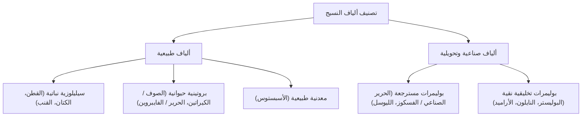
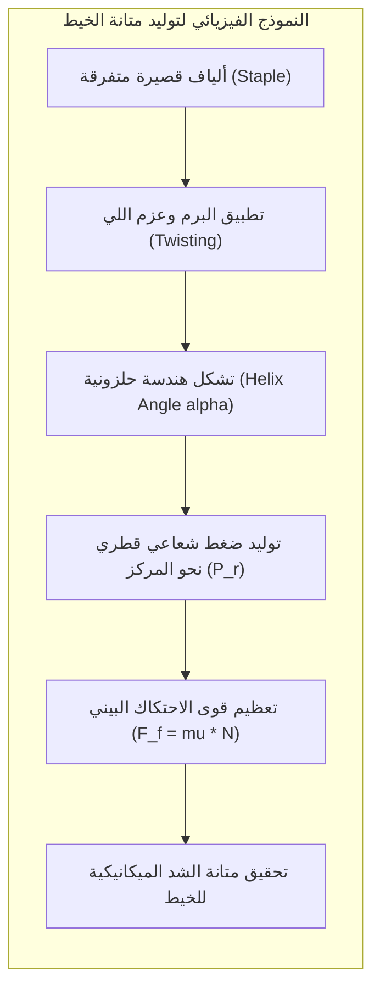
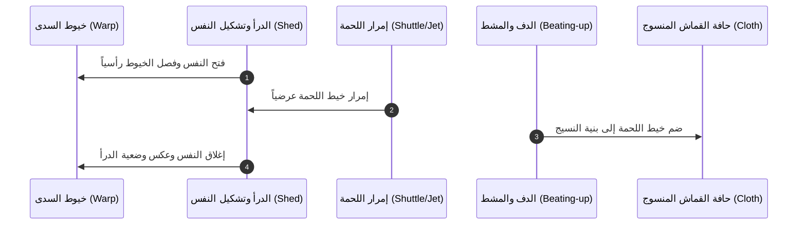
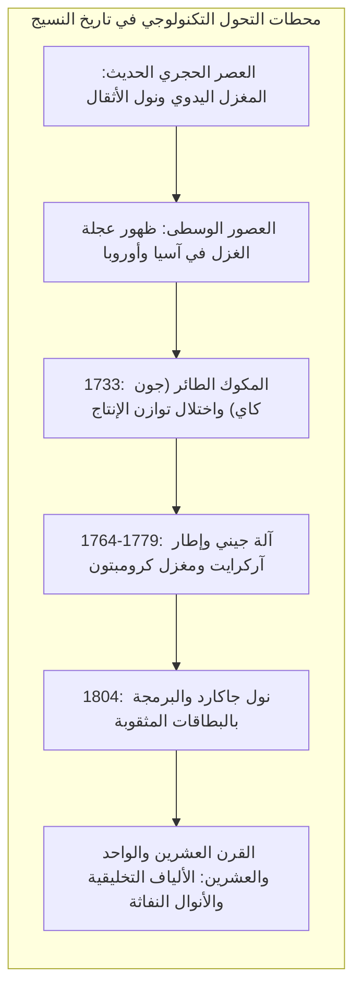

تُصنف الحقب التاريخية في العادة بالاستناد إلى المواد المعدنية الصلبة التي استُخدمت في صناعة الأسلحة والأدوات، مثل العصر الحجري والعصر البرونزي والعصر الحديدي. ومع ذلك، يؤكد علماء الآثار ومؤرخو التكنولوجيا المعاصرون أن هناك تكنولوجيا أخرى غير مرئية كانت العامل الحاسم في بقاء الإنسان وتمدده الجغرافي: تكنولوجيا الألياف والمنسوجات. فبدون الإبر العظمية الدقيقة والخيوط الملتوية التي وفرت الملبس العازل حرارياً، لم يكن لبني البشر أن يجتازوا صقيع العصر الجليدي الأخير أو يطوعوا البيئات الوعرة.

يقدم هذا البحث تفكيكاً علمياً عميقاً لهندسة البوليمرات الطبيعية والاصطناعية، والخصائص الميكانيكية للغزل وتماسك الخيوط، وديناميكا الأنوال، وصولاً إلى ولادة الحوسبة الثنائية من رحم نول جاكارد، ومستقبل المنسوجات الذكية في العصر الحديث.

---

## 1. البنية الجزيئية وهندسة البوليمرات للألياف النسيجية

النسيج هو بنية مرنة تتألف من شبكة متشابكة من الخيوط القوية، وتتكون هذه الخيوط بدورها من وحدات بنائية أولية تُعرف بالألياف (Fibers). لكي تكون المادة صالحة للغزل، يجب أن تتمتع بنسبة طول إلى قطر (Aspect Ratio) لا تقل عن 100:1، إلى جانب المتانة الميكانيكية والمرونة والانحناء دون انكسار.

### 1.1 الألياف السيليلوزية: القطن والكتان

يشكل السيليلوز الأساس الكيميائي للقطن والكتان، وهو بوليمر خطي عالي الوزن الجزيئي يتألف من مونومرات $\beta$-D-جلوكوز المرتبطة بروابط جليكوسيدية $\beta$-(1$\to$4):

$$(C_6H_{10}O_5)_n$$

تتراوح درجة البلمرة ($DP$) في ألياف القطن الخام بين 9,000 و15,000 جزيء جلوكوز. تصطف السلاسل الجزيئية للسيليلوز جنباً إلى جنب لتشكل أليافاً دقيقة (Microfibrils) متماسكة بروابط هيدروجينية بينية وداخلية شديدة الكثافة، مما يمنحها بلورية عالية تصل إلى 70% في القطن و85% في الكتان.

وتتميز ألياف القطن بخاصية ميكانيكية استثنائية: فعند نضج لوزة القطن وجفاف قنواتها المركزية (Lumen)، تلتف الشعيرة حول نفسها بحركات لولبية طبيعية تسمى "الالتواءات التلافيفية" (Convolutions). هذه التلافيف تزيد من مساحة التلامس والاحتكاك بين الشعيرات عند غزلها، مانعة إياها من الانزلاق الحر.

### 1.2 الألياف البروتينية: الصوف والحرير

تمتلك الألياف البروتينية خصائص ميكانيكية ومرنة تختلف جذرياً عن السيليلوز:

1. <strong>الصوف (الكيراتين)</strong>: يتكون الصوف من بروتين الكيراتين ذي البنية الحلزونية $\alpha$-helix، وتستقر هذه البنية بواسطة روابط كبريتية ثنائية تساهمية (-S-S- Cystine bonds). تغطي سطح شعيرة الصوف حراشف مجهرية متراكبة (Cuticle scales). وتمنح هذه الحراشف الصوف تأثيراً احتكاكياً توجيهياً (Directional Friction Effect)، وهو المسؤول الفيزيائي عن ظاهرة التلبيد (Felting) عند تعرض الصوف للحرارة والرطوبة والضغط الميكانيكي.
2. <strong>الحرير الطبيعي (الفايبروين)</strong>: يفرزه دود القز (*Bombyx mori*)، ويتألف من صفائح $\beta$ المتطوية المتوازية عكسياً (Anti-parallel $\beta$-pleated sheets) المكونة من متواليات حمضية أمينية دورية $(-Gly-Ser-Gly-Ala-Gly-Ala-)_n$. نظراً لغياب السلاسل الجانبية الضخمة، تتراصف الصفائح بكثافة شديدة مانحة الحرير قوة شد مذهلة تصل إلى 0.6 جيجاباسكال مع بريق بصري رائع ناتج عن المقطع العرضي المثلثي للشعيرة الذي يعمل كمنشور كاسر للضوء.

| نوع الليف | التركيب الجزيئي الأساسي | متانة الشد (cN/tex) | الاستطالة عند الانقطاع (%) | درجة البلورية (%) |
|---|---|---|---|---|
| <strong>القطن</strong> | سيليلوز خطي ($eta$-Glucan) | 25 - 40 | 6 - 9% | ~70% |
| <strong>الكتان</strong> | سيليلوز + هيميسيليلوز | 50 - 80 | 2 - 3% | ~85% |
| <strong>الصوف</strong> | كيراتين حلزوني ($lpha$-helix) | 12 - 18 | 25 - 40% | ~30% |
| <strong>الحرير</strong> | فايبروين صفائحي ($eta$-sheet) | 35 - 55 | 15 - 25% | ~60% |
| <strong>النايلون 6,6</strong> | بولي أميد | 45 - 75 | 15 - 30% | ~50% |
| <strong>الكيفلار (أراميد)</strong> | بولي بارا فينيلين تيريفثالاميد | 180 - 220 | 2.5 - 4% | >90% |

---

## 2. فيزياء الغزل وميكانيكا التماسك الاحتكاكي للخيوط

المعضلة الهندسية الأساسية في عملية الغزل هي: كيف نحول كتلة من الألياف القصيرة المنفصلة التي لا يتجاوز طول الواحدة منها بضعة سنتيمترات إلى خيط مستمر بطول مئات الأمتار قادر على تحمل قوى الشد الميكانيكية العالية دون أن ينفرط؟ الحل الفيزيائي يكمن في تطبيق عزم اللي والبرم (Twist).

### 2.1 نظرية الاحتكاك والضغط القطري المتولد عن البرم

عند تطبيق البرم على حزمة من الألياف، تتخذ الألياف مسارات لولبية حلزونية حول محور الخيط المركزي. واستناداً إلى نظرية ميكانيكا الخيوط، إذا تعرض الخيط لقوة شد محورية مقدارها $T$، فإن الألياف الخارجية ذات زاوية الميل الحلزونية $\alpha$ تُولد قوة ضغط قطري موجهة نحو المركز (Inward radial pressure):

$$P_r = \frac{T \cdot \sin^2 \alpha}{r}$$

هذا الضغط الشعاعي الداخلي يولد قوة احتكاك ضاغطة بين أسطح الألياف المتجاورة. وبموجب قانون أمونتون-كولوم للاحتكاك:

$$F_f = \mu N$$

حيث $\mu$ هو معامل الاحتكاك السطحي للألياف و $N$ هي القوة العمودية الناتجة عن الضغط القطري $P_r$. يؤدي تزايد الضغط القطري إلى رفع قوة الاحتكاك $F_f$ إلى مستويات تتجاوز قوى القص الانزلاقية، مما يمنع انزلاق الألياف فوق بعضها البعض ويجعل الخيط يتصرف ككيان ميكانيكي متماسك.

### 2.2 نقطة البرم المثلى ومحددات الشد

تخضع قوة الخيط لمقدار البرم المطبق بشكل غير خطي. فإذا كان البرم قليلاً، تنزلق الألياف عند أدنى شد وينقطع الخيط بسبب ضعف الاحتكاك الداخلي. ومع زيادة البرم، ترتفع المقاومة حتى تصل إلى ذروتها عند <strong>البرم الأمثل (Optimum Twist)</strong>.

ولكن عند تجاوز هذا الحد والإفراط في البرم (Over-twisting)، تصبح زاوية الحلزون $\alpha$ مائلة جداً بالنسبة لمحور الشد، مما يُقلل من المركبة المحورية الفعالة لمتانة الألياف ($\propto \cos^2 \alpha$) ويُجهد الألياف بإجهادات قص والتواء مسبقة تؤدي إلى هشاشة الخيط وضعفه.

---

## 3. حركيات وديناميكا الحياكة على النول

الحياكة (Weaving) هي عملية هندسية تهدف إلى تشكيل سطح قماشي مستوٍ ومتماسك عن طريق التعاشق المتعامد بين مجموعتين من الخيوط: خيوط السَّدى (Warp) الممتدة طولياً، وخيوط اللُّحمة (Weft) المتداخلة عرضياً.

### 3.1 الحركات الأساسية في دورة النول الميكانيكي

تتكرر في كل نول نسيج، بدءاً من الأنوال اليدوية القديمة حتى أنوال النفث الهوائي الحديثة، خمس حركات دورية منتظمة:

1. <strong>تشكيل النفس (Shedding)</strong>: تقسيم خيوط السدى رأسياً إلى طبقتين (عليا وسفلى) بواسطة درأ النول لتشكيل ممر مفتوح يُعرف بالنَّفَس.
2. <strong>إمرار اللحمة (Picking)</strong>: إطلاق خيط اللحمة عرضياً عبر النَّفَس المفتوح بواسطة المكوك أو القاذف أو نفاث الهواء.
3. <strong>ضم اللحمة (Beating-up)</strong>: دفع خيط اللحمة الجديد بقوة ودقة نحو حافة القماش المنسوج (Fell of the cloth) باستخدام دف النول ومشطه الفولاذي.
4. <strong>تغذية السدى (Let-off)</strong>: فك خيوط السدى بانتظام مع الحفاظ الصارم على توترها الميكانيكي المبرمج.
5. <strong>سحب القماش (Take-up)</strong>: سحب ولف القماش المنتج على أسطوانة القماش بمعدل ثابت يحدد كثافة خيوط اللحمة في كل سنتيمتر.

### 3.2 التراكيب النسجية الأساسية الثلاثة

تتحدد الخصائص الوظيفية والميكانيكية والمظهرية للمنسوجات من خلال النمط الهندسي لتعاشق السدى واللحمة:

1. <strong>النسيج السادة (Plain Weave / 1/1)</strong>: يمر كل خيط سدى بالتناوب فوق وتحت خيط لحمة واحد. يمتلك هذا التركيب أعلى كثافة من نقاط التعاشق، مما يمنحه متانة ميكانيكية وثباتاً شكلياً فائقاً، ولكنه أقل مرونة وأكثر قابلية للتجعد.
2. <strong>النسيج المبرد (Twill Weave / 2/1, 2/2, 3/1)</strong>: تمر الخيوط فوق خيطين أو أكثر قبل أن تنخفض، مع إزاحة النمط بمقدار خيط واحد في كل صف، مما يخلق خطوطاً مائلة مميزة (مثل أقمشة الجينز والدنيم). يتميز المبرد بمرونة عالية ومقاومة فائقة للتمزق.
3. <strong>النسيج الأطلسي / الساتان (Satin Weave)</strong>: تتباعد نقاط التعاشق إلى أقصى حد هندسي ممكن، مما يجعل الخيوط الطافية تغطي معظم السطح، منتجة قماشاً بالغ النعومة واللمعان وذا انسيابية عالية، ولكنه أكثر عرضة للتلف الاحتكاكي السطحي.

---

## 4. المسار التاريخي للنسيج: من ثورة الصوف إلى النول الرقمي

لم تكن صناعة النسيج مجرد نشاط حرفي ثانوي، بل كانت المحرك الحقيقي للتجارة العالمية، والقوة الدافعة خلف نشوء الرأسمالية الصناعية، وحجر الزاوية في اختراع الحواسيب الرقمية.

### 4.1 المكوك الطائر وثورة المغازل الآلية

في عام 1733، اخترع البريطاني <strong>جون كاي</strong> (John Kay) *المكوك الطائر* (Flying Shuttle)، وهو جهاز ميكانيكي يسمح للنسّاج الواحد بقذف المكوك عبر عروض قماش واسعة بسرعة فائقة دون الحاجة لمساعد. أدى هذا الاختراع إلى مضاعفة إنتاجية النسيج، لكنه تسبب في أزمة خانقة في إمدادات الخيوط؛ إذ بات النول الواحد يستهلك إنتاج 6 إلى 8 مغازل يدوية.

كانت هذه الأزمة الشرارة التي أشعلت الثورة الصناعية الأولى في بريطانيا عبر سلسلة من الابتكارات الميكانيكية الرائدة:
- <strong>مغزل جيني (Spinning Jenny, 1764)</strong> لجيمس هارجريفز، الذي مكن عاملاً واحداً من تدوير عشرات المغازل دفعة واحدة.
- <strong>الإطار المائي (Water Frame, 1769)</strong> لريتشارد آركرايت، الذي استخدم أسطوانات تدور بسرعات متدرجة لسحب الألياف بقوة الماء، مؤسساً بذلك نظام المصنع الحديث (*Factory System*).
- <strong>مغزل البغل (Spinning Mule, 1779)</strong> لصامويل كرومبتون، الذي دمج أفضل ما في الجهازين السابقين لإنتاج خيوط قطنية فائقة النعومة والمتانة.

### 4.2 نول جاكارد: ولادة المنطق الثنائي والبرمجة

في عام 1804، حقق الفرنسي <strong>جوزيف ماري جاكارد</strong> (Joseph Marie Jacquard) ثورة هندسية غير مسبوقة بتطوير نول يتم التحكم في حركته بواسطة سلسلة من البطاقات الورقية المثقوبة (*Punched Cards*).

كان وجود الثقب في البطاقة يسمح للخطاف الميكانيكي بالمرور ورفع خيط السدى (الحالة المنطقية 1)، بينما غياب الثقب يمنع الحركة (الحالة المنطقية 0). مكن هذا النظام الثنائي الصارم من نسج أكثر الرسوم المعقدة والتفاصيل الدقيقة بصورة آلية تماماً.

ألهم هذا المبدأ الثنائي الرائد عالم الرياضيات البريطاني <strong>تشارلز باباج</strong> (Charles Babbage) في تصميم "المحرك التحليلي" (Analytical Engine)، الذي يُعد النموذج النظري الأول للحاسوب، حيث صرحت آدا لوفليس الشهيرة: *"إن المحرك التحليلي ينسج الأنماط الجبرية تماماً كما ينسج نول جاكارد الزهور والأوراق"*.

---

## 5. آفاق القرن الحادي والعشرين: الألياف الذكية والاستدامة

في عصر المواد المتقدمة، تحولت هندسة المنسوجات من مجرد كساء للأبدان إلى ركيزة استراتيجية في صناعات الطيران والفضاء والطب الحيوي:

1. <strong>الألياف الإنشائية الفائقة</strong>: تمتلك ألياف الكربون وألياف البولي إيثيلين فائقة الوزن الجزيئي (UHMWPE) نسبة متانة إلى وزن تفوق الفولاذ البنائي بأكثر من 15 ضعفاً، مما يجعلها المادة الأساسية في هياكل طائرات دريملاينر والأقمار الصناعية والدروع العسكرية.
2. <strong>المنسوجات الإلكترونية الذكية</strong>: يتيح دمج الألياف الضوئية والأسلاك النانوية والبوليمرات الكهروإجهادية داخل الخيوط إنتاج ملابس قادرة على مراقبة العلامات الحيوية للمرضى، وتوليد الطاقة من حركة الجسم، والتكيف الحراري الذاتي.
3. <strong>الاستدامة والتدوير الكيميائي</strong>: تمثل مشكلة التلوث بالألياف البلاستيكية الدقيقة وتحديات الموضة السريعة حافزاً لتطوير تقنيات إعادة التدوير الإنزيمي للبوليمرات، واستخدام المذيبات الأيونية الخضراء لإنتاج ألياف سيليلوزية مغلقة الحلقة البيئية مثل الليوسل.

يقف علم النسيج اليوم شاهداً حياً على التلاحم الفريد بين أقدم مهارات اليد الإنسانية وأحدث فتوحات الكيمياء والفيزياء الرقمية المعاصرة.