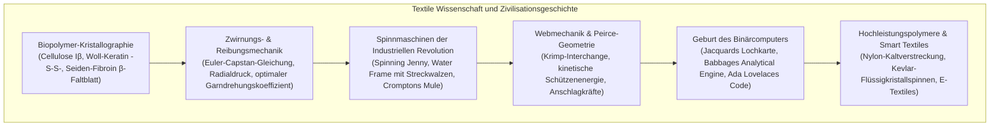

Die Erfindung des Spinnens und Webens markiert den Übergang des Frühmenschen zur Zivilisation. Die Textiltechnik war dabei stets ein Schrittmacher der angewandten Naturwissenschaften.

Die Nanokristallographie natürlicher Biopolymere, die Kontaktmechanik verzwirnter Stapelfasern und die binäre Kreuzungslogik von Kette und Schuss bildeten die physikalische Basis der Industriellen Revolution im England des 18. Jahrhunderts. Darüber hinaus begründete Joseph-Marie Jacquards Lochkartensteuerung von 1804 die Trennung von Hard- und Software, die über Charles Babbage und Ada Lovelace direkt zur modernen Computerarchitektur führte.

---

### 1. Biophysik natürlicher Faserpolymere

1. <strong>Pflanzen-Cellulose (Baumwolle, Flachs)</strong>:
   - Lineares $\beta\text{-(1}\to\text{4)-D-}$Glucan mit einem Polymerisationsgrad von 2.000 bis 15.000. Wasserstoffbrücken bilden dichte <strong>Cellulose I$\beta$-Monokristalle</strong>.
   - <strong>Anomaler Festigkeitsanstieg bei Nässe</strong>: Feuchtigkeit löst lokale Spannungsspitzen in amorphen Zonen auf, wodurch die Reißfestigkeit von Baumwolle im nassen Zustand um 10–20% steigt.
   - Bastfasern werden durch mikrobielles Riffeln (Retting) isoliert, wobei Pektinasen die interfibrilläre Kittsubstanz abbauen.
2. <strong>Woll-Keratin</strong>:
   - Die $\alpha$-Helix entwindet sich unter Zug reversibel zu gestreckten $\beta$-Faltblättern ($\alpha\text{-}\beta$-Phasenübergang).
   - Kovalente Disulfidbrücken ($-S-S-$) des Cystins garantieren hochelastische Rückstellung und Knitterfreiheit.
   - Bilaterale Rindenzellen (Ortho- und Paracortex) erzeugen eine dreidimensionale Locke (Crimp). Die Schuppenstruktur (Cuticula) bedingt den <strong>gerichteten Reibungseffekt (DFE)</strong> und das Verfilzen.
3. <strong>Seiden-Fibroin</strong>:
   - Hexapeptid-Wiederholungen $[-Gly-Ala-Gly-Ala-Gly-Ser-]_n$ lagern sich zu antiparallelen $\beta$-Faltblatt-Nanokristallen zusammen (60–70% Kristallinität) und erreichen die Zugfestigkeit von Klavierdraht.
   - Der dreieckige Faserquerschnitt bricht das Licht prismatisch und erzeugt den typischen Perlglanz.

---

### 2. Spinnmechanik: Euler-Capstan-Reibung und Industrielle Revolution

Wird ein Stapelfaserbündel verdrillt, üben die äußeren Fasern einen radialen Normaldruck $P_N$ auf das Faserinnere aus. Nach der <strong>Euler-Capstan-Reibungsgleichung</strong> sperrt die exponentiell anwachsende Reibung den Faserabzug ab, wodurch extreme Zugfestigkeit entsteht.

- <strong>Arkwrights Water Frame (1769)</strong>: Mehrstufige Walzenpaare mit Differenzialgeschwindigkeiten ($v_1 < v_2 < v_3$) streckten Fasern exakt und erzeugten zugfeste Kettgarne.
- <strong>Cromptons Spinning Mule (1779)</strong>: Die Kombination aus Walzenstreckwerk und fahrbarem Spindelwagen entkoppelte Verziehen und Zwirnen und ermöglichte feinste Luxusgarne im industriellen Großmaßstab.

---

### 3. Webtechnik und die binäre Lochkarte von Jacquard

F. T. Peirces Gewebegeometrie zeigte, dass die Nachgiebigkeit von Webwaren auf dem <strong>Krimp-Austausch</strong> zwischen Kette und Schuss beruht.

1804 erfand Joseph-Marie Jacquard ein System, bei dem gelochte Pappkarten einzelne Kettfäden steuerten:
- <strong>Loch (1)</strong>: Nadel tritt durch, Faden wird gehoben;
- <strong>Kein Loch (0)</strong>: Nadel wird blockiert, Faden bleibt unten;
- <strong>Charles Babbage</strong> adaptierte diese Lochkarten für seine <strong>Analytical Engine</strong>;
- <strong>Ada Lovelace</strong> verfasste den ersten Algorithmus der Welt und formulierte: *"Die Analytical Engine webt algebraische Muster, genau wie der Jacquard-Webstuhl Blumen und Blätter webt."*
- Dies führte über Holleriths Zensusmaschinen direkt zu IBM und den modernen Digitalrechnern.

---

### 4. Synthetische Superfasern

1. <strong>Nylon 6,6 (1935)</strong>: Kaltverstreckung oberhalb von $T_g$ richtet die Ketten parallel aus und maximiert die zwischenmolekularen Amid-Wasserstoffbrücken (Zugfestigkeit bis $1,0\text{ GPa}$).
2. <strong>Kevlar (Para-Aramid)</strong>: Starre Stäbchenpolymere (PPTA) bilden in Schwefelsäure lyotrope nematische Flüssigkristalle; Nassspinnen fixiert eine Ausrichtung von $>95\%$ (fünffache spezifische Festigkeit von Stahl).
3. <strong>UHMWPE (Dyneema)</strong>: Gelspinnen entknäuelter ultrahochmolekularer Ketten erzeugt vollkommen gestreckte Kohlenstoff-Zickzack-Moleküle mit einer Dichte von 0,97 g/cm³ (schwimmt auf Wasser) und 15-facher Stahlfestigkeit.
