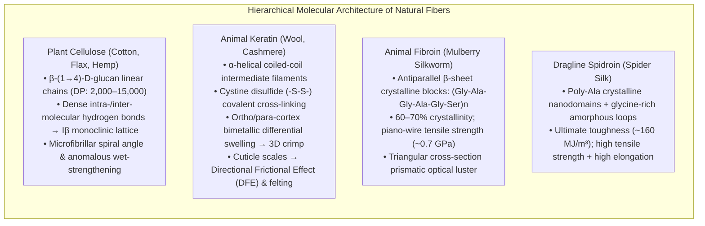
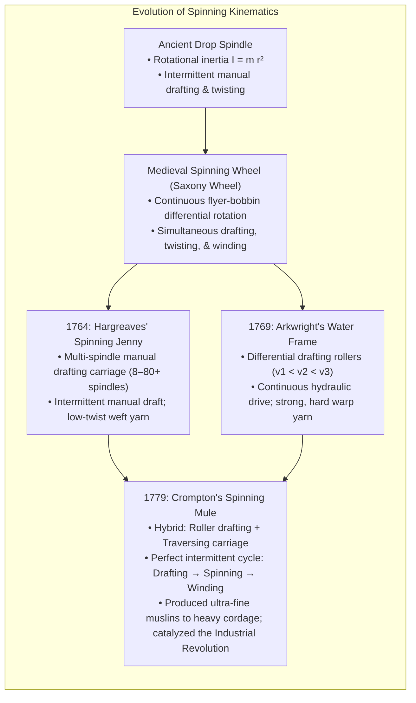
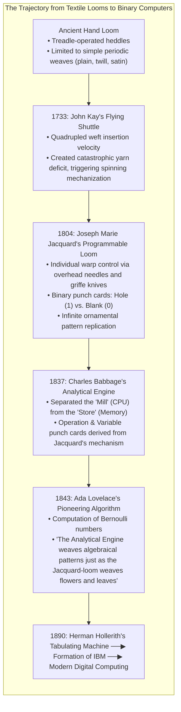
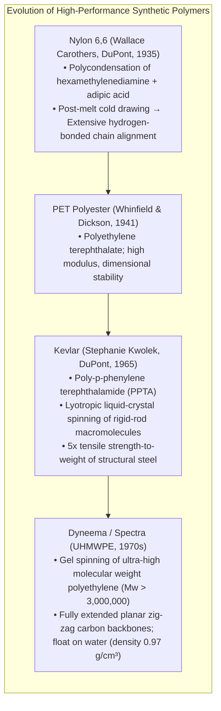

The act of weaving fibers into cloth is one of the earliest and most profound technological revolutions in human history. Yet the impact of textiles on the trajectory of civilization extends far beyond mere thermal insulation or adornment.

Textiles sit at the intersection of biopolymer crystallography, contact friction mechanics, kinematic machinery, and binary information theory. The mechanization of cotton spinning in 18th-century Britain triggered the thermodynamic and economic chain reaction known as the Industrial Revolution. Furthermore, the punched-card binary logic introduced by Joseph Marie Jacquard in 1804 to programmatically control individual warp threads served as the direct conceptual ancestor of Charles Babbage's Analytical Engine, Ada Lovelace's first computer program, Herman Hollerith's tabulating machines, and modern digital architecture.

This scientific treatise explores the complete continuum of fiber civilization: from the sub-nanometer crystal physics of natural polymers (cellulose, keratin, silk fibroin, and dragline spidroin) and the Euler-Capstan contact mechanics of spun yarn to the kinematic dynamics of the spinning mule, Peirce's cloth geometry, Perkin's synthetic dye revolution, liquid-crystalline aramid spinning, and the rise of conductive smart textiles.

---

### 1. Molecular Biophysics and Crystallography of Natural Fibers

Natural textile fibers are hierarchical biocomposites in which crystalline nanofibrils of extreme tensile stiffness are embedded within amorphous, viscoelastic polymeric matrices.

#### 1.1 Plant Cellulose Fibers: Glucan Chains and Supramolecular Lattices

Cotton (*Gossypium*) and bast fibers such as flax (*Linum usitatissimum*), hemp (*Cannabis sativa*), and jute (*Corchorus*) are constructed from cellulose, a linear syndiotactic homopolysaccharide composed of D-glucopyranose units linked by $\beta\text{-(1}\to\text{4)-}$glycosidic bonds:

$$\left( \text{C}_6\text{H}_{10}\text{O}_5 \right)_n \quad (n = \text{Degree of Polymerization DP}: 2,000 \sim 15,000)$$

1. <strong>Intra- and Inter-Molecular Hydrogen Bonding Networks</strong>:
   A strong intramolecular hydrogen bond bridges the $\text{C3-OH}$ hydroxyl group of one glucosyl ring to the $\text{O5}$ ring oxygen of the adjacent unit. This confers rigid, tape-like conformations upon individual glucan chains. Parallel-aligned chains assemble into sheet-like arrays stabilized by intermolecular $\text{O6-H}\cdots\text{O3}$ hydrogen bonds. These sheets stack via van der Waals interactions into native <strong>Cellulose I$\beta$ monoclinic crystals</strong> (space group $P2_1$, two parallel chains per unit cell).
2. <strong>Microfibrillar Spiral Angle and Helical Reversals</strong>:
   Bundles of ~36 cellulose chains consolidate into elementary fibrils ($3–5\text{ nm}$ diameter), which aggregate into microfibrils spiraling around the hollow lumen of the cotton fiber at an angle of $20–30^\circ$ relative to the fiber axis. Periodic structural inversions in the spiral direction—known as reversals—create structural relief zones. Upon drying, internal capillary tensions collapse the tubular lumen into a flattened ribbon characterized by irregular longitudinal convolutions, providing vital mechanical interlock during spinning.
3. <strong>The Anomalous Wet-Strengthening Phenomenon</strong>:
   While synthetic polyamides and wool suffer significant tensile degradation upon water absorption due to hydrogen-bond plasticization, cotton cellulose exhibits a <strong>10–20% increase in tensile strength when wet</strong>. Moisture plasticizes the amorphous interstitial zones, relieving localized internal stress concentrations and permitting a more uniform distribution of tensile loads across adjacent microfibrillar crystalline domains.
4. <strong>Biochemical Retting of Bast Fibers</strong>:
   In bast plants (flax, hemp), high-tenacity fiber bundles are embedded in the phloem matrix of the stem, glued together by middle lamellae rich in calcium pectate and hemicelluloses. Extracting intact fiber bundles requires biological <strong>retting</strong>: anaerobic water submersion where pectinolytic bacilli (*Clostridium felsineum*) selectively secrete endopolygalacturonases and pectin lyases. This enzymatic digestion solubilizes the pectinaceous cement without degrading the high-molecular-weight crystalline cellulose core.

#### 1.2 Wool Keratin: Coiled-Coils, Disulfide Chemistry, and Felting Mechanics

Wool is a specialized epidermal outgrowth composed of hard $\alpha$-keratin, a sulfur-rich fibrous protein:

1. <strong>The $\alpha$-Helix and Coiled-Coil Hierarchy</strong>:
   The polypeptide backbone forms a right-handed $\alpha$-helix stabilized by hydrogen bonds between the carbonyl oxygen ($\text{C}=\text{O}$) of residue $i$ and the amide hydrogen ($\text{N}-\text{H}$) of residue $i+4$ (pitch $0.54\text{ nm}$, 3.6 residues per turn). Pairs of $\alpha$-helices intertwine to form left-handed coiled-coil dimers, which assemble into protofilaments and intermediate filaments embedded in an amorphous, high-sulfur matrix. Under axial tensile strain, the hydrogen bonds of the $\alpha$-helix uncoil reversibly into extended $\beta$-sheets ($\alpha\text{-}\beta$ phase transition), allowing wool fibers to undergo reversible elastic deformations exceeding 30–50% strain.
2. <strong>Cystine Disulfide Cross-Linking ($-S-S-$)</strong>:
   Cystine residues account for 10–12% of wool's dry mass. Covalent disulfide bridges cross-link adjacent polypeptide chains, creating a three-dimensional elastomeric network that provides shape retention and wrinkle resistance.
3. <strong>Bimetallic Bilateral Cortex and 3D Crimp</strong>:
   The internal cortex of the wool fiber is divided into two distinct semicircular halves: the sulfur-rich paracortex and the lower-sulfur orthocortex. Because the orthocortex absorbs more moisture and swells to a greater extent than the paracortex, the fiber bends along its length like a bimetallic strip. This differential expansion generates a permanent three-dimensional helical crimp (typically 5–15 waves per cm), trapping vast volumes of stagnant air that endow wool with supreme thermal insulation.
4. <strong>Cuticle Scales and Directional Frictional Effect (DFE)</strong>:
   The fiber surface is sheathed in overlapping, scale-like cuticle cells pointing toward the tip. The coefficient of friction when sliding against the scale edges ($\mu_2$, against the grain) is substantially higher than in the root-to-tip direction ($\mu_1$, with the grain):
   $$\text{DFE} = \frac{\mu_2 - \mu_1}{\mu_1} > 0$$
   Under thermo-mechanical agitation in aqueous soap solutions, wool fibers migrate irreversibly in the direction of least resistance (root-first). The scale edges ratchet together like biological cable ties, permanently entangling fibers into dense, seamless <strong>felt</strong>.

#### 1.3 Silk Fibroin and Dragline Spidroin: Nature's High-Tenacity Nanocomposites

1. <strong>Mulberry Silk Fibroin</strong>:
   The domestic silkworm (*Bombyx mori*) extrudes twin fibroin monofilaments cemented by water-soluble sericin. The crystalline core consists of repetitively recurring hexapeptide sequences: $[-Gly-Ala-Gly-Ala-Gly-Ser-]_n$. The alternating hydrogen atoms of glycine residues face one side of the $\beta$-strand while the methyl groups of alanine and hydroxyl groups of serine face the opposite side. This allows antiparallel $\beta$-sheets to interdigitate with sub-nanometer precision, achieving a packing density and tensile strength (~0.7 GPa) rivaling structural carbon steels.
2. <strong>Spider Dragline Silk (Major Ampullate Spidroin)</strong>:
   The dragline silk of orb-weaving spiders combines poly-alanine $\beta$-sheet nanocrystals (responsible for extreme elastic modulus) dispersed inside a compliant, glycine-rich amorphous network containing $Gly-Gly-X$ and $Gly-Pro-Gly-X-X$ motifs. When strained, the amorphous matrix unfurls, providing massive plastic elongation before load transfers to the nanocrystals. The result is an energy absorption capacity (<strong>toughness</strong>) of $\sim 160\text{ MJ/m}^3$, exceeding Kevlar ($~50\text{ MJ/m}^3$) by a factor of three.

---

### 2. Mechanics of Spinning: From the Drop Spindle to the Industrial Revolution

Individual staple fibers (cotton: 20–35 mm; wool: 50–100 mm) possess zero structural coherence when placed end-to-end. <strong>Spinning</strong> is the mechanical process that drafts loose fibers into an attenuated strand and inserts axial twist, converting shear friction into enormous longitudinal tensile strength.

#### 2.1 The Contact Mechanics of Yarn Twist: Capstan Friction
When an axial tensile load $T$ is applied to a twisted staple yarn, why do the short fibers not simply slip past one another?

Consider an idealized yarn of circular cross-section and radius $R$, twisted with $N$ turns per meter. An outer fiber helically wraps around the inner core at a surface helix angle $\alpha$:

$$\tan \alpha = 2 \pi R N$$

Under an applied axial tension $T$, the longitudinal tension component within the helical outer fiber resolves into an inward radial compressive pressure $P_N$ directed toward the core axis:

$$P_N \propto \frac{T \sin^2 \alpha}{R}$$

This inward radial pressure compresses the core fibers against each other. According to the <strong>Euler-Capstan law of friction</strong>, the maximum frictional shear resistance $F_{\text{fric}}$ resisting inter-fiber slippage increases exponentially with the wrap angle and normal force:

$$F_{\text{fric}} = \mu P_N A_{\text{contact}}$$

As yarn tension $T$ increases, the radial normal pressure $P_N$ automatically intensifies, dynamically locking the fibers together.
However, if the twist angle $\alpha$ becomes excessively steep, the axial contribution of each fiber's intrinsic tensile strength diminishes according to $\cos \alpha$. Consequently, yarn strength exhibits a sharp parabolic peak at the <strong>optimum twist factor</strong>:

$$\text{Twist Factor (TF)} = \text{Turns per inch} \times \sqrt{\text{Yarn Count}}$$

#### 2.2 The Kinematic Trifecta of the Industrial Revolution

In late 18th-century Lancashire, spinning advanced from manual handicraft into the engine of modern factory capitalism:

1. <strong>James Hargreaves' Spinning Jenny (1764)</strong>:
   A single operator drove a hand crank that rotated a central drive wheel, turning 8 (later up to 80) vertical spindles via cords. A sliding wooden carriage clamped a row of loose rovings, moving backward to draw and draft them, then pausing while the spindles inserted twist. Because drafting lacked positive mechanical grip, the resulting yarn was soft and irregular, usable only as weft (crosswise thread).
2. <strong>Richard Arkwright's Water Frame (1769)</strong>:
   Arkwright replaced human hands with pairs of iron and leather <strong>drafting rollers rotating at differential peripheral velocities</strong> ($v_1 < v_2 < v_3$). As the roving passed through successive roller nips, fibers were drawn out continuously at exact draft ratios ($D = v_3 / v_1$). Driven by a water wheel, the machine produced dense, tightly twisted, uniform yarn strong enough to serve as warp (lengthwise thread), eliminating Europe's historic dependency on linen warps for fustian cloth.
3. <strong>Samuel Crompton's Spinning Mule (1779)</strong>:
   Crompton synthesized the drafting rollers of Arkwright with the moving carriage of Hargreaves:
   - <strong>Phase 1 (Drawing & Preliminary Twist)</strong>: Rollers feed roving forward while the carriage moves backward at a slightly faster speed, imparting uniform drawing and gentle twist.
   - <strong>Phase 2 (Twisting at the Head)</strong>: Rollers stop; the carriage pauses near its outward limit, and spindles spin at peak velocity (up to 10,000 RPM) to insert final structural twist without roller friction.
   - <strong>Phase 3 (Winding In)</strong>: As the carriage rolls back toward the rollers, a faller wire guides the newly spun yarn neatly onto rotating bobbins.
   By decoupling drafting from high-speed twisting, the mule eliminated tensile breakages, allowing the production of extraordinarily fine counts (over 200s Ne, yielding diaphanous muslins) alongside heavy industrial yarns. The mule established the blueprint of the automated steam-powered factory.

---

### 3. Weaving Engineering and the Dawn of Digital Computing: The Jacquard Loom

Weaving is the orthogonal interlacing of two distinct sets of threads: <strong>warp</strong> (longitudinal yarns under high constant tension) and <strong>weft</strong> (transverse yarns inserted through the separated warp shed).

#### 3.1 Peirce's Cloth Geometry and Biaxial Mechanics
In 1937, F. T. Peirce formulated the foundational geometric model of plain-woven fabric, modeling yarns as flexible cylinders of diameter $d_1$ (warp) and $d_2$ (weft) interlacing orthogonally:

$$p_1 = (l_1 - D \theta_1) \cos \theta_1 + D \sin \theta_1$$
$$h_1 + h_2 = D = d_1 + d_2$$
$$c_1 = \frac{l_1 - p_1}{p_1}$$

Where:
- $p_1, p_2$ are yarn spacings (inversely proportional to thread count),
- $l_1, l_2$ are yarn lengths per repeat unit,
- $h_1, h_2$ are crimp heights (wave amplitudes),
- $\theta_1, \theta_2$ are yarn inclination angles,
- $c_1, c_2$ are crimp ratios.

When tensile load is applied along the warp direction, the fabric does not initially deform through tensile stretching of the fibers. Instead, it deforms through <strong>crimp interchange</strong>: the warp yarn straightens, forcing the intersecting weft yarn to increase its out-of-plane crimp height ($h_2 \uparrow$). This non-linear geometric compliance gives woven fabrics their unique drape, flexibility, and recovery.

#### 3.2 Power Loom Dynamics and Beating-Up Kinematics
Mechanizing the loom required synchronizing three primary motions:
1. <strong>Shedding</strong>: Dividing warp threads into upper and lower sheets.
2. <strong>Picking</strong>: Projecting the shuttle ($m \approx 0.4\text{ kg}$) across the shed at velocities $v = 12–18\text{ m/s}$ in a fraction of a second ($E_k = \frac{1}{2}mv^2 \approx 30–60\text{ J}$ per pick).
3. <strong>Beating-up</strong>: A heavy swinging reed drives the newly inserted weft pick tightly into the cloth fell, generating severe cyclic tension spikes in the warp yarns.

#### 3.3 The Jacquard Loom: Hardware-Software Decoupling via Binary Logic

Invented in Lyon by Joseph Marie Jacquard (1804), the Jacquard mechanism eliminated the physical limit of manual draw looms:

1. <strong>Binary Physical Architecture</strong>:
   Overhead harness cords connect to vertical hooks. Horizontal needles press against an advancing perforated cardboard plate:
   - <strong>Hole Present (Binary 1 / Open)</strong>: The needle passes through the card; the hook remains positioned over a rising knife beam (griffe). The griffe ascends, lifting that exact warp thread into the upper shed.
   - <strong>Hole Absent (Binary 0 / Closed)</strong>: The solid cardboard pushes the needle back; the hook slips off the knife edge. That warp thread stays in the lower shed.
2. <strong>Storage and Programmability</strong>:
   Strings of linked punch cards rotated synchronously with the loom's cycle, feeding line-by-line program instructions into the mechanical logic unit. A complex silk damask or woven portrait requiring thousands of thread permutations could be reproduced flawlessly by an untrained worker simply by feeding the corresponding deck of cards.

#### 3.4 Babbage, Lovelace, and the Genealogy of the Computer
The British mathematician Charles Babbage studied Jacquard's mechanism and realized that punch cards could store mathematical operations and variable numbers rather than merely thread heights:

> *"We may say most aptly that the Analytical Engine weaves algebraical patterns just as the Jacquard-loom weaves flowers and leaves."*
> — Augusta Ada King, Countess of Lovelace (1843)

In her foundational notes, Lovelace wrote the first machine algorithm—a step-by-step table of instructions for calculating Bernoulli numbers—and conceptualized the machine's ability to manipulate symbolic entities beyond mere arithmetic. Herman Hollerith adapted Jacquard's punch-card encoding for the 1890 US Census, founding the company that evolved into IBM. The modern digital computer is the intellectual offspring of the silk-weaving loom.

---

### 4. Synthetic Dye Chemistry and the Birth of Organic Industrial Chemistry

Before the mid-19th century, textile coloration was restricted to labor-intensive natural extracts:
- <strong>Indigo</strong>: Insoluble blue indigotin reduced anaerobically in fermentation vats into soluble leuco-indigo, then oxidized by ambient air after fiber penetration to precipitate insoluble dye nanocrystals inside the cellulose pores.
- <strong>Tyrian Purple</strong>: 6,6'-dibromoindigo harvested from Mediterranean predatory sea snails (*Bolinus brandaris*).
- <strong>Madder (Alizarin)</strong>: Metal-complex mordant dye forming aluminum-calcium chelates on fiber surfaces.

In 1856, 18-year-old William Henry Perkin, attempting to synthesize the antimalarial drug quinine from coal tar aniline, accidentally oxidized aniline with potassium dichromate, producing a brilliant purple precipitate: <strong>mauveine</strong>.
Perkin commercialized mauveine, igniting the modern synthetic organic chemical industry. Within decades, industrial syntheses of alizarin (1869) and synthetic indigo (1897 by BASF) caused the collapse of agricultural dye economies and established the massive global chemical conglomerates of the 20th century.

---

### 5. Polymer Chemistry and the Rise of High-Performance Synthetic Fibers

#### 5.1 Wallace Carothers and Nylon 6,6: Cold Drawing Physics
In 1935, DuPont chemist Wallace Carothers synthesized Nylon 6,6 via the step-growth melt polycondensation of hexamethylenediamine and adipic acid:

$$n\,\text{H}_2\text{N-(CH}_2\text{)}_6\text{-NH}_2 + n\,\text{HOOC-(CH}_2\text{)}_4\text{-COOH} \longrightarrow \left[ -\text{NH-(CH}_2\text{)}_6\text{-NH-CO-(CH}_2\text{)}_4\text{-CO-} \right]_n + (2n-1)\,\text{H}_2\text{O}$$

As-spun nylon filaments are weak, consisting of randomly oriented lamellar spherulites. However, when drawn past their yield point at temperatures above the glass transition ($T_g \approx 50^\circ\text{C}$)—a process known as <strong>cold drawing</strong>—the lamellae unravel. The polymer chains orient parallel to the drawing axis, and neighboring amide groups form periodic, dense networks of inter-chain hydrogen bonds ($\text{N}-\text{H}\cdots\text{O}=\text{C}$). This raises filament tensile strength from ~0.2 GPa to ~1.0 GPa.

#### 5.2 Kevlar (Para-Aramid): Lyotropic Liquid-Crystal Spinning
In 1965, Stephanie Kwolek developed poly-p-phenylene terephthalamide (PPTA, Kevlar). Because its backbone is composed entirely of rigid 1,4-phenylene rings alternating with planar trans-amide bonds, the macromolecule cannot flex or fold into random coils; it behaves as an uncompromising <strong>rigid rod</strong>.

Dissolved in 100% concentrated sulfuric acid ($\text{H}_2\text{SO}_4$) above a critical concentration, PPTA spontaneously organizes into a <strong>lyotropic nematic liquid crystal phase</strong>. As the liquid crystalline solution is extruded through spinneret micro-orifices, elongational shear forces align the rigid-rod nematic domains into near-perfect parallel orientation ($>95\%$ alignment). Immediate precipitation in an aqueous coagulation bath locks this hyper-aligned structure into solid fibers. With an axial elastic modulus of $130–180\text{ GPa}$ and tensile strength of $3.6\text{ GPa}$, Kevlar redefined lightweight ballistic armor and aerospace composites.

#### 5.3 Ultra-High Molecular Weight Polyethylene (UHMWPE)
Produced via gel-spinning, UHMWPE (Dyneema, Spectra) utilizes polyethylene chains with molecular weights of $3\times 10^6$ to $6\times 10^6\text{ g/mol}$. Dissolved in hot decalin to untangle the chains, the gel is spun and drawn by ratios of $30\times$ to $50\times$. The result is a continuous filament of virtually fully extended planar zig-zag carbon-carbon backbones. With a specific density of only $0.97\text{ g/cm}^3$ (it floats on water), it displays a specific strength 15 times greater than high-grade steel.

---

### 6. Modern Textile Science: Nanofibers and Electronic Smart Fabrics

Textiles are no longer passive planar materials; they are active, functional matrices interfacing with data, biology, and the environment:

1. <strong>Electrospinning and Nanofibrous Scaffolds</strong>:
   Applying electric fields ($10–30\text{ kV}$) to a polymer droplet forms a Taylor cone, ejecting an electrostatically charged fluid jet that undergoes rapid whipping instabilities and solvent evaporation. This yields non-woven webs composed of fibers with diameters of $50–300\text{ nm}$. These membranes provide extreme specific surface area ($>100\text{ m}^2/\text{g}$) and controlled porosity for aerosol sub-micron viral filtration and tissue-engineering cellular scaffolds.
2. <strong>Conductive E-Textiles and Triboelectric Nanogenerators (TENGs)</strong>:
   By integrating carbon nanotubes, graphene, or silver nanowires into synthetic polymer matrices or using core-spun conductive yarns, fabrics can serve as flexible transmission lines, electromagnetic shielding, capacitive touchpads, and physiological telemetry sensors. Furthermore, leveraging contact-electrification and electrostatic induction between mismatched dielectric textile surfaces (e.g., nylon woven against PTFE), human biomechanical locomotion can be harvested to power wearable electronic nodes.

---

### 7. Conclusion: The Loom of Human Civilization

From prehistoric flax strings to nanoscale electronic fabrics, the story of textiles is the story of human technological emergence:

1. <strong>Biopolymer Physics</strong>: Nature's masterclasses in cellulose hydrogen bonding, wool coiled-coil elasticity, and silk $\beta$-sheet crystallography established the initial engineering limits of flexible materials.
2. <strong>Kinematic Machinery</strong>: The capstan twist friction of spun yarn paved the way for the Industrial Revolution's mechanical masterworks—the water frame and spinning mule.
3. <strong>Information Architecture</strong>: The Jacquard loom's binary punch cards divorced software logic from physical hardware, directly inspiring Babbage, Lovelace, and the digital computing era.
4. <strong>Molecular Synthesis</strong>: Modern organic chemistry evolved from aniline dyes into lyotropic liquid-crystal spinning, producing materials that shatter theoretical limits of tensile tenacity.

The threads of fiber science remain interwoven with the fabric of civilization, continuing to bridge the physical, industrial, and digital worlds.
