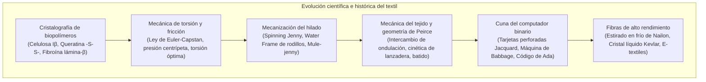

El acto de entrelazar fibras para confeccionar vestimentas representa una de las revoluciones técnicas más antiguas y determinantes de la humanidad. Sin embargo, la ciencia textil ha transformado el curso de la civilización mucho más allá del abrigo físico.

La nanocristalografía de biopolímeros, la mecánica de contacto por torsión de fibras cortas y la lógica geométrica binaria del cruzamiento entre urdimbre y trama sentaron las bases físicas de la Revolución Industrial en la Inglaterra del siglo XVIII. Además, el telar de tarjetas perforadas patentado por Joseph Marie Jacquard en 1804 consagró la primera separación real entre software y hardware, inspirando la Máquina Analítica de Charles Babbage y el primer programa de Ada Lovelace.

---

### 1. Biofísica Molecular de Polímeros Naturales

1. <strong>Celulosa Vegetal (Algodón, Lino)</strong>:
   - Polímero lineal de $\beta\text{-(1}\to\text{4)-D-}$glucopiranosa (DP: 2.000 a 15.000). Los enlaces de hidrógeno intra e intermoleculares forman <strong>nanocristales densos de celulosa I$\beta$ monoclínica</strong>.
   - <strong>Efecto anómalo de resistencia en húmedo</strong>: El agua alivia las tensiones locales en las zonas amorfas, incrementando la resistencia a la tracción del algodón entre un 10% y un 20% al mojarse.
   - El enriado biológico (retting) utiliza pectinasas bacterianas para disolver la lámina media y liberar los haces de fibras de lino.
2. <strong>Queratina de la Lana</strong>:
   - Cadena polipeptídica en hélice $\alpha$ enrollada en superhélices. Bajo carga, se desenrolla reversiblemente hacia láminas $\beta$.
   - Los puentes disulfuro de cistina ($-S-S-$) brindan resiliencia elástica y resistencia al arrugamiento.
   - La asimetría entre ortocorteza y paracorteza genera un rizado tridimensional permanente (crimp), mientras que las escamas de la cutícula inducen el <strong>efecto de fricción direccional (DFE)</strong> que hace posible el enfieltrado.
3. <strong>Fibroína de la Seda</strong>:
   - Secuencias repetitivas $[-Gly-Ala-Gly-Ala-Gly-Ser-]_n$ apiladas en láminas $\beta$ antiparalelas (60–70% cristalinidad), con resistencia comparable a cuerdas de piano y brillo prismático triangular.

---

### 2. Mecánica del Hilado y Ley de Euler-Capstan

Al torcer un haz de fibras grapa, las fibras exteriores generan una compresión radial centrípeta $P_N$ hacia el núcleo:

$$P_N \propto \frac{T \sin^2 \alpha}{R}$$

Según la <strong>ley de fricción de Euler-Capstan</strong>, la resistencia al deslizamiento crece exponencialmente con la tensión normal:

$$F_{\text{fric}} = \mu P_N A_{\text{contact}}$$

- <strong>Water Frame de Arkwright (1769)</strong>: Rodillos girando a velocidades diferenciales ($v_1 < v_2 < v_3$) para hilar urdimbre de gran tenacidad.
- <strong>Mule-Jenny de Crompton (1779)</strong>: Hibridación de rodillos y carro móvil con husos, permitiendo hilar calibres ultrafinos a escala masiva.

---

### 3. Tejido, Geometría de Peirce y el Telar de Jacquard

La geometría de Peirce demuestra que la elasticidad del tejido plano reside en el <strong>intercambio de ondulación (crimp interchange)</strong> entre urdimbre y trama.

En 1804, Joseph Marie Jacquard diseñó un sistema de tarjetas perforadas:
- <strong>Agujero (1)</strong>: La aguja avanza y eleva el hilo de urdimbre;
- <strong>Sin agujero (0)</strong>: La aguja es bloqueada y el hilo permanece abajo;
- <strong>Charles Babbage</strong> aplicó estas tarjetas para programar su <strong>Máquina Analítica</strong>;
- <strong>Ada Lovelace</strong> formuló el primer algoritmo informático, sentenciando: *«La Máquina Analítica teje patrones algebraicos del mismo modo que el telar de Jacquard teje flores y hojas»*.

---

### 4. Química de Tintes y Fibras Sintéticas

1. <strong>Mauveína (1856)</strong>: William Perkin descubrió el primer colorante sintético al oxidar anilina, fundando la industria química moderna (BASF, Bayer).
2. <strong>Nailon 6,6 (1935)</strong>: Policondensación desarrollada por Carothers. El <strong>estirado en frío</strong> alinea las cadenas y multiplica la tenacidad mediante puentes de hidrógeno amida.
3. <strong>Kevlar (Aramida)</strong>: Polímero rígido (PPTA) que genera cristales líquidos nemáticos en ácido sulfúrico; hilado orientado al $>95\%$ con cinco veces la resistencia específica del acero.
4. <strong>UHMWPE (Dyneema)</strong>: Hilado en gel de polietileno de peso molecular ultra alto con cadenas totalmente extendidas; flota en agua y supera en 15 veces la resistencia del acero.
