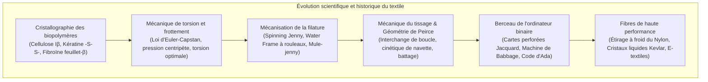

L'acte de tisser des fibres pour s'en vêtir constitue l'une des révolutions technologiques les plus anciennes et les plus profondes de l'humanité. Cependant, l'impact des textiles dépasse largement la simple protection thermique.

La nanocristallographie des biopolymères, la mécanique de contact et de torsion des fibres courtes, ainsi que la logique binaire d'entrecroisement de la chaîne et de la trame ont forgé les bases physiques de la Révolution industrielle dans l'Angleterre du XVIIIe siècle. De surcroît, le système de cartes perforées inventé par Joseph-Marie Jacquard en 1804 pour piloter individuellement les fils de chaîne représente le précurseur direct de la machine analytique de Charles Babbage, du premier algorithme d'Ada Lovelace et de l'architecture informatique moderne.

---

### 1. Biophysique Moléculaire des Polymères Naturels

1. <strong>Cellulose Végétale (Coton, Lin)</strong> :
   - Homopolysaccharide linéaire de $\beta\text{-(1}\to\text{4)-D-}$glucopyranose (DP : 2 000 à 15 000). Les liaisons hydrogène intra- et intermoléculaires forment des nanocristaux denses de <strong>cellulose I$\beta$ monoclinique</strong>.
   - <strong>Augmentation anormale de résistance à l'état humide</strong> : L'eau dissipe les concentrations de contraintes locales dans les zones amorphes, ce qui accroît la résistance à la traction du coton de 10 à 20% lorsqu'il est mouillé.
   - Les fibres libériennes (lin, chanvre) sont extraites par <strong>rouissage (retting)</strong>, processus microbien où les pectinases d'*Clostridium* hydrolysent le ciment pectique.
2. <strong>Kératine de la Laine</strong> :
   - Protéine structurée en hélice $\alpha$ s'enroulant en super-hélices (coiled-coils). Sous tension, elle se déplie de manière réversible en feuillets $\beta$ avec récupération élastique spontanée.
   - Ponts disulfures covalents de cystine ($-S-S-$) conférant résilience et infroissabilité.
   - Le cortex asymétrique (ortho- et para-cortex) crée une frisure tridimensionnelle permanente (crimp), et les écailles cuticulaires engendrent l'<strong>effet de friction directionnelle (DFE)</strong> à l'origine du feutrage.
3. <strong>Fibroïne de Soie</strong> :
   - Motifs répétés $[-Gly-Ala-Gly-Ala-Gly-Ser-]_n$ empilés en feuillets $\beta$ antiparallèles (cristallinité 60–70%), affichant une résistance comparable à la corde à piano. Sa section triangulaire agit comme un prisme optique naturel.

---

### 2. Mécanique de Filature et Loi d'Euler-Capstan

Lorsqu'un faisceau de fibres discontinues est tordu (torsion $N$ tours/m), les fibres périphériques s'enroulent en hélice et exercent une pression centripète normale $P_N$ vers le cœur :

$$P_N \propto \frac{T \sin^2 \alpha}{R}$$

Selon la <strong>loi de frottement d'Euler-Capstan</strong>, la résistance au glissement croît exponentiellement :

$$F_{\text{fric}} = \mu P_N A_{\text{contact}}$$

Plus la tension $T$ augmente, plus le serrage radial se renforce, verrouillant les fibres entre elles.

- <strong>Water Frame d'Arkwright (1769)</strong> : Rouleaux étireurs différentiels ($v_1 < v_2 < v_3$) assurant un étirage continu pour des fils de chaîne résistants.
- <strong>Mule-Jenny de Crompton (1779)</strong> : Association de l'étirage par rouleaux et du chariot mobile, dissociant étirage et torsion pour produire des filés d'une finesse sans précédent.

---

### 3. Tissage, Géométrie de Peirce et Métier Jacquard

Le modèle de Peirce décrit l'<strong>interchange de boucle (crimp interchange)</strong> : sous traction, le redressement des fils de chaîne amplifie l'ondulation des fils de trame, conférant au tissu sa souplesse.

En 1804, Joseph-Marie Jacquard mit au point un système de cartes en carton perforé :
- <strong>Trou (1)</strong> : L'aiguille passe, le crochet soulève le fil de chaîne ;
- <strong>Plein (0)</strong> : L'aiguille bute, le fil reste abaissé ;
- <strong>Charles Babbage</strong> s'inspira de ce mécanisme pour sa <strong>Machine Analytique</strong> ;
- <strong>Ada Lovelace</strong> rédigea le premier algorithme informatique pour le calcul des nombres de Bernoulli, proclamant : *« La Machine Analytique tisse des motifs algébriques tout comme le métier Jacquard tisse des fleurs et des feuilles. »*

---

### 4. Chimie des Colorants et Fibres Synthétiques

1. <strong>Révolution de la Mauvéine (1856)</strong> : William Perkin découvrit accidentellement le premier colorant synthétique à partir du goudron de houille, fondant l'industrie de la chimie organique fine (BASF, Bayer).
2. <strong>Nylon 6,6 (1935)</strong> : Polycondensation par Wallace Carothers. L'<strong>étirage à froid</strong> oriente les chaînes et forme un réseau de liaisons hydrogène amide dense ($1,0\text{ GPa}$).
3. <strong>Kevlar (Aramide)</strong> : Polymère rigide en bâtonnet (PPTA) formant des cristaux liquides nématiques dans l'acide sulfurique ; filage orienté à $>95\%$ (résistance spécifique cinq fois supérieure à l'acier).
4. <strong>UHMWPE (Dyneema)</strong> : Filage sur gel de polyéthylène ultra-long, chaînes entièrement déployées flottant sur l'eau (densité 0,97) et 15 fois plus résistantes que l'acier.
