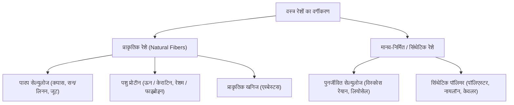
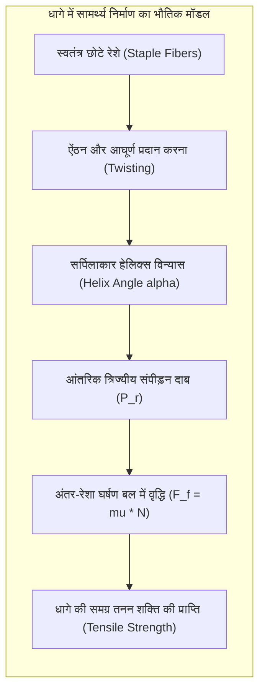
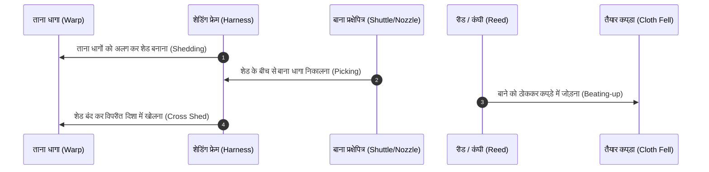
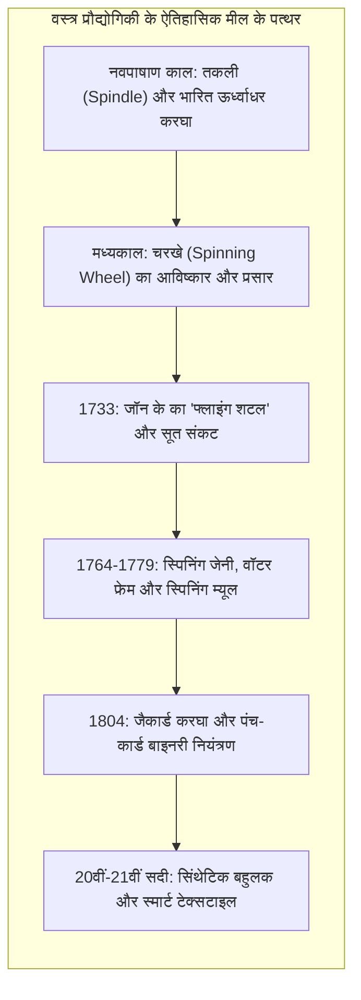

मानव इतिहास के प्रमुख युगों को पारंपरिक रूप से धातुओं और हथियारों के आधार पर पाषाण युग, कांस्य युग और लौह युग में विभाजित किया जाता है। किंतु आधुनिक नृविज्ञानियों और प्रौद्योगिकी इतिहासकारों का मानना है कि मानव प्रजाति के अस्तित्व, शीतकाल में जीवित रहने और महाद्वीपीय विस्तार के मूल में एक अत्यंत कोमल परंतु शक्तिशाली तकनीक थी: रेशा और वस्त्र निर्माण तकनीक। ऊपरी पुरापाषाण काल की हड्डी की सुइयों से लेकर औद्योगिक क्रांति के भाप-चालित करघों और आधुनिक कार्बन-फाइबर कंपोजिट तक, वस्त्र विज्ञान ने मानव समाज की नींव को गढ़ा है।

यह लेख वस्त्र रेशों की बहुलक संरचना, कताई में घर्षण और ट्विस्ट के भौतिक सिद्धांतों, बुनाई के किनेमैटिक्स तथा वैश्विक अर्थव्यवस्था पर वस्त्र उद्योग के युगांतरकारी प्रभावों का एक व्यापक और प्रामाणिक वैज्ञानिक विश्लेषण प्रस्तुत करता है।

---

## 1. वस्त्र रेशों की बहुलक संरचना और सामग्री विज्ञान

वस्त्र एक लचीली द्वि-आयामी संरचना है जो धागों (Yarns) के परस्पर जुड़ाव से बनती है, और धागे सूक्ष्म रेशों (Fibers) से निर्मित होते हैं। किसी भी रेशे को सफलतापूर्वक धागे में बदलने के लिए उसकी लंबाई और व्यास का अनुपात (Aspect Ratio) कम से कम 100:1 होना अनिवार्य है। इसके अतिरिक्त, रेशे में पर्याप्त तनन सामर्थ्य (Tensile Strength), लचीलापन और तापीय स्थिरता होनी चाहिए।

### 1.1 सेल्युलोसिक रेशे: कपास और लिनन

कपास (*Gossypium*) और लिनन (*Linum usitatissimum*) का मुख्य रासायनिक घटक सेल्युलोज है। सेल्युलोज एक रैखिक प्राकृतिक बहुलक है जो $\beta$-(1$\to$4) ग्लाइकोसिडिक बंधों द्वारा जुड़े $\beta$-D-ग्लूकोज मोनोमर्स से बनता है:

$$(C_6H_{10}O_5)_n$$

कच्चे कपास में बहुलकीकरण की डिग्री ($DP$) 9,000 से 15,000 तक होती है। सेल्युलोज श्रृंखलाओं के बीच घने हाइड्रोक्सिल ($-OH$) समूहों के कारण अत्यधिक मजबूत अंतर-आणविक और अंतरा-आणविक हाइड्रोजन बंध बनते हैं। इसके परिणामस्वरूप कपास में लगभग 70% और लिनन में 85% तक क्रिस्टलीय संरचना (Crystallinity) पाई जाती है।

कपास के रेशे की एक अनूठी भौतिक विशेषता उसका प्राकृतिक घुमाव (Convolutions) है। जब कपास का डोडा पककर सूखता है, तो उसके भीतर की केंद्रीय नलिका (Lumen) पिचक जाती है, जिससे रेशा रिबन की तरह सर्पिलाकार रूप में मुड़ जाता है। यह प्राकृतिक घुमाव कताई के दौरान रेशों को एक-दूसरे के साथ मजबूती से उलझने और लॉक होने में सहायता करता है।

### 1.2 प्रोटीन रेशे: ऊन और रेशम

प्राणी रेशों की आणविक संरचना पॉलीपेप्टाइड श्रृंखलाओं पर आधारित होती है, जो सेल्युलोज से सर्वथा भिन्न यांत्रिक गुण प्रदर्शित करती है:

1. <strong>ऊन (केराटिन)</strong>: ऊन में $\alpha$-हेलिक्स प्रोटीन संरचना होती है, जो सिस्टीन डाईसल्फाइड बंधों ($-S-S-$) द्वारा दृढ़ता से बंधी होती है। ऊन की सतह पर सूक्ष्म शल्क (Cuticle scales) पाए जाते हैं। इन शल्कों की दिशात्मक बनावट के कारण एक दिशात्मक घर्षण प्रभाव (Directional Friction Effect) उत्पन्न होता है, जो नमी और दबाव की उपस्थिति में नमदा बनाने (Felting) की अनूठी प्रक्रिया को जन्म देता है।
2. <strong>रेशम (फाइब्रोइन)</strong>: रेशम कीट (*Bombyx mori*) द्वारा स्रावित फाइब्रोइन प्रोटीन एंटी-पैरेलल $\beta$-प्लीटेड शीट्स ($\beta$-pleated sheets) से बना होता है, जिसमें $(-Gly-Ser-Gly-Ala-Gly-Ala-)_n$ का दोहराव होता है। भारी पार्श्व श्रृंखलाओं की अनुपस्थिति के कारण ये शीट अत्यधिक सघन रूप से पैक हो जाती हैं, जिससे रेशम को 0.6 GPa तक की असाधारण तनन शक्ति और त्रिकोणीय प्रिज्म जैसे क्रॉस-सेक्शन के कारण अनुपम चमक प्राप्त होती है।

| रेशा प्रकार | प्रमुख रासायनिक संरचना | तनन शक्ति (cN/tex) | टूटन पर बढ़ाव (%) | क्रिस्टलीयता (%) |
|---|---|---|---|---|
| <strong>कपास</strong> | सेल्युलोज ($eta$-ग्लूकन) | 25 - 40 | 6 - 9% | ~70% |
| <strong>लिनन (फ्लैक्स)</strong> | सेल्युलोज + हेमीसेल्युलोज | 50 - 80 | 2 - 3% | ~85% |
| <strong>ऊन</strong> | केराटिन ($lpha$-हेलिक्स) | 12 - 18 | 25 - 40% | ~30% |
| <strong>रेशम</strong> | फाइब्रोइन ($eta$-शीट) | 35 - 55 | 15 - 25% | ~60% |
| <strong>नायलॉन 6,6</strong> | पॉलियामाइड | 45 - 75 | 15 - 30% | ~50% |
| <strong>केवलर (अरामिड)</strong> | एरोमैटिक पॉलियामाइड | 180 - 220 | 2.5 - 4% | >90% |

---

## 2. कताई की भौतिकी और धागा घर्षण यांत्रिकी

कताई (Spinning) की केंद्रीय चुनौती यह है कि कुछ सेंटीमीटर लंबे छोटे असंबद्ध रेशों (Staple fibers) को हजारों मीटर लंबे एक ऐसे सतत धागे में कैसे रूपांतरित किया जाए जो तनाव पड़ने पर खुले या टूटे नहीं। इस यांत्रिक समस्या का भौतिक समाधान ऐंठन (Twist) में निहित है।

### 2.1 ऐंठन और आंतरिक त्रिज्यीय संपीड़न बल

जब रेशों के बंडल को अक्षीय ऐंठन दी जाती है, तो रेशे बेलनाकार धागे के चारों ओर एक सर्पिलाकार (Helical) ज्यामिति ग्रहण कर लेते हैं। वस्त्र यांत्रिकी के अनुसार, यदि धागे पर अनुदैर्ध्य तनाव $T$ लगाया जाए, तो हेलिक्स कोण $\alpha$ वाले बाहरी रेशे केंद्र की ओर एक आंतरिक त्रिज्यीय दाब ($P_r$) उत्पन्न करते हैं:

$$P_r = \frac{T \cdot \sin^2 \alpha}{r}$$

यह आंतरिक त्रिज्यीय दाब रेशों के बीच एक अत्यधिक तीव्र लंबवत संपर्क बल उत्पन्न करता है। अमॉन्टन-कूलॉम के घर्षण नियम के अनुसार:

$$F_f = \mu N$$

जहाँ $\mu$ रेशे की सतह का घर्षण गुणांक है और $N$ लंबवत सामान्य बल है। त्रिज्यीय संपीड़न दाब के कारण घर्षण बल $F_f$ इतना बढ़ जाता है कि वह रेशों के बीच के फिसलने वाले कतरनी तनाव (Shear stress) से अधिक हो जाता है। इसके परिणामस्वरूप रेशे फिसलने के बजाय आपस में कसकर बंध जाते हैं और धागा असाधारण मजबूती प्राप्त कर लेता है।

### 2.2 इष्टतम ऐंठन और ट्विस्ट मल्टीप्लायर

धागे की शक्ति और ऐंठन के बीच एक गैर-रैखिक (Non-linear) संबंध होता है:
1. <strong>अल्प ऐंठन क्षेत्र</strong>: जब ऐंठन कम होती है, तो त्रिज्यीय दाब अपर्याप्त होता है, जिससे तनाव पड़ने पर रेशे एक-दूसरे पर फिसल जाते हैं और धागा टूट जाता है।
2. <strong>इष्टतम ऐंठन (Optimum Twist)</strong>: यहाँ घर्षण बल रेशे की वास्तविक शक्ति से अधिक हो जाता है, जिससे अधिकतम तनन शक्ति प्राप्त होती है।
3. <strong>अत्यधिक ऐंठन क्षेत्र (Over-twisted)</strong>: यदि ऐंठन इष्टतम सीमा से अधिक दी जाए, तो रेशों का हेलिक्स कोण $\alpha$ अत्यधिक तिरछा हो जाता है। इससे धागे के अक्ष के अनुदिश रेशों का प्रभावी बल योगदान कम हो जाता है और आंतरिक मरोड़ तनाव के कारण धागा कमजोर होकर टूटने लगता है।

---

## 3. बुनाई की किनेमैटिक्स और करघे की कार्यप्रणाली

बुनाई (Weaving) वस्त्र निर्माण की वह प्राचीन एवं परिष्कृत प्रक्रिया है जिसमें धागों के दो लंबवत सेटों—ताना (Warp, लंबाई की दिशा में) और बाना (Weft, चौड़ाई की दिशा में)—को एक निश्चित ज्यामितीय विन्यास में आपस में गूंथा जाता है।

### 3.1 करघे की पांच प्राथमिक और द्वितीयक गतियां

पारंपरिक हस्तकरघे से लेकर आधुनिक एयर-जेट करघे तक, कपड़े की बुनाई अनिवार्य रूप से पांच आवधिक यांत्रिक गतियों पर आधारित होती है:

1. <strong>शेडिंग (Shedding / मुंह खोलना)</strong>: हेडल्स (Heddles/Harnesses) की सहायता से ताने के धागों को ऊपर और नीचे की दो परतों में विभाजित कर एक त्रिकोणीय मार्ग (Shed) बनाना।
2. <strong>पिकिंग (Picking / बाना डालना)</strong>: खुले हुए शेड के आर-पार बाने के धागे को प्रक्षेपित करना (शटल, रैपियर या संपीड़ित वायु जेट द्वारा)।
3. <strong>बीटिंग-अप (Beating-up / ठोकना)</strong>: रीड (Reed) की सहायता से नए डाले गए बाने के धागे को कपड़े के किनारे (Fell of the cloth) पर कसकर दबाना।
4. <strong>लेट-ऑफ (Let-off / ताना छोड़ना)</strong>: ताना बीम से धागों को नियंत्रित तनाव के साथ आगे बढ़ाना।
5. <strong>टेक-अप (Take-up / कपड़ा लपेटना)</strong>: तैयार कपड़े को क्लॉथ रोलर पर समान गति से लपेटना, जिससे कपड़े में बाने का घनत्व (Pick density) एकसमान बना रहे।

### 3.2 तीन आधारभूत बुनाई संरचनाएं

ताने और बाने के परस्पर संयोजन के पैटर्न से कपड़े के यांत्रिक और दृश्य गुण निर्धारित होते हैं:

1. <strong>सादी बुनाई (Plain Weave / 1/1)</strong>: प्रत्येक ताना धागा एकांतर रूप से एक बाना धागे के ऊपर और नीचे से गुजरता है। इसमें इंटरलेसिंग बिंदुओं की संख्या अधिकतम होती है, जिससे यह सर्वाधिक टिकाऊ और संरचनात्मक रूप से स्थिर बुनाई बनती है।
2. <strong>ट्विल बुनाई (Twill Weave / 2/1, 2/2)</strong>: धागे दो या अधिक धागों के ऊपर से गुजरते हैं और प्रत्येक पंक्ति में एक कदम आगे खिसकते हैं, जिससे कपड़े की सतह पर विशिष्ट विकर्ण धारियां (Diagonal lines) बनती हैं (जैसे डेनिम या जींस का कपड़ा)। यह अधिक लचीला और संकोच-रोधी होता है।
3. <strong>साटन बुनाई (Satin Weave)</strong>: इसमें इंटरलेसिंग बिंदु दूर-दूर बिखरे होते हैं, जिससे सतह पर लंबे फ्लोट्स (Floats) दिखाई देते हैं। यह कपड़ा अत्यंत चिकना, चमकदार और मनमोहक ड्रेप वाला होता है, हालांकि घर्षण से इसके धागे आसानी से खिंच सकते हैं।

---

## 4. वस्त्र प्रौद्योगिकी का ऐतिहासिक विकास और सभ्यतागत परिवर्तन

वस्त्र निर्माण केवल एक घरेलू शिल्प नहीं था; इसने वैश्विक व्यापार मार्गों, दास प्रथा, कारखाना प्रणाली और यहाँ तक कि आधुनिक डिजिटल कंप्यूटरों के उद्भव में केंद्रीय भूमिका निभाई है।

### 4.1 फ्लाइंग शटल और औद्योगिक क्रांति का सूत्रपात

सहस्राब्दियों तक कताई का कार्य हाथ की तकली या साधारण चरखे द्वारा किया जाता था। एक बुनकर को निरंतर काम में व्यस्त रखने के लिए कम से कम 4 से 8 कतवारों (Spinners) की आवश्यकता होती थी।

1733 में, <strong>जॉन के</strong> (John Kay) ने *फ्लाइंग शटल* का पेटेंट कराया। इस उपकरण ने अकेले बुनकर को बिना किसी सहायक के चौड़े कपड़ों पर तीव्र गति से बाना डालने में सक्षम बनाया। बुनकरों की गति दोगुनी होने से सूत की भारी कमी हो गई, जिसने यांत्रिक कताई के आविष्कारों की बाढ़ ला दी:
- <strong>स्पिनिंग जेनी (James Hargreaves, 1764)</strong>: एक साथ 8 से 80 तकलियों को एक चरखे से घुमाने की क्षमता।
- <strong>वॉटर फ्रेम (Richard Arkwright, 1769)</strong>: जल शक्ति से चलने वाले रोलर्स का उपयोग कर मजबूत ताना धागा तैयार करना, जिसने पहली केंद्रीकृत मिल प्रणाली (*Factory System*) को जन्म दिया।
- <strong>स्पिनिंग म्यूल (Samuel Crompton, 1779)</strong>: जेनी और वॉटर फ्रेम का संयोजन, जिसने भारतीय मलमल की बराबरी करने वाला अत्यंत महीन और अटूट सूत बनाया।

### 4.2 जैकार्ड करघा: बाइनरी कंप्यूटिंग की ऐतिहासिक जननी

1804 में, फ्रांस के <strong>जोसेफ मैरी जैकार्ड</strong> (Joseph Marie Jacquard) ने छिद्रित कार्डों (Punched Cards) की श्रृंखला द्वारा स्वचालित करघा तैयार किया।

कार्ड में छेद होने पर हुक आगे बढ़कर ताने के धागे को उठाता था (बाइनरी अवस्था 1), और छेद न होने पर धागा नीचे रहता था (बाइनरी अवस्था 0)। इस बाइनरी कोडिंग प्रणाली ने बिना मानवीय हस्तक्षेप के अत्यधिक जटिल आकृतियों और चित्रों वाले कपड़ों की स्वचालित बुनाई संभव बना दी।

इस पंच-कार्ड तकनीक ने ब्रिटिश गणितज्ञ <strong>चार्ल्स बैबेज</strong> को अपने *एनालिटिकल इंजन* (कंप्यूटर का पूर्वज) की प्रोग्रामिंग के लिए सीधे प्रेरित किया। लेडी एडा लवलेस ने प्रसिद्ध टिप्पणी की थी: *"एनालिटिकल इंजन बीजगणितीय पैटर्न उसी तरह बुनता है जैसे जैकार्ड करघा फूल और पत्तियां बुनता है।"* बाद में हर्मन हॉलेरिथ ने 1890 की अमेरिकी जनगणना के लिए इसे अपनाया, जिससे आधुनिक डेटा प्रोसेसिंग और आईबीएम (IBM) की नींव पड़ी।

---

## 5. 21वीं सदी का परिदृश्य: उन्नत सामग्री और पर्यावरणीय स्थिरता

वर्तमान युग में वस्त्र विज्ञान पारंपरिक परिधानों से आगे बढ़कर एयरोस्पेस, बायोमेडिसिन और नैनो-प्रौद्योगिकी का अनिवार्य अंग बन चुका है:

1. <strong>अल्ट्रा-हाई परफॉर्मेंस फाइबर्स</strong>: कार्बन फाइबर और अल्ट्रा-हाई-मॉलिक्यूलर-वेट पॉलीइथाइलीन (UHMWPE) संरचनात्मक स्टील की तुलना में 15 गुना अधिक शक्ति-से-भार अनुपात प्रदान करते हैं। इनका उपयोग बोइंग 787 जैसे विमानों के पंखों, बुलेटप्रूफ जैकेटों और कृत्रिम कंडराओं (Tendons) में किया जा रहा है।
2. <strong>स्मार्ट और इलेक्ट्रॉनिक टेक्सटाइल्स</strong>: रेशों के भीतर लचीले ऑप्टिकल फाइबर, सिल्वर नैनोवायर और पीजोइलेक्ट्रिक पॉलिमर को बुनकर ऐसे कपड़े विकसित किए जा रहे हैं जो हृदय गति और ईसीजी माप सकते हैं, चलने पर विद्युत ऊर्जा उत्पन्न कर सकते हैं और परिवेशीय तापमान के अनुसार अपना रंग बदल सकते हैं।
3. <strong>सर्कुलर इकोनॉमी और केमिकल रीसाइक्लिंग</strong>: सिंथेटिक माइक्रोफाइबर प्रदूषण और फास्ट-फैशन के पर्यावरणीय संकट से निपटने के लिए पर्यावरण-अनुकूल विलायकों (जैसे लियोसेल प्रक्रिया) और पीईटी पॉलिमर के एंजाइमेटिक विघटन द्वारा शत-प्रतिशत चक्रीय वस्त्र पुनर्चक्रण पर व्यापक शोध हो रहा है।

वस्त्र विज्ञान सूक्ष्म आणविक भौतिकी और मानव सभ्यता की गहनतम तकनीकी विरासत का एक शाश्वत और जीवंत संगम है।