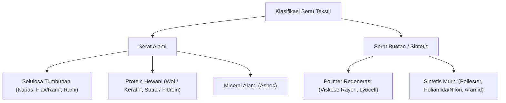
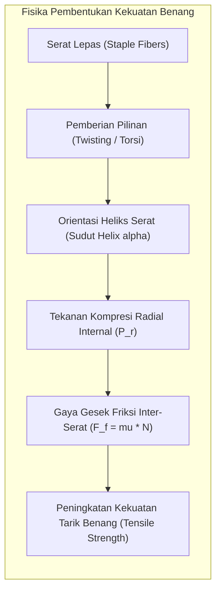
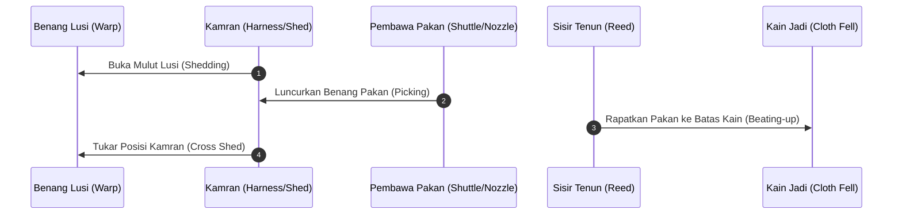
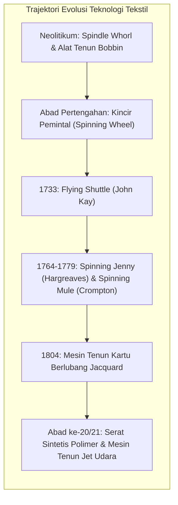

Peradaban manusia sering kali diklasifikasikan berdasarkan material dominan alat pemotong dan senjata—Zaman Batu, Zaman Perunggu, dan Zaman Besi. Namun, para antropolog dan sejarawan teknologi modern mengakui bahwa ada untaian teknologi lain yang jauh lebih penting bagi kelangsungan hidup biologis dan ekspansi geografis Homo sapiens: teknologi serat tekstil. Dari jarum tulang Zaman Paleolitikum atas hingga mesin pintal uap Revolusi Industri dan polimer sintetis aramid berkekuatan tinggi saat ini, manipulasi serat fleksibel telah membentuk struktur sosial, perdagangan internasional, dan sains material.

Artikel ini menyajikan eksplorasi mendalam dan ilmiah tentang arsitektur polimer alami dan sintetis, mekanika friksional kohesi benang, dinamika kinematika penenunan, dan evolusi makro-ekonomi industri tekstil global.

---

## 1. Arsitektur Polimer Serat Alami dan Sintetis

Tekstil didefinisikan sebagai struktur fleksibel yang tersusun dari jaringan benang berkekuatan tarik, yang pada gilirannya dibangun dari satuan dasar terkecil: serat (fiber). Untuk dapat dipintal menjadi benang yang fungsional, suatu serat harus memiliki rasio aspek panjang terhadap diameter (aspect ratio) minimal 100:1, serta memiliki kekuatan kohesi internal, fleksibilitas mekanik, dan stabilitas termal.

### 1.1 Serat Selulosa: Kapas dan Rami

Kapas (*Gossypium*) dan rami atau flax (*Linum usitatissimum*) berbasis pada polimer alami selulosa, yaitu polisakarida linear yang tersusun dari monomer $\beta$-D-glukosa yang terhubung melalui ikatan glikosidik $\beta$-(1$\to$4):

$$(C_6H_{10}O_5)_n$$

Derajat polimerisasi ($DP$) pada selulosa kapas mentah berkisar antara 9.000 hingga 15.000, sedangkan pada serat olahan sekitar 1.000 hingga 3.000. Rantai selulosa membentuk ikatan hidrogen intramolekul dan intermolekul yang sangat padat melalui gugus hidroksil ($-OH$), menghasilkan mikrofibril dengan kristalinitas sekitar 70% pada kapas dan hingga 85% pada rami.

Karakteristik unik serat kapas adalah struktur lumen sentralnya yang mengempis setelah buah kapas matang dan mengering, menyebabkan serat terpelintir secara heliks alami (disebut konvolusi). Konvolusi alami ini memberikan sifat saling mengunci friksional antar-serat yang sangat menguntungkan saat dipintal.

### 1.2 Serat Protein: Wol dan Sutra

Serat hewani tersusun dari rantai polipeptida protein yang memiliki sifat fisik sangat berbeda dengan selulosa:

1. <strong>Wol (Keratin)</strong>: Memiliki struktur molekul $\alpha$-heliks elastis yang distabilkan oleh jembatan disulfida kovalen (ikatan sistina: $-S-S-$). Permukaan wol ditutupi oleh lapisan kutikula bersisik mikroskopis (*epicuticle scales*). Sisik searah ini menyebabkan fenomena gesekan diferensial (*directional friction effect*), yang memungkinkan proses pemadatan felt (*felting*) saat terkena agitasi mekanis basah.
2. <strong>Sutra (Fibroin)</strong>: Disekresikan oleh ulat sutra (*Bombyx mori*), fibroin terdiri dari lembaran terlipat $\beta$ (*anti-parallel $\beta$-pleated sheets*) dengan urutan asam amino berulang $(-Gly-Ser-Gly-Ala-Gly-Ala-)_n$. Karena tidak adanya rantai samping berukuran besar, lembaran $\beta$ dapat tersusun sangat rapat, menghasilkan kekuatan tarik luar biasa (mencapai 0,6 GPa) dengan kilau optik akibat refleksi prisma segitiga alami penampang serat.

| Jenis Serat | Komposisi Kimia Utama | Kekuatan Tarik (cN/tex) | Perpanjangan Putus (%) | Kristalinitas (%) |
|---|---|---|---|---|
| <strong>Kapas</strong> | $\beta$-D-Glukan (Selulosa) | 25 - 40 | 6 - 9% | ~70% |
| <strong>Flax (Rami)</strong> | Selulosa + Hemiselulosa | 50 - 80 | 2 - 3% | ~85% |
| <strong>Wol</strong> | Keratin ($lpha$-heliks) | 12 - 18 | 25 - 40% | ~30% |
| <strong>Sutra</strong> | Fibroin ($eta$-sheet) | 35 - 55 | 15 - 25% | ~60% |
| <strong>Nilon 6,6</strong> | Poliamida | 45 - 75 | 15 - 30% | ~50% |
| <strong>Aramid (Kevlar)</strong> | Para-aramid aromatik | 180 - 220 | 2.5 - 4% | >90% |

---

## 2. Fisika Pemintalan dan Mekanika Friksi Benang

Tantangan fundamental dalam pemintalan adalah mengubah kumpulan serat pendek stapel (staple fibers) dengan panjang beberapa sentimeter menjadi benang kontinu dengan panjang ribuan meter yang tidak terurai saat ditarik. Solusi fisika untuk masalah ini adalah pemberian torsi atau pelintiran (*twist*).

### 2.1 Mekanisme Pelintiran dan Tekanan Kontak Antar-Serat

Ketika pelintiran diterapkan sepanjang sumbu benang silindris, serat-serat individual mengambil lintasan heliks. Menurut teori mekanika elastis benang Gegauff dan Hearle, jika benang diberi tarikan aksial sebesar $T$, serat di bagian luar yang terpilin dengan sudut heliks $\alpha$ akan mengalami gaya radial inward (ke arah sumbu pusat):

$$P_r = \frac{T \cdot \sin^2 \alpha}{r}$$

Gaya radial ke dalam ini menciptakan tekanan kontak normal antar-serat yang sangat tinggi di dalam inti benang. Berdasarkan hukum gesekan Amontons-Coulomb, gaya gesek geser $F_f$ antara dua serat berdekatan sebanding dengan gaya normal $N$:

$$F_f = \mu N$$

di mana $\mu$ adalah koefisien gesekan permukaan serat. Karena tekanan radial $P_r$ menekan serat-serat bersamaan, gesekan antar-serat meningkat tajam hingga melampaui gaya geser luar, mencegah slip relatif antar-serat.

### 2.2 Efek Koefisien Pilinan (Twist Multiplier)

Namun, ada batas optimal untuk tingkat pelintiran. Kekuatan tarik benang memiliki hubungan non-linear terhadap jumlah pelintiran per meter ($T_m$):

1. <strong>Daerah Pilinan Rendah</strong>: Tekanan radial tidak cukup kuat; benang putus akibat tergelincirnya serat (*fiber slippage*).
2. <strong>Kekuatan Maksimum (Optimum Twist)</strong>: Tekanan radial cukup besar sehingga serat tidak tergelincir, melainkan putus secara kohesif (*fiber rupture*).
3. <strong>Daerah Pilinan Berlebih (Over-twisted)</strong>: Sudut heliks serat $\alpha$ terlalu curam terhadap sumbu beban tarikan. Komponen aksial kekuatan serat berkurang sebanding dengan $\cos^2 \alpha$, dan tegangan geser torsional pra-beban melemahkan struktur benang.

Hubungan pilinan sering dinyatakan dengan koefisien pilinan (*twist multiplier*, $TM$):

$$TM = \frac{TPI}{\sqrt{Ne}} \quad \text{atau} \quad \alpha_m = T_m \cdot \sqrt{\text{Tex}}$$

---

## 3. Kinematika dan Dinamika Penenunan

Penenunan (*weaving*) adalah proses ortogonal pembentukan kain di mana dua set benang yang saling tegak lurus—benang lusi (*warp*, arah memanjang) dan benang pakan (*weft*, arah melintang)—disilangkan secara teratur.

### 3.1 Lima Gerakan Utama Alat Tenun (Primary & Secondary Motions)

Operasi mesin tenun, dari alat tenun tradisional hingga alat tenun jet udara modern, bertumpu pada siklus periodik gerakan mekanis:

1. <strong>Pembukaan Mulut Lusi (Shedding)</strong>: Pemisahan benang lusi menjadi dua lapisan (atas dan bawah) menggunakan heddle/kamran untuk membentuk lorong terbuka yang disebut *shed*.
2. <strong>Peluncuran Pakan (Picking)</strong>: Penyisipan sehelai benang pakan melintasi mulut lusi yang terbuka.
3. <strong>Pengetokan (Beating-up)</strong>: Gerakan sisir tenun (*reed*) yang mengayun ke depan untuk merapatkan benang pakan baru ke garis pembentukan kain (*fell of the cloth*).
4. <strong>Penguluran Lusi (Let-off)</strong>: Pelepasan benang lusi dari gulungan (*warp beam*) dengan tegangan yang terkontrol secara presisi.
5. <strong>Penggulungan Kain (Take-up)</strong>: Penarikan dan penggulungan kain jadi pada poros kain (*cloth roller*) dengan kecepatan seragam untuk menjaga kerapatan pakan (*pick density*).

### 3.2 Tiga Struktur Anyaman Dasar

Variasi pola silangan menghasilkan sifat mekanik, draping, dan estetika kain yang sangat berbeda:

1. <strong>Anyaman Polos (Plain Weave / 1/1)</strong>: Setiap benang lusi melintasi atas dan bawah satu benang pakan secara bergantian. Memiliki jumlah persilangan maksimal, memberikan stabilitas dimensi dan ketahanan aus tertinggi, tetapi kaku.
2. <strong>Anyaman Keper (Twill Weave / 2/1, 2/2, 3/1)</strong>: Benang mengapung melintasi dua atau lebih benang sebelum menyusup di bawah satu benang, membentuk garis diagonal khas (seperti kain denim). Anyaman ini lebih lentur dan tahan sobek.
3. <strong>Anyaman Satin (Satin Weave / 5-end, 8-end)</strong>: Titik silang dipisahkan sejauh mungkin sehingga hampir tidak terlihat, menghasilkan permukaan kain yang sangat halus, berkilau, dan drape yang jatuh lembut, namun lebih rentan terhadap gesekan abrasif.

---

## 4. Evolusi Sejarah Teknologi Tekstil dan Transformasi Peradaban

Teknologi tekstil bukanlah sekadar cabang industri; ia adalah katalisator utama transformasi ekonomi, hukum dagang internasional, komputasi biner, dan pembagian kerja gender dalam sejarah umat manusia.

### 4.1 Alat Pemintal Kincir dan Disrupsi John Kay

Selama ribuan tahun, benang dipintal menggunakan spindel genggam (*drop spindle*). Penemuan kincir pemintal (*spinning wheel*) di Asia dan penyebarannya ke Eropa pada Abad Pertengahan meningkatkan produktivitas hingga tiga kali lipat. Namun, rasio penenun terhadap pemintal tetap tidak seimbang: dibutuhkan 4 hingga 8 pemintal untuk memasok benang bagi satu orang penenun.

Keseimbangan ini pecah secara drastis pada tahun 1733 ketika <strong>John Kay</strong> mematenkan *Flying Shuttle* (sekoci terbang). Alat ini memungkinkan satu penenun meluncurkan benang pakan melintasi kain lebar tanpa asisten, menggandakan kecepatan menenun dan memicu kelangkaan benang yang parah di seluruh Inggris.

### 4.2 Mesin Pemintal Mekanis dan Kelahiran Pabrik Modern

Krisis benang memicu lahirnya serangkaian invensi mekanik brilian:

- <strong>Spinning Jenny (James Hargreaves, 1764)</strong>: Mengoperasikan 8 hingga 80 spindel secara bersamaan oleh satu operator manusia.
- <strong>Water Frame (Richard Arkwright, 1769)</strong>: Menggunakan serangkaian rol berkecepatan berbeda untuk menarik serat (drafting) yang digerakkan oleh kincir air. Ini melahirkan sistem pabrik (*factory system*) tersentralisasi pertama.
- <strong>Spinning Mule (Samuel Crompton, 1779)</strong>: Menggabungkan aksi penarikan rol dari Water Frame dengan aksi peregangan kereta geser dari Spinning Jenny, menghasilkan benang katun yang sangat halus dan kuat untuk pertama kalinya menyaingi muslin India.

### 4.3 Mesin Tenun Jacquard: Titik Tolak Komputasi Digital

Pada tahun 1804, <strong>Joseph Marie Jacquard</strong> memperkenalkan alat tenun otomatis yang dikendalikan oleh rantai kartu berlubang (*punched cards*). Setiap lubang pada kartu secara biner mengontrol apakah suatu kait heddle terangkat (1) atau tetap di bawah (0), memungkinkan pembuatan pola kain damask dan brokat rumit tanpa campur tangan manual.

Sistem biner kartu berlubang Jacquard inilah yang secara langsung menginspirasi <strong>Charles Babbage</strong> dalam merancang *Analytical Engine* (komputer mekanik pertama), dan kemudian diadaptasi oleh <strong>Herman Hollerith</strong> untuk sensus AS 1890 yang meletakkan dasar bagi IBM dan era komputasi modern.

---

## 5. Lanskap Tekstil Abad ke-21: Serat Canggih dan Keberlanjutan

Saat ini, rekayasa tekstil telah melampaui batas pakaian konvensional dan memasuki domain material kedirgantaraan, biomekanika, dan sensor pintar:

1. <strong>Serat Berkinerja Tinggi</strong>: Serat karbon dan ultra-high-molecular-weight polyethylene (UHMWPE / Dyneema) memiliki rasio kekuatan terhadap bobot yang melebihi baja struktural hingga 15 kali, digunakan pada badan pesawat Boeing 787 dan rompi anti-peluru militer.
2. <strong>Tekstil Cerdas (Smart Textiles)</strong>: Integrasi serat optik fleksibel, kawat nano perak, dan polimer semikonduktor piezoelektrik ke dalam benang memungkinkan kain memantau tanda vital medis, menghasilkan energi kinetik, dan mengubah warna sesuai stimulasi termal.
3. <strong>Ekonomi Sirkular dan Daur Ulang Kimia</strong>: Industri tekstil menghadapi tantangan ekologis besar akibat serat mikro sintetis dan fast-fashion. Pengembangan pelarut hijau (seperti cairan ionik pada produksi Lyocell) dan depolimerisasi enzimatik PET membuka jalan bagi siklus material tekstil yang benar-benar tertutup dan berkelanjutan.

Ilmu tekstil tetap menjadi sintesis luar biasa antara kimia polimer mutakhir, mekanika kontinuum, dan warisan intelektual sepuluh ribu tahun peradaban manusia.