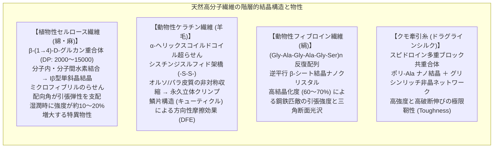
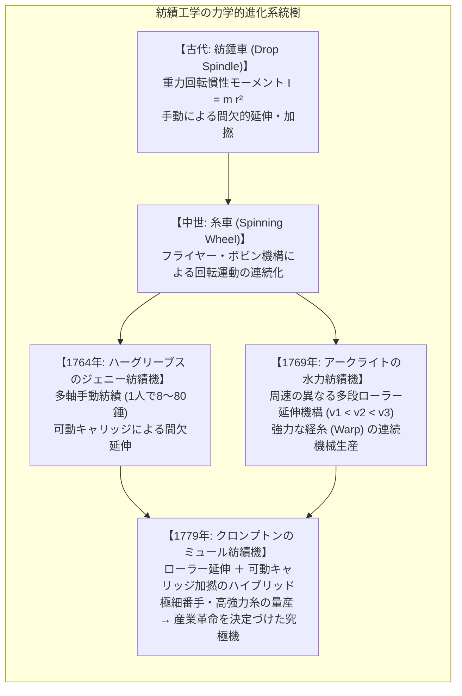
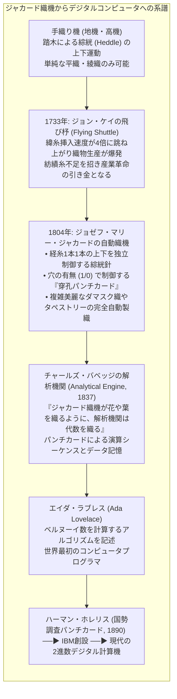
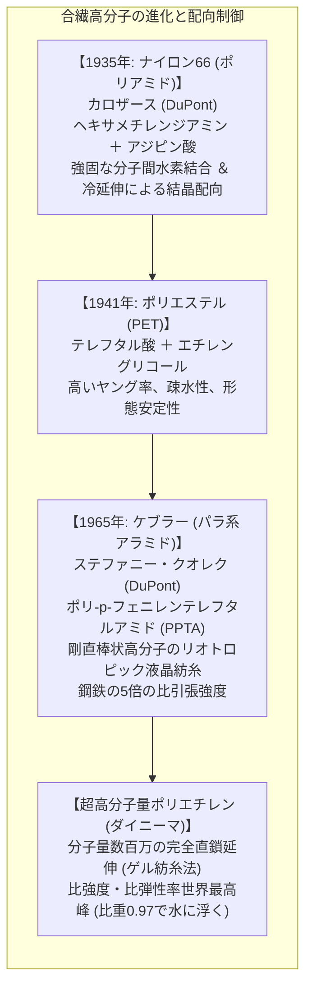

衣服を纏うという行為は、人類が「裸のサル」から文明を築く上で獲得した最も初期にして最も深遠な技術革新の一つです。しかし、繊維（Textile Fiber）が人類史に果たした役割は、単なる寒暖からの防護にとどまりません。

植物や動物の生体高分子が織りなすナノ結晶構造の解明、短繊維を撚り合わせて連続的な糸を紡ぎ出す接触摩擦力学、そして経糸と緯糸の二値交差（On/Off）を制御して複雑な文様を織り上げる幾何学的アルゴリズム。18世紀英国の産業革命の導火線となったのは綿紡績機械化の熱力学的連鎖であり、19世紀初頭に誕生したジャカード織機のパンチカード（穿孔カード）システムこそが、チャールズ・バベッジとエイダ・ラブレスを経て現代のデジタルコンピュータへと直結する「情報革命の真の揺籃」でした。

本稿では、天然高分子（セルロース、羊毛ケラチン、絹フィブロイン、クモ糸スピドロイン）の分子結晶物理学から、キャプスタン摩擦に基づく加撚力学、ジェニー・水力・ミュール紡績機の力学的進化、ピアスの織物幾何学モデル、染色化学と合成染料工業の誕生、ジャカード織機からチューリングマシンへの情報論的系譜、そして高強度アラミド繊維や電子スマートテキスタイルに至る全貌を数理的・歴史的視座から徹底的に詳解します。

---

### 1. 天然高分子繊維の分子構造と結晶物理学

自然界が創り出した天然繊維は、高度に規則正しく配向した結晶領域と柔軟な非晶領域が精緻に組み合わさった、極めて洗練された生体高分子コンポジット材料です。



#### 1.1 植物性セルロース繊維（綿・麻）：グルカン鎖の超分子結晶構造

綿（*Gossypium*）や麻（亜麻 *Linum usitatissimum*、大麻 *Cannabis sativa*、黄麻 *Corchorus*）の骨格を成すセルロースは、D-グルコピラノース残基が $\beta\text{-(1}\to\text{4)-}$グリコシド結合によって脱水縮合した直鎖状多糖類です。

$$\left( \text{C}_6\text{H}_{10}\text{O}_5 \right)_n \quad (n = \text{DP}: 2,000 \sim 15,000)$$

1. <strong>分子内・分子間水素結合ネットワーク</strong>:
   隣接するグルコース環のC3位水酸基（$-\text{OH}$）とC5位エーテル環酸素原子との間に強固な分子内水素結合が形成されるため、グルカン単分子鎖は自発的に剛直な直線状リボン構造を保持します。さらに、平行に並んだ複数の分子鎖がC6位水酸基と隣接鎖の酸素原子間で密な分子間水素結合網を張り巡らせることで、水分子すら侵入できない<strong>セルロースI$\beta$型単斜晶（Monoclinic: 空間群 $P2_1$）ナノ結晶</strong>を構築します。
2. <strong>ミクロフィブリルとらせん反転（Reversal）力学</strong>:
   数十本のセルロース分子鎖が結束した直径約 $3\sim5\text{ nm}$ のミクロフィブリルは、植物細胞壁内部において繊維軸に対して約 $20\sim30^\circ$ のらせん角（Spiral angle）をもって配向しています。綿繊維特有のねじれ（Convolution）は、果実の成熟・乾燥に伴う水分喪失によって生じる内部残留応力の解放現象であり、この不規則ならせん反転構造が繊維間の機械的絡み合い（Inter-fiber interlocking）を劇的に向上させます。
3. <strong>特異な湿潤強化現象</strong>:
   一般の高分子材料（羊毛や合成ポリアミドなど）は吸水によって分子間水素結合が遮断・可塑化され、引張強度が著しく低下します。しかし、綿セルロースは<strong>水分を含むと引張強度が約10〜20%増大する</strong>という特異な物性を示します。水分子が非晶領域の不均一な応力集中部を適度に緩和・スリップさせ、引張時に多数のミクロフィブリル結晶ドメイン間で荷重が均等に再配分されるためです。
4. <strong>靭皮繊維（Bast Fibers）のレッティング（浸水発酵）</strong>:
   麻類（亜麻やヘンプ）の繊維は、茎の靭皮（篩部組織）に束状（ファイバーバンドル）で存在します。これを単離するため、古代から「レッティング（Retting: 浸水発酵処理）」という生物化学的工程が用いられてきました。水中の嫌気性細菌（*Clostridium felsineum* 等）がペクチナーゼおよびヘミセルラーゼを分泌し、セルロース繊維束を接着しているペクチン酸カルシウム層を選択的に酵素分解することで、無傷の高結晶性セルロース長繊維が取り出されます。

#### 1.2 羊毛ケラチン（Wool Keratin）：$\alpha$-ヘリックス、シスチン架橋、フェルト化力学

羊毛繊維は、含硫アミノ酸（シスチン）に富む複合硬タンパク質「ケラチン」から成る、天然の精密生体バネです。

1. <strong>$\alpha$-ヘリックスと超らせん（Coiled-coil）</strong>:
   ポリペプチド主鎖は、4残基ごとにアミド水素とカルボニル酸素間で規則的な水素結合を形成して右巻き $\alpha$-ヘリックス（ピッチ $0.54\text{ nm}$）を構築し、これが2本寄り合わさって左巻きのコイルドコイル複合体を形成します。外力を受けると $\alpha$-ヘリックスの水素結合が可逆的に解離して伸長型 $\beta$-シートへと転移（$\alpha\text{-}\beta$ 相転移）し、元の長さの2倍近くまで破断せずに弾性変形します。外力を除去すると、エントロピー弾性によって元の $\alpha$-ヘリックス構造へと自発的に復元します。
2. <strong>シスチン架橋（$-S-S-$結合）の三次元網目</strong>:
   羊毛の乾燥重量の約10〜12%を占めるシスチン残基が、隣接するポリペプチド鎖間を強固な共有結合（ジスルフィド結合）で強固に架橋しています。この三次元網目構造が熱力学的復元力を与え、羊毛織物に比類なき防皺性（しわ回復性）をもたらします。
3. <strong>二重皮質（バイメタル構造）と立体クリンプ</strong>:
   羊毛の皮質層（コルテックス）は、シスチン含有量が高い「オルソコルテックス」と低い「パラコルテックス」が左右非対称に並列結合した二相構造を有します。両者の吸湿膨潤率の差異がバイメタル効果を引き起こし、三次元らせん状のパーマネント・クリンプ（波状縮れ）を自己形成します。この立体空隙が膨大な静止空気層を保持するため、圧倒的な断熱保温性が発現します。
4. <strong>キューティクル（鱗片）と方向性摩擦効果（DFE）</strong>:
   羊毛繊維の表面は、屋根瓦状に重なり合ったケラチン角質層（キューティクル）で覆われています。根元から先端方向への摩擦係数 $\mu_1$ と、先端から根元方向への逆向き摩擦係数 $\mu_2$ に顕著な差異（$\mu_2 > \mu_1$）が存在します。これが<strong>方向性摩擦効果（Directional Frictional Effect: DFE）</strong>です。
   温水中で機械的揉み作用（Milling）を加えると、繊維は不可逆的に一方向へと潜り込み、スケール同士が爪のように強固に噛み合って緊密な不織布構造へと収縮します。これが人類最古の布地製造技術である「フェルト化（Felting）」の物理的実体です。

#### 1.3 絹フィブロイン（Silk Fibroin）：$\beta$-シートナノ結晶の極限強度

カイコ（*Bombyx mori*）が吐出する絹糸は、芯部の構造タンパク質「フィブロイン」を水溶性糊タンパク質「セリシン」が被覆した芯鞘構造を持っています。

1. <strong>逆平行 $\beta$-シート結晶化</strong>:
   フィブロインの結晶性ドメインは、アミノ酸残基が $[-Gly-Ala-Gly-Ala-Gly-Ser-]_n$ という極めてコンパクトな反復配列で占められています。立体障害の極めて小さいグリシン残基が一面に、アラニンおよびセリン残基が反対側に整然と配向し、逆平行 $\beta$-シートがサブナノメートル間隔で最密スタッキングします。
2. <strong>高結晶化度と光沢の光学物理</strong>:
   結晶化度は60〜70%に達し、強固な水素結合と高密度パッキングにより、鋼鉄のピアノ線に匹敵する極めて高い引張強度（約 $0.6\sim0.7\text{ GPa}$）と高弾性率を両立します。さらに、単糸断面が角の丸い正三角形に酷似しているため、内部反射光がプリズム効果を生み出し、真珠のような優美な光沢（Silk luster）を放ちます。

#### 1.4 クモ牽引糸（Dragline Spider Silk）：強靭性の極限
ジョロウグモ等の牽引糸は、結晶性ポリ-Alaドメイン（$\beta$ シート）がナノ結晶として剛性を担い、グリシンに富む非晶性ループドメイン（$Gly-Gly-X$ や $Gly-Pro-Gly-X-X$ モチーフ）がエントロピー弾性ネットワークを形成しています。破断強度は $1.5\text{ GPa}$ に達し、破断伸びが30〜40%もあるため、破断に至るまでに吸収できるエネルギー（靭性: Toughness）は $160\text{ MJ/m}^3$ に達し、ケブラーや超高張力鋼を遥かに凌駕します。

---

### 2. 紡績技術の力学的進化：手紡ぎから産業革命の機械化へ

長さ数センチメートルの短い不連続な短繊維（ステープル: 綿は約20〜35 mm、羊毛は約50〜100 mm）を集めて、連続的で強靭な「糸（Yarn）」へと仕立て上げる工学的プロセスが「紡績（Spinning）」です。



#### 2.1 加撚（Twist）の接触摩擦力学とキャプスタン方程式
なぜ、引っ張れば容易にすっぽ抜ける短繊維の束に「撚り（ねじり）」を加えるだけで、強大な引張力に耐える強靭な糸が誕生するのでしょうか。

円筒座標系における繊維束に引張張力 $T$ と単位長さあたりの撚り数 $N$［回/m］を与えたとき、最外層の繊維は繊維軸に対して撚り角 $\alpha$（$\tan \alpha = 2\pi R N$、$R$ は糸半径）でらせん状に巻き付きます。外層の繊維張力は、内層の繊維群に対して中心方向への法線方向求心圧縮応力 $P_N$ を発生させます。

$$P_N \propto T \frac{\sin^2 \alpha}{R}$$

この法線圧力 $P_N$ により、繊維同士の接触界面に<strong>オイラー・キャプスタンの摩擦法則（Capstan Friction Law）</strong>に基づく強大な摩擦抵抗力 $F_{\text{friction}}$ が誘起されます。

$$F_{\text{friction}} = \mu P_N A_{\text{contact}}$$

引張力 $T$ が増大するほど法線圧縮力 $P_N$ が自動的に跳ね上がり、繊維間のすっぽ抜け（スリッページ）を自律的にロックします。
しかし、撚り角 $\alpha$ が過大になると、繊維自身の軸方向有効引張断面積が $\cos \alpha$ で減少するため、糸の強力は「至適撚り係数（Optimum Twist Factor）」において極大値を示します。

#### 2.2 産業革命を駆動した3大紡績機械のメカニクス

18世紀後半の英国ランカシャーで起きた紡績機械の爆発的進化は、手作業の職人技を「速度差ローラー」と「慣性回転体」という純物理的な機械要素へ分解・置換した歴史でした。

1. <strong>ハーグリーブスのジェニー紡績機（Spinning Jenny, 1764年）</strong>:
   木製スライドキャリッジ（台車）を往復させることで、1人の作業者が8〜80本以上のスピンドルを同時に駆動して繊維束を延伸・加撚しました。しかし手動駆動のため糸の引張強度が不均一で、緯糸（緯糸: 強い張力がかからない横糸）にしか使用できませんでした。
2. <strong>アークライトの水力紡績機（Water Frame, 1769年）</strong>:
   水車動力を導入し、<strong>周速が前段から後段へと段階的に速くなる複数対の延伸ローラー（Drafting Rollers: $v_1 < v_2 < v_3$）</strong>を通過させることで、繊維を連続的かつ均一に引き伸ばすことに成功しました。これにより、引張張力に耐えうる硬く強靭な経糸（経糸: 縦糸）の機械生産が世界で初めて可能となり、工場制機械工業（Factory System）の礎を築きました。
3. <strong>クロンプトンのミュール紡績機（Spinning Mule, 1779年）</strong>:
   サミュエル・クロンプトンは、ジェニー機の「可動キャリッジ延伸・加撚」と水力機の「ローラー延伸」を交配（ミュール＝ラバの意）させました。
   - <strong>第1サイクル</strong>: ローラーから送り出された粗糸を、キャリッジが後退しながら均一に引き伸ばし、スピンドルの高速回転で適度な撚りを与える。
   - <strong>第2サイクル</strong>: キャリッジが停止し、スピンドルのみが高速回転して本撚りを完了する。
   - <strong>第3サイクル</strong>: キャリッジが前進しながら、撚り合わされた完成糸をスピンドル上のボビンへ規則正しく巻き取る。
   この「延伸と加撚の間欠的分離制御」により、糸にかかる破断応力を極小化し、極上の極細番手（200番手以上の羽のように薄いモスリン綿布）から太番手の高強度糸まで、圧倒的な生産性と品質で世界市場を席巻しました。

---

### 3. 織物工学と情報革命の原点：ジャカード織機

紡績によって得られた「一次元の糸」を、直交する2方向から交差させて「二次元の布（Fabric）」へと組織化する技術が「製織（Weaving）」です。



#### 3.1 ピアスの織物幾何学モデル（Peirce's Cloth Geometry）
織物の力学的性質（引張剛性、せん断変形、ドレープ性）を解析するため、1937年にフレデリック・ピアス（F. T. Peirce）は、円形断面を持つ柔軟な糸の直交屈曲モデルを確立しました。

```
       経糸 (Warp) ──┐
                     ▼
           ╭──╮      ╭──╮      ╭──╮
───────────╯  ╰──────╯  ╰──────╯  ╰───────────
              ╭──╮      ╭──╮      ╭──╮
──────────────╯  ╰──────╯  ╰──────╯  ╰─────────
                     ▲
       緯糸 (Weft) ──┘
```

経糸と緯糸の幾何学的パラメーターは以下の連立方程式で束縛されます。

$$p_1 = (l_1 - D \theta_1) \cos \theta_1 + D \sin \theta_1$$
$$h_1 + h_2 = D = d_1 + d_2$$
$$c_1 = \frac{l_1 - p_1}{p_1}$$

- $p_1, p_2$: 糸の間隔（ピッチ: 織密度に反比例）
- $l_1, l_2$: 1完全組織あたりの糸の曲がり長さ（糸長）
- $d_1, d_2$: 経糸および緯糸の直径（和 $D = d_1 + d_2$）
- $h_1, h_2$: クリンプ高（糸の屈曲振幅）
- $\theta_1, \theta_2$: 糸の最大交差角
- $c_1, c_2$: クリンプ率（Crimp ratio）

布を引っ張ると、まず糸自身の伸長ではなく、交差部におけるクリンプの幾何学的交換（経糸が直線化すると直交する緯糸の波打ち振幅 $h_2$ が強制的に増大する「クリンプ・インターチェンジ」）が先行して低応力・高変形領域を支配します。この非線形な異方性力学が、織物独特のしなやかさと形態保持性を生み出しています。

#### 3.2 ジャカード織機とパンチカード：2進数制御の夜明け

1804年、フランスのリヨンで絹織物職人の子として生まれたジョゼフ・マリー・ジャカード（Joseph Marie Jacquard, 1752–1834）は、数千本に及ぶ経糸（縦糸）の個別昇降を自動制御する画期的な機構を発明しました。

1. <strong>二値制御（Binary Logic）の機械的実装</strong>:
   ジャカード織機の頭部には、無数の細長い金属針（ニードル）と、それに直結した綜絖フックが配置されています。針の直前に、規則的に穴が開けられた厚紙の「パンチカード（Card）」が押し付けられます。
   - <strong>カードに穴が開いている（1 / True）</strong>: 針は穴を通り抜けて前進し、フックがナイフ格子に引っ掛かって上方に引き上げられる。対応する経糸が持ち上がり、開口（Shed）の上側に配置される。
   - <strong>カードに穴が開いていない（0 / False）</strong>: 針はカードの厚紙に押し戻され、フックはナイフから外れる。対応する経糸は下層にとどまる。
2. <strong>プログラムによるパターンの複製可能性</strong>:
   緯糸が一筋通る（杼が走る）ごとに、連結されたパンチカードのチェーンが1駒ずつ回転して次の行のコードを読み取ります。熟練職人が数ヶ月を要した壮麗なタペストリーや肖像画織物が、パンチカードの束を装填するだけで、未熟練の工員によって寸分の狂いもなく何度でも複製可能となりました。

#### 3.3 エイダ・ラブレスとバベッジの直観：織機からアルゴリズムへ

英国の数学者チャールズ・バベッジ（Charles Babbage）は、ジャカードのパンチカード機構に決定的なインスピレーションを受け、1837年に蒸気動力で駆動する世界最初の汎用機械式計算機「解析機関（Analytical Engine）」を構想しました。

世界最初のプログラマとして知られるエイダ・ラブレス（Ada Lovelace, 1815–1852）は、解析機関に関する注釈書（Note G）において、不朽の名言を残しています。

> *“We may say most aptly that the Analytical Engine weaves algebraical patterns just as the Jacquard-loom weaves flowers and leaves.”*
> （解析機関は、ジャカード織機が花や葉の文様を織り上げるように、代数の数式パターンを織り上げる、と表現するのが最も的確である。）

ジャカード織機が「物理的な糸の上下動」というハードウェアを「穴の有無という抽象化された情報（ソフトウェア）」から完全に切り離したように、バベッジとエイダは「計算機械の演算装置（ミル: 織布機）」と「命令プログラムを記録した外部記憶媒体（パンチカード）」を分離しました。このパンチカード技術は、1890年の米国国勢調査でハーマン・ホレリスのタビュレーティングマシンへと継承されてIBMの基礎となり、20世紀半ばのフォン・ノイマン型コンピュータの黎明期に至るまで、人類の計算機科学を駆動し続けたのです。

---

#### 3.4 力織機の運動力学とおさ打ち（Beating-up）の応力解析
織機の機械化における最大の難関は、シャットル（杼）の高速往復運動と、経糸の開口（Shedding）、緯糸を織り込む「おさ打ち（Beating-up）」の精密な機械的同期でした。
1. <strong>シャットル投擲の運動エネルギー</strong>:
   質量 $m$（約0.3〜0.5 kg）のシャットルを1秒間に数回から十数回往復させるため、ピッキング機構は急峻なパルス状加速力を与えます。
   $$E_k = \frac{1}{2} m v^2$$
   シャットル速度 $v$ は $10\sim15\text{ m/s}$ に達し、反対側のシャットルボックスで急停止する際の衝撃吸収と制動が機械寿命を左右しました。
2. <strong>おさ打ちの弾性変形方程式</strong>:
   リード（筬: おさ）が前進して挿入された緯糸を織前（Cloth fell）に押し込む瞬間、経糸には急激な引張応力スパイクが発生します。この織前変位 $x(t)$ と糸張力 $T(t)$ の非線形ダイナミクスが、織物のカバーファクター（被覆率）と目ズレ耐性を決定づけます。

---

### 4. 染色化学と合成染料工業の誕生

繊維の文明史は、色彩を固定化する界面化学の歴史でもあります。

```mermaid
flowchart LR
    DyeHistory ["染色化学のパラダイムシフト"]
    DyeHistory --> NaturalDyes["【天然染料の時代】<br/>• 植物藍 (インディゴ): ロイコ体への還元建染め<br/>• 貝紫 (ジブロモインディゴ): 皇帝の紫<br/>• 茜 (アリザリン): アルミニウム媒染錯体形成"]
    DyeHistory --> SyntheticDyes["【1856年: 合成染料革命】<br/>• W. H. パーキンのモーブ (Mauveine) 発見<br/>• コールタール有機合成化学の爆発<br/>• BASF, Bayer 等の近代化学産業の誕生"]
end
```

1. <strong>インディゴの建染め（Vat Dyeing）</strong>:
   水に不溶性のインディゴ（青色）は、嫌気性発酵槽内で還元剤（ハイドロサルファイト等）により水溶性のロイコ体（淡黄色）へと還元されます。繊維内に浸透させた後、空気中の酸素で再酸化して不溶性インディゴ結晶を繊維細孔内部で再生・沈殿固定します。
2. <strong>パーキンのモーブ（Mauveine, 1856年）</strong>:
   18歳のウィリアム・パーキン（William Henry Perkin）がマラリア薬キニーネの合成実験中に偶然発見した紫色の合成染料モーブは、人類最初の合成染料であり、石炭乾留副産物（コールタール）から巨大な有機化学工業を立ち上げる決定打となりました。

---

### 5. 高分子化学と合成繊維の台頭

20世紀、石油化学工業と高分子化学（Polymer Chemistry）の成立により、人類は天然繊維の模倣を超えて、分子設計に基づく超高性能繊維を自らの手で創り出しました。



#### 5.1 ナイロン66：高分子重縮合と冷延伸（Cold Drawing）の物理
1935年、デュポン社のウォーレス・カロザース（Wallace Carothers）は、ヘキサメチレンジアミンとアジピン酸の脱水重縮合により、世界初の完全合成繊維「ナイロン66（ポリアミド66）」を発明しました。

$$n\,\text{H}_2\text{N-(CH}_2\text{)}_6\text{-NH}_2 + n\,\text{HOOC-(CH}_2\text{)}_4\text{-COOH} \longrightarrow \left[ -\text{NH-(CH}_2\text{)}_6\text{-NH-CO-(CH}_2\text{)}_4\text{-CO-} \right]_n + (2n-1)\,\text{H}_2\text{O}$$

溶融紡糸直後の未延伸ナイロン糸は、高分子鎖がランダムに折りたたまれた球晶（Spherulite）構造を持ち、強度が極めて脆弱です。しかし、ガラス転移点（$T_g \approx 50^\circ\mathrm{C}$）以上で約3〜4倍に機械的引っ張り変形を加える<strong>冷延伸（Cold Drawing）</strong>を施すと、巨大な分子配向が起きます。
アミド結合（$-\text{NH-CO}-$）が繊維軸に対して平行に整列し、隣接する分子鎖間で無数の水素結合が規則正しく架橋します。この結果、引張強度は約4〜5倍（$0.8\sim1.0\text{ GPa}$）へと跳ね上がります。

#### 5.2 アラミド繊維（ケブラー）：液晶紡糸と剛直棒状分子
1965年、ステファニー・クオレク（Stephanie Kwolek）が開発したポリ-p-フェニレンテレフタルアミド（PPTA: 商品名ケブラー）は、防弾チョッキや航空宇宙構造材料の標準となったスーパー繊維です。
1. <strong>剛直棒状（Rigid-rod）高分子</strong>:
   脂肪酸アルキル鎖のようなフレキシブルな炭素鎖を持たず、剛直なパラ置換ベンゼン環と平面アミド結合が直列に連結しているため、分子鎖自体が棒のように硬く、自発的に屈曲することができません。
2. <strong>リオトロピック液晶紡糸（Lyotropic Liquid Crystal Spinning）</strong>:
   濃硫酸溶媒中にPPTAを高濃度で溶解させると、高分子鎖が自然に平行配列したネマチック液晶相（Nematic liquid crystalline phase）を形成します。これを極小ノズルから紡糸して急速凝固させると、分子配向度が極限（$>95\%$）まで高められた完全配向フィラメントが得られます。比引張強度は同質量の鋼鉄の5倍を超え、防弾性能や耐切創性を発揮します。

#### 5.3 超高分子量ポリエチレン（UHMWPE）：ゲル紡糸と分子鎖の極限伸直
分子量200万〜600万に達する超高分子量ポリエチレン（UHMWPE: ダイニーマ、スペクトラ）は、ゲル紡糸法（Gel Spinning）によって製造されます。
希薄溶液中で分子鎖の絡み合い（Entanglement）を極小化した状態で紡糸し、その後数十倍に超延伸（Ultra-drawing）することで、炭素-炭素単結合（$-\text{C}-\text{C}-$）骨格が完全に伸直した平面ジグザグ結晶鎖を形成します。比重0.97と水に浮くほど軽量でありながら、引張強度は $3.5\text{ GPa}$ を超え、同重量基準でピアノ線の約15倍の破断強度を誇ります。


---

### 6. 現代テキスタイルサイエンスとスマートファブリック

今日、繊維科学はナノテクノロジーおよびエレクトロニクスと融合し、受動的な布地から能動的な情報・生体インターフェースへと変貌を遂げています。

#### 6.1 エレクトロスピニング（静電紡糸法）によるナノファイバー
高電圧（数万ボルト）をポリマー溶液に印加し、ノズル先端に形成されたテイラーコーン（Taylor Cone）から静電反発力によって極細ジェットを噴出させる技術です。直径数十〜数百ナノメートルの<strong>ナノファイバー不織布</strong>が形成され、比表面積が飛躍的に増大します。ウイルス捕集用高性能マスク、リチウムイオン電池セパレータ、人工血管や再生医療用細胞培養足場（Scaffold）として不可欠な材料となっています。

#### 6.2 スマートテキスタイルと導電性繊維
カーボンナノチューブ（CNT）やグラフェンを複合化した導電性高分子繊維、あるいは極細金属ワイヤーを組み込んだ織物は、衣服そのものをディスプレイ、アンテナ、発電素子（摩擦発電: TENG）、あるいは生体電位（心電図・筋電図）センサーとして機能させます。

200年前にジャカード織機がパンチカードを読み込んで経糸を跳ね上げたように、現代のスマートテキスタイルは、経糸と緯糸の交差点そのものをマトリックス電極やトランジスタとして機能させ、布地全体をフレキシブルな計算プラットフォームへと進化させつつあります。

---

### 7. まとめ：人類の歴史を織り成した繊維科学

繊維と織物の文明史を俯瞰するとき、私たちは技術と社会の驚くべき共進化を目の当たりにします。

1. <strong>天然高分子の知恵</strong>: セルロースの水素結合、ケラチンの立体クリンプ、絹フィブロインの $\beta$-シート結晶が、数万年前から人類の生存を支えてきた。
2. <strong>摩擦と加撚の力学</strong>: キャプスタン方程式が証明するように、短繊維を束ねて撚りをかける幾何学的工夫が、巨大な引張強度を生み出す糸の源泉となった。
3. <strong>産業革命の原動力</strong>: 速度差ローラーとミュール紡績機による力学的イノベーションが、人類史上最大の生産力爆発と近代産業社会をもたらした。
4. <strong>計算機科学への直結</strong>: ジャカード織機のパンチカードによる2進数制御は、バベッジとエイダ・ラブレスの洞察を経て、現代のデジタル情報社会の礎となった。
5. <strong>分子設計の未来</strong>: 石油化学が生んだ合成繊維から液晶紡糸アラミド、そして計算機能を宿したスマートファブリックへ。

糸を紡ぎ、布を織るという原始的な営みの中に、人類の科学精神、産業構造の変革、そして情報文明のすべての萌芽が宿っていたのです。
