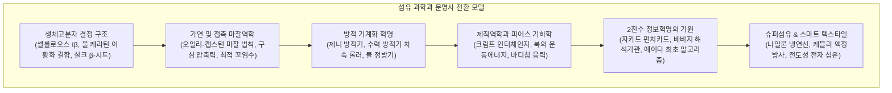

인류가 직물을 짜서 옷을 입은 행위는 인류 문명 발전의 가장 위대한 기술적 도약 중 하나입니다.

식물과 동물의 생체 고분자가 이루는 정밀한 나노 결정 구조, 짧은 단섬유를 꼬아 연속적인 실로 만드는 접촉 마찰역학, 그리고 경사와 위사의 2진 교차(On/Off)를 제어하는 기하학적 알고리즘. 18세기 영국 산업혁명의 도화선은 면방적 기계화였으며, 1804년 조제프 마리 자카드가 발명한 천공카드 2진 직기는 찰스 배비지와 에이다 러브레이스를 거쳐 현대 디지털 컴퓨터의 직접적 기원이 되었습니다.



---

### 1. 천연 고분자 섬유의 분자 결정물리학

1. <strong>식물성 셀룰로오스 (면, 마)</strong>:
   - $\beta\text{-(1}\to\text{4)-D-}$글루코오스 선형 중합체(DP 2,000~15,000). 조밀한 분자간 수소결합이 <strong>셀룰로오스 I$\beta$ 단사정계</strong> 나노결정을 형성합니다.
   - <strong>습윤 강도 증가의 역설</strong>: 물을 흡수하면 비정질 영역의 응력 집중이 완화되어 인장강도가 10~20% 오히려 증가합니다.
   - 인피섬유(아마, 대마)는 레팅(Retting) 혐기 발효를 통해 펙틴질을 분해하여 고강도 섬유 다발을 분리합니다.
2. <strong>양모 케라틴 (Wool Keratin)</strong>:
   - 우권 $\alpha$-나선이 코일드코일을 형성하며, 인장 시 신장형 $\beta$-시트로 상전이 후 가역 복원됩니다.
   - 시스틴 이황화 결합($-S-S-$)이 탄성 회복력과 방추성을 제공합니다.
   - 오르소/파라 피질의 비대칭 수축이 입체적 영구 크림프를 만들고, 표면 큐티클 스케일의 <strong>방향성 마찰 효과(DFE)</strong>가 펠트화의 원리가 됩니다.
3. <strong>견 피브로인 (Silk Fibroin)</strong>:
   - $[-Gly-Ala-Gly-Ala-Gly-Ser-]_n$ 반복 서열의 역평행 $\beta$-시트가 치밀하게 적층되어 60~70% 결정화도를 가지며 강철선 수준의 강도를 발휘합니다.
   - 삼각 단면이 프리즘 역할을 하여 영롱한 광택을 띱니다.
4. <strong>거미 견인사 (Dragline Silk)</strong>:
   - 폴리알라닌 나노결정과 글리신 리치 무정형 망목 복합체로 인성(Toughness)이 $160\text{ MJ/m}^3$에 달합니다.

---

### 2. 가연 역학과 방적 기계화 혁명

단섬유에 꼬임(Twist)을 주면 최외곽 섬유 장력에 의해 내부로 구심 압축력 $P_N$이 발생합니다. <strong>오일러-캡스턴 마찰 법칙</strong> $F_{\text{fric}} = \mu P_N A_{\text{contact}}$ 에 의해 장력이 증가할수록 섬유 간 미끄러짐이 자율적으로 잠기며 강력한 실이 완성됩니다.

- <strong>아크라이트 수력 방적기 (1769)</strong>: 원주 속도가 다른 차속 롤러($v_1 < v_2 < v_3$)로 균일 견인하여 질긴 경사 대량 생산;
- <strong>크롬프턴 뮬 정방기 (1779)</strong>: 롤러 견인과 캐리지 가연을 간헐 분리 제어하여 극도로 가늘고 질긴 고급 면사를 양산, 산업혁명의 공장제를 확립.

---

### 3. 직물 역학과 자카드 직기의 컴퓨터 혁명

피어스(Peirce) 직물 기하학 모델:

$$p_1 = (l_1 - D \theta_1) \cos \theta_1 + D \sin \theta_1, \quad h_1 + h_2 = D = d_1 + d_2$$

실 자체의 신장보다 교차점의 <strong>크림프 교환(Crimp Interchange)</strong>이 천의 유연성을 지배함을 수학적으로 증명합니다.

1804년 자카드(Jacquard)는 천공카드에 뚫린 구멍 유무(1과 0)로 개별 경사를 기계식으로 들어 올리는 장치를 발명했습니다:
- <strong>찰스 배비지</strong>는 이를 보고 연산(CPU)과 데이터 기억(Memory)을 카드로 분리한 <strong>해석기관</strong>을 설계했습니다;
- <strong>에이다 러브레이스</strong>는 세계 최초의 컴퓨터 알고리즘을 작성하며 "해석기관은 자카드 직기가 꽃과 잎을 짜듯 대수학을 짠다"는 명언을 남겼습니다;
- 이는 홀러리스 천공기계를 거쳐 IBM과 현대 디지털 컴퓨터의 모태가 되었습니다.

---

### 4. 염색 화학과 유기화학 공업의 태동

섬유의 문명사는 자연의 색채를 포획하고 분자 계면에 고착시키는 화학의 역사이기도 합니다.

```mermaid
flowchart LR
    DyeHistoryKO ["염색 화학의 패러다임 전환"]
    DyeHistoryKO --> NaturalDyes["【천연 염료 시대】<br/>• 쪽 (인디고 Indigo): 류코체 환원 배트 염색<br/>• 조개 보라 (디브로모인디고): 황제의 자주색<br/>• 꼭두서니 (알리자린): 금속 매염 착체"]
    DyeHistoryKO --> SyntheticDyes["【1856년 합성염료 혁명】<br/>• 18세 퍼킨의 모브 (Mauveine) 우연 합성<br/>• 콜타르 유기화학 폭발<br/>• BASF, Bayer 등 근대 화학기업 탄생"]
end
```

1. <strong>인디고 배트 염색 (Vat Dyeing)</strong>:
   물에 녹지 않는 청색 인디고는 혐기성 발효조에서 환원되어 수용성인 연황색 류코체(Leuco-indigo)로 전환됩니다. 섬유 비정질 영역의 미세 공극에 침투시킨 후 대기 중 산소와 접촉시켜 불용성 인디고 나노 결정을 섬유 내부에서 재산화 침전시켜 영구 고착합니다.
2. <strong>퍼킨의 모브 (Mauveine, 1856)</strong>:
   18세의 윌리엄 퍼킨(William Perkin)은 말라리아 치료제 퀴닌을 합성하려다 콜타르 부산물인 아닐린 산화 반응에서 최초의 인공 합성염료 <strong>모브(Mauveine)</strong>를 발견했습니다. 이 발견은 전통 천연염료 농업을 해체하고 독일 BASF, 바이엘(Bayer) 등 근대 거대 정밀 유기화학 공업을 출범시키는 결정적 도화선이 되었습니다.

---

### 5. 동력직기 역학과 바디침(Beating-up) 응력 동역학

직기 기계화의 핵심은 북(Shuttle)의 초고속 왕복 투척과 바디침(Beating-up)의 정밀한 동기화였습니다:
1. <strong>북 투척의 운동에너지</strong>: 질량 약 0.4 kg의 북이 초당 $12\sim15\text{ m/s}$의 속도로 개구를 통과하며 ($E_k = \frac{1}{2}mv^2 \approx 30\sim50\text{ J}$), 왕복 완충 및 제동 기술이 기계적 내구성을 좌우했습니다;
2. <strong>바디침(Beating-up) 충격 응력</strong>: 리드(바디)가 위사를 직전(Cloth fell)에 밀어붙일 때 경사에 급격한 인장 응력 스파이크가 발생하며, 이 비선형 변형 동역학이 직물의 밀도와 인열강도를 결정합니다.

---

### 6. 첨단 슈퍼섬유와 스마트 텍스타일

1. <strong>나일론 66 (1935)</strong>: 헥사메틸렌디아민과 아디프산의 축중합. 방사 후 <strong>냉연신(Cold Drawing)</strong>을 통해 분자쇄를 평행 배향하고 촘촘한 아미드 수소결합을 형성하여 인장강도를 5배($1.0\text{ GPa}$) 향상시켰습니다.
2. <strong>케블라 (Kevlar, 파라계 아라미드)</strong>: 강직한 막대 분자(PPTA)가 농황산에서 <strong>리오트로픽 네마틱 액정</strong>을 자발 형성합니다. 미세 노즐 압출 방사 시 분자 배향도가 95%를 초과하여 강철의 5배에 달하는 비강도를 달성했습니다.
3. <strong>초고분자량 폴리에틸렌 (UHMWPE / 다이니마)</strong>: 겔 방사 초연신을 통해 분자량 수백만의 얽힘을 풀어 완전 직쇄 평면 지그재그 탄소 골격을 형성, 비중 0.97로 물에 뜨면서도 피아노선 강도의 15배를 구현했습니다.
4. <strong>스마트 텍스타일</strong>: 탄소나노튜브와 전도성 고분자 섬유를 복합화하여 직물 자체가 센서, 안테나, 마찰대전 발전소자(TENG)로 기능하는 차세대 인체 통신 플랫폼을 구축하고 있습니다.

