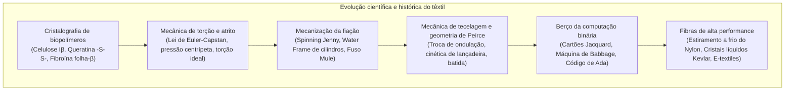

A arte de tecer fibras e confeccionar vestimentas representa uma das mais antigas e decisivas conquistas tecnológicas da humanidade. Contudo, o impacto dos têxteis estende-se muito além da proteção climática.

A nanocristalografia de biopolímeros, a mecânica de contato por torção de fibras descontínuas e a lógica geométrica binária do entrelaçamento de fios estabeleceram as bases materiais da Revolução Industrial britânica. Além disso, o sistema de cartões perfurados patenteado por Joseph Marie Jacquard em 1804 consagrou a primeira separação física entre hardware e software, inspirando diretamente a Máquina Analítica de Charles Babbage e o código inaugural de Ada Lovelace.

---

### 1. Biofísica Molecular de Polímeros Naturais

1. <strong>Celulose Vegetal (Algodão, Linho)</strong>:
   - Polímero linear de $\beta\text{-(1}\to\text{4)-D-}$glicopiranose (DP: 2.000 a 15.000). Ligações de hidrogênio formam densos <strong>nanocristais de celulose I$\beta$ monoclínica</strong>.
   - <strong>Aumento anômalo de tenacidade a úmido</strong>: A água dissipa tensões localizadas nas zonas amorfas, elevando a resistência à tração do algodão molhado em 10 a 20%.
   - As fibras de caule (linho, cânhamo) são liberadas por maceração biológica (retting), na qual enzimas bacterianas hidrolisam a pectina.
2. <strong>Queratina da Lã</strong>:
   - Hélice $\alpha$ em conformação super-helicoidal com transição reversível para folhas $\beta$ sob tração.
   - Pontes dissulfeto covalentes de cistina ($-S-S-$) garantem memória elástica e resistência a vincos.
   - Assimetria cortical entre orto e paracórtex gera o ondulado helicoidal tridimensional (crimp), enquanto as escamas da cutícula geram o <strong>efeito de fricção direcional (DFE)</strong> responsável pela feltragem.
3. <strong>Fibroína da Seda</strong>:
   - Repetições $[-Gly-Ala-Gly-Ala-Gly-Ser-]_n$ empacotadas em folhas $\beta$ antiparalelas com 60–70% de cristalinidade, conferindo resistência comparável à corda de piano e brilho perolado.

---

### 2. Mecânica da Fiação e Lei de Euler-Capstan

A torção de um feixe de fibras induz uma tensão compressiva radial centrípeta $P_N$ exercida pelas camadas externas:

$$P_N \propto \frac{T \sin^2 \alpha}{R}$$

Pela <strong>lei de atrito de Euler-Capstan</strong>, a resistência ao escorregamento entre fibras cresce exponencialmente com a pressão normal:

$$F_{\text{fric}} = \mu P_N A_{\text{contact}}$$

- <strong>Water Frame de Arkwright (1769)</strong>: Cilindros com velocidades periféricas diferenciadas ($v_1 < v_2 < v_3$) para estiramento mecânico contínuo;
- <strong>Spinning Mule de Crompton (1779)</strong>: Hibridização de cilindros e carro móvel, produzindo fios de extrema regularidade e finura inigualável.

---

### 3. Tecelagem, Geometria de Peirce e Tear Jacquard

A geometria de Peirce estabelece que a maleabilidade dos tecidos decorre da <strong>troca de ondulação (crimp interchange)</strong> entre urdume e trama.

Em 1804, Jacquard empregou cartões perfurados para controle individual dos fios:
- <strong>Perfuração (1)</strong>: Agulha avança e o liço ergue o fio de urdume;
- <strong>Sem perfuração (0)</strong>: Agulha bloqueada e o fio permanece abaixado;
- <strong>Charles Babbage</strong> utilizou essa ideia na sua <strong>Máquina Analítica</strong>;
- <strong>Ada Lovelace</strong> redigiu o primeiro algoritmo computacional, declarando: *«A Máquina Analítica tece padrões algébricos da mesma forma que o tear de Jacquard tece flores e folhas»*.

---

### 4. Química de Corantes e Superfibras Sintéticas

1. <strong>Revolução da Mauveína (1856)</strong>: Síntese acidental do primeiro corante sintético por William Perkin a partir de anilina de alcatrão, impulsionando a indústria química orgânica.
2. <strong>Nylon 6,6 (1935)</strong>: Desenvolvido por Carothers. O <strong>estiramento a frio</strong> orienta as cadeias poliméricas e estabelece uma rede estável de pontes de hidrogênio amida ($1,0\text{ GPa}$).
3. <strong>Kevlar (Aramida)</strong>: Polímero rígido em bastonete (PPTA) que forma cristais líquidos nemáticos em ácido sulfúrico; fiação orientada a $>95\%$ com cinco vezes a resistência do aço.
4. <strong>UHMWPE (Dyneema)</strong>: Fiação em gel de polietileno de ultra-alto peso molecular com cadeias perfeitamente estendidas, flutuando na água e superando o aço em 15 vezes.
