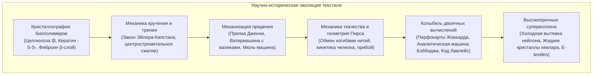

Создание тканей и одежды представляет собой один из древнейших и наиболее фундаментальных технологических прорывов человечества. Однако значение текстильных технологий простирается далеко за рамки защиты от холода.

Нанокристаллография природных биополимеров, контактная механика кручения коротких волокон и двоичная логика переплетения основы и утка заложили физическую основу Промышленной революции в Англии XVIII века. Более того, перфокарточная система Жаккарда 1804 года ознаменовала первое в истории разделение программного кода и аппаратной части, напрямую вдохновив Чарльза Бэббиджа и Аду Лавлейс на создание концепции компьютера.

---

### 1. Молекулярная биофизика природных полимеров

1. <strong>Растительная целлюлоза (Хлопок, Лен)</strong>:
   - Линейный гомополисахарид из остатков $\beta\text{-(1}\to\text{4)-D-}$глюкозы (степень полимеризации 2000–15000). Внутри- и межмолекулярные водородные связи формируют плотную <strong>моноклинную решетку целлюлозы I$\beta$</strong>.
   - <strong>Аномальный рост прочности во влажном состоянии</strong>: Вода снимает локальные механические напряжения в аморфных зонах, увеличивая разрывную прочность мокрого хлопка на 10–20%.
   - Лубяные волокна льна выделяются биологической мочкой (retting), при которой пектиназы бактерий растворяют межклеточный пектиновый клей.
2. <strong>Кератин шерсти</strong>:
   - Полипептидные цепи в виде $\alpha$-спиралей скручены в суперспирали. При растяжении водородные связи обратимо перестраиваются в вытянутые $\beta$-слои.
   - Ковалентные дисульфидные мостики цистина ($-S-S-$) обеспечивают упругую релаксацию и несминаемость.
   - Двустороннее строение коры (орто- и паракортекс) формирует трехмерную извитость (crimp), а чешуйки кутикулы создают <strong>направленный фрикционный эффект (DFE)</strong>, лежащий в основе валяния войлока.
3. <strong>Фиброин шелка</strong>:
   - Гексапептидные повторы $[-Gly-Ala-Gly-Ala-Gly-Ser-]_n$ упакованы в антипараллельные $\beta$-слои с кристалличностью 60–70%, достигая прочности стальной проволоки. Треугольное сечение волокна обеспечивает радужный призматический блеск.

---

### 2. Механика прядения и закон Эйлера-Капстана

Скручивание штапельных волокон приводит к тому, что внешние слои генерируют нормальное радиальное давление $P_N$:

$$P_N \propto \frac{T \sin^2 \alpha}{R}$$

По <strong>закону трения Эйлера-Капстана</strong> сопротивление проскальзыванию волокон возрастает экспоненциально:

$$F_{\text{fric}} = \mu P_N A_{\text{contact}}$$

- <strong>Ватермашина Аркрайта (1769)</strong>: Пары вытяжных валиков с разной окружной скоростью ($v_1 < v_2 < v_3$) обеспечили непрерывную машинную вытяжку прочной нити основы.
- <strong>Мюль-машина Кромптона (1779)</strong>: Разделение вытяжки и скручивания на подвижной каретке позволило прясть сверхтонкую пряжу высшего качества в промышленных масштабах.

---

### 3. Ткачество, геометрия Пирса и станок Жаккарда

Геометрия Пирса показала, что податливость ткани основана на <strong>обмене изгибами (crimp interchange)</strong> между нитями основы и утка.

В 1804 году Жозеф Мари Жаккард применил перфокарты для раздельного управления каждой нитью основы:
- <strong>Отверстие (1)</strong>: Игла проходит, крючок поднимает нить основы;
- <strong>Без отверстия (0)</strong>: Игла упирается в карту, нить остается внизу;
- <strong>Чарльз Бэббидж</strong> применил этот принцип в <strong>Аналитической машине</strong>;
- <strong>Ада Лавлейс</strong> создала первый в мире алгоритм и пророчески записала: *«Аналитическая машина ткет алгебраические узоры точно так же, как станок Жаккарда ткет цветы и листья»*.

---

### 4. Химия красителей и синтетические волокна

1. <strong>Мовеин (1856)</strong>: Уильям Перкин синтезировал первый анилиновый краситель, породив мировую синтетическую органическую химию (BASF, Bayer).
2. <strong>Нейлон 6,6 (1935)</strong>: Поликонденсация Карозерса. <strong>Холодная вытяжка</strong> ориентирует молекулы и формирует сеть амидных связей ($1,0\text{ ГПа}$).
3. <strong>Кевлар (Арамид)</strong>: Жесткоцепной полимер (PPTA) образует нематические жидкие кристаллы в серной кислоте; ориентация $>95\%$ дает удельную прочность в пять раз выше стали.
4. <strong>Сверхвысокомолекулярный полиэтилен (UHMWPE)</strong>: Гель-формование с распрямлением макромолекул дает плотность 0,97 г/см³ (плавает в воде) и прочность в 15 раз выше стали.
