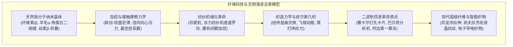
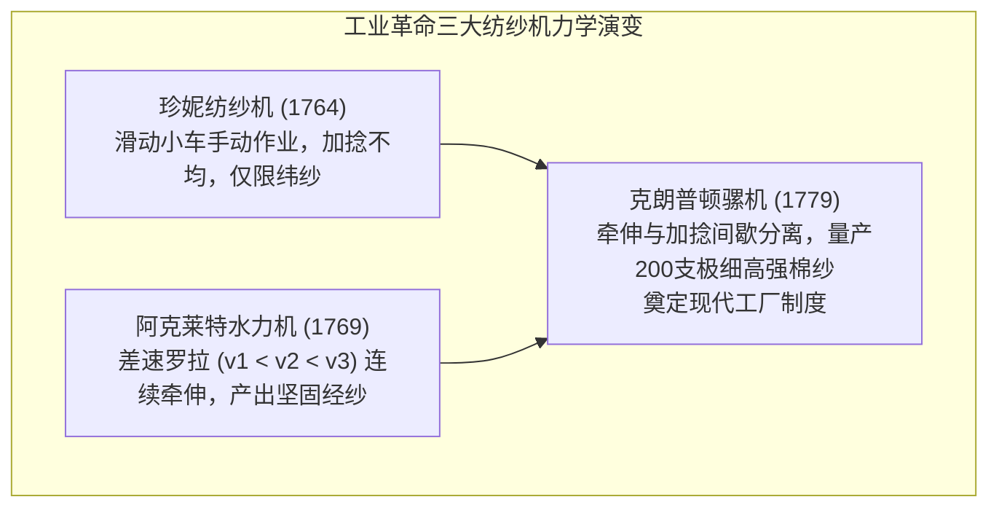

衣服的编织与穿戴，是人类从原始走向文明的最古老、最深邃的技术突破之一。然而，纤维科学对人类文明史的塑造，远远超越了抵御寒暑的基本功能。

从天然高分子纳米晶体结构，到短纤维加捻抱合的接触摩擦力学，再到经纬交织的二进制几何算法——18世纪英国工业革命的引擎正是棉纺技术的机械化；而1804年雅卡尔提花机的穿孔卡片二进制控制系统，更是巴贝奇、阿达·洛夫莱斯乃至现代电子数字计算机的直接鼻祖。



---

### 1. 天然高分子纤维的分子结构与结晶物理学

1. <strong>植物纤维素（棉、麻）</strong>：
   - 由 $\beta\text{-(1}\to\text{4)-D-}$吡喃葡萄糖脱水缩合而成的线形多糖，聚合度（DP）高达2,000~15,000。
   - 分子内与分子间极其致密的氢键网络构筑了水分子无法侵入的<strong>纤维素 I$\beta$ 单斜晶相</strong>。
   - <strong>湿强增大反常物性</strong>：普通高分子吸水软化变弱，而棉纤维湿润时强度反而增加10~20%。水分子使无定形区应力松弛，拉伸时微纤晶区受力更加均匀。
   - 韧皮纤维（亚麻、大麻）经<strong>浸水沤麻（Retting）</strong>，利用厌氧菌（*Clostridium*）果胶酶选择性水解果胶酸钙，解离出高强度晶体纤维束。
2. <strong>羊毛角蛋白（Wool Keratin）</strong>：
   - 主链呈右旋 $\alpha$-螺旋，经两两交缠形成左旋卷曲螺旋（Coiled-coil）。拉伸时氢键可逆断裂转变为伸展型 $\beta$-折叠，撤去外力后自发熵弹性回弹。
   - 占干重10%以上的胱氨酸二硫键（$-S-S-$）构成坚固三维交联网络，赋予抗皱性。
   - 偏心皮质（正皮质与副皮质吸湿膨胀差异）形成双金属片效应，产生立体持久卷曲（Crimp）。表皮毛鳞片（Cuticle）的<strong>定向摩擦效应（DFE）</strong>构成了古老缩绒与毡化（Felting）的力学基础。
3. <strong>蚕丝丝素（Silk Fibroin）</strong>：
   - 核心反转六肽重复序列 $[-Gly-Ala-Gly-Ala-Gly-Ser-]_n$。甘氨酸与丙氨酸定向排列，反平行 $\beta$-折叠紧密堆积，结晶度达60~70%，比拉伸强度匹敌优质钢丝。
   - 三角形截面带来棱镜式光反射，产生如珍珠般璀璨的丝光。
4. <strong>蜘蛛牵引丝（Dragline Silk）</strong>：
   - 核心由多聚丙氨酸（Poly-Ala）纳米晶体与富含甘氨酸的无定形弹性网络构成，兼具高达 $1.5\text{ GPa}$ 的强度与30~40%的高断裂伸长率，能量吸收断裂韧性达 $160\text{ MJ/m}^3$。

---

### 2. 加捻力学与纺纱机械化革命

短纤维通过<strong>加捻（Twisting）</strong>形成连续纱线。最外层纤维呈螺旋线倾斜缠绕，张力 $T$ 在中心方向诱导出径向向心压缩应力 $P_N \propto \frac{T \sin^2 \alpha}{R}$。

根据<strong>欧拉-绞盘摩擦定律（Capstan Friction Law）</strong>：

$$F_{\text{fric}} = \mu P_N A_{\text{contact}}$$

张力越大，向心压力越高，自律性锁死纤维滑移。当捻角过大时，轴向有效承载截面减小，因此存在最佳捻度。



- <strong>珍妮纺纱机（1764）</strong>：手摇多锭，滑动架往复牵伸；
- <strong>阿克莱特水力机（1769）</strong>：多组差动罗拉（$v_1 < v_2 < v_3$）精确机械牵伸，生产硬挺经纱；
- <strong>克朗普顿骡机（1779）</strong>：罗拉牵伸与走锭加捻分离，制造极高支数纱线，彻底引爆工业革命。

---

### 3. 织造力学与计算机的诞生：雅卡尔提花机

皮尔斯（F. T. Peirce）织物几何学建立了经纬纱屈曲几何方程：

$$p_1 = (l_1 - D \theta_1) \cos \theta_1 + D \sin \theta_1, \quad h_1 + h_2 = D = d_1 + d_2$$

在外力作用下，<strong>屈曲交换（Crimp Interchange）</strong>使经纱拉直时纬纱波纹幅度自发增大，赋予布料各向异性柔顺度。

```mermaid
flowchart LR
    LoomLogic ["织机与计算机逻辑的同构演进"]
    LoomLogic --> Jacquard["1804: 雅卡尔打孔卡片 (0/1 二进制)<br/>经纱提花独立控制，程式化复制图样"]
    Jacquard --> Babbage["1837: 巴贝奇分析机<br/>采用打孔卡片输入指令与数据<br/>『分析机编织代数，如织机编织花朵』"]
    Babbage --> Lovelace["阿达·洛夫莱斯第一算法<br/>编制伯努利数计算程序<br/>世界首位程序员"]
    Lovelace --> ModernComputing["霍勒里斯制表机 ──▶ IBM ──▶ 现代数字计算机"]
end
```

雅卡尔织机用卡片上“有孔（1）/无孔（0）”控制经纱提起与否，是人类历史上首次将<strong>抽象的软件指令与物理机械硬件完全解耦</strong>。阿达·洛夫莱斯敏锐地指出：“分析机编织代数方程式，如同雅卡尔织机编织花卉与叶片。”

---

### 4. 染色化学与有机化学工业的诞生

1. <strong>天然染料时代</strong>：
   - 植物蓝（靛蓝 Indigo）：水不溶性靛蓝在还原发酵槽中转变为水溶性隐色体（Leuco-indigo），渗入纤维后经空气氧化重新析出结晶固定；
   - 骨螺紫（骨螺二溴靛蓝）：地中海贵族与皇帝专用色；
   - 茜草（茜素 Alizarin）：形成铝钙金属络合物媒染固着。
2. <strong>1856年合成染料革命</strong>：
   18岁的威廉·珀金（William Perkin）在尝试人工合成抗疟药奎宁时，意外从煤焦油副产物苯胺中合成了世界上第一种人工合成染料<strong>苯胺紫（Mauveine）</strong>。这一发现彻底引爆了煤化工与有机合成化学，催生了德国BASF、拜耳（Bayer）等现代跨国化工巨头。

---

### 5. 合成纤维与高分子工程

1. <strong>尼龙66（卡罗瑟斯，1935）</strong>：己二胺与己二酸缩聚。未拉伸丝晶粒杂乱，经<strong>冷拉伸（Cold Drawing）</strong>定向排列，链间形成密集酰胺氢键，强度暴增至 $1.0\text{ GPa}$。
2. <strong>聚酯纤维（PET, 涤纶）</strong>：对苯二甲酸与乙二醇缩聚，具极高杨氏模量、耐磨与保形性。
3. <strong>凯夫拉（Kevlar，芳纶）</strong>：聚对苯二甲酰对苯二胺（PPTA）的刚性棒状分子在浓硫酸中形成<strong>溶致向列型液晶</strong>，挤出纺丝高度定向（$>95\%$），比强度为钢材5倍。
4. <strong>超高分子量聚乙烯（UHMWPE / 迪尼玛）</strong>：凝胶纺丝超拉伸，碳主链完全伸直呈全锯齿构象，比重0.97浮于水面，比强度为钢丝15倍。
5. <strong>智能纺织品（Smart Textiles）</strong>：静电纺丝纳米纤维网用于病毒过滤与组织工程支架；导电聚合物与碳纳米管纤维将织物转化为柔性传感器与摩擦纳米发电机（TENG）。
