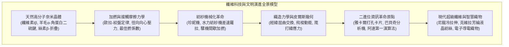
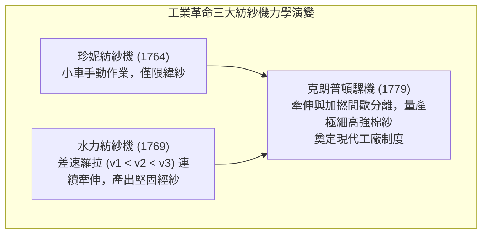

衣服的編織與穿戴，是人類從原始走向文明的最古老、最深邃的技術突破之一。然而，纖維科學對人類文明史的塑造，遠遠超越了抵禦寒暑的基本功能。

從天然高分子奈米晶體結構，到短纖維加撚抱合的接觸摩擦力學，再到經緯交織的二進位幾何演算法——18世紀英國工業革命的引擎正是棉紡技術的機械化；而1804年雅卡爾提花機的穿孔卡片二進位控制系統，更是巴貝奇、阿達·洛夫萊斯乃至現代電子數位電腦的直接鼻祖。



---

### 1. 天然高分子纖維的分子結構與結晶物理學

1. <strong>植物纖維素（棉、麻）</strong>：
   - 由 $\beta\text{-(1}\to\text{4)-D-}$吡喃葡萄糖脫水縮合而成的線形多醣，聚合度高達2,000~15,000。
   - 分子內與分子間緊密的氫鍵網絡構築了<strong>纖維素 I$\beta$ 單斜晶相</strong>。
   - <strong>濕強增大反常物性</strong>：棉纖維濕潤時強度反而增加10~20%，水分子消除應力集中使各微纖微晶受力均勻。
   - 韌皮纖維經<strong>浸水漚麻（Retting）</strong>利用厭氧菌果膠酶水解果膠，分離出高純度纖維束。
2. <strong>羊毛角蛋白（Wool Keratin）</strong>：
   - 右旋 $\alpha$-螺旋構成卷曲螺旋，受力可逆轉化為伸展型 $\beta$-折疊，撤去外力後自發熵彈性回彈。
   - 胱氨酸二硫鍵（$-S-S-$）交聯賦予彈性與抗皺性。
   - 偏心皮質（正皮質與副皮質膨脹差異）形成立體持久捲曲（Crimp）。表皮毛鱗片的<strong>定向摩擦效應（DFE）</strong>構成縮絨與氈化（Felting）基礎。
3. <strong>蠶絲絲素（Silk Fibroin）</strong>：
   - 六肽重複序列 $[-Gly-Ala-Gly-Ala-Gly-Ser-]_n$ 反平行 $\beta$-折疊緊密堆積，結晶度達60~70%，拉伸強度匹敵優質鋼絲。
   - 三角形截面賦予獨特珠光光澤。
4. <strong>蜘蛛牽引絲（Dragline Silk）</strong>：
   - 奈米結晶 Poly-Ala 與高彈性無定形網絡複合，斷裂韌性高達 $160\text{ MJ/m}^3$。

---

### 2. 加撚力學與紡紗機械化革命

短纖維加撚時，外層纖維螺旋纏繞產生徑向向心壓縮應力 $P_N \propto \frac{T \sin^2 \alpha}{R}$。依據<strong>歐拉-絞盤摩擦定律</strong>：

$$F_{\text{fric}} = \mu P_N A_{\text{contact}}$$

張力自律性鎖死纖維滑移。



---

### 3. 織造力學與資訊革命：雅卡爾提花機

皮爾斯幾何學證明了織物的<strong>屈曲交換（Crimp Interchange）</strong>柔韌性：

$$p_1 = (l_1 - D \theta_1) \cos \theta_1 + D \sin \theta_1, \quad h_1 + h_2 = D = d_1 + d_2$$

1804年雅卡爾提花機採用穿孔厚紙板，以“有孔（1）/無孔（0）”控制單根經紗升降：
- 英國數學家巴貝奇受此啟發設計<strong>分析機（Analytical Engine）</strong>；
- 詩人拜倫之女阿達·洛夫萊斯寫下第一個計算伯努利數的演算法，盛讚分析機「如提花機織出花卉般織出代數方程式」；
- 霍勒里斯將其轉化為穿孔卡片制表機，催生IBM與現代電子計算機。

---

---

### 4. 染色化學與合成有機化學工業的誕生

纖維的文明史，亦是人類馴服色彩與分子界面化學的史詩。

```mermaid
flowchart LR
    DyeHistoryTW ["染色化學的範式轉移"]
    DyeHistoryTW --> NaturalDyes["【天然染料時代】<br/>• 植物藍 (靛藍 Indigo): 還原為水溶性隱色體建染<br/>• 貝紫 (二溴靛藍): 腓尼基與羅馬帝王之紫<br/>• 茜草 (茜素 Alizarin): 鋁鈣金屬媒染絡合"]
    DyeHistoryTW --> SyntheticDyes["【1856年: 合成染料革命】<br/>• 18歲珀金合成苯胺紫 (Mauveine)<br/>• 煤焦油有機化學大爆發<br/>• 催生 BASF, Bayer 等現代化學工業巨頭"]
end
```

1. <strong>天然染料與建染工藝（Vat Dyeing）</strong>：
   不溶於水的靛藍分子在厭氧發酵還原槽中被還原為可溶性的淡黃色「隱色體（Leuco-indigo）」，使其順利滲透進入纖維非晶區細孔。取出接觸空氣後，大氣中的氧氣將隱色體迅速氧化，在纖維內部重新沉澱結晶為牢固的不溶性藍色染料顆粒。
2. <strong>1856年合成染料革命</strong>：
   18歲的英國化學家威廉·珀金（William Perkin）在嘗試人工合成抗瘧疾藥奎寧時，意外利用重鉻酸鉀氧化煤焦油副產物苯胺，合成了人類第一種人工合成染料<strong>苯胺紫（Mauveine）</strong>。這項劃時代的突破直接摧毀了傳統農業染料經濟，確立了現代合成有機化學的工業體系，催生了德國巴斯夫（BASF）、拜耳（Bayer）等跨國化工巨擘。

---

### 5. 力織機動力學與筬打緯應力分析

織機機械化進程中的核心機械挑戰在於飛梭的極速往復運動與經紗開口、打緯的嚴格動態同步：
1. <strong>飛梭投射動能</strong>：質量約0.3~0.5 kg的飛梭以 $12\sim15\text{ m/s}$ 的高速度穿過經紗梭道，動能 $E_k = \frac{1}{2}mv^2$ 達數十焦耳，其末端制動與減震技術直接決定了機械壽命；
2. <strong>筬打緯（Beating-up）的彈性動態</strong>：當筬將新引進的緯紗狠狠推入織口（Cloth fell）時，經紗系統會承受瞬時脈衝張力尖峰。這一非線性應力直接決定了織物的緊密度與抗撕裂性能。

---

### 6. 合成纖維與現代超級高分子工程

1. <strong>尼龍66（Carothers, 1935）</strong>：己二胺與己二酸縮聚產物。熔融紡絲後進行<strong>冷拉伸（Cold Drawing）</strong>，誘導高分子鏈高度軸向平行排列並形成緻密醯胺氫鍵網絡，拉伸強度躍升4~5倍至 $1.0\text{ GPa}$。
2. <strong>聚酯纖維（PET, 特麗綸）</strong>：對苯二甲酸與乙二醇縮聚，具極佳楊氏模量、耐皺性與尺寸穩定性。
3. <strong>克維拉（Kevlar，芳綸）</strong>：聚對苯二甲醯對苯二胺（PPTA）的剛性棒狀分子在濃硫酸中自發形成<strong>溶致向列型液晶</strong>。經微孔擠出紡絲後分子鏈取向度超過95%，比強度為優質鋼材的5倍以上。
4. <strong>超高分子量聚乙烯（UHMWPE / 迪尼瑪）</strong>：凝膠紡絲超拉伸技術將分子量數百萬的聚乙烯完全解纏結拉直，形成無缺陷的全鋸齒碳-碳骨架結晶，比重0.97可浮於水面，抗拉強度為高強度鋼絲的15倍。
5. <strong>智慧紡織品（Smart Textiles）</strong>：靜電紡絲奈米纖維網用於高效空氣過濾與生醫組織工程支架；嵌入碳奈米管與導電聚合物的智慧織物能將人體運動機械能轉化為電能，實現穿戴式生理監測。

