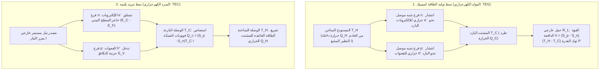
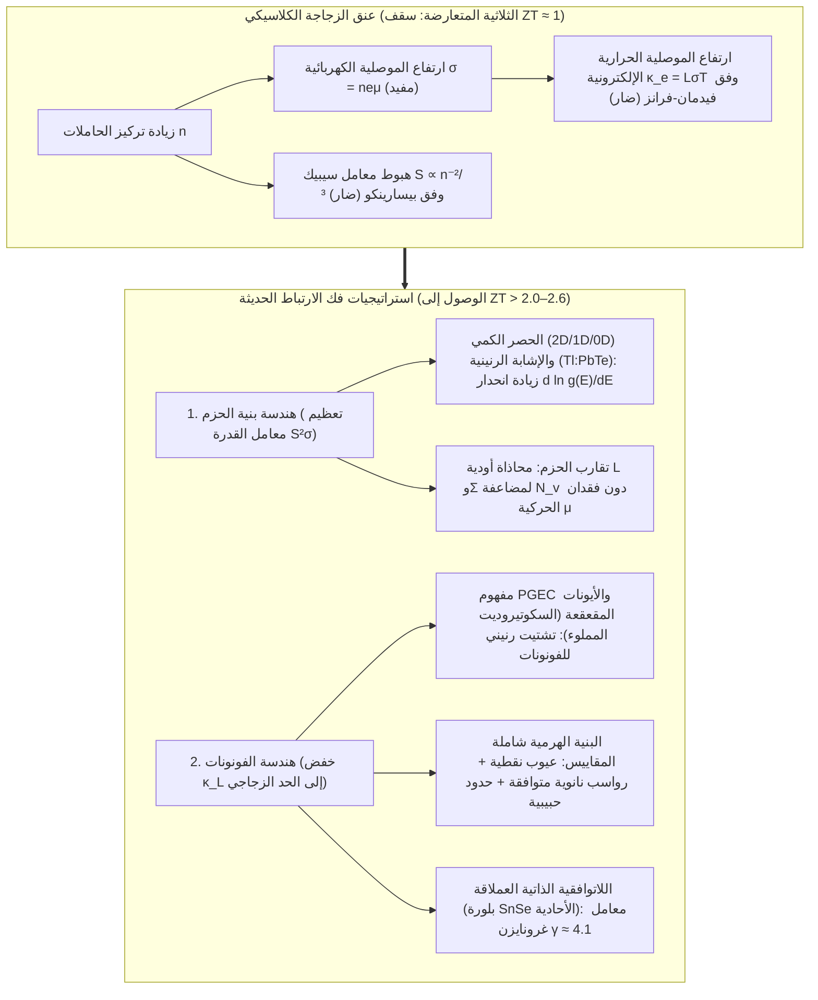

## 1. مقدمة: معجزة الحالة الصلبة التي تربط الحرارة بالكهرباء دون أي أجزاء متحركة

منذ إطلاقتهما في أواخر صيف عام 1977، يواصل المسباران الفضائيان التوأمان التابعان لوكالة ناسا <strong>«فوياجر 1» (Voyager 1)</strong> و<strong>«فوياجر 2» (Voyager 2)</strong> رحلتهما عبر الفضاء بين النجمي — على بعد أكثر من 24 مليار كيلومتر من الشمس — لأكثر من 47 عاماً مع الاستمرار في إرسال البيانات إلى الأرض. عند هذه المسافة الهائلة، تنخفض شدة الإشعاع الشمسي إلى أقل من واحد من عشرة آلاف من قيمتها عند الأرض، مما يجعل الألواح الشمسية عديمة الجدوى؛ كما أن أي محرك حراري ميكانيكي يعتمد على المكابس أو التوربينات كان سيتعطل منذ عقود بفعل التآكل.

إن القلب النابض الذي يمد مسباري فوياجر بالطاقة طوال نصف قرن هو <strong>المولد الكهرحراري بالنظائر المشعة (RTG)</strong>: مصدر طاقة من الحالة الصلبة يحول فرق درجات الحرارة بين حرارة اضمحلال ألفا للبلوتونيوم-238 ($^{238}\text{Pu}$، $T_H \approx 1273\,\text{K}$) وبرودة الفضاء السحيق ($T_C \approx 573\,\text{K}$) مباشرة إلى تيار كهربائي مستمر باستخدام مزدوجات أشباه موصلات السيليكون-الجرمانيوم ($\text{SiGe}$). وعلى الأرض، يعمل القانون الفيزيائي ذاته في الاتجاه المعاكس داخل <strong>عناصر بلتييه (المبردات الكهرحرارية TEC)</strong>: فبدون قطرة واحدة من غاز التبريد أو ضاغط ميكانيكي، يؤدي مرور تيار كهربائي إلى تجميد أحد الوجهين الخزفيين، وتثبيت الطول الموجي لليزر اتصالات الألياف البصرية DWDM بدقة $\pm 0.01\,\text{K}$، وتشغيل أجهزة تفاعل البوليميراز المتسلسل (PCR)، وتبريد مستشعرات التصوير الفلكي CCD.

لماذا يولد التدرج الحراري فرق جهد كهربائي، ولماذا يضخ التيار الكهربائي الحرارة؟ ولماذا لم تحل المولدات الكهرحرارية محل التوربينات البخارية في محطات الطاقة؟ تكمن الإجابة في واحدة من أعقد معضلات فيزياء المادة المكثفة: <strong>الثلاثية المتعارضة (المقايضة الأساسية) بين معامل سيبيك $S$، والموصلية الكهربائية $\sigma$، والموصلية الحرارية $\kappa$</strong>.

---

## 2. توحيد التأثيرات الكهرحرارية الكلاسيكية الثلاثة وعلاقات أونساغر التبادلية

ترتكز الكهرحرارية على ثلاث ظواهر اكتُشفت في القرن التاسع عشر: <strong>تأثير سيبيك (1821)</strong>، و<strong>تأثير بلتييه (1834)</strong>، و<strong>تأثير طومسون (1851)</strong>.

### 2.1 تأثير سيبيك: التوسع الحراري لتوزيع فيرمي-ديراك وتوازن الانتشار والانجراف

عندما يخضع موصل أو شبه موصل في دائرة مفتوحة ($\mathbf{J} = 0$) لتدرج حراري مكاني $\nabla T$، ينشأ تلقائياً مجال كهروستاتيكي داخلي $\mathbf{E} = -\nabla V$ (أو بدقة $-\nabla \tilde{\mu}/e$) يتناسب طردياً مع $\nabla T$:

$$\nabla V = -S \nabla T \quad \Longleftrightarrow \quad S = -\frac{\Delta V}{\Delta T}$$

يُعرف الثابت $S$ (بوحدة $\mu\text{V/K}$ أو $\text{V/K}$) باسم <strong>معامل سيبيك (Seebeck coefficient)</strong> أو القوة الدافعة الكهرحرارية. ويُفسَّر مجهرياً عبر <strong>دالة توزيع فيرمي-ديراك</strong>:

$$f(E, T) = \frac{1}{\exp\left(\frac{E - \mu}{k_B T}\right) + 1}$$

1. <strong>التوسع الحراري لسطح فيرمي عند الطرف الساخن</strong>: عند درجة حرارة $T > 0$، تتسع حافة فيرمي ضمن نافذة طاقية $\sim 2k_B T$. ويحتوي الطرف الساخن ($T_H$) على كثافة أعلى بكثير من حاملات الشحنة عالية الطاقة فوق مستوى فيرمي $E_F$ مقارنة بالطرف البارد ($T_C$).
2. <strong>التوازن الديناميكي بين الانتشار الحراري والانجراف الكهروستاتيكي</strong>: تنتشر الحاملات الساخنة نحو الطرف البارد. ففي <strong>شبه الموصل من النوع n</strong> تتراكم الإلكترونات السالبة ($q = -e$) عند الطرف البارد ($S_n < 0$)؛ وفي <strong>شبه الموصل من النوع p</strong> تتراكم الفجوات الموجبة ($q = +e$) عند الطرف البارد ($S_p > 0$). يولّد هذا الفصل الشحني مجالاً كهربائياً داخلياً يدفع تيار انجراف معاكساً حتى <strong>يتعادل تيار الانتشار الحراري مع تيار الانجراف الكهروستاتيكي تماماً ($\mathbf{J}_{\text{diff}} + \mathbf{J}_{\text{drift}} = 0$)</strong>. وعند توصيل فرعي p وn <strong>حرارياً على التوازي وكهربائياً على التوالي</strong> (مزدوجة $\pi$)، يتجمع جهد الدائرة المفتوحة: $V_{\text{oc}} = (S_p - S_n)(T_H - T_C)$.

### 2.2 صيغة موت وعلاقة بيسارينكو

باستخدام مفكوك سومرفيلد لمعادلة بولتزمان للنقل، يخضع معامل سيبيك في أشباه الموصلات المنحلة <strong>لصيغة موت (Mott Formula)</strong>:

$$S = -\frac{\pi^2 k_B^2 T}{3e} \left. \frac{d \ln \sigma(E)}{dE} \right|_{E = E_F}$$

حيث $\sigma(E) = \frac{1}{3} e^2 g(E) v^2(E) \tau(E)$ هي الموصلية الطيفية و$g(E)$ هي كثافة الحالات الإلكترونية (DOS). <strong>يقيس معامل سيبيك إذن عدم التناظر الطاقي للتوصيل حول مستوى فيرمي $E_F$</strong>. ولحزمة طاقة مكافئة ثلاثية الأبعاد مع تشتت الفونونات الصوتية، تؤول صيغة موت إلى <strong>علاقة بيسارينكو (Pisarenko Relation)</strong>:

$$S = \frac{8 \pi^2 k_B^2}{3 e h^2} m^* T \left( \frac{\pi}{3n} \right)^{2/3}$$

يتطلب الحصول على معامل سيبيك كبير <strong>(1) كتلة فعالة ثقيلة لكثافة الحالات $m^*$</strong> و<strong>(2) تركيز حاملات شحنة منخفضاً $n$ ($S \propto n^{-2/3}$)</strong>.

### 2.3 تأثير بلتييه، وتأثير طومسون، وعلاقات كلفن-أونساغر التبادلية

عندما يمر تيار مستمر $I$ عبر وصلة متساوية الحرارة بين مادتين مختلفتين A وB، تُمتص الحرارة أو تنبعث بشكل عكوس بمعدل:

$$\dot{Q}_P = (\Pi_A - \Pi_B) I = \Pi_{AB} I$$

مجهرياً، عندما ينتقل إلكترون من المعدن ($E \approx E_F$) إلى حزمة التوصيل في شبه موصل من النوع n ($E_{\text{trans}} > E_C$) عند الوصلة الباردة، يتعين عليه <strong>تسلق حاجز طاقي $\Delta E = E_{\text{trans}} - E_F > 0$</strong> عبر امتصاص الفونونات من الشبكة البلورية مما يبرّد الوصلة؛ وعند الوصلة الساخنة يهبط عائداً إلى $E_F$ مطلقاً فائض طاقته كفونونات. وبالمثل يصف <strong>تأثير طومسون</strong> (1851) التبادل الحراري العكوس $\dot{q}_{\text{total}} = \frac{\mathbf{J}^2}{\sigma} - \mathcal{K}_T (\mathbf{J} \cdot \nabla T)$ في موصل متجانس تحت تدرج حراري $\nabla T$.

وفي الديناميكا الحرارية الخطية لغير الاتزان التي صاغها لارس أونساغر (1931، جائزة نوبل 1968)، يرتبط تيار الشحنة $\mathbf{J}_e$ وتدفق الحرارة $\mathbf{J}_Q$ بالمصفوفة الحركية:

$$\begin{pmatrix} \mathbf{J}_e \\ \mathbf{J}_Q \end{pmatrix} = \begin{pmatrix} L_{11} & L_{12} \\ L_{21} & L_{22} \end{pmatrix} \begin{pmatrix} -\frac{1}{e}\nabla \tilde{\mu} \\ \nabla \left(\frac{1}{T}\right) \end{pmatrix}$$

يفرض تناظر انعكاس الزمن المجهري <strong>علاقة أونساغر التبادلية $L_{12} = L_{21}$</strong>، ومنها تنتج مباشرة <strong>علاقتا كلفن</strong>:

$$\Pi = S \cdot T, \qquad \mathcal{K}_T = T \frac{dS}{dT}$$

وهذا يكشف المعنى الفيزيائي العميق لمعامل سيبيك: <strong>إن $S = \frac{\Pi}{T}$ هو بالضبط الإنتروبيا المنقولة لكل وحدة شحنة كهربائية ($S = S_{\text{carrier}} / q$)!</strong>

---

## 3. الاشتقاق الديناميكي الحراري لمعامل الجدارة $ZT$ والكفاءة القصوى وقدرة التبريد

### 3.1 الكفاءة القصوى $\eta_{\max}$ للمولد الكهرحراري (TEG)

لمزدوجة كهرحرارية تعمل بين $T_H$ و$T_C$ ($\Delta T = T_H - T_C$) بمقاومة داخلية $R$ ومواصلة حرارية $K$ ومعامل سيبيك $S = S_p - S_n$، تُعطى الحرارة المسحوبة من المصدر الساخن $Q_H$ والقدرة الكهربائية $P$ المسلمة للحمل $R_L$ بالعلاقتين:

$$Q_H = S T_H I + K (T_H - T_C) - \frac{1}{2} I^2 R, \qquad P = I^2 R_L = S(T_H - T_C)I - I^2 R$$

وبتحسين النسبة الهندسية لتقليل الجداء $RK$، تتجمع خصائص المادة في <strong>معامل الجدارة اللابعدي $ZT$</strong> الذي قدمه أبرام يوفي (1949):

$$ZT = \frac{S^2 \sigma T}{\kappa} = \frac{S^2 \sigma T}{\kappa_e + \kappa_L}$$

حيث $PF = S^2 \sigma$ هو <strong>معامل القدرة</strong> و$\kappa = \kappa_e + \kappa_L$ هو مجموع الموصلية الحرارية الإلكترونية $\kappa_e$ والشبكية (الفونونية) $\kappa_L$. وبتعظيم الكفاءة $\eta(m) = P / Q_H$ بالنسبة إلى $m = R_L / R$ نجد $m_{\text{opt}} = \sqrt{1 + Z\bar{T}}$ ($\bar{T} = \frac{T_H + T_C}{2}$) و<strong>معادلة الكفاءة القصوى</strong>:

$$\eta_{\max} = \underbrace{\frac{T_H - T_C}{T_H}}_{\text{كفاءة كارنو }\eta_C} \cdot \underbrace{\frac{\sqrt{1 + Z\bar{T}} - 1}{\sqrt{1 + Z\bar{T}} + \frac{T_C}{T_H}}}_{\text{معامل المادة}}$$

### 3.2 قدرة التبريد الصافية $Q_c$ وأقصى فرق حراري $\Delta T_{\max}$ ومعامل الأداء COP

في مبرد بلتييه (TEC)، يُعطى التوازن الحراري عند الوجه البارد ($T_C$) بالمعادلة:

$$Q_c = \underbrace{(S_p - S_n) T_C I}_{\text{(1) تبريد بلتييه}} - \underbrace{\frac{1}{2} I^2 R}_{\text{(2) التسخين العكسي لجول}} - \underbrace{K (T_H - T_C)}_{\text{(3) التوصيل الحراري العكسي لفورييه}}$$

وبما أن تسخين جول ينمو تربيعياً ($\propto I^2$)، يوجد تيار أمثل $I_{\max} = \frac{S T_C}{R}$ ($\frac{\partial Q_c}{\partial I} = 0$). وعند انعدام الحمل الحراري الخارجي ($Q_c = 0$)، نحصل على <strong>أقصى فرق في درجات الحرارة $\Delta T_{\max}$</strong> و<strong>أقصى معامل أداء $\text{COP}_{\max}$</strong>:

$$\Delta T_{\max} = \frac{1}{2} Z T_C^2, \qquad \text{COP}_{\max} = \frac{T_C}{T_H - T_C} \cdot \frac{\sqrt{1 + Z\bar{T}} - \frac{T_H}{T_C}}{\sqrt{1 + Z\bar{T}} + 1}$$

---

## 4. معضلة الحالة الصلبة الأساسية: الثلاثية المتعارضة لـ $S$ و$\sigma$ و$\kappa$

لماذا يصعب تجاوز حاجز $ZT \approx 1$؟ لأن المعاملات الثلاثة تتصارع عبر تركيز حاملات الشحنة $n$:

1. <strong>تعارض $S$ مع $\sigma$ (مقايضة بيسارينكو)</strong>: زيادة $n$ ترفع $\sigma = n e \mu$، لكنها تخفض $S \propto m^* n^{-2/3}$ بشدة. أما زيادة الكتلة الفعالة $m^*$ فتخفض الحركية $\mu = \frac{e\tau}{m^*}$.
2. <strong>تعارض $\sigma$ مع $\kappa_e$ (قانون فيدمان-فرانز)</strong>: الإلكترونات نفسها تنقل الشحنة والحرارة معاً وفق:

$$\frac{\kappa_e}{\sigma T} = L = \frac{\pi^2}{3} \left( \frac{k_B}{e} \right)^2 \approx 2.44 \times 10^{-8}\,\text{W}\cdot\Omega\cdot\text{K}^{-2}$$

حيث $L$ هو عدد لورنتز. ولذلك تقع المنطقة المثلى في <strong>أشباه الموصلات المنحلة عالية الإشابة ($n \approx 10^{19}\text{–}10^{20}\,\text{cm}^{-3}$)</strong> مع فجوة طاقة تحقق معيار تشاسمار-ستراتون ($E_g \approx 6\text{–}10\,k_B T$) لكبح التوصيل ثنائي القطب.

| النطاق الحراري | نظام المواد | الحرارة المثلى $T_{\text{opt}}$ | فجوة الطاقة $E_g$ | ذروة $ZT$ النموذجية | البنية البلورية، الفيزياء الأساسية والتطبيقات |
| :--- | :--- | :--- | :--- | :--- | :--- |
| <strong>التبريد الفائق إلى الغرفة</strong> ($< 450\,\text{K}$) | سبائك $\text{Bi}_2\text{Te}_3$ | $250\text{–}400\,\text{K}$ | $\sim 0.15\,\text{eV}$ | $0.8\text{–}1.4$ | بنية طبقية معينية، تعدد أودية $N_v=6$. المعيار العالمي لمبردات بلتييه (TEC). |
| <strong>الحرارة المتوسطة I</strong> ($500\text{–}850\,\text{K}$) | $\text{PbTe}$ وTAGS-85 | $600\text{–}800\,\text{K}$ | $\sim 0.30\,\text{eV}$ | $1.2\text{–}2.2$ | بنية مكعبة. <strong>تقارب الحزم</strong> L–$\Sigma$ ($N_v = 4 \to 16$)، إشابة رنينية بـ $\text{Tl}$ ورواسب نانوية $\text{SrTe}$. عربات المريخ MMRTG. |
| <strong>الحرارة المتوسطة II</strong> ($550\text{–}900\,\text{K}$) | السكوتيروديت المملوء ($\text{Ba}_x\text{La}_y\text{Yb}_z\text{Co}_4\text{Sb}_{12}$) | $700\text{–}850\,\text{K}$ | $\sim 0.3\,\text{eV}$ | $1.2\text{–}1.8$ | بنية أقفاص ($\text{CoSb}_3$). الأيونات الضيفة «تقعقع» لا توافقياً (<strong>آلية PGEC</strong>) فتشتت الفونونات. عوادم السيارات. |
| <strong>المتوسطة–العالية</strong> ($650\text{–}1000\,\text{K}$) | بلورة $\text{SnSe}$ الأحادية | $750\text{–}923\,\text{K}$ | $\sim 0.86\,\text{eV}$ | $2.2\text{–}2.6+$ | بنية طبقية مطوية ($Pnma \to Cmcm$). <strong>لاتوافقية شبكية ذاتية عملاقة</strong> ($\gamma \approx 4.1$) تعطي $\kappa_L \approx 0.23\,\text{W/(m}\cdot\text{K)}$. |
| <strong>الحرارة العالية</strong> ($700\text{–}1100\,\text{K}$) | سبائك Half-Heusler ($\text{ZrNiSn}$, $\text{NbFeSb}$) | $800\text{–}1050\,\text{K}$ | $\sim 0.5\,\text{eV}$ | $1.0\text{–}1.5$ | متانة ميكانيكية فائقة، غير سامة، معامل قدرة ضخم ($PF > 50\,\mu\text{W cm}^{-1}\text{K}^{-2}$). أفران الصلب والصناعة. |
| <strong>الحرارة فوق العالية</strong> ($900\text{–}1300\,\text{K}$) | سبائك $\text{SiGe}$ ($\text{Si}_{0.8}\text{Ge}_{0.2}$) | $1000\text{–}1273\,\text{K}$ | $\sim 0.8\,\text{eV}$ | $0.8\text{–}1.3$ | شبكة تساهمية ماسية مستقرة عند $1000\,^\circ\text{C}$. تغذي مولدات RTG لمسباري فوياجر ونيو هورايزونز. |

---

## 5. كسر سقف $ZT \approx 1$: هندسة الحزم وهندسة الفونونات الحديثة

1. <strong>مفهوم PGEC («زجاج الفونونات – بلورة الإلكترونات»، غلين سلاك، 1995)</strong>: في <strong>السكوتيروديت المملوء ($\text{CoSb}_3$)</strong> والكلathrates، تهتز الأيونات الضيفة داخل الأقفاص الذرية بشكل لا توافقي («rattling») فتشتت الفونونات الصوتية دون إعاقة الإلكترونات.
2. <strong>هندسة بنية الحزم</strong>: يتيح <strong>الحصر الكمي منخفض الأبعاد</strong> (هيكس ودريسلهوس، 1993)، و<strong>الإشابة بالمستويات الرنينية</strong> ($\text{Tl}:\text{PbTe}$، هيريمانز وآخرون، 2008)، و<strong>تقارب الحزم</strong> ($m^* = N_v^{2/3} m^*_b$، محاذاة حزمتي $L$ و$\Sigma$ لرفع التعدد إلى $N_v = 16$) رفع $S$ دون التضحية بالحركية $\mu$.
3. <strong>الهندسة الفونونية الهرمية شاملة المقاييس وبلورة $\text{SnSe}$</strong>: عبر دمج العيوب النقطية الذرية والرواسب النانوية المتوافقة ($\text{SrTe}$) والحدود الحبيبية الميزوسكوبية (كاناتزيديس وآخرون، 2012) جرى تشتيت كامل طيف الفونونات ($ZT \approx 2.2$). وفي عام 2014، حققت البلورة الأحادية <strong>$\text{SnSe}$</strong> رقماً قياسياً بلغ <strong>$ZT = 2.6 \pm 0.3$ عند $923\,\text{K}$</strong> بفضل اللاتوافقية الشبكية الذاتية العملاقة ($\gamma \approx 4.1$، $\kappa_L \approx 0.23\,\text{W/(m}\cdot\text{K)}$).

---

## 6. التطبيقات العملية وآفاق المستقبل: من مسابير الفضاء إلى الكهرحرارية الدورانية (Spin Caloritronics)

1. <strong>استكشاف الفضاء العميق (RTG وMMRTG)</strong>: من مزدوجات $\text{SiGe}$ في *فوياجر 1 و2* و*نيو هورايزونز* إلى مولدات <strong>MMRTG</strong> ($\text{PbTe/TAGS}$) في عربتي المريخ *كيوريوسيتي* و*بيرسيفيرانس* ومروحية *دراغون فلاي* النووية المتجهة إلى تيتان.
2. <strong>الإدارة الحرارية الدقيقة (TEC)</strong>: تثبيت حرارة ليزر اتصالات DWDM في حدود $\pm 0.01\,\text{K}$، وأجهزة PCR الطبية، والتبريد الخالي من الاهتزاز لمستشعرات الفلك والأشعة تحت الحمراء.
3. <strong>استرجاع الحرارة المهدرة، والكهرحرارية القابلة للارتداء، والكهرحرارية الدورانية</strong>: مستشعرات إنترنت الأشياء الصناعي (IIoT) ذاتية التغذية، وأشباه الموصلات غير العضوية المطيلة ($\text{Ag}_2\text{S}$) والبوليمرات الموصلة (PEDOT:PSS) لحصاد حرارة الجسم، إضافة إلى <strong>تأثير سيبيك المغزلي (SSE)</strong> و<strong>تأثير نيرنست الشاذ (ANE، $\mathbf{E}_{\text{ANE}} \propto \mathbf{M} \times \nabla T$)</strong> في أشباه معادن فايل المغناطيسية الطوبولوجية.
