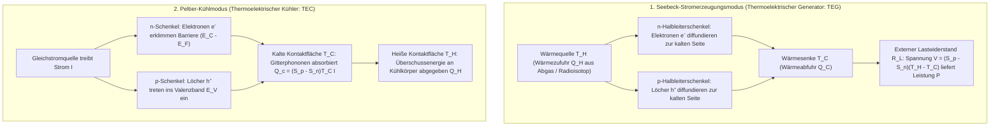
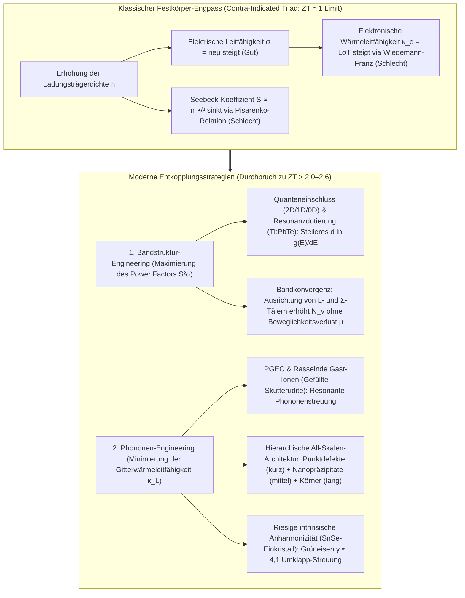

## 1. Einleitung: Das Festkörperwunder, das Wärme und Elektrizität ohne bewegliche Teile verbindet

Seit ihrem Start im Spätsommer 1977 rasen die beiden NASA-Raumsonden <strong>Voyager 1</strong> und <strong>Voyager 2</strong> durch den interstellaren Raum – heute über 24 Milliarden Kilometer von der Sonne entfernt – und senden noch immer Funksignale zur Erde. In dieser gewaltigen Entfernung sinkt die Sonneneinstrahlung auf weniger als ein Zehntausendstel des Erdwerts, sodass Solarzellen völlig nutzlos sind. Zudem wäre jede konventionelle Wärmekraftmaschine mit beweglichen Kolben, Turbinenschaufeln oder Lagern nach einem halben Jahrhundert ohne Wartung längst durch Verschleiß und Materialermüdung ausgefallen.

Das schlagende Herz der Voyager-Sonden ist der <strong>Radioisotopen-Thermoelektrische Generator (RTG)</strong>: eine Festkörper-Stromquelle, die den Temperaturgradienten zwischen der radioaktiven Zerfallswärme von Plutonium-238 ($^{238}\text{Pu}$, $T_H \approx 1273\,\text{K}$) und der Kälte des Weltraums ($T_C \approx 573\,\text{K}$) über Silizium-Germanium-Halbleiterelemente ($\text{SiGe}$) direkt in Gleichstrom umwandelt. Auf der Erde arbeitet exakt dasselbe physikalische Gesetz in umgekehrter Richtung in <strong>Peltier-Elementen (Thermoelektrischen Kühlern, TECs)</strong>: Ohne einen Tropfen Kältemittel oder einen Kompressor kühlt ein elektrischer Strom eine Keramikseite unter den Gefrierpunkt, stabilisiert Glasfaser-Telekommunikationslaser auf $\pm 0{,}01\,\text{K}$ genau, treibt PCR-Thermocycler an und kühlt astronomische CCD-Sensoren.

Warum erzeugt ein Temperaturgradient eine elektrische Spannung, und warum pumpt ein Strom Wärme? Und weshalb haben thermoelektrische Generatoren Dampfturbinen in Kraftwerken noch nicht abgelöst? Die Antwort liegt in einem der hartnäckigsten Dilemmata der Festkörperphysik: dem <strong>dreifachen Zielkonflikt (Contra-indicated Triad) zwischen Seebeck-Koeffizient $S$, elektrischer Leitfähigkeit $\sigma$ und Wärmeleitfähigkeit $\kappa$</strong>.

---

## 2. Vereinheitlichung der drei klassischen thermoelektrischen Effekte und Onsager-Reziprozität

Die Thermoelektrizität beruht auf drei im 19. Jahrhundert entdeckten Phänomenen: dem <strong>Seebeck-Effekt (1821)</strong>, dem <strong>Peltier-Effekt (1834)</strong> und dem <strong>Thomson-Effekt (1851)</strong>.

### 2.1 Der Seebeck-Effekt: Thermische Verbreiterung der Fermi-Dirac-Verteilung und Diffusions-Drift-Gleichgewicht

Wird ein stromloser Leiter oder Halbleiter ($\mathbf{J} = 0$) einem räumlichen Temperaturgradienten $\nabla T$ ausgesetzt, baut sich im Inneren spontan ein elektrisches Feld $\mathbf{E} = -\nabla V$ (genauer: ein Gradient des elektrochemischen Potenzials $-\nabla \tilde{\mu}/e$) proportional zu $\nabla T$ auf:

$$\nabla V = -S \nabla T \quad \Longleftrightarrow \quad S = -\frac{\Delta V}{\Delta T}$$

Die Proportionalitätskonstante $S$ (in $\mu\text{V/K}$ oder $\text{V/K}$) heißt <strong>Seebeck-Koeffizient</strong> oder <strong>Thermokraft</strong>. Mikroskopisch folgt dieser Effekt direkt aus der <strong>Fermi-Dirac-Verteilungsfunktion</strong> der Ladungsträger:

$$f(E, T) = \frac{1}{\exp\left(\frac{E - \mu}{k_B T}\right) + 1}$$

1. <strong>Thermische Aufweichung der Fermi-Kante am heißen Ende</strong>: Bei $T > 0$ wird die Fermi-Stufe über ein Energiefenster von $\sim 2k_B T$ verschmiert. Am heißen Ende ($T_H$) existieren deutlich mehr hochenergetische, schnelle Ladungsträger oberhalb des Fermi-Niveaus $E_F$ als am kalten Ende ($T_C$).
2. <strong>Dynamisches Gleichgewicht zwischen Thermodiffusion und elektrostatischer Drift</strong>: Die energiereichen Ladungsträger diffundieren vom heißen zum kalten Ende. In einem <strong>n-Halbleiter</strong> sammeln sich negativ geladene Elektronen ($q = -e$) am kalten Ende an ($S_n < 0$); in einem <strong>p-Halbleiter</strong> sammeln sich positiv geladene Löcher ($q = +e$) am kalten Ende an ($S_p > 0$). Das resultierende innere elektrische Feld treibt einen entgegengesetzten Driftstrom an, bis im stationären Zustand <strong>Thermodiffusionsstrom und elektrostatischer Driftstrom einander exakt kompensieren ($\mathbf{J}_{\text{diff}} + \mathbf{J}_{\text{drift}} = 0$)</strong>. Durch Verschaltung von p- und n-Schenkeln <strong>thermisch parallel und elektrisch in Reihe</strong> ($\pi$-Paar) addiert sich die Leerlaufspannung zu $V_{\text{oc}} = (S_p - S_n)(T_H - T_C)$.

### 2.2 Mott-Formel und Pisarenko-Relation

Über die Sommerfeld-Entwicklung der Boltzmann-Transportgleichung erhält man für entartete Halbleiter und Metalle die <strong>Mott-Formel</strong>:

$$S = -\frac{\pi^2 k_B^2 T}{3e} \left. \frac{d \ln \sigma(E)}{dE} \right|_{E = E_F}$$

wobei $\sigma(E) = \frac{1}{3} e^2 g(E) v^2(E) \tau(E)$ die spektrale Leitfähigkeit und $g(E)$ die elektronische Zustandsdichte (DOS) ist. <strong>Der Seebeck-Koeffizient misst somit die Energie-Asymmetrie der Leitung um das Fermi-Niveau $E_F$</strong>: Je steiler $g(E)$ bei $E_F$ ansteigt, desto größer ist $|S|$. Für ein isotropes 3D-Parabolband mit akustischer Phononenstreuung liefert die Mott-Formel die <strong>Pisarenko-Relation</strong>:

$$S = \frac{8 \pi^2 k_B^2}{3 e h^2} m^* T \left( \frac{\pi}{3n} \right)^{2/3}$$

Ein hoher Seebeck-Koeffizient erfordert folglich <strong>(1) eine hohe effektive Zustandsdichtemasse $m^*$</strong> und <strong>(2) eine niedrige Ladungsträgerdichte $n$ ($S \propto n^{-2/3}$)</strong>.

### 2.3 Peltier-Effekt, Thomson-Effekt und Kelvin-Onsager-Reziprozität

Fließt ein Gleichstrom $I$ durch den isothermen Kontakt zweier unterschiedlicher Materialien A und B, wird an der Grenzfläche reversibel eine Wärmeleistung $\dot{Q}_P$ absorbiert oder freigesetzt:

$$\dot{Q}_P = (\Pi_A - \Pi_B) I = \Pi_{AB} I$$

Mikroskopisch müssen Elektronen beim Übertritt vom Metall ($E \approx E_F$) in das Leitungsband eines n-Halbleiters ($E_{\text{trans}} > E_C$) am kalten Kontakt eine <strong>Potenzialbarriere $\Delta E = E_{\text{trans}} - E_F > 0$ erklimmen</strong>. Dazu absorbieren sie thermische Energie aus dem Kristallgitter (Vernichtung von Phononen) und kühlen die Grenzfläche ab; am heißen Kontakt fallen sie zurück auf $E_F$ und geben ihre Überschussenergie als Phononen an die Wärmesenke ab. Analog beschreibt der <strong>Thomson-Effekt</strong> (1851) die reversible Wärmeaufnahme oder -abgabe $\dot{q}_{\text{total}} = \frac{\mathbf{J}^2}{\sigma} - \mathcal{K}_T (\mathbf{J} \cdot \nabla T)$ in einem homogenen Leiter mit Temperaturgradient $\nabla T$.

In Lars Onsagers linearer Nichtgleichgewichtsthermodynamik (1931, Nobelpreis 1968) sind elektrischer Strom $\mathbf{J}_e$ und Wärmestrom $\mathbf{J}_Q$ über die Transportmatrix $\mathbf{L}$ gekoppelt:

$$\begin{pmatrix} \mathbf{J}_e \\ \mathbf{J}_Q \end{pmatrix} = \begin{pmatrix} L_{11} & L_{12} \\ L_{21} & L_{22} \end{pmatrix} \begin{pmatrix} -\frac{1}{e}\nabla \tilde{\mu} \\ \nabla \left(\frac{1}{T}\right) \end{pmatrix}$$

Aus der mikroskopischen Zeitumkehrsymmetrie folgt die <strong>Onsagersche Reziprozitätsbeziehung $L_{12} = L_{21}$</strong>, die unmittelbar auf die beiden <strong>Kelvin-Relationen</strong> führt:

$$\Pi = S \cdot T, \qquad \mathcal{K}_T = T \frac{dS}{dT}$$

Physikalisch bedeutet $\Pi = S \cdot T$: <strong>Der Seebeck-Koeffizient $S = \frac{\Pi}{T}$ ist exakt die pro Einheitsladung transportierte Entropie ($S = S_{\text{Träger}} / q$)!</strong>

---

## 3. Thermodynamische Herleitung der Gütezahl $ZT$, des maximalen Wirkungsgrads und der Kühlleistung

### 3.1 Maximaler Wirkungsgrad $\eta_{\max}$ eines thermoelektrischen Generators (TEG)

Für ein Thermopaar zwischen $T_H$ und $T_C$ ($\Delta T = T_H - T_C$) mit Gesamtwiderstand $R$, thermischem Leitwert $K$ und Seebeck-Koeffizient $S = S_p - S_n$ setzt sich der am heißen Ende aufgenommene Wärmestrom $Q_H$ aus Peltier-Wärme, Fourierscher Wärmeleitung und der Hälfte der rückfließenden Jouleschen Stromwärme zusammen, während am Lastwiderstand $R_L$ die elektrische Leistung $P$ abfällt:

$$Q_H = S T_H I + K (T_H - T_C) - \frac{1}{2} I^2 R, \qquad P = I^2 R_L = S(T_H - T_C)I - I^2 R$$

Minimiert man das Geometrieprodukt $RK$, so bündeln sich alle Materialeigenschaften in der von Abram F. Ioffe (1949) eingeführten <strong>dimensionslosen Gütezahl (Figure of Merit) $ZT$</strong>:

$$ZT = \frac{S^2 \sigma T}{\kappa} = \frac{S^2 \sigma T}{\kappa_e + \kappa_L}$$

wobei $PF = S^2 \sigma$ der <strong>elektrische Leistungsfaktor (Power Factor)</strong> ist und $\kappa = \kappa_e + \kappa_L$ die Summe aus elektronischer Wärmeleitfähigkeit $\kappa_e$ und Gitterwärmeleitfähigkeit (Phononen) $\kappa_L$ darstellt. Maximierung von $\eta(m) = P / Q_H$ bezüglich des Widerstandsverhältnisses $m = R_L / R$ liefert die optimale Anpassung $m_{\text{opt}} = \sqrt{1 + Z\bar{T}}$ ($\bar{T} = \frac{T_H + T_C}{2}$) und den <strong>maximalen Wirkungsgrad</strong>:

$$\eta_{\max} = \underbrace{\frac{T_H - T_C}{T_H}}_{\text{Carnot-Wirkungsgrad }\eta_C} \cdot \underbrace{\frac{\sqrt{1 + Z\bar{T}} - 1}{\sqrt{1 + Z\bar{T}} + \frac{T_C}{T_H}}}_{\text{Materialfaktor}}$$

Für $Z\bar{T} \to \infty$ erreicht der Generator den Carnot-Wirkungsgrad $\eta_C$. Bei $Z\bar{T} = 1$ ($T_H = 600\,\text{K}, T_C = 300\,\text{K}$) beträgt $\eta_{\max} \approx 10{,}8\%$; eine Steigerung auf $Z\bar{T} = 3\text{–}4$ hebt $\eta_{\max}$ auf $>20\text{–}25\%$.

### 3.2 Netto-Kühlleistung $Q_c$, maximale Temperaturdifferenz $\Delta T_{\max}$ und Leistungszahl COP

Beim Peltier-Kühler (TEC) lautet die Wärmebilanz an der kalten Seite ($T_C$):

$$Q_c = \underbrace{(S_p - S_n) T_C I}_{\text{(1) Peltier-Kühlung}} - \underbrace{\frac{1}{2} I^2 R}_{\text{(2) Joulesche Rückheizung}} - \underbrace{K (T_H - T_C)}_{\text{(3) Fouriersche Wärmeleitung}}$$

Da die Joulesche Erwärmung quadratisch ($\propto I^2$) wächst, existiert ein optimaler Strom $I_{\max} = \frac{S T_C}{R}$ ($\frac{\partial Q_c}{\partial I} = 0$), oberhalb dessen die Kühlleistung wieder abnimmt! Für verschwindende Kühllast ($Q_c = 0$) folgen die <strong>maximale Temperaturabsenkung $\Delta T_{\max}$</strong> und die <strong>maximale Leistungszahl $\text{COP}_{\max}$</strong>:

$$\Delta T_{\max} = \frac{1}{2} Z T_C^2, \qquad \text{COP}_{\max} = \frac{T_C}{T_H - T_C} \cdot \frac{\sqrt{1 + Z\bar{T}} - \frac{T_H}{T_C}}{\sqrt{1 + Z\bar{T}} + 1}$$

---

## 4. Das fundamentale Festkörper-Dilemma: Der Zielkonflikt von $S$, $\sigma$ und $\kappa$

Warum lässt sich $ZT = \frac{S^2 \sigma T}{\kappa_e + \kappa_L}$ in gewöhnlichen Kristallen kaum über $1$ steigern? Weil alle drei Größen über die Ladungsträgerkonzentration $n$ gegeneinander arbeiten:

1. <strong>Der Konflikt zwischen $S$ und $\sigma$ (Pisarenko-Trade-off)</strong>: Eine Erhöhung von $n$ steigert zwar $\sigma = n e \mu$, lässt aber $S \propto m^* n^{-2/3}$ drastisch einbrechen. Wählt man hingegen schwere effektive Massen $m^*$, sinkt die Beweglichkeit $\mu = \frac{e\tau}{m^*}$.
2. <strong>Der Konflikt zwischen $\sigma$ und $\kappa_e$ (Wiedemann-Franz-Gesetz)</strong>: Dieselben Elektronen, die Ladung transportieren, transportieren auch Wärmeenergie:

$$\frac{\kappa_e}{\sigma T} = L = \frac{\pi^2}{3} \left( \frac{k_B}{e} \right)^2 \approx 2{,}44 \times 10^{-8}\,\text{W}\cdot\Omega\cdot\text{K}^{-2}$$

mit der universellen Lorenz-Zahl $L$. Jede Steigerung von $\sigma$ erhöht proportional $\kappa_e = L\sigma T$. Das Optimum liegt daher bei <strong>hochdotierten, entarteten Halbleitern mit $n \approx 10^{19}\text{–}10^{20}\,\text{cm}^{-3}$</strong> (Chasmar-Stratton-Kriterium $E_g \approx 6\text{–}10\,k_B T$, um bipolare Wärmeleitung zu unterdrücken).

| Temperaturbereich | Repräsentatives Materialsystem | Optimale Temp. $T_{\text{opt}}$ | Bandlücke $E_g$ | Typisches Peak-$ZT$ | Kristallstruktur, Schlüsselphysik & Hauptanwendungen |
| :--- | :--- | :--- | :--- | :--- | :--- |
| <strong>Kryo bis Raumtemp.</strong> ($< 450\,\text{K}$) | $\text{Bi}_2\text{Te}_3$-Legierungen | $250\text{–}400\,\text{K}$ | $\sim 0{,}15\,\text{eV}$ | $0{,}8\text{–}1{,}4$ | Schichtstruktur mit Van-der-Waals-Bindung und 6-facher Tal-Entartung ($N_v=6$). Weltweiter Standard für Peltier-Kühler (TECs). |
| <strong>Mitteltemperatur I</strong> ($500\text{–}850\,\text{K}$) | $\text{PbTe}$ & TAGS-85 | $600\text{–}800\,\text{K}$ | $\sim 0{,}30\,\text{eV}$ | $1{,}2\text{–}2{,}2$ | Steinsalzstruktur. Hohes $ZT$ durch L–$\Sigma$-<strong>Bandkonvergenz</strong> ($N_v = 4 \to 16$), resonante $\text{Tl}$-Dotierung und $\text{SrTe}$-Nanopräzipitate. Mars-Rover MMRTGs. |
| <strong>Mitteltemperatur II</strong> ($550\text{–}900\,\text{K}$) | Gefüllte Skutterudite ($\text{Ba}_x\text{La}_y\text{Yb}_z\text{Co}_4\text{Sb}_{12}$) | $700\text{–}850\,\text{K}$ | $\sim 0{,}3\,\text{eV}$ | $1{,}2\text{–}1{,}8$ | Kubische Käfigstruktur ($\text{CoSb}_3$). Eingelagerte Gast-Ionen „rasseln“ anharmonisch (<strong>PGEC-Mechanismus</strong>) und streuen Phononen. Abwärmenutzung. |
| <strong>Mittel- bis Hochtemp.</strong> ($650\text{–}1000\,\text{K}$) | $\text{SnSe}$ (Zinnselenid-Einkristall) | $750\text{–}923\,\text{K}$ | $\sim 0{,}86\,\text{eV}$ | $2{,}2\text{–}2{,}6+$ | Gefaltete orthorhombische Schichtstruktur ($Pnma \to Cmcm$). <strong>Riesige intrinsische Gitteranharmonizität</strong> ($\gamma \approx 4{,}1$) senkt $\kappa_L$ auf $\approx 0{,}23\,\text{W/(m}\cdot\text{K)}$. |
| <strong>Hochtemperatur</strong> ($700\text{–}1100\,\text{K}$) | Half-Heusler-Legierungen ($\text{ZrNiSn}$, $\text{NbFeSb}$) | $800\text{–}1050\,\text{K}$ | $\sim 0{,}5\,\text{eV}$ | $1{,}0\text{–}1{,}5$ | Mechanisch extrem robust, ungiftig, sehr hoher Leistungsfaktor ($PF > 50\,\mu\text{W cm}^{-1}\text{K}^{-2}$). Industrielle Hochofen-Abwärme. |
| <strong>Ultrahochtemperatur</strong> ($900\text{–}1300\,\text{K}$) | $\text{SiGe}$-Legierungen ($\text{Si}_{0{,}8}\text{Ge}_{0{,}2}$) | $1000\text{–}1273\,\text{K}$ | $\sim 0{,}8\,\text{eV}$ | $0{,}8\text{–}1{,}3$ | Diamantgitter, starke Legierungsstreuung und Sublimationsstabilität bei $1000\,^\circ\text{C}$. Voyager 1 & 2 sowie New Horizons RTGs. |

---

## 5. Durchbruch durch die $ZT \approx 1$-Decke: Modernes Band- und Phononen-Engineering

1. <strong>Glen Slacks PGEC („Phonon-Glass Electron-Crystal“, 1995)</strong>: In <strong>gefüllten Skutteruditen ($\text{CoSb}_3$)</strong> und <strong>Clathraten</strong> bewegen sich Elektronen ungehindert durch das kovalente Kristallgerüst, während in Übergroßen Hohlräumen eingeschlossene Gast-Ionen („Rattler“) lokal anharmonisch schwingen und akustische Phononen bis nahe an das amorphe Glaslimit streuen.
2. <strong>Bandstruktur-Engineering</strong>: Durch <strong>niedrigdimensionalen Quanteneinschluss</strong> (Hicks & Dresselhaus, 1993), <strong>resonante Störstellendotierung</strong> ($\text{Tl}$ in $\text{PbTe}$, Heremans et al., 2008) und <strong>Bandkonvergenz</strong> ($m^* = N_v^{2/3} m^*_b$, Vereinigung von $L$- und $\Sigma$-Valenzbändern auf $N_v = 16$) lässt sich $S$ massiv steigern, ohne die Einzelband-Beweglichkeit $\mu$ zu opfern.
3. <strong>Hierarchische All-Skalen-Phononenstreuung und $\text{SnSe}$</strong>: Da wärmetransportierende Phononen freie Weglängen von $1\,\text{nm}$ bis $1\,\mu\text{m}$ abdecken, kombiniert die <strong>All-Skalen-Architektur</strong> (Kanatzidis et al., 2012) atomare Punktdefekte, kohärente endotaxiale $\text{SrTe}$-Nanopräzipitate und mesoskopische Korngrenzen ($ZT \approx 2{,}2$). In <strong>Zinnselenid-Einkristallen ($\text{SnSe}$)</strong> erzeugt das stereochemisch aktive $5s^2$-Elektronenpaar von $\text{Sn}^{2+}$ eine riesige intrinsische Gitteranharmonizität (Grüneisen-Parameter $\gamma \approx 4{,}1$), die ganz ohne Nanostrukturen $\kappa_L \approx 0{,}23\,\text{W/(m}\cdot\text{K)}$ und <strong>$ZT = 2{,}6 \pm 0{,}3$ bei $923\,\text{K}$</strong> erreicht.

---

## 6. Anwendungen und Zukunft: Von Raumsonden bis zur Spinkaloritronik

1. <strong>Tiefenraum-RTGs und MMRTGs</strong>: Während *Voyager 1 & 2* und *New Horizons* mit Hochtemperatur-$\text{SiGe}$-Elementen fliegen, nutzen die Mars-Rover *Curiosity* und *Perseverance* sowie der geplante Titan-Oktokopter *Dragonfly* den <strong>Multi-Mission RTG (MMRTG)</strong> auf $\text{PbTe/TAGS}$-Basis.
2. <strong>Präzisions-Wärmemanagement (TEC)</strong>: Millikelvin-Stabilisierung ($\pm 0{,}01\,\text{K}$) von DWDM-Telekommunikationslasern, schnelle PCR-Thermocycler und vibrationsfreie Kühlung von Infrarot- und Astronomiedetektoren.
3. <strong>Abwärmerückgewinnung, tragbare Thermoelektrik und Spinkaloritronik</strong>: Autarke IIoT-Sensoren, bei Raumtemperatur duktile anorganische Halbleiter ($\text{Ag}_2\text{S}$) für tragbare Körperwärme-Harvester sowie der <strong>Spin-Seebeck-Effekt (SSE)</strong> und der <strong>Anomale Nernst-Effekt (ANE, $\mathbf{E}_{\text{ANE}} \propto \mathbf{M} \times \nabla T$)</strong> in topologischen Weyl-Halbmetallen eröffnen völlig neue Wege für großflächige, flexible Dünnschicht-Energiewandler.
