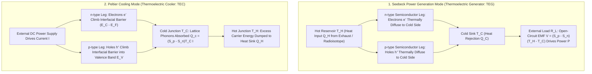
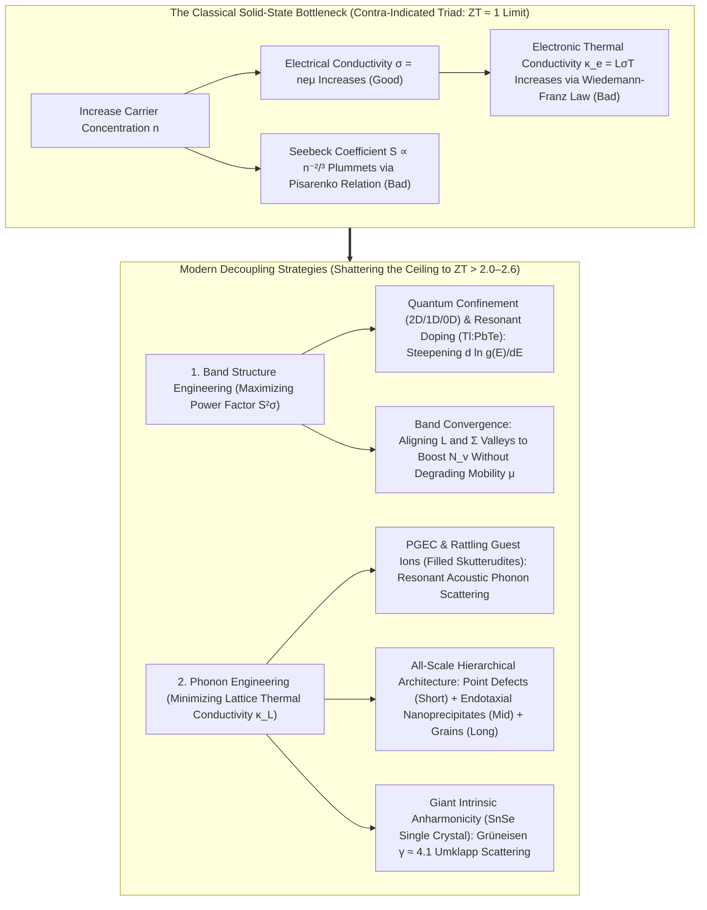

## 1. Introduction: The Solid-State Miracle Linking Heat and Electricity with Zero Moving Parts

Launched in the late summer of 1977, NASA's twin deep-space probes <strong>Voyager 1</strong> and <strong>Voyager 2</strong> have been hurtling through the dark void of interstellar space—now more than 24 billion kilometers from the Sun—for over 47 years, continuously transmitting faint radio telemetry back to Earth. At that staggering distance, solar irradiance drops to less than one ten-thousandth of its intensity at Earth's orbit, rendering photovoltaic solar arrays completely useless. Furthermore, in an unforgiving environment where mechanical maintenance is impossible for half a century, any conventional heat engine relying on moving pistons, spinning turbine blades, bearings, or circulating working fluids would have seized up or fractured from mechanical wear and fatigue decades ago.

The beating heart sustaining the Voyager spacecraft across half a century is the <strong>Radioisotope Thermoelectric Generator (RTG)</strong>—a solid-state power source that converts the thermal gradient between the radioactive alpha-decay heat of Plutonium-238 ($^{238}\text{Pu}$) and the cryogenic cold of deep space directly into direct-current (DC) electricity. Inside an RTG, there are no boilers, no turbines, and no rotating magnetic coils. Instead, hundreds of silicon-germanium ($\text{SiGe}$) semiconductor couples sit silently across a temperature difference, and the valence and conduction electrons inside their crystal lattices steadily drift from hot to cold, generating hundreds of watts of uninterrupted electrical power.

Closer to home, the exact same physical law operating in reverse quietly powers critical modern technologies. Compact wine chillers, precision temperature controllers that lock the wavelength of fiber-optic telecommunications lasers to within a hundredth of a kelvin ($\pm 0.01\,\text{K}$), rapid polymerase chain reaction (PCR) thermal cyclers used in genetic diagnostics, and cooled astronomical CCD imaging sensors all rely on <strong>Peltier devices (Thermoelectric Coolers: TECs)</strong>. Without a single drop of fluorocarbon refrigerant or a noisy mechanical compressor, driving an electrical current through a sandwich of semiconductor pellets causes one ceramic face to freeze below zero while the opposite face pumps out heat.

These two phenomena—the <strong>Seebeck effect</strong> (generating an electromotive force from a temperature gradient) and the <strong>Peltier effect</strong> (pumping heat across a junction via an electric current)—are two sides of the same fundamental solid-state process: the <strong>coupled transport of charge and entropy</strong> by mobile quasiparticles (electrons and holes) inside a crystal lattice.

Yet a profound scientific question immediately arises. Why haven't thermoelectric generators replaced steam turbines in power plants or captured all the waste heat pouring out of automobile exhaust pipes and industrial furnaces? Why do household refrigerators and air conditioners still rely on century-old vapor-compression cycles rather than silent, solid-state Peltier modules?

The answer lies in one of the most stubborn dilemmas in condensed matter physics: the <strong>contra-indicated triad (fundamental trade-off) among the Seebeck coefficient $S$, electrical conductivity $\sigma$, and thermal conductivity $\kappa$</strong>. Governed by Fermi-Dirac quantum statistics, the <strong>Pisarenko relation</strong>, and the <strong>Wiedemann-Franz law</strong>, any attempt to improve one of these three parameters in a conventional bulk crystal inevitably degrades the other two. In this comprehensive article, we unify the three classical thermoelectric effects through microscopic band theory and Onsager's non-equilibrium thermodynamics, rigorously derive the dimensionless figure of merit $ZT$ and maximum conversion efficiency, dissect the solid-state bottlenecks limiting $ZT$, and explore how modern nanoscale band engineering and hierarchical phonon engineering have shattered the historical $ZT \approx 1$ ceiling toward $ZT > 2.0\text{–}2.6$.

---

## 2. Unifying the Three Classical Thermoelectric Effects: Microscopic Physics and Reciprocal Relations

Thermoelectricity rests upon three historically distinct phenomena discovered in the first half of the nineteenth century: the <strong>Seebeck effect (1821)</strong>, the <strong>Peltier effect (1834)</strong>, and the <strong>Thomson effect (1851)</strong>. Let us examine the microscopic quantum transport mechanisms behind each effect and see how irreversible thermodynamics binds them into a single unified framework.

### 2.1 The Seebeck Effect: Fermi-Dirac Thermal Broadening and Diffusion-Drift Equilibrium

In 1821, the German physicist Thomas Johann Seebeck joined two dissimilar metal wires—bismuth ($\text{Bi}$) and copper ($\text{Cu}$)—into a closed loop and heated one of the two junctions. Observing that a nearby compass needle deflected whenever a temperature difference existed between the junctions, Seebeck initially misinterpreted the phenomenon as "thermomagnetism." Shortly thereafter, Hans Christian Ørsted and others demonstrated that the temperature gradient actually induced an <strong>electromotive force (voltage)</strong> around the circuit, driving an electric current that deflected the magnetic needle via Ampère's law.

In an open-circuit conductor or semiconductor ($\mathbf{J} = 0$) subjected to a spatial temperature gradient $\nabla T$, a built-in electrostatic field $\mathbf{E} = -\nabla V$ (more precisely, a gradient of the electrochemical potential $-\nabla \tilde{\mu}/e$) spontaneously develops in direct proportion to $\nabla T$:

$$\nabla V = -S \nabla T \quad \Longleftrightarrow \quad S = -\frac{\Delta V}{\Delta T}$$

The proportionality constant $S$ (typically measured in $\mu\text{V/K}$ or $\text{V/K}$) is the <strong>Seebeck coefficient</strong> or <strong>thermopower</strong>.

To understand microscopically why a temperature gradient creates a voltage, we examine the energy distribution of mobile charge carriers (conduction-band electrons $e^-$ in an n-type semiconductor, or valence-band holes $h^+$ in a p-type semiconductor) governed by the <strong>Fermi-Dirac distribution function</strong>:

$$f(E, T) = \frac{1}{\exp\left(\frac{E - \mu}{k_B T}\right) + 1}$$

where $E$ is carrier energy, $\mu$ is the chemical potential (Fermi level $E_F$), $k_B \approx 1.381 \times 10^{-23}\,\text{J/K}$ is the Boltzmann constant, and $T$ is absolute temperature.

1. <strong>Thermal Broadening of the Fermi Surface at the Hot End</strong>:
   At absolute zero ($T = 0\,\text{K}$), $f(E, 0)$ is a sharp step function that drops discontinuously from $1$ to $0$ at $E = E_F$. At any finite temperature $T > 0$, thermal excitations smear out the Fermi edge over an energy window of width $\sim 2 k_B T$. When one end of an n-type semiconductor rod is heated to $T_H$ while the other is held at $T_C$ ($T_H > T_C$), the Fermi tail at the hot end extends to significantly higher energies than at the cold end. Consequently, the hot end contains a much higher population of high-energy, high-velocity "hot electrons" above $E_F$.
2. <strong>Net Thermal Diffusion Toward the Cold Junction</strong>:
   Just as gas molecules diffuse from high-temperature (high-kinetic-energy) regions toward low-temperature regions, the energetic electrons at the hot end diffuse toward the cold end with higher thermal velocities and longer mean free paths than the cooler electrons diffusing backward from the cold end.
3. <strong>Dynamic Equilibrium Between Thermal Diffusion and Electrostatic Drift</strong>:
   Under open-circuit conditions, electrons arriving at the cold end cannot leave the material. They accumulate at the cold junction, charging it negatively ($-$), while leaving behind uncompensated ionized donor atoms that charge the hot junction positively ($+$). This spatial charge separation establishes a built-in electrostatic field $\mathbf{E}_{\text{int}} = -\nabla V$ pointing from the hot end to the cold end, which exerts an opposing electrostatic force that pushes electrons back toward the hot end. Within picoseconds, the system reaches a steady-state dynamic equilibrium where the <strong>forward thermal diffusion current is exactly canceled by the backward electrostatic drift current ($\mathbf{J}_{\text{total}} = \mathbf{J}_{\text{diff}} + \mathbf{J}_{\text{drift}} = 0$)</strong>. The steady-state electrostatic potential difference across the terminals is the Seebeck voltage $\Delta V = -S(T_H - T_C)$.

In an <strong>n-type semiconductor</strong>, the majority carriers are negatively charged electrons ($q = -e$), so the cold end becomes negative and $S_n < 0$. In a <strong>p-type semiconductor</strong>, the majority carriers are positively charged holes ($q = +e$); thermal diffusion drives holes to accumulate at the cold end, making it positive and yielding $S_p > 0$. Practical thermoelectric modules exploit this opposite polarity by connecting p-type and n-type legs <strong>thermally in parallel</strong> (both spanning $T_H$ to $T_C$) and <strong>electrically in series</strong> ($\pi$-shaped unicouples). The open-circuit voltage of a single p-n couple adds constructively as $V_{\text{oc}} = (S_p - S_n)(T_H - T_C) = (|S_p| + |S_n|)\Delta T$.

### 2.2 The Mott Formula and the Pisarenko Relation

To link the Seebeck coefficient $S$ directly to the electronic band structure of a solid, we solve the linearized Boltzmann transport equation under the relaxation-time approximation. For degenerate semiconductors and metals (where transport occurs within a narrow energy shell around $E_F$), the Sommerfeld expansion yields the celebrated <strong>Mott formula</strong>:

$$S = -\frac{\pi^2 k_B^2 T}{3e} \left. \frac{d \ln \sigma(E)}{dE} \right|_{E = E_F} = -\frac{\pi^2 k_B^2 T}{3e} \frac{1}{\sigma(E_F)} \left. \frac{d\sigma(E)}{dE} \right|_{E = E_F}$$

Here, $\sigma(E) = \frac{1}{3} e^2 g(E) v^2(E) \tau(E)$ is the <strong>differential spectral conductivity</strong> at energy $E$, determined by the electronic density of states (DOS) $g(E)$, the carrier group velocity $v(E) = \frac{1}{\hbar}\nabla_{\mathbf{k}} E$, and the scattering relaxation time $\tau(E)$.

The Mott formula reveals a profound physical insight: <strong>the Seebeck coefficient measures the energy asymmetry of electrical conduction across the Fermi level $E_F$</strong>. At the hot end, states above $E_F$ ($E > E_F$) are populated with excess electrons that diffuse toward the cold end, while states below $E_F$ ($E < E_F$) have a deficit of electrons, causing cold-end electrons in that lower energy range to diffuse toward the hot end. If $\sigma(E)$ were completely flat and symmetric around $E_F$ ($\left.\frac{d\sigma(E)}{dE}\right|_{E_F} = 0$), the forward current of hot electrons above $E_F$ and the backward current of cold electrons below $E_F$ would carry equal magnitudes of charge in opposite directions, canceling the net voltage ($S = 0$). Maximizing $|S|$ therefore requires a band structure where the density of states $g(E)$ or scattering time $\tau(E)$ varies as steeply as possible with energy right at $E_F$.

For a 3D isotropic parabolic band ($E = \frac{\hbar^2 k^2}{2m^*}$) with acoustic phonon scattering ($\tau(E) \propto E^{-1/2}$), evaluating the Mott formula in terms of carrier concentration $n = \frac{8\pi}{3}\left(\frac{2m^* E_F}{h^2}\right)^{3/2}$ yields the <strong>Pisarenko relation</strong>:

$$S = \frac{8 \pi^2 k_B^2}{3 e h^2} m^* T \left( \frac{\pi}{3n} \right)^{2/3}$$

where $h$ is Planck's constant and $m^*$ is the density-of-states effective mass. The Pisarenko relation dictates that achieving a large Seebeck coefficient requires <strong>(1) a heavy effective mass $m^*$</strong> (flat electronic bands or high valley degeneracy $N_v$) and <strong>(2) a low carrier concentration $n$ ($S \propto n^{-2/3}$)</strong>. As we shall see in Section 4, both requirements clash directly with high electrical conductivity $\sigma = ne\mu$.

### 2.3 The Peltier Effect: Reversible Latent Heat of Carriers Crossing Interfacial Barriers

In 1834, the French physicist Jean Charles Athanase Peltier discovered the inverse phenomenon: when an external DC current $I$ is driven across the isothermal junction between two dissimilar conductors A and B, heat is either absorbed (cooling the junction) or released (heating the junction) at a rate $\dot{Q}_P$ strictly linear in the current $I$:

$$\dot{Q}_P = (\Pi_A - \Pi_B) I = \Pi_{AB} I$$

Here $\Pi_A$ and $\Pi_B$ are the intrinsic <strong>Peltier coefficients</strong> (units: $\text{V}$ or $\text{J/C}$) of the two materials. Unlike irreversible Joule heating ($\dot{Q}_J = I^2 R \ge 0$), which dissipates energy throughout the bulk regardless of current direction, the Peltier effect is a <strong>thermodynamically reversible interfacial phenomenon</strong>: reversing the polarity of the current $I \to -I$ instantaneously switches a heat-absorbing (cooling) junction into a heat-rejecting (heating) junction.

Microscopically, the Peltier effect is understood by tracking the potential and kinetic energy of charge carriers as they cross a metal–semiconductor interface:
1. <strong>Inside the metal interconnect</strong> (e.g., copper), electrons travel right at the Fermi level $E_F$, carrying minimal excess thermal energy relative to $E_F$.
2. <strong>Inside an n-type semiconductor leg</strong>, the Fermi level $E_F$ lies near or slightly below the conduction band edge $E_C$. Mobile electrons capable of carrying current through the semiconductor must occupy states above $E_C$, at an average transport energy $E_{\text{trans}} = E_C + \Delta E_k$ (where $\Delta E_k \sim \frac{3}{2} k_B T$ is the average kinetic energy weighted by conductivity).
3. <strong>At the Cold Junction (Metal $\to$ n-type Semiconductor)</strong>: When an electron is forced by the external power supply to cross from the metal into the n-type semiconductor, it must <strong>climb an energy barrier of height $\Delta E = E_{\text{trans}} - E_F > 0$</strong>. To gain this potential and kinetic energy, the electron absorbs thermal energy from the surrounding crystal lattice (annihilating acoustic phonons). Deprived of phonon energy, the junction cools down—a solid-state analog of the latent heat of evaporation in a liquid-vapor refrigerator, with electrons acting as the working fluid!
4. <strong>At the Hot Junction (n-type Semiconductor $\to$ Metal)</strong>: When the electron exits the n-type semiconductor into the opposite metal electrode, it drops from the high transport level $E_{\text{trans}}$ back down to the metal's Fermi level $E_F$, dumping its excess energy $\Delta E = E_{\text{trans}} - E_F$ into the crystal lattice by emitting phonons. This junction consequently heats up.

In the adjacent p-type semiconductor leg, positively charged holes ($h^+$) travel in the direction of conventional current, absorbing phonon heat at the cold junction as they drop into deeper valence-band states ($E < E_V$) and releasing heat at the hot junction as they recombine with electrons at the metal electrode. By arranging p-type and n-type legs in an alternating $\pi$-configuration, every top junction absorbs heat while every bottom junction rejects heat, creating a solid-state heat pump.

### 2.4 The Thomson Effect and the Kelvin–Onsager Reciprocal Relations

In 1851, William Thomson (Lord Kelvin) analyzed the thermodynamic cycle of a thermoelectric circuit using the First and Second Laws of Thermodynamics and predicted a third phenomenon: the <strong>Thomson effect</strong>. When an electric current density $\mathbf{J}$ flows through a <em>single homogeneous conductor</em> along which a temperature gradient $\nabla T$ is maintained, reversible heat is continuously absorbed or evolved throughout the volume of the conductor:

$$\dot{q}_{\text{total}} = \frac{\mathbf{J}^2}{\sigma} - \mathcal{K}_T (\mathbf{J} \cdot \nabla T)$$

where $\mathcal{K}_T$ is the <strong>Thomson coefficient</strong>. Physically, because the Seebeck coefficient $S(T)$—which represents the entropy transported per unit charge—changes with temperature along the rod, a carrier moving from temperature $T$ to $T + dT$ must continuously exchange heat $dQ = T\,dS$ with the lattice to adjust its local thermal distribution.

More importantly, Kelvin derived two fundamental equations linking all three thermoelectric coefficients—the <strong>Kelvin relations</strong>:

$$\Pi = S \cdot T \qquad \text{(First Kelvin Relation)}$$

$$\mathcal{K}_T = T \frac{dS}{dT} \qquad \text{(Second Kelvin Relation)}$$

Because thermoelectric circuits inevitably involve irreversible entropy production (Joule heating $I^2 R$ and Fourier heat conduction $- \kappa \nabla T$), Kelvin's reversible thermodynamic argument remained controversial until 1931, when Lars Onsager formulated his <strong>reciprocal relations of linear non-equilibrium thermodynamics</strong> (Nobel Prize in Chemistry, 1968).

In Onsager's formulation, the coupled electric current density $\mathbf{J}_e$ (or particle flux $\mathbf{J}_N = -\mathbf{J}_e/e$) and heat flux density $\mathbf{J}_Q$ are driven by their conjugate thermodynamic forces—the electrochemical potential gradient $-\frac{1}{e}\nabla \tilde{\mu}$ and the inverse temperature gradient $\nabla\left(\frac{1}{T}\right) = -\frac{\nabla T}{T^2}$—via the linear kinetic matrix:

$$\begin{pmatrix} \mathbf{J}_e \\ \mathbf{J}_Q \end{pmatrix} = \begin{pmatrix} L_{11} & L_{12} \\ L_{21} & L_{22} \end{pmatrix} \begin{pmatrix} -\frac{1}{e}\nabla \tilde{\mu} \\ \nabla \left(\frac{1}{T}\right) \end{pmatrix}$$

Here, the diagonal coefficients $L_{11} = \sigma$ and $L_{22}$ govern direct electrical conduction (Ohm's law) and thermal conduction (Fourier's law). The off-diagonal cross-coupling coefficients $L_{12}$ and $L_{21}$ govern thermoelectric conversion: $L_{12}$ describes electric current driven by a temperature gradient (Seebeck effect), while $L_{21}$ describes heat flux driven by an electric potential gradient (Peltier effect). By invoking <strong>microscopic time-reversal invariance</strong> of the underlying equations of motion in the absence of an external magnetic field, Onsager proved that the kinetic matrix is strictly symmetric:

$$L_{12} = L_{21}$$

Setting $\mathbf{J}_e = 0$ (open circuit) gives the Seebeck coefficient $S \equiv \frac{-\nabla \tilde{\mu}/e}{\nabla T} = \frac{1}{T^2} \frac{L_{12}}{L_{11}} T = \frac{L_{12}}{T L_{11}}$. Setting $\nabla T = 0$ (isothermal junction) gives the Peltier coefficient $\Pi \equiv \left(\frac{\mathbf{J}_Q}{\mathbf{J}_e}\right)_{\nabla T = 0} = \frac{L_{21}}{L_{11}}$. Substituting Onsager's reciprocity $L_{12} = L_{21}$ immediately yields the <strong>First Kelvin Relation</strong>:

$$\Pi = \frac{L_{21}}{L_{11}} = T \left(\frac{L_{12}}{T L_{11}}\right) = S \cdot T$$

This identity reveals the deepest thermodynamic meaning of the Seebeck coefficient: <strong>$S = \frac{\Pi}{T}$ is precisely the entropy transported per unit electric charge ($S = \frac{S_{\text{carrier}}}{q}$)</strong>. A material with a large Seebeck coefficient is simply one in which each mobile charge carrier carries a large packet of thermal entropy!

---

## 3. Thermodynamic Derivation of the Figure of Merit $ZT$, Maximum Efficiency, and Cooling Capacity

How efficiently can a thermoelectric module convert heat into electricity, or pump heat out of a cold chamber? Let us derive the governing equations for both power generation (TEG) and refrigeration (TEC) from first-principles energy balance.

### 3.1 Maximum Conversion Efficiency $\eta_{\max}$ of a Thermoelectric Generator (TEG)

Consider a unicouple consisting of one p-type leg and one n-type leg operating between a hot reservoir at $T_H$ and a cold sink at $T_C$ ($\Delta T = T_H - T_C$), connected in series with an external load resistance $R_L$. Let $S = S_p - S_n$ be the combined couple Seebeck coefficient, $R = R_p + R_n = \left(\frac{\rho_p L_p}{A_p} + \frac{\rho_n L_n}{A_n}\right)$ be the total internal electrical resistance, and $K = K_p + K_n = \left(\frac{\kappa_p A_p}{L_p} + \frac{\kappa_n A_n}{L_n}\right)$ be the total parallel thermal conductance of the two legs.

When a current $I$ flows through the circuit, the rate of heat $Q_H$ extracted from the hot reservoir at $T = T_H$ is governed by three physical processes:

$$Q_H = \underbrace{S T_H I}_{\text{(1) Peltier Heat Absorption at } T_H} + \underbrace{K (T_H - T_C)}_{\text{(2) Fourier Thermal Conduction}} - \underbrace{\frac{1}{2} I^2 R}_{\text{(3) Half of Bulk Joule Heat Returned to } T_H}$$

The factor of $\frac{1}{2}$ in the third term arises from solving the 1D steady-state heat diffusion equation $- \kappa \frac{d^2 T}{dx^2} = J^2 \rho$ along the leg length: uniform internal Joule heating $I^2 R$ splits equally between the hot boundary ($-\frac{1}{2} I^2 R$ reducing net heat input) and the cold boundary ($+\frac{1}{2} I^2 R$ adding to waste heat).

Meanwhile, the electrical power $P$ delivered to the external load $R_L$ is the open-circuit Seebeck power minus internal Ohmic dissipation:

$$P = I^2 R_L = S(T_H - T_C) I - I^2 R$$

The thermal-to-electrical conversion efficiency $\eta$ is the ratio of useful electrical output power $P$ to the heat input $Q_H$:

$$\eta = \frac{P}{Q_H} = \frac{I^2 R_L}{S T_H I + K(T_H - T_C) - \frac{1}{2} I^2 R}$$

Introducing the dimensionless load-to-internal resistance ratio $m \equiv \frac{R_L}{R}$, the circuit current is $I = \frac{S(T_H - T_C)}{R(1 + m)}$. Substituting $I$ into $\eta$ reveals that all material and geometric parameters collapse into a single product $R K$. Minimizing $R K$ with respect to the cross-sectional area ratio $A_p / A_n$ defines the intrinsic material <strong>Figure of Merit $Z$</strong> (units: $\text{K}^{-1}$), first formalized by Abram Fedorovich Ioffe in 1949:

$$Z = \frac{S^2}{R K} = \frac{S^2 \sigma}{\kappa} \quad \Longrightarrow \quad ZT = \frac{S^2 \sigma T}{\kappa} = \frac{S^2 \sigma T}{\kappa_e + \kappa_L}$$

Multiplying $Z$ by the absolute operating temperature $T$ (or mean temperature $\bar{T} = \frac{T_H + T_C}{2}$) gives the <strong>dimensionless figure of merit $ZT$</strong>, where the numerator $PF = S^2 \sigma$ is the <strong>electrical power factor</strong> and the denominator $\kappa = \kappa_e + \kappa_L$ is the total thermal conductivity (sum of electronic $\kappa_e$ and lattice/phonon $\kappa_L$ contributions).

To find the maximum possible conversion efficiency $\eta_{\max}$, we differentiate $\eta(m)$ with respect to the resistance ratio $m$ and set $\frac{d\eta}{dm} = 0$. Because the current $I$ also alters the Peltier heat flux $S T_H I$ and Joule heat $I^2 R$, maximum efficiency does <em>not</em> occur at the standard impedance-matching condition $m = 1$ (which maximizes raw output power $P$), but rather at the thermally coupled impedance ratio:

$$m_{\text{opt}} = \frac{R_L}{R} = \sqrt{1 + Z\bar{T}}$$

Substituting $m_{\text{opt}} = \sqrt{1 + Z\bar{T}}$ into the efficiency equation yields the fundamental equation of thermoelectric power generation:

$$\eta_{\max} = \underbrace{\frac{T_H - T_C}{T_H}}_{\text{Carnot Efficiency }\eta_C} \cdot \underbrace{\frac{\sqrt{1 + Z\bar{T}} - 1}{\sqrt{1 + Z\bar{T}} + \frac{T_C}{T_H}}}_{\text{Material Reduction Factor}}$$

This equation encapsulates the entire thermodynamic landscape of thermoelectricity:
- The first factor $\eta_C = \frac{T_H - T_C}{T_H}$ is the <strong>Carnot efficiency</strong>—the absolute ceiling imposed by the Second Law of Thermodynamics on any heat engine operating between $T_H$ and $T_C$.
- The second factor is a monotonically increasing function of $Z\bar{T}$. In the hypothetical limit $Z\bar{T} \to \infty$ (zero thermal conductivity $\kappa \to 0$ and zero electrical resistivity), the second factor approaches $1$, proving that a solid-state thermoelectric generator is a true heat engine capable in principle of reaching the Carnot limit.
- At $Z\bar{T} = 1$ (typical of commercial $\text{Bi}_2\text{Te}_3$ or $\text{PbTe}$ modules) operating between $T_C = 300\,\text{K}$ and $T_H = 600\,\text{K}$ ($\eta_C = 50\%$), the material factor is $\frac{\sqrt{2}-1}{\sqrt{2}+0.5} \approx 0.216$, giving $\eta_{\max} \approx 10.8\%$. Raising $Z\bar{T}$ to $2.0$ boosts $\eta_{\max}$ to $\sim 16.6\%$; reaching $Z\bar{T} = 3.0\text{–}4.0$ pushes $\eta_{\max}$ to $21\%\text{–}25\%$ (half of Carnot), which would allow solid-state modules to compete directly with mechanical Rankine and Stirling engines!

### 3.2 Net Heat Balance, Maximum Temperature Differential $\Delta T_{\max}$, and COP in Peltier Cooling

Now consider a Peltier cooler (TEC) driven by an external DC current $I$ to extract heat from a cold stage at $T_C$ and reject it to a heat sink at $T_H$. The <strong>net cooling power (heat pumping capacity) $Q_c$</strong> at the cold junction is given by the balance of three competing mechanisms:

$$Q_c = \underbrace{(S_p - S_n) T_C I}_{\text{(1) Peltier Cooling}} - \underbrace{\frac{1}{2} I^2 R}_{\text{(2) Joule Back-Heating}} - \underbrace{K (T_H - T_C)}_{\text{(3) Fourier Thermal Back-Conduction}}$$

Every practical characteristic of a Peltier cooler follows directly from the interplay of these three terms:
1. <strong>Linear Peltier Absorption ($S T_C I$)</strong>: Scales linearly with current $I$. At low currents, increasing $I$ increases cooling power.
2. <strong>Quadratic Joule Back-Heating ($-\frac{1}{2} I^2 R$)</strong>: Half of the resistive heat generated inside the semiconductor legs flows back into the cold plate. Because Joule heating grows quadratically ($\propto I^2$) while Peltier cooling grows only linearly ($\propto I$), <strong>driving too much current through a Peltier device is counterproductive</strong>. Beyond an optimal current $I_{\max}$, the $I^2 R$ parabola overtakes the linear $S T_C I$ term, and the Peltier cooler turns into a net heater!
3. <strong>Fourier Thermal Leakage ($-K \Delta T$)</strong>: As the cold face drops further below the hot-sink temperature $T_H$, parasitic heat conduction flowing backward through the legs from $T_H$ to $T_C$ grows linearly with $\Delta T = T_H - T_C$. Furthermore, the hot side must reject the total thermal load $Q_H = Q_c + P_{\text{in}} = S T_H I + \frac{1}{2} I^2 R - K \Delta T$. If the hot-side heat sink or fan is inadequate, $T_H$ rises rapidly, driving Fourier back-conduction through the roof and causing thermal runaway on the cold side.

To find the <strong>maximum achievable temperature difference $\Delta T_{\max} = (T_H - T_C)_{\max}$</strong>, we first maximize $Q_c$ with respect to current $I$ via $\frac{\partial Q_c}{\partial I} = S T_C - I R = 0$, obtaining the optimal current:

$$I_{\max} = \frac{S T_C}{R}$$

Substituting $I_{\max}$ into the cooling equation and setting the external heat load to zero ($Q_c = 0$, meaning all net Peltier cooling goes toward fighting internal Fourier back-conduction) yields:

$$0 = S T_C \left(\frac{S T_C}{R}\right) - \frac{1}{2} \left(\frac{S T_C}{R}\right)^2 R - K \Delta T_{\max} = \frac{1}{2} \frac{S^2 T_C^2}{R} - K \Delta T_{\max}$$

Dividing by $K$ and substituting $Z = \frac{S^2}{RK}$ gives the classic formula for the maximum temperature drop of a single-stage Peltier cooler:

$$\Delta T_{\max} = \frac{1}{2} Z T_C^2 = \frac{1}{2} (Z T_C) T_C$$

For a commercial $\text{Bi}_2\text{Te}_3$ module with $Z \approx 3.0 \times 10^{-3}\,\text{K}^{-1}$ operating at $T_C \approx 270\,\text{K}$ ($ZT_C \approx 0.81$), the theoretical maximum temperature drop is $\Delta T_{\max} \approx 109\,\text{K}$ (practically $\sim 68\text{–}75\,\text{K}$ after accounting for ceramic substrate thermal resistance and electrical contact resistance). To reach cryogenic temperatures ($\Delta T > 100\text{–}130\,\text{K}$, down to $-100\,^\circ\text{C}$), engineers stack multiple stages into a pyramid-shaped <strong>multi-stage cascade TEC</strong>, where each wider lower stage pumps away the combined $Q_c + P_{\text{in}}$ rejected by the narrower upper stage.

Similarly, maximizing the <strong>Coefficient of Performance ($\text{COP} \equiv \frac{Q_c}{P_{\text{in}}}$)</strong> with respect to current yields:

$$\text{COP}_{\max} = \underbrace{\frac{T_C}{T_H - T_C}}_{\text{Carnot COP}} \cdot \frac{\sqrt{1 + Z\bar{T}} - \frac{T_H}{T_C}}{\sqrt{1 + Z\bar{T}} + 1}$$

Once again, $ZT$ is the universal figure of merit governing both maximum cooling efficiency and maximum temperature differential.

---

## 4. The Fundamental Solid-State Dilemma: The Contra-Indicated Triad of $S$, $\sigma$, and $\kappa$

Looking at the definition $ZT = \frac{S^2 \sigma T}{\kappa_e + \kappa_L}$, the recipe for an ideal thermoelectric material appears deceptively simple: maximize the Seebeck coefficient $S$, maximize the electrical conductivity $\sigma$, and minimize the thermal conductivity $\kappa = \kappa_e + \kappa_L$. Yet in any conventional 3D crystalline solid, these three transport coefficients are tightly coupled through the carrier concentration $n$, forming a <strong>contra-indicated triad</strong> where improving one property systematically ruins the other two.

### 4.1 Why Tuning Carrier Concentration $n$ Triggers a Three-Way Conflict

Suppose we attempt to boost $ZT$ by doping a semiconductor to increase its charge carrier concentration $n$:

1. <strong>The $S$ vs. $\sigma$ Conflict (The Pisarenko Trade-off)</strong>:
   Electrical conductivity is given by $\sigma = n e \mu$, where $\mu = \frac{e\tau}{m^*_{\text{cond}}}$ is the carrier mobility. Increasing the carrier concentration $n$ linearly increases $\sigma$ (Desired). However, pushing more carriers into the band raises the Fermi level $E_F$ deeper into the conduction or valence band, reducing the logarithmic energy derivative of the density of states at $E_F$. By the Pisarenko relation derived in Section 2.2:
   $$S = \frac{8 \pi^2 k_B^2}{3 e h^2} m^* T \left( \frac{\pi}{3n} \right)^{2/3} \propto m^* n^{-2/3}$$
   <strong>Increasing $n$ causes the Seebeck coefficient $S$ to plummet as $n^{-2/3}$ (Undesired)</strong>. Even worse, if we attempt to restore $S$ by choosing a material with a heavy effective mass $m^*$ (flat bands), the carrier mobility $\mu = \frac{e\tau}{m^*}$ drops precipitously because heavy carriers accelerate slowly and scatter more frequently, crushing $\sigma$!

2. <strong>The $\sigma$ vs. $\kappa_e$ Conflict (The Wiedemann–Franz Law)</strong>:
   What happens to the denominator $\kappa = \kappa_e + \kappa_L$ when we increase $\sigma$? Total thermal conductivity in a solid is carried by two parallel channels: mobile charge carriers ($\kappa_e$) and quantized lattice vibrations or phonons ($\kappa_L$). Because the very same electrons that transport electric charge ($\sigma$) also transport thermal kinetic energy ($\kappa_e$), the two conductivities are locked together by the <strong>Wiedemann–Franz Law</strong> (discovered empirically in 1853 and proven via Sommerfeld's quantum free-electron theory in 1928):
   $$\frac{\kappa_e}{\sigma T} = L = \frac{\pi^2}{3} \left( \frac{k_B}{e} \right)^2 \approx 2.44 \times 10^{-8}\,\text{W}\cdot\Omega\cdot\text{K}^{-2}$$
   where $L$ is the universal <strong>Lorenz number</strong> (ranging from $L = 2(k_B/e)^2 \approx 1.49 \times 10^{-8}\,\text{W}\Omega\text{K}^{-2}$ in non-degenerate semiconductors to $\frac{\pi^2}{3}(k_B/e)^2 \approx 2.44 \times 10^{-8}\,\text{W}\Omega\text{K}^{-2}$ in degenerate metals).
   Consequently, <strong>raising electrical conductivity $\sigma$ inevitably increases the electronic thermal conductivity $\kappa_e = L \sigma T$ in direct lockstep</strong>, short-circuiting the temperature gradient across the device! Notice that even if lattice thermal conductivity were completely eliminated ($\kappa_L \to 0$), the figure of merit would be bounded by $ZT = \frac{S^2 \sigma T}{\kappa_e} = \frac{S^2}{L}$, requiring $S > 156\,\mu\text{V/K}$ just to reach $ZT = 1$.

### 4.2 Insulators, Semiconductors, and Metals: The Heavily Doped Semiconductor Sweet Spot

Comparing the three classes of solids across the carrier concentration spectrum ($n = 10^{14}$ to $10^{23}\,\text{cm}^{-3}$) explains why all practical thermoelectric materials occupy a narrow "Goldilocks zone":

- <strong>Insulators and Intrinsic Semiconductors ($n < 10^{16}\,\text{cm}^{-3}$)</strong>:
  The Fermi level sits deep inside the band gap, giving an enormous Seebeck coefficient ($|S| > 500\text{–}1000\,\mu\text{V/K}$). However, because $\sigma = ne\mu$ is vanishingly small, the power factor $S^2\sigma$ and $ZT$ are nearly zero. Worse still, at elevated temperatures, thermal excitation across the band gap creates both electrons and holes simultaneously. Because electrons ($S_n < 0$) and holes ($S_p > 0$) both diffuse toward the cold end, their Seebeck voltages cancel out, while electron-hole pair recombination at the cold end releases massive latent heat—the catastrophic <strong>bipolar thermal conduction effect ($\kappa_{\text{bipolar}}$)</strong>.
- <strong>Metals ($n \sim 10^{22}\text{–}10^{23}\,\text{cm}^{-3}$)</strong>:
  Metals like copper, silver, and aluminum boast immense electrical conductivity $\sigma$, but their Fermi level lies several electron-volts deep inside the conduction band where $\frac{d\ln g(E)}{dE}$ is tiny. Their Seebeck coefficients are minuscule ($|S| \approx 1\text{–}5\,\mu\text{V/K}$) and their electronic thermal conductivity $\kappa_e \approx 300\text{–}400\,\text{W/(m}\cdot\text{K)}$ is enormous, resulting in dismal figures of merit ($ZT \sim 10^{-4}\text{–}10^{-3}$).
- <strong>Heavily Doped (Degenerate) Semiconductors ($n \approx 10^{19}\text{–}10^{20}\,\text{cm}^{-3}$)</strong>:
  When a narrow-bandgap semiconductor is heavily doped so that the Fermi level $E_F$ sits right at or within $\sim k_B T$ of the band edge, a sweet spot emerges: $S$ remains substantial ($150\text{–}250\,\mu\text{V/K}$) while $\sigma$ reaches $500\text{–}2000\,\text{S/cm}$, maximizing the power factor $PF = S^2 \sigma$. At this carrier density, $\kappa_e$ is still moderate ($\sim 0.5\text{–}1.5\,\text{W/(m}\cdot\text{K)}$), leaving lattice thermal conductivity $\kappa_L$ as the dominant heat-loss channel—a channel that materials scientists can attack using heavy elements (such as $\text{Bi}, \text{Te}, \text{Pb}, \text{Sb}$ with low sound velocities and low Debye temperatures) and nanostructuring.

### 4.3 Comparison of State-of-the-Art Thermoelectric Materials Across Temperature Regimes

Because $ZT(T)$ peaks at a temperature dictated by the semiconductor's band gap—governed by the <strong>Chasmar–Stratton criterion $E_g \approx (6 \text{ to } 10) k_B T_{\text{opt}}$</strong> to suppress bipolar conduction while maintaining high mobility—different material families dominate distinct thermal regimes:

| Temperature Regime | Representative Material System | Optimal Temp. $T_{\text{opt}}$ | Band Gap $E_g$ | Typical Peak $ZT$ | Crystal Structure, Key Physics & Primary Applications |
| :--- | :--- | :--- | :--- | :--- | :--- |
| <strong>Cryogenic to Room Temp.</strong> ($< 450\,\text{K}$) | $\text{Bi}_2\text{Te}_3$ Alloys ($\text{Bi}_2\text{Te}_{3-x}\text{Se}_x$ / $\text{Bi}_{2-x}\text{Sb}_x\text{Te}_3$) | $250\text{–}400\,\text{K}$ | $\sim 0.13\text{–}0.16\,\text{eV}$ | $0.8\text{–}1.4$ | Layered rhombohedral structure with van der Waals bonding and 6-fold valley degeneracy ($N_v = 6$). Universal standard for Peltier coolers (TECs) and low-grade waste-heat harvesting. |
| <strong>Mid-Temperature I</strong> ($500\text{–}850\,\text{K}$) | $\text{PbTe}$ & TAGS-85 ($(\text{GeTe})_{0.85}(\text{AgSbTe}_2)_{0.15}$) | $600\text{–}800\,\text{K}$ | $\sim 0.30\,\text{eV}$ | $1.2\text{–}2.2$ | Rock-salt cubic structure. High $ZT$ via L–$\Sigma$ <strong>band convergence</strong> ($N_v = 4 \to 16$), resonant Tl doping, and endotaxial $\text{SrTe}$ nanoprecipitates. Powers NASA's Mars Curiosity & Perseverance MMRTGs. |
| <strong>Mid-Temperature II</strong> ($550\text{–}900\,\text{K}$) | Filled Skutterudites ($\text{Ba}_x\text{La}_y\text{Yb}_z\text{Co}_4\text{Sb}_{12}$) | $700\text{–}850\,\text{K}$ | $\sim 0.2\text{–}0.4\,\text{eV}$ | $1.2\text{–}1.8$ | Cubic cage framework ($\text{CoSb}_3$). Rare-earth/alkaline-earth guest ions "rattle" anharmonically inside voids (<strong>PGEC mechanism</strong>), scattering acoustic phonons. Automotive & industrial exhaust recovery. |
| <strong>Mid-to-High Temp.</strong> ($650\text{–}1000\,\text{K}$) | $\text{SnSe}$ (Tin Selenide) Single & Polycrystals | $750\text{–}923\,\text{K}$ | $\sim 0.6\text{–}0.86\,\text{eV}$ | $2.2\text{–}2.6+$ | Layered orthorhombic ($Pnma \to Cmcm$) pleated structure. Giant <strong>intrinsic lattice anharmonicity</strong> (Grüneisen parameter $\gamma \approx 4.1$) yields ultralow $\kappa_L \approx 0.23\,\text{W/(m}\cdot\text{K)}$ without extrinsic nanostructures. |
| <strong>High Temperature</strong> ($700\text{–}1100\,\text{K}$) | Half-Heusler Alloys ($\text{ZrNiSn}$, $\text{NbFeSb}$, $\text{TiCoSb}$) | $800\text{–}1050\,\text{K}$ | $\sim 0.5\,\text{eV}$ | $1.0\text{–}1.5$ | $\text{MgAgAs}$-type intermetallic structure. Exceptional mechanical toughness, thermal stability, non-toxicity, and huge power factors ($PF > 50\,\mu\text{W cm}^{-1}\text{K}^{-2}$). Heavy industrial furnace heat recovery. |
| <strong>Ultra-High Temp.</strong> ($900\text{–}1300\,\text{K}$) | $\text{SiGe}$ Alloys ($\text{Si}_{0.8}\text{Ge}_{0.2}$) | $1000\text{–}1273\,\text{K}$ | $\sim 0.7\text{–}0.9\,\text{eV}$ | $0.8\text{–}1.3$ | Diamond cubic covalent network. Strong alloy mass-fluctuation phonon scattering and unmatched resistance to sublimation at $1000\,^\circ\text{C}$. Powers Voyager 1 & 2 and New Horizons deep-space RTGs. |

---

## 5. Breaking the $ZT \approx 1$ Ceiling: Modern Band and Phonon Engineering

From the late 1950s until the mid-1990s, the peak figure of merit of bulk thermoelectric materials plateaued stubbornly around $ZT \approx 1.0$. Breaking through this four-decade ceiling to achieve $ZT > 2.0\text{–}2.6$ required a paradigm shift: finding physical mechanisms that <strong>decouple the contra-indicated triad</strong>—either enhancing $S$ without sacrificing $\sigma$ (band engineering) or crushing $\kappa_L$ down to the amorphous glass limit without scattering electrons (phonon engineering).

### 5.1 Glen Slack's PGEC ("Phonon-Glass Electron-Crystal") and Rattling Cage Compounds

In 1995, Glen A. Slack formulated the guiding design principle of modern phonon engineering: an ideal thermoelectric material should be a <strong>"Phonon-Glass Electron-Crystal" (PGEC)</strong>.
- <strong>Electron-Crystal</strong>: Charge carriers (electrons and holes) experience a highly periodic covalent crystal framework, maintaining long relaxation times $\tau_e$, high mobility $\mu$, and a large power factor $S^2\sigma$.
- <strong>Phonon-Glass</strong>: Heat-carrying lattice vibrations (acoustic phonons) experience severe structural disorder or local anharmonicity, reducing their mean free path $\ell_{\text{ph}}$ down to the interatomic spacing (the Cahill–Pohl minimum thermal conductivity limit $\kappa_{\min} \approx 0.2\text{–}0.5\,\text{W/(m}\cdot\text{K)}$).

Because the Wiedemann–Franz law ($\kappa_e = L \sigma T$) constrains only the electronic thermal conductivity $\kappa_e$, the lattice thermal conductivity $\kappa_L$ is completely independent of $\sigma$ in principle. Slack realized that open-framework crystal structures—specifically <strong>skutterudites ($\text{CoSb}_3$)</strong> and <strong>clathrates ($\text{Ba}_8\text{Ga}_{16}\text{Ge}_{30}$)</strong>—contain large atomic cages (icosahedral or tetrakaidecahedral voids) surrounded by a rigid covalent framework.
1. Electrons travel unimpeded along the rigid $\text{Co}-\text{Sb}$ covalent network, preserving crystalline electrical conductivity $\sigma$.
2. When heavy guest ions (such as lanthanides $\text{La}, \text{Ce}, \text{Yb}$ or alkaline-earth $\text{Ba}$ ions) are inserted into the oversized cages, they are weakly bound and undergo large-amplitude, localized anharmonic oscillations known as <strong>"rattling"</strong>.
3. These localized Einstein-like rattling modes hybridize with and resonantly scatter heat-carrying acoustic phonons across avoided crossings in the phonon dispersion relation, slashing $\kappa_L$ by nearly an order of magnitude. By co-filling the cages with multiple guest species of different masses and spring constants (<strong>multi-filled skutterudites</strong> like $\text{Ba}_x\text{La}_y\text{Yb}_z\text{Co}_4\text{Sb}_{12}$), researchers scatter a broad frequency spectrum of phonons simultaneously, pushing $ZT$ up to $1.7\text{–}1.8$.

### 5.2 Band Structure Engineering: Low-Dimensional Quantum Confinement, Resonant Levels, and Band Convergence

While PGEC attacks the denominator $\kappa_L$, a parallel revolution attacked the Pisarenko trade-off in the numerator $S^2\sigma$ by reshaping the electronic density of states $g(E)$:

1. <strong>Hicks–Dresselhaus Low-Dimensional Quantum Confinement (1993)</strong>:
   In two seminal 1993 papers, Lyndon D. Hicks and Mildred S. Dresselhaus at MIT proved theoretically that confining charge carriers within nanoscale <strong>2D quantum wells (superlattices)</strong>, <strong>1D nanowires</strong>, or <strong>0D quantum dots</strong> fundamentally alters the energy derivative of the density of states:
   - In a 3D bulk crystal, $g_{\text{3D}}(E) \propto E^{1/2}$ varies smoothly and gently with energy.
   - In a 2D quantum well, $g_{\text{2D}}(E)$ becomes a staircase of sharp step functions; in a 1D nanowire, $g_{\text{1D}}(E) \propto (E - E_n)^{-1/2}$ exhibits sharp van Hove singularities; and in a 0D quantum dot, $g_{\text{0D}}(E) = \sum \delta(E - E_n)$ collapses into discrete delta-function spikes.
   Recalling the Mott formula $S \propto \left.\frac{d\ln \sigma(E)}{dE}\right|_{E_F}$, placing the Fermi level $E_F$ right at the sharp edge of a quantum-confined subband dramatically amplifies $\frac{d\ln g(E)}{dE}$, allowing <strong>$S$ and $n$ ($\sigma$) to increase simultaneously</strong> while the closely spaced quantum interfaces scatter phonons whose mean free paths exceed the well thickness ($\ell_{\text{ph}} > d_{\text{well}} > \ell_e$). This prediction sparked a global wave of nanostructured thermoelectrics, including $\text{Bi}_2\text{Te}_3/\text{Sb}_2\text{Te}_3$ superlattices (Venkatasubramanian et al., 2001) and $\text{PbSeTe}$ quantum-dot superlattices (Harman et al., 2002).

2. <strong>Resonant Level Doping (Heremans et al., 2008)</strong>:
   Can we achieve the sharp DOS spikes of low-dimensional quantum dots inside an inexpensive, macroscopic 3D bulk crystal? In 2008, Joseph P. Heremans and coworkers demonstrated exactly this by doping bulk lead telluride ($\text{PbTe}$) with trace amounts of thallium ($\text{Tl}$). The $\text{Tl}$ $6s$ states hybridize resonantly with the valence band of $\text{PbTe}$, creating a sharp resonant distortion ("hump") in the bulk density of states $g(E)$ near $E_F$. This <strong>resonant level enhancement</strong> doubled $ZT$ in p-type $\text{Tl}_{0.02}\text{Pb}_{0.98}\text{Te}$ to $1.5$ at $773\,\text{K}$ by lifting the Seebeck coefficient well above the classical Pisarenko curve.

3. <strong>Band Convergence (Valley Degeneracy Engineering)</strong>:
   Another powerful bulk strategy is aligning multiple electronic valleys in energy. The total density-of-states effective mass $m^*$ (which enhances $S$) is related to the single-valley inertial effective mass $m^*_b$ (which governs mobility $\mu \propto 1/m^*_b$) via the <strong>valley degeneracy $N_v$</strong> (the number of symmetry-equivalent pockets in the Brillouin zone):
   $$m^* = N_v^{2/3} m^*_b$$
   In $\text{PbTe}_{1-x}\text{Se}_x$ or $\text{Mg}_2\text{Si}_{1-x}\text{Sn}_x$, tuning temperature and alloy composition brings a secondary heavy valence band ($\Sigma$ band, $N_v = 12$) into exact energy alignment with the primary light valence band ($L$ band, $N_v = 4$). At the convergence temperature, the effective valley degeneracy jumps to $N_v = 4 + 12 = 16$. This <strong>band convergence</strong> increases $m^*$ by a factor of $4^{2/3} \approx 2.52$—boosting the Seebeck coefficient $S$ and power factor $S^2\sigma$—without making individual carriers heavier or slower inside each valley!

### 5.3 Hierarchical All-Scale Phonon Engineering and Intrinsic Anharmonicity ($\text{SnSe}$)

Why didn't early single-scale纳米precipitates eliminate $\kappa_L$ completely? Because heat in a crystal is not carried by monochromatic phonons of a single wavelength. Instead, acoustic phonons span a <strong>broad mean-free-path ($\ell_{\text{ph}}$) spectrum covering three orders of magnitude</strong>—from atomic distances ($\sim 0.5\text{–}2\,\text{nm}$, carrying $\sim 25\%$ of the heat), through nanoscale lengths ($\sim 2\text{–}100\,\text{nm}$, carrying $\sim 50\%$ of the heat), all the way to sub-micron and mesoscale lengths ($\sim 0.1\text{–}1\,\mu\text{m}$, carrying the remaining $\sim 25\%$). By contrast, the mean free path of charge carriers in a degenerate semiconductor is very short ($\ell_e \sim 1\text{–}10\,\text{nm}$).

In 2012, Mercouri G. Kanatzidis and colleagues at Northwestern University synthesized these length scales into <strong>Hierarchical All-Scale Phonon Engineering</strong> (demonstrated in $\text{Na}$-doped $\text{PbTe}-\text{SrTe}$ with $ZT \approx 2.2$ at $915\,\text{K}$):
1. <strong>Atomic-Scale Point Defects ($\sim 0.1\text{–}1\,\text{nm}$)</strong>: Alloying and substitutional dopants create local mass and strain fluctuations that Rayleigh-scatter <strong>short-wavelength (high-frequency) phonons</strong>.
2. <strong>Nanoscale Endotaxial Precipitates ($\sim 2\text{–}20\,\text{nm}$)</strong>: Coherent $\text{SrTe}$ nanocrystals embedded endotaxially inside the $\text{PbTe}$ matrix strongly scatter <strong>medium-wavelength phonons</strong>. Crucially, because the crystal lattices of the precipitate and host matrix are crystallographically aligned (coherent interfaces with minimal valence-band offset), holes pass right through the interfaces with negligible mobility loss!
3. <strong>Mesoscale Grain Boundaries ($\sim 0.1\text{–}1\,\mu\text{m}$)</strong>: Spark-plasma-sintered (SPS) sub-micron grains scatter the remaining <strong>long-wavelength (low-frequency) phonons</strong> that bypass both point defects and nanoprecipitates.

Then, in 2014, Zhao and Kanatzidis stunned the solid-state physics community by reporting a record <strong>$ZT = 2.6 \pm 0.3$ at $923\,\text{K}$ along the $b$-axis of single-crystal tin selenide ($\text{SnSe}$)</strong>—a simple binary compound free of toxic lead ($\text{Pb}$) and scarce tellurium ($\text{Te}$), containing <em>no extrinsic nanostructures whatsoever</em>. In $\text{SnSe}$, stereochemically active $5s^2$ lone-pair electrons on the $\text{Sn}^{2+}$ ions distort the crystal into a corrugated, accordion-like layered structure ($Pnma$ phase transitioning to $Cmcm$ near $800\,\text{K}$). This bonding geometry produces <strong>giant intrinsic lattice anharmonicity</strong>, quantified by an extraordinarily large Grüneisen parameter ($\gamma \approx 4.1$ along the $a$-axis, compared to $\gamma \approx 1.5$ in normal crystals). Intense three-phonon Umklapp scattering causes phonons to scatter off one another within a few lattice spacings, yielding an intrinsically ultralow lattice thermal conductivity of $\kappa_L \approx 0.23\,\text{W/(m}\cdot\text{K)}$—lower than many amorphous glasses—inside a pristine single crystal!

---

## 6. Real-World Applications and Future Frontiers: From Interstellar Probes to Spin Caloritronics

Having traced the physics from nineteenth-century wire loops to modern quantum engineering, let us examine how thermoelectric technology operates in extreme real-world environments and where the next breakthroughs lie.

### 6.1 Deep-Space Exploration: Radioisotope Thermoelectric Generators (RTGs & MMRTGs)

Nowhere has thermoelectricity proven more irreplaceable than in outer solar system and planetary exploration. Beyond the orbit of Jupiter ($5.2\,\text{AU}$), solar irradiance falls below $50\,\text{W/m}^2$ ($< 3.7\%$ of Earth's solar constant); at Pluto and the Kuiper Belt ($30\text{–}50\,\text{AU}$), sunlight is over $1,000$ times fainter than on Earth. Even on Mars, global dust storms can blot out the Sun for months—as fatally demonstrated when the solar-powered *Opportunity* and *InSight* landers lost power—while the lunar night lasts for 14 Earth days at cryogenic temperatures near $-170\,^\circ\text{C}$.

NASA's deep-space flagship missions rely on <strong>Radioisotope Thermoelectric Generators (RTGs)</strong>, which pair a central heat source of Plutonium-238 dioxide ($^{238}\text{PuO}_2$, half-life $87.7$ years, specific thermal power $\sim 0.54\,\text{W}_{\text{th}}/\text{g}$) with surrounding banks of thermoelectric unicouples:
- <strong>Voyager 1 & 2 (MHW-RTG), Galileo, Cassini, and New Horizons (GPHS-RTG)</strong>:
  These outer-planet missions utilize refractory <strong>silicon-germanium ($\text{SiGe}$) unicouples</strong> operating between $T_H \approx 1273\,\text{K}$ ($1000\,^\circ\text{C}$) at the $^{238}\text{Pu}$ core and $T_C \approx 573\,\text{K}$ ($300\,^\circ\text{C}$) at the radiative cooling fins. Each of the Voyagers launched with three MHW-RTGs producing $470\,\text{W}_{\text{e}}$ total from $\sim 7200\,\text{W}_{\text{th}}$ of decay heat ($\eta \approx 6.5\%$). Despite gradual radioactive decay ($0.78\%$ per year) and thermocouple aging, those solid-state $\text{SiGe}$ legs have operated continuously in the vacuum of space for over $415,000$ hours without a single mechanical failure.
- <strong>Mars Rovers *Curiosity* and *Perseverance*, and the *Dragonfly* Titan Rotorcraft (MMRTG)</strong>:
  Because $\text{SiGe}$ insulation degrades in a planetary atmosphere, NASA developed the <strong>Multi-Mission RTG (MMRTG)</strong>, which uses segmented <strong>$\text{PbTe}$ (n-type) and $\text{TAGS}$ / $\text{PbSnTe}$ (p-type)</strong> couples sealed in an inert argon gas environment, operating between $T_H \approx 810\,\text{K}$ and $T_C \approx 470\,\text{K}$. Delivering $\sim 110\,\text{W}_{\text{e}}$ of continuous electrical power alongside $\sim 2000\,\text{W}_{\text{th}}$ of waste heat (circulated via fluid loops to keep the rover's batteries and instruments warm during frigid Martian nights), the MMRTG also powers <strong>Dragonfly</strong>, NASA's nuclear-powered octocopter scheduled to fly through the dense nitrogen atmosphere of Saturn's moon Titan.

### 6.2 Precision Solid-State Thermal Management (Peltier TECs)

While vapor-compression refrigerators dominate high-capacity household cooling due to their higher COP ($3.0\text{–}4.0$ vs. $0.5\text{–}1.0$ for TECs), Peltier coolers hold an unassailable monopoly wherever <strong>compact size, zero vibration, zero refrigerant, rapid thermal response, and bidirectional millikelvin temperature stabilization</strong> are paramount:

1. <strong>Optical Fiber Telecommunications (DWDM Laser Stabilization)</strong>:
   Modern Dense Wavelength-Division Multiplexing (DWDM) internet backbones pack 80 to 160 distinct laser wavelengths down a single optical fiber, separated by a razor-thin channel spacing of just $0.8\,\text{nm}$ ($100\,\text{GHz}$) or $0.4\,\text{nm}$ ($50\,\text{GHz}$). The emission wavelength of an $\text{InGaAsP}$ distributed-feedback (DFB) semiconductor laser drifts by $\sim 0.1\,\text{nm/K}$. A temperature fluctuation of just $4\,\text{K}$ would cause adjacent optical channels to collide, collapsing global data transmission. Every long-haul optical transceiver package therefore mounts its laser diode directly atop a micro-Peltier cooler controlled by a PID feedback loop, locking the laser junction temperature to within $\pm 0.01\,\text{K}$ across ambient environments ranging from $-40\,^\circ\text{C}$ to $+85\,^\circ\text{C}$.
2. <strong>Biomedical PCR Thermal Cyclers and Semiconductor Lithography</strong>:
   Polymerase Chain Reaction (PCR) DNA amplification requires cycling biological samples rapidly and repeatedly between denaturation ($95\,^\circ\text{C}$), primer annealing ($55\,^\circ\text{C}$), and extension ($72\,^\circ\text{C}$) at ramp rates of $3\text{–}8\,^\circ\text{C/s}$. By simply reversing the H-bridge drive current, Peltier arrays switch seamlessly between high-power heating and active cooling within milliseconds.
3. <strong>Cryogenic Dark-Current Suppression in Astronomical & Infrared Detectors</strong>:
   In astronomical CCD cameras, X-ray spectrometers, and mid-wave infrared ($\text{HgCdTe}$, $\text{InSb}$) focal-plane arrays, thermally excited dark current grows exponentially with temperature ($\propto \exp(-E_g / 2k_B T)$). Multi-stage cascade Peltier coolers chill these sensors down to $-60\,^\circ\text{C}$ to $-100\,^\circ\text{C}$ with <strong>zero mechanical vibration</strong>, preventing microphonic image blur that plagues mechanical Stirling cryocoolers.

### 6.3 Waste-Heat Recovery, Wearable Thermoelectrics, and Spin Caloritronics

Globally, more than <strong>60% of all primary energy consumed by humanity is rejected into the environment as waste heat</strong>—from industrial steel, glass, and cement furnaces, power plant flues, data center server racks, and internal combustion engine exhaust pipes. Because dispersed low-to-medium grade waste heat ($< 250\,^\circ\text{C}$) cannot economically drive mechanical steam turbines, thermoelectric generators offer a uniquely scalable pathway to energy harvesting:
- <strong>Industrial IoT (IIoT) Autonomous Sensor Nodes</strong>:
  Compact TEGs clamped onto warm factory steam pipes or industrial motors ($\Delta T \sim 10\text{–}30\,\text{K}$) generate tens of milliwatts continuously, powering wireless vibration and pressure telemetry sensors indefinitely without battery replacement.
- <strong>Flexible, Organic, and Ductile Wearable Thermoelectrics</strong>:
  Conventional $\text{Bi}_2\text{Te}_3$ is brittle, limiting its conformal contact with curved heat sources like the human body. Recent breakthroughs in conducting polymers (such as doped PEDOT:PSS), carbon nanotube composites, and <strong>room-temperature ductile inorganic semiconductors (such as $\text{Ag}_2\text{S}$-based argyrodites that can be bent and rolled like metals)</strong> enable wearable thermoelectric wristbands and biomedical patches that harvest body heat ($\Delta T \sim 3\text{–}8\,\text{K}$ between skin and ambient air) to power continuous health monitors.
- <strong>Spin Caloritronics and the Anomalous Nernst Effect (ANE)</strong>:
  At the cutting edge of condensed matter physics, researchers are combining spintronics with thermoelectrics—a field known as <strong>spin caloritronics</strong>. Discovered by Eiji Saitoh and colleagues in 2008, the <strong>Spin Seebeck Effect (SSE)</strong> generates a pure spin current parallel to a temperature gradient inside a magnetic insulator (such as $\text{Y}_3\text{Fe}_5\text{O}_{12}$, YIG), which is converted into a transverse electrical voltage in an adjacent heavy-metal film ($\text{Pt}$) via the Inverse Spin Hall Effect. Closely related is the <strong>Anomalous Nernst Effect (ANE)</strong> in topological magnetic Weyl semimetals (such as $\text{Co}_2\text{MnGa}$ and $\text{Fe}_3\text{Ga}$), where a temperature gradient $\nabla T$ induces an electric field perpendicular to both $\nabla T$ and the magnetization $\mathbf{M}$ ($\mathbf{E}_{\text{ANE}} \propto \mathbf{M} \times \nabla T$). Because the voltage develops <em>laterally</em> across the surface rather than vertically along the temperature gradient, ANE/SSE devices replace complex 3D $\pi$-structured pillar arrays with simple, flexible, large-area thin-film coatings that can be wrapped directly around curved pipes and heat exchangers.

---

## 7. Conclusion: The Quantum Dance of Electrons and Phonons

Can we generate electricity from a temperature difference, and cool matter directly with an electric current? Over two centuries of physics have transformed Seebeck's compass deflection and Peltier's freezing junction into a cornerstone of solid-state quantum transport:

1. <strong>Thermodynamic Unification</strong>: The Seebeck effect ($\nabla V = -S\nabla T$) arises from the dynamic balance between Fermi-tail thermal diffusion and electrostatic drift, while the Peltier effect ($\dot{Q}_P = \Pi I$) reflects the reversible latent heat absorbed or released as carriers climb or descend interfacial energy barriers. Onsager's time-reversal reciprocity ($L_{12} = L_{21}$) locks both effects together via the Kelvin relation $\Pi = S \cdot T$, establishing $S$ as the entropy transported per unit charge.
2. <strong>The Figure of Merit $ZT$ and the Contra-Indicated Triad</strong>: Both power-generation efficiency $\eta_{\max}$ and refrigeration capacity ($\Delta T_{\max} = \frac{1}{2} Z T_C^2$) are governed by $ZT = \frac{S^2 \sigma T}{\kappa_e + \kappa_L}$. Because the Pisarenko relation ($S \propto n^{-2/3}$) and the Wiedemann–Franz law ($\kappa_e = L \sigma T$) pit $S$, $\sigma$, and $\kappa_e$ against one another across the carrier concentration spectrum, heavily doped degenerate semiconductors ($n \approx 10^{19}\text{–}10^{20}\,\text{cm}^{-3}$) represent the optimal electronic compromise.
3. <strong>Decoupling Electrons and Phonons</strong>: By exploiting the disparity between short electron mean free paths ($\ell_e \sim 1\text{–}10\,\text{nm}$) and broad phonon mean-free-path spectra ($\ell_{\text{ph}} \sim 1\,\text{nm}\text{–}1\,\mu\text{m}$)—through rattling cage compounds (PGEC), quantum confinement, resonant levels, band convergence, all-scale hierarchical nanostructuring, and intrinsically anharmonic crystals like $\text{SnSe}$—modern materials science has broken the $ZT \approx 1$ barrier, reaching $ZT > 2.0\text{–}2.6$.

From the silent $\text{SiGe}$ thermocouples propelling *Voyager* through interstellar space to the micro-Peltier coolers stabilizing the world's fiber-optic internet and the next generation of waste-heat recovery systems, the coupled flow of electrons and phonons continues to bridge the worlds of heat and electricity with elegance and enduring reliability.
