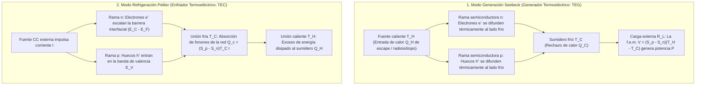
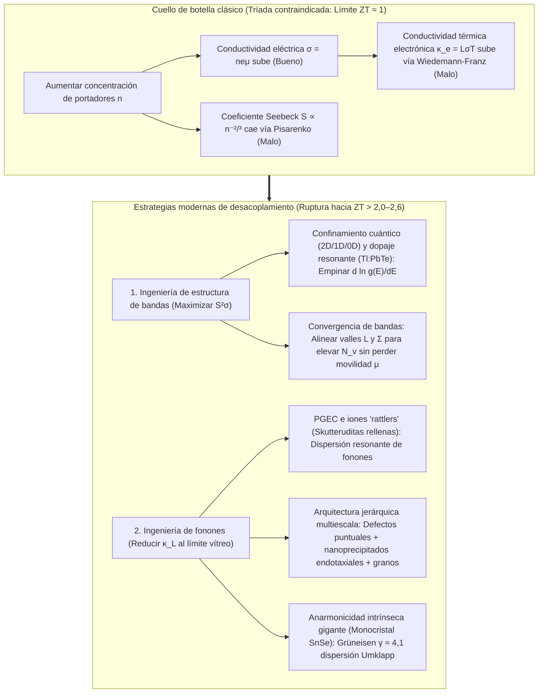

## 1. Introducción: El milagro del estado sólido que une calor y electricidad sin piezas móviles

Lanzadas a finales del verano de 1977, las sondas espaciales gemelas <strong>Voyager 1</strong> y <strong>Voyager 2</strong> de la NASA llevan más de 47 años surcando el vacío interestelar —a más de 24.000 millones de kilómetros del Sol— enviando telemetría a la Tierra. A esa distancia, la irradiancia solar cae a menos de una diezmilésima parte de su valor en la Tierra, inutilizando los paneles solares, y cualquier motor térmico con pistones o turbinas habría fallado hace décadas por desgaste mecánico.

El corazón que mantiene vivas a las Voyager es el <strong>Generador Termoeléctrico de Radioisótopos (RTG)</strong>: una fuente de estado sólido que convierte directamente la diferencia de temperatura entre el calor de desintegración alfa del plutonio-238 ($^{238}\text{Pu}$, $T_H \approx 1273\,\text{K}$) y el frío del espacio ($T_C \approx 573\,\text{K}$) en corriente continua mediante termopares semiconductores de silicio-germanio ($\text{SiGe}$). En la Tierra, la misma ley física invertida impulsa las <strong>celdas Peltier (refrigeradores termoeléctricos, TEC)</strong>: sin refrigerantes ni compresores, una corriente eléctrica congela una cara cerámica, estabiliza láseres de fibra óptica DWDM con precisión de $\pm 0{,}01\,\text{K}$, acciona termocicladores PCR y enfría sensores CCD astronómicos.

¿Por qué un gradiente térmico genera voltaje y una corriente bombea calor? ¿Y por qué los módulos termoeléctricos aún no han sustituido a las turbinas de vapor? La respuesta reside en uno de los dilemas más profundos de la física de la materia condensada: la <strong>tríada contraindicada (compromiso fundamental) entre el coeficiente Seebeck $S$, la conductividad eléctrica $\sigma$ y la conductividad térmica $\kappa$</strong>.

---

## 2. Unificación de los tres efectos termoeléctricos clásicos y reciprocidad de Onsager

La termoelectricidad descansa sobre tres fenómenos descubiertos en el siglo XIX: el <strong>efecto Seebeck (1821)</strong>, el <strong>efecto Peltier (1834)</strong> y el <strong>efecto Thomson (1851)</strong>.

### 2.1 El efecto Seebeck: Ensanchamiento térmico de Fermi-Dirac y equilibrio difusión-deriva

Cuando un conductor o semiconductor en circuito abierto ($\mathbf{J} = 0$) se somete a un gradiente de temperatura $\nabla T$, surge espontáneamente un campo electrostático interno $\mathbf{E} = -\nabla V$ (más exactamente $-\nabla \tilde{\mu}/e$) proporcional a $\nabla T$:

$$\nabla V = -S \nabla T \quad \Longleftrightarrow \quad S = -\frac{\Delta V}{\Delta T}$$

La constante $S$ (en $\mu\text{V/K}$ o $\text{V/K}$) es el <strong>coeficiente Seebeck</strong> o <strong>poder termoeléctrico</strong>. Su origen microscópico se explica mediante la <strong>función de distribución de Fermi-Dirac</strong>:

$$f(E, T) = \frac{1}{\exp\left(\frac{E - \mu}{k_B T}\right) + 1}$$

1. <strong>Ensanchamiento térmico de la superficie de Fermi en el extremo caliente</strong>: A $T > 0$, el escalón de Fermi se difumina en una ventana $\sim 2k_B T$. El extremo caliente ($T_H$) posee una población mucho mayor de portadores de alta energía por encima de $E_F$ que el extremo frío ($T_C$).
2. <strong>Equilibrio dinámico entre difusión térmica y deriva electrostática</strong>: Los portadores calientes se difunden hacia el extremo frío. En un <strong>semiconductor tipo n</strong>, los electrones ($q = -e$) se acumulan en el lado frío ($S_n < 0$); en un <strong>semiconductor tipo p</strong>, los huecos ($q = +e$) se acumulan en el lado frío ($S_p > 0$). El campo eléctrico interno resultante impulsa una corriente de deriva opuesta hasta que <strong>la corriente de difusión térmica y la corriente de deriva electrostática se cancelan exactamente ($\mathbf{J}_{\text{diff}} + \mathbf{J}_{\text{drift}} = 0$)</strong>. Conectando ramas p y n <strong>térmicamente en paralelo y eléctricamente en serie</strong> (unicouple en $\pi$), el voltaje en circuito abierto se suma: $V_{\text{oc}} = (S_p - S_n)(T_H - T_C)$.

### 2.2 Fórmula de Mott y relación de Pisarenko

Mediante la expansión de Sommerfeld de la ecuación de transporte de Boltzmann, el coeficiente Seebeck de un semiconductor degenerado sigue la <strong>fórmula de Mott</strong>:

$$S = -\frac{\pi^2 k_B^2 T}{3e} \left. \frac{d \ln \sigma(E)}{dE} \right|_{E = E_F}$$

donde $\sigma(E) = \frac{1}{3} e^2 g(E) v^2(E) \tau(E)$ es la conductividad espectral y $g(E)$ la densidad de estados electrónicos (DOS). <strong>El coeficiente Seebeck mide la asimetría energética de la conducción alrededor de $E_F$</strong>. Para una banda parabólica 3D isótropa con dispersión por fonones acústicos, se obtiene la <strong>relación de Pisarenko</strong>:

$$S = \frac{8 \pi^2 k_B^2}{3 e h^2} m^* T \left( \frac{\pi}{3n} \right)^{2/3}$$

Lograr un alto coeficiente Seebeck requiere <strong>(1) una gran masa efectiva de densidad de estados $m^*$</strong> y <strong>(2) una baja concentración de portadores $n$ ($S \propto n^{-2/3}$)</strong>.

### 2.3 Efecto Peltier, efecto Thomson y relaciones recíprocas de Kelvin-Onsager

Cuando una corriente continua $I$ atraviesa la unión isoterma entre dos materiales A y B, se absorbe o libera calor reversiblemente a razón de:

$$\dot{Q}_P = (\Pi_A - \Pi_B) I = \Pi_{AB} I$$

Microscópicamente, cuando un electrón pasa del metal ($E \approx E_F$) a la banda de conducción de un semiconductor tipo n ($E_{\text{trans}} > E_C$) en la unión fría, debe <strong>escalar una barrera de energía $\Delta E = E_{\text{trans}} - E_F > 0$</strong> absorbiendo fonones de la red cristalina y enfriando la unión; en la unión caliente, cae de regreso a $E_F$ liberando su exceso de energía en forma de fonones. Asimismo, el <strong>efecto Thomson</strong> (1851) describe el intercambio térmico reversible $\dot{q}_{\text{total}} = \frac{\mathbf{J}^2}{\sigma} - \mathcal{K}_T (\mathbf{J} \cdot \nabla T)$ en un conductor homogéneo con un gradiente $\nabla T$.

En la termodinámica lineal fuera del equilibrio de Lars Onsager (1931, Premio Nobel 1968), los flujos eléctrico $\mathbf{J}_e$ y térmico $\mathbf{J}_Q$ cumplen:

$$\begin{pmatrix} \mathbf{J}_e \\ \mathbf{J}_Q \end{pmatrix} = \begin{pmatrix} L_{11} & L_{12} \\ L_{21} & L_{22} \end{pmatrix} \begin{pmatrix} -\frac{1}{e}\nabla \tilde{\mu} \\ \nabla \left(\frac{1}{T}\right) \end{pmatrix}$$

La invariancia bajo inversión temporal impone la <strong>reciprocidad de Onsager $L_{12} = L_{21}$</strong>, de donde se deducen las <strong>relaciones de Kelvin</strong>:

$$\Pi = S \cdot T, \qquad \mathcal{K}_T = T \frac{dS}{dT}$$

Esto revela que <strong>el coeficiente Seebeck $S = \frac{\Pi}{T}$ es exactamente la entropía transportada por unidad de carga eléctrica ($S = S_{\text{portador}} / q$)</strong>.

---

## 3. Derivación termodinámica de la figura de mérito $ZT$, la eficiencia máxima y la capacidad de enfriamiento

### 3.1 Eficiencia máxima $\eta_{\max}$ de un generador termoeléctrico (TEG)

Para un par termoeléctrico entre $T_H$ y $T_C$ ($\Delta T = T_H - T_C$) con resistencia interna $R$, conductancia térmica $K$ y coeficiente Seebeck $S = S_p - S_n$, el flujo de calor absorbido en el lado caliente $Q_H$ y la potencia eléctrica entregada a la carga $R_L$ son:

$$Q_H = S T_H I + K (T_H - T_C) - \frac{1}{2} I^2 R, \qquad P = I^2 R_L = S(T_H - T_C)I - I^2 R$$

Al optimizar la geometría para minimizar $RK$, las propiedades del material se agrupan en la <strong>figura de mérito adimensional $ZT$</strong> introducida por Abram F. Ioffe (1949):

$$ZT = \frac{S^2 \sigma T}{\kappa} = \frac{S^2 \sigma T}{\kappa_e + \kappa_L}$$

donde $PF = S^2 \sigma$ es el <strong>factor de potencia</strong> y $\kappa = \kappa_e + \kappa_L$ la suma de la conductividad térmica electrónica $\kappa_e$ y de red (fonones) $\kappa_L$. Maximizando $\eta(m) = P / Q_H$ respecto a $m = R_L / R$ se obtiene el acople óptimo $m_{\text{opt}} = \sqrt{1 + Z\bar{T}}$ ($\bar{T} = \frac{T_H + T_C}{2}$) y la <strong>eficiencia máxima de conversión</strong>:

$$\eta_{\max} = \underbrace{\frac{T_H - T_C}{T_H}}_{\text{Eficiencia de Carnot }\eta_C} \cdot \underbrace{\frac{\sqrt{1 + Z\bar{T}} - 1}{\sqrt{1 + Z\bar{T}} + \frac{T_C}{T_H}}}_{\text{Factor de reducción del material}}$$

### 3.2 Potencia de enfriamiento $Q_c$, diferencia máxima de temperatura $\Delta T_{\max}$ y COP en celdas Peltier

En un enfriador Peltier (TEC), el balance térmico en la cara fría ($T_C$) es:

$$Q_c = \underbrace{(S_p - S_n) T_C I}_{\text{(1) Enfriamiento Peltier}} - \underbrace{\frac{1}{2} I^2 R}_{\text{(2) Retorno de calor de Joule}} - \underbrace{K (T_H - T_C)}_{\text{(3) Conducción térmica de Fourier}}$$

Como el calentamiento de Joule crece cuadráticamente ($\propto I^2$), existe una corriente óptima $I_{\max} = \frac{S T_C}{R}$ ($\frac{\partial Q_c}{\partial I} = 0$). Con carga térmica nula ($Q_c = 0$), la <strong>caída máxima de temperatura $\Delta T_{\max}$</strong> y el <strong>coeficiente de desempeño máximo $\text{COP}_{\max}$</strong> son:

$$\Delta T_{\max} = \frac{1}{2} Z T_C^2, \qquad \text{COP}_{\max} = \frac{T_C}{T_H - T_C} \cdot \frac{\sqrt{1 + Z\bar{T}} - \frac{T_H}{T_C}}{\sqrt{1 + Z\bar{T}} + 1}$$

---

## 4. El dilema fundamental del estado sólido: La tríada contraindicada de $S$, $\sigma$ y $\kappa$

¿Por qué es tan difícil superar $ZT \approx 1$? Porque los tres parámetros compiten entre sí a través de la concentración de portadores $n$:

1. <strong>Conflicto $S$ vs $\sigma$ (compromiso de Pisarenko)</strong>: Aumentar $n$ eleva $\sigma = n e \mu$, pero desploma $S \propto m^* n^{-2/3}$. Aumentar la masa efectiva $m^*$ reduce la movilidad $\mu = \frac{e\tau}{m^*}$.
2. <strong>Conflicto $\sigma$ vs $\kappa_e$ (ley de Wiedemann-Franz)</strong>: Los mismos electrones que transportan carga transportan calor según:

$$\frac{\kappa_e}{\sigma T} = L = \frac{\pi^2}{3} \left( \frac{k_B}{e} \right)^2 \approx 2{,}44 \times 10^{-8}\,\text{W}\cdot\Omega\cdot\text{K}^{-2}$$

donde $L$ es el número de Lorenz. Por ello, el punto óptimo se encuentra en los <strong>semiconductores degenerados fuertemente dopados ($n \approx 10^{19}\text{–}10^{20}\,\text{cm}^{-3}$)</strong> con brecha energética acorde al criterio de Chasmar-Stratton ($E_g \approx 6\text{–}10\,k_B T$) para suprimir la conducción bipolar.

| Rango de temperatura | Sistema de materiales | Temp. óptima $T_{\text{opt}}$ | Brecha $E_g$ | $ZT$ pico típico | Estructura cristalina, física clave y aplicaciones |
| :--- | :--- | :--- | :--- | :--- | :--- |
| <strong>Criogénico a ambiente</strong> ($< 450\,\text{K}$) | Aleaciones de $\text{Bi}_2\text{Te}_3$ | $250\text{–}400\,\text{K}$ | $\sim 0{,}15\,\text{eV}$ | $0{,}8\text{–}1{,}4$ | Estructura laminar romboédrica, degeneración de valles $N_v=6$. Estándar universal para celdas Peltier (TEC). |
| <strong>Temperatura media I</strong> ($500\text{–}850\,\text{K}$) | $\text{PbTe}$ y TAGS-85 | $600\text{–}800\,\text{K}$ | $\sim 0{,}30\,\text{eV}$ | $1{,}2\text{–}2{,}2$ | Estructura cúbica tipo sal de roca. <strong>Convergencia de bandas</strong> L–$\Sigma$ ($N_v = 4 \to 16$), dopaje resonante con $\text{Tl}$ y nanoprecipitados $\text{SrTe}$. Rovers marcianos MMRTG. |
| <strong>Temperatura media II</strong> ($550\text{–}900\,\text{K}$) | Skutteruditas rellenas ($\text{Ba}_x\text{La}_y\text{Yb}_z\text{Co}_4\text{Sb}_{12}$) | $700\text{–}850\,\text{K}$ | $\sim 0{,}3\,\text{eV}$ | $1{,}2\text{–}1{,}8$ | Red de jaulas ($\text{CoSb}_3$). Los iones huésped «tabletean» (rattling, <strong>mecanismo PGEC</strong>) dispersando fonones. Gases de escape. |
| <strong>Media-Alta temp.</strong> ($650\text{–}1000\,\text{K}$) | $\text{SnSe}$ monocristalino | $750\text{–}923\,\text{K}$ | $\sim 0{,}86\,\text{eV}$ | $2{,}2\text{–}2{,}6+$ | Estructura laminar plegada ($Pnma \to Cmcm$). <strong>Anarmonicidad intrínseca gigante</strong> ($\gamma \approx 4{,}1$) con $\kappa_L \approx 0{,}23\,\text{W/(m}\cdot\text{K)}$. |
| <strong>Alta temperatura</strong> ($700\text{–}1100\,\text{K}$) | Aleaciones Half-Heusler ($\text{ZrNiSn}$, $\text{NbFeSb}$) | $800\text{–}1050\,\text{K}$ | $\sim 0{,}5\,\text{eV}$ | $1{,}0\text{–}1{,}5$ | Intermetálicos robustos, no tóxicos, factor de potencia enorme ($PF > 50\,\mu\text{W cm}^{-1}\text{K}^{-2}$). Hornos siderúrgicos e industriales. |
| <strong>Ultra-alta temp.</strong> ($900\text{–}1300\,\text{K}$) | Aleaciones $\text{SiGe}$ ($\text{Si}_{0{,}8}\text{Ge}_{0{,}2}$) | $1000\text{–}1273\,\text{K}$ | $\sim 0{,}8\,\text{eV}$ | $0{,}8\text{–}1{,}3$ | Red covalente tipo diamante estable a $1000\,^\circ\text{C}$. Alimenta los RTG de Voyager 1 y 2 y New Horizons. |

---

## 5. Rompiendo el techo de $ZT \approx 1$: Ingeniería de bandas e ingeniería de fonones

1. <strong>El concepto PGEC («Vidrio de fonones – Cristal de electrones», Glen Slack, 1995)</strong>: En <strong>skutteruditas rellenas ($\text{CoSb}_3$)</strong> y clatratos, los iones huésped dentro de las jaulas atómicas oscilan de forma anarmónica («rattling») y dispersan los fonones acústicos sin frenar los electrones.
2. <strong>Ingeniería de bandas</strong>: El <strong>confinamiento cuántico</strong> (Hicks y Dresselhaus, 1993), el <strong>dopaje de nivel resonante</strong> ($\text{Tl}:\text{PbTe}$, Heremans et al., 2008) y la <strong>convergencia de bandas</strong> ($m^* = N_v^{2/3} m^*_b$, alineando los valles $L$ y $\Sigma$ hasta $N_v = 16$) elevan $S$ sin sacrificar la movilidad $\mu$.
3. <strong>Nanoestructuración jerárquica multiescala y $\text{SnSe}$</strong>: Combinando defectos puntuales atómicos, nanoprecipitados endotaxiales coherentes ($\text{SrTe}$) y bordes de grano mesoscópicos, Kanatzidis et al. (2012) lograron dispersar todo el espectro de fonones ($ZT \approx 2{,}2$). En 2014, el monocristal <strong>$\text{SnSe}$</strong> alcanzó <strong>$ZT = 2{,}6 \pm 0{,}3$ a $923\,\text{K}$</strong> gracias a su anarmonicidad reticular intrínseca gigante ($\gamma \approx 4{,}1$, $\kappa_L \approx 0{,}23\,\text{W/(m}\cdot\text{K)}$).

---

## 6. Aplicaciones reales y fronteras futuras: De las sondas espaciales a la espincaloritrónica

1. <strong>Exploración del espacio profundo (RTG y MMRTG)</strong>: Desde los termopares de $\text{SiGe}$ en *Voyager 1 y 2* y *New Horizons* hasta los <strong>MMRTG</strong> ($\text{PbTe/TAGS}$) de los rovers marcianos *Curiosity* y *Perseverance* y el octocóptero nuclear *Dragonfly* en Titán.
2. <strong>Gestión térmica de precisión (TEC)</strong>: Estabilización en $\pm 0{,}01\,\text{K}$ de láseres de telecomunicaciones DWDM, termocicladores PCR y enfriamiento sin vibraciones de detectores CCD e infrarrojos.
3. <strong>Recuperación de calor residual, termoelectricidad vestible y espincaloritrónica</strong>: Sensores IIoT autónomos, semiconductores inorgánicos dúctiles ($\text{Ag}_2\text{S}$) y polímeros conductores (PEDOT:PSS) para recolectar calor corporal, así como el <strong>efecto Seebeck de espín (SSE)</strong> y el <strong>efecto Nernst anómalo (ANE, $\mathbf{E}_{\text{ANE}} \propto \mathbf{M} \times \nabla T$)</strong> en semimetales de Weyl magnéticos topológicos.
