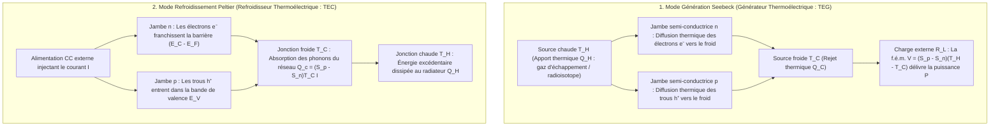
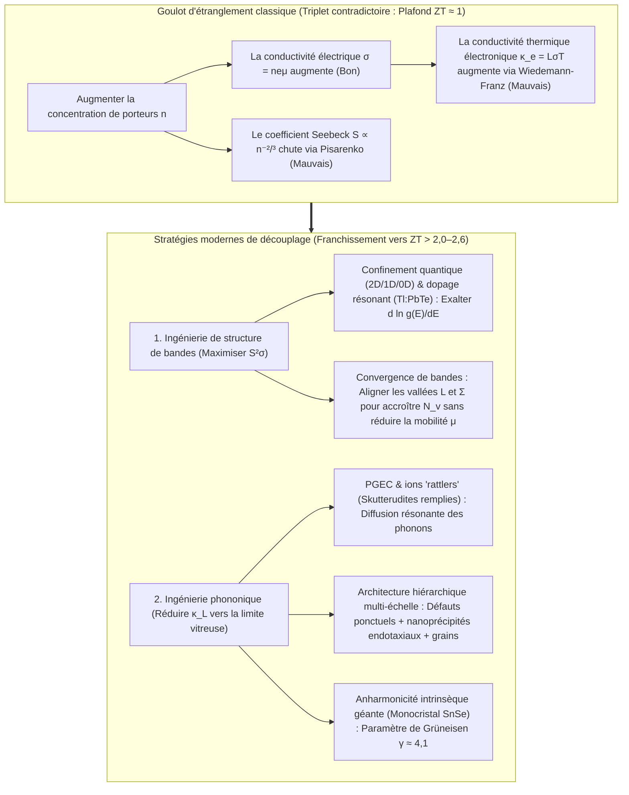

## 1. Introduction : Le miracle de l'état solide reliant chaleur et électricité sans aucune pièce mobile

Lancées à la fin de l'été 1977, les sondes spatiales jumelles <strong>Voyager 1</strong> et <strong>Voyager 2</strong> de la NASA sillonnent le vide interstellaire — à plus de 24 milliards de kilomètres du Soleil — depuis plus de 47 ans tout en continuant de transmettre leurs données vers la Terre. À une telle distance, l'éclairement solaire est inférieur au dix-millième de sa valeur terrestre, rendant les panneaux photovoltaïques totalement inopérants. De plus, toute machine thermique mécanique dotée de pistons, de turbines ou de roulements aurait cédé à l'usure depuis des décennies.

Le cœur qui alimente les sondes Voyager depuis un demi-siècle est le <strong>générateur thermoélectrique à radioisotope (RTG)</strong> : une source d'énergie à l'état solide qui convertit directement l'écart de température entre la chaleur de désintégration alpha du plutonium 238 ($^{238}\text{Pu}$, $T_H \approx 1273\,\text{K}$) et le froid spatial ($T_C \approx 573\,\text{K}$) en courant continu grâce à des couples semi-conducteurs silicium-germanium ($\text{SiGe}$). Sur Terre, la même loi physique inversée anime les <strong>modules Peltier (refroidisseurs thermoélectriques, TEC)</strong> : sans fluide frigorigène ni compresseur, un courant électrique refroidit une face céramique sous zéro degré, stabilise la longueur d'onde des lasers télécoms à fibre optique à $\pm 0{,}01\,\text{K}$ près, pilote les thermocycleurs PCR et refroidit les capteurs CCD astronomiques.

Comment un gradient thermique peut-il engendrer une tension électrique, et un courant pomper de la chaleur ? Et pourquoi les générateurs thermoélectriques n'ont-ils pas encore remplacé les turbines à vapeur ? La réponse réside dans l'un des dilemmes les plus tenaces de la physique de la matière condensée : le <strong>triplet contradictoire (compromis fondamental) entre le coefficient Seebeck $S$, la conductivité électrique $\sigma$ et la conductivité thermique $\kappa$</strong>.

---

## 2. Unification des trois effets thermoélectriques classiques et réciprocité d'Onsager

La thermoélectricité repose sur trois phénomènes découverts au XIXe siècle : l'<strong>effet Seebeck (1821)</strong>, l'<strong>effet Peltier (1834)</strong> et l'<strong>effet Thomson (1851)</strong>.

### 2.1 L'effet Seebeck : Élargissement thermique de Fermi-Dirac et équilibre diffusion-dérive

Lorsqu'un conducteur ou semi-conducteur en circuit ouvert ($\mathbf{J} = 0$) est soumis à un gradient de température $\nabla T$, un champ électrostatique interne $\mathbf{E} = -\nabla V$ (plus exactement $-\nabla \tilde{\mu}/e$) apparaît spontanément en proportion directe de $\nabla T$ :

$$\nabla V = -S \nabla T \quad \Longleftrightarrow \quad S = -\frac{\Delta V}{\Delta T}$$

La constante $S$ (en $\mu\text{V/K}$ ou $\text{V/K}$) est le <strong>coefficient Seebeck</strong> ou <strong>pouvoir thermoélectrique</strong>. À l'échelle microscopique, il découle de la <strong>distribution de Fermi-Dirac</strong> :

$$f(E, T) = \frac{1}{\exp\left(\frac{E - \mu}{k_B T}\right) + 1}$$

1. <strong>Élargissement thermique de la surface de Fermi au côté chaud</strong> : À $T > 0$, la marche de Fermi s'étale sur une fenêtre d'énergie $\sim 2k_B T$. L'extrémité chaude ($T_H$) compte beaucoup plus de porteurs de haute énergie au-dessus du niveau de Fermi $E_F$ que l'extrémité froide ($T_C$).
2. <strong>Équilibre dynamique entre diffusion thermique et dérive électrostatique</strong> : Les porteurs chauds diffusent vers l'extrémité froide. Dans un <strong>semi-conducteur de type n</strong>, les électrons ($q = -e$) s'accumulent au côté froid ($S_n < 0$) ; dans un <strong>semi-conducteur de type p</strong>, les trous ($q = +e$) s'accumulent au côté froid ($S_p > 0$). Le champ électrique interne ainsi créé engendre un courant de dérive opposé jusqu'à ce que <strong>le courant de diffusion thermique et le courant de dérive électrostatique s'annulent exactement ($\mathbf{J}_{\text{diff}} + \mathbf{J}_{\text{drift}} = 0$)</strong>. En associant des jambes p et n <strong>thermiquement en parallèle et électriquement en série</strong> (unicouple en $\pi$), la tension en circuit ouvert s'additionne : $V_{\text{oc}} = (S_p - S_n)(T_H - T_C)$.

### 2.2 Formule de Mott et relation de Pisarenko

Par le développement de Sommerfeld de l'équation de transport de Boltzmann, le coefficient Seebeck d'un semi-conducteur dégénéré obéit à la <strong>formule de Mott</strong> :

$$S = -\frac{\pi^2 k_B^2 T}{3e} \left. \frac{d \ln \sigma(E)}{dE} \right|_{E = E_F}$$

où $\sigma(E) = \frac{1}{3} e^2 g(E) v^2(E) \tau(E)$ est la conductivité spectrale et $g(E)$ la densité d'états électroniques (DOS). <strong>Le coefficient Seebeck mesure ainsi l'asymétrie énergétique de la conduction de part et d'autre de $E_F$</strong>. Pour une bande parabolique 3D isotrope avec diffusion par les phonons acoustiques, on obtient la <strong>relation de Pisarenko</strong> :

$$S = \frac{8 \pi^2 k_B^2}{3 e h^2} m^* T \left( \frac{\pi}{3n} \right)^{2/3}$$

Un grand coefficient Seebeck exige donc <strong>(1) une masse effective de densité d'états $m^*$ élevée</strong> et <strong>(2) une faible concentration de porteurs $n$ ($S \propto n^{-2/3}$)</strong>.

### 2.3 Effet Peltier, effet Thomson et relations de réciprocité de Kelvin-Onsager

Lorsqu'un courant continu $I$ traverse la jonction isotherme entre deux matériaux A et B, de la chaleur est absorbée ou dégagée de façon réversible au taux :

$$\dot{Q}_P = (\Pi_A - \Pi_B) I = \Pi_{AB} I$$

Microscopiquement, lorsqu'un électron passe du métal ($E \approx E_F$) dans la bande de conduction d'un semi-conducteur de type n ($E_{\text{trans}} > E_C$) à la jonction froide, il doit <strong>franchir une barrière d'énergie $\Delta E = E_{\text{trans}} - E_F > 0$</strong> en absorbant des phonons du réseau cristallin, ce qui refroidit la jonction ; à la jonction chaude, il retombe vers $E_F$ en cédant son excédent d'énergie sous forme de phonons. De même, l'<strong>effet Thomson</strong> (1851) décrit l'échange thermique réversible $\dot{q}_{\text{total}} = \frac{\mathbf{J}^2}{\sigma} - \mathcal{K}_T (\mathbf{J} \cdot \nabla T)$ le long d'un conducteur homogène soumis à $\nabla T$.

Dans la thermodynamique linéaire hors d'équilibre de Lars Onsager (1931, Prix Nobel 1968), les flux électrique $\mathbf{J}_e$ et thermique $\mathbf{J}_Q$ sont reliés par la matrice cinétique :

$$\begin{pmatrix} \mathbf{J}_e \\ \mathbf{J}_Q \end{pmatrix} = \begin{pmatrix} L_{11} & L_{12} \\ L_{21} & L_{22} \end{pmatrix} \begin{pmatrix} -\frac{1}{e}\nabla \tilde{\mu} \\ \nabla \left(\frac{1}{T}\right) \end{pmatrix}$$

L'invariance par renversement du temps impose la <strong>symétrie d'Onsager $L_{12} = L_{21}$</strong>, d'où découlent immédiatement les <strong>relations de Kelvin</strong> :

$$\Pi = S \cdot T, \qquad \mathcal{K}_T = T \frac{dS}{dT}$$

Cela révèle le sens thermodynamique profond du pouvoir thermoélectrique : <strong>$S = \frac{\Pi}{T}$ est exactement l'entropie transportée par unité de charge électrique ($S = S_{\text{porteur}} / q$) !</strong>

---

## 3. Dérivation thermodynamique du facteur de mérite $ZT$, du rendement maximal et de la puissance frigorifique

### 3.1 Rendement maximal $\eta_{\max}$ d'un générateur thermoélectrique (TEG)

Pour un couple opérant entre $T_H$ et $T_C$ ($\Delta T = T_H - T_C$) de résistance interne $R$, de conductance thermique $K$ et de coefficient Seebeck $S = S_p - S_n$, la chaleur prélevée à la source chaude $Q_H$ et la puissance électrique utile $P$ délivrée à la charge $R_L$ valent :

$$Q_H = S T_H I + K (T_H - T_C) - \frac{1}{2} I^2 R, \qquad P = I^2 R_L = S(T_H - T_C)I - I^2 R$$

En minimisant le produit $RK$, toutes les propriétés du matériau se regroupent dans le <strong>facteur de mérite sans dimension $ZT$</strong> introduit par Abram F. Ioffe (1949) :

$$ZT = \frac{S^2 \sigma T}{\kappa} = \frac{S^2 \sigma T}{\kappa_e + \kappa_L}$$

où $PF = S^2 \sigma$ est le <strong>facteur de puissance</strong> et $\kappa = \kappa_e + \kappa_L$ la somme des conductivités thermiques électronique $\kappa_e$ et de réseau (phonons) $\kappa_L$. La maximisation de $\eta(m) = P / Q_H$ par rapport au rapport d'impédance $m = R_L / R$ donne $m_{\text{opt}} = \sqrt{1 + Z\bar{T}}$ ($\bar{T} = \frac{T_H + T_C}{2}$) et le <strong>rendement maximal</strong> :

$$\eta_{\max} = \underbrace{\frac{T_H - T_C}{T_H}}_{\text{Rendement de Carnot }\eta_C} \cdot \underbrace{\frac{\sqrt{1 + Z\bar{T}} - 1}{\sqrt{1 + Z\bar{T}} + \frac{T_C}{T_H}}}_{\text{Facteur matériau}}$$

### 3.2 Puissance frigorifique $Q_c$, écart maximal de température $\Delta T_{\max}$ et COP en mode Peltier

Pour un refroidisseur Peltier (TEC), le bilan thermique à la jonction froide ($T_C$) s'écrit :

$$Q_c = \underbrace{(S_p - S_n) T_C I}_{\text{(1) Refroidissement Peltier}} - \underbrace{\frac{1}{2} I^2 R}_{\text{(2) Retour d'effet Joule}} - \underbrace{K (T_H - T_C)}_{\text{(3) Conduction de Fourier}}$$

L'effet Joule croissant en $I^2$, la puissance frigorifique passe par un maximum pour le courant optimal $I_{\max} = \frac{S T_C}{R}$ ($\frac{\partial Q_c}{\partial I} = 0$). À charge thermique nulle ($Q_c = 0$), l'<strong>écart maximal de température $\Delta T_{\max}$</strong> et le <strong>coefficient de performance maximal $\text{COP}_{\max}$</strong> valent :

$$\Delta T_{\max} = \frac{1}{2} Z T_C^2, \qquad \text{COP}_{\max} = \frac{T_C}{T_H - T_C} \cdot \frac{\sqrt{1 + Z\bar{T}} - \frac{T_H}{T_C}}{\sqrt{1 + Z\bar{T}} + 1}$$

---

## 4. Le dilemme fondamental de l'état solide : Le triplet contradictoire $S$, $\sigma$ et $\kappa$

Pourquoi est-il si difficile de dépasser $ZT \approx 1$ ? Parce que les trois grandeurs sont couplées de manière antagoniste par la concentration de porteurs $n$ :

1. <strong>Le conflit $S$ vs $\sigma$ (compromis de Pisarenko)</strong> : Augmenter $n$ accroît $\sigma = n e \mu$, mais fait chuter $S \propto m^* n^{-2/3}$. Augmenter la masse effective $m^*$ dégrade la mobilité $\mu = \frac{e\tau}{m^*}$.
2. <strong>Le conflit $\sigma$ vs $\kappa_e$ (loi de Wiedemann-Franz)</strong> : Les mêmes électrons transportent la charge et la chaleur selon :

$$\frac{\kappa_e}{\sigma T} = L = \frac{\pi^2}{3} \left( \frac{k_B}{e} \right)^2 \approx 2{,}44 \times 10^{-8}\,\text{W}\cdot\Omega\cdot\text{K}^{-2}$$

où $L$ est le nombre de Lorenz. Toute hausse de $\sigma$ augmente donc $\kappa_e = L\sigma T$. Le compromis idéal se situe dans les <strong>semi-conducteurs dégénérés fortement dopés ($n \approx 10^{19}\text{–}10^{20}\,\text{cm}^{-3}$)</strong> vérifiant le critère de Chasmar-Stratton ($E_g \approx 6\text{–}10\,k_B T$) pour éviter la conduction bipolaire.

| Gamme de température | Système de matériaux | Temp. optimale $T_{\text{opt}}$ | Bande interdite $E_g$ | $ZT$ pic typique | Structure cristalline, physique clé & applications |
| :--- | :--- | :--- | :--- | :--- | :--- |
| <strong>Cryo à ambiante</strong> ($< 450\,\text{K}$) | Alliages $\text{Bi}_2\text{Te}_3$ | $250\text{–}400\,\text{K}$ | $\sim 0{,}15\,\text{eV}$ | $0{,}8\text{–}1{,}4$ | Structure lamellaire rhomboédrique, dégénérescence de vallées $N_v=6$. Référence universelle des refroidisseurs Peltier (TEC). |
| <strong>Moyenne temp. I</strong> ($500\text{–}850\,\text{K}$) | $\text{PbTe}$ & TAGS-85 | $600\text{–}800\,\text{K}$ | $\sim 0{,}30\,\text{eV}$ | $1{,}2\text{–}2{,}2$ | Structure cubique sel gemme. <strong>Convergence de bandes</strong> L–$\Sigma$ ($N_v = 4 \to 16$), dopage résonant $\text{Tl}$ et nanoprécipités $\text{SrTe}$. Rovers martiens MMRTG. |
| <strong>Moyenne temp. II</strong> ($550\text{–}900\,\text{K}$) | Skutterudites remplies ($\text{Ba}_x\text{La}_y\text{Yb}_z\text{Co}_4\text{Sb}_{12}$) | $700\text{–}850\,\text{K}$ | $\sim 0{,}3\,\text{eV}$ | $1{,}2\text{–}1{,}8$ | Réseau à cages ($\text{CoSb}_3$). Les ions hôtes « grelottent » (rattling, <strong>mécanisme PGEC</strong>) et diffusent les phonons. Échappements automobiles. |
| <strong>Moyenne-Haute temp.</strong> ($650\text{–}1000\,\text{K}$) | $\text{SnSe}$ monocristallin | $750\text{–}923\,\text{K}$ | $\sim 0{,}86\,\text{eV}$ | $2{,}2\text{–}2{,}6+$ | Structure lamellaire plissée ($Pnma \to Cmcm$). <strong>Anharmonicité intrinsèque géante</strong> ($\gamma \approx 4{,}1$) donnant $\kappa_L \approx 0{,}23\,\text{W/(m}\cdot\text{K)}$. |
| <strong>Haute température</strong> ($700\text{–}1100\,\text{K}$) | Alliages Half-Heusler ($\text{ZrNiSn}$, $\text{NbFeSb}$) | $800\text{–}1050\,\text{K}$ | $\sim 0{,}5\,\text{eV}$ | $1{,}0\text{–}1{,}5$ | Intermétalliques robustes, non toxiques, facteur de puissance géant ($PF > 50\,\mu\text{W cm}^{-1}\text{K}^{-2}$). Récupération sur fours industriels. |
| <strong>Ultra-haute temp.</strong> ($900\text{–}1300\,\text{K}$) | Alliages $\text{SiGe}$ ($\text{Si}_{0{,}8}\text{Ge}_{0{,}2}$) | $1000\text{–}1273\,\text{K}$ | $\sim 0{,}8\,\text{eV}$ | $0{,}8\text{–}1{,}3$ | Réseau diamant covalent stable à $1000\,^\circ\text{C}$. Alimente les RTG des sondes Voyager 1 & 2 et New Horizons. |

---

## 5. Briser le plafond $ZT \approx 1$ : Ingénierie de bandes et ingénierie phononique

1. <strong>Le concept PGEC (« Verre de phonons – Cristal d'électrons », Glen Slack, 1995)</strong> : Dans les <strong>skutterudites remplies ($\text{CoSb}_3$)</strong> et les clathrates, les ions hôtes insérés dans les cages atomiques oscillent de manière anharmonique (« rattling ») et diffusent les phonons acoustiques sans perturber les électrons.
2. <strong>Ingénierie de structure de bandes</strong> : Le <strong>confinement quantique</strong> (Hicks & Dresselhaus, 1993), les <strong>niveaux résonants</strong> ($\text{Tl}:\text{PbTe}$, Heremans et al., 2008) et la <strong>convergence de bandes</strong> ($m^* = N_v^{2/3} m^*_b$, alignement des bandes $L$ et $\Sigma$ portant la dégénérescence de vallées à $N_v = 16$) exaltent $S$ sans dégrader la mobilité $\mu$.
3. <strong>Nanostructuration hiérarchique multi-échelle et anharmonicité intrinsèque de $\text{SnSe}$</strong> : En combinant défauts ponctuels atomiques, nanoprécipités endotaxiaux cohérents ($\text{SrTe}$) et joints de grains mésoscopiques, Kanatzidis et al. (2012) ont diffusé tout le spectre de libre parcours moyen des phonons ($ZT \approx 2{,}2$). En 2014, le monocristal <strong>$\text{SnSe}$</strong> a atteint <strong>$ZT = 2{,}6 \pm 0{,}3$ à $923\,\text{K}$</strong> grâce à l'anharmonicité géante de ses liaisons ($\gamma \approx 4{,}1$, $\kappa_L \approx 0{,}23\,\text{W/(m}\cdot\text{K)}$).

---

## 6. Applications concrètes et frontières futures : Des sondes spatiales à la spincaloritronique

1. <strong>Exploration spatiale (RTG et MMRTG)</strong> : Des couples $\text{SiGe}$ des sondes *Voyager* aux générateurs <strong>MMRTG</strong> ($\text{PbTe/TAGS}$) des rovers martiens *Curiosity* et *Perseverance* ainsi que du futur octocoptère nucléaire *Dragonfly* sur Titan.
2. <strong>Gestion thermique de précision (TEC)</strong> : Stabilisation à $\pm 0{,}01\,\text{K}$ des lasers télécoms DWDM, thermocycleurs PCR biomédicaux et refroidissement sans vibrations des détecteurs CCD et infrarouges.
3. <strong>Récupération de chaleur fatale, thermoélectricité portable et spincaloritronique</strong> : Capteurs IIoT autonomes, semi-conducteurs inorganiques ductiles ($\text{Ag}_2\text{S}$) et polymères conducteurs (PEDOT:PSS) pour vêtements connectés, ainsi que l'<strong>effet Seebeck de spin (SSE)</strong> et l'<strong>effet Nernst anomal (ANE, $\mathbf{E}_{\text{ANE}} \propto \mathbf{M} \times \nabla T$)</strong> dans les semi-métaux de Weyl magnétiques topologiques.
