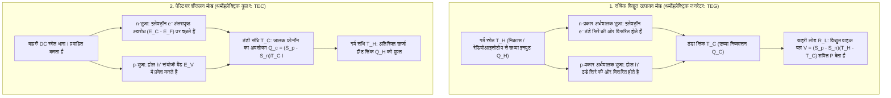
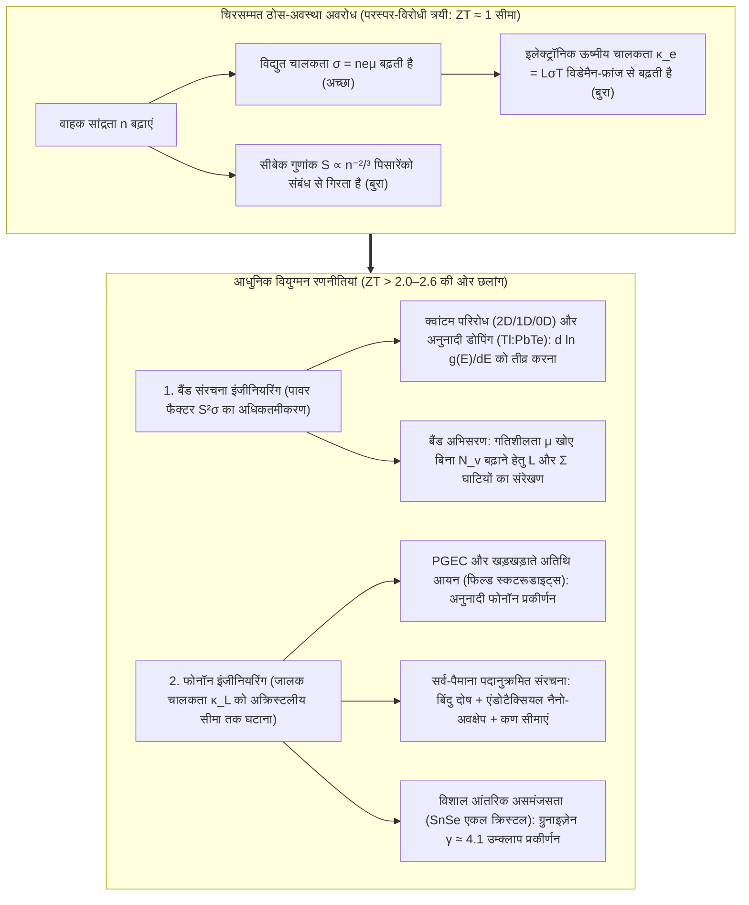

## 1. परिचय: बिना किसी गतिशील पुर्जे के ऊष्मा और विद्युत को जोड़ने वाला ठोस-अवस्था चमत्कार

1977 की गर्मियों के अंत में प्रक्षेपित किए गए नासा (NASA) के जुड़वां अंतरिक्ष यान <strong>वॉयेजर 1 (Voyager 1)</strong> और <strong>वॉयेजर 2 (Voyager 2)</strong> सूर्य से 24 अरब किलोमीटर से अधिक दूर अंतरतारकीय अंतरिक्ष के अंधेरे में 47 वर्षों से अधिक समय से लगातार यात्रा कर रहे हैं और पृथ्वी पर रेडियो संकेत भेज रहे हैं। इतनी विशाल दूरी पर सौर विकिरण पृथ्वी की कक्षा की तुलना में दस-हज़ारवें हिस्से से भी कम रह जाता है, जिससे सौर पैनल पूरी तरह बेकार हो जाते हैं; साथ ही, आधी सदी तक बिना मरम्मत के किसी भी पिस्टन या टरबाइन वाले यांत्रिक ऊष्मा इंजन ने घिसाव के कारण दशकों पहले काम करना बंद कर दिया होता।

आधी सदी से वॉयेजर यानों को जीवित रखने वाला धड़कता हुआ हृदय <strong>रेडियोआइसोटोप थर्मोइलेक्ट्रिक जनरेटर (RTG, परमाणु बैटरी)</strong> है—एक ठोस-अवस्था ऊर्जा स्रोत जो प्लूटोनियम-238 ($^{238}\text{Pu}$, $T_H \approx 1273\,\text{K}$) के अल्फा-क्षय की ऊष्मा और गहरे अंतरिक्ष की ठंडक ($T_C \approx 573\,\text{K}$) के बीच के तापमान अंतर को सिलिकॉन-जर्मेनियम ($\text{SiGe}$) अर्धचालक युग्मों के माध्यम से सीधे दिष्ट धारा (DC) विद्युत में बदलता है। पृथ्वी पर, ठीक यही भौतिक नियम विपरीत दिशा में कार्य करते हुए <strong>पेल्टियर उपकरणों (थर्मोइलेक्ट्रिक कूलर, TEC)</strong> को चलाता है: बिना एक बूंद प्रशीतक (refrigerant) या कंप्रेसर के, विद्युत धारा प्रवाहित करने पर एक सिरेमिक सतह शून्य से नीचे जम जाती है, जो फाइबर-ऑप्टिक DWDM संचार लेजरों के तापमान को $\pm 0.01\,\text{K}$ की सटीकता पर स्थिर रखती है, PCR थर्मल साइक्लर चलाती है और खगोलीय CCD सेंसरों को ठंडा करती है।

तापमान प्रवणता विद्युत विभव कैसे उत्पन्न करती है, और विद्युत धारा ऊष्मा को कैसे पंप करती है? और थर्मोइलेक्ट्रिक जनरेटरों ने अभी तक बिजलीघरों के भाप टरबाइनों की जगह क्यों नहीं ली है? इसका उत्तर संघनित पदार्थ भौतिकी की सबसे कठिन पहेलियों में से एक में छिपा है: <strong>सीबेक गुणांक $S$, विद्युत चालकता $\sigma$, और ऊष्मीय चालकता $\kappa$ के बीच की परस्पर-विरोधी त्रयी (Contra-indicated Triad)</strong>।

---

## 2. तीन चिरसम्मत थर्मोइलेक्ट्रिक प्रभावों का एकीकरण और ओन्सागर पारस्परिकता

थर्मोइलेक्ट्रिसिटी 19वीं सदी में खोजे गए तीन प्रभावों पर आधारित है: <strong>सीबेक प्रभाव (1821)</strong>, <strong>पेल्टियर प्रभाव (1834)</strong>, और <strong>थॉमसन प्रभाव (1851)</strong>।

### 2.1 सीबेक प्रभाव: फर्मी-डिराक तापीय विस्तार और विसरण-अपवाह संतुलन

जब किसी खुले परिपथ ($\mathbf{J} = 0$) वाले चालक या अर्धचालक पर तापमान प्रवणता $\nabla T$ लगाई जाती है, तो पदार्थ के भीतर स्वतः एक स्थिरवैद्युत क्षेत्र $\mathbf{E} = -\nabla V$ (सटीक रूप से $-\nabla \tilde{\mu}/e$) उत्पन्न हो जाता है:

$$\nabla V = -S \nabla T \quad \Longleftrightarrow \quad S = -\frac{\Delta V}{\Delta T}$$

समानुपाती नियतांक $S$ ($\mu\text{V/K}$ या $\text{V/K}$ में) को <strong>सीबेक गुणांक (Seebeck coefficient)</strong> या <strong>थर्मोपावर</strong> कहते हैं। सूक्ष्म स्तर पर इसकी उत्पत्ति <strong>फर्मी-डिराक वितरण फलन</strong> से होती है:

$$f(E, T) = \frac{1}{\exp\left(\frac{E - \mu}{k_B T}\right) + 1}$$

1. <strong>गर्म सिरे पर फर्मी सतह का तापीय विस्तार</strong>: $T > 0$ पर फर्मी किनारा $\sim 2k_B T$ ऊर्जा अंतराल में फैल जाता है। गर्म सिरे ($T_H$) पर ठंडे सिरे ($T_C$) की तुलना में फर्मी स्तर $E_F$ से ऊपर उच्च-ऊर्जा वाहकों की संख्या कहीं अधिक होती है।
2. <strong>तापीय विसरण और स्थिरवैद्युत अपवाह (Drift) के बीच गतिशील संतुलन</strong>: उच्च-ऊर्जा वाहक गर्म सिरे से ठंडे सिरे की ओर विसरित होते हैं। <strong>n-प्रकार के अर्धचालक</strong> में ऋणावेशित इलेक्ट्रॉन ($q = -e$) ठंडे सिरे पर जमा होते हैं ($S_n < 0$); जबकि <strong>p-प्रकार के अर्धचालक</strong> में धनावेशित होल ($q = +e$) ठंडे सिरे पर जमा होते हैं ($S_p > 0$)। इससे उत्पन्न आंतरिक विद्युत क्षेत्र एक विपरीत अपवाह धारा चलाता है जब तक कि <strong>तापीय विसरण धारा और स्थिरवैद्युत अपवाह धारा एक-दूसरे को पूर्णतः निरस्त न कर दें ($\mathbf{J}_{\text{diff}} + \mathbf{J}_{\text{drift}} = 0$)</strong>। p- और n-भुजाओं को <strong>तापीय रूप से समांतर और विद्युत रूप से श्रेणीक्रम</strong> ($\pi$-युग्म) में जोड़ने पर खुला-परिपथ विभव जुड़ जाता है: $V_{\text{oc}} = (S_p - S_n)(T_H - T_C)$।

### 2.2 मोट सूत्र (Mott Formula) और पिसारेंको संबंध (Pisarenko Relation)

बोल्ट्ज़मैन परिवहन समीकरण के सोमरफेल्ड प्रसार से अपभ्रष्ट अर्धचालकों के लिए <strong>मोट सूत्र</strong> प्राप्त होता है:

$$S = -\frac{\pi^2 k_B^2 T}{3e} \left. \frac{d \ln \sigma(E)}{dE} \right|_{E = E_F}$$

जहाँ $\sigma(E) = \frac{1}{3} e^2 g(E) v^2(E) \tau(E)$ स्पेक्ट्रमी चालकता है और $g(E)$ इलेक्ट्रॉनिक अवस्था घनत्व (DOS) है। <strong>सीबेक गुणांक फर्मी स्तर $E_F$ के आर-पार चालन की ऊर्जा विषमता को मापता है</strong>। 3D परवलयिक बैंड और ध्वनिक फोनॉन प्रकीर्णन के लिए मोट सूत्र <strong>पिसारेंको संबंध</strong> बन जाता है:

$$S = \frac{8 \pi^2 k_B^2}{3 e h^2} m^* T \left( \frac{\pi}{3n} \right)^{2/3}$$

अतः उच्च सीबेक गुणांक $S$ के लिए <strong>(1) भारी अवस्था-घनत्व प्रभावी द्रव्यमान $m^*$</strong> और <strong>(2) निम्न वाहक सांद्रता $n$ ($S \propto n^{-2/3}$)</strong> आवश्यक है।

### 2.3 पेल्टियर प्रभाव, थॉमसन प्रभाव और केल्विन-ओन्सागर पारस्परिक संबंध

जब बाहरी दिष्ट धारा $I$ दो भिन्न पदार्थों A और B की समतापीय संधि से गुजरती है, तो संधि पर उत्क्रमणीय रूप से ऊष्मा अवशोषित या मुक्त होती है:

$$\dot{Q}_P = (\Pi_A - \Pi_B) I = \Pi_{AB} I$$

सूक्ष्म रूप से, जब ठंडी संधि पर एक इलेक्ट्रॉन धातु ($E \approx E_F$) से n-प्रकार के अर्धचालक के चालन बैंड ($E_{\text{trans}} > E_C$) में प्रवेश करता है, तो उसे <strong>ऊर्जा अवरोध $\Delta E = E_{\text{trans}} - E_F > 0$ पर चढ़ना पड़ता है</strong>, जिसके लिए वह क्रिस्टल जालक से फोनॉन अवशोषित करता है और संधि को ठंडा कर देता है; गर्म संधि पर वह वापस $E_F$ पर गिरता है और अतिरिक्त ऊर्जा फोनॉन के रूप में छोड़ता है। इसी प्रकार, <strong>थॉमसन प्रभाव</strong> (1851) तापमान प्रवणता $\nabla T$ वाले समांगी चालक में उत्क्रमणीय ऊष्मा विनिमय $\dot{q}_{\text{total}} = \frac{\mathbf{J}^2}{\sigma} - \mathcal{K}_T (\mathbf{J} \cdot \nabla T)$ को व्यक्त करता है।

लार्स ओन्सागर के रैखिक गैर-संतुलन ऊष्मागतिकी (1931, नोबेल पुरस्कार 1968) में विद्युत धारा $\mathbf{J}_e$ और ऊष्मा प्रवाह $\mathbf{J}_Q$ गतिज आव्यूह से जुड़े हैं:

$$\begin{pmatrix} \mathbf{J}_e \\ \mathbf{J}_Q \end{pmatrix} = \begin{pmatrix} L_{11} & L_{12} \\ L_{21} & L_{22} \end{pmatrix} \begin{pmatrix} -\frac{1}{e}\nabla \tilde{\mu} \\ \nabla \left(\frac{1}{T}\right) \end{pmatrix}$$

सूक्ष्म समय-उत्क्रमण सममिति से <strong>ओन्सागर पारस्परिकता $L_{12} = L_{21}$</strong> सिद्ध होती है, जिससे सीधे <strong>केल्विन के संबंध</strong> प्राप्त होते हैं:

$$\Pi = S \cdot T, \qquad \mathcal{K}_T = T \frac{dS}{dT}$$

इससे स्पष्ट होता है कि <strong>सीबेक गुणांक $S = \frac{\Pi}{T}$ वास्तव में प्रति इकाई विद्युत आवेश द्वारावाहित एन्ट्रॉपी ($S = S_{\text{carrier}} / q$) है!</strong>

---

## 3. दक्षतांक $ZT$, अधिकतम दक्षता और शीतलन क्षमता की ऊष्मागतिकीय व्युत्पत्ति

### 3.1 थर्मोइलेक्ट्रिक जनरेटर (TEG) की अधिकतम रूपांतरण दक्षता $\eta_{\max}$

$T_H$ और $T_C$ ($\Delta T = T_H - T_C$) के बीच कार्यरत युग्म (आंतरिक प्रतिरोध $R$, तापीय चालकता $K$, सीबेक गुणांक $S = S_p - S_n$) के लिए गर्म सिरे से ली गई ऊष्मा $Q_H$ और बाहरी लोड $R_L$ को दी गई विद्युत शक्ति $P$ हैं:

$$Q_H = S T_H I + K (T_H - T_C) - \frac{1}{2} I^2 R, \qquad P = I^2 R_L = S(T_H - T_C)I - I^2 R$$

ज्यामितीय गुणनफल $RK$ को न्यूनतम करने पर पदार्थ के सभी गुण अब्राम एफ. इओफे (1949) द्वारा परिभाषित <strong>विमाहीन दक्षतांक (Figure of Merit) $ZT$</strong> में समाहित हो जाते हैं:

$$ZT = \frac{S^2 \sigma T}{\kappa} = \frac{S^2 \sigma T}{\kappa_e + \kappa_L}$$

जहाँ $PF = S^2 \sigma$ <strong>पावर फैक्टर</strong> है और $\kappa = \kappa_e + \kappa_L$ इलेक्ट्रॉनिक ($\kappa_e$) तथा जालक/फोनॉन ($\kappa_L$) ऊष्मीय चालकता का योग है। प्रतिरोध अनुपात $m = R_L / R$ के सापेक्ष $\eta(m) = P / Q_H$ को अधिकतम करने पर $m_{\text{opt}} = \sqrt{1 + Z\bar{T}}$ ($\bar{T} = \frac{T_H + T_C}{2}$) और <strong>अधिकतम रूपांतरण दक्षता</strong> प्राप्त होती है:

$$\eta_{\max} = \underbrace{\frac{T_H - T_C}{T_H}}_{\text{कार्नो दक्षता }\eta_C} \cdot \underbrace{\frac{\sqrt{1 + Z\bar{T}} - 1}{\sqrt{1 + Z\bar{T}} + \frac{T_C}{T_H}}}_{\text{पदार्थ गुणांक}}$$

### 3.2 पेल्टियर शीतलन क्षमता $Q_c$, अधिकतम तापांतर $\Delta T_{\max}$ और COP

पेल्टियर कूलर (TEC) में ठंडे सिरे ($T_C$) पर शुद्ध शीतलन क्षमता $Q_c$ है:

$$Q_c = \underbrace{(S_p - S_n) T_C I}_{\text{(1) पेल्टियर शीतलन}} - \underbrace{\frac{1}{2} I^2 R}_{\text{(2) जूल पश्च-तापन}} - \underbrace{K (T_H - T_C)}_{\text{(3) फूरिये तापीय चालन}}$$

चूंकि जूल तापन $I^2$ के रूप में बढ़ता है, इसलिए इष्टतम धारा $I_{\max} = \frac{S T_C}{R}$ ($\frac{\partial Q_c}{\partial I} = 0$) होती है। शून्य बाहरी ऊष्मा भार ($Q_c = 0$) पर <strong>अधिकतम तापमान गिरावट $\Delta T_{\max}$</strong> और <strong>अधिकतम निष्पादन गुणांक $\text{COP}_{\max}$</strong> हैं:

$$\Delta T_{\max} = \frac{1}{2} Z T_C^2, \qquad \text{COP}_{\max} = \frac{T_C}{T_H - T_C} \cdot \frac{\sqrt{1 + Z\bar{T}} - \frac{T_H}{T_C}}{\sqrt{1 + Z\bar{T}} + 1}$$

---

## 4. ठोस-अवस्था भौतिकी की मूलभूत दुविधा: $S$, $\sigma$ और $\kappa$ की परस्पर-विरोधी त्रयी

$ZT \approx 1$ की सीमा को पार करना इतना कठिन क्यों है? क्योंकि तीनों प्राचल वाहक सांद्रता $n$ के माध्यम से एक-दूसरे का विरोध करते हैं:

1. <strong>$S$ बनाम $\sigma$ संघर्ष (पिसारेंको समझौता)</strong>: $n$ बढ़ाने पर $\sigma = n e \mu$ बढ़ता है, किंतु $S \propto m^* n^{-2/3}$ तेजी से गिरता है। प्रभावी द्रव्यमान $m^*$ बढ़ाने पर गतिशीलता $\mu = \frac{e\tau}{m^*}$ घट जाती है।
2. <strong>$\sigma$ बनाम $\kappa_e$ संघर्ष (विडेमैन-फ्रांज नियम)</strong>: वही इलेक्ट्रॉन आवेश और ऊष्मा दोनों का वहन करते हैं:

$$\frac{\kappa_e}{\sigma T} = L = \frac{\pi^2}{3} \left( \frac{k_B}{e} \right)^2 \approx 2.44 \times 10^{-8}\,\text{W}\cdot\Omega\cdot\text{K}^{-2}$$

जहाँ $L$ लोरेंज संख्या है। इसलिए सर्वोत्तम संतुलन <strong>अत्यधिक डोपित अपभ्रष्ट अर्धचालकों ($n \approx 10^{19}\text{–}10^{20}\,\text{cm}^{-3}$)</strong> में मिलता है जिनका बैंडगैप द्विध्रुवीय चालन को रोकने के लिए चास्मर-स्ट्रैटन मानदंड ($E_g \approx 6\text{–}10\,k_B T$) को संतुष्ट करता है।

| तापमान क्षेत्र | प्रतिनिधि पदार्थ प्रणाली | इष्टतम ताप $T_{\text{opt}}$ | बैंडगैप $E_g$ | विशिष्ट शिखर $ZT$ | क्रिस्टल संरचना, प्रमुख भौतिकी और अनुप्रयोग |
| :--- | :--- | :--- | :--- | :--- | :--- |
| <strong>क्रायोजेनिक से कमरे का ताप</strong> ($< 450\,\text{K}$) | $\text{Bi}_2\text{Te}_3$ मिश्रधातु | $250\text{–}400\,\text{K}$ | $\sim 0.15\,\text{eV}$ | $0.8\text{–}1.4$ | स्तरित समचतुर्भुजीय संरचना, घाटी अपभ्रष्टता $N_v=6$. पेल्टियर कूलर (TEC) के लिए वैश्विक मानक। |
| <strong>मध्यम तापमान I</strong> ($500\text{–}850\,\text{K}$) | $\text{PbTe}$ और TAGS-85 | $600\text{–}800\,\text{K}$ | $\sim 0.30\,\text{eV}$ | $1.2\text{–}2.2$ | रॉक-सॉल्ट घनीय संरचना। L–$\Sigma$ <strong>बैंड अभिसरण</strong> ($N_v = 4 \to 16$), $\text{Tl}$ अनुनादी डोपिंग और $\text{SrTe}$ नैनो-अवक्षेप। मंगल रोवर MMRTG। |
| <strong>मध्यम तापमान II</strong> ($550\text{–}900\,\text{K}$) | फिल्ड स्कटरूडाइट्स ($\text{Ba}_x\text{La}_y\text{Yb}_z\text{Co}_4\text{Sb}_{12}$) | $700\text{–}850\,\text{K}$ | $\sim 0.3\,\text{eV}$ | $1.2\text{–}1.8$ | पिंजरा संरचना ($\text{CoSb}_3$)। अतिथि आयन असमंजस रूप से खड़खड़ाते हैं (rattling, <strong>PGEC तंत्र</strong>) और फोनॉन प्रकीर्णित करते हैं। निकास ऊष्मा। |
| <strong>मध्यम-उच्च ताप</strong> ($650\text{–}1000\,\text{K}$) | $\text{SnSe}$ एकल क्रिस्टल | $750\text{–}923\,\text{K}$ | $\sim 0.86\,\text{eV}$ | $2.2\text{–}2.6+$ | मुड़ी हुई स्तरित संरचना ($Pnma \to Cmcm$)। <strong>विशाल आंतरिक जालक असमंजसता</strong> ($\gamma \approx 4.1$) से $\kappa_L \approx 0.23\,\text{W/(m}\cdot\text{K)}$। |
| <strong>उच्च तापमान</strong> ($700\text{–}1100\,\text{K}$) | हाफ-ह्यूसलर मिश्रधातु ($\text{ZrNiSn}$, $\text{NbFeSb}$) | $800\text{–}1050\,\text{K}$ | $\sim 0.5\,\text{eV}$ | $1.0\text{–}1.5$ | यांत्रिक रूप से अत्यंत मजबूत, गैर-विषाक्त, विशाल पावर फैक्टर ($PF > 50\,\mu\text{W cm}^{-1}\text{K}^{-2}$)। औद्योगिक भट्टी अपशिष्ट ऊष्मा। |
| <strong>अति-उच्च तापमान</strong> ($900\text{–}1300\,\text{K}$) | $\text{SiGe}$ मिश्रधातु ($\text{Si}_{0.8}\text{Ge}_{0.2}$) | $1000\text{–}1273\,\text{K}$ | $\sim 0.8\,\text{eV}$ | $0.8\text{–}1.3$ | हीरे जैसा सहसंयोजक जाल, $1000\,^\circ\text{C}$ पर स्थिर। वॉयेजर 1 व 2 तथा न्यू होराइजन्स के RTG का आधार। |

---

## 5. $ZT \approx 1$ की सीमा को तोड़ना: आधुनिक बैंड और फोनॉन इंजीनियरिंग

1. <strong>ग्लेन स्लैक की PGEC अवधारणा ("फोनॉन-ग्लास इलेक्ट्रॉन-क्रिस्टल", 1995)</strong>: <strong>फिल्ड स्कटरूडाइट्स ($\text{CoSb}_3$)</strong> और क्लैथ्रेट्स में परमाण्विक पिंजरों के भीतर बंद अतिथि आयन असमंजस रूप से दोलन ("rattling") करते हैं और इलेक्ट्रॉनों को बाधित किए बिना ध्वनिक फोनॉनों को प्रकीर्णित करते हैं।
2. <strong>बैंड संरचना इंजीनियरिंग</strong>: <strong>निम्न-विमीय क्वांटम परिरोध</strong> (हिक्स और ड्रेसेलहॉस, 1993), <strong>अनुनादी स्तर डोपिंग</strong> ($\text{Tl}:\text{PbTe}$, हेरेमन्स आदि, 2008), और <strong>बैंड अभिसरण</strong> ($m^* = N_v^{2/3} m^*_b$, $L$ और $\Sigma$ घाटियों को मिलाकर $N_v = 16$ करना) गतिशीलता $\mu$ को घटाए बिना $S$ को बढ़ाते हैं।
3. <strong>सर्व-पैमाना पदानुक्रमित फोनॉन इंजीनियरिंग और $\text{SnSe}$</strong>: परमाण्विक बिंदु दोषों, सुसंगत नैनो-अवक्षेपों ($\text{SrTe}$) और मेसोस्कोपिक कण सीमाओं (कनातज़िडिस आदि, 2012) के संयोजन से सभी तरंगदैर्घ्य के फोनॉनों का प्रकीर्णन कर $ZT \approx 2.2$ प्राप्त किया गया। 2014 में <strong>$\text{SnSe}$ एकल क्रिस्टल</strong> ने अपनी विशाल आंतरिक जालक असमंजसता ($\gamma \approx 4.1$, $\kappa_L \approx 0.23\,\text{W/(m}\cdot\text{K)}$) के बल पर बिना किसी बाहरी नैनोसंरचना के $923\,\text{K}$ पर <strong>$ZT = 2.6 \pm 0.3$</strong> का कीर्तिमान स्थापित किया।

---

## 6. वास्तविक अनुप्रयोग और भविष्य के क्षितिज: अंतरिक्ष यानों से स्पिन कैलोरीट्रॉनिक्स तक

1. <strong>गहरे अंतरिक्ष का अन्वेषण (RTG और MMRTG)</strong>: *वॉयेजर 1 व 2* और *न्यू होराइजन्स* के $\text{SiGe}$ थर्मोकपल से लेकर मंगल रोवर *क्यूरियोसिटी* और *पर्सिवियरेंस* तथा शनि के चंद्रमा टाइटन पर उड़ने वाले परमाणु ऑक्टोकॉप्टर *ड्रैगनफ्लाई* के <strong>MMRTG</strong> ($\text{PbTe/TAGS}$) तक।
2. <strong>सटीक तापीय प्रबंधन (TEC)</strong>: फाइबर-ऑप्टिक DWDM लेजरों का $\pm 0.01\,\text{K}$ स्थिरीकरण, जैव-चिकित्सीय PCR थर्मल साइक्लर, और खगोलीय व अवरक्त (IR) डिटेक्टरों का कंपन-मुक्त शीतलन।
3. <strong>अपशिष्ट ऊष्मा पुनर्प्राप्ति, पहनने योग्य थर्मोइलेक्ट्रिक्स और स्पिन कैलोरीट्रॉनिक्स (Spin Caloritronics)</strong>: स्वायत्त IIoT सेंसर, कमरे के तापमान पर लचीले अकार्बनिक अर्धचालक ($\text{Ag}_2\text{S}$) व चालक बहुलक (PEDOT:PSS), तथा चुंबकीय कुचालकों में <strong>स्पिन सीबेक प्रभाव (SSE)</strong> और टोपोलॉजिकल वेइल अर्धधातुओं में <strong>असामान्य नर्न्स्ट प्रभाव (ANE, $\mathbf{E}_{\text{ANE}} \propto \mathbf{M} \times \nabla T$)</strong>।
