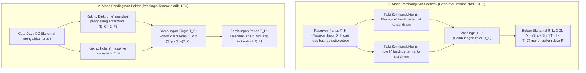
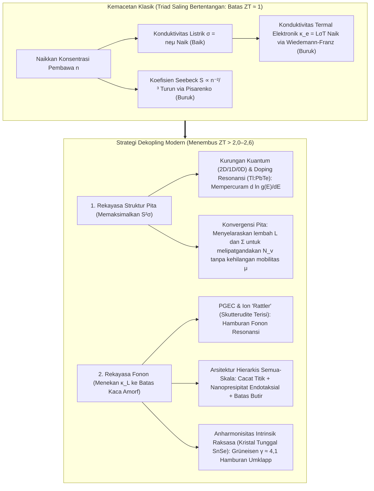

## 1. Pendahuluan: Keajaiban Zat Padat yang Menghubungkan Panas dan Listrik Tanpa Bagian Bergerak

Diluncurkan pada akhir musim panas 1977, wahana antariksa kembar NASA <strong>Voyager 1</strong> dan <strong>Voyager 2</strong> telah melesat menembus ruang antarbintang—lebih dari 24 miliar kilometer dari Matahari—selama lebih dari 47 tahun sambil terus mengirimkan telemetri ke Bumi. Pada jarak sejauh itu, radiasi matahari turun hingga kurang dari seperseribu intensitas di Bumi sehingga panel surya tidak berguna, sementara mesin kalor mekanis dengan piston atau turbin pasti sudah lama rusak akibat keausan.

Jantung yang menghidupi Voyager selama setengah abad adalah <strong>Generator Termoelektrik Radioisotop (RTG)</strong>: sumber daya zat padat yang mengubah perbedaan suhu antara panas peluruhan alfa Plutonium-238 ($^{238}\text{Pu}$, $T_H \approx 1273\,\text{K}$) dan dinginnya antariksa ($T_C \approx 573\,\text{K}$) secara langsung menjadi listrik arus searah (DC) menggunakan pasangan semikonduktor silikon-germanium ($\text{SiGe}$). Di Bumi, hukum fisika yang sama ketika dijalankan terbalik menggerakkan <strong>elemen Peltier (Pendingin Termoelektrik, TEC)</strong>: tanpa setetes pun refrigeran atau kompresor, arus listrik membekukan satu sisi keramik, menstabilkan laser telekomunikasi serat optik DWDM hingga $\pm 0{,}01\,\text{K}$, menggerakkan mesin PCR, dan mendinginkan sensor CCD astronomi.

Mengapa gradien suhu menghasilkan tegangan listrik, dan arus listrik memompa panas? Mengapa generator termoelektrik belum menggantikan turbin uap di pembangkit listrik? Jawabannya terletak pada dilema paling mendasar dalam fisika benda terkondensasi: <strong>triad saling bertentangan (trade-off fundamental) antara koefisien Seebeck $S$, konduktivitas listrik $\sigma$, dan konduktivitas termal $\kappa$</strong>.

---

## 2. Menyatukan Tiga Efek Termoelektrik Klasik dan Resiprositas Onsager

Termoelektrik berdiri di atas tiga fenomena abad ke-19: <strong>efek Seebeck (1821)</strong>, <strong>efek Peltier (1834)</strong>, dan <strong>efek Thomson (1851)</strong>.

### 2.1 Efek Seebeck: Pelebaran Termal Fermi-Dirac dan Kesetimbangan Difusi-Hanyutan

Ketika konduktor atau semikonduktor rangkaian terbuka ($\mathbf{J} = 0$) dikenai gradien suhu $\nabla T$, medan elektrostatik internal $\mathbf{E} = -\nabla V$ (tepatnya $-\nabla \tilde{\mu}/e$) muncul secara spontan sebanding dengan $\nabla T$:

$$\nabla V = -S \nabla T \quad \Longleftrightarrow \quad S = -\frac{\Delta V}{\Delta T}$$

Konstanta $S$ (dalam $\mu\text{V/K}$ atau $\text{V/K}$) adalah <strong>koefisien Seebeck</strong> atau <strong>daya termoelektrik</strong>. Secara mikroskopis, efek ini berasal dari <strong>fungsi distribusi Fermi-Dirac</strong>:

$$f(E, T) = \frac{1}{\exp\left(\frac{E - \mu}{k_B T}\right) + 1}$$

1. <strong>Pelebaran Termal Permukaan Fermi di Ujung Panas</strong>: Pada $T > 0$, tepi Fermi melebar pada jendela energi $\sim 2k_B T$. Ujung panas ($T_H$) memiliki populasi pembawa muatan berenergi tinggi di atas $E_F$ jauh lebih banyak daripada ujung dingin ($T_C$).
2. <strong>Kesetimbangan Dinamis antara Difusi Termal dan Hanyutan Elektrostatik</strong>: Pembawa muatan panas berdifusi menuju ujung dingin. Dalam <strong>semikonduktor tipe-n</strong>, elektron ($q = -e$) menumpuk di ujung dingin ($S_n < 0$); dalam <strong>semikonduktor tipe-p</strong>, lubang/hole ($q = +e$) menumpuk di ujung dingin ($S_p > 0$). Medan listrik internal yang terbentuk mendorong arus hanyutan (drift) berlawanan hingga <strong>arus difusi termal dan arus hanyutan elektrostatik saling meniadakan secara tepat ($\mathbf{J}_{\text{diff}} + \mathbf{J}_{\text{drift}} = 0$)</strong>. Dengan menghubungkan kaki tipe-p dan tipe-n <strong>secara termal paralel dan secara elektrik seri</strong> (pasangan-$\pi$), tegangan rangkaian terbuka saling menjumlah: $V_{\text{oc}} = (S_p - S_n)(T_H - T_C)$.

### 2.2 Rumus Mott dan Relasi Pisarenko

Melalui ekspansi Sommerfeld dari persamaan transpor Boltzmann, koefisien Seebeck semikonduktor terdegenerasi memenuhi <strong>rumus Mott</strong>:

$$S = -\frac{\pi^2 k_B^2 T}{3e} \left. \frac{d \ln \sigma(E)}{dE} \right|_{E = E_F}$$

di mana $\sigma(E) = \frac{1}{3} e^2 g(E) v^2(E) \tau(E)$ adalah konduktivitas spektral dan $g(E)$ adalah rapat keadaan elektronik (DOS). <strong>Koefisien Seebeck mengukur asimetri energi konduksi di sekitar $E_F$</strong>. Untuk pita parabolik 3D isotropik dengan hamburan fonon akustik, diperoleh <strong>relasi Pisarenko</strong>:

$$S = \frac{8 \pi^2 k_B^2}{3 e h^2} m^* T \left( \frac{\pi}{3n} \right)^{2/3}$$

Mencapai koefisien Seebeck yang besar membutuhkan <strong>(1) massa efektif rapat keadaan $m^*$ yang berat</strong> dan <strong>(2) konsentrasi pembawa muatan $n$ yang rendah ($S \propto n^{-2/3}$)</strong>.

### 2.3 Efek Peltier, Efek Thomson, dan Relasi Resiprokal Kelvin-Onsager

Ketika arus searah $I$ melewati sambungan isotermal antara dua material A dan B, kalor diserap atau dilepaskan secara reversibel dengan laju:

$$\dot{Q}_P = (\Pi_A - \Pi_B) I = \Pi_{AB} I$$

Secara mikroskopis, ketika elektron melintas dari logam ($E \approx E_F$) ke pita konduksi semikonduktor tipe-n ($E_{\text{trans}} > E_C$) di sambungan dingin, ia harus <strong>mendaki penghalang energi $\Delta E = E_{\text{trans}} - E_F > 0$</strong> dengan menyerap fonon dari kisi kristal sehingga mendinginkan sambungan; di sambungan panas, elektron turun kembali ke $E_F$ dan membuang kelebihan energinya sebagai fonon. Demikian pula, <strong>efek Thomson</strong> (1851) menjelaskan pertukaran kalor reversibel $\dot{q}_{\text{total}} = \frac{\mathbf{J}^2}{\sigma} - \mathcal{K}_T (\mathbf{J} \cdot \nabla T)$ sepanjang konduktor homogen dengan gradien $\nabla T$.

Dalam termodinamika non-kesetimbangan linier Lars Onsager (1931, Nobel Kimia 1968), rapat arus listrik $\mathbf{J}_e$ dan fluks kalor $\mathbf{J}_Q$ memenuhi:

$$\begin{pmatrix} \mathbf{J}_e \\ \mathbf{J}_Q \end{pmatrix} = \begin{pmatrix} L_{11} & L_{12} \\ L_{21} & L_{22} \end{pmatrix} \begin{pmatrix} -\frac{1}{e}\nabla \tilde{\mu} \\ \nabla \left(\frac{1}{T}\right) \end{pmatrix}$$

Invariansi pembalikan waktu mikroskopis menuntut <strong>resiprositas Onsager $L_{12} = L_{21}$</strong>, yang langsung menghasilkan <strong>relasi Kelvin</strong>:

$$\Pi = S \cdot T, \qquad \mathcal{K}_T = T \frac{dS}{dT}$$

Ini mengungkap bahwa <strong>koefisien Seebeck $S = \frac{\Pi}{T}$ adalah tepat entropi yang diangkut per satuan muatan listrik ($S = S_{\text{pembawa}} / q$)</strong>!

---

## 3. Penurunan Termodinamika Angka Mérito $ZT$, Efisiensi Maksimum, dan Kapasitas Pendinginan

### 3.1 Efisiensi Konversi Maksimum $\eta_{\max}$ pada Generator Termoelektrik (TEG)

Untuk pasangan termoelektrik antara $T_H$ dan $T_C$ ($\Delta T = T_H - T_C$) dengan hambatan internal $R$, konduktansi termal $K$, dan koefisien Seebeck $S = S_p - S_n$, laju kalor yang diserap di sisi panas $Q_H$ dan daya listrik $P$ pada beban $R_L$ adalah:

$$Q_H = S T_H I + K (T_H - T_C) - \frac{1}{2} I^2 R, \qquad P = I^2 R_L = S(T_H - T_C)I - I^2 R$$

Dengan meminimalkan hasil kali geometri $RK$, seluruh sifat material menyatu ke dalam <strong>angka mérito tak berdimensi (Figure of Merit) $ZT$</strong> yang dirumuskan oleh Abram F. Ioffe (1949):

$$ZT = \frac{S^2 \sigma T}{\kappa} = \frac{S^2 \sigma T}{\kappa_e + \kappa_L}$$

di mana $PF = S^2 \sigma$ adalah <strong>faktor daya</strong> dan $\kappa = \kappa_e + \kappa_L$ adalah jumlah konduktivitas termal elektronik $\kappa_e$ dan kisi (fonon) $\kappa_L$. Memaksimalkan $\eta(m) = P / Q_H$ terhadap rasio hambatan $m = R_L / R$ memberikan $m_{\text{opt}} = \sqrt{1 + Z\bar{T}}$ ($\bar{T} = \frac{T_H + T_C}{2}$) serta <strong>efisiensi konversi maksimum</strong>:

$$\eta_{\max} = \underbrace{\frac{T_H - T_C}{T_H}}_{\text{Efisiensi Carnot }\eta_C} \cdot \underbrace{\frac{\sqrt{1 + Z\bar{T}} - 1}{\sqrt{1 + Z\bar{T}} + \frac{T_C}{T_H}}}_{\text{Faktor Reduksi Material}}$$

### 3.2 Daya Pendinginan $Q_c$, Perbedaan Suhu Maksimum $\Delta T_{\max}$, dan COP pada Mode Peltier

Pada pendingin Peltier (TEC), neraca kalor di sisi dingin ($T_C$) adalah:

$$Q_c = \underbrace{(S_p - S_n) T_C I}_{\text{(1) Pendinginan Peltier}} - \underbrace{\frac{1}{2} I^2 R}_{\text{(2) Pemanasan Balik Joule}} - \underbrace{K (T_H - T_C)}_{\text{(3) Konduksi Balik Fourier}}$$

Karena pemanasan Joule tumbuh secara kuadratik ($\propto I^2$), terdapat arus optimal $I_{\max} = \frac{S T_C}{R}$ ($\frac{\partial Q_c}{\partial I} = 0$). Pada beban kalor nol ($Q_c = 0$), <strong>penurunan suhu maksimum $\Delta T_{\max}$</strong> dan <strong>koefisien kinerja maksimum $\text{COP}_{\max}$</strong> adalah:

$$\Delta T_{\max} = \frac{1}{2} Z T_C^2, \qquad \text{COP}_{\max} = \frac{T_C}{T_H - T_C} \cdot \frac{\sqrt{1 + Z\bar{T}} - \frac{T_H}{T_C}}{\sqrt{1 + Z\bar{T}} + 1}$$

---

## 4. Dilema Fundamental Zat Padat: Triad Saling Bertentangan $S$, $\sigma$, dan $\kappa$

Mengapa begitu sulit melampaui $ZT \approx 1$? Karena ketiga parameter saling berkonflik melalui konsentrasi pembawa muatan $n$:

1. <strong>Konflik $S$ vs $\sigma$ (Kompromi Pisarenko)</strong>: Menaikkan $n$ meningkatkan $\sigma = n e \mu$, tetapi menjatuhkan $S \propto m^* n^{-2/3}$. Memperbesar massa efektif $m^*$ menurunkan mobilitas $\mu = \frac{e\tau}{m^*}$.
2. <strong>Konflik $\sigma$ vs $\kappa_e$ (Hukum Wiedemann-Franz)</strong>: Elektron yang sama mengangkut muatan sekaligus kalor menurut:

$$\frac{\kappa_e}{\sigma T} = L = \frac{\pi^2}{3} \left( \frac{k_B}{e} \right)^2 \approx 2{,}44 \times 10^{-8}\,\text{W}\cdot\Omega\cdot\text{K}^{-2}$$

di mana $L$ adalah bilangan Lorenz. Oleh karena itu, titik optimal berada pada <strong>semikonduktor terdegenerasi terdoping berat ($n \approx 10^{19}\text{–}10^{20}\,\text{cm}^{-3}$)</strong> dengan celah pita sesuai kriteria Chasmar-Stratton ($E_g \approx 6\text{–}10\,k_B T$) guna menekan konduksi bipolar.

| Rentang Suhu | Sistem Material | Suhu Optimal $T_{\text{opt}}$ | Celah Pita $E_g$ | Puncak $ZT$ Tipikal | Struktur Kristal, Fisika Kunci & Aplikasi |
| :--- | :--- | :--- | :--- | :--- | :--- |
| <strong>Kriogenik hingga Ruang</strong> ($< 450\,\text{K}$) | Paduan $\text{Bi}_2\text{Te}_3$ | $250\text{–}400\,\text{K}$ | $\sim 0{,}15\,\text{eV}$ | $0{,}8\text{–}1{,}4$ | Struktur berlapis rombohedral, degenerasi lembah $N_v=6$. Standar utama pendingin Peltier (TEC). |
| <strong>Suhu Menengah I</strong> ($500\text{–}850\,\text{K}$) | $\text{PbTe}$ & TAGS-85 | $600\text{–}800\,\text{K}$ | $\sim 0{,}30\,\text{eV}$ | $1{,}2\text{–}2{,}2$ | Struktur kubik garam batu. <strong>Konvergensi pita</strong> L–$\Sigma$ ($N_v = 4 \to 16$), doping resonansi $\text{Tl}$, dan nanopresipitat $\text{SrTe}$. Rover Mars MMRTG. |
| <strong>Suhu Menengah II</strong> ($550\text{–}900\,\text{K}$) | Skutterudite Terisi ($\text{Ba}_x\text{La}_y\text{Yb}_z\text{Co}_4\text{Sb}_{12}$) | $700\text{–}850\,\text{K}$ | $\sim 0{,}3\,\text{eV}$ | $1{,}2\text{–}1{,}8$ | Kerangka sangkar ($\text{CoSb}_3$). Ion tamu bergetar anharmonik (rattling, <strong>mekanisme PGEC</strong>) menghamburkan fonon. Gas buang otomotif. |
| <strong>Menengah-Tinggi</strong> ($650\text{–}1000\,\text{K}$) | Kristal tunggal $\text{SnSe}$ | $750\text{–}923\,\text{K}$ | $\sim 0{,}86\,\text{eV}$ | $2{,}2\text{–}2{,}6+$ | Struktur berlapis berlipat ($Pnma \to Cmcm$). <strong>Anharmonisitas kisi intrinsik raksasa</strong> ($\gamma \approx 4{,}1$) menghasilkan $\kappa_L \approx 0{,}23\,\text{W/(m}\cdot\text{K)}$. |
| <strong>Suhu Tinggi</strong> ($700\text{–}1100\,\text{K}$) | Paduan Half-Heusler ($\text{ZrNiSn}$, $\text{NbFeSb}$) | $800\text{–}1050\,\text{K}$ | $\sim 0{,}5\,\text{eV}$ | $1{,}0\text{–}1{,}5$ | Intermetalik tangguh, tak beracun, faktor daya sangat besar ($PF > 50\,\mu\text{W cm}^{-1}\text{K}^{-2}$). Pemulihan panas tungku industri. |
| <strong>Suhu Ultra-Tinggi</strong> ($900\text{–}1300\,\text{K}$) | Paduan $\text{SiGe}$ ($\text{Si}_{0{,}8}\text{Ge}_{0{,}2}$) | $1000\text{–}1273\,\text{K}$ | $\sim 0{,}8\,\text{eV}$ | $0{,}8\text{–}1{,}3$ | Jaringan kovalen intan stabil pada $1000\,^\circ\text{C}$. Menggerakkan RTG Voyager 1 & 2 dan New Horizons. |

---

## 5. Menembus Batas $ZT \approx 1$: Rekayasa Pita dan Rekayasa Fonon Modern

1. <strong>Konsep PGEC ("Phonon-Glass Electron-Crystal", Glen Slack, 1995)</strong>: Dalam <strong>skutterudite terisi ($\text{CoSb}_3$)</strong> dan klatrat, ion tamu di dalam sangkar atom bergetar secara anharmonik ("rattling") dan menghamburkan fonon akustik tanpa menghambat elektron.
2. <strong>Rekayasa Pita</strong>: <strong>Kurungan kuantum berdimensi rendah</strong> (Hicks & Dresselhaus, 1993), <strong>doping tingkat resonansi</strong> ($\text{Tl}:\text{PbTe}$, Heremans et al., 2008), dan <strong>konvergensi pita</strong> ($m^* = N_v^{2/3} m^*_b$, menyelaraskan lembah $L$ dan $\Sigma$ hingga $N_v = 16$) meningkatkan $S$ tanpa mengorbankan mobilitas $\mu$.
3. <strong>Nanostrukturisasi Hierarkis Semua-Skala dan $\text{SnSe}$</strong>: Menggabungkan cacat titik atomik, nanopresipitat endotaksial koheren ($\text{SrTe}$), dan batas butir mesoskopis (Kanatzidis et al., 2012) menghamburkan seluruh spektrum fonon ($ZT \approx 2{,}2$). Pada 2014, kristal tunggal <strong>$\text{SnSe}$</strong> mencapai rekor <strong>$ZT = 2{,}6 \pm 0{,}3$ pada $923\,\text{K}$</strong> berkat anharmonisitas kisi intrinsik raksasa ($\gamma \approx 4{,}1$, $\kappa_L \approx 0{,}23\,\text{W/(m}\cdot\text{K)}$).

---

## 6. Aplikasi Nyata dan Masa Depan: Dari Wahana Antariksa hingga Spinkaloritronik

1. <strong>Eksplorasi Antariksa Dalam (RTG & MMRTG)</strong>: Dari termokopel $\text{SiGe}$ pada *Voyager 1 & 2* dan *New Horizons* hingga <strong>MMRTG</strong> ($\text{PbTe/TAGS}$) pada rover Mars *Curiosity* dan *Perseverance* serta oktokopter nuklir *Dragonfly* di Titan.
2. <strong>Manajemen Termal Presisi (TEC)</strong>: Stabilisasi suhu $\pm 0{,}01\,\text{K}$ pada laser telekomunikasi DWDM, mesin siklus termal PCR, dan pendinginan bebas getaran untuk detektor CCD dan inframerah.
3. <strong>Pemulihan Panas Buang, Termoelektrik Wearable, dan Spinkaloritronik</strong>: Sensor IIoT mandiri, semikonduktor anorganik ulet suhu ruang ($\text{Ag}_2\text{S}$) dan polimer konduktif (PEDOT:PSS) pemanen panas tubuh, serta <strong>efek Spin Seebeck (SSE)</strong> dan <strong>efek Nernst Anomali (ANE, $\mathbf{E}_{\text{ANE}} \propto \mathbf{M} \times \nabla T$)</strong> pada semimetal Weyl magnetik topologis.
