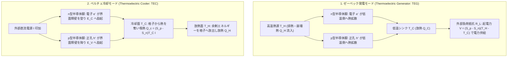
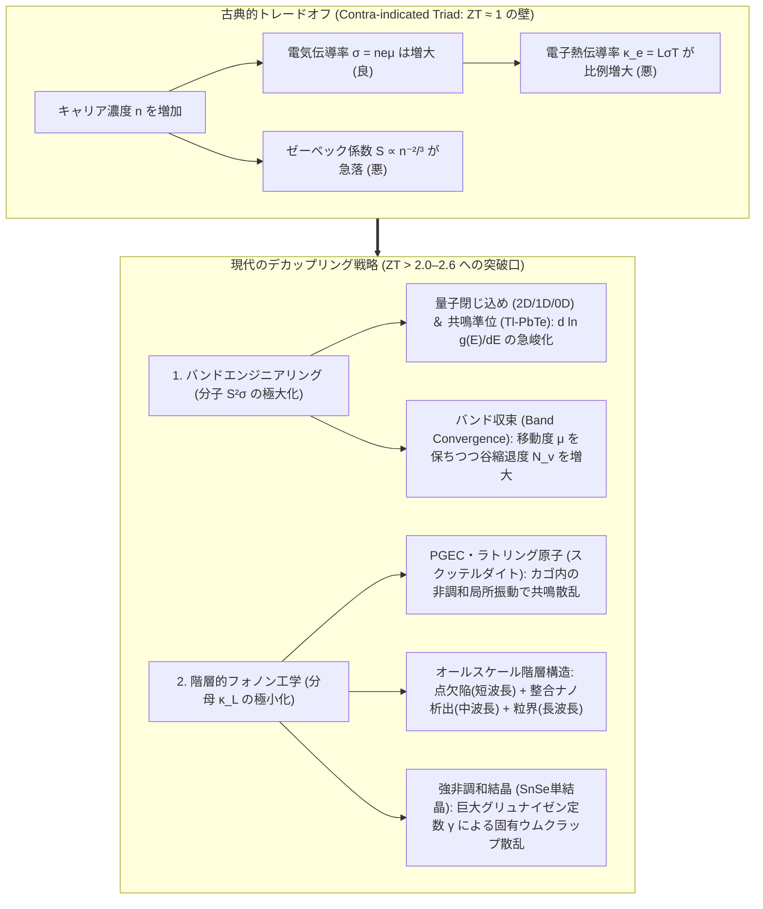

## 1. 導入：可動部ゼロで「熱」と「電気」を直接結ぶ固体物理学の奇跡

1977年に打ち上げられたNASAの深宇宙探査機<strong>ボイジャー1号（Voyager 1）</strong>と<strong>ボイジャー2号（Voyager 2）</strong>は、太陽から240億キロメートル以上離れた星間空間（インターステラー空間）を、打ち上げから47年以上が経過した現在も飛行し続け、地球へ微弱な電波を送り届けている。太陽光の強度が地球軌道の数万分の1にまで減衰するこの暗黒の深宇宙では、太陽光パネル（太陽電池）はまったく役に立たない。さらに、47年間一度もメンテナンスを行えない極限環境において、ピストンやタービンといった機械的可動部を持つ発電機を搭載すれば、摩耗や潤滑油の劣化、振動による破損でとうの昔に寿命を迎えていたはずである。

ボイジャーに半世紀近い生命力を与えている心臓部こそ、プルトニウム238（$^{238}\text{Pu}$）のアルファ崩壊熱と宇宙空間の極低温との「温度差」から直接電力を生み出す<strong>放射性同位体熱電発電機（RTG: Radioisotope Thermoelectric Generator）</strong>である。そこには蒸気を作るボイラーも、回転するタービン翼も、磁界を切るコイルも存在しない。ただシリコン・ゲルマニウム（$\text{SiGe}$）合金の半導体ブロックの両端に温度差が与えられているだけで、結晶内部の電子が音もなく移動し、何十年にもわたって絶え間なく直流電流を供給し続けているのだ。

一方、私たちの身の回りに目を向ければ、まったく同じ物理法則を「逆向き」に動かしたデバイスが静かに活躍している。小型ワインセラーの冷却ユニット、光ファイバー通信網のレーザーダイオードをミリケルビン（$0.01\,\text{K}$）精度で温度ロックする温調器、PCR検査装置の高速サーマルサイクラー、そして天体観測用冷却CCDカメラに使われる<strong>ペルチェ素子（Thermoelectric Cooler: TEC）</strong>である。フロンや代替フロンなどの冷媒ガスもコンプレッサーも一切使わず、薄いセラミック板に挟まれた半導体チップに電流を流すだけで、片面が氷点下に凍りつき、もう片面が熱を帯びる。

これら2つの現象——「温度差から電圧を生む<strong>ゼーベック効果（Seebeck Effect）</strong>」と「電流から温度差（吸熱・発熱）を生む<strong>ペルチェ効果（Peltier Effect）</strong>」——は、固体結晶の内部で<strong>電荷（電子・正孔）</strong>と<strong>エントロピー（熱）</strong>が同じキャリアによって同時に運ばれるという、固体物理学の最も美しく奥深い結合輸送現象（Coupled Transport Phenomenon）の表と裏にほかならない。

しかし、ここには19世紀以来、物理学者と材料工学者を悩ませ続けてきた巨大な壁が立ちはだかっている。「なぜ世界中の工場や自動車から捨てられている膨大な排熱を、すべて熱電変換素子で電気に変えてしまえないのか？」「なぜ家庭用の大型冷蔵庫やエアコンは、今もコンプレッサー式（蒸気圧縮冷凍サイクル）ばかりで、静かなペルチェ素子に置き換わらないのか？」

その答えは、固体中の電子と格子振動（フォノン）が従う冷徹な量子統計力学の法則——<strong>ゼーベック係数 $S$、電気伝導率 $\sigma$、熱伝導率 $\kappa$ の3つが互いに足を引っ張り合う「背反の三重苦（トレードオフ）」</strong>にある。本稿では、3つの古典的熱電効果のミクロな発現機構とオンサーガーの相反定理による熱力学的統一から出発し、無次元性能指数 $ZT$ と変換効率の厳密な導出、ヴィーデマン・フランツの法則とピサレンコ関係が課す固体物理の限界、そしてナノテクノロジーとフォノンエンジニアリングによって「$ZT \approx 1$ の壁」を打ち破りつつある現代熱電材料科学の最前線までを体系的に解き明かす。

---

## 2. 3つの熱電効果の統一的理解とミクロな物理機構

熱電変換現象は、歴史的には19世紀前半に別々の実験家によって発見された3つの効果——<strong>ゼーベック効果（1821年）</strong>、<strong>ペルチェ効果（1834年）</strong>、<strong>トムソン効果（1851年）</strong>——から構成される。まずはそれぞれの物理的実体と、半導体バンド理論および量子統計力学に基づくミクロなメカニズムを精確に把握しよう。

### 2.1 ゼーベック効果（Seebeck Effect）：フェルミ分布の熱的広がりと拡散電場

1821年、ドイツの物理学者トーマス・ヨハン・ゼーベック（Thomas Johann Seebeck）は、ビスマス（$\text{Bi}$）と銅（$\text{Cu}$）という2種類の異なる金属線を環状に接続し、2つの接合部の一方を加熱して温度差を与えると、近くに置いた方位磁針が振れることを発見した。ゼーベック自身はこれを「温度差が直接磁場を生む現象（熱磁気効果：Thermomagnetism）」と解釈したが、直後にハンス・クリスチャン・エルステッドらが、温度差によって閉回路に<strong>起電力（電圧）</strong>が生じ、その結果として流れた電流がアンペールの法則に従って磁針を振らせたのだと正しく結論づけた。

開回路（電流 $I = 0$）の状態にある均一な導体または半導体に温度勾配 $\nabla T$ を与えると、物質内部には温度勾配に比例した静電場 $\mathbf{E} = -\nabla V$（または電気化学ポテンシャル勾配）が自発的に誘起される。この比例係数が<strong>ゼーベック係数（Seebeck Coefficient）</strong>または<strong>熱電能（Thermopower）</strong> $S$ である。

$$\nabla V = -S \nabla T \quad \Longleftrightarrow \quad S = -\frac{\Delta V}{\Delta T}$$

なぜ温度差があるだけで、物質の両端に電圧が現れるのだろうか？これを理解するには、結晶中の自由キャリア（n型半導体なら伝導帯の電子 $e^-$、p型半導体なら価電子帯の正孔 $h^+$）が従う<strong>フェルミ・ディラック分布関数（Fermi-Dirac Distribution）</strong>を見る必要がある。

$$f(E, T) = \frac{1}{\exp\left(\frac{E - \mu}{k_B T}\right) + 1}$$

ここで $E$ はキャリアのエネルギー、$\mu$ は化学ポテンシャル（フェルミ準位 $E_F$）、$k_B \approx 1.381 \times 10^{-23}\,\text{J/K}$ はボルツマン定数、$T$ は絶対温度である。

1. <strong>高温端におけるフェルミ分布の熱的広がり（Thermal Broadening）</strong>：
   絶対零度（$T = 0\,\text{K}$）では、フェルミ分布 $f(E, 0)$ は $E = E_F$ を境に1から0へ不連続に落ちる階段関数である。しかし有限温度 $T > 0$ では、フェルミ準位 $E_F$ の周囲 $\pm k_B T$ 程度のエネルギー幅にわたって分布が滑らかにぼやける。棒状のn型半導体の一端を高温 $T_H$、他端を低温 $T_C$（$T_H > T_C$）に保つと、高温端ではフェルミ準位より高いエネルギー領域（$E > E_F$）に励起された「高エネルギー（高速度）の熱い電子」が低温端よりもはるかに多く存在する。
2. <strong>熱拡散流（Thermal Diffusion Current）の発生</strong>：
   気体分子が高温部から低温部へ拡散するのと同様に、高温端の高エネルギー電子は高い熱速度を持って低温端へと拡散していく。同時に低温端からも冷たい電子が高温端へ拡散するが、高温端からやってくる電子の方が平均速度も数密度（高エネルギー裾野の占有率）も圧倒的に大きいため、正味の電子流が高温端から低温端へと向かう。
3. <strong>内部静電場による熱拡散との動的平衡</strong>：
   回路が開いている（外部に電流が流れ出せない）場合、低温端に到達した電子は行き場を失って蓄積し、低温端は負（$-$）に、電子が抜け出た高温端は正（$+$）に帯電する。この電荷の偏りによって、低温端から高温端へ向かう内部静電場 $\mathbf{E}_{\text{int}} = -\nabla V$ が形成される。この電場は、後から低温端へ拡散してこようとする電子を押し戻す（静電ドリフト流を生む）向きに働く。やがて<strong>「温度差による熱拡散流」と「蓄積電荷による逆向き静電ドリフト流」がミクロに完全につり合った定常状態（正味電流 $\mathbf{J} = 0$）</strong>に達する。このとき両端に確立されている電位差 $\Delta V$ こそがゼーベック起電力である。

n型半導体では多数キャリアが負電荷の電子（$-e$）であるため低温端が負電位となり、ゼーベック係数は負（$S_n < 0$）となる。逆にp型半導体では多数キャリアが正電荷の正孔（$+e$）であるため、正孔が低温端へ拡散して低温端が正電位となり、ゼーベック係数は正（$S_p > 0$）となる。実用的な熱電発電モジュールでは、この符号が逆である性質を巧みに利用し、<strong>p型素子とn型素子を熱的には並列（どちらも上側が高温、下側が低温）、電気的には直列（$\pi$型構造）</strong>に接続することで、1対あたりの起電力を $(S_p - S_n)\Delta T = (|S_p| + |S_n|)\Delta T$ へと倍増させ、数十〜数百対を直列化して実用的な数ボルト〜数十ボルトの電圧を取り出している。

### 2.2 モットの関係式（Mott Formula）とピサレンコ関係

ゼーベック係数 $S$ の大きさを決める固体物理学的要因を定量化するため、ボルツマン輸送方程式（緩和時間近似）から導かれる<strong>モットの関係式（Mott Formula）</strong>を確認しよう。縮退半導体や金属のようにフェルミ準位近傍のキャリアが輸送を担う系において、ゼーベック係数は次式で与えられる。

$$S = -\frac{\pi^2 k_B^2 T}{3e} \left. \frac{d \ln \sigma(E)}{dE} \right|_{E = E_F} = -\frac{\pi^2 k_B^2 T}{3e} \frac{1}{\sigma(E_F)} \left. \frac{d\sigma(E)}{dE} \right|_{E = E_F}$$

ここで $\sigma(E)$ はエネルギー $E$ を持つキャリアの微分導電率（Differential Conductivity）であり、電子の状態密度 $g(E)$、群速度 $v(E)$、散乱緩和時間 $\tau(E)$ を用いて $\sigma(E) \propto e^2 g(E) v^2(E) \tau(E)$ と表される。

このモットの式は、熱電材料設計における極めて重要な本質を語っている。すなわち、<strong>「ゼーベック係数 $S$ とは、フェルミ準位 $E_F$ における導電率のエネルギー微分（非対称性）である」</strong>ということだ。なぜなら、高温端では $E > E_F$ の高エネルギー電子が低温端へ進み、同時に $E < E_F$ の低エネルギー領域では低温端から高温端へ電子が埋め合わせるように移動する。もし $E_F$ の上下で状態密度 $g(E)$ や移動度が完全にフラット（対称、$\frac{d\sigma(E)}{dE} = 0$）であれば、上側の熱い電子が運ぶ電流と下側の冷たい電子が逆向きに運ぶ電流が完全に相殺し、ゼーベック係数 $S$ はゼロになってしまう。したがって、大きなゼーベック係数を得るためには、フェルミ準位 $E_F$ において状態密度 $g(E)$ や緩和時間 $\tau(E)$ がエネルギーに対して急激に立ち上がる（$\left|\frac{d\ln \sigma(E)}{dE}\right|$ が極めて大きい）バンド構造が必要なのである。

これを3次元等方的放物線バンド（有効質量 $m^*$）を持つ縮退半導体に適用し、音響フォノン散乱（$\tau(E) \propto E^{-1/2}$）を仮定すると、キャリア濃度 $n$ と有効質量 $m^*$ の関係を記述する有名な<strong>ピサレンコ関係（Pisarenko Relation）</strong>が導かれる。

$$S = \frac{8 \pi^2 k_B^2}{3 e h^2} m^* T \left( \frac{\pi}{3n} \right)^{2/3}$$

（$h$ はプランク定数）。この式から明らかなように、ゼーベック係数 $|S|$ を大きくするには、<strong>①状態密度有効質量 $m^*$ が大きい（バンドが平坦で状態密度が密な）物質を選ぶこと</strong>、そして<strong>②キャリア濃度 $n$ を低く抑えること（$S \propto n^{-2/3}$）</strong>が求められる。これがのちに詳述する「電気伝導率 $\sigma = ne\mu$ との深刻なトレードオフ」の震源地となる。

### 2.3 ペルチェ効果（Peltier Effect）：界面エネルギー障壁の昇降による可逆吸発熱

ゼーベックの発見から13年後の1834年、フランスの時計職人から物理学に転じたジャン・シャルル・アタナズ・ペルチェ（Jean Charles Athanase Peltier）は、2種類の異なる導体AとBの接合部に外部電源から直流電流 $I$ を流すと、接合界面においてジュール熱（$\propto I^2 R$）とは別に、<strong>電流の向きに依存して熱が吸収（冷却）されたり放出（加熱）されたりする現象</strong>を発見した。

導体Aから導体Bへ電流 $I$ が流れるとき、単位時間あたりに接合界面で発生する（または吸収される）ペルチェ熱量 $\dot{Q}_P$ は、電流 $I$ の1乗に比例する。

$$\dot{Q}_P = (\Pi_A - \Pi_B) I = \Pi_{AB} I$$

ここで $\Pi_A, \Pi_B$ は各物質固有の<strong>ペルチェ係数（Peltier Coefficient、単位：$\text{V}$ または $\text{J/C}$）</strong>である。ジュール熱 $I^2 R$ が常に正（不可逆な散逸による発熱）であり電流を逆転させても発熱のままであるのに対し、ペルチェ熱 $\Pi_{AB} I$ は<strong>熱力学的に可逆（Reversible）</strong>であり、電流 $I$ の向きを反転させると吸熱部が発熱部に、発熱部が吸熱部に瞬時に切り替わる。

ミクロな半導体バンド図でペルチェ冷却のメカニズムを追ってみよう。金属電極（銅など）とn型半導体が接合されている界面を考える。
1. <strong>金属電極内</strong>では、伝導電子はフェルミ準位 $E_F$ のすぐ近くのエネルギー準位を移動している。
2. 一方、<strong>n型半導体内</strong>では、フェルミ準位 $E_F$ は禁制帯（バンドギャップ）内、あるいは伝導帯下端 $E_C$ のすぐ近くにあり、実際に電流を運ぶ伝導電子は伝導帯下端より少し上の平均輸送エネルギー $E_{\text{trans}} = E_C + \Delta E_k$（$\Delta E_k \sim \frac{3}{2}k_B T$）の準位を走行しなければならない。
3. したがって、電子が金属電極からn型半導体へと流入する接合部（冷却面）では、電子は<strong>ポテンシャルの段差（エネルギー障壁 $E_{\text{trans}} - E_F > 0$）を駆け上がらなければならない</strong>。このとき電子は、周囲の結晶格子（フォノン）から熱エネルギーを奪い取って自らの位置エネルギー・運動エネルギーへと変換し、伝導帯へと飛び移る。結晶格子から見れば熱エネルギーが奪われるため、この接合界面は<strong>吸熱（冷却）</strong>される（電子の「蒸発潜熱」に酷似した現象である）。
4. 逆に、n型半導体を通過した電子が反対側の金属電極（放熱面）へ流出する接合部では、高エネルギー状態 $E_{\text{trans}}$ にあった電子が金属の低いフェルミ準位 $E_F$ へと<strong>滝を落ちるようにエネルギー準位を降下する</strong>。この余剰エネルギー $(E_{\text{trans}} - E_F)$ が結晶格子（フォノン）へと放出されるため、放熱面では<strong>発熱（加熱）</strong>が生じる。

p型半導体でも全く同様のことが正孔（$h^+$）に対して起こる。金属電極からp型半導体へ電流が流れる（正孔が注入される）界面では、正孔が価電子帯上端 $E_V$ の下側へと励起されるために格子から熱を奪って吸熱し、反対側の界面では熱を放出する。結果として、$\pi$型モジュールの片面（上部）に吸熱接合を、反対面（下部）に発熱接合を集約することで、電子と正孔という「固体中の作動流体」が低温側から高温側へと熱を汲み上げる<strong>固体ヒートポンプ（ペルチェ冷却器）</strong>が成立するのである。

### 2.4 トムソン効果とケルビン・オンサーガーの相反定理

1851年、熱力学の巨匠ウィリアム・トムソン（William Thomson、のちのケルビン卿 Lord Kelvin）は、ゼーベック効果とペルチェ効果の間に熱力学第一法則（エネルギー保存則）と第二法則（エントロピー原理）を適用し、まだ誰も実験で確認していなかった<strong>第3の熱電効果——トムソン効果（Thomson Effect）</strong>の存在を理論的に予言した。

トムソン効果とは、異種導体の接合部ではなく、<strong>温度勾配 $\nabla T$ が存在する単一の均一な導体に電流密度 $\mathbf{J}$ を流したとき、導体の至るところで連続的に可逆的な吸熱または発熱 $\dot{q}_T$ が生じる現象</strong>である。単位体積・単位時間あたりの総発熱量 $\dot{q}_{\text{total}}$ は、ジュール熱とトムソン熱の和として次式で表される。

$$\dot{q}_{\text{total}} = \frac{\mathbf{J}^2}{\sigma} - \mathcal{K}_T (\mathbf{J} \cdot \nabla T)$$

ここで比例係数 $\mathcal{K}_T$ は<strong>トムソン係数（Thomson Coefficient）</strong>と呼ばれる。キャリアが温度勾配に沿って移動するとき、場所ごとにキャリアの熱容量および平均輸送エントロピー（すなわちゼーベック係数 $S(T)$）が温度とともに変化するため、その差額分の熱を周囲の格子とやり取りせざるを得ないことがトムソン効果の物理的起源である。

さらにケルビン卿は、これら3つの係数 $S, \Pi, \mathcal{K}_T$ が互いに独立ではなく、次の2つの厳密な恒等式——<strong>ケルビンの関係式（Kelvin Relations）</strong>——で結ばれていることを導いた。

$$\Pi = S \cdot T \qquad \text{（ケルビンの第一関係式）}$$

$$\mathcal{K}_T = T \frac{dS}{dT} \qquad \text{（ケルビンの第二関係式）}$$

当時、熱伝導やジュール発熱という「不可逆過程」が常に随伴する系に対して可逆熱力学のカルノーサイクル論法を適用したケルビンの導出は「準熱力学的仮定」と呼ばれたが、1931年にラルス・オンサーガー（Lars Onsager、1968年ノーベル化学賞受賞）が<strong>不可逆過程の線形熱力学（Linear Non-Equilibrium Thermodynamics）</strong>を確立したことで、完全な数学的・統計力学的基礎が与えられた。

オンサーガー理論では、粒子流（電流密度 $\mathbf{J}_e$）と熱流密度 $\mathbf{J}_Q$ が、それぞれの共役な熱力学的駆動力（Generalized Forces）——電気化学ポテンシャル勾配 $-\nabla\tilde{\mu}/e$ と逆温度勾配 $\nabla(1/T)$——の線形結合として記述される。

$$\begin{pmatrix} \mathbf{J}_e \\ \mathbf{J}_Q \end{pmatrix} = \begin{pmatrix} L_{11} & L_{12} \\ L_{21} & L_{22} \end{pmatrix} \begin{pmatrix} -\frac{1}{e}\nabla \tilde{\mu} \\ \nabla \left(\frac{1}{T}\right) \end{pmatrix}$$

ここで対角成分 $L_{11}$ はオームの法則（電気伝導）、$L_{22}$ はフーリエの法則（熱伝導）に対応する輸送係数である。そして非対角成分（交差項）$L_{12}$ は「温度差が電流を生む効果（ゼーベック効果）」、$L_{21}$ は「電位差（電流）が熱流を生む効果（ペルチェ効果）」を表す。ミクロな力学方程式の時間反転対称性（Microscopic Reversibility）から、オンサーガーの相反定理（Onsager Reciprocal Relation）は非対角成分が厳密に等しいことを保証する。

$$L_{12} = L_{21}$$

開回路条件（$\mathbf{J}_e = 0$）からゼーベック係数を求めると $S = \frac{1}{T} \frac{L_{12}}{L_{11}}$ となり、等温条件（$\nabla T = 0$）での熱流と電流の比からペルチェ係数を求めると $\Pi = \left(\frac{\mathbf{J}_Q}{\mathbf{J}_e}\right)_{\nabla T = 0} = \frac{L_{21}}{L_{11}}$ となる。ここに $L_{12} = L_{21}$ を代入すれば、直ちに<strong>ケルビンの第一関係式 $\Pi = S \cdot T$</strong> が一片の曖昧さもなく導出される。すなわち、<strong>ゼーベック係数 $S$ とは「単位電荷あたりが輸送するエントロピー（Transport Entropy per Unit Charge）」そのもの</strong>であり、それに絶対温度 $T$ を掛けた $\Pi = ST$ が単位電荷あたりの潜熱（ペルチェ熱）となるのである。

---

## 3. 無次元性能指数 $ZT$ と熱電変換効率・冷却能力の熱力学的導出

熱電変換素子の性能がどのような物質パラメータによって支配されているかを明らかにするため、発電モードにおける最大変換効率 $\eta_{\max}$ と、冷却モードにおける最大到達温度差 $\Delta T_{\max}$ を熱収支方程式から厳密に導出しよう。

### 3.1 熱電発電（TEG）の最大変換効率 $\eta_{\max}$ の導出

断面積 $A$、長さ $L$ を持つp型半導体とn型半導体の1対（ユニカップル）が、高温熱源 $T_H$ と低温熱浴 $T_C$（$\Delta T = T_H - T_C$）の間に配置され、外部負荷抵抗 $R_L$ に接続されて電流 $I$ を流している系を考える。素子の合成ゼーベック係数を $S = S_p - S_n$、内部電気抵抗を $R = \left(\frac{1}{\sigma_p} + \frac{1}{\sigma_n}\right)\frac{L}{A}$、熱コンダクタンスを $K = (\kappa_p + \kappa_n)\frac{A}{L}$ とおく。

高温端（$T = T_H$）において高温熱源から素子へと単位時間あたりに流入する熱量 $Q_H$ は、以下の3つの項の和・差で表される。

$$Q_H = \underbrace{S T_H I}_{\text{①高温端でのペルチェ吸熱}} + \underbrace{K (T_H - T_C)}_{\text{②フーリエ熱伝導}} - \underbrace{\frac{1}{2} I^2 R}_{\text{③ジュール熱の高温側への還流分}}$$

ここで第3項に $\frac{1}{2}$ がつくのは、素子内部で一様に発生したジュール熱 $I^2 R$ が一次元熱伝導方程式に従って高温端と低温端へちょうど半分ずつ（$\frac{1}{2} I^2 R$ ずつ）流れ出るためである。

一方、外部負荷抵抗 $R_L$ で消費される有効な発電電力 $P$ は、熱起電力 $V_{\text{oc}} = S(T_H - T_C)$ から内部抵抗降下 $IR$ を引いた電圧に電流 $I$ を掛けたものである。

$$P = I^2 R_L = S(T_H - T_C)I - I^2 R$$

したがって、熱電発電の熱効率 $\eta$ は、投入熱量 $Q_H$ に対する出力電力 $P$ の比として定義される。

$$\eta = \frac{P}{Q_H} = \frac{I^2 R_L}{S T_H I + K(T_H - T_C) - \frac{1}{2} I^2 R}$$

ここで負荷抵抗と内部抵抗の比を $m = \frac{R_L}{R}$ とおくと、回路電流は $I = \frac{S(T_H - T_C)}{R(1 + m)}$ と書ける。これを $\eta$ の式に代入して整理すると、材料の物性値のみから成る1つの組み合わせパラメータ $Z$ が自然に浮かび上がる。

$$Z = \frac{S^2}{R K} = \frac{S^2 \sigma}{\kappa} \quad \left[\text{単位：}\text{K}^{-1}\right]$$

この $Z$ に平均絶対温度 $\bar{T} = \frac{T_H + T_C}{2}$（あるいは動作温度 $T$）を掛けて無次元化したものが、1949年に旧ソ連の物理学者アブラム・ヨッフェ（Abram Fedorovich Ioffe）によって体系化された<strong>無次元性能指数（Dimensionless Figure of Merit）$ZT$</strong> である。

$$ZT = \frac{S^2 \sigma T}{\kappa} = \frac{S^2 \sigma T}{\kappa_e + \kappa_L}$$

効率 $\eta(m)$ を抵抗比 $m$ で微分して $\frac{d\eta}{dm} = 0$ となる最適インピーダンス整合条件を求めると、最大効率を与える負荷抵抗比は単純な $m = 1$（最大電力供給条件）ではなく、熱流との結合を反映した $m_{\text{opt}} = \sqrt{1 + Z\bar{T}}$ となる。この $m_{\text{opt}}$ を代入することで、熱電発電の<strong>最大変換効率 $\eta_{\max}$</strong> の基本公式が得られる。

$$\eta_{\max} = \underbrace{\frac{T_H - T_C}{T_H}}_{\text{カルノー効率 }\eta_C} \cdot \underbrace{\frac{\sqrt{1 + Z\bar{T}} - 1}{\sqrt{1 + Z\bar{T}} + \frac{T_C}{T_H}}}_{\text{材料性能因子}}$$

この公式が示す物理的意味は極めて明快である。
- 第一因子 $\eta_C = \frac{T_H - T_C}{T_H}$ は、熱力学第二法則がすべての熱機関に課す絶対上限である<strong>カルノー効率（Carnot Efficiency）</strong>である。
- 第二因子は無次元性能指数 $Z\bar{T}$ の単調増加関数である。もし理想的な熱電材料が存在して $Z\bar{T} \to \infty$（たとえば熱伝導率 $\kappa \to 0$ かつ電気抵抗率 $\rho \to 0$）を実現できれば、第二因子は $1$ に収束し、熱電素子は可動部を一切持たないまま<strong>カルノーサイクルと同一の理想効率 $\eta_C$ に到達する</strong>。
- しかし現実の商用材料（ビスマス・テルル $\text{Bi}_2\text{Te}_3$ など）では $Z\bar{T} \approx 0.8 \sim 1.0$ 程度にとどまる。たとえば $T_C = 300\,\text{K}$、$T_H = 600\,\text{K}$（カルノー効率 $\eta_C = 50\%$）のとき、$Z\bar{T} = 1$ では第二因子は約 $0.21$ となり、実効変換効率は $\eta_{\max} \approx 10.5\%$ 程度となる。もし $Z\bar{T} = 3$ が達成できれば効率は約 $22\%$、$Z\bar{T} = 4$ なら約 $25\%$（カルノー効率の半分）に達し、既存の蒸気タービンや内燃機関に匹敵するエネルギー変換器となるため、世界中の研究者が $ZT = 2 \sim 3$ の壁を超えるべく鎬を削っているのである。

### 3.2 ペルチェ冷却（TEC）の熱収支方程式と最大到達温度差 $\Delta T_{\max}$

次に、外部から電流 $I$ を流し込んで低温面（$T_C$）から熱を奪うペルチェ冷却モードの熱収支を考えよう。冷却面において外部の被冷却物体から単位時間あたりに奪うことができる<strong>正味の吸熱量（冷却能力）$Q_c$</strong> は、高温端の式と符号が反転し、次式で表される。

$$Q_c = \underbrace{S T_C I}_{\text{①ペルチェ吸熱}} - \underbrace{\frac{1}{2} I^2 R}_{\text{②ジュール発熱の逆流}} - \underbrace{K (T_H - T_C)}_{\text{③フーリエ逆熱伝導}}$$

この式は、ペルチェ素子を扱うすべてのエンジニア・研究者が直面する「3つの熱のせめぎ合い」を見事に表現している。
1. <strong>第1項 $S T_C I$（ペルチェ吸熱効果）</strong>：電流 $I$ の1乗に比例して増大する本来の冷却項である。
2. <strong>第2項 $-\frac{1}{2} I^2 R$（ジュール発熱の逆流）</strong>：素子自身の内部抵抗 $R$ によって発生したジュール熱の半分が冷却面へと流れ込む。これは電流 $I$ の<strong>2乗に比例</strong>して増大するため、より強く冷やそうとして電流 $I$ をむやみに大きくしすぎると、ある臨界点を超えた瞬間から第2項が第1項を圧倒し、<strong>ペルチェ素子全体が単なる電熱ヒーターと化して冷却面が逆に加熱されてしまう</strong>。
3. <strong>第3項 $-K(T_H - T_C)$（フーリエ熱伝導による熱リーク）</strong>：冷却が進んで高温面 $T_H$ と低温面 $T_C$ の温度差 $\Delta T = T_H - T_C$ が広がるほど、素子の熱コンダクタンス $K$ を通じて高温側から低温側へ逆流してくる熱量が増大する。もし放熱面（$T_H$ 側）に十分なヒートシンクや水冷機構を設けて熱を逃がさなければ、$T_H$ が急上昇して第3項の逆流熱が激増し、冷却面 $T_C$ の温度もすぐに上がってしまう。

では、ペルチェ素子が作り出せる<strong>最大到達温度差 $\Delta T_{\max} = (T_H - T_C)_{\max}$</strong> はいくらになるだろうか？まず、温度差 $\Delta T$ を固定したときに吸熱量 $Q_c$ を最大化する最適電流 $I_{\max}$ を $\frac{\partial Q_c}{\partial I} = S T_C - I R = 0$ から求めると、

$$I_{\max} = \frac{S T_C}{R}$$

となる。この最適電流 $I_{\max}$ を流した状態で、外部からの熱負荷をゼロ（完全断熱状態：$Q_c = 0$、すなわちペルチェ吸熱からジュール熱を引いた残りがすべてフーリエ逆熱伝導と釣り合う限界状態）とおくと、

$$0 = S T_C \left(\frac{S T_C}{R}\right) - \frac{1}{2} \left(\frac{S T_C}{R}\right)^2 R - K \Delta T_{\max} = \frac{1}{2} \frac{S^2 T_C^2}{R} - K \Delta T_{\max}$$

両辺を $K$ で割り、$Z = \frac{S^2}{RK}$ を用いれば、ペルチェ素子の最大温度差の公式が得られる。

$$\Delta T_{\max} = \frac{1}{2} Z T_C^2 = \frac{1}{2} (Z T_C) T_C$$

室温付近（$T_C \approx 270\,\text{K}$）で $Z \approx 3 \times 10^{-3}\,\text{K}^{-1}$（$ZT_C \approx 0.8$）の標準的な $\text{Bi}_2\text{Te}_3$ ペルチェ素子では、単段での最大温度差は $\Delta T_{\max} \approx \frac{1}{2} \times 0.8 \times 270 \approx 108\,\text{K}$（実際には接触抵抗や輻射熱ロスにより $65 \sim 75\,\text{K}$ 程度）となる。これ以上の極低温（たとえば $-100\,^\circ\text{C}$ 以下）を得たい場合には、ピラミッド状に複数のペルチェ素子を積み重ねて下段が上段の放熱を吸収する<strong>多段カスケード型ペルチェ素子（Multi-Stage Peltier Module）</strong>が用いられる。

また、投入電力 $P_{\text{in}} = I^2 R + S(T_H - T_C)I$ に対する吸熱量 $Q_c$ の比である<strong>成績係数（COP: Coefficient of Performance）</strong>の最大値 $\text{COP}_{\max}$ も、発電効率と全く双対な形で $Z\bar{T}$ によって一意に決定される。

$$\text{COP}_{\max} = \underbrace{\frac{T_C}{T_H - T_C}}_{\text{カルノーCOP}} \cdot \frac{\sqrt{1 + Z\bar{T}} - \frac{T_H}{T_C}}{\sqrt{1 + Z\bar{T}} + 1}$$

ここでもやはり、発電効率 $\eta_{\max}$ と冷却効率 $\text{COP}_{\max}$ の双方を支配する唯一絶対の指標は<strong>無次元性能指数 $ZT = \frac{S^2 \sigma T}{\kappa_e + \kappa_L}$</strong> なのである。

---

## 4. 固体物理学最大のジレンマ：「$S \cdot \sigma \cdot \kappa$ のトレードオフ（背反の三重苦）」

式の上では、$ZT = \frac{S^2 \sigma T}{\kappa_e + \kappa_L}$ を大きくする方法は単純明快に見える。「ゼーベック係数 $S$ が大きく、電気伝導率 $\sigma$ が高く、かつ熱伝導率 $\kappa = \kappa_e + \kappa_L$ が低い物質」を探せばよい。ところが、現実の結晶固体においてこれら3つの要請を同時に満たそうとすると、量子力学と統計力学の根幹に根ざした<strong>「背反の三重苦（Contra-indicated Triad）」</strong>に正面から阻まれることになる。

### 4.1 なぜキャリア濃度 $n$ を動かすとすべてが裏目に出るのか

物質の電気的・熱的輸送特性を制御する最も基本的な実験パラメータは、不純物ドーピングによる<strong>キャリア濃度 $n$（単位体積あたりの自由電子または正孔の数）</strong>の調整である。キャリア濃度 $n$ を変化させたとき、3つの物性値 $S, \sigma, \kappa_e$ がどのように連動するかを見てみよう。

1. <strong>電気伝導率 $\sigma$ とゼーベック係数 $S$ の相反（ピサレンコの呪縛）</strong>：
   電気伝導率は $\sigma = n e \mu$（$\mu$ はキャリア移動度）で表されるため、内部抵抗 $R$ を下げて大電流を取り出すには、キャリア濃度 $n$ を増やせばよい。しかし、第2.2節で導いたピサレンコ関係：
   $$S = \frac{8 \pi^2 k_B^2}{3 e h^2} m^* T \left( \frac{\pi}{3n} \right)^{2/3} \propto n^{-2/3}$$
   が示す通り、キャリア濃度 $n$ を増やすとフェルミ準位 $E_F$ が伝導帯（または価電子帯）の奥深くへと押し上げられ、フェルミ面近傍での状態密度の非対称性 $\left.\frac{d\ln \sigma(E)}{dE}\right|_{E_F}$ が急速に失われる。その結果、<strong>$n$ を増やして $\sigma$ を上げようとすればするほど、ゼーベック係数 $S$ は $n^{-2/3}$ に従って急落する</strong>。
   さらに追い打ちをかけるのが<strong>有効質量 $m^*$ と移動度 $\mu$ の相反</strong>である。ピサレンコ関係から $S$ を稼ぐためにバンドが平坦で有効質量 $m^*$ が重い物質を選ぶと、キャリアは結晶中を動きにくくなり、移動度 $\mu = \frac{e\tau}{m^*}$ が低下して電気伝導率 $\sigma$ が落ちてしまうのである。

2. <strong>電気伝導率 $\sigma$ と電子熱伝導率 $\kappa_e$ の比例（ヴィーデマン・フランツの法則）</strong>：
   では、電気伝導率 $\sigma$ を高めながら熱伝導率 $\kappa = \kappa_e + \kappa_L$ を下げることはできるだろうか？固体中の熱伝導率 $\kappa$ は、キャリア（電子・正孔）自身が熱を運ぶ<strong>電子熱伝導率 $\kappa_e$</strong> と、結晶格子の振動波（フォノン）が熱を運ぶ<strong>格子熱伝導率 $\kappa_L$</strong> の和である。
   ここで、電荷を運ぶのも電子であり、電子熱伝導 $\kappa_e$ を担うのも同じ電子である以上、両者は1853年に発見された固体物理学の鉄則——<strong>ヴィーデマン・フランツの法則（Wiedemann-Franz Law）</strong>——によって強固に縛られている。
   $$\frac{\kappa_e}{\sigma T} = L = \frac{\pi^2}{3} \left( \frac{k_B}{e} \right)^2 \approx 2.44 \times 10^{-8}\,\text{W}\cdot\Omega\cdot\text{K}^{-2}$$
   ここで比例定数 $L$ は<strong>ローレンツ数（Lorenz Number）</strong>と呼ばれ、自由電子ガスモデルでは物質の種類によらない普遍定数となる（非縮退半導体では $L = 2(k_B/e)^2 \approx 1.49 \times 10^{-8}\,\text{W}\cdot\Omega\cdot\text{K}^{-2}$ までわずかに変化する）。
   すなわち、<strong>電気をよく通す物質（高 $\sigma$）は、必然的に電子が熱もよく通してしまう（高 $\kappa_e = L \sigma T$）</strong>。もし $\kappa_L \ll \kappa_e$ となる極限まで格子熱伝導を抑えたとしても、$ZT = \frac{S^2 \sigma T}{\kappa_e} = \frac{S^2}{L}$ となり、少なくとも $S \gtrsim \sqrt{L} \approx 156\,\mu\text{V/K}$ 以上の高いゼーベック係数を持たなければ $ZT = 1$ すら超えられないことがわかる。

### 4.2 絶縁体・半導体・金属の比較と「高濃度ドープ半導体」のスイートスポット

この3者のトレードオフをキャリア濃度 $n$ の軸に沿って整理すると、なぜ熱電材料には銅のような金属もガラスのような絶縁体も使えず、<strong>高濃度にドーピングされた縮退半導体（Heavily Doped Semiconductors）</strong>が選ばれるのかが一目で理解できる。

- <strong>絶縁体・真性半導体（$n < 10^{16}\,\text{cm}^{-3}$）</strong>：
  フェルミ準位がバンドギャップ中央付近にあり、ゼーベック係数 $|S|$ は $500 \sim 1000\,\mu\text{V/K}$ 以上と極めて巨大である。しかしキャリアがほとんど存在しないため電気伝導率 $\sigma$ が桁違いに小さく（内部抵抗が巨大で電流が取り出せない）、出力因子 $PF = S^2 \sigma$ および $ZT$ はほぼゼロとなる。さらに高温では少数キャリアも熱励起され、電子と正孔が同じ方向へ拡散して起電力を打ち消し合う<strong>バイポーラ効果（Bipolar Diffusion Effect）</strong>によって $S$ が急落し、電子・正孔対の生成・再結合に伴うバイポーラ熱伝導 $\kappa_{\text{bi}}$ が急増してしまう。
- <strong>金属（$n \sim 10^{22}\,\text{cm}^{-3}$）</strong>：
  銅や銀のようにキャリア濃度が極めて高く、電気伝導率 $\sigma$ は最高レベルである。しかしフェルミ準位が伝導帯の遥か上方に位置するため、ゼーベック係数 $|S|$ はわずか $1 \sim 5\,\mu\text{V/K}$ 程度しかない。加えてヴィーデマン・フランツの法則により電子熱伝導率 $\kappa_e$ が数百 $\text{W/(m}\cdot\text{K)}$ と巨大であるため、$ZT$ は $10^{-3} \sim 10^{-2}$ オーダーにとどまり、エネルギー変換には全く使えない（温度計測用の熱電対としてのみ利用される）。
- <strong>高濃度ドープ半導体・半金属（$n \approx 10^{19} \sim 10^{20}\,\text{cm}^{-3}$）</strong>：
  フェルミ準位 $E_F$ がちょうど伝導帯の下端（または価電子帯の上端）のごく近傍（$|E_F - E_C| \lesssim k_B T$）に位置する領域である。ここでは $S \approx 150 \sim 250\,\mu\text{V/K}$ という十分に大きなゼーベック係数と、$\sigma \approx 500 \sim 2000\,\text{S/cm}$ という実用的な電気伝導率が絶妙にバランスし、<strong>出力因子（Power Factor）$PF = S^2 \sigma$ が極大ピーク</strong>を迎える。さらに、このキャリア濃度領域では熱伝導率の大部分をまだ格子熱伝導率 $\kappa_L$ が占めているため、重元素（$\text{Bi}, \text{Te}, \text{Pb}, \text{Sb}$ など原子量が大きく音速が遅い元素）を用いて $\kappa_L$ を下げることで $ZT \approx 1$ が達成されるのである。

### 4.3 温度帯別の代表的熱電変換材料と特性比較

熱電素子の性能指数 $ZT = \frac{S^2 \sigma T}{\kappa}$ は温度 $T$ の強い関数であり、バンドギャップ $E_g$ と熱励起によるバイポーラ効果の立ち上がり温度（一般に最適動作温度 $T_{\text{opt}}$ に対して $E_g \approx 6 \sim 10 k_B T_{\text{opt}}$ が目安とされる<strong>Chasmar-Strattonの経験則</strong>）によって、各材料が得意とする温度領域が明確に分かれている。

| 温度領域 | 代表的材料系 | 最適動作温度 $T$ | バンドギャップ $E_g$ | 代表的なピーク $ZT$ | 結晶構造・物理的特徴と主な用途 |
| :--- | :--- | :--- | :--- | :--- | :--- |
| <strong>低温〜室温域</strong> ($< 450\,\text{K}$) | $\text{Bi}_2\text{Te}_3$ 系 ($\text{Bi}_2\text{Te}_{3-x}\text{Se}_x$ / $\text{Bi}_{2-x}\text{Sb}_x\text{Te}_3$) | $250 \sim 400\,\text{K}$ | $\sim 0.13 \sim 0.16\,\text{eV}$ | $0.8 \sim 1.4$ | 層状六方晶（ファンデルワールス結合）、高い異方性と6つの等価なバンド谷（高 $m^*$）。ペルチェ冷却素子（TEC）および低温排熱発電の絶対的標準。 |
| <strong>中温域①</strong> ($500 \sim 850\,\text{K}$) | $\text{PbTe}$ 系 / TAGS ($(\text{GeTe})_{0.85}(\text{AgSbTe}_2)_{0.15}$) | $600 \sim 800\,\text{K}$ | $\sim 0.30\,\text{eV}$ | $1.2 \sim 2.2$ | 岩塩型構造。L谷と$\Sigma$谷の<strong>バンド収束（Band Convergence）</strong>とナノ析出物散乱により高 $ZT$ を実現。NASA火星探査機MMRTGの主力材料。 |
| <strong>中温域②</strong> ($550 \sim 900\,\text{K}$) | 充填スクッテルダイト ($\text{Ba}_x\text{Yb}_y\text{Co}_4\text{Sb}_{12}$ 等) | $700 \sim 850\,\text{K}$ | $\sim 0.2 \sim 0.4\,\text{eV}$ | $1.2 \sim 1.8$ | カゴ状構造（Cage Structure）の空隙に希土類イオンを充填。<strong>ラトリング振動（PGEC）</strong>によりフォノンを選択散乱。自動車・産業排熱回収。 |
| <strong>中〜高温域</strong> ($650 \sim 1000\,\text{K}$) | $\text{SnSe}$ 単結晶・多結晶 （セレン化スズ） | $750 \sim 923\,\text{K}$ | $\sim 0.6 \sim 0.86\,\text{eV}$ | $2.2 \sim 2.6+$ | 歪んだ岩塩型層状構造。巨大な<strong>格子非調和性（強アンハーモニシティ）</strong>によりナノ構造なしで超低 $\kappa_L \approx 0.23\,\text{W/(m}\cdot\text{K)}$ を実現した現代のブレイクスルー材料。 |
| <strong>高温域①</strong> ($700 \sim 1100\,\text{K}$) | ハーフホイスラー合金 ($\text{ZrNiSn}$, $\text{NbFeSb}$ 系) | $800 \sim 1050\,\text{K}$ | $\sim 0.5\,\text{eV}$ | $1.0 \sim 1.5$ | $\text{MgAgAs}$型立方晶。機械的強度・耐熱酸化性・無毒性に優れ、出力因子 $S^2\sigma$ が極めて大きい。重工業炉や高温排熱回収向け。 |
| <strong>超高温域</strong> ($900 \sim 1300\,\text{K}$) | $\text{SiGe}$ 合金 ($\text{Si}_{0.8}\text{Ge}_{0.2}$) | $1000 \sim 1273\,\text{K}$ | $\sim 0.7 \sim 0.9\,\text{eV}$ | $0.8 \sim 1.3$ | ダイヤモンド型構造。高温での化学的安定性が抜群で昇華しにくい。ボイジャー1・2号やニュー・ホライズンズの深宇宙RTGに採用。 |

---

## 5. 「$ZT \approx 1$ の壁」を打ち破る現代フォノン・バンドエンジニアリング

1950年代に $\text{Bi}_2\text{Te}_3$ や $\text{PbTe}$、$\text{SiGe}$ が開発されてから1990年代半ばまでの約40年間、熱電材料の最大性能指数は $ZT \approx 1.0$ の天井に張り付いたままほとんど進歩しなかった。なぜなら、マクロなバルク結晶において一様な組成調整を行う限り、前述の「$S \cdot \sigma \cdot \kappa$ のトレードオフ」から逃れる術がなかったからである。

この40年間の停滞を打ち破り、21世紀に入って $ZT > 2.0 \sim 2.6$ という飛躍をもたらしたのは、<strong>「電荷を運ぶ電子の波（フェルミ波長・平均自由行程）と、熱を運ぶ格子の波（フォノンの波長・平均自由行程）の空間スケールとエネルギー依存性の違いを突き、両者を完全に切り離して（デカップリングして）制御する」</strong>という3つの革新的パラダイムシフトであった。

### 5.1 グレン・スラックの「PGEC（フォノンガラス・電子結晶）」とラトリング効果

1995年、アメリカの物理学者グレン・スラック（Glen A. Slack）は、理想的な熱電材料が備えるべき姿を<strong>「PGEC（Phonon-Glass Electron-Crystal：フォノンにとってはガラス、電子にとっては単結晶）」</strong>という鮮烈な言葉で定式化した。
- <strong>電子結晶（Electron-Crystal）</strong>：電気伝導を担う電子や正孔に対しては、長距離の周期ポテンシャルが完全に保たれた単結晶として振る舞い、キャリアが散乱されずに高い移動度 $\mu$ と大きな出力因子 $S^2\sigma$ を維持する。
- <strong>フォノンガラス（Phonon-Glass）</strong>：熱伝導を担う格子振動（音響フォノン）に対しては、アモルファス（ガラス）のように強い無秩序散乱体として振る舞い、フォノンの平均自由行程 $\ell_{\text{ph}}$ を原子間距離の極限（カヒル・ポールの最小熱伝導率限界 $\kappa_{\min}$）まで短縮して $\kappa_L$ を徹底的に叩き潰す。

ヴィーデマン・フランツの法則 $\kappa_e = L \sigma T$ は電子が運ぶ熱 $\kappa_e$ を縛る法則であり、<strong>格子が運ぶ熱 $\kappa_L$ はこの法則の拘束を一切受けない</strong>。したがって、電子が走る骨格ネットワーク（共有結合フレームワーク）を一切傷つけずに、フォノンだけを散乱するギミックを結晶内に組み込めば、$\sigma$ と $S$ を全く落とさずに分母の $\kappa = \kappa_e + \kappa_L$ だけを劇的に小さくできる。

このPGEC概念を結晶化学的に見事に具現化したのが、<strong>充填スクッテルダイト（Filled Skutterudites：$\text{R}_x\text{Co}_4\text{Sb}_{12}$）</strong>と<strong>クラスレート化合物（Clathrates：$\text{Ba}_8\text{Ga}_{16}\text{Ge}_{30}$ など）</strong>である。これらの結晶は、コバルト（$\text{Co}$）とアンチモン（$\text{Sb}$）などの強固な共有結合ネットワークが立体的な「カゴ（Cage / Void）」を形成している。
1. 電子や正孔は、この強固で周期的な $\text{Co-Sb}$ 骨格ネットワークの上を高速で伝播するため、高い電気伝導率 $\sigma$ が保たれる。
2. 一方、大きなカゴの内部空間にランタノイドやアルカリ土類金属（$\text{La}, \text{Ce}, \text{Ba}, \text{Yb}$ など）のゲストイオンを閉じ込めると、ゲストイオンはカゴのサイズに対して小さいため、緩く束縛された状態で周囲の壁と非調和的に激しく揺れ動く——これを<strong>ラトリング（Rattling：ガラガラと鳴る運動）</strong>と呼ぶ。
3. この局所的なラトリング振動（アインシュタイン振動子モード）が、結晶中を伝播して熱を運ぼうとする低周波の音響フォノンと共鳴的に結合（Avoided Crossing / 共鳴散乱）し、フォノンの群速度と寿命を劇的に低下させる。さらに、固有振動数の異なる複数種類のゲスト原子（たとえば $\text{Ba}, \text{La}, \text{Yb}$ の3種類）を同時にカゴへ充填する<strong>多重充填（Multiple Filling）</strong>を行うことで、幅広い周波数帯域の音響フォノンを一網打尽に散乱し、$ZT \approx 1.7 \sim 1.8$ という高い性能が実現された。

### 5.2 バンドエンジニアリング：低次元量子閉じ込めと共鳴準位・バンド収束

分母の $\kappa_L$ を下げるPGECと並行して、分子の出力因子 $PF = S^2\sigma$ における「ピサレンコ関係（$S$ と $\sigma$ のトレードオフ）」を正面から突破する<strong>バンドエンジニアリング（Band Structure Engineering）</strong>も大きく開花した。

1. <strong>ヒックス・ドレッセルハウスの低次元量子閉じ込め効果（1993年）</strong>：
   MITのリン・ヒックス（Lyndon D. Hicks）とミルドレッド・ドレッセルハウス（Mildred S. Dresselhaus）は、材料を量子井戸（2次元超格子）、ナノワイヤ（1次元）、量子ドット（0次元）へとナノスケールで閉じ込めると、電子の状態密度 $g(E)$ の形状が劇的に変化することを理論的に示した。
   - 3次元バルク結晶では、状態密度は $g_{\text{3D}}(E) \propto \sqrt{E}$ と緩やかにしか増加しない。
   - しかし2次元量子井戸では $g_{\text{2D}}(E)$ は階段関数（ステップ関数）となり、1次元ナノワイヤでは $g_{\text{1D}}(E) \propto 1/\sqrt{E}$ の発散ピーク（ファン・ホーヴェ特異点）を持ち、0次元量子ドットではデルタ関数 $\delta(E - E_n)$ の鋭いスパイクとなる。
   第2.2節のモットの式 $S \propto \left.\frac{d\ln \sigma(E)}{dE}\right|_{E = E_F}$ を思い出してほしい。量子閉じ込めによって状態密度 $g(E)$ に鋭いエッジやスパイクを作り出し、ちょうどその急峻な立ち上がりの位置にフェルミ準位 $E_F$ を合わせれば、<strong>キャリア濃度 $n$（すなわち $\sigma$）を高く保ったまま、微分値 $\frac{d\ln g(E)}{dE}$ を爆発的に増大させて巨大なゼーベック係数 $S$ を得ることができる</strong>のである。さらに超格子界面やナノワイヤ表面がフォノンを強く散乱するため、$\kappa_L$ の低減も同時に達成される（例：Venkatasubramanianらによる $\text{Bi}_2\text{Te}_3/\text{Sb}_2\text{Te}_3$ 超格子薄膜、Harmanらによる $\text{PbTeSe}$ 量子ドット超格子など）。

2. <strong>共鳴準位ドーピング（Resonant Level Doping）とバンド収束（Band Convergence）</strong>：
   高価な薄膜超格子を作らずとも、バルク結晶の内部で低次元量子閉じ込めと同等の「状態密度の鋭い突起」を作る手法が、2008年にジョセフ・ヘレマンス（Joseph P. Heremans）らによって実証された<strong>共鳴準位（Resonant States）の導入</strong>である。テルル化鉛（$\text{PbTe}$）に微量のタリウム（$\text{Tl}$）をドーピングすると、$\text{Tl}$ の局在軌道が $\text{PbTe}$ の価電子帯内部で混成して状態密度 $g(E)$ に鋭い「こぶ（共鳴準位による歪み）」を形成する。これにより、同じキャリア濃度でありながらゼーベック係数 $S$ がピサレンコ曲線から大幅に上振れし、$ZT \approx 1.5$ へと倍増した。
   さらに、温度や合金組成を調整して複数の異なるエネルギーバンドの谷（たとえば $\text{PbTe}$ の軽いL谷と重い$\Sigma$谷）のエネルギー準位を一致させる<strong>バンド収束（Band Convergence）</strong>を用いると、1つの谷あたりの移動度 $\mu_b$ を全く劣化させないまま、実効的なバンド縮退度 $N_v$（谷の数）を4から16へと4倍に増やすことができる。全体としての状態密度有効質量は $m^* = N_v^{2/3} m_b^*$ に従って増大するため、<strong>「個々のキャリアは軽い有効質量 $m_b^*$ で高速に走りながら（高 $\mu$・高 $\sigma$）、全体の状態密度は多数の谷 $N_v$ で稼いで高いゼーベック係数 $S$ を得る」</strong>という理想的なトレードオフ打破が可能となったのである。

### 5.3 階層的オールスケール・フォノン散乱と強非調和格子（$\text{SnSe}$）

2012年、ノースウェスタン大学のメルクーリ・カナツィディス（Mercouri G. Kanatzidis）らの研究グループは、バルク熱電材料の $ZT$ を一気に $2.2$ へと引き上げる決定的な手法——<strong>階層的オールスケール・フォノン構造（Hierarchical All-Scale Phonon Architecture）</strong>——を確立した。

なぜ従来のナノ構造化だけではフォノンを完全に止められなかったのか？それは、固体中で熱を運ぶ音響フォノンが単一の波長や単一の平均自由行程 $\ell_{\text{ph}}$ を持っているのではなく、<strong>数オングストローム（短波長）から数マイクロメートル（長波長）まで3桁以上にわたる広い平均自由行程スペクトル</strong>を持っているためである（通常、短波長フォノンが熱伝導の約25%、中波長が約50%、長波長が約25%を担う）。一方で、縮退半導体における電子や正孔の平均自由行程 $\ell_e$ はわずか $1 \sim 10\,\text{nm}$ 程度と極めて短い。

レイリー散乱の法則によれば、あるサイズ $D$ の構造欠陥は、それと同程度の波長・平均自由行程を持つ波を最も強く散乱する。そこでカナツィディスらは、1つのバルク結晶（$\text{PbTe}-\text{SrTe}$ 系）の中に<strong>3つの異なる空間スケールの散乱中心を階層的に埋め込む</strong>という設計を行った。
1. <strong>原子スケール（$\sim 0.1 \sim 1\,\text{nm}$）：点欠陥・固溶体合金化</strong>
   格子サイトへの異種原子置換（質量差とひずみ場の導入）により、<strong>短波長（高周波）フォノン</strong>を徹底的に散乱する。
2. <strong>ナノスケール（$\sim 2 \sim 20\,\text{nm}$）：整合ナノ析出物（Endotaxial Nanoprecipitates）</strong>
   母相の $\text{PbTe}$ 結晶格子と結晶方位が完全に揃った（コヒーレントな）$\text{SrTe}$ ナノ結晶を析出させる。界面の格子整合が保たれているため、平均自由行程の短い電子（$\ell_e \sim 5\,\text{nm}$）は界面でほとんど散乱されずに通り抜ける（高 $\sigma$ 維持）一方、<strong>中波長フォノン</strong>はナノ析出物によって強力に散乱される。
3. <strong>メソスケール（$\sim 0.1 \sim 1\,\mu\text{m}$）：結晶粒界（Mesoscale Grain Boundaries）</strong>
   放電プラズマ焼結（SPS）などによってサブミクロン〜ミクロンサイズの結晶粒界を多数導入し、原子欠陥もナノ析出物もすり抜けてしまう<strong>長波長（低周波）フォノン</strong>を粒界で完全にブロックする。

この「短・中・長」の全波長帯を網羅する3段構えのフォノン・ブロッキングにより、格子熱伝導率 $\kappa_L$ はガラスの限界値に近い水準まで劇的に低下し、$915\,\text{K}$ において $ZT \approx 2.2$ という記録的な値が達成された。

さらに2014年には、同じくスズとセレンというありふれた元素（鉛やテルルを含まない環境調和元素）だけからなる層状化合物<strong>セレン化スズ（$\text{SnSe}$）単結晶</strong>において、ナノ析出物や人工超格子を一切作らなくても、結晶のb軸方向に沿って<strong>$923\,\text{K}$ で $ZT = 2.6 \pm 0.3$</strong> に達することが発見され、世界に衝撃を与えた。$\text{SnSe}$ の $\text{Sn}-\text{Se}$ 結合は孤立電子対（Lone Pair Electrons）の立体化学的活性によって強く歪んだアコーディオン状の層状構造をとっており、格子振動の<strong>非調和性（Anharmonicity：グリュナイゼン定数 $\gamma \approx 4.1$ という異常な巨大値）</strong>が極端に強い。そのため、外部から人工的な欠陥を入れなくても、フォノン同士が激しく衝突し合って自ら崩壊する「フォノン-フォノン・ウムクラップ散乱（Umklapp Scattering）」が極限まで強まり、単結晶でありながら $\kappa_L \approx 0.23\,\text{W/(m}\cdot\text{K)}$ という超高真空断熱材やガラス並みの超低熱伝導率を本質的に（Intrinsically）備えていたのである。

---

## 6. 応用展開と未来展望：深宇宙探査から産業排熱回収・スピン熱電まで

基礎物理学と材料科学が切り拓いた熱電変換技術は、現在どのようなフィールドで社会と科学を支え、どこへ向かおうとしているのか。代表的な4つの領域を詳しく見ていこう。

### 6.1 深宇宙・惑星探査を支える放射性同位体熱電発電機（RTG / MMRTG）

第1節で触れた通り、熱電発電（TEG）が人類の科学史において最もかけがえのない貢献を果たしてきた舞台は<strong>宇宙探査</strong>である。木星軌道（太陽距離5.2天文単位）以遠では太陽光のエネルギー密度は地球近傍の27分の1以下、冥王星軌道（約40天文単位）では実に1600分の1以下にまで低下する。また火星表面や月面であっても、数週間続く巨大な砂嵐や14日間続く極低温の夜（月の夜は約 $-170\,^\circ\text{C}$）、あるいは太陽光の届かない永久影クレーター内部では、太陽電池と二次電池の組み合わせだけでは探査機が凍死してしまう。

そこでNASAが一貫して採用してきたのが、プルトニウム238（$^{238}\text{Pu}$、半減期87.7年）の酸化物ペレットが発するアルファ崩壊熱（約 $0.54\,\text{W/g}$）を高温源 $T_H$（約 $800 \sim 1273\,\text{K}$）、宇宙空間への輻射放熱フィンを低温源 $T_C$（約 $470 \sim 570\,\text{K}$）として熱電変換を行う<strong>RTG（Radioisotope Thermoelectric Generator）</strong>である。
- <strong>ボイジャー1号・2号（MHW-RTG）およびニュー・ホライズンズ（GPHS-RTG）</strong>：
  超高温（$T_H \approx 1273\,\text{K}$）で動作するシリコン・ゲルマニウム（$\text{SiGe}$）合金のユニカップルを数百対搭載。ボイジャーは打ち上げ時に約 $470\,\text{W}$ の電力を発生し、プルトニウム238の放射性減衰と熱電素子の経年変化を経てもなお、47年以上にわたって一度の故障もなく電力を供給し続けている。
- <strong>火星ローバー「キュリオシティ（Curiosity）」および「パーサヴィアランス（Perseverance）」（MMRTG）</strong>：
  大気を持つ火星表面でも真空の宇宙空間でも動作可能な<strong>多目的RTG（MMRTG: Multi-Mission RTG）</strong>を搭載。n型脚には $\text{PbTe}$、p型脚には $\text{TAGS}$（テルル・アンチモン・ゲルマニウム・銀合金）のセグメント構造を採用し、約 $2000\,\text{W}$ の崩壊熱から初期出力約 $110\,\text{W}$ の電力と、ローバー内部の電子機器を火星の極寒から守る温水循環用の排熱を同時に供給している。また、2028年打ち上げ予定の土星最大の衛星タイタンを探査する大型ドローン型探査機<strong>「ドラゴンフライ（Dragonfly）」</strong>も、このMMRTGを動力源としてタイタンの分厚い窒素大気を飛行する計画である。

### 6.2 光通信・バイオ医療・精密機器を支えるペルチェ温調（TEC）

一方、ペルチェ素子（TEC）が圧倒的な優位性を持つのは、「大型冷凍機のような大冷却パワー」ではなく、<strong>「振動ゼロ・冷媒ゼロ・超小型・電流の向きと大きさによるミリケルビン精度の双方向温度制御（加熱と冷却のシームレスな切り替え）」</strong>が要求されるハイテク産業分野である。

1. <strong>光ファイバー通信網のレーザー波長安定化</strong>：
   インターネットの基幹網を支える高密度波長分割多重（DWDM）光通信では、1本の光ファイバーの中に波長が $0.8\,\text{nm}$（周波数にして $100\,\text{GHz}$）ずつしか離れていない数十〜百本以上のレーザー光を多重化して伝送している。ところが、半導体レーザー（DFBレーザー）の発振波長は温度が $1\,\text{K}$ 変わるだけで約 $0.1\,\text{nm}$ もドリフトしてしまうため、温度が数度ずれれば隣のチャンネルと混信して通信が途絶する。そのため、世界中の通信基地局や海底ケーブル陸揚げ局のレーザートランシーバー内部には必ず超小型ペルチェ素子が組み込まれ、周囲温度が変動してもレーザーチップの温度を $25.00 \pm 0.01\,^\circ\text{C}$ にリアルタイムでロックし続けている。
2. <strong>半導体製造装置（露光・エッチング）とPCR遺伝子増幅装置</strong>：
   最先端のEUVリソグラフィ装置やシリコンウェーハの精密温調チャック、さらには新型コロナウイルス検査などで広く普及した<strong>PCR（ポリメラーゼ連鎖反応）サーマルサイクラー</strong>では、DNAの変性（$95\,^\circ\text{C}$）・アニーリング（$55\,^\circ\text{C}$）・伸長（$72\,^\circ\text{C}$）という温度サイクルを毎秒数度の高速ランプレートで何十回も正確に反復する必要があり、電流極性の反転だけで瞬時に急速加熱と急速冷却を切り替えられるペルチェ素子が不可欠の役割を果たしている。
3. <strong>赤外線センサー・天体観測用CCDカメラの暗電流冷却</strong>：
   天体望遠鏡の撮像センサーや暗視カメラの赤外線検出器（$\text{HgCdTe}$ や $\text{InGaAs}$ など）では、素子自身の熱揺らぎによって発生する熱雑音（暗電流：Dark Current）が微弱な光信号を覆い隠してしまう。ここに多段カスケード型ペルチェ素子を組み込んでセンサーを $-40\,^\circ\text{C} \sim -100\,^\circ\text{C}$ に冷却すると、コンプレッサーやスターリング冷凍機のような機械的微振動（像ブレの原因）を一切発生させずに、暗電流ノイズを数千分の1以下に激減させることができる。

### 6.3 一次エネルギーの60%を占める「未利用排熱」の回収と次世代フロンティア

人類が毎年消費する化石燃料や原子力などの一次エネルギーのうち、実際に動力や電力として有効利用されているのはわずか30〜40%にすぎず、<strong>残りの約60%は工場の排気ガス・冷却水、自動車のマフラーやラジエーター、データセンターのサーバー排熱として大気中へそのまま捨てられている（未利用排熱）</strong>。

特に $200\,^\circ\text{C}$ 以下の「低温分散型排熱」は、排熱全体の過半数を占めるにもかかわらず、蒸気タービンを回すには温度（エクセルギー）が低すぎ、かつ発生源が工場中の配管や無数の自動車・電子機器に分散しているため、機械式熱機関では回収が不可能であった。ここにスケール依存性を持たない（小規模でも大規模でも効率が変わらない）熱電変換モジュールを適用する試みが急速に進んでいる。
- <strong>産業・車載排熱回収とIoT自立電源（エネルギーハーベスティング）</strong>：
  製鉄所の連続鋳造ラインやセメント焼成炉からの高輻射熱を発電に変える大面積モジュールや、工場内の蒸気配管のわずかな温度差（$\Delta T \sim 10 \sim 30\,\text{K}$）で駆動し、電池交換不要で振動・圧力センサーのデータを無線送信し続ける<strong>産業用IoT（IIoT）自立電源</strong>の実用化が進んでいる。
- <strong>フレキシブル・有機熱電変換材料（Wearable Thermoelectrics）</strong>：
  従来の無機半導体（$\text{Bi}_2\text{Te}_3$ など）は硬く脆いセラミック状であるため、人間の皮膚や曲面配管に密着させることが難しかった。近年では導電性高分子（PEDOT:PSSなど）やカーボンナノチューブ（CNT）、あるいは室温で金属のように塑性変形する<strong>延性無機半導体（$\text{Ag}_2\text{S}$ 系カルコゲナイド）</strong>の研究が急速に進展し、体温（$36\,^\circ\text{C}$）と外気温とのわずか数度の温度差からマイクロワット〜ミリワットの電力を常時発電するスマートウォッチや医療用バイタルセンサーパッチが実現しつつある。
- <strong>スピンカロリトロニクス（Spin Caloritronics）と異常ネルンスト効果</strong>：
  さらに固体物理学の最前線では、電荷の移動だけでなく電子の量子力学的な角運動量である<strong>「スピン（Spin）」と熱流の相互作用</strong>を利用する新しい学理が誕生している。2008年に東北大学の齊藤英治らによって発見された<strong>スピンゼーベック効果（Spin Seebeck Effect）</strong>や、トポロジカル磁性体（ワイル半金属 $\text{Co}_2\text{MnGa}$ など）における<strong>巨大異常ネルンスト効果（Anomalous Nernst Effect: ANE）</strong>では、温度勾配 $\nabla T$ と直交する向き（外積方向 $\mathbf{M} \times \nabla T$）に起電力が発生する。従来のゼーベック素子では多数のp型・n型柱を温度勾配方向に立体的に直列配線する複雑な$\pi$型モジュール構造が不可欠であったが、異常ネルンスト効果やスピンゼーベック効果を用いれば、<strong>熱源の表面に磁性薄膜シートをペタリと貼り付けて横に長い配線を這わせるだけで、面積に比例して大電圧を取り出せる</strong>ため、次世代の超薄型・大面積熱電発電デバイスとして熱い注目を集めている。

---

## 7. まとめ：エントロピーを運ぶ電子の物理学

「温度差から電気をつくれるのか、そして電気から直接冷気をつくれるのか」という問いに対する物理学の答えは、200年にわたる熱力学と固体量子論の結晶そのものであった。

1. <strong>3つの熱電効果の統一</strong>：ゼーベック効果（$\nabla V = -S\nabla T$）は高温端でのフェルミ分布の熱的広がりが生むキャリアの熱拡散と内部静電場の平衡であり、ペルチェ効果（$\dot{Q}_P = \Pi I$）は異種接合界面のエネルギー障壁をキャリアが昇降する際の可逆な潜熱授受である。両者はオンサーガーの相反定理 $L_{12} = L_{21}$ を通じて<strong>ケルビンの関係式 $\Pi = S \cdot T$</strong> で固く結ばれている。
2. <strong>性能指数 $ZT$ と背反の三重苦</strong>：熱電変換の最大効率 $\eta_{\max}$ もペルチェ冷却の最大温度差 $\Delta T_{\max} = \frac{1}{2} Z T_C^2$ も、すべて無次元性能指数 $ZT = \frac{S^2 \sigma T}{\kappa_e + \kappa_L}$ によって支配される。しかし通常の固体では、キャリア濃度 $n$ を増やせばピサレンコ関係（$S \propto n^{-2/3}$）により $S$ が落ち、ヴィーデマン・フランツの法則（$\kappa_e = L \sigma T$）により電子熱伝導率 $\kappa_e$ が増大するという強いトレードオフが存在するため、$n \approx 10^{19} \sim 10^{20}\,\text{cm}^{-3}$ の高濃度ドープ半導体が最適解となる。
3. <strong>ナノ・フォノン工学による限界突破</strong>：現代の材料科学は、カゴ状結晶内のラトリング振動（PGEC）、低次元量子閉じ込めと共鳴準位・バンド収束による状態密度制御、そして原子欠陥・ナノ析出物・結晶粒界を組み合わせた階層的オールスケール・フォノン散乱や $\text{SnSe}$ の強非調和格子によって、電子の輸送（高 $S^2\sigma$）とフォノンの遮断（超低 $\kappa_L$）を分離制御し、$ZT > 2.0 \sim 2.6$ の新領域を切り拓いた。

太陽系外縁の暗闇を47年以上飛び続けるボイジャー探査機のRTGから、世界中の光通信レーザーを $0.01\,\text{K}$ 単位で支えるペルチェ素子、そして工場や人体から失われる膨大な排熱を再び価値ある電力へと蘇らせる次世代モジュールまで——結晶格子のなかを音もなく走る電子とフォノンのダンスは、これからも持続可能なエネルギー社会と極限科学の最前線を静かに、しかし力強く支え続けていくのである。
