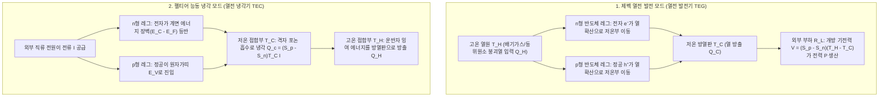
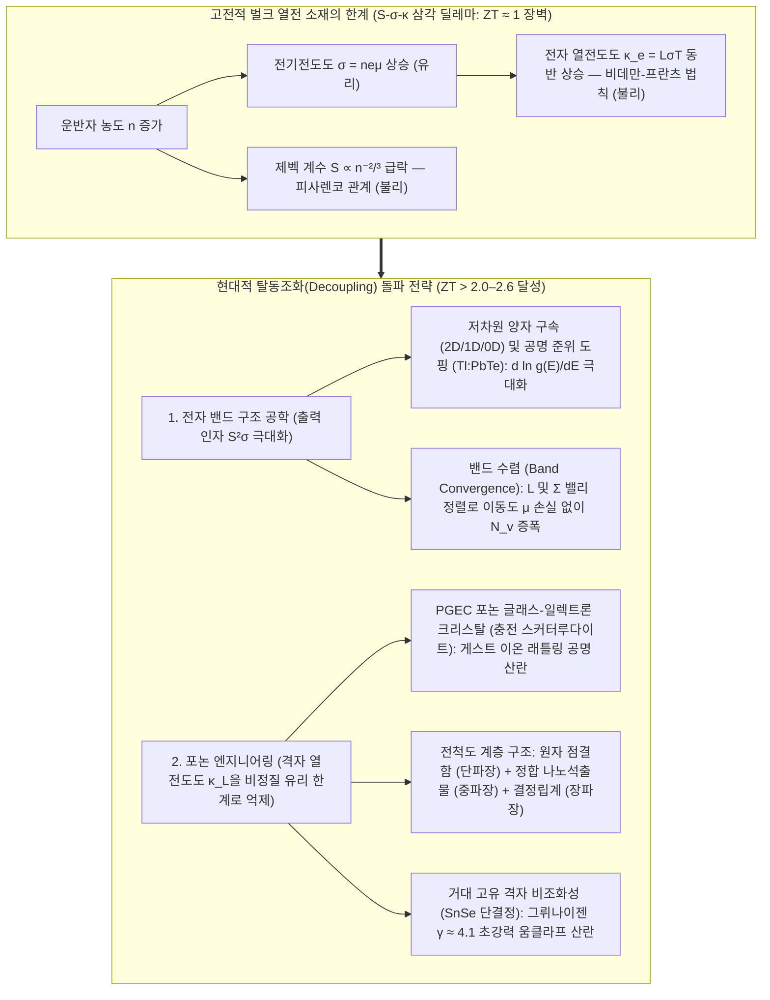

## 1. 들어가며: 움직이는 부품 하나 없이 열과 전기를 잇는 고체물리의 기적

1977년 발사된 미 항공우주국(NASA)의 쌍둥이 심우주 탐사선 <strong>보이저 1호(Voyager 1)</strong>와 <strong>보이저 2호(Voyager 2)</strong>는 태양으로부터 240억 킬로미터 이상 떨어진 칠흑 같은 성간 우주를 47년 넘게 비행하며 지구와 교신하고 있습니다. 태양 빛이 지구 궤도의 1만분의 1도 되지 않는 그곳에서 태양전지판은 무용지물이며, 반세기 동안 수리가 불가능한 극한 환경에서 피스톤이나 터빈 날개가 돌아가는 기계식 열기관은 마모와 피로 파괴로 일찌감치 멈춰 섰을 것입니다.

보이저호에 반세기 동안 끊임없이 전력을 공급해 온 심장은 <strong>방사성 동위원소 열전 발전기(RTG, 일명 원자력 전지)</strong>입니다. 플루토늄-238($^{238}\text{Pu}$)의 알파 붕괴열($T_H \approx 1273\,\text{K}$)과 극저온 우주 공간($T_C \approx 573\,\text{K}$) 사이의 온도 차이를 이용해, 실리콘-게르마늄($\text{SiGe}$) 반도체 소자 내부의 전자가 뜨거운 곳에서 차가운 곳으로 이동하며 직류 전기를 직접 만들어 냅니다. 반대로 지상에서는 똑같은 물리 법칙을 역으로 구동하는 <strong>펠티어 소자(열전 냉각기, TEC)</strong>가 냉매 한 방울이나 압축기 없이 전류만으로 광통신 레이저의 파장 온도를 $\pm 0.01\,\text{K}$ 이내로 정밀 제어하고, 유전자 증폭(PCR) 장치와 천체망원경의 CCD 센서를 냉각합니다.

어떻게 온도 차이가 곧바로 전압이 되고, 전류가 곧바로 열을 퍼낼 수 있을까요? 그리고 왜 열전 발전기는 아직 화력발전소의 증기 터빈을 완전히 대체하지 못했을까요? 그 해답은 응집물질물리학의 가장 집요한 난제인 <strong>제벡 계수 $S$, 전기전도도 $\sigma$, 열전도도 $\kappa$ 사이의 상호 배타적 삼각 딜레마(Contra-indicated Triad)</strong> 속에 숨어 있습니다.

---

## 2. 3대 고전 열전 효과의 미시적 물리학과 온사게르 상반 관계에 의한 통합

열전 현상은 19세기에 발견된 세 가지 효과—<strong>제벡 효과(1821)</strong>, <strong>펠티어 효과(1834)</strong>, <strong>톰슨 효과(1851)</strong>—에 기반을 두고 있습니다.

### 2.1 제벡 효과(Seebeck Effect): 페르미-디랙 분포의 열적 퍼짐과 확산-표류 평형

전류가 흐르지 않는 개방 회로($\mathbf{J} = 0$) 상태의 도체나 반도체에 온도 구배 $\nabla T$가 가해지면, 재료 내부에 온도 차이에 비례하는 기전력(정전위 구배 $\nabla V$, 엄밀히는 전기화학 퍼텐셜 구배 $-\nabla \tilde{\mu}/e$)이 자발적으로 유도됩니다.

$$\nabla V = -S \nabla T \quad \Longleftrightarrow \quad S = -\frac{\Delta V}{\Delta T}$$

비례 상수 $S$(단위: $\mu\text{V/K}$ 또는 $\text{V/K}$)를 <strong>제벡 계수(Seebeck coefficient)</strong> 또는 열기전력(Thermopower)이라 합니다. 그 미시적 원인은 전하 운반자(전자 또는 정공)의 에너지를 지배하는 <strong>페르미-디랙(Fermi-Dirac) 분포 함수</strong>에서 비롯됩니다.

$$f(E, T) = \frac{1}{\exp\left(\frac{E - \mu}{k_B T}\right) + 1}$$

1. <strong>고온부 페르미 표면의 열적 퍼짐(Thermal Broadening)</strong>: 유한한 온도 $T > 0$에서 페르미 준위 $E_F$ 주위 $\sim 2k_B T$ 에너지 폭의 전자들이 열적으로 들뜹니다. 고온부($T_H$)는 저온부($T_C$)보다 고에너지·고속 열전자의 밀도가 훨씬 높습니다.
2. <strong>열확산과 정전기적 표류(Drift)의 동적 평형</strong>: 고온부의 고에너지 운반자들이 저온부로 알짜 열확산(Thermal diffusion)을 일으킵니다. n형 반도체에서는 음전하를 띤 전자($q = -e$)가 저온부에 쌓여 저온부가 음($-$)극이 되고($S_n < 0$), p형 반도체에서는 양전하를 띤 정공($q = +e$)이 저온부에 쌓여 양($+$)극이 됩니다($S_p > 0$). 축적된 전하가 만든 내부 전기장에 의한 역방향 <strong>정전기적 표류 전류</strong>가 순방향 <strong>열확산 전류</strong>와 정확히 상쇄($\mathbf{J}_{\text{diff}} + \mathbf{J}_{\text{drift}} = 0$)될 때 양단에 정상 상태 제벡 전압이 형성됩니다. 실제 열전 모듈은 p형과 n형 레그를 <strong>열적으로는 병렬, 전기적으로는 직렬</strong>($\pi$형 유니커플)로 연결하여 개방 전압을 $V_{\text{oc}} = (S_p - S_n)(T_H - T_C)$로 배가시킵니다.

### 2.2 모트 공식(Mott Formula)과 피사렌코 관계(Pisarenko Relation)

볼츠만 수송 방정식의 좀머펠트 전개를 통해 유도되는 축퇴 반도체의 제벡 계수는 유명한 <strong>모트 공식</strong>을 따릅니다.

$$S = -\frac{\pi^2 k_B^2 T}{3e} \left. \frac{d \ln \sigma(E)}{dE} \right|_{E = E_F}$$

여기서 미분 전도도 $\sigma(E) = \frac{1}{3} e^2 g(E) v^2(E) \tau(E)$는 전자 상태밀도(DOS) $g(E)$, 군속도 $v(E)$, 완화 시간 $\tau(E)$의 곱입니다. 즉, <strong>제벡 계수 $S$는 페르미 준위 $E_F$ 위아래의 전기 전도 비대칭성을 측정하는 척도</strong>이며, $E_F$에서 상태밀도 $g(E)$의 에너지 기울기가 가파를수록 $|S|$가 커집니다. 3차원 등방성 포물선 밴드와 음향 포논 산란을 가정하면 모트 공식은 <strong>피사렌코 관계</strong>로 표현됩니다.

$$S = \frac{8 \pi^2 k_B^2}{3 e h^2} m^* T \left( \frac{\pi}{3n} \right)^{2/3}$$

따라서 높은 제벡 계수 $S$를 얻으려면 <strong>큰 상태밀도 유효질량 $m^*$</strong>과 <strong>낮은 운반자 농도 $n$($S \propto n^{-2/3}$)</strong>이 요구됩니다.

### 2.3 펠티어 효과(Peltier Effect)와 톰슨 효과(Thomson Effect)

외부 직류 전류 $I$가 서로 다른 두 물질 A와 B의 등온 접합부를 통과할 때, 계면에서는 전류 $I$에 비례하는 속도로 열이 가역적으로 흡수(냉각)되거나 방출(가열)됩니다.

$$\dot{Q}_P = (\Pi_A - \Pi_B) I = \Pi_{AB} I$$

여기서 $\Pi$(단위: $\text{V}$ 또는 $\text{J/C}$)는 <strong>펠티어 계수</strong>입니다. 미시적 에너지 밴드 관점에서 금속 전극 내부의 전자는 페르미 준위 $E_F$ 근처에서 이동하지만, n형 반도체 내부에서 전류를 나르려면 전도대 바닥 $E_C$ 위의 수송 준위 $E_{\text{trans}}$에 올라타야 합니다. 따라서 전자가 금속에서 n형 반도체로 넘어가는 냉각 접합부에서는 <strong>에너지 장벽 $\Delta E = E_{\text{trans}} - E_F > 0$을 뛰어넘기 위해 주변 결정 격자의 포논(열에너지)을 흡수</strong>하므로 접합부가 차가워집니다(마치 액체 냉매가 기화하며 잠열을 흡수하는 것과 같은 전자 가스의 등온 팽창!). 반대로 전자가 고온 접합부에서 반도체로부터 금속의 $E_F$로 떨어질 때는 잉여 에너지를 포논으로 방출하여 열을 냅니다.

1851년 윌리엄 톰슨(켈빈 경)은 온도 구배 $\nabla T$가 존재하는 단일 균일 도체에 전류 $\mathbf{J}$가 흐를 때 운반자의 엔트로피 변화로 인해 열이 흡수·방출되는 <strong>톰슨 효과</strong>($\dot{q}_{\text{total}} = \frac{\mathbf{J}^2}{\sigma} - \mathcal{K}_T (\mathbf{J} \cdot \nabla T)$)를 예측했습니다.

### 2.4 온사게르-켈빈 상반 관계(Onsager-Kelvin Reciprocal Relations)

선형 비평형 열역학에서 전류 밀도 $\mathbf{J}_e$와 열류 밀도 $\mathbf{J}_Q$는 켤레 열역학적 힘에 의해 구동됩니다.

$$\begin{pmatrix} \mathbf{J}_e \\ \mathbf{J}_Q \end{pmatrix} = \begin{pmatrix} L_{11} & L_{12} \\ L_{21} & L_{22} \end{pmatrix} \begin{pmatrix} -\frac{1}{e}\nabla \tilde{\mu} \\ \nabla \left(\frac{1}{T}\right) \end{pmatrix}$$

1931년 라르스 온사게르(Lars Onsager, 1968년 노벨 화학상)는 미시적 시간 반전 대칭성으로부터 교차 수송 계수의 대칭성 <strong>$L_{12} = L_{21}$</strong>을 증명했으며, 이로부터 제벡 계수와 펠티어 계수를 하나로 묶는 <strong>켈빈 제1 및 제2 관계식</strong>이 도출됩니다.

$$\Pi = S \cdot T, \qquad \mathcal{K}_T = T \frac{dS}{dT}$$

이는 <strong>제벡 계수 $S = \frac{\Pi}{T}$가 곧 단위 전하당 수송되는 열역학적 엔트로피($S = S_{\text{carrier}} / q$)</strong>임을 뜻합니다!

---

## 3. 무차원 성능지수 $ZT$, 최대 변환 효율 및 펠티어 냉각 능력의 엄밀한 유도

### 3.1 열전 발전기(TEG)의 최대 변환 효율 $\eta_{\max}$

고온부 $T_H$와 저온부 $T_C$($\Delta T = T_H - T_C$) 사이에서 작동하는 유니커플의 총 제벡 계수를 $S = S_p - S_n$, 내부 전기저항을 $R$, 병렬 열전도도를 $K$라 합시다. 전류 $I$가 흐를 때 1차원 정상 상태 열방정식을 풀면 내부 줄 발열 $I^2 R$의 정확히 절반이 고온부로 되돌아가므로, 고온부 흡수 열량 $Q_H$와 외부 부하 $R_L$에 전달되는 출력 전력 $P$는 다음과 같습니다.

$$Q_H = \underbrace{S T_H I}_{\text{고온부 펠티어 흡열}} + \underbrace{K (T_H - T_C)}_{\text{푸리에 열전도 손실}} - \underbrace{\frac{1}{2} I^2 R}_{\text{줄 발열의 절반 반환}}, \qquad P = I^2 R_L = S(T_H - T_C)I - I^2 R$$

저항비 $m \equiv R_L / R$을 도입하고 레그 단면적비를 최적화하면 모든 물성치는 이오페(A. F. Ioffe, 1949)가 정립한 <strong>무차원 열전 성능지수(Figure of Merit) $ZT$</strong>로 압축됩니다.

$$ZT = \frac{S^2 \sigma T}{\kappa} = \frac{S^2 \sigma T}{\kappa_e + \kappa_L}$$

여기서 분자 $PF = S^2 \sigma$는 <strong>출력 인자(Power Factor)</strong>이고, 분모 $\kappa = \kappa_e + \kappa_L$은 전자 열전도도 $\kappa_e$와 격자(포논) 열전도도 $\kappa_L$의 합입니다. 변환 효율 $\eta(m) = P / Q_H$를 $m$에 대해 미분하여($\frac{d\eta}{dm} = 0$) 극대화하면 최적 임피던스 매칭 조건 $m_{\text{opt}} = \sqrt{1 + Z\bar{T}}$($\bar{T} = \frac{T_H + T_C}{2}$)를 얻으며, 이를 대입하면 <strong>열전 발전 최대 효율 공식</strong>이 도출됩니다.

$$\eta_{\max} = \underbrace{\frac{T_H - T_C}{T_H}}_{\text{카르노 효율 }\eta_C} \cdot \underbrace{\frac{\sqrt{1 + Z\bar{T}} - 1}{\sqrt{1 + Z\bar{T}} + \frac{T_C}{T_H}}}_{\text{재료 감소 인자}}$$

$Z\bar{T} \to \infty$ 극한에서 $\eta_{\max}$는 카르노 효율 $\eta_C$에 수렴합니다. 상용 소재 수준인 $Z\bar{T} = 1$($T_H = 600\,\text{K}, T_C = 300\,\text{K}$)에서는 $\eta_{\max} \approx 10.8\%$이지만, $Z\bar{T}$를 $3\text{–}4$로 높이면 효율이 $21\%\text{–}25\%$에 달해 기계식 열기관을 대체할 수 있습니다.

### 3.2 펠티어 순 냉각 능력 $Q_c$, 최대 도달 온도차 $\Delta T_{\max}$ 및 성적계수 COP

펠티어 냉각기(TEC)의 저온부($T_C$) <strong>순 냉각 능력 $Q_c$</strong>는 세 가지 항의 균형으로 결정됩니다.

$$Q_c = \underbrace{(S_p - S_n) T_C I}_{\text{(1) 펠티어 흡열 냉각}} - \underbrace{\frac{1}{2} I^2 R}_{\text{(2) 줄 발열 역류}} - \underbrace{K (T_H - T_C)}_{\text{(3) 푸리에 열전도 역류}}$$

펠티어 흡열은 전류 $I$에 선형 비례하는 반면 줄 발열은 $I^2$으로 급증하므로, 최적 전류 $I_{\max} = \frac{S T_C}{R}$($\frac{\partial Q_c}{\partial I} = 0$)을 초과해 전류를 흘리면 오히려 냉각기가 히터로 돌변합니다! 외부 열부하가 없는 상태($Q_c = 0$)에서 도달 가능한 <strong>최대 온도차 $\Delta T_{\max}$</strong>와 <strong>최대 성적계수 $\text{COP}_{\max}$</strong>는 다음과 같습니다.

$$\Delta T_{\max} = \frac{1}{2} Z T_C^2, \qquad \text{COP}_{\max} = \frac{T_C}{T_H - T_C} \cdot \frac{\sqrt{1 + Z\bar{T}} - \frac{T_H}{T_C}}{\sqrt{1 + Z\bar{T}} + 1}$$

상온 $\text{Bi}_2\text{Te}_3$ 단단 모듈($ZT_C \approx 0.8\text{–}1.0$)의 실제 $\Delta T_{\max}$는 약 $68\text{–}75\,\text{K}$이며, 다단 피라미드 적층(Cascade TEC)을 통해 $-100\,^\circ\text{C}$ 이하의 극저온 냉각이 가능합니다.

---

## 4. 고체물리학의 근본적 딜레마: $S$, $\sigma$, $\kappa$의 상충 삼각 관계

왜 $ZT = \frac{S^2 \sigma T}{\kappa_e + \kappa_L}$를 높이는 것이 그토록 어려울까요? 세 변수가 운반자 농도 $n$을 매개로 정면충돌하기 때문입니다.

1. <strong>$S$와 $\sigma$의 충돌(피사렌코 트레이드오프)</strong>: 전기전도도 $\sigma = n e \mu$를 높이려고 도핑 농도 $n$을 올리면 피사렌코 관계($S \propto m^* n^{-2/3}$)에 의해 제벡 계수 $S$가 급락합니다. 반대로 $S$를 키우려고 유효질량 $m^*$이 무거운 평탄 밴드 물질을 쓰면 이동도 $\mu = \frac{e\tau}{m^*}$가 떨어져 $\sigma$가 무너집니다.
2. <strong>$\sigma$와 $\kappa_e$의 충돌(비데만-프란츠 법칙 Wiedemann-Franz Law)</strong>: 전류를 나르는 자유전자가 열에너지도 함께 나르기 때문에 전자 열전도도 $\kappa_e$와 전기전도도 $\sigma$는 <strong>비데만-프란츠 법칙</strong>으로 묶여 있습니다.

$$\frac{\kappa_e}{\sigma T} = L = \frac{\pi^2}{3} \left( \frac{k_B}{e} \right)^2 \approx 2.44 \times 10^{-8}\,\text{W}\cdot\Omega\cdot\text{K}^{-2}$$

여기서 $L$은 로렌츠 상수입니다. 즉, $\sigma$를 높이면 $\kappa_e = L\sigma T$가 비례해서 치솟아 온도 차이를 단락시켜 버립니다!

결국 절연체는 $\sigma \approx 0$이고 고온에서 전자-정공 쌍에 의한 치명적인 <strong>양극성 열전도(Bipolar conduction)</strong>가 발생하며, 금속은 $S \approx 1\text{–}5\,\mu\text{V/K}$가 너무 작고 $\kappa_e$가 너무 큽니다. 따라서 모든 실용 열전 소재는 <strong>운반자 농도 $n \approx 10^{19}\text{–}10^{20}\,\text{cm}^{-3}$ 영역의 고농도 도핑 축퇴 반도체(Degenerate Semiconductor)</strong>에서 최적점을 찾습니다.

| 작동 온도 영역 | 대표 열전 소재 시스템 | 최적 온도 $T_{\text{opt}}$ | 밴드갭 $E_g$ | 대표 피크 $ZT$ | 결정 구조, 핵심 물리 메커니즘 및 주요 응용 분야 |
| :--- | :--- | :--- | :--- | :--- | :--- |
| <strong>저온~상온 영역</strong> ($< 450\,\text{K}$) | $\text{Bi}_2\text{Te}_3$계 합금 ($\text{Bi}_2\text{Te}_{3-x}\text{Se}_x$ / $\text{Bi}_{2-x}\text{Sb}_x\text{Te}_3$) | $250\text{–}400\,\text{K}$ | $\sim 0.15\,\text{eV}$ | $0.8\text{–}1.4$ | 층상 마름모계 구조, 반데르발스 결합 및 높은 밸리 축퇴도($N_v=6$). 상용 펠티어 냉각기(TEC) 및 저온 폐열 발전의 표준 소재. |
| <strong>중온 영역 I</strong> ($500\text{–}850\,\text{K}$) | $\text{PbTe}$ 및 TAGS-85 | $600\text{–}800\,\text{K}$ | $\sim 0.30\,\text{eV}$ | $1.2\text{–}2.2$ | 암염 입방 구조. L–$\Sigma$ <strong>밴드 수렴</strong>($N_v = 4 \to 16$), $\text{Tl}$ 공명 준위 도핑, $\text{SrTe}$ 정합 나노석출물로 고성능 달성. 화성 탐사 로버 MMRTG에 탑재. |
| <strong>중온 영역 II</strong> ($550\text{–}900\,\text{K}$) | 충전 스커터루다이트 ($\text{Ba}_x\text{La}_y\text{Yb}_z\text{Co}_4\text{Sb}_{12}$) | $700\text{–}850\,\text{K}$ | $\sim 0.3\,\text{eV}$ | $1.2\text{–}1.8$ | $\text{CoSb}_3$ 새장(Cage) 구조. 빈 공간에 넣은 희토류/알칼리토류 게스트 이온의 비조화 <strong>래틀링(Rattling, PGEC 메커니즘)</strong>으로 음향 포논 산란. 자동차·산업 배기열 회수. |
| <strong>중고온 영역</strong> ($650\text{–}1000\,\text{K}$) | $\text{SnSe}$ (셀레늄화 주석 단결정) | $750\text{–}923\,\text{K}$ | $\sim 0.86\,\text{eV}$ | $2.2\text{–}2.6+$ | 주름진 층상 사방정계($Pnma \to Cmcm$). $\text{Sn}^{2+}$ 고립전자쌍에 의한 <strong>거대 고유 격자 비조화성</strong>(그뤼나이젠 상수 $\gamma \approx 4.1$)으로 초저 열전도도 $\kappa_L \approx 0.23\,\text{W/(m}\cdot\text{K)}$ 달성. |
| <strong>고온 영역</strong> ($700\text{–}1100\,\text{K}$) | 하프-호이슬러 합금 ($\text{ZrNiSn}$, $\text{NbFeSb}$) | $800\text{–}1050\,\text{K}$ | $\sim 0.5\,\text{eV}$ | $1.0\text{–}1.5$ | 금속간 화합물 구조. 탁월한 기계적 강도·열안정성·무독성 및 초고 출력 인자($PF > 50\,\mu\text{W cm}^{-1}\text{K}^{-2}$). 제철소·산업용 용광로 폐열 발전. |
| <strong>초고온 영역</strong> ($900\text{–}1300\,\text{K}$) | $\text{SiGe}$ 실리콘-게르마늄 ($\text{Si}_{0.8}\text{Ge}_{0.2}$) | $1000\text{–}1273\,\text{K}$ | $\sim 0.8\,\text{eV}$ | $0.8\text{–}1.3$ | 다이아몬드 공유결합 격자. 강한 합금 질량 요동 포논 산란 및 $1000\,^\circ\text{C}$ 진공 내승화성. 보이저 1·2호 및 뉴호라이즌스호 심우주 RTG 전원. |

---

## 5. $ZT \approx 1$의 벽을 허물다: 현대 밴드 공학과 포논 엔지니어링

1. <strong>글렌 슬랙(Glen Slack)의 PGEC("포논 글래스-일렉트론 크리스탈", 1995)와 래틀링 효과</strong>: 전자의 평균자유행로($\sim 1\text{–}10\,\text{nm}$)보다 포논의 평균자유행로 스펙트럼이 훨씬 넓다는 점을 이용해, <strong>충전 스커터루다이트($\text{CoSb}_3$)</strong>나 <strong>클라스레이트(Clathrate)</strong>의 거대 원자 새장(Cage) 속에 무거운 희토류 게스트 이온을 넣습니다. 전자는 외곽의 공유결합 격자를 따라 방해 없이 흐르고(일렉트론 크리스탈), 새장 안의 게스트 이온은 국소 비조화 <strong>래틀링(Rattling, 덜그럭거림)</strong> 진동을 하며 열을 나르는 음향 포논만 선택적으로 산란시킵니다(포논 글래스).
2. <strong>밴드 구조 공학: 양자 구속, 공명 도핑, 밴드 수렴</strong>:
   - <strong>힉스-드레셀하우스 저차원 양자 구속(1993)</strong>: 2D 양자우물, 1D 나노선, 0D 양자점의 계단형·스파이크형 상태밀도 특이점을 이용해 $\frac{d\ln g(E)}{dE}$를 극대화합니다.
   - <strong>공명 준위 도핑(Heremans 등, 2008)</strong>: 벌크 $\text{PbTe}$에 탈륨($\text{Tl}$)을 도핑해 페르미 준위 근처에 공명 상태밀도 혹(hump)을 형성합니다.
   - <strong>밴드 수렴(Band Convergence)</strong>: 상태밀도 유효질량은 밸리 축퇴도 $N_v$에 의해 $m^* = N_v^{2/3} m^*_b$로 주어집니다. $\text{PbTe}$의 가벼운 $L$ 밸리($N_v=4$)와 무거운 $\Sigma$ 밸리($N_v=12$)의 에너지를 일치시키면 개별 운반자의 이동도($\mu \propto 1/m^*_b$)를 희생하지 않고도 $N_v = 16$으로 증폭시켜 $S$와 $S^2\sigma$를 동시에 끌어올릴 수 있습니다!
3. <strong>전척도 계층형 포논 엔지니어링(Kanatzidis 등, 2012)과 $\text{SnSe}$ 고유 비조화성(2014)</strong>:
   <strong>원자 단위 점결함</strong>(단파장 포논 산란) + <strong>정합(Endotaxial) 나노석출물 $\text{SrTe}$</strong>(운반자 산란 없이 중파장 포논 산란) + <strong>서브마이크론 결정립계</strong>(장파장 포논 산란)를 결합한 전척도 아키텍처로 $\text{PbTe}$에서 $ZT \approx 2.2$를 달성했습니다. 나아가 2014년에는 나노구조가 전혀 없는 <strong>단결정 $\text{SnSe}$</strong>에서 $\text{Sn}^{2+}$의 $5s^2$ 고립전자쌍에 의한 아코디언형 격자 왜곡과 거대 그뤼나이젠 상수($\gamma \approx 4.1$)만으로 비정질 유리보다 낮은 $\kappa_L \approx 0.23\,\text{W/(m}\cdot\text{K)}$와 <strong>$ZT = 2.6 \pm 0.3$ ($923\,\text{K}$)</strong>이 보고되었습니다.

---

## 6. 실전 응용과 미래 프런티어: 성간 우주선에서 스핀 칼로리트소닉스까지

1. <strong>우주 탐사용 원자력 전지(RTG & MMRTG)</strong>: 보이저 1·2호와 뉴호라이즌스호의 $\text{SiGe}$ RTG에 이어, 화성 로버 큐리오시티·퍼서비어런스와 토성의 위성 타이탄을 비행할 원자력 드론 '드래곤플라이(Dragonfly)'는 아르곤 가스가 봉입된 $\text{PbTe/TAGS}$ 기반 MMRTG로부터 24시간 안정적인 전력과 보온열을 공급받습니다.
2. <strong>초정밀 반도체 열관리(펠티어 TEC)</strong>: 광통신 DWDM 레이저 다이오드의 파장 흔들림을 막는 $\pm 0.01\,\text{K}$ 온도 고정, PCR 유전자 증폭기, 무진동 적외선·천체 관측 센서 냉각에서 독보적인 위치를 차지하고 있습니다.
3. <strong>산업 폐열 회수, 웨어러블 열전 소자, 스핀 칼로리트소닉스(Spin Caloritronics)</strong>: 공장 배관의 폐열로 작동하는 무전원 IIoT 센서, 금속처럼 휘어지는 상온 연성 무기 반도체($\text{Ag}_2\text{S}$계) 및 전도성 고분자(PEDOT:PSS) 체온 발전 패치, 그리고 자성 절연체의 <strong>스핀 제벡 효과(SSE)</strong>와 위상 자성 반금속의 <strong>비정상 네른스트 효과(ANE, $\mathbf{E}_{\text{ANE}} \propto \mathbf{M} \times \nabla T$)</strong>를 이용한 대면적 박막 열전 코팅에 이르기까지 전자와 포논의 양자 협주곡은 계속 진화하고 있습니다.
