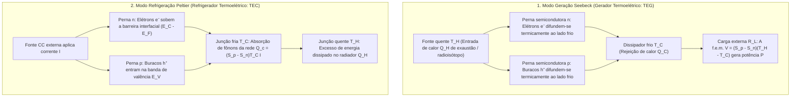
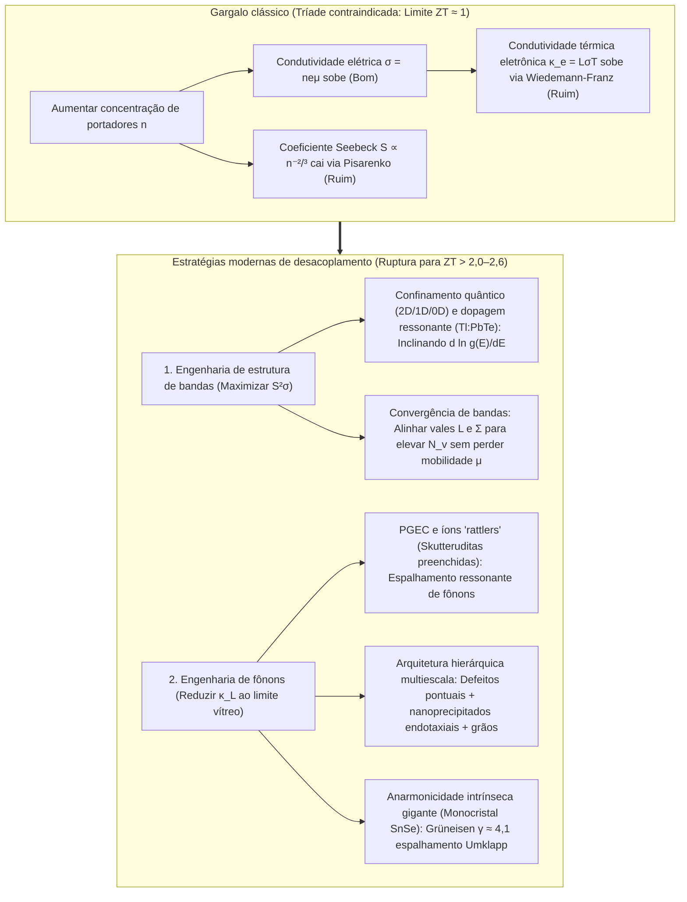

## 1. Introdução: O milagre do estado sólido que une calor e eletricidade sem peças móveis

Lançadas no final do verão de 1977, as sondas espaciais gêmeas <strong>Voyager 1</strong> e <strong>Voyager 2</strong> da NASA viajam pelo espaço interestelar — a mais de 24 bilhões de quilômetros do Sol — há mais de 47 anos enviando telemetria para a Terra. A essa distância, a irradiação solar cai para menos de um décimo de milésimo do valor na Terra, tornando os painéis solares inúteis, e qualquer motor térmico com pistões ou turbinas teria falhado há décadas por desgaste mecânico.

O coração que mantém as Voyager ativas é o <strong>Gerador Termoelétrico de Radioisótopos (RTG)</strong>: uma fonte de estado sólido que converte diretamente a diferença de temperatura entre o calor de decaimento alfa do plutônio-238 ($^{238}\text{Pu}$, $T_H \approx 1273\,\text{K}$) e o frio do espaço ($T_C \approx 573\,\text{K}$) em corrente contínua através de pares semicondutores de silício-germânio ($\text{SiGe}$). Na Terra, a mesma lei física operando ao contrário move as <strong>pastilhas Peltier (refrigeradores termoelétricos, TEC)</strong>: sem fluido refrigerante nem compressor, uma corrente elétrica congela uma face cerâmica, estabiliza lasers de telecomunicações por fibra óptica DWDM em $\pm 0{,}01\,\text{K}$, aciona termocicladores PCR e resfria sensores CCD astronômicos.

Por que um gradiente térmico gera tensão elétrica e uma corrente bombeia calor? E por que os geradores termoelétricos ainda não substituíram as turbinas a vapor? A resposta reside em um dos dilemas mais profundos da física da matéria condensada: a <strong>tríade contraindicada (compromisso fundamental) entre o coeficiente Seebeck $S$, a condutividade elétrica $\sigma$ e a condutividade térmica $\kappa$</strong>.

---

## 2. Unificação dos três efeitos termoelétricos clássicos e reciprocidade de Onsager

A termoeletricidade baseia-se em três fenômenos descobertos no século XIX: o <strong>efeito Seebeck (1821)</strong>, o <strong>efeito Peltier (1834)</strong> e o <strong>efeito Thomson (1851)</strong>.

### 2.1 O efeito Seebeck: Alargamento térmico de Fermi-Dirac e equilíbrio difusão-deriva

Quando um condutor ou semicondutor em circuito aberto ($\mathbf{J} = 0$) é submetido a um gradiente de temperatura $\nabla T$, surge espontaneamente um campo eletrostático interno $\mathbf{E} = -\nabla V$ (mais precisamente $-\nabla \tilde{\mu}/e$) proporcional a $\nabla T$:

$$\nabla V = -S \nabla T \quad \Longleftrightarrow \quad S = -\frac{\Delta V}{\Delta T}$$

A constante $S$ (em $\mu\text{V/K}$ ou $\text{V/K}$) é o <strong>coeficiente Seebeck</strong> ou <strong>poder termoelétrico</strong>. Sua origem microscópica decorre da <strong>distribuição de Fermi-Dirac</strong>:

$$f(E, T) = \frac{1}{\exp\left(\frac{E - \mu}{k_B T}\right) + 1}$$

1. <strong>Alargamento térmico da superfície de Fermi na extremidade quente</strong>: Para $T > 0$, o degrau de Fermi espalha-se numa janela $\sim 2k_B T$. O lado quente ($T_H$) possui muito mais portadores de alta energia acima de $E_F$ do que o lado frio ($T_C$).
2. <strong>Equilíbrio dinâmico entre difusão térmica e deriva eletrostática</strong>: Os portadores quentes difundem-se para o lado frio. Num <strong>semicondutor tipo n</strong>, os elétrons ($q = -e$) acumulam-se no lado frio ($S_n < 0$); num <strong>semicondutor tipo p</strong>, os buracos ($q = +e$) acumulam-se no lado frio ($S_p > 0$). O campo elétrico interno resultante impulsiona uma corrente de deriva oposta até que <strong>a corrente de difusão térmica e a corrente de deriva eletrostática se cancelem exatamente ($\mathbf{J}_{\text{diff}} + \mathbf{J}_{\text{drift}} = 0$)</strong>. Conectando pernas p e n <strong>termicamente em paralelo e eletricamente em série</strong> (par em $\pi$), a tensão de circuito aberto soma-se: $V_{\text{oc}} = (S_p - S_n)(T_H - T_C)$.

### 2.2 Fórmula de Mott e relação de Pisarenko

Pela expansão de Sommerfeld da equação de transporte de Boltzmann, o coeficiente Seebeck num semicondutor degenerado segue a <strong>fórmula de Mott</strong>:

$$S = -\frac{\pi^2 k_B^2 T}{3e} \left. \frac{d \ln \sigma(E)}{dE} \right|_{E = E_F}$$

onde $\sigma(E) = \frac{1}{3} e^2 g(E) v^2(E) \tau(E)$ é a condutividade espectral e $g(E)$ a densidade de estados eletrônicos (DOS). <strong>O coeficiente Seebeck mede a assimetria energética da condução em torno de $E_F$</strong>. Para uma banda parabólica 3D isotrópica com espalhamento por fônons acústicos, obtém-se a <strong>relação de Pisarenko</strong>:

$$S = \frac{8 \pi^2 k_B^2}{3 e h^2} m^* T \left( \frac{\pi}{3n} \right)^{2/3}$$

Um elevado coeficiente Seebeck exige <strong>(1) grande massa efetiva de densidade de estados $m^*$</strong> e <strong>(2) baixa concentração de portadores $n$ ($S \propto n^{-2/3}$)</strong>.

### 2.3 Efeito Peltier, efeito Thomson e relações recíprocas de Kelvin-Onsager

Quando uma corrente contínua $I$ atravessa a junção isotérmica entre dois materiais A e B, calor é absorvido ou liberado reversivelmente à taxa:

$$\dot{Q}_P = (\Pi_A - \Pi_B) I = \Pi_{AB} I$$

Microscopicamente, quando um elétron passa do metal ($E \approx E_F$) para a banda de condução de um semicondutor tipo n ($E_{\text{trans}} > E_C$) na junção fria, ele precisa <strong>subir uma barreira de energia $\Delta E = E_{\text{trans}} - E_F > 0$</strong> absorvendo fônons da rede cristalina e resfriando a junção; na junção quente, ele cai de volta para $E_F$ liberando o excesso de energia como fônons. Analogamente, o <strong>efeito Thomson</strong> (1851) descreve a troca térmica reversível $\dot{q}_{\text{total}} = \frac{\mathbf{J}^2}{\sigma} - \mathcal{K}_T (\mathbf{J} \cdot \nabla T)$ num condutor homogêneo sob $\nabla T$.

Na termodinâmica linear fora do equilíbrio de Lars Onsager (1931, Prêmio Nobel 1968), os fluxos elétrico $\mathbf{J}_e$ e térmico $\mathbf{J}_Q$ obedecem a:

$$\begin{pmatrix} \mathbf{J}_e \\ \mathbf{J}_Q \end{pmatrix} = \begin{pmatrix} L_{11} & L_{12} \\ L_{21} & L_{22} \end{pmatrix} \begin{pmatrix} -\frac{1}{e}\nabla \tilde{\mu} \\ \nabla \left(\frac{1}{T}\right) \end{pmatrix}$$

A invariância por reversão temporal impõe a <strong>reciprocidade de Onsager $L_{12} = L_{21}$</strong>, de onde resultam as <strong>relações de Kelvin</strong>:

$$\Pi = S \cdot T, \qquad \mathcal{K}_T = T \frac{dS}{dT}$$

Isso mostra que <strong>o coeficiente Seebeck $S = \frac{\Pi}{T}$ é exatamente a entropia transportada por unidade de carga elétrica ($S = S_{\text{portador}} / q$)</strong>!

---

## 3. Derivação termodinâmica da figura de mérito $ZT$, eficiência máxima e capacidade de refrigeração

### 3.1 Eficiência máxima $\eta_{\max}$ de um gerador termoelétrico (TEG)

Para um par termoelétrico entre $T_H$ e $T_C$ ($\Delta T = T_H - T_C$) com resistência interna $R$, condutância térmica $K$ e coeficiente Seebeck $S = S_p - S_n$, o calor absorvido na fonte quente $Q_H$ e a potência elétrica entregue à carga $R_L$ são:

$$Q_H = S T_H I + K (T_H - T_C) - \frac{1}{2} I^2 R, \qquad P = I^2 R_L = S(T_H - T_C)I - I^2 R$$

Minimizando o produto $RK$, todas as propriedades do material reúnem-se na <strong>figura de mérito adimensional $ZT$</strong> introduzida por Abram F. Ioffe (1949):

$$ZT = \frac{S^2 \sigma T}{\kappa} = \frac{S^2 \sigma T}{\kappa_e + \kappa_L}$$

onde $PF = S^2 \sigma$ é o <strong>fator de potência</strong> e $\kappa = \kappa_e + \kappa_L$ a soma da condutividade térmica eletrônica $\kappa_e$ e de rede (fônons) $\kappa_L$. Maximizando $\eta(m) = P / Q_H$ em relação a $m = R_L / R$, obtém-se $m_{\text{opt}} = \sqrt{1 + Z\bar{T}}$ ($\bar{T} = \frac{T_H + T_C}{2}$) e a <strong>eficiência máxima de conversão</strong>:

$$\eta_{\max} = \underbrace{\frac{T_H - T_C}{T_H}}_{\text{Eficiência de Carnot }\eta_C} \cdot \underbrace{\frac{\sqrt{1 + Z\bar{T}} - 1}{\sqrt{1 + Z\bar{T}} + \frac{T_C}{T_H}}}_{\text{Fator de redução do material}}$$

### 3.2 Potência de resfriamento $Q_c$, diferença máxima de temperatura $\Delta T_{\max}$ e COP no modo Peltier

Num refrigerador Peltier (TEC), o balanço térmico na face fria ($T_C$) é:

$$Q_c = \underbrace{(S_p - S_n) T_C I}_{\text{(1) Resfriamento Peltier}} - \underbrace{\frac{1}{2} I^2 R}_{\text{(2) Retorno de calor de Joule}} - \underbrace{K (T_H - T_C)}_{\text{(3) Condução térmica de Fourier}}$$

Como o aquecimento de Joule cresce com $I^2$, existe uma corrente ótima $I_{\max} = \frac{S T_C}{R}$ ($\frac{\partial Q_c}{\partial I} = 0$). Com carga térmica nula ($Q_c = 0$), a <strong>queda máxima de temperatura $\Delta T_{\max}$</strong> e o <strong>coeficiente de performance máximo $\text{COP}_{\max}$</strong> valem:

$$\Delta T_{\max} = \frac{1}{2} Z T_C^2, \qquad \text{COP}_{\max} = \frac{T_C}{T_H - T_C} \cdot \frac{\sqrt{1 + Z\bar{T}} - \frac{T_H}{T_C}}{\sqrt{1 + Z\bar{T}} + 1}$$

---

## 4. O dilema fundamental do estado sólido: A tríade contraindicada de $S$, $\sigma$ e $\kappa$

Por que é tão difícil superar $ZT \approx 1$? Porque os três parâmetros competem entre si através da concentração de portadores $n$:

1. <strong>Conflito $S$ vs $\sigma$ (compromisso de Pisarenko)</strong>: Aumentar $n$ eleva $\sigma = n e \mu$, mas derruba $S \propto m^* n^{-2/3}$. Aumentar a massa efetiva $m^*$ reduz a mobilidade $\mu = \frac{e\tau}{m^*}$.
2. <strong>Conflito $\sigma$ vs $\kappa_e$ (lei de Wiedemann-Franz)</strong>: Os mesmos elétrons que transportam carga transportam calor segundo:

$$\frac{\kappa_e}{\sigma T} = L = \frac{\pi^2}{3} \left( \frac{k_B}{e} \right)^2 \approx 2{,}44 \times 10^{-8}\,\text{W}\cdot\Omega\cdot\text{K}^{-2}$$

onde $L$ é o número de Lorenz. O ponto ótimo reside nos <strong>semicondutores degenerados fortemente dopados ($n \approx 10^{19}\text{–}10^{20}\,\text{cm}^{-3}$)</strong> obedecendo ao critério de Chasmar-Stratton ($E_g \approx 6\text{–}10\,k_B T$) para suprimir a condução bipolar.

| Faixa de temperatura | Sistema de materiais | Temp. ótima $T_{\text{opt}}$ | Bandgap $E_g$ | $ZT$ pico típico | Estrutura cristalina, física-chave e aplicações |
| :--- | :--- | :--- | :--- | :--- | :--- |
| <strong>Criogênico a ambiente</strong> ($< 450\,\text{K}$) | Ligas de $\text{Bi}_2\text{Te}_3$ | $250\text{–}400\,\text{K}$ | $\sim 0{,}15\,\text{eV}$ | $0{,}8\text{–}1{,}4$ | Estrutura lamelar romboédrica, degenerescência de vales $N_v=6$. Padrão mundial para pastilhas Peltier (TEC). |
| <strong>Temperatura média I</strong> ($500\text{–}850\,\text{K}$) | $\text{PbTe}$ e TAGS-85 | $600\text{–}800\,\text{K}$ | $\sim 0{,}30\,\text{eV}$ | $1{,}2\text{–}2{,}2$ | Estrutura cúbica sal-gema. <strong>Convergência de bandas</strong> L–$\Sigma$ ($N_v = 4 \to 16$), dopagem ressonante com $\text{Tl}$ e nanoprecipitados $\text{SrTe}$. Rovers marcianos MMRTG. |
| <strong>Temperatura média II</strong> ($550\text{–}900\,\text{K}$) | Skutteruditas preenchidas ($\text{Ba}_x\text{La}_y\text{Yb}_z\text{Co}_4\text{Sb}_{12}$) | $700\text{–}850\,\text{K}$ | $\sim 0{,}3\,\text{eV}$ | $1{,}2\text{–}1{,}8$ | Rede de gaiolas ($\text{CoSb}_3$). Íons hóspedes chocalham (rattling, <strong>mecanismo PGEC</strong>) espalhando fônons. Gases de exaustão. |
| <strong>Média-Alta temp.</strong> ($650\text{–}1000\,\text{K}$) | $\text{SnSe}$ monocristalino | $750\text{–}923\,\text{K}$ | $\sim 0{,}86\,\text{eV}$ | $2{,}2\text{–}2{,}6+$ | Estrutura lamelar pregueada ($Pnma \to Cmcm$). <strong>Anarmonicidade intrínseca gigante</strong> ($\gamma \approx 4{,}1$) com $\kappa_L \approx 0{,}23\,\text{W/(m}\cdot\text{K)}$. |
| <strong>Alta temperatura</strong> ($700\text{–}1100\,\text{K}$) | Ligas Half-Heusler ($\text{ZrNiSn}$, $\text{NbFeSb}$) | $800\text{–}1050\,\text{K}$ | $\sim 0{,}5\,\text{eV}$ | $1{,}0\text{–}1{,}5$ | Intermetálicos robustos, atóxicos, enorme fator de potência ($PF > 50\,\mu\text{W cm}^{-1}\text{K}^{-2}$). Fornos siderúrgicos e industriais. |
| <strong>Ultra-alta temp.</strong> ($900\text{–}1300\,\text{K}$) | Ligas $\text{SiGe}$ ($\text{Si}_{0{,}8}\text{Ge}_{0{,}2}$) | $1000\text{–}1273\,\text{K}$ | $\sim 0{,}8\,\text{eV}$ | $0{,}8\text{–}1{,}3$ | Rede covalente tipo diamante estável a $1000\,^\circ\text{C}$. Alimenta os RTGs da Voyager 1 e 2 e New Horizons. |

---

## 5. Rompendo o teto de $ZT \approx 1$: Engenharia de bandas e engenharia de fônons

1. <strong>O conceito PGEC («Vidro de fônons – Cristal de elétrons», Glen Slack, 1995)</strong>: Em <strong>skutteruditas preenchidas ($\text{CoSb}_3$)</strong> e clatratos, os íons hóspedes dentro das gaiolas atômicas oscilam de forma anarmônica («rattling») e espalham fônons acústicos sem frear os elétrons.
2. <strong>Engenharia de bandas</strong>: O <strong>confinamento quântico</strong> (Hicks e Dresselhaus, 1993), a <strong>dopagem de nível ressonante</strong> ($\text{Tl}:\text{PbTe}$, Heremans et al., 2008) e a <strong>convergência de bandas</strong> ($m^* = N_v^{2/3} m^*_b$, alinhando os vales $L$ e $\Sigma$ até $N_v = 16$) elevam $S$ sem sacrificar a mobilidade $\mu$.
3. <strong>Nanoestruturação hierárquica multiescala e $\text{SnSe}$</strong>: Combinando defeitos pontuais atômicos, nanoprecipitados endotaxiais coerentes ($\text{SrTe}$) e contornos de grão mesoscópicos, Kanatzidis et al. (2012) espalharam todo o espectro de fônons ($ZT \approx 2{,}2$). Em 2014, o monocristal <strong>$\text{SnSe}$</strong> atingiu <strong>$ZT = 2{,}6 \pm 0{,}3$ a $923\,\text{K}$</strong> graças à sua anarmonicidade reticular intrínseca gigante ($\gamma \approx 4{,}1$, $\kappa_L \approx 0{,}23\,\text{W/(m}\cdot\text{K)}$).

---

## 6. Aplicações reais e fronteiras futuras: Das sondas espaciais à espincaloritrônica

1. <strong>Exploração do espaço profundo (RTG e MMRTG)</strong>: Dos termopares de $\text{SiGe}$ nas *Voyager 1 e 2* e *New Horizons* aos <strong>MMRTGs</strong> ($\text{PbTe/TAGS}$) dos rovers marcianos *Curiosity* e *Perseverance* e do octocóptero nuclear *Dragonfly* em Titã.
2. <strong>Gerenciamento térmico de precisão (TEC)</strong>: Estabilização em $\pm 0{,}01\,\text{K}$ de lasers de telecomunicações DWDM, termocicladores PCR e resfriamento sem vibrações de detectores CCD e infravermelhos.
3. <strong>Recuperação de calor residual, termoeletricidade vestível e espincaloritrônica</strong>: Sensores IIoT autônomos, semicondutores inorgânicos dúcteis ($\text{Ag}_2\text{S}$) e polímeros condutores (PEDOT:PSS) para colher calor corporal, além do <strong>efeito Seebeck de spin (SSE)</strong> e do <strong>efeito Nernst anômalo (ANE, $\mathbf{E}_{\text{ANE}} \propto \mathbf{M} \times \nabla T$)</strong> em semimetais de Weyl magnéticos topológicos.
