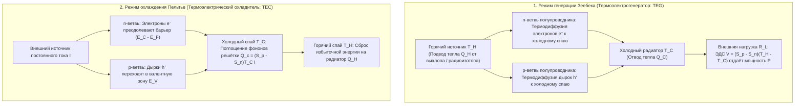
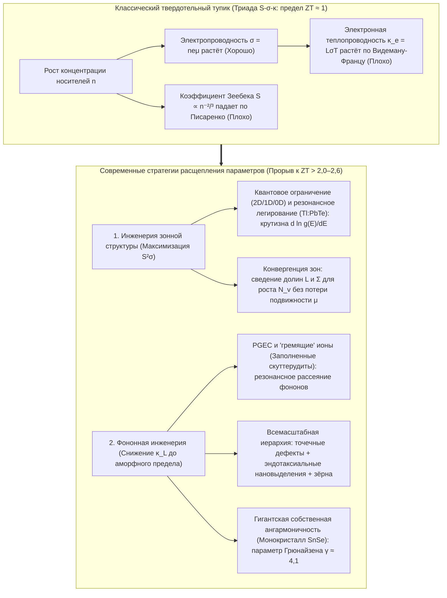

## 1. Введение: твердотельное чудо, связывающее тепло и электричество без единой движущейся детали

Запущенные в конце лета 1977 года космические зонды-близнецы НАСА <strong>«Вояджер-1» (Voyager 1)</strong> и <strong>«Вояджер-2» (Voyager 2)</strong> уже более 47 лет летят сквозь межзвёздное пространство — на расстоянии свыше 24 миллиардов километров от Солнца — и продолжают передавать радиотелеметрию на Землю. На таком расстоянии солнечное излучение падает менее чем до одной десятитысячной от земного, делая солнечные батареи бесполезными, а любой механический тепловой двигатель с поршнями или турбинами давно вышел бы из строя из-за износа.

Сердцем, питающим «Вояджеры» полвека подряд, служит <strong>радиоизотопный термоэлектрический генератор (РИТЭГ, RTG)</strong> — твердотельный источник энергии, напрямую преобразующий перепад температур между теплом альфа-распада плутония-238 ($^{238}\text{Pu}$, $T_H \approx 1273\,\text{K}$) и холодом космоса ($T_C \approx 573\,\text{K}$) в постоянный ток с помощью кремний-германиевых ($\text{SiGe}$) полупроводниковых термопар. На Земле тот же физический закон в обратном направлении приводит в действие <strong>элементы Пельтье (термоэлектрические охладители, TEC)</strong>: без капли фреона и компрессора постоянный ток охлаждает одну керамическую грань ниже нуля, стабилизирует длину волны оптоволоконных DWDM-лазеров с точностью $\pm 0{,}01\,\text{K}$, управляет ПЦР-термоциклерами и охлаждает астрономические ПЗС-матрицы.

Почему градиент температуры рождает напряжение, а ток перекачивает тепло? И почему термоэлектрогенераторы ещё не вытеснили паровые турбины? Ответ кроется в фундаментальной дилемме физики конденсированного состояния — <strong>взаимоисключающей триаде между коэффициентом Зеебека $S$, электропроводностью $\sigma$ и теплопроводностью $\kappa$</strong>.

---

## 2. Объединение трёх классических термоэлектрических эффектов и взаимность Онсагера

Термоэлектричество опирается на три явления XIX века: <strong>эффект Зеебека (1821)</strong>, <strong>эффект Пельтье (1834)</strong> и <strong>эффект Томсона (1851)</strong>.

### 2.1 Эффект Зеебека: тепловое размытие Ферми — Дирака и баланс диффузии и дрейфа

Когда разомкнутый проводник или полупроводник ($\mathbf{J} = 0$) помещён в градиент температуры $\nabla T$, внутри него самопроизвольно возникает электростатическое поле $\mathbf{E} = -\nabla V$ (точнее, $-\nabla \tilde{\mu}/e$), пропорциональное $\nabla T$:

$$\nabla V = -S \nabla T \quad \Longleftrightarrow \quad S = -\frac{\Delta V}{\Delta T}$$

Коэффициент $S$ (в $\text{мкВ/К}$ или $\text{В/К}$) называется <strong>коэффициентом Зеебека</strong> или <strong>термо-ЭДС</strong>. Микроскопически он следует из <strong>распределения Ферми — Дирака</strong>:

$$f(E, T) = \frac{1}{\exp\left(\frac{E - \mu}{k_B T}\right) + 1}$$

1. <strong>Тепловое размытие поверхности Ферми на горячем конце</strong>: При $T > 0$ ступенька Ферми размывается в окне $\sim 2k_B T$. На горячем конце ($T_H$) концентрация высокоэнергетических носителей выше уровня Ферми $E_F$ значительно больше, чем на холодном ($T_C$).
2. <strong>Динамическое равновесие термодиффузии и электростатического дрейфа</strong>: Горячие носители диффундируют к холодному концу. В <strong>полупроводнике n-типа</strong> электроны ($q = -e$) скапливаются на холодном конце ($S_n < 0$); в <strong>полупроводнике p-типа</strong> дырки ($q = +e$) скапливаются на холодном конце ($S_p > 0$). Возникающее внутреннее электрическое поле вызывает встречный ток дрейфа, пока <strong>ток термодиффузии и ток электростатического дрейфа точно не уравновесят друг друга ($\mathbf{J}_{\text{diff}} + \mathbf{J}_{\text{drift}} = 0$)</strong>. Соединяя p- и n-ветви <strong>тепловым образом параллельно, а электрически последовательно</strong> ($\pi$-пара), получаем суммарную ЭДС холостого хода $V_{\text{oc}} = (S_p - S_n)(T_H - T_C)$.

### 2.2 Формула Мотта и соотношение Писаренко

Разложение Зоммерфельда кинетического уравнения Больцмана даёт для вырожденных полупроводников <strong>формулу Мотта</strong>:

$$S = -\frac{\pi^2 k_B^2 T}{3e} \left. \frac{d \ln \sigma(E)}{dE} \right|_{E = E_F}$$

где $\sigma(E) = \frac{1}{3} e^2 g(E) v^2(E) \tau(E)$ — спектральная проводимость, а $g(E)$ — плотность электронных состояний (DOS). <strong>Коэффициент Зеебека измеряет энергетическую асимметрию проводимости вблизи $E_F$</strong>. Для 3D параболической зоны при рассеянии на акустических фононах получаем <strong>соотношение Писаренко</strong> (А. Ф. Иоффе, Н. Л. Писаренко, 1940):

$$S = \frac{8 \pi^2 k_B^2}{3 e h^2} m^* T \left( \frac{\pi}{3n} \right)^{2/3}$$

Высокий коэффициент Зеебека требует <strong>(1) большой эффективной массы плотности состояний $m^*$</strong> и <strong>(2) низкой концентрации носителей $n$ ($S \propto n^{-2/3}$)</strong>.

### 2.3 Эффект Пельтье, эффект Томсона и соотношения взаимности Кельвина — Онсагера

При пропускании постоянного тока $I$ через изотермический контакт двух разнородных материалов A и B выделяется или поглощается обратимая тепловая мощность:

$$\dot{Q}_P = (\Pi_A - \Pi_B) I = \Pi_{AB} I$$

Микроскопически при переходе электрона из металла ($E \approx E_F$) в зону проводимости полупроводника n-типа ($E_{\text{trans}} > E_C$) на холодном спае он должен <strong>преодолеть потенциальный барьер $\Delta E = E_{\text{trans}} - E_F > 0$</strong>, поглощая фононы кристаллической решётки и охлаждая спай; на горячем спае электрон спускается обратно на уровень $E_F$, отдавая избыток энергии решётке. Аналогично <strong>эффект Томсона</strong> (1851) описывает обратимый теплообмен $\dot{q}_{\text{total}} = \frac{\mathbf{J}^2}{\sigma} - \mathcal{K}_T (\mathbf{J} \cdot \nabla T)$ в однородном проводнике с градиентом $\nabla T$.

В линейной неравновесной термодинамике Ларса Онсагера (1931, Нобелевская премия 1968 г.) электрический $\mathbf{J}_e$ и тепловой $\mathbf{J}_Q$ потоки связаны кинетической матрицей:

$$\begin{pmatrix} \mathbf{J}_e \\ \mathbf{J}_Q \end{pmatrix} = \begin{pmatrix} L_{11} & L_{12} \\ L_{21} & L_{22} \end{pmatrix} \begin{pmatrix} -\frac{1}{e}\nabla \tilde{\mu} \\ \nabla \left(\frac{1}{T}\right) \end{pmatrix}$$

Обратимость времени на микроуровне требует <strong>соотношения взаимности Онсагера $L_{12} = L_{21}$</strong>, откуда напрямую следуют <strong>соотношения Кельвина</strong>:

$$\Pi = S \cdot T, \qquad \mathcal{K}_T = T \frac{dS}{dT}$$

Таким образом, <strong>коэффициент Зеебека $S = \frac{\Pi}{T}$ есть в точности энтропия, переносимая единичным электрическим зарядом ($S = S_{\text{носителя}} / q$)</strong>!

---

## 3. Термодинамический вывод добротности $ZT$, максимального КПД и холодопроизводительности

### 3.1 Максимальный КПД $\eta_{\max}$ термоэлектрогенератора (TEG)

Для термопары между $T_H$ и $T_C$ ($\Delta T = T_H - T_C$) с внутренним сопротивлением $R$, тепловой проводимостью $K$ и коэффициентом Зеебека $S = S_p - S_n$ тепловой поток на горячем спае $Q_H$ и полезная электрическая мощность $P$ на нагрузке $R_L$ равны:

$$Q_H = S T_H I + K (T_H - T_C) - \frac{1}{2} I^2 R, \qquad P = I^2 R_L = S(T_H - T_C)I - I^2 R$$

Минимизация произведения $RK$ сводит все свойства материала к введённому академиком <strong>А. Ф. Иоффе (1949)</strong> безразмерному параметру — <strong>термоэлектрической добротности $ZT$</strong>:

$$ZT = \frac{S^2 \sigma T}{\kappa} = \frac{S^2 \sigma T}{\kappa_e + \kappa_L}$$

где $PF = S^2 \sigma$ — <strong>фактор мощности</strong>, а $\kappa = \kappa_e + \kappa_L$ — сумма электронной $\kappa_e$ и решёточной (фононной) $\kappa_L$ теплопроводностей. Максимизация $\eta(m) = P / Q_H$ по отношению сопротивлений $m = R_L / R$ даёт $m_{\text{opt}} = \sqrt{1 + Z\bar{T}}$ ($\bar{T} = \frac{T_H + T_C}{2}$) и <strong>формулу Иоффе для максимального КПД</strong>:

$$\eta_{\max} = \underbrace{\frac{T_H - T_C}{T_H}}_{\text{КПД Карно }\eta_C} \cdot \underbrace{\frac{\sqrt{1 + Z\bar{T}} - 1}{\sqrt{1 + Z\bar{T}} + \frac{T_C}{T_H}}}_{\text{Материальный фактор}}$$

### 3.2 Холодопроизводительность $Q_c$, максимальный перепад температур $\Delta T_{\max}$ и холодильный коэффициент COP

В охладителе Пельтье (TEC) баланс тепла на холодном спае ($T_C$) имеет вид:

$$Q_c = \underbrace{(S_p - S_n) T_C I}_{\text{(1) Охлаждение Пельтье}} - \underbrace{\frac{1}{2} I^2 R}_{\text{(2) Джоулев возврат тепла}} - \underbrace{K (T_H - T_C)}_{\text{(3) Теплопроводность Фурье}}$$

Поскольку джоулево тепло растёт как $I^2$, существует оптимальный ток $I_{\max} = \frac{S T_C}{R}$ ($\frac{\partial Q_c}{\partial I} = 0$). При нулевой тепловой нагрузке ($Q_c = 0$) <strong>максимальный перепад температур $\Delta T_{\max}$</strong> и <strong>максимальный холодильный коэффициент $\text{COP}_{\max}$</strong> равны:

$$\Delta T_{\max} = \frac{1}{2} Z T_C^2, \qquad \text{COP}_{\max} = \frac{T_C}{T_H - T_C} \cdot \frac{\sqrt{1 + Z\bar{T}} - \frac{T_H}{T_C}}{\sqrt{1 + Z\bar{T}} + 1}$$

---

## 4. Фундаментальная дилемма твёрдого тела: взаимоисключающая триада $S$, $\sigma$ и $\kappa$

Почему так трудно преодолеть рубеж $ZT \approx 1$? Потому что все три параметра жёстко связаны через концентрацию носителей $n$:

1. <strong>Конфликт $S$ и $\sigma$ (компромисс Писаренко)</strong>: Рост $n$ повышает $\sigma = n e \mu$, но обрушивает $S \propto m^* n^{-2/3}$. Увеличение эффективной массы $m^*$ снижает подвижность $\mu = \frac{e\tau}{m^*}$.
2. <strong>Конфликт $\sigma$ и $\kappa_e$ (закон Видемана — Франца)</strong>: Одни и те же электроны переносят и заряд, и тепло:

$$\frac{\kappa_e}{\sigma T} = L = \frac{\pi^2}{3} \left( \frac{k_B}{e} \right)^2 \approx 2{,}44 \times 10^{-8}\,\text{Вт}\cdot\Omega\cdot\text{К}^{-2}$$

где $L$ — число Лоренца. Поэтому оптимум достигается в <strong>сильнолегированных вырожденных полупроводниках ($n \approx 10^{19}\text{–}10^{20}\,\text{см}^{-3}$)</strong> с шириной запрещённой зоны по критерию Часмара — Страттона ($E_g \approx 6\text{–}10\,k_B T$) для подавления биполярной теплопроводности.

| Температурный режим | Семейство материалов | Оптимальная $T_{\text{opt}}$ | Ширина зоны $E_g$ | Пиковый $ZT$ | Кристаллическая структура, физика и применение |
| :--- | :--- | :--- | :--- | :--- | :--- |
| <strong>Криогенный и комнатный</strong> ($< 450\,\text{K}$) | Сплавы $\text{Bi}_2\text{Te}_3$ | $250\text{–}400\,\text{K}$ | $\sim 0{,}15\,\text{эВ}$ | $0{,}8\text{–}1{,}4$ | Слоистая ромбоэдрическая структура, кратность долин $N_v=6$. Мировой стандарт для элементов Пельтье (TEC). |
| <strong>Среднетемпературный I</strong> ($500\text{–}850\,\text{K}$) | $\text{PbTe}$ и TAGS-85 | $600\text{–}800\,\text{K}$ | $\sim 0{,}30\,\text{эВ}$ | $1{,}2\text{–}2{,}2$ | Кубическая структура каменной соли. <strong>Конвергенция зон</strong> L–$\Sigma$ ($N_v = 4 \to 16$), резонансный $\text{Tl}$ и нановыделения $\text{SrTe}$. Марсоходы MMRTG. |
| <strong>Среднетемпературный II</strong> ($550\text{–}900\,\text{K}$) | Заполненные скуттерудиты ($\text{Ba}_x\text{La}_y\text{Yb}_z\text{Co}_4\text{Sb}_{12}$) | $700\text{–}850\,\text{K}$ | $\sim 0{,}3\,\text{эВ}$ | $1{,}2\text{–}1{,}8$ | Каркасная решётка ($\text{CoSb}_3$). Гостевые ионы «гремят» в пустотах (rattling, <strong>PGEC</strong>), рассеивая фононы. Выхлопные газы. |
| <strong>Средне-высокотемп.</strong> ($650\text{–}1000\,\text{K}$) | Монокристалл $\text{SnSe}$ | $750\text{–}923\,\text{K}$ | $\sim 0{,}86\,\text{эВ}$ | $2{,}2\text{–}2{,}6+$ | Гофрированная слоистая структура ($Pnma \to Cmcm$). <strong>Гигантская собственная ангармоничность</strong> ($\gamma \approx 4{,}1$) даёт $\kappa_L \approx 0{,}23\,\text{Вт/(м}\cdot\text{К)}$. |
| <strong>Высокотемпературный</strong> ($700\text{–}1100\,\text{K}$) | Сплавы Гейслера (Half-Heusler) ($\text{ZrNiSn}$, $\text{NbFeSb}$) | $800\text{–}1050\,\text{K}$ | $\sim 0{,}5\,\text{эВ}$ | $1{,}0\text{–}1{,}5$ | Механически прочные, нетоксичные интерметаллиды, высокий фактор мощности ($PF > 50\,\text{мкВт см}^{-1}\text{К}^{-2}$). Металлургические печи. |
| <strong>Сверхвысокотемп.</strong> ($900\text{–}1300\,\text{K}$) | Сплавы $\text{SiGe}$ ($\text{Si}_{0{,}8}\text{Ge}_{0{,}2}$) | $1000\text{–}1273\,\text{K}$ | $\sim 0{,}8\,\text{эВ}$ | $0{,}8\text{–}1{,}3$ | Алмазоподобная ковалентная сеть, стойкая при $1000\,^\circ\text{C}$. Питает РИТЭГи «Вояджеров» и «Новых горизонтов». |

---

## 5. Прорыв потолка $ZT \approx 1$: зонная и фононная инженерия

1. <strong>Концепция PGEC («Фононное стекло — электронный кристалл», Глен Слэк, 1995)</strong>: В <strong>заполненных скуттерудитах ($\text{CoSb}_3$)</strong> и клатратах гостевые ионы внутри атомных клеток совершают ангармонические колебания («rattling»), рассеивая акустические фононы без рассеяния электронов.
2. <strong>Зонная инженерия</strong>: <strong>Низкоразмерное квантовое ограничение</strong> (Хикс и Дрессельхаус, 1993), <strong>резонансные уровни</strong> ($\text{Tl}:\text{PbTe}$, Хереманс и др., 2008) и <strong>конвергенция зон</strong> ($m^* = N_v^{2/3} m^*_b$, выравнивание долин $L$ и $\Sigma$ до $N_v = 16$) повышают $S$ без потери подвижности $\mu$.
3. <strong>Всемасштабная иерархическая фононная инженерия и $\text{SnSe}$</strong>: Сочетание атомных точечных дефектов, когерентных нановыделений ($\text{SrTe}$) и субмикронных границ зёрен (Канацидис и др., 2012) рассеивает весь спектр длин пробега фононов ($ZT \approx 2{,}2$). В 2014 году монокристалл <strong>$\text{SnSe}$</strong> достиг рекордного <strong>$ZT = 2{,}6 \pm 0{,}3$ при $923\,\text{K}$</strong> за счёт гигантской собственной ангармоничности решётки ($\gamma \approx 4{,}1$, $\kappa_L \approx 0{,}23\,\text{Вт/(м}\cdot\text{К)}$).

---

## 6. Практические применения и будущее: от дальнего космоса до спин-калоритроники

1. <strong>Космические РИТЭГи (RTG и MMRTG)</strong>: От $\text{SiGe}$-термопар «Вояджеров» до <strong>MMRTG</strong> ($\text{PbTe/TAGS}$) марсоходов *Curiosity* и *Perseverance* и ядерного октокоптера *Dragonfly* для полётов на Титане.
2. <strong>Прецизионное терморегулирование (TEC)</strong>: Стабилизация температуры оптоволоконных DWDM-лазеров с точностью $\pm 0{,}01\,\text{K}$, ПЦР-амплификаторы ДНК и безвибрационное охлаждение ИК- и ПЗС-детекторов.
3. <strong>Рекуперация сбросного тепла, носимая термоэлектрика и спин-калоритроника</strong>: Автономные датчики IIoT, пластичные неорганические полупроводники ($\text{Ag}_2\text{S}$) и проводящие полимеры (PEDOT:PSS) для генерации энергии от тепла тела, а также <strong>спиновый эффект Зеебека (SSE)</strong> и <strong>аномальный эффект Нернста (ANE, $\mathbf{E}_{\text{ANE}} \propto \mathbf{M} \times \nabla T$)</strong> в топологических магнитных полуметаллах Вейля.
