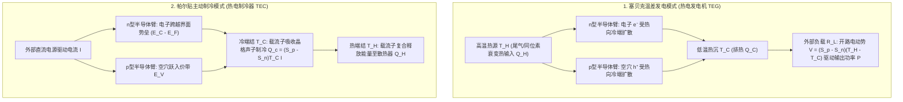
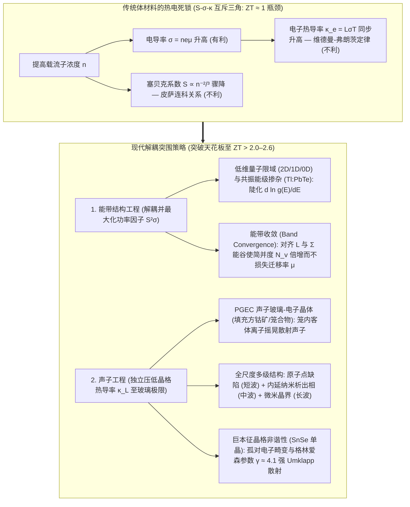

## 1. 引言：没有任何运动部件，连接热与电的固态奇迹

1977年发射升空的美国宇航局（NASA）双子深空探测器<strong>“旅行者1号”（Voyager 1）</strong>与<strong>“旅行者2号”（Voyager 2）</strong>已经在黑暗寒冷的星际空间中连续飞行了超过47年，距离太阳超过240亿公里。在如此遥远的深空，太阳辐射强度不足地球轨道的万分之一，光伏太阳能电池板完全失效；同时，在长达半个世纪无法维修的极端环境下，任何依赖活塞、涡轮叶片或循环工质的传统机械热机早已因磨损与金属疲劳而瘫痪。

维持旅行者号半个世纪不间断通信的动力心脏，是<strong>放射性同位素热电机（RTG，俗称核电池）</strong>——一种利用钚-238（$^{238}\text{Pu}$）$\alpha$衰变热（$T_H \approx 1273\,\text{K}$）与深空极寒背景（$T_C \approx 573\,\text{K}$）之间的温度差，直接将热能转化为直流电的固态装置。在地球上，完全相同的物理定律在逆向工作时则化身为<strong>帕尔贴制冷器（TEC）</strong>：无需一滴氟利昂制冷剂或嘈杂的压缩机，只需通入直流电，半导体陶瓷片的一面便会瞬间结霜，精准锁定光纤通信激光器波长（$\pm 0.01\,\text{K}$）、驱动基因扩增 PCR 仪以及冷却天文望远镜 CCD 传感器。

为什么温差可以直接产生电压，而电流又能直接抽吸热量？为什么热电材料至今仍未完全取代发电厂的蒸汽轮机与家用冰箱的压缩机？答案隐藏在凝聚态物理最核心的难题之一——<strong>塞贝克系数 $S$、电导率 $\sigma$ 与热导率 $\kappa$ 之间的强耦合互斥三角（Contra-indicated Triad）</strong>之中。

---

## 2. 三大经典热电效应的微观物理与昂萨格倒易统一

热电学建立在十九世纪发现的三大经典效应之上：<strong>塞贝克效应（1821）</strong>、<strong>帕尔贴效应（1834）</strong>与<strong>汤姆孙效应（1851）</strong>。

### 2.1 塞贝克效应（Seebeck Effect）：费米-狄拉克分布的热展宽与扩散-漂移平衡

当导体或半导体处于开路状态（$\mathbf{J} = 0$）且存在温度梯度 $\nabla T$ 时，材料内部会自发建立起与温差成正比的静电势梯度 $\nabla V$（准确而言是电化学势梯度 $-\nabla \tilde{\mu}/e$）：

$$\nabla V = -S \nabla T \quad \Longleftrightarrow \quad S = -\frac{\Delta V}{\Delta T}$$

比例系数 $S$（单位通常为 $\mu\text{V/K}$）即为<strong>塞贝克系数（Seebeck coefficient）</strong>或热电势率。其微观起源可由<strong>费米-狄拉克（Fermi-Dirac）分布函数</strong>直接解释：

$$f(E, T) = \frac{1}{\exp\left(\frac{E - \mu}{k_B T}\right) + 1}$$

1. <strong>热端费米面的热展宽</strong>：在有限温度 $T > 0$ 下，费米面附近约 $\sim 2k_B T$ 能量窗口内的电子发生热激发。热端（$T_H$）的高能载流子布居数显著高于冷端（$T_C$）。
2. <strong>热扩散与静电漂移的动态平衡</strong>：热端高能载流子向冷端发生净热扩散。在 n 型半导体中，电子（$q = -e$）在冷端积累使冷端带负电（$S_n < 0$）；在 p 型半导体中，空穴（$q = +e$）在冷端积累使冷端带正电（$S_p > 0$）。当内部建起的内建电场驱动的反向<strong>静电漂移电流</strong>与正向<strong>热扩散电流</strong>精确抵消（$\mathbf{J}_{\text{diff}} + \mathbf{J}_{\text{drift}} = 0$）时，两端输出的稳态电压即为塞贝克电压。工程上将 p 型和 n 型热电臂在<strong>热学上并联、电学上串联</strong>（$\pi$ 型热电偶），单对热电偶的开路电压即叠加为 $V_{\text{oc}} = (S_p - S_n)(T_H - T_C)$。

### 2.2 莫特公式（Mott Formula）与皮萨连科关系（Pisarenko Relation）

利用玻尔兹曼输运方程的索末菲展开，简并半导体的塞贝克系数遵循著名的<strong>莫特公式</strong>：

$$S = -\frac{\pi^2 k_B^2 T}{3e} \left. \frac{d \ln \sigma(E)}{dE} \right|_{E = E_F}$$

其中微分电导率 $\sigma(E) = \frac{1}{3} e^2 g(E) v^2(E) \tau(E)$ 取决于电子态密度（DOS）$g(E)$、群速度 $v(E)$ 与弛豫时间 $\tau(E)$。莫特公式表明：<strong>$S$ 度量了费米能级 $E_F$ 两侧导电能力的能量不对称性</strong>——态密度 $g(E)$ 在 $E_F$ 处随能量变化越陡峭，$|S|$ 就越大。对于三维各向同性抛物线能带且以声学声子散射为主的体系，莫特公式化为<strong>皮萨连科关系</strong>：

$$S = \frac{8 \pi^2 k_B^2}{3 e h^2} m^* T \left( \frac{\pi}{3n} \right)^{2/3}$$

可见，要获得高塞贝克系数 $S$，需要<strong>较大的态密度有效质量 $m^*$</strong> 以及<strong>较低的载流子浓度 $n$（$S \propto n^{-2/3}$）</strong>。

### 2.3 帕尔贴效应（Peltier Effect）与汤姆孙效应（Thomson Effect）

当外加直流电 $I$ 流经两种不同材料 A 与 B 的等温结时，界面处会以正比于电流 $I$ 的速率可逆地吸热或放热：

$$\dot{Q}_P = (\Pi_A - \Pi_B) I = \Pi_{AB} I$$

比例系数 $\Pi$（单位：$\text{V}$ 或 $\text{J/C}$）称为<strong>帕尔贴系数</strong>。在微观能带图像中，金属电极中的电子处于费米能级 $E_F$，而 n 型半导体中的导电电子必须占据导带底 $E_C$ 以上的输运能级 $E_{\text{trans}}$。当电子从金属进入 n 型半导体（冷端结）时，必须<strong>跨越势垒 $\Delta E = E_{\text{trans}} - E_F > 0$</strong>，为此电子必须从晶格中吸收声子能量，导致冷端降温（如同电子作为工质发生“等温膨胀蒸发”吸热）；当电子在热端从半导体跃迁回金属的低能级 $E_F$ 时，多余能量以声子形式释放给晶格，使热端放热。

1851年，开尔文勋爵（William Thomson）进一步预言了<strong>汤姆孙效应</strong>：当电流密度 $\mathbf{J}$ 流经存在温度梯度 $\nabla T$ 的单一均匀导体时，由于载流子比熵随温度变化，单位体积的产热率为 $\dot{q}_{\text{total}} = \frac{\mathbf{J}^2}{\sigma} - \mathcal{K}_T (\mathbf{J} \cdot \nabla T)$，其中 $\mathcal{K}_T$ 为汤姆孙系数。

### 2.4 昂萨格-开尔文倒易关系（Onsager-Kelvin Relations）

在线性非平衡热力学中，电流密度 $\mathbf{J}_e$ 与热流密度 $\mathbf{J}_Q$ 由广义热力学力驱动：

$$\begin{pmatrix} \mathbf{J}_e \\ \mathbf{J}_Q \end{pmatrix} = \begin{pmatrix} L_{11} & L_{12} \\ L_{21} & L_{22} \end{pmatrix} \begin{pmatrix} -\frac{1}{e}\nabla \tilde{\mu} \\ \nabla \left(\frac{1}{T}\right) \end{pmatrix}$$

1931年，拉斯·昂萨格（Lars Onsager，1968年诺贝尔化学奖）由微观运动方程的时间反演对称性证明了交叉输运系数严格对称：<strong>$L_{12} = L_{21}$</strong>。由此直接导出连接三大效应的<strong>开尔文第一与第二关系</strong>：

$$\Pi = S \cdot T, \qquad \mathcal{K}_T = T \frac{dS}{dT}$$

这揭示了塞贝克系数最深刻的物理本质：<strong>$S = \frac{\Pi}{T}$ 正是单位电荷所携带的输运熵（$S = S_{\text{carrier}} / q$）！</strong>

---

## 3. 无量纲热电优值 $ZT$、最大转换效率与帕尔贴制冷极限的严格推导

### 3.1 温差发电（TEG）的最大热电转换效率 $\eta_{\max}$

设热电偶在高温源 $T_H$ 与低温源 $T_C$（$\Delta T = T_H - T_C$）之间工作，总塞贝克系数为 $S = S_p - S_n$，内阻为 $R$，总并联热导为 $K$。当回路电流为 $I$ 时，由一维稳态热传导方程可知，体焦耳热 $I^2 R$ 的一半返回热端，另一半流向冷端。因此高温端吸热率 $Q_H$ 与外部负载 $R_L$ 上的输出电功率 $P$ 分别为：

$$Q_H = \underbrace{S T_H I}_{\text{热端帕尔贴吸热}} + \underbrace{K (T_H - T_C)}_{\text{傅里叶热传导漏热}} - \underbrace{\frac{1}{2} I^2 R}_{\text{半数焦耳热返还}}, \qquad P = I^2 R_L = S(T_H - T_C)I - I^2 R$$

定义负载电阻与内阻之比 $m \equiv R_L / R$，并对两臂截面积比进行几何优化，所有材料属性归结为约菲（A. F. Ioffe，1949）提出的<strong>无量纲热电优值 $ZT$</strong>：

$$ZT = \frac{S^2 \sigma T}{\kappa} = \frac{S^2 \sigma T}{\kappa_e + \kappa_L}$$

其中分子 $PF = S^2 \sigma$ 称为<strong>功率因子（Power Factor）</strong>，分母 $\kappa = \kappa_e + \kappa_L$ 为电子热导率 $\kappa_e$ 与晶格（声子）热导率 $\kappa_L$ 之和。对效率 $\eta(m) = P / Q_H$ 求极值（$\frac{d\eta}{dm} = 0$），可得最优阻抗匹配条件为 $m_{\text{opt}} = \sqrt{1 + Z\bar{T}}$（其中 $\bar{T} = \frac{T_H + T_C}{2}$），代入即得<strong>热电发电最大效率公式</strong>：

$$\eta_{\max} = \underbrace{\frac{T_H - T_C}{T_H}}_{\text{卡诺效率 }\eta_C} \cdot \underbrace{\frac{\sqrt{1 + Z\bar{T}} - 1}{\sqrt{1 + Z\bar{T}} + \frac{T_C}{T_H}}}_{\text{材料折减因子}}$$

当 $Z\bar{T} \to \infty$ 时，$\eta_{\max} \to \eta_C$（卡诺极限）。当 $Z\bar{T} = 1$（传统商用材料）且 $T_H = 600\,\text{K}, T_C = 300\,\text{K}$ 时，$\eta_{\max} \approx 10.8\%$；若能将 $Z\bar{T}$ 提升至 $3\text{–}4$，转换效率即可突破 $20\%\text{–}25\%$，足以与传统机械热机正面竞争！

### 3.2 帕尔贴制冷量 $Q_c$、最大温差 $\Delta T_{\max}$ 与制冷系数 COP

在帕尔贴制冷器（TEC）中，冷端（$T_C$）的<strong>净制冷功率 $Q_c$</strong> 由三项竞争机制决定：

$$Q_c = \underbrace{(S_p - S_n) T_C I}_{\text{(1) 帕尔贴界面吸热}} - \underbrace{\frac{1}{2} I^2 R}_{\text{(2) 焦耳热回流}} - \underbrace{K (T_H - T_C)}_{\text{(3) 傅里叶热传导回流}}$$

由于帕尔贴吸热随电流 $I$ 线性增长，而焦耳热随 $I^2$ 二次方暴涨，电流并非越大越好！对 $I$ 求导（$\frac{\partial Q_c}{\partial I} = 0$）可得产生最大制冷量的最优电流 $I_{\max} = \frac{S T_C}{R}$。令净外部热负载 $Q_c = 0$，即得单级帕尔贴器件所能达到的<strong>最大温差 $\Delta T_{\max}$</strong> 及<strong>最大性能系数 $\text{COP}_{\max}$</strong>：

$$\Delta T_{\max} = \frac{1}{2} Z T_C^2, \qquad \text{COP}_{\max} = \frac{T_C}{T_H - T_C} \cdot \frac{\sqrt{1 + Z\bar{T}} - \frac{T_H}{T_C}}{\sqrt{1 + Z\bar{T}} + 1}$$

对于室温 $\text{Bi}_2\text{Te}_3$ 器件（$ZT_C \approx 0.8\text{–}1.0$），单级 $\Delta T_{\max}$ 约为 $68\text{–}75\,\text{K}$；通过金字塔形多级级联（Cascade TEC），制冷温差可达 $> 130\,\text{K}$。

---

## 4. 固体物理的根本困境：$S$、$\sigma$ 与 $\kappa$ 的强耦合互斥三角

为什么提高 $ZT = \frac{S^2 \sigma T}{\kappa_e + \kappa_L}$ 如此艰难？因为三大参数被载流子浓度 $n$ 死死锁在一起：

1. <strong>$S$ 与 $\sigma$ 的冲突（皮萨连科权衡）</strong>：电导率 $\sigma = n e \mu$ 要求提高载流子浓度 $n$ 和迁移率 $\mu = \frac{e\tau}{m^*}$；但皮萨连科关系 $S \propto m^* n^{-2/3}$ 表明，增加 $n$ 会使塞贝克系数 $S$ 按 $n^{-2/3}$ 骤降，而增大有效质量 $m^*$ 又会降低迁移率 $\mu$。
2. <strong>$\sigma$ 与 $\kappa_e$ 的冲突（维德曼-弗朗茨定律 Wiedemann-Franz Law）</strong>：传导电荷的电子同时也传导热能，电子热导率 $\kappa_e$ 与电导率 $\sigma$ 成严格正比：

$$\frac{\kappa_e}{\sigma T} = L = \frac{\pi^2}{3} \left( \frac{k_B}{e} \right)^2 \approx 2.44 \times 10^{-8}\,\text{W}\cdot\Omega\cdot\text{K}^{-2}$$

其中 $L$ 为洛伦兹常数。提高 $\sigma$ 必然同步推高 $\kappa_e$，从而抹平温差！

因此，绝缘体的 $\sigma \approx 0$ 且高温下存在致命的电子-空穴<strong>双极热导（Bipolar conduction）</strong>；金属的 $S \approx 1\text{–}5\,\mu\text{V/K}$ 极小且 $\kappa_e$ 极大；唯有载流子浓度处在 <strong>$n \approx 10^{19}\text{–}10^{20}\,\text{cm}^{-3}$ 的重掺杂简并半导体</strong>（窄带隙满足 Chasmar-Stratton 判据 $E_g \approx 6\text{–}10\,k_B T$）才能使功率因子 $S^2\sigma$ 与 $ZT$ 达到峰值。

| 温区划分 | 代表性材料体系 | 最佳工作温度 $T_{\text{opt}}$ | 带隙 $E_g$ | 典型峰值 $ZT$ | 晶体结构、核心物理机制与主要工程应用 |
| :--- | :--- | :--- | :--- | :--- | :--- |
| <strong>低温至室温区</strong> ($< 450\,\text{K}$) | $\text{Bi}_2\text{Te}_3$ 基合金 ($\text{Bi}_2\text{Te}_{3-x}\text{Se}_x$ / $\text{Bi}_{2-x}\text{Sb}_x\text{Te}_3$) | $250\text{–}400\,\text{K}$ | $\sim 0.15\,\text{eV}$ | $0.8\text{–}1.4$ | 层状菱面体结构，范德华键合，高能谷简并度（$N_v=6$）。商用帕尔贴制冷器（TEC）与低温余热回收的绝对主力。 |
| <strong>中温区 I</strong> ($500\text{–}850\,\text{K}$) | $\text{PbTe}$ 与 TAGS-85 | $600\text{–}800\,\text{K}$ | $\sim 0.30\,\text{eV}$ | $1.2\text{–}2.2$ | 岩盐立方结构。通过 L–$\Sigma$ <strong>能带收敛</strong>（$N_v = 4 \to 16$）、$\text{Tl}$ 共振能级掺杂及 $\text{SrTe}$ 内延纳米析出相实现高 $ZT$。用于火星车 MMRTG。 |
| <strong>中温区 II</strong> ($550\text{–}900\,\text{K}$) | 填充方钴矿 (Filled Skutterudites) ($\text{Ba}_x\text{La}_y\text{Yb}_z\text{Co}_4\text{Sb}_{12}$) | $700\text{–}850\,\text{K}$ | $\sim 0.3\,\text{eV}$ | $1.2\text{–}1.8$ | $\text{CoSb}_3$ 笼状结构。稀土/碱土客体离子在晶笼内非谐<strong>“摇晃”（Rattling，PGEC 机制）</strong>共振散射声子。用于汽车与工业尾气发电。 |
| <strong>中高温区</strong> ($650\text{–}1000\,\text{K}$) | $\text{SnSe}$（硒化锡单晶/多晶） | $750\text{–}923\,\text{K}$ | $\sim 0.86\,\text{eV}$ | $2.2\text{–}2.6+$ | 层状正交褶皱结构（$Pnma \to Cmcm$）。$\text{Sn}^{2+}$ 孤对电子引发<strong>巨本征晶格非谐性</strong>（格林爱森参数 $\gamma \approx 4.1$），本征 $\kappa_L \approx 0.23\,\text{W/(m}\cdot\text{K)}$。 |
| <strong>高温区</strong> ($700\text{–}1100\,\text{K}$) | Half-Heusler 半哈斯勒合金 ($\text{ZrNiSn}$, $\text{NbFeSb}$) | $800\text{–}1050\,\text{K}$ | $\sim 0.5\,\text{eV}$ | $1.0\text{–}1.5$ | 金属间化合物，机械强度极高、无毒耐高温，功率因子极高（$PF > 50\,\mu\text{W cm}^{-1}\text{K}^{-2}$）。用于钢铁与玻璃工业炉余热回收。 |
| <strong>超高温区</strong> ($900\text{–}1300\,\text{K}$) | $\text{SiGe}$ 硅锗合金 ($\text{Si}_{0.8}\text{Ge}_{0.2}$) | $1000\text{–}1273\,\text{K}$ | $\sim 0.8\,\text{eV}$ | $0.8\text{–}1.3$ | 金刚石共价结构，强合金质量起伏散射声子，耐 $1000\,^\circ\text{C}$ 高温不升华。驱动旅行者1/2号与新视野号深空 RTG。 |

---

## 5. 打破 $ZT \approx 1$ 历史天花板：现代能带工程与声子工程

1. <strong>Slack 的“声子玻璃-电子晶体”（PGEC，1995）与笼状化合物</strong>：利用电子平均自由程短而声子平均自由程长的差异，在<strong>填充方钴矿（$\text{CoSb}_3$）</strong>与<strong>笼合物（Clathrates）</strong>的共价晶笼中填入稀土/碱土客体离子。电子沿刚性共价骨架高速输运（电子晶体），而客体离子在笼内做大振幅局域非谐<strong>“摇晃”（Rattling）</strong>，共振散射携热声学声子（声子玻璃）。
2. <strong>能带工程：低维量子限域、共振能级与能带收敛</strong>：
   - <strong>Hicks-Dresselhaus 低维量子限域（1993）</strong>：利用 2D 量子阱、1D 纳米线或 0D 量子点的尖锐态密度奇点陡化 $\frac{d\ln g(E)}{dE}$。
   - <strong>共振能级掺杂（Heremans 等，2008）</strong>：如 $\text{Tl}$ 掺杂 $\text{PbTe}$ 在费米面附近引入共振态密度畸变峰。
   - <strong>能带收敛（Band Convergence）</strong>：由于态密度有效质量满足 $m^* = N_v^{2/3} m^*_b$，通过调控成分与温度使 $\text{PbTe}$ 的轻空穴 $L$ 带（$N_v=4$）与重空穴 $\Sigma$ 带（$N_v=12$）对齐，总简并度跃升至 $N_v = 16$，在不增大单谷有效质量 $m^*_b$（不牺牲迁移率 $\mu$）的前提下大幅提升 $S$！
3. <strong>全尺度多级声子工程（Kanatzidis 等，2012）与 $\text{SnSe}$ 巨本征非谐性（2014）</strong>：
   由于传热声子的平均自由程横跨 $\sim 1\,\text{nm}$ 至 $1\,\mu\text{m}$ 三个数量级，结合<strong>原子尺度点缺陷</strong>（散射短波声子）、<strong>内延共格纳米析出相</strong>（散射中波声子且不散射载流子）与<strong>介观微米晶界</strong>（散射长波声子）的<strong>全尺度多级结构</strong>在 $\text{PbTe}-\text{SrTe}$ 中实现了 $ZT \approx 2.2$。2014年，赵立东与 Kanatzidis 发现<strong>硒化锡（$\text{SnSe}$）单晶</strong>依靠 $\text{Sn}^{2+}$ 的 $5s^2$ 孤对电子立体化学活性产生高达 $\gamma \approx 4.1$ 的格林爱森参数，无需任何外加纳米结构便在 $923\,\text{K}$ 下创下 $\kappa_L \approx 0.23\,\text{W/(m}\cdot\text{K)}$ 与 <strong>$ZT = 2.6 \pm 0.3$</strong> 的纪录。

---

## 6. 现实工程应用与前沿展望：从星际核电池到自旋热电学

1. <strong>深空探测核电池（RTG 与 MMRTG）</strong>：旅行者1/2号与新视野号采用耐高温 $\text{SiGe}$ 热电偶；而在大气环境中工作的“好奇号”、“毅力号”火星车及未来的泰坦星核动力无人机“蜻蜓号”（Dragonfly）则采用密封在氩气中的 $\text{PbTe/TAGS}$ 多任务放射性同位素热电机（MMRTG），持续输出 $\sim 110\,\text{W}_{\text{e}}$ 电力。
2. <strong>精密固态温控（TEC）</strong>：密集波分复用（DWDM）光纤通信激光器依靠微型帕尔贴芯片将结温锁定在 $\pm 0.01\,\text{K}$ 以防止信道串扰；PCR 基因扩增仪与无振动红外/天文 CCD 冷却器同样离不开帕尔贴技术。
3. <strong>工业余热回收、柔性可穿戴热电与自旋热电学（Spin Caloritronics）</strong>：从工业物联网（IIoT）免维护传感器、室温塑性无机半导体（如 $\text{Ag}_2\text{S}$ 硫银锗矿）与导电高分子（PEDOT:PSS）体温发电贴片，到利用<strong>自旋塞贝克效应（SSE）</strong>与拓扑磁性外尔半金属<strong>反常能斯特效应（ANE，$\mathbf{E}_{\text{ANE}} \propto \mathbf{M} \times \nabla T$）</strong>的横向薄膜热电器件，电子与声子的量子协奏正持续拓展人类能量转换的疆界。
