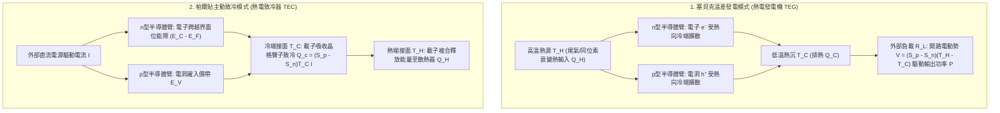
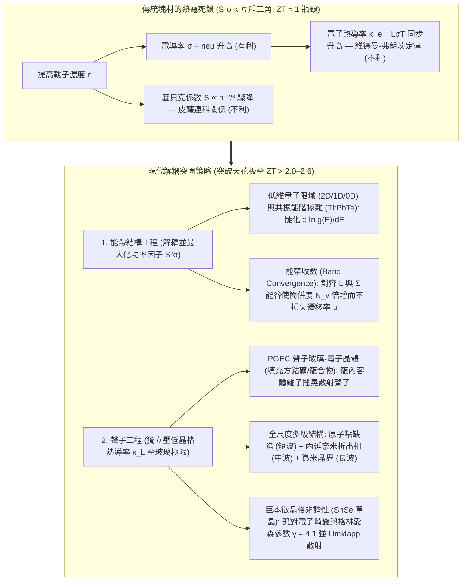

## 1. 引言：沒有任何運動部件，連結熱與電的固態奇蹟

1977年發射升空的美國太空總署（NASA）雙子深空探測器<strong>「航海家1號」（Voyager 1）</strong>與<strong>「航海家2號」（Voyager 2）</strong>已經在黑暗寒冷的星際空間中連續飛行了超過47年，距離太陽超過240億公里。在如此遙遠的深空，太陽輻射強度不足地球軌道的萬分之一，太陽能光電板完全失效；同時，在長達半個世紀無法維修的極端環境下，任何依賴活塞、渦輪葉片或循環工質的傳統機械熱機早已因磨損與金屬疲勞而癱瘓。

維持航海家號半個世紀不間斷通訊的動力心臟，是<strong>放射性同位素熱電機（RTG，俗稱核電池）</strong>——一種利用鈽-238（$^{238}\text{Pu}$）$\alpha$衰變熱（$T_H \approx 1273\,\text{K}$）與深空極寒背景（$T_C \approx 573\,\text{K}$）之間的溫度差，直接將熱能轉化為直流電的固態裝置。在地球上，完全相同的物理定律在逆向運作時則化身為<strong>帕爾貼致冷晶片（TEC）</strong>：無需一滴冷媒或吵雜的壓縮機，只需通入直流電，半導體陶瓷片的一面便會瞬間結霜，精準鎖定光纖通訊雷射波長（$\pm 0.01\,\text{K}$）、驅動基因擴增 PCR 儀以及冷卻天文望遠鏡 CCD 感測器。

為什麼溫差可以直接產生電壓，而電流又能直接抽吸熱量？為什麼熱電材料至今仍未完全取代發電廠的蒸汽渦輪機與家用冰箱的壓縮機？答案隱藏在凝聚態物理最核心的難題之一——<strong>塞貝克係數 $S$、電導率 $\sigma$ 與熱導率 $\kappa$ 之間的強耦合互斥三角（Contra-indicated Triad）</strong>之中。

---

## 2. 三大經典熱電效應的微觀物理與昂薩格倒易統一

熱電學建立在十九世紀發現的三大經典效應之上：<strong>塞貝克效應（1821）</strong>、<strong>帕爾貼效應（1834）</strong>與<strong>湯姆孫效應（1851）</strong>。

### 2.1 塞貝克效應（Seebeck Effect）：費米-狄拉克分佈的熱展寬與擴散-漂移平衡

當導體或半導體處於開路狀態（$\mathbf{J} = 0$）且存在溫度梯度 $\nabla T$ 時，材料內部會自發建立起與溫差成正比的靜電位梯度 $\nabla V$（準確而言是電化學勢梯度 $-\nabla \tilde{\mu}/e$）：

$$\nabla V = -S \nabla T \quad \Longleftrightarrow \quad S = -\frac{\Delta V}{\Delta T}$$

比例係數 $S$（單位通常為 $\mu\text{V/K}$）即為<strong>塞貝克係數（Seebeck coefficient）</strong>或熱電勢率。其微觀起源可由<strong>費米-狄拉克（Fermi-Dirac）分佈函數</strong>直接解釋：

$$f(E, T) = \frac{1}{\exp\left(\frac{E - \mu}{k_B T}\right) + 1}$$

1. <strong>熱端費米面的熱展寬</strong>：在有限溫度 $T > 0$ 下，費米面附近約 $\sim 2k_B T$ 能量窗口內的電子發生熱激發。熱端（$T_H$）的高能載子佈居數顯著高於冷端（$T_C$）。
2. <strong>熱擴散與靜電漂移的動態平衡</strong>：熱端高能載子向冷端發生淨熱擴散。在 n 型半導體中，電子（$q = -e$）在冷端累積使冷端帶負電（$S_n < 0$）；在 p 型半導體中，電洞（$q = +e$）在冷端累積使冷端帶正電（$S_p > 0$）。當內部建起的內建電場驅動的反向<strong>靜電漂移電流</strong>與正向<strong>熱擴散電流</strong>精確抵銷（$\mathbf{J}_{\text{diff}} + \mathbf{J}_{\text{drift}} = 0$）時，兩端輸出的穩態電壓即為塞貝克電壓。工程上將 p 型和 n 型熱電臂在<strong>熱學上並聯、電學上串聯</strong>（$\pi$ 型熱電偶），單對熱電偶的開路電壓即疊加為 $V_{\text{oc}} = (S_p - S_n)(T_H - T_C)$。

### 2.2 莫特公式（Mott Formula）與皮薩連科關係（Pisarenko Relation）

利用玻爾茲曼輸運方程式的索末菲展開，簡併半導體的塞貝克係數遵循著名的<strong>莫特公式</strong>：

$$S = -\frac{\pi^2 k_B^2 T}{3e} \left. \frac{d \ln \sigma(E)}{dE} \right|_{E = E_F}$$

其中微分電導率 $\sigma(E) = \frac{1}{3} e^2 g(E) v^2(E) \tau(E)$ 取決於電子態密度（DOS）$g(E)$、群速度 $v(E)$ 與弛豫時間 $\tau(E)$。莫特公式表明：<strong>$S$ 度量了費米能階 $E_F$ 兩側導電能力的能量不對稱性</strong>——態密度 $g(E)$ 在 $E_F$ 處隨能量變化越陡峭，$|S|$ 就越大。對於三維各向同性拋物線能帶且以聲學聲子散射為主的體系，莫特公式化為<strong>皮薩連科關係</strong>：

$$S = \frac{8 \pi^2 k_B^2}{3 e h^2} m^* T \left( \frac{\pi}{3n} \right)^{2/3}$$

可見，要獲得高塞貝克係數 $S$，需要<strong>較大的態密度有效質量 $m^*$</strong> 以及<strong>較低的載子濃度 $n$（$S \propto n^{-2/3}$）</strong>。

### 2.3 帕爾貼效應（Peltier Effect）與湯姆孫效應（Thomson Effect）

當外加直流電 $I$ 流經兩種不同材料 A 與 B 的等溫接面時，界面處會以正比於電流 $I$ 的速率可逆地吸熱或放熱：

$$\dot{Q}_P = (\Pi_A - \Pi_B) I = \Pi_{AB} I$$

比例係數 $\Pi$（單位：$\text{V}$ 或 $\text{J/C}$）稱為<strong>帕爾貼係數</strong>。在微觀能帶圖像中，金屬電極中的電子處於費米能階 $E_F$，而 n 型半導體中的導電電子必須佔據導帶底 $E_C$ 以上的輸運能階 $E_{\text{trans}}$。當電子從金屬進入 n 型半導體（冷端接面）時，必須<strong>跨越位能障 $\Delta E = E_{\text{trans}} - E_F > 0$</strong>，為此電子必須從晶格中吸收聲子能量，導致冷端降溫（如同電子作為工質發生「等溫膨脹蒸發」吸熱）；當電子在熱端從半導體躍遷回金屬的低能階 $E_F$ 時，多餘能量以聲子形式釋放給晶格，使熱端放熱。

1851年，克耳文勳爵（William Thomson）進一步預言了<strong>湯姆孫效應</strong>：當電流密度 $\mathbf{J}$ 流經存在溫度梯度 $\nabla T$ 的單一均勻導體時，由於載子比熵隨溫度變化，單位體積的產熱率為 $\dot{q}_{\text{total}} = \frac{\mathbf{J}^2}{\sigma} - \mathcal{K}_T (\mathbf{J} \cdot \nabla T)$，其中 $\mathcal{K}_T$ 為湯姆孫係數。

### 2.4 昂薩格-克耳文倒易關係（Onsager-Kelvin Relations）

在線性非平衡熱力學中，電流密度 $\mathbf{J}_e$ 與熱流密度 $\mathbf{J}_Q$ 由廣義熱力學力驅動：

$$\begin{pmatrix} \mathbf{J}_e \\ \mathbf{J}_Q \end{pmatrix} = \begin{pmatrix} L_{11} & L_{12} \\ L_{21} & L_{22} \end{pmatrix} \begin{pmatrix} -\frac{1}{e}\nabla \tilde{\mu} \\ \nabla \left(\frac{1}{T}\right) \end{pmatrix}$$

1931年，拉斯·昂薩格（Lars Onsager，1968年諾貝爾化學獎）由微觀運動方程式的時間反演對稱性證明了交叉輸運係數嚴格對稱：<strong>$L_{12} = L_{21}$</strong>。由此直接導出連結三大效應的<strong>克耳文第一與第二關係</strong>：

$$\Pi = S \cdot T, \qquad \mathcal{K}_T = T \frac{dS}{dT}$$

這揭示了塞貝克係數最深刻的物理本質：<strong>$S = \frac{\Pi}{T}$ 正是單位電荷所攜帶的輸運熵（$S = S_{\text{carrier}} / q$）！</strong>

---

## 3. 無因次熱電優值 $ZT$、最大轉換效率與帕爾貼致冷極限的嚴格推導

### 3.1 溫差發電（TEG）的最大熱電轉換效率 $\eta_{\max}$

設熱電偶在高溫源 $T_H$ 與低溫源 $T_C$（$\Delta T = T_H - T_C$）之間運作，總塞貝克係數為 $S = S_p - S_n$，內阻為 $R$，總並聯熱導為 $K$。當迴路電流為 $I$ 時，由一維穩態熱傳導方程式可知，體焦耳熱 $I^2 R$ 的一半返回熱端，另一半流向冷端。因此高溫端吸熱率 $Q_H$ 與外部負載 $R_L$ 上的輸出電功率 $P$ 分別為：

$$Q_H = \underbrace{S T_H I}_{\text{熱端帕爾貼吸熱}} + \underbrace{K (T_H - T_C)}_{\text{傅立葉熱傳導漏熱}} - \underbrace{\frac{1}{2} I^2 R}_{\text{半數焦耳熱返還}}, \qquad P = I^2 R_L = S(T_H - T_C)I - I^2 R$$

定義負載電阻與內阻之比 $m \equiv R_L / R$，並對兩臂截面積比進行幾何最佳化，所有材料屬性歸結為約菲（A. F. Ioffe，1949）提出的<strong>無因次熱電優值 $ZT$</strong>：

$$ZT = \frac{S^2 \sigma T}{\kappa} = \frac{S^2 \sigma T}{\kappa_e + \kappa_L}$$

其中分子 $PF = S^2 \sigma$ 稱為<strong>功率因子（Power Factor）</strong>，分母 $\kappa = \kappa_e + \kappa_L$ 為電子熱導率 $\kappa_e$ 與晶格（聲子）熱導率 $\kappa_L$ 之和。對效率 $\eta(m) = P / Q_H$ 求極值（$\frac{d\eta}{dm} = 0$），可得最佳阻抗匹配條件為 $m_{\text{opt}} = \sqrt{1 + Z\bar{T}}$（其中 $\bar{T} = \frac{T_H + T_C}{2}$），代入即得<strong>熱電發電最大效率公式</strong>：

$$\eta_{\max} = \underbrace{\frac{T_H - T_C}{T_H}}_{\text{卡諾效率 }\eta_C} \cdot \underbrace{\frac{\sqrt{1 + Z\bar{T}} - 1}{\sqrt{1 + Z\bar{T}} + \frac{T_C}{T_H}}}_{\text{材料折減因子}}$$

當 $Z\bar{T} \to \infty$ 時，$\eta_{\max} \to \eta_C$（卡諾極限）。當 $Z\bar{T} = 1$（傳統商用材料）且 $T_H = 600\,\text{K}, T_C = 300\,\text{K}$ 時，$\eta_{\max} \approx 10.8\%$；若能將 $Z\bar{T}$ 提升至 $3\text{–}4$，轉換效率即可突破 $20\%\text{–}25\%$，足以與傳統機械熱機正面競爭！

### 3.2 帕爾貼致冷量 $Q_c$、最大溫差 $\Delta T_{\max}$ 與性能係數 COP

在帕爾貼致冷器（TEC）中，冷端（$T_C$）的<strong>淨致冷功率 $Q_c$</strong> 由三項競爭機制決定：

$$Q_c = \underbrace{(S_p - S_n) T_C I}_{\text{(1) 帕爾貼界面吸熱}} - \underbrace{\frac{1}{2} I^2 R}_{\text{(2) 焦耳熱回流}} - \underbrace{K (T_H - T_C)}_{\text{(3) 傅立葉熱傳導回流}}$$

由於帕爾貼吸熱隨電流 $I$ 線性增長，而焦耳熱隨 $I^2$ 二次方暴漲，電流並非越大越好！對 $I$ 求導（$\frac{\partial Q_c}{\partial I} = 0$）可得產生最大致冷量的最佳電流 $I_{\max} = \frac{S T_C}{R}$。令淨外部熱負載 $Q_c = 0$，即得單級帕爾貼元件所能達到的<strong>最大溫差 $\Delta T_{\max}$</strong> 及<strong>最大性能係數 $\text{COP}_{\max}$</strong>：

$$\Delta T_{\max} = \frac{1}{2} Z T_C^2, \qquad \text{COP}_{\max} = \frac{T_C}{T_H - T_C} \cdot \frac{\sqrt{1 + Z\bar{T}} - \frac{T_H}{T_C}}{\sqrt{1 + Z\bar{T}} + 1}$$

對於室溫 $\text{Bi}_2\text{Te}_3$ 元件（$ZT_C \approx 0.8\text{–}1.0$），單級 $\Delta T_{\max}$ 約為 $68\text{–}75\,\text{K}$；透過金字塔形多級串疊（Cascade TEC），致冷溫差可達 $> 130\,\text{K}$。

---

## 4. 固態物理的根本困境：$S$、$\sigma$ 與 $\kappa$ 的強耦合互斥三角

為什麼提高 $ZT = \frac{S^2 \sigma T}{\kappa_e + \kappa_L}$ 如此艱難？因為三大參數被載子濃度 $n$ 死死鎖在一起：

1. <strong>$S$ 與 $\sigma$ 的衝突（皮薩連科權衡）</strong>：電導率 $\sigma = n e \mu$ 要求提高載子濃度 $n$ 和遷移率 $\mu = \frac{e\tau}{m^*}$；但皮薩連科關係 $S \propto m^* n^{-2/3}$ 表明，增加 $n$ 會使塞貝克係數 $S$ 按 $n^{-2/3}$ 驟降，而增大有效質量 $m^*$ 又會降低遷移率 $\mu$。
2. <strong>$\sigma$ 與 $\kappa_e$ 的衝突（維德曼-弗朗茨定律 Wiedemann-Franz Law）</strong>：傳導電荷的電子同時也傳導熱能，電子熱導率 $\kappa_e$ 與電導率 $\sigma$ 成嚴格正比：

$$\frac{\kappa_e}{\sigma T} = L = \frac{\pi^2}{3} \left( \frac{k_B}{e} \right)^2 \approx 2.44 \times 10^{-8}\,\text{W}\cdot\Omega\cdot\text{K}^{-2}$$

其中 $L$ 為勞侖茲常數。提高 $\sigma$ 必然同步推高 $\kappa_e$，從而抹平溫差！

因此，絕緣體的 $\sigma \approx 0$ 且高溫下存在致命的電子-電洞<strong>雙極熱導（Bipolar conduction）</strong>；金屬的 $S \approx 1\text{–}5\,\mu\text{V/K}$ 極小且 $\kappa_e$ 極大；唯有載子濃度處在 <strong>$n \approx 10^{19}\text{–}10^{20}\,\text{cm}^{-3}$ 的重摻雜簡併半導體</strong>（窄能隙滿足 Chasmar-Stratton 判據 $E_g \approx 6\text{–}10\,k_B T$）才能使功率因子 $S^2\sigma$ 與 $ZT$ 達到峰值。

| 溫區劃分 | 代表性材料體系 | 最佳工作溫度 $T_{\text{opt}}$ | 能隙 $E_g$ | 典型峰值 $ZT$ | 晶體結構、核心物理機制與主要工程應用 |
| :--- | :--- | :--- | :--- | :--- | :--- |
| <strong>低溫至室溫區</strong> ($< 450\,\text{K}$) | $\text{Bi}_2\text{Te}_3$ 基合金 ($\text{Bi}_2\text{Te}_{3-x}\text{Se}_x$ / $\text{Bi}_{2-x}\text{Sb}_x\text{Te}_3$) | $250\text{–}400\,\text{K}$ | $\sim 0.15\,\text{eV}$ | $0.8\text{–}1.4$ | 層狀菱面體結構，范德華鍵結，高能谷簡併度（$N_v=6$）。商用帕爾貼致冷器（TEC）與低溫廢熱回收的絕對主力。 |
| <strong>中溫區 I</strong> ($500\text{–}850\,\text{K}$) | $\text{PbTe}$ 與 TAGS-85 | $600\text{–}800\,\text{K}$ | $\sim 0.30\,\text{eV}$ | $1.2\text{–}2.2$ | 岩鹽立方結構。透過 L–$\Sigma$ <strong>能帶收斂</strong>（$N_v = 4 \to 16$）、$\text{Tl}$ 共振能階摻雜及 $\text{SrTe}$ 內延奈米析出相實現高 $ZT$。用於火星車 MMRTG。 |
| <strong>中溫區 II</strong> ($550\text{–}900\,\text{K}$) | 填充方鈷礦 (Filled Skutterudites) ($\text{Ba}_x\text{La}_y\text{Yb}_z\text{Co}_4\text{Sb}_{12}$) | $700\text{–}850\,\text{K}$ | $\sim 0.3\,\text{eV}$ | $1.2\text{–}1.8$ | $\text{CoSb}_3$ 籠狀結構。稀土/鹼土客體離子在晶籠內非諧<strong>「搖晃」（Rattling，PGEC 機制）</strong>共振散射聲子。用於汽車與工業尾氣發電。 |
| <strong>中高溫區</strong> ($650\text{–}1000\,\text{K}$) | $\text{SnSe}$（硒化錫單晶/多晶） | $750\text{–}923\,\text{K}$ | $\sim 0.86\,\text{eV}$ | $2.2\text{–}2.6+$ | 層狀正交褶皺結構（$Pnma \to Cmcm$）。$\text{Sn}^{2+}$ 孤對電子引發<strong>巨本徵晶格非諧性</strong>（格林愛森參數 $\gamma \approx 4.1$），本徵 $\kappa_L \approx 0.23\,\text{W/(m}\cdot\text{K)}$。 |
| <strong>高溫區</strong> ($700\text{–}1100\,\text{K}$) | Half-Heusler 半哈斯勒合金 ($\text{ZrNiSn}$, $\text{NbFeSb}$) | $800\text{–}1050\,\text{K}$ | $\sim 0.5\,\text{eV}$ | $1.0\text{–}1.5$ | 金屬間化合物，機械強度極高、無毒耐高溫，功率因子極高（$PF > 50\,\mu\text{W cm}^{-1}\text{K}^{-2}$）。用於鋼鐵與玻璃工業爐廢熱回收。 |
| <strong>超高溫區</strong> ($900\text{–}1300\,\text{K}$) | $\text{SiGe}$ 矽鍺合金 ($\text{Si}_{0.8}\text{Ge}_{0.2}$) | $1000\text{–}1273\,\text{K}$ | $\sim 0.8\,\text{eV}$ | $0.8\text{–}1.3$ | 金剛石共價結構，強合金質量起伏散射聲子，耐 $1000\,^\circ\text{C}$ 高溫不昇華。驅動航海家1/2號與新視野號深空 RTG。 |

---

## 5. 打破 $ZT \approx 1$ 歷史天花板：現代能帶工程與聲子工程

1. <strong>Slack 的「聲子玻璃-電子晶體」（PGEC，1995）與籠狀化合物</strong>：利用電子平均自由程短而聲子平均自由程長的差異，在<strong>填充方鈷礦（$\text{CoSb}_3$）</strong>與<strong>籠合物（Clathrates）</strong>的共價晶籠中填入稀土/鹼土客體離子。電子沿剛性共價骨架高速輸運（電子晶體），而客體離子在籠內做大振幅局域非諧<strong>「搖晃」（Rattling）</strong>，共振散射攜熱聲學聲子（聲子玻璃）。
2. <strong>能帶工程：低維量子限域、共振能階與能帶收斂</strong>：
   - <strong>Hicks-Dresselhaus 低維量子限域（1993）</strong>：利用 2D 量子井、1D 奈米線或 0D 量子點的尖銳態密度奇異點陡化 $\frac{d\ln g(E)}{dE}$。
   - <strong>共振能階摻雜（Heremans 等，2008）</strong>：如 $\text{Tl}$ 摻雜 $\text{PbTe}$ 在費米面附近引入共振態密度畸變峰。
   - <strong>能帶收斂（Band Convergence）</strong>：由於態密度有效質量滿足 $m^* = N_v^{2/3} m^*_b$，透過調控成分與溫度使 $\text{PbTe}$ 的輕電洞 $L$ 帶（$N_v=4$）與重電洞 $\Sigma$ 帶（$N_v=12$）對齊，總簡併度躍升至 $N_v = 16$，在不增大單谷有效質量 $m^*_b$（不犧牲遷移率 $\mu$）的前提下大幅提升 $S$！
3. <strong>全尺度多級聲子工程（Kanatzidis 等，2012）與 $\text{SnSe}$ 巨本徵非諧性（2014）</strong>：
   由於傳熱聲子的平均自由程橫跨 $\sim 1\,\text{nm}$ 至 $1\,\mu\text{m}$ 三個數量級，結合<strong>原子尺度點缺陷</strong>（散射短波聲子）、<strong>內延共格奈米析出相</strong>（散射中波聲子且不散射載子）與<strong>介觀微米晶界</strong>（散射長波聲子）的<strong>全尺度多級結構</strong>在 $\text{PbTe}-\text{SrTe}$ 中實現了 $ZT \approx 2.2$。2014年，趙立東與 Kanatzidis 發現<strong>硒化錫（$\text{SnSe}$）單晶</strong>依靠 $\text{Sn}^{2+}$ 的 $5s^2$ 孤對電子立體化學活性產生高達 $\gamma \approx 4.1$ 的格林愛森參數，無需任何外加奈米結構便在 $923\,\text{K}$ 下創下 $\kappa_L \approx 0.23\,\text{W/(m}\cdot\text{K)}$ 與 <strong>$ZT = 2.6 \pm 0.3$</strong> 的紀錄。

---

## 6. 現實工程應用與前沿展望：從星際核電池到自旋熱電學

1. <strong>深空探測核電池（RTG 與 MMRTG）</strong>：航海家1/2號與新視野號採用耐高溫 $\text{SiGe}$ 熱電偶；而在大氣環境中運作的「好奇號」、「毅力號」火星車及未來的泰坦星核動力無人機「蜻蜓號」（Dragonfly）則採用密封在氬氣中的 $\text{PbTe/TAGS}$ 多任務放射性同位素熱電機（MMRTG），持續輸出 $\sim 110\,\text{W}_{\text{e}}$ 電力。
2. <strong>精密固態溫控（TEC）</strong>：高密度分波多工（DWDM）光纖通訊雷射依靠微型帕爾貼晶片將接面溫度鎖定在 $\pm 0.01\,\text{K}$ 以防止通道串擾；PCR 基因擴增儀與無振動紅外線/天文 CCD 冷卻器同樣離不開帕爾貼技術。
3. <strong>工業廢熱回收、柔性可穿戴熱電與自旋熱電學（Spin Caloritronics）</strong>：從工業物聯網（IIoT）免維護感測器、室溫塑性無機半導體（如 $\text{Ag}_2\text{S}$ 硫銀鍺礦）與導電高分子（PEDOT:PSS）體溫發電貼片，到利用<strong>自旋塞貝克效應（SSE）</strong>與拓撲磁性外爾半金屬<strong>反常能斯特效應（ANE，$\mathbf{E}_{\text{ANE}} \propto \mathbf{M} \times \nabla T$）</strong>的橫向薄膜熱電元件，電子與聲子的量子協奏正持續拓展人類能量轉換的疆界。
