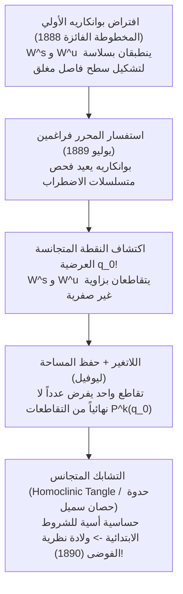

## 1. مقدمة: لعنة النجم الثالث في الكون الميكانيكي

في عام 1687، نشر إسحاق نيوتن كتابه الخالد *الأصول الرياضية للفلسفة الطبيعية* (*Principia*)، مغيراً إلى الأبد فهم البشرية للكون. فمن خلال إثبات أن القوة التي تسقط التفاحة على الأرض والقوة التي تُبقي القمر في مداره تخضعان لنفس قانون الجذب العام للتربيع العكسي، نجح نيوتن في حل <strong>مسألة الجسمين (Two-Body Problem)</strong> حلاً تحليلياً وهندسياً كاملاً. وبموجب هذا الحل، فإن مداري أي كتلتين نقطيتين تتجاذبان ثقاليّاً يظلان إلى الأبد <strong>قطوعاً مخروطية (إهليلجاً أو قطعاً مكافئاً أو قطعاً زائداً)</strong> يمكن التعبير عنها بدوال ابتدائية مغلقة، مما أرسى دعائم الحتمية الكلاسيكية و«شيطان لابلاس».

غير أنه بمجرد إضافة <strong>جرم سماوي ثالث واحد فقط</strong> — أي الانتقال من $N=2$ إلى $N=3$ كما في نظام الشمس والأرض والقمر، وهو ما يُعرف بـ <strong>معضلة الأجسام الثلاثة (Three-Body Problem)</strong> — ينهار هذا السحر التحليلي تماماً. لماذا يمكن حل نظام من نجمين بحساب التفاضل والتكامل الجامعي الأولي، بينما عجز أعظم علماء الرياضيات لأكثر من ثلاثة قرون أمام ثلاثة نجوم؟

لا يكمن الحاجز في مجرد صعوبة الحسابات، بل في عجز بنيوي عميق بين <strong>أبعاد فضاء الطور الهاملتوني وعدد التكاملات الأولى (الكميات المحفوظة)</strong>، فضلاً عن هندسة <strong>عدم القابلية للتكامل والفوضى الحتمية (Deterministic Chaos)</strong> التي اكتشفها هنري بوانكاريه في أواخر القرن التاسع عشر.

---

## 2. القابلية التامة للتكامل في مسألة الجسمين مقابل جدار الأبعاد في الأجسام الثلاثة

### 2.1 الصياغة الهاملتونية ومبرهنة ليوفيل-أرنولد

لنظام مكوّن من $N$ كتلة نقطية $m_i$ في المواضع $\mathbf{r}_i \in \mathbb{R}^3$، تُكتب معادلات نيوتن للحركة على النحو التالي:

$$m_i \frac{d^2 \mathbf{r}_i}{dt^2} = \sum_{\substack{j=1 \\ j \ne i}}^{N} \frac{G m_i m_j (\mathbf{r}_j - \mathbf{r}_i)}{\|\mathbf{r}_j - \mathbf{r}_i\|^3} \qquad (i = 1, \dots, N)$$

في <strong>فضاء الطور ذي الأبعاد $6N$</strong> بإحداثيات معممة $\mathbf{q} = (\mathbf{r}_1, \dots, \mathbf{r}_N)$ وزخوم مترافقة $\mathbf{p} = (m_1\dot{\mathbf{r}}_1, \dots, m_N\dot{\mathbf{r}}_N)$، تُوصف الديناميكا بدالة هاملتون $H(\mathbf{q}, \mathbf{p})$:

$$H(\mathbf{q}, \mathbf{p}) = \sum_{i=1}^{N} \frac{\|\mathbf{p}_i\|^2}{2m_i} - \sum_{1 \le i < j \le N} \frac{G m_i m_j}{\|\mathbf{r}_i - \mathbf{r}_j\|}$$

وفقاً لـ <strong>مبرهنة ليوفيل-أرنولد (Liouville-Arnold Theorem, 1855 / 1963)</strong>، يكون النظام الهاملتوني المستقل ذو $n$ من درجات الحرية (أي فضاء طور ببعد $2n$) <strong>قابلاً للتكامل تماماً بالتربيعات</strong> إذا وفقط إذا وُجدت $n$ من التكاملات الأولى المستقلة دالياً $F_1 (=H), F_2, \dots, F_n$ في حالة <strong>التفاف متبادل (In Involution: أقواس بواسون معدومة $\{F_i, F_j\} = 0$)</strong>. عندئذٍ تتحرك المسارات حركة شبه دورية على أطوار لا متغيرة (Invariant Tori) $\mathbb{T}^n$.

وبموجب مبرهنة نويثر (Noether's Theorem) لتناظرات زمرة غاليليو، يمتلك أي نظام جاذبي مكوّن من $N$ جسماً بالضبط <strong>10 تكاملات جبرية كلاسيكية للحركة</strong>:
1. <strong>حفظ الزخم الخطي الكلي $\mathbf{P}$ (3) والحركة المنتظمة لمركز الكتلة $\mathbf{G}_{\text{CM}} = M\mathbf{R}_{\text{CM}} - \mathbf{P}t$ (3)</strong>: يختزل فضاء الطور بمقدار <strong>6 أبعاد</strong> ($6N \to 6N - 6$).
2. <strong>حفظ الزخم الزاوي الكلي $\mathbf{L} = \sum \mathbf{r}_i \times \mathbf{p}_i$ (3)</strong>: نظراً لأن $\{L_x, L_y\} = L_z \ne 0$، نحصل على <strong>تكاملين متبادلين</strong> ($\|\mathbf{L}\|^2$ و$L_z$)، وبدمج *حذف العقد لياكوبي (1842)* يُختزل فضاء الطور بمقدار 4 أبعاد.
3. <strong>حفظ الطاقة الميكانيكية الكلية $H = E$ (1)</strong>.

### 2.2 حساب درجات الحرية: لماذا تنجح $N=2$ وتفشل $N=3$؟

```mermaid
flowchart TD
    subgraph TwoBody["مسألة الجسمين (N = 2): فضاء الطور 12 بعداً (6 درجات حرية)"]
        TB1["فضاء الطور الابتدائي: 6 × 2 = 12 بعداً"] --> TB2["فصل حركة مركز الكتلة (6 تكاملات)<br/>12 - 6 = 6 أبعاد نسبية (n_rel = 3 درجات حرية)"]
        TB2 --> TB3["يمتلك 3 تكاملات متبادلة: H_rel, |L|^2, L_z<br/>شرط ليوفيل-أرنولد متحقق تماماً (3 = 3)!"]
        TB3 --> TB4["متجه لابلاس-رونغ-لينز A -> قابلية تكامل فائقة<br/>حل تحليلي تام: قطوع كبلر المخروطية"]
    end

    subgraph ThreeBody["معضلة الأجسام الثلاثة (N = 3): فضاء الطور 18 بعداً (9 درجات حرية)"]
        THB1["فضاء الطور الابتدائي: 6 × 3 = 18 بعداً"] --> THB2["إحداثيات ياكوبي / مركز الكتلة (6 تكاملات)<br/>18 - 6 = 12 بعداً نسبياً (n_rel = 6 درجات حرية)"]
        THB2 --> THB3["لـ n_rel = 6 درجات حرية، توجد 3 تكاملات متبادلة فقط:<br/>H_rel, |L|^2, L_z (عجز بمقدار 3 تكاملات!)"]
        THB3 --> THB4["تبقى 7 إلى 8 أبعاد غير قابلة للاختزال!<br/>مبرهنتا برونز (1887) وبوانكاريه (1889): غير قابل للتكامل"]
    end
```

* <strong>في حالة $N=2$</strong>: بعد طرح أبعاد مركز الكتلة الستة، يتبقى للحركة النسبية ($\mathbf{r} = \mathbf{r}_1 - \mathbf{r}_2$، الكتلة المختزلة $\mu_{\text{red}} = \frac{m_1 m_2}{m_1+m_2}$) <strong>$n_{\text{rel}} = 3$ درجات حرية</strong> و<strong>3 تكاملات متبادلة</strong> ($H_{\text{rel}}, \|\mathbf{L}\|^2, L_z$). علاوة على ذلك، فإن التناظر الديناميكي الخفي $SO(4)$ لجهد $1/r$ يحفظ <strong>متجه لابلاس-رونغ-لينز (LRL)</strong>:
  $$\mathbf{A} = \mathbf{p} \times \mathbf{L} - \mu_{\text{red}} G m_1 m_2 \frac{\mathbf{r}}{\|\mathbf{r}\|}$$
  مما يجعل النظام <strong>فائق القابلية للتكامل</strong> بمدارات إهليلجية مغلقة $r(\theta) = \frac{p}{1 + e\cos(\theta - \varpi)}$.
* <strong>في حالة $N=3$</strong>: يقفز فضاء الطور إلى <strong>$6 \times 3 = 18$ بعداً</strong>. وبعد فصل مركز الكتلة يتبقى 12 بعداً (<strong>$n_{\text{rel}} = 6$ درجات حرية</strong>)، ولكن مع نفس التكاملات المتبادلة الثلاثة فقط! وحتى بعد اختزال الزخم الزاوي والطاقة، <strong>تبقى 8 أبعاد سمبلكتية (أو متعدد طيات طاقة سباعي الأبعاد)</strong> دون حل.
  - أثبتت <strong>مبرهنة برونز (1887)</strong> و<strong>مبرهنة بوانكاريه لعدم القابلية للتكامل (1889)</strong> عدم وجود أي تكاملات أولى جبرية أو تحليلية مستقلة أخرى.
  - <strong>فخ متسلسلة سوندمان (1912)</strong>: رغم أن عالم الرياضيات الفنلندي كارل سوندمان نجح في بناء متسلسلة قوى في $t^{1/3}$ متقاربة لكل الأزمنة $t$ (بشرط $\mathbf{L} \ne \mathbf{0}$)، أثبت ديفيد بيلوريزكي (1930) أن حساب دورة مدارية واحدة فقط يتطلب جمع ما لا يقل عن <strong>$10^{8\,000\,000}$ حد</strong>، مما يجعلها عديمة الجدوى فيزيائياً!

| وجه المقارنة | مسألة الجسمين ($N=2$) | معضلة الأجسام الثلاثة العامة ($N=3$) | المسألة المقيدة الدائرية المستوية (PCR3BP) |
| :--- | :--- | :--- | :--- |
| <strong>أبعاد فضاء الطور ($6N$)</strong> | $12$ بعداً ($6$ درجات حرية) | $18$ بعداً ($9$ درجات حرية) | $4$ أبعاد (كتلة اختبار، درجتا حرية) |
| <strong>الفضاء النسبي (بعد مركز الكتلة)</strong> | $6$ أبعاد ($n_{\text{rel}} = 3$) | $12$ بعداً ($n_{\text{rel}} = 6$) | $4$ أبعاد ($n = 2$ في الإطار الدوار) |
| <strong>التكاملات المتبادلة (المطلوب / المتوفر)</strong> | $3$ / $3$ (+ متجه LRL $\mathbf{A}$) | $6$ / $3$ (<strong>عجز بمقدار $3$!</strong>) | $2$ / $1$ (ثابت ياكوبي $C_J$) |
| <strong>السلوك الديناميكي</strong> | فائق التكامل (قطوع مخروطية) | <strong>غير قابل للتكامل</strong> (فوضى متجانسة الميل) | <strong>غير قابل للتكامل</strong> (أطوار KAM وفوضى) |

---

## 3. معضلة الأجسام الثلاثة المقيدة الدائرية (CR3BP) ونقاط لاغرانج الخمس ($L_1$–$L_5$)

### 3.1 معادلات الحركة في الإطار الدوار وثابت ياكوبي

في <strong>CR3BP</strong>، يدور جرمان رئيسيان $m_1 \ge m_2$ في مدارين دائريين ($a=1, \omega=1$) حول مركز كتلتهما المشترك، بينما يتحرك جرم ثالث مهمل الكتلة ($m_3 \to 0$) في مجالهما. باستخدام معامل الكتلة اللابعدي $\mu = \frac{m_2}{m_1 + m_2} \in (0, 1/2]$، يثبت الجرمان الرئيسيان في <strong>الإطار الدوار $(x,y,z)$</strong> عند $(-\mu, 0, 0)$ و$(1-\mu, 0, 0)$. بتعريف <strong>الجهد الفعال $\Omega(x, y, z)$</strong>:

$$\Omega(x, y, z) = \frac{1}{2}(x^2 + y^2) + \frac{1 - \mu}{r_1} + \frac{\mu}{r_2}, \qquad r_1 = \sqrt{(x+\mu)^2+y^2+z^2}, \quad r_2 = \sqrt{(x-1+\mu)^2+y^2+z^2}$$

تُكتب معادلات الحركة متضمنةً قوة كوريوليس ($-2\boldsymbol{\omega}\times\mathbf{v}$):

$$\ddot{x} - 2\dot{y} = \frac{\partial \Omega}{\partial x}, \qquad \ddot{y} + 2\dot{x} = \frac{\partial \Omega}{\partial y}, \qquad \ddot{z} = \frac{\partial \Omega}{\partial z}$$

بضرب المعادلات في $\dot{x}, \dot{y}, \dot{z}$ ومكاملتها، نحصل على الكمية المحفوظة الوحيدة في CR3BP، وهي <strong>تكامل ياكوبي (ثابت ياكوبي $C_J$)</strong>:

$$C_J = 2\Omega(x, y, z) - (\dot{x}^2 + \dot{y}^2 + \dot{z}^2)$$

ولأن $v_{\text{rot}}^2 = 2\Omega - C_J \ge 0$، تنحصر الحركة داخل <strong>منطقة هيل $2\Omega(x,y,z) \ge C_J$</strong>، المحاطة بـ <strong>منحنيات السرعة الصفرية (Zero-Velocity Curves)</strong> $2\Omega = C_J$.

### 3.2 اشتقاق واستقرار النقاط $L_1$–$L_5$: تلسكوب جيمس ويب وكويكبات طروادة

شرط التوازن $\nabla \Omega = \mathbf{0}$ في المستوي $z=0$ يعطي خمس نقاط اتزان:
1. <strong>نقاط أويلر الثلاث على استقامة واحدة ($L_1, L_2, L_3$، 1767)</strong>: تقع على المحور $y=0$ كجذور لمعادلة من الدرجة الخامسة $x - \frac{(1-\mu)(x+\mu)}{|x+\mu|^3} - \frac{\mu(x-1+\mu)}{|x-1+\mu|^3} = 0$. عندما يكون $\mu \ll 1$، تبعد $L_1$ و$L_2$ عن $m_2$ مسافة تقارب <strong>نصف قطر هيل $r_{\text{Hill}} \approx a(\mu/3)^{1/3}$</strong> (حوالي <strong>1.5 مليون كم</strong> عن الأرض في نظام الشمس-الأرض).
2. <strong>نقطتا لاغرانج للمثلث المتساوي الأضلاع ($L_4, L_5$، 1772)</strong>: بكتابة $\Omega(r_1, r_2) = \frac{1-\mu}{2}(r_1^2 + \frac{2}{r_1}) + \frac{\mu}{2}(r_2^2 + \frac{2}{r_2}) - \frac{1}{2}\mu(1-\mu)$، فإن الشرط $\frac{\partial \Omega}{\partial r_1} = \frac{\partial \Omega}{\partial r_2} = 0$ يعطي فوراً <strong>$r_1 = r_2 = 1$</strong>، مشكلاً مثلثين متساويي الأضلاع في $L_{4,5} = \left(\frac{1}{2}-\mu, \pm\frac{\sqrt{3}}{2}, 0\right)$.

تحليل المعادلة المميزة الخطية $\lambda^4 + (4 - \Omega_{xx} - \Omega_{yy})\lambda^2 + (\Omega_{xx}\Omega_{yy} - \Omega_{xy}^2) = 0$ يُظهر:
* <strong>عدم الاستقرار السرجي للنقاط $L_1, L_2, L_3$ ومدارات الهالة لتلسكوب جيمس ويب (JWST)</strong>: لأن $\Omega_{xx}\Omega_{yy} < 0$، تكون القيم الذاتية $\pm\sigma, \pm i\omega_{xy}, \pm i\omega_z$ ($\text{Saddle} \times \text{Center} \times \text{Center}$)، وبالتالي فإن <strong>$L_1, L_2, L_3$ غير مستقرة خطياً دائماً</strong>. ومع ذلك، يدعم متعدد الطيات المركزي <strong>مدارات الهالة (Halo Orbits)</strong> الدورية ثلاثية الأبعاد. يدور <strong>تلسكوب جيمس ويب الفضائي (JWST)</strong> حول النقطة $L_2$ في مدار هالة: فهو يتجنب ظل الأرض دائماً، ويُبقي الشمس والأرض والقمر خلف درعه الحراري المكون من 5 طبقات ($<40\text{ K}$)، ولا يستهلك سوى <strong>$\Delta v \approx 2\text{–}4\text{ م/ث}$ سنوياً</strong> للحفاظ على مداره!
* <strong>الاستقرار الجيروسكوبي بقوة كوريوليس في $L_4, L_5$ ومعيار راوث الحرج</strong>: رغم أن $L_4$ و$L_5$ تمثلان <strong>قمماً محلية (نهايات عظمى)</strong> للجهد $\Omega$، فإن <strong>قوة كوريوليس ($-2\boldsymbol{\omega}\times\mathbf{v}$)</strong> تحرف أي جسيم يبدأ بالانزلاق وتحجزه في مدار مستقر حول القمة! المعادلة المميزة:
  $$\lambda^4 + \lambda^2 + \frac{27}{4}\mu(1 - \mu) = 0$$
  تعطي جذوراً تخيلية صرفة (استقراراً خطياً) إذا وفقط إذا كان المميز موجباً (<strong>معيار راوث، 1875</strong>):
  $$1 - 27\mu(1 - \mu) > 0 \iff \mu < \mu_{\text{crit}} = \frac{1 - \sqrt{23/27}}{2} \approx 0.0385209 \quad \left(\frac{m_1}{m_2} > 24.96\right)$$
  في نظام الشمس-المشتري ($\mu \approx 0.000954 \ll 0.03852$)، يحتجز هذا الاستقرار أكثر من 12,000 من <strong>كويكبات طروادة</strong> في $L_4$ و$L_5$!

---

## 4. جائزة الملك أوسكار الثاني وخطأ هنري بوانكاريه (1889) الذي أطلق نظرية الفوضى

في عام 1889، فاز <strong>هنري بوانكاريه</strong> بالمسابقة الرياضية الدولية التي أعلنها <strong>الملك أوسكار الثاني ملك السويد والنرويج</strong>. وأثناء طباعة البحث في مجلة *Acta Mathematica*، لاحظ المحرر الشاب <strong>لارس إدفارد فراغمين</strong> فجوة في البرهان. وعندما أعاد بوانكاريه فحص حساباته، اكتشف بذهول أن <strong>متعدد الطيات المستقر $W^s(p_0)$</strong> و<strong>متعدد الطيات غير المستقر $W^u(p_0)$</strong> لمدار دوري زائدي لا ينطبقان بسلاسة، بل <strong>يتقاطعان عرضياً (Transverse Homoclinic Intersection)</strong>!

بسبب اللاتغير تحت تطبيق العودة لبوانكاريه $P$، فإن تقاطعاً عرضياً واحداً عند $q_0$ يفرض <strong>عدداً لا نهائياً من التقاطعات المتجانسة $P^k(q_0)$ ($k \in \mathbb{Z}$)</strong>؛ وبسبب حفظ المساحة لليوفيل، تتمدد الفصوص وتنطوي إلى ما لا نهاية مشكلةً <strong>التشابك المتجانس (Homoclinic Tangle / حدوة حصان سميل، 1967)</strong>. دفع بوانكاريه من ماله الخاص 3,581 كرونة (أكثر من قيمة الجائزة البالغة 2,500 كرونة!) لسحب وإتلاف النسخ المطبوعة ونشر النسخة المعدلة عام 1890 التي أسست <strong>نظرية الفوضى</strong>.

---

## 5. المعجزات الحديثة: مدار الرقم ثمانية ومبرهنة KAM في النظام الشمسي

### 5.1 رقصة الرقم ثمانية (مور 1993؛ شينسينير ومونتغومري 2000)

بعد أكثر من قرنين على أويلر ولاغرانج، اكتشف <strong>كريستوفر مور (1993)</strong> عددياً وأثبت <strong>آلان شينسينير وريتشارد مونتغومري (2000)</strong> بصرامة في مجلة *Annals of Mathematics* عبر <strong>مبدأ الفعل الأصغر (حساب التغيرات)</strong> وجود <strong>المدار الدوري على شكل رقم ثمانية (Figure-Eight Choreography)</strong> لثلاث كتل متساوية ($m_1=m_2=m_3=1$) بزخم زاوي معدوم ($\mathbf{L}=\mathbf{0}$):

$$\mathbf{r}_2(t) = \mathbf{r}_1\left(t - \frac{T}{3}\right), \qquad \mathbf{r}_3(t) = \mathbf{r}_1\left(t - \frac{2T}{3}\right)$$

من خلال تصغير دالي الفعل $\mathcal{A}[\mathbf{q}] = \int_0^T (T - V)\,dt$ تحت تناظر $D_6$ على <strong>كرة الأشكال (Shape Sphere $S^2$)</strong>، أثبتا أن النهاية الصغرى للفعل أصغر قطعا من أي مسار تصادمي ($\mathcal{A}_{\text{eight}} < \mathcal{A}_{\text{coll}}$). لاحقاً، اكتشف شوفاكوف ودميتراشينوفيتش (2013) ولي ولياو (2017) <strong>أكثر من 2,000 عائلة جديدة من المدارات الدورية</strong>.

### 5.2 مبرهنة KAM، انتشار أرنولد، وأفق ليابونوف البالغ 5 ملايين سنة (لاسكار)

في النظام الهاملتوني شبه القابل للتكامل $H(\mathbf{I}, \boldsymbol{\theta}) = H_0(\mathbf{I}) + \epsilon H_1(\mathbf{I}, \boldsymbol{\theta})$، تولد الرنينات <strong>مشكلة القواسم الصغيرة</strong> $\mathbf{k}\cdot\boldsymbol{\omega}(\mathbf{I}) \approx 0$. أثبتت <strong>مبرهنة كولموغوروف-أرنولد-موزر (KAM، 1954–1963)</strong> أنه عندما يكون $\epsilon \ll 1$، فإن معظم الأطوار اللإمتغيرة تنجو إذا حققت تردداتها <strong>الشرط الديوفانتي</strong>:

$$|\mathbf{k} \cdot \boldsymbol{\omega}| \ge \frac{\gamma}{\|\mathbf{k}\|^\tau} \qquad \left(\forall \mathbf{k} \in \mathbb{Z}^n \setminus \{\mathbf{0}\}\right)$$

بينما عند درجات الحرية $n \ge 3$ تتصل الطبقات الرنينية المدمرة لتسمح بحدوث <strong>انتشار أرنولد (Arnold Diffusion)</strong> البطيء جداً.

وأخيراً، أظهرت التكاملات العددية لـ <strong>جاك لاسكار (1989 / 2009)</strong> أن النظام الشمسي الداخلي فوضوي بـ <strong>زمن ليابونوف يبلغ $\tau_{\text{L}} \approx 5\text{ ملايين سنة}$ فقط</strong>: فعدم يقين ابتدائي قدره <strong>15 متراً</strong> في موضع الأرض ينمو ليبلغ <strong>$1\text{ وحدة فلكية}$ خلال 100 مليون سنة</strong>، مما يجعل التنبؤ بالطور المداري بعد 100 مليون سنة مستحيلاً فيزيائياً، مع وجود <strong>احتمال بنسبة $\sim 1\%$</strong> خلال الـ 5 مليارات سنة القادمة لأن يؤدي رنين علمي بين عطارد والمشتري ($g_1 \approx g_5$) إلى قفزة في شذوذ مدار عطارد ($e > 0.6$) ووقوع تصادمات كارثية بين الكواكب الداخلية.
