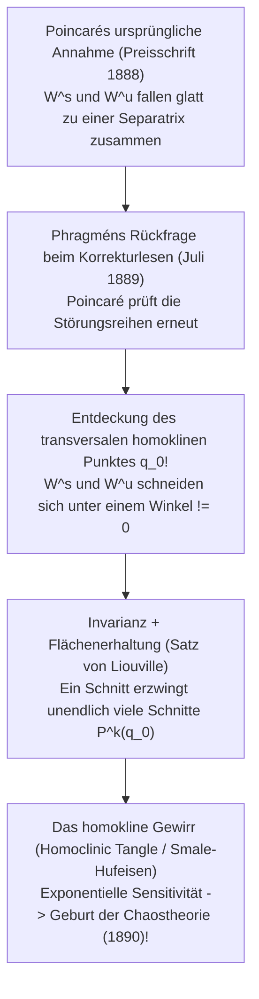

## 1. Einleitung: Der Fluch des dritten Sterns im Uhrwerk-Universum

Als Isaac Newton im Jahr 1687 seine *Philosophiæ Naturalis Principia Mathematica* veröffentlichte, gelang ihm einer der größten Triumphe der Wissenschaftsgeschichte: Er löste das gravitierende <strong>Zweikörperproblem (Two-Body Problem)</strong> vollständig und exakt. Zwei Punktmassen, die sich gemäß dem universellen Gravitationsgesetz anziehen, bewegen sich für alle Zeiten auf exakt berechenbaren <strong>Kegelschnitten (Ellipsen, Parabeln oder Hyperbeln)</strong>. Dieser Erfolg begründete das Bild eines deterministischen Uhrwerk-Universums im Sinne des Laplaceschen Dämons.

Doch sobald man dem System aus Sonne und Erde mit dem Mond <strong>nur einen einzigen dritten Himmelskörper</strong> hinzufügt – beim Übergang von $N=2$ zu $N=3$, dem <strong>Dreikörperproblem (Three-Body Problem)</strong> –, bricht die geschlossene analytische Lösbarkeit zusammen. Warum lässt sich ein System aus zwei Sternen mit elementarer Analysis lösen, während drei Sterne die brillantesten Mathematiker über drei Jahrhunderte lang vor eine unüberwindbare Mauer stellten?

Der Grund liegt nicht in bloßem Rechenaufwand, sondern in einem fundamentalen Defizit zwischen der <strong>Dimension des Hamiltonschen Phasenraums und der Anzahl unabhängiger Erhaltungsgrößen (Erstintegrale)</strong> sowie in der Geometrie der <strong>Nicht-Integrierbarkeit und des deterministischen Chaos</strong>, die Henri Poincaré Ende des 19. Jahrhunderts entdeckte.

---

## 2. Vollständige Integrierbarkeit des Zweikörperproblems vs. Phasenraum-Mauer bei drei Körpern

### 2.1 Hamiltonsche Formulierung und der Satz von Liouville-Arnold

Für $N$ Punktmassen $m_i$ an den Orten $\mathbf{r}_i \in \mathbb{R}^3$ lauten die Newtonschen Bewegungsgleichungen:

$$m_i \frac{d^2 \mathbf{r}_i}{dt^2} = \sum_{\substack{j=1 \\ j \ne i}}^{N} \frac{G m_i m_j (\mathbf{r}_j - \mathbf{r}_i)}{\|\mathbf{r}_j - \mathbf{r}_i\|^3} \qquad (i = 1, \dots, N)$$

Im <strong>$(6N)$-dimensionalen Phasenraum</strong> mit kanonischen Koordinaten $\mathbf{q} = (\mathbf{r}_1, \dots, \mathbf{r}_N)$ und Impulsen $\mathbf{p} = (m_1\dot{\mathbf{r}}_1, \dots, m_N\dot{\mathbf{r}}_N)$ wird die Dynamik durch die Hamilton-Funktion $H(\mathbf{q}, \mathbf{p})$ bestimmt:

$$H(\mathbf{q}, \mathbf{p}) = \sum_{i=1}^{N} \frac{\|\mathbf{p}_i\|^2}{2m_i} - \sum_{1 \le i < j \le N} \frac{G m_i m_j}{\|\mathbf{r}_i - \mathbf{r}_j\|}$$

Nach dem <strong>Satz von Liouville-Arnold (1855 / 1963)</strong> ist ein autonomes Hamiltonsches System mit $n$ Freiheitsgraden ($2n$-dimensionaler Phasenraum) genau dann durch Quadraturen <strong>vollständig integrierbar</strong>, wenn $n$ funktional unabhängige Erstintegrale $F_1 (=H), F_2, \dots, F_n$ existieren, die paarweise <strong>in Involution</strong> stehen (verschwindende Poisson-Klammern $\{F_i, F_j\} = 0$). Die Trajektorien verlaufen dann quasi-periodisch auf $n$-dimensionalen invarianten Tori $\mathbb{T}^n$.

Aus dem Noether-Theorem der Galilei-Gruppe folgen für jedes $N$-Körper-System exakt <strong>10 klassische algebraische Bewegungsintegrale</strong>:
1. <strong>Gesamtimpuls $\mathbf{P}$ (3) und Schwerpunktsatz $\mathbf{G}_{\text{CM}} = M\mathbf{R}_{\text{CM}} - \mathbf{P}t$ (3)</strong>: Reduziert den Phasenraum im Schwerpunktsystem um <strong>6 Dimensionen</strong> ($6N \to 6N - 6$).
2. <strong>Gesamtdrehimpuls $\mathbf{L} = \sum \mathbf{r}_i \times \mathbf{p}_i$ (3)</strong>: Wegen $\{L_x, L_y\} = L_z \ne 0$ liefern diese genau <strong>2 kommutierende Integrale</strong> ($\|\mathbf{L}\|^2$ und $L_z$) und erlauben über Jacobis *Elimination der Knoten (1842)* eine Reduktion um 4 Phasenraumdimensionen.
3. <strong>Gesamtenergie $H = E$ (1)</strong>.

### 2.2 Bilanz der Freiheitsgrade: $N=2$ vs. $N=3$

```mermaid
flowchart TD
    subgraph TwoBody["Zweikörperproblem (N = 2): 12D-Phasenraum (6 Freiheitsgrade)"]
        TB1["Voller Phasenraum: 6 × 2 = 12 Dimensionen"] --> TB2["Abspaltung des Schwerpunkts (6 Integrale)<br/>12 - 6 = 6D relativer Phasenraum (n_rel = 3 DOF)"]
        TB2 --> TB3["Besitzt 3 kommutierende Integrale: H_rel, |L|^2, L_z<br/>Liouville-Arnold-Bedingung exakt erfüllt (3 = 3)!"]
        TB3 --> TB4["Laplace-Runge-Lenz-Vektor A -> Superintegrierbar<br/>Exakte Lösung: Keplersche Kegelschnitte"]
    end

    subgraph ThreeBody["Dreikörperproblem (N = 3): 18D-Phasenraum (9 Freiheitsgrade)"]
        THB1["Voller Phasenraum: 6 × 3 = 18 Dimensionen"] --> THB2["Jacobi-Koordinaten / Schwerpunkt (6 Integrale)<br/>18 - 6 = 12D relativer Phasenraum (n_rel = 6 DOF)"]
        THB2 --> THB3["Für n_rel = 6 DOF existieren nur 3 kommutierende Integrale:<br/>H_rel, |L|^2, L_z (Defizit von 3 Integralen!)"]
        THB3 --> THB4["Trotz Drehimpuls- & Energiereduktion bleiben 7D–8D übrig!<br/>Sätze von Bruns (1887) & Poincaré (1889): Nicht-integrierbar"]
    end
```

* <strong>Für $N=2$</strong>: Nach Abzug der 6 Schwerpunktsdimensionen verbleiben <strong>$n_{\text{rel}} = 3$ Freiheitsgrade</strong> (mit reduzierter Masse $\mu_{\text{red}} = \frac{m_1 m_2}{m_1+m_2}$), denen exakt <strong>3 kommutierende Integrale</strong> ($H_{\text{rel}}, \|\mathbf{L}\|^2, L_z$) gegenüberstehen. Zusätzlich bleibt aufgrund der verborgenen $SO(4)$-Symmetrie des $1/r$-Potentials der <strong>Laplace-Runge-Lenz-Vektor (LRL-Vektor)</strong> erhalten:
  $$\mathbf{A} = \mathbf{p} \times \mathbf{L} - \mu_{\text{red}} G m_1 m_2 \frac{\mathbf{r}}{\|\mathbf{r}\|}$$
  Dies macht das Zweikörperproblem <strong>maximal superintegrierbar</strong> und erzwingt geschlossene Kegelschnittbahnen $r(\theta) = \frac{p}{1 + e\cos(\theta - \varpi)}$.
* <strong>Für $N=3$</strong>: Der Phasenraum hat <strong>$6 \times 3 = 18$ Dimensionen</strong>. Nach Abzug des Schwerpunkts verbleiben 12 Dimensionen (<strong>$n_{\text{rel}} = 6$ Freiheitsgrade</strong>), aber weiterhin nur 3 kommutierende Integrale! Selbst nach vollständiger Drehimpuls- und Energiereduktion bleiben <strong>8 symplektische Dimensionen (bzw. eine 7D-Energiemannigfaltigkeit)</strong> ungelöst.
  - <strong>Satz von Bruns (1887)</strong> & <strong>Nicht-Integrierbarkeitssatz von Poincaré (1889)</strong>: Es existieren keine weiteren unabhängigen algebraischen oder analytischen Erstintegrale.
  - <strong>Die Falle der Sundman-Reihe (1912)</strong>: Karl Frithiof Sundman fand zwar durch Regularisierung binärer Stöße ($dt = r\,d\tau \sim t^{1/3}$) eine für alle Zeiten konvergente Potenzreihe; wie David Beloriszky (1930) jedoch zeigte, erfordert die Berechnung eines einzigen Bahnumlaufs mindestens <strong>$10^{8.000.000}$ Reihenglieder</strong> – physikalisch völlig unbrauchbar!

| Merkmal | Zweikörperproblem ($N=2$) | Allgemeines Dreikörperproblem ($N=3$) | Ebenen-Zirkuläres Restriktives 3-Körper (PCR3BP) |
| :--- | :--- | :--- | :--- |
| <strong>Phasenraumdimension ($6N$)</strong> | $12\text{D}$ ($6$ Freiheitsgrade) | $18\text{D}$ ($9$ Freiheitsgrade) | $4\text{D}$ (nur Testkörper, $2$ Freiheitsgrade) |
| <strong>Relativer Phasenraum (ohne SP)</strong> | $6\text{D}$ ($n_{\text{rel}} = 3$ DOF) | $12\text{D}$ ($n_{\text{rel}} = 6$ DOF) | $4\text{D}$ ($n = 2$ DOF im mitrotierenden System) |
| <strong>Kommutierende Integrale (Soll / Ist)</strong> | Soll: $3$ / Ist: $3$ (+ LRL-Vektor) | Soll: $6$ / Ist: $3$ (<strong>3 fehlen!</strong>) | Soll: $2$ / Ist: $1$ (Jacobi-Konstante $C_J$) |
| <strong>Dynamisches Regime</strong> | Superintegrierbar (Kegelschnitte) | <strong>Nicht-integrierbar</strong> (Homoklines Chaos) | <strong>Nicht-integrierbar</strong> (KAM-Tori & Chaos) |

---

## 3. Das Zirkuläre Restriktive Dreikörperproblem (CR3BP) und die fünf Lagrange-Punkte ($L_1$–$L_5$)

### 3.1 Bewegungsgleichungen im mitrotierenden System und die Jacobi-Konstante

Im <strong>CR3BP</strong> kreisen zwei Hauptmassen $m_1 \ge m_2$ auf Kreisbahnen (Abstand $a=1$, Winkelgeschwindigkeit $\omega=1$) um ihren Schwerpunkt, während eine Testmasse $m_3 \to 0$ im Schwerefeld beider Massen bewegt wird. Mit dem dimensionslosen Massenparameter $\mu = \frac{m_2}{m_1 + m_2} \in (0, 1/2]$ liegen die Hauptmassen im <strong>mitrotierenden synodischen Koordinatensystem $(x,y,z)$</strong> fest bei $(-\mu, 0, 0)$ und $(1-\mu, 0, 0)$. Mit dem <strong>effektiven Potential (Pseudopotential)</strong>

$$\Omega(x, y, z) = \frac{1}{2}(x^2 + y^2) + \frac{1 - \mu}{r_1} + \frac{\mu}{r_2}, \qquad r_1 = \sqrt{(x+\mu)^2+y^2+z^2}, \quad r_2 = \sqrt{(x-1+\mu)^2+y^2+z^2}$$

und der Corioliskraft $-2\boldsymbol{\omega}\times\mathbf{v}$ lauten die Bewegungsgleichungen:

$$\ddot{x} - 2\dot{y} = \frac{\partial \Omega}{\partial x}, \qquad \ddot{y} + 2\dot{x} = \frac{\partial \Omega}{\partial y}, \qquad \ddot{z} = \frac{\partial \Omega}{\partial z}$$

Da die Corioliskraft senkrecht zur Geschwindigkeit steht, liefert die Integration das einzige Erhaltungsintegral des CR3BP – die <strong>Jacobi-Konstante $C_J$</strong>:

$$C_J = 2\Omega(x, y, z) - (\dot{x}^2 + \dot{y}^2 + \dot{z}^2)$$

Wegen $v_{\text{rot}}^2 = 2\Omega - C_J \ge 0$ ist die Bewegung auf die <strong>Hill-Region $2\Omega(x,y,z) \ge C_J$</strong> beschränkt, begrenzt durch die <strong>Nullgeschwindigkeitsflächen (Zero-Velocity Surfaces)</strong> $2\Omega = C_J$.

### 3.2 Die fünf Gleichgewichtspunkte ($L_1$–$L_5$), JWST-Halo-Orbits und das Routh-Kriterium

Die Bedingung $\nabla \Omega = \mathbf{0}$ liefert in der Bahnebene ($z=0$) genau fünf stationäre Punkte:
1. <strong>Eulers drei kollineare Punkte ($L_1, L_2, L_3$, 1767)</strong>: Auf der Verbindungsgeraden $y=0$ als Lösungen der Gleichung fünften Grades $x - \frac{(1-\mu)(x+\mu)}{|x+\mu|^3} - \frac{\mu(x-1+\mu)}{|x-1+\mu|^3} = 0$. Für $\mu \ll 1$ liegen $L_1$ und $L_2$ im Abstand des <strong>Hill-Radius $r_{\text{Hill}} \approx a(\mu/3)^{1/3}$</strong> von $m_2$ (im System Sonne–Erde ca. <strong>1,5 Millionen km</strong> von der Erde entfernt).
2. <strong>Lagranges zwei gleichseitige Dreieckspunkte ($L_4, L_5$, 1772)</strong>: Schreibt man $\Omega(r_1, r_2) = \frac{1-\mu}{2}(r_1^2 + \frac{2}{r_1}) + \frac{\mu}{2}(r_2^2 + \frac{2}{r_2}) - \frac{1}{2}\mu(1-\mu)$, so liefert $\frac{\partial \Omega}{\partial r_1} = \frac{\partial \Omega}{\partial r_2} = 0$ sofort <strong>$r_1 = r_2 = 1$</strong>! Die Punkte $L_{4,5} = \left(\frac{1}{2}-\mu, \pm\frac{\sqrt{3}}{2}, 0\right)$ bilden mit $m_1$ und $m_2$ exakte gleichseitige Dreiecke ($60^\circ$ vor bzw. hinter dem Planeten).

Die lineare Stabilitätsanalyse mit der charakteristischen Gleichung $\lambda^4 + (4 - \Omega_{xx} - \Omega_{yy})\lambda^2 + (\Omega_{xx}\Omega_{yy} - \Omega_{xy}^2) = 0$ zeigt:
* <strong>Sattel-Instabilität von $L_1, L_2, L_3$ und das James-Webb-Teleskop (JWST)</strong>: Wegen $\Omega_{xx}\Omega_{yy} < 0$ besitzen $L_1, L_2, L_3$ die Eigenwertstruktur $\pm\sigma, \pm i\omega_{xy}, \pm i\omega_z$ ($\text{Saddle} \times \text{Center} \times \text{Center}$) und sind <strong>immer linear instabil</strong>. Auf der 4D-Zentrumsmannigfaltigkeit existieren jedoch dreidimensionale periodische <strong>Halo-Orbits</strong>. Das <strong>James-Webb-Weltraumteleskop (JWST)</strong> umkreist den Sonne-Erde-Punkt $L_2$ auf einem solchen Halo-Orbit: Es vermeidet dauerhaft den Erdschatten, schirmt Sonne, Erde und Mond gleichzeitig mit einem einzigen Hitzeschild ab (Kühlung auf $<40\text{ K}$) und benötigt zur Bahnkorrektur nur ein winziges <strong>$\Delta v \approx 2\text{–}4\text{ m/s}$ pro Jahr</strong>!
* <strong>Coriolis-Stabilisierung von $L_4, L_5$ und Rouths kritisches Massenverhältnis</strong>: Obwohl $L_4$ und $L_5$ <strong>Maxima (Berggipfel)</strong> des effektiven Potentials $\Omega$ sind, lenkt die <strong>Corioliskraft ($-2\boldsymbol{\omega}\times\mathbf{v}$)</strong> jeden abgleitenden Körper seitlich in eine stabile Bahn um den Gipfel ab! Aus der charakteristischen Gleichung
  $$\lambda^4 + \lambda^2 + \frac{27}{4}\mu(1 - \mu) = 0$$
  folgt lineare Stabilität ($\lambda = \pm i\omega_{1,2}$ rein imaginär) genau dann, wenn die Diskriminante positiv ist (<strong>Routh-Kriterium, 1875</strong>):
  $$1 - 27\mu(1 - \mu) > 0 \iff \mu < \mu_{\text{crit}} = \frac{1 - \sqrt{23/27}}{2} \approx 0.0385209 \quad \left(\frac{m_1}{m_2} > 24.96\right)$$
  Im System Sonne–Jupiter ($\mu \approx 0.000954 \ll 0.03852$) sind $L_4$ und $L_5$ daher stabil und beherbergen über 12.000 <strong>Trojaner-Asteroiden</strong>!

---

## 4. König Oskar II., Poincarés schicksalhafter Irrtum von 1889 und die Geburt des Chaos

Im Jahr 1889 gewann <strong>Henri Poincaré</strong> den von <strong>König Oskar II. von Schweden und Norwegen</strong> gestifteten Mathematikpreis. Doch während des Drucks in den *Acta Mathematica* entdeckte der junge Lektor <strong>Lars Edvard Phragmén</strong> eine Lücke im Beweis. Als Poincaré seine Rechnungen überprüfte, erkannte er mit Schrecken: Die <strong>stabile Mannigfaltigkeit $W^s(p_0)$</strong> und die <strong>instabile Mannigfaltigkeit $W^u(p_0)$</strong> eines hyperbolischen periodischen Orbits fallen unter Störungen nicht glatt zusammen, sondern <strong>schneiden sich transversal (Transverse Homoclinic Intersection)</strong>!

Da $W^s$ und $W^u$ invariant unter der Poincaré-Abbildung $P$ sind, zieht ein einziger transversaler Schnittpunkt $q_0$ automatisch <strong>unendlich viele homokline Schnittpunkte $P^k(q_0)$ ($k \in \mathbb{Z}$)</strong> nach sich! Wegen der symplektischen Flächenerhaltung müssen sich die eingeschlossenen Flächenlappen (Lobes) bei Annäherung an den Sattelpunkt unendlich lang ausdehnen und unendlich oft ineinander falten – das <strong>homokline Gewirr (Homoclinic Tangle / Smale-Hufeisen, 1967)</strong>. Poincaré ließ die bereits gedruckte Auflage auf eigene Kosten (für 3.581 Kronen – mehr als das Preisgeld von 2.500 Kronen!) einstampfen und legte 1890 mit der korrigierten Fassung das Fundament der modernen <strong>Chaostheorie</strong>.

---

## 5. Moderne Wunder: Die Figur-Acht-Choreographie und das KAM-Theorem

### 5.1 Die Figur-Acht-Bahn (Moore 1993; Chenciner & Montgomery 2000)

Über 200 Jahre nach Euler und Lagrange entdeckte <strong>Cristopher Moore (1993)</strong> numerisch eine völlig neue periodische Lösung für drei gleiche Massen ($m_1=m_2=m_3=1$) bei Gesamtdrehimpuls $\mathbf{L}=\mathbf{0}$, deren Existenz <strong>Alain Chenciner und Richard Montgomery (2000)</strong> in den *Annals of Mathematics* streng bewiesen: die <strong>Figur-Acht-Choreographie (Figure-Eight Orbit)</strong>, bei der drei Sterne einander im Abstand von $T/3$ auf derselben Achterbahnkurve jagen:

$$\mathbf{r}_2(t) = \mathbf{r}_1\left(t - \frac{T}{3}\right), \qquad \mathbf{r}_3(t) = \mathbf{r}_1\left(t - \frac{2T}{3}\right)$$

Durch Minimierung des Wirkungsfunktionals $\mathcal{A}[\mathbf{q}] = \int_0^T (T - V)\,dt$ unter $D_6$-Symmetrie auf der <strong>Formkugel (Shape Sphere $S^2$)</strong> zeigten sie, dass das globale Wirkungsminimum echt kleiner ist als die Wirkung jeder Kollisionsbahn ($\mathcal{A}_{\text{eight}} < \mathcal{A}_{\text{coll}}$). Später fanden Šuvakov & Dmitrašinović (2013) sowie Li & Liao (2017) mittels *Clean Numerical Simulation* <strong>über 2.000 weitere periodische Orbitfamilien</strong>.

### 5.2 Das KAM-Theorem, Arnold-Diffusion und die 5-Millionen-Jahre-Lyapunov-Zeit des Sonnensystems

Warum ist unser Sonnensystem trotz Nicht-Integrierbarkeit seit 4,5 Milliarden Jahren stabil? In fast-integrierbaren Hamilton-Systemen $H(\mathbf{I}, \boldsymbol{\theta}) = H_0(\mathbf{I}) + \epsilon H_1(\mathbf{I}, \boldsymbol{\theta})$ führt die klassische Störungsrechnung bei Resonanzen $\mathbf{k}\cdot\boldsymbol{\omega}(\mathbf{I}) \approx 0$ auf das <strong>Problem der kleinen Nenner (Small Divisors Problem)</strong>.

Das <strong>Kolmogorov-Arnold-Moser-Theorem (KAM-Theorem, 1954–1963)</strong> beweist jedoch: Für hinreichend kleines $\epsilon \ll 1$ überleben die meisten invarianten Tori, sofern ihr Frequenzvektor $\boldsymbol{\omega}$ die stark irrationale <strong>Diophantische Bedingung</strong> erfüllt:

$$|\mathbf{k} \cdot \boldsymbol{\omega}| \ge \frac{\gamma}{\|\mathbf{k}\|^\tau} \qquad \left(\forall \mathbf{k} \in \mathbb{Z}^n \setminus \{\mathbf{0}\}\right)$$

Nur resonante Tori zerfallen gemäß dem <strong>Poincaré-Birkhoff-Theorem</strong> in Inselketten und chaotische Schichten (wie die Kirkwood-Lücken im Asteroidengürtel), während für $n \ge 3$ Freiheitsgrade entlang des „Arnold-Netzes“ eine extrem langsame <strong>Arnold-Diffusion</strong> möglich wird.

Numerische Langzeitintegrationen von <strong>Jacques Laskar (1989 / 2009)</strong> enthüllten schließlich, dass das innere Sonnensystem chaotisch ist und eine <strong>Lyapunov-Zeit von nur $\tau_{\text{L}} \approx 5\text{ Millionen Jahren}$</strong> besitzt! Eine anfängliche Positionsunsicherheit der Erde von nur <strong>15 Metern</strong> wächst in <strong>100 Millionen Jahren auf $1\text{ AE}$ (den gesamten Erdbahnradius)</strong> an, was exakte Bahnprognosen über 100 Millionen Jahre hinaus unmöglich macht; zudem besteht über die nächsten 5 Milliarden Jahre durch säkulare Resonanz zwischen Merkur und Jupiter ($g_1 \approx g_5$) eine <strong>$\sim 1\%$-ige Wahrscheinlichkeit</strong>, dass Merkurs Exzentrizität über $0.6$ springt und Kollisionen der inneren Planeten auslöst.
