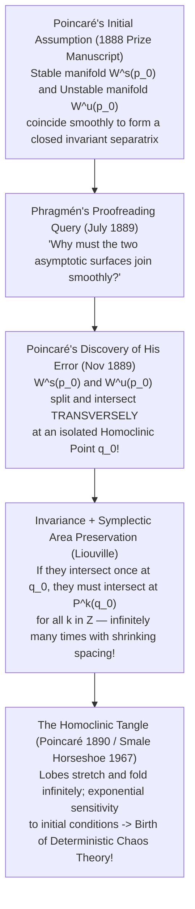

## 1. Introduction: The Curse of the Third Star in a Clockwork Universe

In 1687, Sir Isaac Newton published his monumental *Philosophiæ Naturalis Principia Mathematica* (*Principia*), fundamentally transforming humanity's comprehension of the cosmos. By demonstrating that the terrestrial force pulling an apple to the ground and the celestial force tethering the Moon to its orbit obey the exact same inverse-square law of universal gravitation, Newton achieved a triumph of analytical reasoning: he completely solved the <strong>Two-Body Problem</strong>—the motion of two point masses interacting solely through mutual gravity.

From Newton's geometric and analytical derivations emerged a rigorous proof of Johannes Kepler's three empirical laws of planetary motion. Given the initial positions and velocities of two gravitating bodies, their future (and past) trajectories are determined for all eternity in closed elementary form as <strong>conic sections</strong>—ellipses, parabolas, or hyperbolas. This triumph inspired Pierre-Simon Laplace in 1814 to articulate his famous vision of scientific determinism ("Laplace's Demon"): an intellect that knew the exact positions and momenta of every particle in the universe at a single instant could embrace in a single formula the movements of the greatest celestial bodies and the lightest atoms; nothing would be uncertain, and both the future and the past would be present before its eyes.

Yet a formidable abyss stood right at Newton's feet. When Newton attempted to account for the motion of the Moon under the simultaneous gravitational pull of both the Earth and the Sun—transitioning from $N=2$ bodies to just $N=3$ bodies—his analytical machinery ground to a halt. Newton later confessed to the astronomer John Machin that *"his head never ached but when he was studying the lunar theory."* Moving from the Two-Body Problem to the <strong>Three-Body Problem</strong> by adding a single gravitational actor shatters closed-form integrability, rendering it fundamentally impossible to express the general trajectory in terms of elementary functions or algebraic quadratures.

Why does a system of two stars yield to first-year university calculus, whereas adding a third star baffled the greatest mathematical minds for over three centuries? The barrier is not merely computational complexity. Rather, it stems from a profound structural deficit in <strong>Hamiltonian phase-space dimensionality versus conserved quantities (first integrals)</strong>, and from the intricate geometry of <strong>non-integrability and deterministic chaos</strong> uncovered by Henri Poincaré at the close of the nineteenth century.

In this comprehensive mathematical treatise, we dissect the Three-Body Problem across five foundational pillars:

1. <strong>Complete Integrability of the Two-Body Problem vs. the Dimensional Wall of Three Bodies</strong>: Liouville-Arnold integrability in Hamiltonian mechanics, the 10 classical algebraic integrals of motion, superintegrability via the Laplace-Runge-Lenz vector, the theorems of Bruns (1887) and Poincaré (1889), and the physical futility of Sundman's $t^{1/3}$ convergent power series (1912).
2. <strong>The Circular Restricted Three-Body Problem (CR3BP) and Euler-Lagrange Equilibrium Points ($L_1$–$L_5$)</strong>: The co-rotating synodic frame, the effective pseudo-potential $\Omega(x,y,z)$, the Jacobi integral and Zero-Velocity Curves (Hill's regions), the saddle-center instability of the collinear points ($L_1, L_2, L_3$) that hosts the <strong>James Webb Space Telescope (JWST)</strong> in a halo orbit, and the gyroscopic Coriolis stabilization of the equilateral triangle points ($L_4, L_5$) governed by <strong>Routh's critical mass ratio</strong> ($\mu < 0.03852$, explaining Jupiter's Trojan asteroids).
3. <strong>King Oscar II's 1889 Prize Competition and Henri Poincaré's Fateful Error</strong>: How Lars Edvard Phragmén spotted a gap in Poincaré's prize-winning memoir, forcing Poincaré to recall the printed issue of *Acta Mathematica* at his own expense and leading to the discovery of <strong>transverse homoclinic intersections (the Homoclinic Tangle)</strong>—the birth of chaos theory.
4. <strong>Modern Variational Miracles: The Figure-Eight Choreography</strong>: How Cristopher Moore (1993) and Alain Chenciner & Richard Montgomery (2000) broke a two-century drought by proving the existence of the stable equal-mass Figure-Eight orbit via action minimization on the shape sphere, sparking the discovery of thousands of new periodic families.
5. <strong>The Kolmogorov-Arnold-Moser (KAM) Theorem and the Fate of the Solar System</strong>: Overcoming the 200-year-old "Small Divisors Problem" via Diophantine frequency conditions, the survival of Cantor-set invariant tori, Arnold diffusion in high dimensions, and Jacques Laskar's multi-billion-year numerical integrations revealing our Solar System's <strong>Lyapunov time of $\sim 5\text{ million years}$</strong> and the $1\%$ risk of a catastrophic Mercurian orbital instability.

---

## 2. Complete Integrability of the Two-Body Problem vs. The Phase-Space Wall of Three Bodies

### 2.1 Equations of Motion and Hamiltonian Formulation of the $N$-Body Problem

Consider $N$ point masses $m_1, m_2, \dots, m_N$ moving in three-dimensional inertial Euclidean space $\mathbb{R}^3$ at position vectors $\mathbf{r}_i = (x_i, y_i, z_i)^T \in \mathbb{R}^3$ ($i = 1, \dots, N$). Interacting solely via Newtonian universal gravitation with constant $G$, the equations of motion form a coupled system of $3N$ second-order nonlinear ordinary differential equations (ODEs):

$$m_i \frac{d^2 \mathbf{r}_i}{dt^2} = \sum_{\substack{j=1 \\ j \ne i}}^{N} \frac{G m_i m_j (\mathbf{r}_j - \mathbf{r}_i)}{\|\mathbf{r}_j - \mathbf{r}_i\|^3} \qquad (i = 1, 2, \dots, N)$$

To analyze the structural solvability of this system, we cast it into <strong>Hamiltonian mechanics</strong>. Defining canonical coordinates $\mathbf{q} = (\mathbf{r}_1, \dots, \mathbf{r}_N) \in \mathbb{R}^{3N}$ and conjugate linear momenta $\mathbf{p} = (\mathbf{p}_1, \dots, \mathbf{p}_N) \in \mathbb{R}^{3N}$ where $\mathbf{p}_i = m_i \dot{\mathbf{r}}_i$, the total mechanical energy is given by the autonomous Hamiltonian function $H(\mathbf{q}, \mathbf{p}) = T(\mathbf{p}) + V(\mathbf{q})$:

$$H(\mathbf{q}, \mathbf{p}) = \sum_{i=1}^{N} \frac{\|\mathbf{p}_i\|^2}{2m_i} - \sum_{1 \le i < j \le N} \frac{G m_i m_j}{\|\mathbf{r}_i - \mathbf{r}_j\|}$$

The $3N$ second-order equations are thereby transformed into $6N$ first-order Hamilton's canonical equations on a <strong>$6N$-dimensional phase space</strong> $M = T^*(\mathbb{R}^{3N} \setminus \Delta)$ (where $\Delta = \{\mathbf{q} \mid \mathbf{r}_i = \mathbf{r}_j \text{ for some } i \ne j\}$ denotes the collision singularity set):

$$\frac{d\mathbf{r}_i}{dt} = \frac{\partial H}{\partial \mathbf{p}_i} = \frac{\mathbf{p}_i}{m_i}, \qquad \frac{d\mathbf{p}_i}{dt} = -\frac{\partial H}{\partial \mathbf{r}_i} = -\frac{\partial V}{\partial \mathbf{r}_i} \qquad (i = 1, \dots, N)$$

Equipped with the canonical symplectic 2-form $\omega = \sum_{i=1}^N d\mathbf{r}_i \wedge d\mathbf{p}_i$, the time evolution of any smooth observable $F(\mathbf{q}, \mathbf{p}, t)$ along the Hamiltonian flow is governed by the <strong>Poisson bracket</strong>:

$$\frac{dF}{dt} = \frac{\partial F}{\partial t} + \{F, H\}, \qquad \{F, G\} \equiv \sum_{i=1}^{N} \sum_{\alpha \in \{x,y,z\}} \left( \frac{\partial F}{\partial q_{i,\alpha}} \frac{\partial G}{\partial p_{i,\alpha}} - \frac{\partial F}{\partial p_{i,\alpha}} \frac{\partial G}{\partial q_{i,\alpha}} \right)$$

A time-independent function $I(\mathbf{q}, \mathbf{p})$ is a <strong>first integral (constant of motion)</strong> if and only if it commutes with the Hamiltonian under the Poisson bracket: $\{I, H\} = 0$.

### 2.2 The Liouville-Arnold Theorem and the 10 Classical Integrals of Motion

What does it mean for a Hamiltonian system to be "solvable in closed form" (integrable by quadratures)?
For a general unstructured system of $2n$ first-order ODEs, reducing the integration to explicit quadratures requires knowing $2n$ independent constants of motion. However, because Hamiltonian systems preserve the symplectic structure $\omega$, Joseph Liouville (1855) and Vladimir Arnold (1963) proved that <strong>only half as many ($n$) first integrals are required</strong>, provided they mutually commute!

> <strong>Theorem (Liouville-Arnold Integrability Theorem)</strong>:
> An autonomous Hamiltonian system with $n$ degrees of freedom (meaning a <strong>$2n$-dimensional phase space</strong>) is <strong>completely integrable by quadratures</strong> if there exist $n$ functionally independent first integrals $F_1 (= H), F_2, \dots, F_n$ that are mutually <strong>in involution</strong>:
> $$\{F_i, F_j\} = 0 \qquad \forall \, i, j \in \{1, 2, \dots, n\}$$
> If the regular level set $M_{\mathbf{f}} = \{(\mathbf{q}, \mathbf{p}) \mid F_i(\mathbf{q}, \mathbf{p}) = f_i\}$ is connected and compact, it is diffeomorphic to an $n$-dimensional <strong>invariant torus</strong> $\mathbb{T}^n = (S^1)^n$. Moreover, one can construct canonical <strong>action-angle coordinates</strong> $(\mathbf{I}, \boldsymbol{\theta}) \in \mathbb{R}^n \times \mathbb{T}^n$ in which the Hamiltonian depends solely on the actions, $H = H(\mathbf{I})$, so that the equations of motion become linear with constant frequencies:
> $$\dot{\mathbf{I}} = -\frac{\partial H}{\partial \boldsymbol{\theta}} = \mathbf{0}, \qquad \dot{\boldsymbol{\theta}} = \frac{\partial H}{\partial \mathbf{I}} = \boldsymbol{\omega}(\mathbf{I}) \implies \boldsymbol{\theta}(t) = \boldsymbol{\theta}_0 + \boldsymbol{\omega}(\mathbf{I}) t \pmod{2\pi}$$

By Noether's Theorem, the fundamental symmetries of three-dimensional Euclidean space and time under the Galilean group guarantee <strong>10 classical algebraic integrals of motion</strong> for *any* gravitational $N$-body system ($N \ge 2$):

1. <strong>Conservation of Total Linear Momentum (3 integrals) and Uniform Center-of-Mass Motion (3 integrals) = 6 reductions</strong>:
   Translational invariance of $V(\mathbf{q})$ implies conservation of total momentum $\mathbf{P} \in \mathbb{R}^3$:
   $$\mathbf{P} = \sum_{i=1}^{N} \mathbf{p}_i = \text{const.} \quad (3\text{ components: } P_x, P_y, P_z)$$
   Defining the total mass $M = \sum_{i=1}^N m_i$ and the center of mass (barycenter) $\mathbf{R}_{\text{CM}} = \frac{1}{M}\sum_{i=1}^N m_i \mathbf{r}_i$, integrating $\dot{\mathbf{R}}_{\text{CM}} = \mathbf{P}/M$ yields 3 additional Galilean boost integrals:
   $$\mathbf{G}_{\text{CM}} = M \mathbf{R}_{\text{CM}}(t) - \mathbf{P} t = \text{const.} \quad (3\text{ components: } G_x, G_y, G_z)$$
   By fixing the inertial frame at the center of mass ($\mathbf{R}_{\text{CM}} = \mathbf{0}, \mathbf{P} = \mathbf{0}$), we unconditionally eliminate <strong>6 phase-space dimensions</strong> (3 degrees of freedom), reducing the phase space from $6N$ to $6N - 6$.
2. <strong>Conservation of Total Angular Momentum (3 integrals)</strong>:
   Rotational invariance ($SO(3)$ symmetry) implies conservation of the total angular momentum vector $\mathbf{L} \in \mathbb{R}^3$:
   $$\mathbf{L} = \sum_{i=1}^{N} \mathbf{r}_i \times \mathbf{p}_i = \text{const.} \quad (3\text{ components: } L_x, L_y, L_z)$$
   Crucially, the three components of $\mathbf{L}$ do *not* mutually commute: they satisfy the $\mathfrak{so}(3)$ Lie algebra relations $\{L_x, L_y\} = L_z$, $\{L_y, L_z\} = L_x$, $\{L_z, L_x\} = L_y$. From $\mathbf{L}$, one can extract exactly <strong>two commuting integrals in involution</strong>: the squared magnitude $\|\mathbf{L}\|^2 = L_x^2 + L_y^2 + L_z^2$ and one axial component $L_z$. Together with Carl Gustav Jacob Jacobi's 1842 <strong>"Elimination of the Nodes"</strong> (orienting the reference plane perpendicular to $\mathbf{L}$, the *invariable plane*, and quotienting out the $SO(2)$ rotation angle around $\mathbf{L}$), rotational symmetry reduces the phase space by <strong>4 dimensions</strong> (2 degrees of freedom).
3. <strong>Conservation of Total Mechanical Energy (1 integral)</strong>:
   Time-translation invariance ($\partial H / \partial t = 0$) yields energy conservation:
   $$H(\mathbf{q}, \mathbf{p}) = E = \text{const.} \quad (1\text{ integral})$$

Summing these up gives $6 + 3 + 1 = \mathbf{10}$ <strong>classical algebraic integrals of motion</strong>.

### 2.3 Degree-of-Freedom Accounting: Why $N=2$ Succeeds and $N=3$ Fails

Let us now perform an exact degree-of-freedom audit comparing $N=2$ and $N=3$.

```mermaid
flowchart TD
    subgraph TwoBody["The Two-Body Problem (N = 2): 12D Phase Space (6 DOF)"]
        TB1["Initial Phase Space: 6 × 2 = 12 Dimensions (n = 6 DOF)"] --> TB2["Center-of-Mass Reduction (6 Integrals: R_CM, P)<br/>12 - 6 = 6D Relative Phase Space (n_rel = 3 DOF)"]
        TB2 --> TB3["Relative Hamiltonian System (3 DOF)<br/>Possesses 3 Commuting Integrals: H_rel, |L|^2, L_z"]
        TB3 --> TB4["Liouville-Arnold Integrability Condition Met (3 = 3)!<br/>Plus Laplace-Runge-Lenz Vector A -> Maximally Superintegrable"]
        TB4 --> TB5["Exact Closed-Form Quadrature Solution:<br/>Keplerian Conic Sections (Ellipse, Parabola, Hyperbola)"]
    end

    subgraph ThreeBody["The Three-Body Problem (N = 3): 18D Phase Space (9 DOF)"]
        THB1["Initial Phase Space: 6 × 3 = 18 Dimensions (n = 9 DOF)"] --> THB2["Jacobi Coordinate CoM Reduction (6 Integrals)<br/>18 - 6 = 12D Relative Phase Space (n_rel = 6 DOF)"]
        THB2 --> THB3["Angular Momentum L & Jacobi Elimination of Nodes (-4D)<br/>+ Energy Surface H = E & Time Elimination (-2D)"]
        THB3 --> THB4["For n_rel = 6 DOF, only 3 Commuting Integrals exist:<br/>H_rel, |L|^2, L_z (3 < 6 -> Deficit of 3 Integrals!)"]
        THB4 --> THB5["6D–8D Unreduced Phase Space Remains!<br/>Bruns (1887) & Poincaré (1889): Non-Integrable & Chaotic"]
    end
```

#### ① Complete Integrability and Superintegrability of the Two-Body Problem ($N=2$)
For $N=2$ bodies, the full phase space has dimension $6 \times 2 = 12$ ($n = 6$ degrees of freedom).
Introducing the center-of-mass position $\mathbf{R}_{\text{CM}} = \frac{m_1 \mathbf{r}_1 + m_2 \mathbf{r}_2}{m_1 + m_2}$, the relative displacement vector $\mathbf{r} = \mathbf{r}_1 - \mathbf{r}_2$, and the <strong>reduced mass</strong> $\mu_{\text{red}} = \frac{m_1 m_2}{m_1 + m_2}$, the 6 center-of-mass integrals decouple the trivial barycentric drift, leaving a <strong>6-dimensional relative phase space</strong> with <strong>$n_{\text{rel}} = 3$ degrees of freedom</strong> governed by the Kepler Hamiltonian:

$$H_{\text{rel}}(\mathbf{r}, \mathbf{p}) = \frac{\|\mathbf{p}\|^2}{2\mu_{\text{red}}} - \frac{G m_1 m_2}{\|\mathbf{r}\|}$$

To satisfy the Liouville-Arnold theorem for $n_{\text{rel}} = 3$ degrees of freedom, we need <strong>3 functionally independent commuting first integrals</strong>. And we possess precisely three:

$$F_1 = H_{\text{rel}}, \qquad F_2 = \|\mathbf{L}\|^2, \qquad F_3 = L_z \qquad \text{with} \quad \{F_i, F_j\} = 0$$

Because the number of commuting integrals ($3$) matches the degrees of freedom ($3$), the Two-Body Problem is <strong>completely integrable</strong>! Confining the motion to the orbital plane orthogonal to $\mathbf{L}$ in polar coordinates $(r, \theta)$ reduces the problem to a one-dimensional radial quadrature with effective potential $V_{\text{eff}}(r) = -\frac{G m_1 m_2}{r} + \frac{\|\mathbf{L}\|^2}{2\mu_{\text{red}} r^2}$:

$$t - t_0 = \int_{r_0}^{r} \frac{dr'}{\sqrt{\frac{2}{\mu_{\text{red}}}\left(E + \frac{G m_1 m_2}{r'} - \frac{\|\mathbf{L}\|^2}{2\mu_{\text{red}} r'^2}\right)}}$$

Even more remarkably, the pure $1/r$ Newtonian potential possesses a hidden higher-dimensional dynamical symmetry—$SO(4)$ for bound orbits ($E < 0$) and $SO(3,1)$ for unbound trajectories ($E > 0$)—manifested in the conservation of the <strong>Laplace-Runge-Lenz (LRL) Vector</strong> $\mathbf{A}$:

$$\mathbf{A} = \mathbf{p} \times \mathbf{L} - \mu_{\text{red}} G m_1 m_2 \frac{\mathbf{r}}{\|\mathbf{r}\|} = \text{const.}$$

The vector $\mathbf{A}$ lies permanently in the orbital plane, points directly toward the periapsis (closest approach), and has magnitude proportional to the orbital eccentricity $e = \frac{\|\mathbf{A}\|}{\mu_{\text{red}} G m_1 m_2}$. Taking the dot product $\mathbf{r} \cdot \mathbf{A} = r \|\mathbf{A}\| \cos(\theta - \varpi) = \mathbf{r} \cdot (\mathbf{p} \times \mathbf{L}) - \mu_{\text{red}} G m_1 m_2 r = \|\mathbf{L}\|^2 - \mu_{\text{red}} G m_1 m_2 r$ immediately yields the exact conic-section trajectory without integrating a single differential equation:

$$r(\theta) = \frac{p}{1 + e \cos(\theta - \varpi)}, \qquad p = \frac{\|\mathbf{L}\|^2}{\mu_{\text{red}}^2 G(m_1 + m_2)}$$

Because the 3-DOF relative Kepler problem possesses $2n_{\text{rel}} - 1 = 5$ functionally independent constants of motion (among the 7 components of $H_{\text{rel}}, \mathbf{L}, \mathbf{A}$, linked by the two identities $\mathbf{L} \cdot \mathbf{A} = 0$ and $\|\mathbf{A}\|^2 = 2\mu_{\text{red}} H_{\text{rel}} \|\mathbf{L}\|^2 + (\mu_{\text{red}} G m_1 m_2)^2$), it is <strong>maximally superintegrable</strong>. Every bounded trajectory closes perfectly into a periodic ellipse that never precesses.

#### ② Dimensional Collapse in the Three-Body Problem ($N=3$) and Non-Integrability Theorems
Now add a third mass $m_3$. The full phase space jumps to <strong>$6 \times 3 = 18$ dimensions ($n = 9$ degrees of freedom)</strong>.
We introduce hierarchical <strong>Jacobi coordinates</strong> $(\boldsymbol{\rho}_1, \boldsymbol{\rho}_2, \mathbf{R}_{\text{CM}})$:

$$\boldsymbol{\rho}_1 = \mathbf{r}_2 - \mathbf{r}_1, \qquad \boldsymbol{\rho}_2 = \mathbf{r}_3 - \frac{m_1 \mathbf{r}_1 + m_2 \mathbf{r}_2}{m_1 + m_2}, \qquad \mathbf{R}_{\text{CM}} = \frac{m_1 \mathbf{r}_1 + m_2 \mathbf{r}_2 + m_3 \mathbf{r}_3}{m_1 + m_2 + m_3}$$

Eliminating the 6 center-of-mass coordinates $(\mathbf{R}_{\text{CM}}, \mathbf{P})$ reduces the phase space from $18$ dimensions to a <strong>12-dimensional relative phase space</strong> with <strong>$n_{\text{rel}} = 6$ degrees of freedom</strong>.
By the Liouville-Arnold theorem, integrating this $6$-DOF relative Hamiltonian system requires <strong>6 mutually commuting first integrals</strong>. Yet the remaining classical conservation laws provide only <strong>3 commuting integrals</strong>:

$$F_1 = H_{\text{rel}}, \qquad F_2 = \|\mathbf{L}\|^2, \qquad F_3 = L_z$$

Even after applying Jacobi's elimination of the nodes (which uses the full $SO(3)$ angular momentum reduction to remove 4 phase-space dimensions, dropping the system from 12D to an 8D reduced symplectic phase space of 4 DOF) and restricting to a fixed 7D energy hypersurface $H_{\text{rel}} = E$ (or eliminating time via an angular variable to reach a 6D flow), we are left with an <strong>irreducible 8-dimensional symplectic phase space (or 7D energy manifold)</strong> and <strong>zero remaining integrals</strong>! Out of 18 original dimensions, the 10 classical integrals leave <strong>8 phase-space dimensions</strong> completely unconstrained.

| Property / Metric | Two-Body Problem ($N=2$) | General Three-Body Problem ($N=3$) | Planar Circular Restricted 3-Body (PCR3BP) |
| :--- | :--- | :--- | :--- |
| <strong>Full Phase-Space Dimension ($6N$)</strong> | $12$ dimensions ($6$ DOF) | $18$ dimensions ($9$ DOF) | $4$ dimensions (test mass only, $2$ DOF) |
| <strong>Relative Phase Space (Post-CoM)</strong> | $6$ dimensions ($n_{\text{rel}} = 3$ DOF) | $12$ dimensions ($n_{\text{rel}} = 6$ DOF) | $4$ dimensions ($n = 2$ DOF in synodic frame) |
| <strong>Total Classical First Integrals</strong> | $10$ (plus LRL vector $\mathbf{A}$) | $10$ ($6\text{ CoM} + 3\text{ Ang. Mom.} + 1\text{ Energy}$) | $1$ (Jacobi Constant $C_J$ only) |
| <strong>Commuting Integrals Required vs. Found</strong> | Need $3$, Have $3$ ($+2$ superintegrable) | Need $6$, Have $3$ (<strong>Deficit of $3$!</strong>) | Need $2$, Have $1$ (<strong>Deficit of $1$!</strong>) |
| <strong>Remaining Symplectic / Flow Dimension</strong> | $0$ (reduces to 1D quadrature) | $8\text{D}$ symplectic ($7\text{D}$ energy manifold) | $3\text{D}$ energy manifold ($2\text{D}$ Poincaré map) |
| <strong>Dynamical Regime</strong> | Maximally Superintegrable (Conics) | <strong>Non-Integrable</strong> (Homoclinic Chaos) | <strong>Non-Integrable</strong> (Mixed KAM Tori & Chaos) |

For over a century, mathematicians searched for hidden eleventh, twelfth, and thirteenth integrals of motion. That quest was definitively ended by two landmark impossibility theorems:

* <strong>Bruns's Theorem (Heinrich Bruns, 1887)</strong>: In the general Newtonian three-body problem, there exist <strong>no other independent algebraic first integrals</strong> (functions algebraic in the Cartesian positions and momenta) beyond the 10 classical integrals of motion. (Paul Painlevé extended this in 1898 to integrals rational or algebraic in the velocities alone.)
* <strong>Poincaré's Non-Integrability Theorem (Henri Poincaré, 1889/1892)</strong>: In the restricted three-body problem with mass ratio $\mu$, there exists <strong>no new first integral $F(\mathbf{I}, \boldsymbol{\theta}, \mu)$ that is analytic</strong> in the action-angle variables and the perturbation parameter $\mu$ independent of the Hamiltonian (Jacobi constant).

> [!NOTE]
> <strong>Did Karl Sundman "Solve" the Three-Body Problem in 1912? The $10^{8,000,000}$-Term Trap</strong>
> In 1912, the Finnish mathematician <strong>Karl Frithiof Sundman</strong> proved a remarkable theorem: provided the total angular momentum is non-zero ($\mathbf{L} \ne \mathbf{0}$, which rules out simultaneous triple collisions by Sundman's inequality), one can regularize all binary collisions via a non-linear time transformation $dt = r\,d\tau$ (scaling locally as $t^{1/3}$, related to Levi-Civita regularization) and apply a conformal mapping $w = \frac{e^{\pi s / 2\omega} - 1}{e^{\pi s / 2\omega} + 1}$ from a complex strip containing the real time axis into the unit disk $|w| < 1$. This yields a <strong>convergent power series in $w$ valid for all real time $t \in (-\infty, +\infty)$</strong>! (In 1991, Qiu-Dong Wang generalized this to the $N$-body problem.)
> Why, then, do physicists and astronomers never use Sundman's series? In 1930, the French astronomer <strong>David Beloriszky</strong> investigated the convergence rate of Sundman's series for typical astronomical configurations. Because the strip width $\omega$ is minuscule and the conformal mapping severely compresses time near the boundary of the unit disk, Beloriszky proved that computing the position of a body over just <strong>one single orbital period</strong> to standard astronomical precision requires summing at least <strong>$10^{8,000,000}$ terms</strong> (a $1$ followed by eight million zeros)! Since the entire observable universe contains only $\sim 10^{80}$ atoms, evaluating Sundman's series is physically impossible. An analytical power series whose convergence is logarithmically crippled offers zero physical predictability.

---

## 3. Islands of Order in the Storm: The Circular Restricted Three-Body Problem (CR3BP) and Euler-Lagrange Points ($L_1$–$L_5$)

Although the general Three-Body Problem resists closed-form integration, Leonhard Euler (1767) and Joseph-Louis Lagrange (1772) discovered exact geometric equilibrium configurations in which three bodies maintain a rigid relative shape throughout their orbital motion.

### 3.1 Formulation of the CR3BP, the Effective Potential, and the Jacobi Integral

In many astronomical settings—such as a spacecraft moving in the Earth-Moon or Sun-Earth system, or an asteroid moving in the Sun-Jupiter system—the third mass $m_3$ is infinitesimal compared to the two primary masses $m_1 \ge m_2$ ($m_3 \to 0$). When $m_1$ and $m_2$ revolve around their common barycenter in <strong>circular Keplerian orbits</strong> of constant separation $a$ and uniform angular velocity $\omega = \sqrt{G(m_1 + m_2)/a^3}$, the system is called the <strong>Circular Restricted Three-Body Problem (CR3BP)</strong>.

We adopt standard <strong>dimensionless canonical units</strong>:
* <strong>Mass normalization</strong>: Set $m_1 + m_2 = 1$ and define the dimensionless mass parameter $\mu$:
  $$\mu \equiv \frac{m_2}{m_1 + m_2} \in \left(0, \frac{1}{2}\right] \implies m_1 = 1 - \mu, \quad m_2 = \mu$$
* <strong>Length normalization</strong>: Set the separation between the primaries to $a = 1$.
* <strong>Time normalization</strong>: Choose the unit of time such that $\omega = 1$ (so $G(m_1 + m_2) = 1$ and one orbital period is $T = 2\pi$).

We now transform from the inertial frame to a <strong>co-rotating (synodic) Cartesian frame $(x, y, z)$</strong> rotating with angular velocity $\boldsymbol{\omega} = (0, 0, 1)^T$ around the $z$-axis, with the origin at the barycenter and the $x$-axis passing permanently through both primaries:
* <strong>Primary 1 (mass $1 - \mu$) is fixed at</strong>: $(x_1, y_1, z_1) = (-\mu, 0, 0)$
* <strong>Primary 2 (mass $\mu$) is fixed at</strong>: $(x_2, y_2, z_2) = (1 - \mu, 0, 0)$

The distances from the infinitesimal test particle at $(x, y, z)$ to the two primaries are:

$$r_1 = \sqrt{(x + \mu)^2 + y^2 + z^2}, \qquad r_2 = \sqrt{(x - 1 + \mu)^2 + y^2 + z^2}$$

In the rotating synodic frame, the test particle experiences Newtonian gravity from both primaries plus two inertial fictitious forces: the <strong>centrifugal force</strong> $-\boldsymbol{\omega} \times (\boldsymbol{\omega} \times \mathbf{r}) = (x, y, 0)^T$ and the velocity-dependent <strong>Coriolis force</strong> $-2\boldsymbol{\omega} \times \dot{\mathbf{r}} = (2\dot{y}, -2\dot{x}, 0)^T$. Defining the <strong>Effective Potential (Pseudo-Potential) $\Omega(x, y, z)$</strong> (using the celestial mechanics sign convention where forces are $+\nabla \Omega$):

$$\Omega(x, y, z) \equiv \frac{1}{2}(x^2 + y^2) + \frac{1 - \mu}{r_1} + \frac{\mu}{r_2}$$

the equations of motion in the CR3BP take the compact form:

$$\ddot{x} - 2\dot{y} = \frac{\partial \Omega}{\partial x}, \qquad \ddot{y} + 2\dot{x} = \frac{\partial \Omega}{\partial y}, \qquad \ddot{z} = \frac{\partial \Omega}{\partial z}$$

Multiplying these three equations by $\dot{x}, \dot{y}, \dot{z}$ respectively and summing them, the Coriolis terms $-2\dot{x}\dot{y} + 2\dot{y}\dot{x} = 0$ cancel identically (because the Coriolis force is always orthogonal to the relative velocity and performs zero mechanical work!). Integrating with respect to time yields the <strong>Jacobi Integral (Jacobi Constant $C_J$)</strong>, discovered by Carl Gustav Jacob Jacobi in 1836:

$$C_J \equiv 2\Omega(x, y, z) - (\dot{x}^2 + \dot{y}^2 + \dot{z}^2) = (x^2 + y^2) + \frac{2(1 - \mu)}{r_1} + \frac{2\mu}{r_2} - v_{\text{rot}}^2 = \text{const.}$$

The Jacobi constant $C_J = -2H_{\text{syn}}$ is the <strong>sole conserved first integral</strong> of the CR3BP. Because the squared speed in the rotating frame $v_{\text{rot}}^2 = \dot{x}^2 + \dot{y}^2 + \dot{z}^2 = 2\Omega(x, y, z) - C_J$ must be non-negative ($v_{\text{rot}}^2 \ge 0$), a particle with Jacobi constant $C_J$ is rigorously confined to <strong>Hill's Region</strong>:

$$\mathcal{H}(C_J) = \{(x, y, z) \in \mathbb{R}^3 \mid 2\Omega(x, y, z) \ge C_J\}$$

The boundary $2\Omega(x, y, z) = C_J$ where $v_{\text{rot}} = 0$ defines the <strong>Zero-Velocity Surfaces (Zero-Velocity Curves / ZVCs in the $(x,y)$ plane)</strong> introduced by George William Hill in 1878 to prove that the Moon is gravitationally bound to the Earth and cannot escape to infinity! As $C_J$ decreases (meaning the particle's energy increases), bottlenecks in the Zero-Velocity Curves open up sequentially at five critical stationary points of $\Omega(x, y, z)$: the <strong>five Lagrange points $L_1, L_2, L_3, L_4, L_5$</strong>.

### 3.2 Derivation of Euler's Three Collinear Points ($L_1, L_2, L_3$)

Equilibrium points in the rotating frame satisfy $\dot{x} = \dot{y} = \dot{z} = 0$ and $\ddot{x} = \ddot{y} = \ddot{z} = 0$, which corresponds to critical points of the effective potential:

$$\nabla \Omega(x, y, z) = \mathbf{0} \iff \frac{\partial \Omega}{\partial x} = 0, \quad \frac{\partial \Omega}{\partial y} = 0, \quad \frac{\partial \Omega}{\partial z} = 0$$

From $\frac{\partial \Omega}{\partial z} = -z\left(\frac{1-\mu}{r_1^3} + \frac{\mu}{r_2^3}\right) = 0$, every equilibrium point must lie strictly in the orbital plane (<strong>$z = 0$</strong>).

In 1767, Leonhard Euler investigated equilibria lying along the line connecting the two primaries (<strong>$y = 0, z = 0$</strong>). Along the $x$-axis, $\frac{\partial \Omega}{\partial y} = 0$ holds trivially, and $\frac{\partial \Omega}{\partial x} = 0$ yields the fifth-degree algebraic equation:

$$f(x) = x - \frac{(1 - \mu)(x + \mu)}{|x + \mu|^3} - \frac{\mu(x - 1 + \mu)}{|x - 1 + \mu|^3} = 0$$

The singularities at $x_1 = -\mu$ and $x_2 = 1 - \mu$ partition the real axis into three open intervals: $(-\infty, -\mu)$, $(-\mu, 1-\mu)$, and $(1-\mu, +\infty)$. Within each interval, the derivative is strictly positive:

$$f'(x) = 1 + \frac{2(1 - \mu)}{|x + \mu|^3} + \frac{2\mu}{|x - 1 + \mu|^3} > 0$$

Since $f(x)$ is strictly monotonically increasing on each interval and ranges from $-\infty$ to $+\infty$ between its endpoints, the Intermediate Value Theorem guarantees <strong>exactly one unique real root in each of the three intervals</strong>:

1. <strong>$L_1$ (Between Primary 1 and Primary 2: $-\mu < x < 1 - \mu$)</strong>:
   Setting $x = (1 - \mu) - \xi$ where $\xi = r_2 \ll 1$ for small mass ratio $\mu \ll 1$, expansion of the quintic equation yields $3\xi^3 \approx \mu$, defining the <strong>Hill Sphere Radius</strong>:
   $$r_2(L_1) = a \left(\frac{\mu}{3}\right)^{1/3} \left[1 - \frac{1}{3}\left(\frac{\mu}{3}\right)^{1/3} - \frac{1}{9}\left(\frac{\mu}{3}\right)^{2/3} + \mathcal{O}(\mu)\right]$$
   For the Sun-Earth system ($\mu \approx 3.003 \times 10^{-6}$, $a \approx 1.496 \times 10^8\text{ km}$), $L_1$ sits approximately <strong>$1.5\text{ million km}$ ($0.01\text{ AU}$) sunward of the Earth</strong>. Here, Earth's outward gravitational pull partially cancels the Sun's inward pull, lengthening the orbital period of a closer orbit so that it matches Earth's 1-year period.
2. <strong>$L_2$ (Beyond Primary 2: $x > 1 - \mu$)</strong>:
   Setting $x = (1 - \mu) + \xi$, asymptotic expansion for $\mu \ll 1$ yields:
   $$r_2(L_2) = a \left(\frac{\mu}{3}\right)^{1/3} \left[1 + \frac{1}{3}\left(\frac{\mu}{3}\right)^{1/3} - \frac{1}{9}\left(\frac{\mu}{3}\right)^{2/3} + \mathcal{O}(\mu)\right]$$
   For the Sun-Earth system, $L_2$ lies <strong>$1.5\text{ million km}$ anti-sunward of the Earth</strong>. Here, the gravitational pulls of the Sun and Earth add constructively, providing the extra centripetal acceleration needed for an exterior body to orbit at Earth's faster angular speed.
3. <strong>$L_3$ (Behind Primary 1: $x < -\mu$)</strong>:
   Located on the far side of the primary star opposite the planet, expansion for $\mu \ll 1$ gives:
   $$x(L_3) = -1 - \frac{5}{12}\mu + \frac{1127}{20736}\mu^3 + \mathcal{O}(\mu^4)$$

### 3.3 Derivation of Lagrange's Two Equilateral Triangle Points ($L_4, L_5$)

In 1772, Joseph-Louis Lagrange sought off-axis equilibria with $y \ne 0, z = 0$. We can derive them with breathtaking elegance by expressing $\Omega$ directly in terms of the bipolar distances $(r_1, r_2)$. Using the geometric identity $(1 - \mu)r_1^2 + \mu r_2^2 = x^2 + y^2 + \mu(1 - \mu)$, the effective potential $\Omega(x, y, 0)$ becomes:

$$\Omega(r_1, r_2) = \frac{1 - \mu}{2}\left(r_1^2 + \frac{2}{r_1}\right) + \frac{\mu}{2}\left(r_2^2 + \frac{2}{r_2}\right) - \frac{1}{2}\mu(1 - \mu)$$

Because the Jacobian of the coordinate transformation $(x, y) \mapsto (r_1, r_2)$ is non-singular whenever $y \ne 0$, the equilibrium condition $\nabla_{x,y}\Omega = \mathbf{0}$ is strictly equivalent to $\frac{\partial \Omega}{\partial r_1} = 0$ and $\frac{\partial \Omega}{\partial r_2} = 0$:

$$\frac{\partial \Omega}{\partial r_1} = (1 - \mu)\left(r_1 - \frac{1}{r_1^2}\right) = 0 \implies r_1 = 1$$

$$\frac{\partial \Omega}{\partial r_2} = \mu\left(r_2 - \frac{1}{r_2^2}\right) = 0 \implies r_2 = 1$$

Independent of the mass ratio $\mu$, the unique off-axis solutions occur at <strong>$r_1 = 1$ and $r_2 = 1$</strong>! Since the separation between the two primaries is also $a = 1$, the third body and the two primaries form the vertices of two exact <strong>equilateral triangles</strong> in the orbital plane, $60^\circ$ ahead of ($L_4$) and $60^\circ$ behind ($L_5$) the secondary mass $m_2$:

$$L_4 = \left(\frac{1}{2} - \mu, \; +\frac{\sqrt{3}}{2}, \; 0\right), \qquad L_5 = \left(\frac{1}{2} - \mu, \; -\frac{\sqrt{3}}{2}, \; 0\right)$$

### 3.4 Linear Stability Analysis: Halo Orbits at $L_2$, Gyroscopic Coriolis Trapping at $L_4/L_5$, and Routh's Criterion

To determine whether an equilibrium point $(x_0, y_0, 0)$ can trap celestial bodies or spacecraft, we linearize the equations of motion for small perturbations $(\xi, \eta, \zeta) = (x - x_0, y - y_0, z)$. The out-of-plane vertical equation decouples completely:

$$\ddot{\zeta} = \Omega_{zz}\zeta = -\left(\frac{1 - \mu}{r_{10}^3} + \frac{\mu}{r_{20}^3}\right)\zeta = -\omega_z^2 \zeta$$

which is always simple harmonic motion with frequency $\omega_z > 0$ (linearly stable in the $z$-direction). In the orbital plane, the linearized system reads:

$$\begin{pmatrix} \ddot{\xi} \\ \ddot{\eta} \end{pmatrix} + \begin{pmatrix} 0 & -2 \\ 2 & 0 \end{pmatrix} \begin{pmatrix} \dot{\xi} \\ \dot{\eta} \end{pmatrix} = \begin{pmatrix} \Omega_{xx} & \Omega_{xy} \\ \Omega_{xy} & \Omega_{yy} \end{pmatrix} \begin{pmatrix} \xi \\ \eta \end{pmatrix}$$

Substituting $(\xi, \eta)^T \propto e^{\lambda t}$ yields the fourth-degree biquadratic characteristic polynomial:

$$\lambda^4 + (4 - \Omega_{xx} - \Omega_{yy})\lambda^2 + (\Omega_{xx}\Omega_{yy} - \Omega_{xy}^2) = 0$$

Linear stability requires that all four eigenvalues $\lambda_1, \lambda_2, \lambda_3, \lambda_4$ be purely imaginary ($\lambda = \pm i\omega$), which holds if and only if both roots $\Lambda = \lambda^2$ of the quadratic equation $\Lambda^2 + (4 - \Omega_{xx} - \Omega_{yy})\Lambda + (\Omega_{xx}\Omega_{yy} - \Omega_{xy}^2) = 0$ are real and strictly negative ($\Lambda_1 < 0, \Lambda_2 < 0$).

#### ① Saddle Instability of the Collinear Points ($L_1, L_2, L_3$) and the Orbit of the James Webb Space Telescope
At $L_1, L_2, L_3$, symmetry across the $x$-axis gives $y_0 = 0 \implies \Omega_{xy} = 0$. Defining the positive quantity $A \equiv \frac{1 - \mu}{r_{10}^3} + \frac{\mu}{r_{20}^3} > 1$, the second derivatives evaluate to:

$$\Omega_{xx} = 1 + 2A > 3 > 0, \qquad \Omega_{yy} = 1 - A < 0$$

Consequently, the constant term of the characteristic equation (the Hessian determinant of $\Omega$) is strictly negative:

$$\Lambda_1 \Lambda_2 = \Omega_{xx}\Omega_{yy} = (1 + 2A)(1 - A) < 0$$

Because the product of the two roots $\Lambda_1$ and $\Lambda_2$ is negative, one root is strictly positive ($\Lambda_1 > 0$) and the other is strictly negative ($\Lambda_2 < 0$) for <strong>all</strong> values of $\mu \in (0, 1/2]$:
* $\Lambda_1 > 0 \implies \lambda_{1,2} = \pm \sigma$ (a real hyperbolic pair: an exponentially growing unstable mode $e^{+\sigma t}$ and an exponentially decaying stable mode $e^{-\sigma t}$).
* $\Lambda_2 < 0 \implies \lambda_{3,4} = \pm i\omega_{xy}$ (an imaginary elliptic pair: planar oscillatory motion, alongside the vertical $\pm i\omega_z$ oscillation).

Thus, <strong>the collinear points $L_1, L_2, L_3$ have phase-space topological type $\text{Saddle} \times \text{Center} \times \text{Center}$ and are unconditionally linearly unstable</strong>!

Why, then, do space agencies place flagship observatories like the <strong>James Webb Space Telescope (JWST)</strong>, <strong>Gaia</strong>, <strong>Euclid</strong>, and <strong>Planck</strong> at Sun-Earth $L_2$, and solar observatories like <strong>SOHO</strong> and <strong>DSCOVR</strong> at Sun-Earth $L_1$?
1. <strong>Center Manifold, Lissajous Orbits, and Halo Orbits</strong>:
   Although the 2D hyperbolic subspace ($\pm \sigma$) is unstable, the remaining 4D subspace ($\pm i\omega_{xy}, \pm i\omega_z$) forms a <strong>4-dimensional center manifold</strong>. By strictly zeroing out the initial projection onto the unstable eigenvector, a spacecraft moves on quasi-periodic 3D <strong>Lissajous orbits</strong> around the empty point $L_1$ or $L_2$. When the orbital amplitude is large enough (hundreds of thousands of kilometers), nonlinear frequency shifts lock the in-plane frequency $\omega_{xy}$ and out-of-plane frequency $\omega_z$ into a $1:1$ resonance, creating a closed three-dimensional periodic <strong>Halo Orbit</strong> (first named and computed by Robert Farquhar in 1968).
2. <strong>Thermal and Power Supremacy for JWST at $L_2$</strong>:
   JWST does *not* sit stationary at the point $L_2$; it orbits around $L_2$ in a gigantic Halo orbit with a radius of $\sim 250,000\text{ to }800,000\text{ km}$ and a period of $\sim 6\text{ months}$. This sweeping Halo trajectory ensures that <strong>JWST never enters the shadow (umbra/penumbra) of the Earth or Moon</strong>, providing uninterrupted solar power and avoiding violent thermal shocks. Simultaneously, because the Sun, Earth, and Moon all remain continuously on the same side of the spacecraft, JWST's 5-layer Kapton sunshield blocks thermal radiation from all three celestial bodies at once, allowing its beryllium mirrors to passively cool to $< 40\text{ K}$ ($-233^\circ\text{C}$).
3. <strong>Minimal Station-Keeping and the Interplanetary Superhighway</strong>:
   At Sun-Earth $L_2$, the hyperbolic eigenvalue is $\sigma \approx 2.50$ (in dimensionless units), corresponding to an e-folding instability timescale of $1/\sigma \approx 23\text{ days}$. By firing thrusters briefly every $\sim 21\text{ days}$ to nudge the spacecraft back onto the stable manifold, JWST maintains its Halo orbit for decades using a minuscule station-keeping budget of just <strong>$\Delta v \approx 2\text{–}4\text{ m/s per year}$</strong>! Moreover, the invariant stable and unstable manifold tubes $W^{s,u}(\text{Halo})$ winding through the Solar System form the <strong>Interplanetary Superhighway (IPS)</strong>, exploited by missions such as *Genesis* and *ARTEMIS* for near-zero-fuel trajectory design.

#### ② Gyroscopic Coriolis Stabilization of $L_4, L_5$ and Routh's Critical Mass Ratio
What about the equilateral triangle points $L_4$ and $L_5$?
If we inspect the effective potential surface $\Omega(x, y)$, we encounter a delightful physical paradox: <strong>$L_4$ and $L_5$ are local maxima (mountain peaks) of $\Omega(x, y)$</strong>! On a static potential hill, a marble placed at the summit rolls downhill and escapes in every direction. Why don't asteroids at $L_4$ and $L_5$ slide down the potential hill?

The answer is <strong>gyroscopic stabilization by the Coriolis force</strong> ($-2\boldsymbol{\omega} \times \mathbf{v}$). As soon as a particle begins to slide down the potential hill from $L_4$ or $L_5$ and acquires a small velocity $\mathbf{v}$, the Coriolis force deflects it at right angles to its motion—curving its trajectory into a closed kidney-bean-shaped (tadpole or horseshoe) epicyclic orbit around the summit, exactly analogous to how a magnetic field traps charged particles in a Penning trap or how a spinning saddle stabilizes a Paul trap!

Let us determine the exact condition under which the Coriolis force is strong enough to overcome the steepness of the potential hill. Evaluating the second partial derivatives of $\Omega$ at $L_{4,5} = \left(\frac{1}{2}-\mu, \pm\frac{\sqrt{3}}{2}, 0\right)$ where $r_{10} = r_{20} = 1$:

$$\Omega_{xx} = \frac{3}{4}, \qquad \Omega_{yy} = \frac{9}{4}, \qquad \Omega_{xy} = \pm \frac{3\sqrt{3}}{4}(1 - 2\mu)$$

Substituting these into the characteristic polynomial coefficients gives:

$$4 - (\Omega_{xx} + \Omega_{yy}) = 4 - \left(\frac{3}{4} + \frac{9}{4}\right) = 1$$

$$\Omega_{xx}\Omega_{yy} - \Omega_{xy}^2 = \frac{27}{16} - \frac{27}{16}(1 - 2\mu)^2 = \frac{27}{4}\mu(1 - \mu)$$

Thus, the planar characteristic equation at $L_4$ and $L_5$ simplifies to the remarkably clean form:

$$\lambda^4 + \lambda^2 + \frac{27}{4}\mu(1 - \mu) = 0$$

Setting $\Lambda = \lambda^2$, we have $\Lambda^2 + \Lambda + \frac{27}{4}\mu(1 - \mu) = 0$, whose roots are:

$$\Lambda_{1,2} = \frac{-1 \pm \sqrt{1 - 27\mu(1 - \mu)}}{2}$$

For $L_4$ and $L_5$ to be linearly stable, $\Lambda_1$ and $\Lambda_2$ must both be real and negative (yielding four purely imaginary eigenvalues $\lambda = \pm i\omega_1, \pm i\omega_2$). Since $-1 < 0$ and $\frac{27}{4}\mu(1-\mu) > 0$, this occurs if and only if the discriminant is positive (<strong>Gascheau 1843; Routh 1875</strong>):

$$1 - 27\mu(1 - \mu) > 0 \iff \mu(1 - \mu) < \frac{1}{27}$$

Solving the quadratic inequality $27\mu^2 - 27\mu + 1 > 0$ for $\mu \in (0, 1/2]$ yields <strong>Routh's Critical Mass Parameter</strong>:

$$\mu < \mu_{\text{crit}} = \frac{1 - \sqrt{1 - 4/27}}{2} = \frac{1 - \sqrt{23/27}}{2} \approx 0.0385208965\dots$$

Expressed in terms of the primary-to-secondary mass ratio $\frac{m_1}{m_2} = \frac{1 - \mu}{\mu}$, this becomes:

$$\frac{m_1}{m_2} > \frac{1 + \sqrt{23/27}}{1 - \sqrt{23/27}} = \frac{25 + 3\sqrt{69}}{2} \approx 24.9599358\dots$$

Whenever the primary body is at least <strong>$24.96$ times more massive</strong> than the secondary body, $L_4$ and $L_5$ are linearly stable! (By the Deprit-Markeev theorem using KAM normal forms, they are also <strong>nonlinearly Lyapunov stable</strong> for all $\mu < \mu_{\text{crit}}$ except at two isolated resonant mass ratios $\mu_{1:2} \approx 0.02429$ and $\mu_{1:3} \approx 0.01352$ where $\omega_1 = 2\omega_2$ or $\omega_1 = 3\omega_2$). In the Sun-Jupiter system ($\mu \approx 0.000954 \ll 0.03852$), this gyroscopic stability has trapped over $12,000$ known <strong>Trojan Asteroids</strong> in the "Greek camp" ($L_4$) and "Trojan camp" ($L_5$) for billions of years!

| Two-Body Primary System | Mass Parameter $\mu = \frac{m_2}{m_1+m_2}$ | Mass Ratio $m_1 / m_2$ | Routh Stability ($\mu < 0.03852$) & Observational / Mission Reality |
| :--- | :--- | :--- | :--- |
| <strong>Sun – Jupiter</strong> | $9.537 \times 10^{-4}$ | $\approx 1,047.6$ | <strong>Stable</strong>: $>12,000$ <strong>Trojan Asteroids</strong> at $L_4$ & $L_5$ (explored by NASA's *Lucy* mission) |
| <strong>Sun – Earth</strong> | $3.003 \times 10^{-6}$ | $\approx 332,946$ | <strong>Stable</strong>: Earth Trojans (2010 $\text{TK}_7$, 2020 $\text{XL}_5$) at $L_4$; <strong>JWST</strong> at $L_2$; <strong>SOHO</strong> at $L_1$ |
| <strong>Earth – Moon</strong> | $1.215 \times 10^{-2}$ | $\approx 81.30$ | <strong>Stable</strong>: $81.3 > 24.96$; Kordylewski dust clouds at $L_4/L_5$; *Queqiao* relay satellite at $L_2$ |
| <strong>Pluto – Charon</strong> | $1.085 \times 10^{-1}$ | $\approx 8.22$ | <strong>Unstable</strong>: $8.22 < 24.96$; complex eigenvalues $\lambda = \pm \alpha \pm i\beta$ cause spiral ejection from $L_4/L_5$ |

---

## 4. King Oscar II's 1889 Prize Competition and Henri Poincaré's Error That Birthed Chaos Theory

### 4.1 The Royal Mathematical Competition of 1889

More than a century after Euler and Lagrange, the global behavior of the Three-Body Problem remained an impenetrable mystery. In 1885, the Swedish mathematician Gösta Mittag-Leffler, founder of the journal *Acta Mathematica*, persuaded <strong>King Oscar II of Sweden and Norway</strong>—himself a passionate patron of mathematics—to sponsor an international prize competition celebrating the King's 60th birthday on January 21, 1889. The prize jury consisted of three titans of nineteenth-century analysis: Karl Weierstrass, Charles Hermite, and Mittag-Leffler.

Question 1 of the four competition problems posed the ultimate challenge of celestial mechanics:

> <strong>Prize Question 1 (formulated by Weierstrass)</strong>:
> *"Given a system of arbitrarily many mass points that attract each other according to Newton's law, under the assumption that no two points ever collide, try to find a representation of the coordinates of each point as a series in a variable that is some known function of time and for all of whose values the series converges uniformly."*

The 34-year-old French polymath <strong>Henri Poincaré (1854–1912)</strong> submitted a monumental 160-page memoir under the Latin motto *"Nunquam praescriptos transibunt sidera fines"* ("Nothing exceeds the limit of the stars"). Realizing that pure power-series manipulation masked the qualitative geometry of phase space, Poincaré invented an entirely new arsenal of topological and geometric tools for the planar circular restricted three-body problem:
* <strong>The Poincaré Surface of Section (Return Map $P: \Sigma \to \Sigma$)</strong>: Intersecting the continuous 3D flow on an energy manifold with a transverse 2D surface $\Sigma$, converting continuous differential equations into a discrete area-preserving diffeomorphism $x_{n+1} = P(x_n)$.
* <strong>The Poincaré Recurrence Theorem (1890)</strong>: Using Liouville's theorem (invariance of phase-space volume $\int dp \wedge dq$), Poincaré proved that in any bounded Hamiltonian phase space, almost every trajectory returns arbitrarily close to its initial state infinitely many times.
* <strong>Characteristic Exponents and Asymptotic Surfaces (Stable & Unstable Manifolds)</strong>: Around an unstable hyperbolic periodic orbit $\gamma$ (a saddle fixed point $p_0$ on the Poincaré section $\Sigma$), Poincaré constructed the invariant curves of points that converge exponentially toward $p_0$ as $t \to +\infty$ (<strong>the stable manifold $W^s(p_0)$</strong>) and as $t \to -\infty$ (<strong>the unstable manifold $W^u(p_0)$</strong>).

### 4.2 Phragmén's Question, the Recall of *Acta Mathematica*, and the Homoclinic Tangle

Weierstrass and Hermite hailed Poincaré's memoir as a masterpiece that would inaugurate a new era in celestial mechanics, and King Oscar II officially awarded Poincaré the prize (2,500 Swedish kronor and a gold medal) on January 21, 1889. Printing of the memoir began in Volume 13 of *Acta Mathematica*.

Then, in July 1889, disaster—and scientific immortality—struck. A 26-year-old Swedish sub-editor at *Acta Mathematica*, <strong>Lars Edvard Phragmén</strong>, was meticulously proofreading Poincaré's manuscript and noticed a subtle gap in the proof that the series expansions for the stable and unstable asymptotic manifolds $W^s(p_0)$ and $W^u(p_0)$ converged and joined smoothly into a single closed invariant curve (a smooth separatrix, as occurs in an unperturbed integrable pendulum). Phragmén wrote politely to Poincaré asking him to clarify the step.

When Poincaré re-examined his perturbation series to answer Phragmén, he was horrified. In an unperturbed integrable system ($\mu = 0$), the unstable manifold $W^u(p_0)$ leaving a hyperbolic point $p_0$ coincides smoothly and identically with the stable manifold $W^s(p_0)$ returning to $p_0$, forming a neat closed loop (a homoclinic loop / separatrix) that partitions phase space into orderly, predictable regions. Poincaré had implicitly assumed that when a small gravitational perturbation ($\mu > 0$) is switched on, $W^u(p_0)$ and $W^s(p_0)$ continue to coincide smoothly.

Upon closer calculation (the precursor to what we now call the <strong>Poincaré-Melnikov integral</strong>), Poincaré realized that under generic perturbations, <strong>$W^u(p_0)$ and $W^s(p_0)$ split apart and intersect each other transversely at a non-zero angle!</strong>

Let us trace the inexorable geometric logic that led Poincaré from a single transverse intersection to the discovery of <strong>Deterministic Chaos</strong>:

1. <strong>Existence of a Transverse Homoclinic Point</strong>: Suppose the unstable curve $W^u(p_0)$ and stable curve $W^s(p_0)$ of a saddle fixed point $p_0 \in \Sigma$ cross each other transversely at a point $q_0 \ne p_0$, called a <strong>homoclinic point</strong> ($q_0 \in W^u(p_0) \cap W^s(p_0) \setminus \{p_0\}$).
2. <strong>Infinite Proliferation of Intersections</strong>: Because both $W^u(p_0)$ and $W^s(p_0)$ are invariant sets under the Poincaré return map $P$ (meaning $P(W^u) = W^u$ and $P(W^s) = W^s$), the forward and backward iterates of $q_0$ must *also* belong to both manifolds! That is:
   $$q_k \equiv P^k(q_0) \in W^u(p_0) \cap W^s(p_0) \qquad \forall \, k \in \mathbb{Z}$$
   <strong>If $W^u$ and $W^s$ intersect transversely once, they must intersect infinitely many times!</strong>
3. <strong>Exponential Compression Near the Saddle Point</strong>: As $k \to +\infty$, the points $q_k = P^k(q_0)$ converge exponentially along $W^s(p_0)$ toward the fixed point $p_0$ at rate $\lambda_s = e^{-\sigma T} < 1$. Thus, the distance along $W^s(p_0)$ between consecutive homoclinic intersections $q_k$ and $q_{k+1}$ shrinks exponentially toward zero.
4. <strong>Incompressibility of Phase-Space Area (Liouville's Theorem)</strong>: Between $q_0$ and $q_1$, the segments of $W^u$ and $W^s$ enclose a two-dimensional region called a <strong>lobe</strong> $\mathcal{L}_0$ of finite area $A(\mathcal{L}_0) > 0$. Because the Hamiltonian Poincaré map $P$ is symplectic (area-preserving), every iterate $\mathcal{L}_k = P^k(\mathcal{L}_0)$ must have the <strong>exact same area</strong>: $A(\mathcal{L}_k) = A(\mathcal{L}_0) = \text{const.}$
5. <strong>Infinite Stretching and Folding (The Homoclinic Tangle)</strong>: As $k \to +\infty$, the base width of the lobe $\mathcal{L}_k$ along $W^s(p_0)$ shrinks exponentially toward zero, yet its area remains constant and $W^u(p_0)$ cannot self-intersect! Consequently, the unstable manifold $W^u(p_0)$ is forced to stretch into infinitely long, thin tendrils that whip back and forth, folding over themselves and intersecting $W^s(p_0)$ in an infinitely dense, self-similar fractal mesh!

Devastated by his error yet electrified by its implications, Poincaré telegraphed Mittag-Leffler in late November 1889 begging him to stop the presses and recall every copy of *Acta Mathematica* Volume 13 that had already been distributed. Mittag-Leffler quietly retrieved all distributed copies and destroyed the print run. <strong>Poincaré personally paid 3,581 kronor and 75 öre—over 1,000 kronor more than the entire 2,500-kronor King Oscar Prize he had won!—to finance the reprinting of his radically rewritten 270-page memoir</strong>, published in 1890.

In Volume 3 of his subsequent masterwork *Les Méthodes Nouvelles de la Mécanique Céleste* (1899), Poincaré penned one of the most famous passages in the history of science describing this <strong>Homoclinic Tangle</strong>:

> *"When one tries to depict the figure formed by these two curves and their infinity of intersections, each of which corresponds to a doubly asymptotic solution, these intersections form a kind of net, web, or infinitely tight mesh; neither of the two curves can ever cross itself, Frame by frame, it must fold back upon itself in a very complex manner in order to cross the links of the web infinitely many times. One is struck with amazement by the complexity of this figure, which I shall not even attempt to draw. Nothing gives a better idea of the complication of the three-body problem, and of all the problems of dynamics in general, where there is no uniform integral..."*

In 1967, the American mathematician <strong>Stephen Smale</strong> proved via the <strong>Smale-Birkhoff Homoclinic Theorem</strong> that in the neighborhood of any transverse homoclinic point, an iterate $P^N$ of the Poincaré map contains an invariant Cantor set $\Lambda$ on which the dynamics is topologically conjugate to a <strong>Smale Horseshoe Map</strong>—which in turn is isomorphic to a <strong>Bernoulli shift on infinitely many coin tosses</strong>! Nearby trajectories within the homoclinic tangle diverge exponentially with a positive <strong>Maximum Lyapunov Exponent</strong> $\lambda_{\text{L}} > 0$:

$$\|\delta \mathbf{x}(t)\| \sim \|\delta \mathbf{x}(0)\| e^{\lambda_{\text{L}} t}$$

Deterministic equations of motion thus generate behavior that is statistically indistinguishable from pure randomness over timescales exceeding the <strong>Lyapunov Time</strong> $\tau_{\text{L}} = 1 / \lambda_{\text{L}}$.

---

## 5. Modern Miracles: The Figure-Eight Choreography and the Explosion of Periodic Orbits

### 5.1 Breaking a 200-Year Drought: The Figure-Eight Orbit (1993 / 2000)

Even within a non-integrable chaotic phase space, embedded <strong>periodic orbits</strong> serve as the skeleton of the dynamics. As Poincaré wrote: *"What renders these periodic solutions so precious to us is that they are, so to speak, the only breach through which we may attempt to penetrate a stronghold hitherto reputed unassailable."*

Yet for the general equal-mass Three-Body Problem ($m_1 = m_2 = m_3 = 1$), for more than 220 years after Euler's collinear family (1767) and Lagrange's equilateral family (1772), no fundamentally new topological class of explicit analytical periodic solutions was proven to exist.

That two-century silence was shattered in 1993 when physicist <strong>Cristopher Moore</strong> at the Santa Fe Institute used topological braid theory and numerical relaxation to discover a stunning zero-angular-momentum ($\mathbf{L} = \mathbf{0}$) planar orbit, and in 2000 when mathematicians <strong>Alain Chenciner and Richard Montgomery</strong> published a rigorous mathematical proof of its existence in the *Annals of Mathematics*: the celebrated <strong>Figure-Eight Orbit (Three-Body Choreography)</strong>!

In the Figure-Eight solution, three stars of identical mass ($m_1 = m_2 = m_3 = 1$) chase one another indefinitely along a <strong>single stationary figure-eight (lemniscate-like) curve</strong> in the plane, separated equally in time by one-third of a period $T/3$:

$$\mathbf{r}_2(t) = \mathbf{r}_1\left(t - \frac{T}{3}\right), \qquad \mathbf{r}_3(t) = \mathbf{r}_1\left(t - \frac{2T}{3}\right), \qquad \sum_{i=1}^3 \mathbf{r}_i(t) = \mathbf{0}$$

### 5.2 How Chenciner and Montgomery Proved Existence via the Principle of Least Action

How did Chenciner and Montgomery prove the exact existence of the Figure-Eight orbit without solving the differential equations? They bypassed ODE integration altogether and used the <strong>Direct Method of the Calculus of Variations (Hamilton's Principle of Least Action)</strong>!

According to Hamilton's principle, periodic solutions of period $T$ of the Newtonian $N$-body problem correspond to critical points (stationary paths) of the <strong>Lagrangian Action Functional</strong> $\mathcal{A}[\mathbf{q}]$ over the space of closed $T$-periodic loops $\Lambda = H^1(\mathbb{R}/T\mathbb{Z}, (\mathbb{R}^2)^3)$:

$$\mathcal{A}[\mathbf{q}] = \int_0^T L(\mathbf{q}(t), \dot{\mathbf{q}}(t)) \, dt = \int_0^T \left( \frac{1}{2}\sum_{i=1}^{3} m_i \|\dot{\mathbf{r}}_i(t)\|^2 + \sum_{1 \le i < j \le 3} \frac{G m_i m_j}{\|\mathbf{r}_i(t) - \mathbf{r}_j(t)\|} \right) dt$$

Since $\mathcal{A}[\mathbf{q}] \ge 0$ is bounded below, one can seek a periodic orbit by finding the <strong>global minimum</strong> of $\mathcal{A}[\mathbf{q}]$ within a symmetry-constrained loop class (a theorem guaranteed by Palais's Principle of Symmetric Criticality). However, Newtonian gravity poses a notorious mathematical obstacle that had stymied Poincaré and Sundman: <strong>the collision trap</strong>!
Because the Newtonian potential scales as $V \sim -r_{ij}^{-1}$ (a "weak force" in Gordon's classification, as opposed to strong potentials $r^{-\alpha}$ with $\alpha \ge 2$), near a binary collision where $r_{ij}(t) \sim t^{2/3}$, the integral $\int_0^\delta t^{-2/3}\,dt = 3\delta^{1/3} < \infty$ <strong>converges to a finite action value</strong>! Consequently, the global minimizer of $\mathcal{A}[\mathbf{q}]$ could easily be a physically useless collision path where two stars crash into each other.

Chenciner and Montgomery overcame this obstacle with geometric brilliance:
1. <strong>Reduction to the Shape Sphere</strong>: Quotienting the planar three-body configuration space (with center of mass fixed at the origin) by rotations $SO(2)$ and dilations $\mathbb{R}^+$ yields <strong>Montgomery's Shape Sphere</strong> $\mathbb{C}\mathbb{P}^1 \cong S^2$. Every point on this unit sphere represents an oriented congruence class of triangles formed by the three bodies: the equator represents degenerate <strong>collinear configurations (Euler configurations)</strong>, the North and South poles represent <strong>Lagrange's equilateral triangles</strong>, and three special points on the equator are the <strong>three binary collision singularities</strong>!
2. <strong>Imposing the $D_6$ Choreography Symmetry</strong>: They restricted the loop space to paths on the shape sphere invariant under the dihedral group $D_6$ of order 12 (generated by switching two masses while reflecting across the figure-eight axes, shifting time by $T/12$).
3. <strong>Action Estimate Excluding Collisions</strong>: First, they established a rigorous lower bound $\mathcal{A}_{\text{coll}}$ on the action of *any* $D_6$-symmetric loop that hits one of the three collision points on the equator ($\mathcal{A}_{\text{coll}} \ge \frac{3}{2}(3\pi)^{2/3} 2^{1/3}$). Second, they constructed an explicit collision-free test loop $\mathbf{q}_{\text{test}}$ weaving around the three collision punctures on the shape sphere and proved that its action satisfies the strict inequality:
   $$\inf_{\mathbf{q} \in \Lambda_{D_6}} \mathcal{A}[\mathbf{q}] \le \mathcal{A}[\mathbf{q}_{\text{test}}] < \mathcal{A}_{\text{coll}}$$
   Because the minimum action in the symmetry class is strictly smaller than the action of *any* collision path, <strong>the action-minimizing trajectory cannot collide—it must be a smooth, classical periodic solution of Newton's equations!</strong>

Even more remarkably, high-precision numerical stability analysis by Carles Simó demonstrated that the Figure-Eight choreography is <strong>linearly and KAM-nonlinearly stable</strong>: surrounded by a four-dimensional island of invariant tori in phase space, the Figure-Eight orbit survives small perturbations in both initial velocities and slightly unequal masses!

### 5.3 The 21st-Century Explosion of New Periodic Families

The Figure-Eight discovery opened the floodgates of topological celestial mechanics:
* <strong>Šuvakov & Dmitrašinović (2013)</strong>: Recognizing that periodic zero-angular-momentum orbits correspond to closed curves on the thrice-punctured shape sphere $S^2 \setminus \{3\text{ points}\}$, Milovan Šuvakov and Veljko Dmitrašinović classified orbits by their free homotopy classes (conjugacy classes of the fundamental group $\pi_1(S^2 \setminus \{3\text{ pts}\}) \cong F_2$, the free group on two generators $a, b$) and discovered <strong>13 new distinct topological families</strong>, including the "Butterfly," "Bumblebee," "Dragonfly," "Goggles," and "Yarn" orbits.
* <strong>Li & Liao's Clean Numerical Simulation (2017–2018)</strong>: Using a specialized arbitrary-precision integration scheme called Clean Numerical Simulation (CNS) to suppress numerical round-off chaos down to $10^{-100}$ precision, Xiaoming Li and Shijun Liao discovered <strong>695 new families of equal-mass periodic orbits</strong> in 2017 and over <strong>1,223 new families for unequal masses</strong> in 2018!

---

## 6. The Kolmogorov-Arnold-Moser (KAM) Theorem and the Stability of the Solar System

### 6.1 The 200-Year Curse of the "Small Divisors Problem"

We now confront the ultimate existential question of celestial mechanics:
<strong>"If the Three-Body Problem—and a fortiori our Solar System of the Sun and eight planets—is non-integrable and filled with Poincaré's homoclinic chaos, why hasn't the Earth been flung into deep interstellar space or plunged into the Sun over the past $4.56\text{ billion years}$?"</strong>

Because the Sun contains $99.86\%$ of the Solar System's mass (Jupiter's mass is $\sim 10^{-3} M_\odot$, Earth's is $\sim 3 \times 10^{-6} M_\odot$), the planetary $N$-body Hamiltonian can be written as a <strong>nearly integrable Hamiltonian system</strong> in action-angle variables $(\mathbf{I}, \boldsymbol{\theta}) \in \mathbb{R}^n \times \mathbb{T}^n$:

$$H(\mathbf{I}, \boldsymbol{\theta}) = H_0(\mathbf{I}) + \epsilon H_1(\mathbf{I}, \boldsymbol{\theta}), \qquad \epsilon \sim 10^{-3} \ll 1$$

Here, the unperturbed Hamiltonian $H_0(\mathbf{I})$ describes decoupled two-body Keplerian ellipses around the Sun (where the actions $\mathbf{I}$ determine the semi-major axes $a_j$, eccentricities $e_j$, and inclinations $i_j$, and the angles $\boldsymbol{\theta}$ are the mean anomalies and perihelion/node longitudes), while $\epsilon H_1(\mathbf{I}, \boldsymbol{\theta})$ represents the mutual gravitational perturbations among the planets.

When $\epsilon = 0$, the entire phase space is foliated by invariant $n$-dimensional tori $\mathbf{I} = \text{const.}$, on which trajectories wind quasi-periodically with unperturbed frequencies $\boldsymbol{\omega}(\mathbf{I}) = \frac{\partial H_0}{\partial \mathbf{I}}$. In the 18th and 19th centuries, Laplace, Lagrange, Le Verrier, Delaunay, and Lindstedt sought a canonical transformation $(\mathbf{I}, \boldsymbol{\theta}) \mapsto (\mathbf{J}, \boldsymbol{\phi})$ generated by $S(\mathbf{J}, \boldsymbol{\theta}) = \mathbf{J} \cdot \boldsymbol{\theta} + \epsilon S_1(\mathbf{J}, \boldsymbol{\theta}) + \epsilon^2 S_2 + \dots$ to eliminate the angle dependence $\boldsymbol{\theta}$ to first order in $\epsilon$. Expanding the perturbation in a Fourier series $H_1(\mathbf{J}, \boldsymbol{\theta}) = \sum_{\mathbf{k} \in \mathbb{Z}^n} h_{\mathbf{k}}(\mathbf{J}) e^{i \mathbf{k} \cdot \boldsymbol{\theta}}$, the homological equation $\boldsymbol{\omega}(\mathbf{J}) \cdot \frac{\partial S_1}{\partial \boldsymbol{\theta}} + H_1(\mathbf{J}, \boldsymbol{\theta}) = \langle H_1 \rangle$ yields the Fourier coefficients of $S_1$:

$$S_1(\mathbf{J}, \boldsymbol{\theta}) = \sum_{\mathbf{k} \in \mathbb{Z}^n \setminus \{\mathbf{0}\}} \frac{i \, h_{\mathbf{k}}(\mathbf{J})}{\mathbf{k} \cdot \boldsymbol{\omega}(\mathbf{J})} e^{i \mathbf{k} \cdot \boldsymbol{\theta}}, \qquad \mathbf{k} \cdot \boldsymbol{\omega}(\mathbf{J}) = k_1 \omega_1 + k_2 \omega_2 + \dots + k_n \omega_n$$

Look closely at the denominator <strong>$\mathbf{k} \cdot \boldsymbol{\omega}(\mathbf{J})$</strong>: this is the infamous <strong>Small Divisors Problem (Problem of Small Denominators)</strong>!
Whenever the orbital frequencies $\omega_1, \dots, \omega_n$ are commensurate or nearly commensurate—an <strong>orbital resonance</strong> such as the $5:2$ "Great Inequality" near-resonance between Jupiter and Saturn ($2\omega_{\text{Jup}} - 5\omega_{\text{Sat}} \approx 0$), or the <strong>Kirkwood Gaps</strong> in the asteroid belt ($3:1, 5:2, 7:3, 2:1$ resonances with Jupiter)—there exists an integer vector $\mathbf{k} \in \mathbb{Z}^n \setminus \{\mathbf{0}\}$ for which $\mathbf{k} \cdot \boldsymbol{\omega}(\mathbf{J}) = 0$ (or is arbitrarily tiny)!

Worse still, because the set of rational frequency ratios where $\mathbf{k} \cdot \boldsymbol{\omega}(\mathbf{J}) = 0$ is <strong>topologically dense</strong> throughout the entire action space $\mathbb{R}^n$, small divisors appear in the neighborhood of *every* point in phase space! This led Poincaré to prove that classical Lindstedt perturbation series generally diverge, and convinced early statistical physicists (such as Enrico Fermi in 1923) that an arbitrarily small generic perturbation $\epsilon > 0$ would destroy *all* invariant tori and render the entire energy surface ergodic and chaotic!

### 6.2 The KAM Theorem: Diophantine Frequencies and Cantor Sets of Surviving Tori

In 1954, at the International Congress of Mathematicians in Amsterdam, the great Soviet mathematician <strong>Andrey Nikolaevich Kolmogorov</strong> announced a revolutionary theorem that overturned this ergodic dogma. Rigorous proofs were completed by <strong>Jürgen Moser</strong> in 1962 (for smooth twist maps) and <strong>Vladimir Igorevich Arnold</strong> in 1963 (for analytic Hamiltonian systems): the <strong>Kolmogorov-Arnold-Moser (KAM) Theorem</strong>.

Kolmogorov realized two profound mathematical truths:
1. <strong>Measure Theory vs. Topology</strong>: Although resonant frequency vectors ($\mathbf{k} \cdot \boldsymbol{\omega} = 0$) are *dense* in $\mathbb{R}^n$, they have <strong>Lebesgue measure (volume) zero</strong>! Conversely, the set of <strong>strongly irrational ("Diophantine") frequency vectors</strong>—despite being a nowhere-dense, porous <strong>Cantor set</strong> riddled with resonant gaps—occupies <strong>almost the entire volume of phase space</strong>!
2. <strong>Quadratic Convergence via Newton Iteration</strong>: Whereas classical perturbation theory shifts errors incrementally ($\epsilon \to \epsilon^2 \to \epsilon^3 \dots$) and gets overwhelmed by small divisors, Kolmogorov designed an accelerated <strong>Newton-Raphson-type canonical iteration</strong> in which the perturbation size squares at every step ($\epsilon \to \epsilon^2 \to \epsilon^4 \to \epsilon^8 \dots \to \epsilon^{2^m}$), crushing the polynomial growth of the small divisors!

> <strong>Theorem (The KAM Theorem)</strong>:
> Let $H(\mathbf{I}, \boldsymbol{\theta}) = H_0(\mathbf{I}) + \epsilon H_1(\mathbf{I}, \boldsymbol{\theta})$ be a real-analytic Hamiltonian on $D \times \mathbb{T}^n$, where $H_0$ satisfies Kolmogorov's <strong>non-degeneracy condition</strong>:
> $$\det \left( \frac{\partial^2 H_0}{\partial \mathbf{I}^2} \right) = \det \left( \frac{\partial \boldsymbol{\omega}(\mathbf{I})}{\partial \mathbf{I}} \right) \ne 0$$
> Then for sufficiently small perturbation $\epsilon \ll 1$, every unperturbed invariant torus whose frequency vector $\boldsymbol{\omega} = \boldsymbol{\omega}(\mathbf{I}_0)$ satisfies the <strong>Diophantine Condition</strong>:
> $$|\mathbf{k} \cdot \boldsymbol{\omega}| \ge \frac{\gamma}{\|\mathbf{k}\|^\tau} \qquad \forall \, \mathbf{k} \in \mathbb{Z}^n \setminus \{\mathbf{0}\} \quad \left(\text{for fixed } \gamma > 0, \; \tau > n - 1, \; \|\mathbf{k}\| = \sum_{j=1}^n |k_j|\right)$$
> <strong>survives the perturbation</strong>! That is, there exists a slightly deformed invariant <strong>KAM torus</strong> $\mathcal{T}_{\boldsymbol{\omega}}^\epsilon$ close to $\mathbf{I} = \mathbf{I}_0$ on which the perturbed flow remains conjugate to linear quasi-periodic motion $\dot{\boldsymbol{\phi}} = \boldsymbol{\omega}$. Moreover, the Lebesgue measure (phase-space volume) of the destroyed resonant complement vanishes as $\mathcal{O}(\sqrt{\epsilon}) \to 0$ as $\epsilon \to 0$.

Why does the Diophantine condition defeat the small divisors? Because $H_1$ is real-analytic, its Fourier coefficients decay <strong>exponentially</strong> with wavenumber, $|h_{\mathbf{k}}| \le C e^{-\rho \|\mathbf{k}\|}$, whereas the Diophantine denominator $|\mathbf{k} \cdot \boldsymbol{\omega}|^{-1} \le \gamma^{-1} \|\mathbf{k}\|^\tau$ grows only <strong>polynomially</strong>! Since exponential decay always beats polynomial growth ($\|\mathbf{k}\|^\tau e^{-\rho \|\mathbf{k}\|} \to 0$), each step of the Newton-KAM iteration converges on a slightly shrunk analyticity strip, leaving behind a positive-measure Cantor family of surviving KAM tori.

### 6.3 Poincaré-Birkhoff Islands, Arnold Diffusion, and Laskar's 5-Million-Year Lyapunov Horizon

What happens in the resonant gaps where $\mathbf{k} \cdot \boldsymbol{\omega} = 0$ and the Diophantine condition fails?
* <strong>The Poincaré-Birkhoff Theorem and Fractal Island Chains</strong>: Resonant tori break apart into an alternating chain of stable <strong>elliptic periodic orbits</strong> (surrounded by secondary miniature KAM tori) and unstable <strong>hyperbolic periodic orbits</strong> (whose stable and unstable manifolds intersect transversely to form a thin stochastic layer of <strong>Poincaré's homoclinic chaos</strong>). Zooming into any secondary elliptic island reveals tertiary KAM tori and tertiary chaotic layers *ad infinitum*—a magnificent self-similar fractal hierarchy of order and chaos!
* <strong>Topological Trapping ($n=2$) vs. Arnold Diffusion ($n \ge 3$)</strong>:
  - In a system with <strong>$n = 2$ degrees of freedom</strong> (such as the Planar CR3BP), the energy manifold has dimension $2n - 1 = 3$, while each surviving KAM torus has dimension $n = 2$. Because a 2D torus $\mathbb{T}^2$ embedded in a 3D energy manifold $M^3$ has codimension $3 - 2 = 1$, <strong>each KAM torus acts as an impenetrable topological barrier</strong>! A chaotic trajectory trapped in a stochastic layer between two 2D KAM tori can never cross either torus; its action variables $\mathbf{I}$ remain <strong>perpetually bounded for all eternity</strong> ($t \to \pm\infty$).
  - However, for <strong>$n \ge 3$ degrees of freedom</strong> (such as the spatial 3-body problem or the full Solar System), the energy manifold has dimension $2n - 1 \ge 5$, while the surviving KAM tori have dimension $n \le 2n - 3$ (codimension $\ge 2$). Just as a 1D closed curve (a circle) cannot divide 3D space into an "inside" and an "outside," <strong>$n$-dimensional KAM tori cannot divide a $(2n-1)$-dimensional energy surface when $n \ge 3$</strong>! As Vladimir Arnold demonstrated in 1964, all the broken resonant chaotic layers link up across the entire phase space into a connected, spiderweb-like network called the <strong>Arnold Web</strong>, allowing trajectories to drift erratically along resonances over exponentially long timescales (<strong>Nekhoroshev's Theorem</strong>, $T \sim \exp((1/\epsilon)^a)$)—a phenomenon known as <strong>Arnold Diffusion</strong>!

Finally, what does this imply for the actual fate of our Solar System? Beginning in 1989 and culminating in massive supercomputer ensembles in 2009, <strong>Jacques Laskar</strong> (at the Paris Observatory / IMCCE) numerically integrated the secular and full equations of motion of the eight planets over billions of years, uncovering two landmark truths:

1. <strong>The Inner Solar System is Chaotic with a Lyapunov Time of $\tau_{\text{L}} \approx 5\text{ Million Years}$</strong>:
   Due to overlapping secular resonances among the inner terrestrial planets (particularly the resonance $(g_1 - g_5) - (s_1 - s_2) \approx 0$ linking Mercury, Venus, Earth, Mars, and Jupiter), the maximum Lyapunov exponent of the inner Solar System is $\lambda_{\text{L}} \approx (5\text{ Myr})^{-1}$. Every $5\text{ million years}$, any initial uncertainty in planetary positions multiplies by a factor of $e \approx 2.71828$!
   - An initial measurement uncertainty of just <strong>$\delta x(0) = 15\text{ meters}$</strong> in Earth's orbital position today grows to $\sim 110\text{ m}$ after $10\text{ Myr}$, to $\sim 2.4\text{ km}$ after $25\text{ Myr}$, and reaches <strong>$1\text{ AU}$ ($\sim 1.5 \times 10^{11}\text{ m}$, the size of Earth's entire orbit!) after just $100\text{ million years}$</strong> ($15\text{ m} \times e^{100/5} = 15 \times e^{20} \approx 7.3 \times 10^9\text{ m}$ to $10^{11}\text{ m}$)!
   - Consequently, predicting the exact orbital phase (for instance, whether Earth will be at perihelion in January or July) more than <strong>$60\text{ to }100\text{ million years}$ into the future is physically impossible</strong>, no matter how powerful our computers become!
2. <strong>Long-TermKAM Quasi-Stability and the $1\%$ Risk of Mercury's Catastrophic Instability</strong>:
   Why hasn't Earth escaped in $4.5\text{ billion years}$ despite a $5\text{ Myr}$ Lyapunov time? Because the chaos is primarily confined to the *angular phases* $\boldsymbol{\theta}$ and slow secular diffusion along the Arnold web, while the semi-major axes $a_j$ remain tightly constrained near KAM-like quasi-periodic tori! Nevertheless, in a 2009 *Nature* study of $2,501$ numerical integrations spanning the next $5\text{ billion years}$ (including general relativistic perihelion precession), Laskar and Mickaël Gastineau showed that in <strong>$\sim 1\%$ of trajectories</strong>, a secular resonance between Mercury's perihelion precession rate $g_1$ and Jupiter's $g_5$ ($g_1 \approx g_5$) pumps Mercury's eccentricity above $e_1 > 0.6$, triggering a global destabilization of the inner Solar System in which Mercury plunges into the Sun or collides with Venus, or Mars is ejected or collides with the Earth!

---

## 7. Conclusion: Why Unsolvability Makes the Cosmos Infinitely Richer

When Newton solved the Two-Body Problem in 1687, it seemed as though the universe was a simple, deterministic clockwork mechanism whose entire future could be written down on a single sheet of paper. Had the Three-Body Problem also turned out to be integrable in elementary functions, every celestial system would be locked forever onto rigid invariant tori, repeating the same quasi-periodic rhythms without surprise or structural evolution.

Instead, the gap between the <strong>18 dimensions of three-body phase space</strong> and the <strong>10 classical conservation laws</strong> gifted physics and mathematics an inexhaustible treasure trove:

* <strong>Unstable Equilibria as Gateways</strong>: Because Euler's collinear points $L_1$ and $L_2$ are hyperbolic saddle-centers, their invariant manifolds create the Halo orbits where the <strong>James Webb Space Telescope</strong> gazes back to the dawn of galaxies and the <strong>Interplanetary Superhighway</strong> connects worlds with minimal fuel.
* <strong>Gyroscopic Sanctuaries</strong>: Because the Coriolis force stabilizes the potential peaks at Lagrange's equilateral points $L_4$ and $L_5$ whenever Routh's criterion ($\mu < 0.03852$) holds, Jupiter's <strong>Trojan asteroids</strong> preserve pristine fossils from the birth of the Solar System.
* <strong>The Dance of Chaos and KAM Order</strong>: Because Poincaré's <strong>homoclinic tangles</strong> and Kolmogorov-Arnold-Moser's <strong>Diophantine invariant tori</strong> are interwoven at every scale of phase space, resonant Kirkwood gaps in the asteroid belt could deliver water-bearing meteorites (and evolutionary catalysts) to the early Earth, while the KAM stability of Earth's semi-major axis shielded our biosphere across $4.5\text{ billion years}$ of cosmic time.

The fact that three stars render the distant future uncomputable is not a defeat of human reason. Out of the three-hundred-year struggle to tame the Three-Body Problem emerged symplectic geometry, algebraic topology, variational choreography, KAM perturbation theory, and the science of deterministic chaos. Behind the serene nightly procession of the stars pulses an infinitely folded tapestry of invariant manifolds in eighteen-dimensional phase space.

---

## References and Foundational Literature

1. Newton, I. (1687). *Philosophiæ Naturalis Principia Mathematica*. London: Royal Society.
2. Euler, L. (1767). "De motu rectilineo trium corporum se mutuo attrahentium." *Novi Commentarii Academiae Scientiarum Petropolitanae*, 11, 144–151.
3. Lagrange, J.-L. (1772). "Essai sur le problème des trois corps." *Œuvres de Lagrange*, Vol. 6, 229–331.
4. Jacobi, C. G. J. (1836). "Sur le mouvement d'un point et sur un cas particulier du problème des trois corps." *Comptes Rendus de l'Académie des Sciences*, 3, 59–61.
5. Routh, E. J. (1875). "On Laplace's three particles, with a supplement on the stability of steady motion." *Proceedings of the London Mathematical Society*, 6, 86–97.
6. Bruns, H. (1887). "Über die Integrale des Vielkörper-Problems." *Acta Mathematica*, 11(1–4), 25–96.
7. Poincaré, H. (1890). "Sur le problème des trois corps et les équations de la dynamique." *Acta Mathematica*, 13, 1–270.
8. Poincaré, H. (1892–1899). *Les Méthodes Nouvelles de la Mécanique Céleste* (Vols. 1–3). Paris: Gauthier-Villars.
9. Sundman, K. F. (1912). "Mémoire sur le problème des trois corps." *Acta Mathematica*, 36(1), 105–179.
10. Beloriszky, D. (1930). "Application pratique des méthodes de M. Sundman à un cas particulier du problème des trois corps." *Bulletin Astronomique*, 6, 417–434.
11. Kolmogorov, A. N. (1954). "On conservation of conditionally periodic motions for a small change in Hamilton's function." *Doklady Akademii Nauk SSSR*, 98, 527–530.
12. Moser, J. (1962). "On invariant curves of area-preserving mappings of an annulus." *Nachrichten der Akademie der Wissenschaften in Göttingen*, 1962, 1–20.
13. Arnold, V. I. (1963). "Proof of a theorem of A. N. Kolmogorov on the preservation of conditionally periodic motions under a small perturbation of the Hamiltonian." *Russian Mathematical Surveys*, 18(5), 9–36.
14. Arnold, V. I. (1964). "Instability of dynamical systems with several degrees of freedom." *Soviet Mathematics Doklady*, 5, 581–585.
15. Smale, S. (1967). "Differentiable dynamical systems." *Bulletin of the American Mathematical Society*, 73(6), 747–817.
16. Moore, C. (1993). "Braids in classical dynamics." *Physical Review Letters*, 70(24), 3675–3679.
17. Chenciner, A., & Montgomery, R. (2000). "A remarkable periodic solution of the three-body problem in the case of equal masses." *Annals of Mathematics*, 152(3), 881–901.
18. Laskar, J., & Gastineau, M. (2009). "Existence of collisional trajectories of Mercury, Mars and Venus with the Earth." *Nature*, 459(7248), 817–819.
19. Šuvakov, M., & Dmitrašinović, V. (2013). "Three classes of Newtonian three-body planar periodic orbits." *Physical Review Letters*, 110(11), 114301.
20. Li, X., & Liao, S. (2017). "More than six hundred new families of Newtonian periodic planar collisionless three-body orbits." *Science China Physics, Mechanics & Astronomy*, 60(12), 129511.
