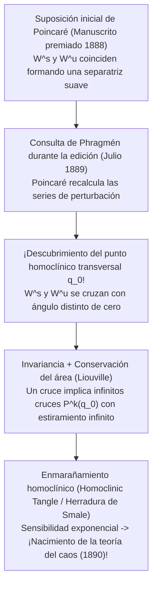

## 1. Introducción: La maldición de la tercera estrella en el universo de relojería

En 1687, Isaac Newton publicó sus monumentales *Philosophiæ Naturalis Principia Mathematica*, transformando para siempre nuestra comprensión del cosmos. Al demostrar que la caída de una manzana y la órbita de la Luna obedecen exactamente a la misma ley de gravitación universal, Newton resolvió por completo el <strong>problema de los dos cuerpos (Two-Body Problem)</strong>: las trayectorias de dos masas puntuales que se atraen gravitatoriamente son para toda la eternidad <strong>secciones cónicas (elipses, parábolas o hipérbolas)</strong> expresables mediante funciones elementales cerradas, cimentando el determinismo del «demonio de Laplace».

Sin embargo, en cuanto añadimos un <strong>único tercer cuerpo celeste</strong> —pasando de $N=2$ a $N=3$ en el sistema Sol-Tierra-Luna, el <strong>problema de los tres cuerpos (Three-Body Problem)</strong>—, la magia analítica se derrumba por completo. ¿Por qué dos estrellas se resuelven con cálculo universitario de primer año, mientras que tres estrellas desafiaron a los mejores matemáticos durante más de tres siglos?

La barrera no radica en una simple dificultad de cálculo, sino en un déficit estructural entre la <strong>dimensión del espacio de fases hamiltoniano y el número de integrales primeras (cantidades conservadas)</strong>, así como en la geometría de la <strong>no integrabilidad y el caos determinista</strong> descubierta por Henri Poincaré a finales del siglo XIX.

---

## 2. Integrabilidad completa del problema de dos cuerpos frente al muro dimensional de tres cuerpos

### 2.1 Formulación hamiltoniana y el teorema de Liouville-Arnold

Para $N$ masas puntuales $m_i$ en posiciones $\mathbf{r}_i \in \mathbb{R}^3$, las ecuaciones diferenciales de Newton son:

$$m_i \frac{d^2 \mathbf{r}_i}{dt^2} = \sum_{\substack{j=1 \\ j \ne i}}^{N} \frac{G m_i m_j (\mathbf{r}_j - \mathbf{r}_i)}{\|\mathbf{r}_j - \mathbf{r}_i\|^3} \qquad (i = 1, \dots, N)$$

En el <strong>espacio de fases de $6N$ dimensiones</strong> con coordenadas canónicas $\mathbf{q} = (\mathbf{r}_1, \dots, \mathbf{r}_N)$ y momentos conjugados $\mathbf{p} = (m_1\dot{\mathbf{r}}_1, \dots, m_N\dot{\mathbf{r}}_N)$, la evolución viene dada por el hamiltoniano $H(\mathbf{q}, \mathbf{p})$:

$$H(\mathbf{q}, \mathbf{p}) = \sum_{i=1}^{N} \frac{\|\mathbf{p}_i\|^2}{2m_i} - \sum_{1 \le i < j \le N} \frac{G m_i m_j}{\|\mathbf{r}_i - \mathbf{r}_j\|}$$

Según el <strong>teorema de Liouville-Arnold (1855 / 1963)</strong>, un sistema hamiltoniano autónomo con $n$ grados de libertad (espacio de fases de dimensión $2n$) es <strong>completamente integrable por cuadraturas</strong> si y solo si existen $n$ integrales primeras funcionalmente independientes $F_1 (=H), F_2, \dots, F_n$ <strong>en involución</strong> mutua (corchetes de Poisson nulos $\{F_i, F_j\} = 0$). En tal caso, las trayectorias se enrollan cuasi-periódicamente sobre toros invariantes $n$-dimensionales $\mathbb{T}^n$.

Por el teorema de Noether, las simetrías de Galileo garantizan para cualquier sistema de $N$ cuerpos exactamente <strong>10 integrales algebraicas clásicas de movimiento</strong>:
1. <strong>Momento lineal total $\mathbf{P}$ (3) y movimiento uniforme del centro de masas $\mathbf{G}_{\text{CM}} = M\mathbf{R}_{\text{CM}} - \mathbf{P}t$ (3)</strong>: Reduce incondicionalmente el espacio de fases en <strong>6 dimensiones</strong> ($6N \to 6N - 6$).
2. <strong>Momento angular total $\mathbf{L} = \sum \mathbf{r}_i \times \mathbf{p}_i$ (3)</strong>: Como $\{L_x, L_y\} = L_z \ne 0$, proporciona exactamente <strong>2 integrales en involución</strong> ($\|\mathbf{L}\|^2$ y $L_z$), y mediante la *eliminación de los nodos* de Jacobi (1842) reduce el espacio de fases en 4 dimensiones.
3. <strong>Energía mecánica total $H = E$ (1)</strong>.

### 2.2 Conteo de grados de libertad: Por qué $N=2$ es integrable y $N=3$ fracasa

```mermaid
flowchart TD
    subgraph TwoBody["Problema de dos cuerpos (N = 2): Espacio de fases 12D (6 GDL)"]
        TB1["Espacio de fases inicial: 6 × 2 = 12 dimensiones"] --> TB2["Reducción del centro de masas (6 integrales)<br/>12 - 6 = 6D espacio relativo (n_rel = 3 GDL)"]
        TB2 --> TB3["Posee 3 integrales en involución: H_rel, |L|^2, L_z<br/>¡Condición de Liouville-Arnold cumplida (3 = 3)!"]
        TB3 --> TB4["Vector de Laplace-Runge-Lenz A -> Superintegrabilidad<br/>Solución exacta: Secciones cónicas de Kepler"]
    end

    subgraph ThreeBody["Problema de tres cuerpos (N = 3): Espacio de fases 18D (9 GDL)"]
        THB1["Espacio de fases inicial: 6 × 3 = 18 dimensiones"] --> THB2["Coordenadas de Jacobi / Centro de masas (6 integrales)<br/>18 - 6 = 12D espacio relativo (n_rel = 6 GDL)"]
        THB2 --> THB3["Para n_rel = 6 GDL, solo existen 3 integrales en involución:<br/>H_rel, |L|^2, L_z (¡Déficit de 3 integrales!)"]
        THB3 --> THB4["¡Quedan 7D–8D irreducibles!<br/>Teoremas de Bruns (1887) y Poincaré (1889): No integrable"]
    end
```

* <strong>Para $N=2$</strong>: Descontando las 6 dimensiones del centro de masas, el movimiento relativo ($\mathbf{r} = \mathbf{r}_1 - \mathbf{r}_2$, masa reducida $\mu_{\text{red}} = \frac{m_1 m_2}{m_1+m_2}$) tiene <strong>$n_{\text{rel}} = 3$ grados de libertad</strong> y exactamente <strong>3 integrales en involución</strong> ($H_{\text{rel}}, \|\mathbf{L}\|^2, L_z$). Además, la simetría oculta $SO(4)$ del potencial $1/r$ conserva el <strong>vector de Laplace-Runge-Lenz (LRL)</strong>:
  $$\mathbf{A} = \mathbf{p} \times \mathbf{L} - \mu_{\text{red}} G m_1 m_2 \frac{\mathbf{r}}{\|\mathbf{r}\|}$$
  haciendo el sistema <strong>maximalmente superintegrable</strong> con órbitas cónicas cerradas $r(\theta) = \frac{p}{1 + e\cos(\theta - \varpi)}$.
* <strong>Para $N=3$</strong>: El espacio de fases salta a <strong>$6 \times 3 = 18$ dimensiones</strong>. Tras separar el centro de masas quedan 12 dimensiones (<strong>$n_{\text{rel}} = 6$ grados de libertad</strong>), pero solo las mismas 3 integrales en involución. Incluso tras reducir el momento angular y fijar la energía, <strong>quedan 8 dimensiones simplécticas (o una variedad de energía de 7 dimensiones)</strong> sin resolver.
  - <strong>Teorema de Bruns (1887)</strong> y <strong>Teorema de no integrabilidad de Poincaré (1889)</strong>: No existen más integrales primeras algebraicas ni analíticas independientes de las 10 clásicas.
  - <strong>La trampa de la serie de Sundman (1912)</strong>: Aunque Karl Sundman halló una serie convergente en potencias de $t^{1/3}$ para todo $t$ (con $\mathbf{L} \ne \mathbf{0}$), David Beloriszky (1930) demostró que calcular una sola época orbital requiere sumar al menos <strong>$10^{8\,000\,000}$ términos</strong>, siendo físicamente inútil.

| Característica | Problema de dos cuerpos ($N=2$) | Problema general de tres cuerpos ($N=3$) | Problema circular restringido plano (PCR3BP) |
| :--- | :--- | :--- | :--- |
| <strong>Dimensión del espacio de fases ($6N$)</strong> | $12\text{D}$ ($6$ GDL) | $18\text{D}$ ($9$ GDL) | $4\text{D}$ (masa de prueba, $2$ GDL) |
| <strong>Espacio relativo (sin CM)</strong> | $6\text{D}$ ($n_{\text{rel}} = 3$ GDL) | $12\text{D}$ ($n_{\text{rel}} = 6$ GDL) | $4\text{D}$ ($n = 2$ GDL en marco sinódico) |
| <strong>Integrales en involución (Req. / Disp.)</strong> | $3$ / $3$ (+ vector LRL $\mathbf{A}$) | $6$ / $3$ (<strong>¡Faltan $3$!</strong>) | $2$ / $1$ (Constante de Jacobi $C_J$) |
| <strong>Régimen dinámico</strong> | Superintegrable (Cónicas) | <strong>No integrable</strong> (Caos homoclínico) | <strong>No integrable</strong> (Toros KAM y caos) |

---

## 3. El problema circular restringido de tres cuerpos (CR3BP) y los cinco puntos de Lagrange ($L_1$–$L_5$)

### 3.1 Ecuaciones en el marco sinódico corrotante y la constante de Jacobi

En el <strong>CR3BP</strong>, dos cuerpos primarios $m_1 \ge m_2$ giran en órbitas circulares ($a=1, \omega=1$) alrededor de su baricentro mientras una partícula de masa infinitesimal ($m_3 \to 0$) se mueve en su campo. Con el parámetro de masa $\mu = \frac{m_2}{m_1 + m_2} \in (0, 1/2]$, las masas primarias están fijas en el <strong>marco rotatorio $(x,y,z)$</strong> en $(-\mu, 0, 0)$ y $(1-\mu, 0, 0)$. Definiendo el <strong>potencial efectivo $\Omega(x, y, z)$</strong>:

$$\Omega(x, y, z) = \frac{1}{2}(x^2 + y^2) + \frac{1 - \mu}{r_1} + \frac{\mu}{r_2}, \qquad r_1 = \sqrt{(x+\mu)^2+y^2+z^2}, \quad r_2 = \sqrt{(x-1+\mu)^2+y^2+z^2}$$

las ecuaciones de movimiento con la fuerza de Coriolis ($-2\boldsymbol{\omega}\times\mathbf{v}$) son:

$$\ddot{x} - 2\dot{y} = \frac{\partial \Omega}{\partial x}, \qquad \ddot{y} + 2\dot{x} = \frac{\partial \Omega}{\partial y}, \qquad \ddot{z} = \frac{\partial \Omega}{\partial z}$$

Multiplicando por $\dot{x}, \dot{y}, \dot{z}$ e integrando se obtiene la única cantidad conservada del CR3BP, la <strong>constante de Jacobi $C_J$</strong>:

$$C_J = 2\Omega(x, y, z) - (\dot{x}^2 + \dot{y}^2 + \dot{z}^2)$$

Dado que $v_{\text{rot}}^2 = 2\Omega - C_J \ge 0$, el movimiento queda confinado a la <strong>región de Hill $2\Omega(x,y,z) \ge C_J$</strong>, delimitada por las <strong>curvas de velocidad cero (Zero-Velocity Curves)</strong> $2\Omega = C_J$.

### 3.2 Derivación y estabilidad de $L_1$–$L_5$: El telescopio James Webb y los asteroides troyanos

La condición de equilibrio $\nabla \Omega = \mathbf{0}$ en el plano $z=0$ produce cinco puntos estacionarios:
1. <strong>Los tres puntos colineales de Euler ($L_1, L_2, L_3$, 1767)</strong>: Sobre el eje $y=0$, raíces de la quíntica $x - \frac{(1-\mu)(x+\mu)}{|x+\mu|^3} - \frac{\mu(x-1+\mu)}{|x-1+\mu|^3} = 0$. Para $\mu \ll 1$, $L_1$ y $L_2$ distan de $m_2$ aproximadamente el <strong>radio de Hill $r_{\text{Hill}} \approx a(\mu/3)^{1/3}$</strong> (unos <strong>1,5 millones de km</strong> de la Tierra en el sistema Sol-Tierra).
2. <strong>Los dos puntos equiláteros de Lagrange ($L_4, L_5$, 1772)</strong>: Expresando $\Omega(r_1, r_2) = \frac{1-\mu}{2}(r_1^2 + \frac{2}{r_1}) + \frac{\mu}{2}(r_2^2 + \frac{2}{r_2}) - \frac{1}{2}\mu(1-\mu)$, la condición $\frac{\partial \Omega}{\partial r_1} = \frac{\partial \Omega}{\partial r_2} = 0$ arroja de inmediato <strong>$r_1 = r_2 = 1$</strong>, formando dos triángulos equiláteros exactos en $L_{4,5} = \left(\frac{1}{2}-\mu, \pm\frac{\sqrt{3}}{2}, 0\right)$.

El polinomio característico linealizado $\lambda^4 + (4 - \Omega_{xx} - \Omega_{yy})\lambda^2 + (\Omega_{xx}\Omega_{yy} - \Omega_{xy}^2) = 0$ demuestra:
* <strong>Inestabilidad de silla de $L_1, L_2, L_3$ y las órbitas Halo del JWST</strong>: Como $\Omega_{xx}\Omega_{yy} < 0$, los autovalores son $\pm\sigma, \pm i\omega_{xy}, \pm i\omega_z$ ($\text{Saddle} \times \text{Center} \times \text{Center}$), por lo que <strong>$L_1, L_2, L_3$ son siempre linealmente inestables</strong>. Sin embargo, su variedad central alberga <strong>órbitas Halo</strong> periódicas tridimensionales. El <strong>Telescopio Espacial James Webb (JWST)</strong> orbita alrededor de $L_2$ en una órbita Halo: evita permanentemente la sombra terrestre, mantiene al Sol, la Tierra y la Luna detrás de su parasol de 5 capas ($<40\text{ K}$) y requiere apenas <strong>$\Delta v \approx 2\text{–}4\text{ m/s}$ al año</strong> para mantener su estación.
* <strong>Estabilización por Coriolis de $L_4, L_5$ y criterio crítico de Routh</strong>: Aunque $L_4$ y $L_5$ son <strong>máximos locales (cimas)</strong> de $\Omega$, la <strong>fuerza de Coriolis ($-2\boldsymbol{\omega}\times\mathbf{v}$)</strong> desvía lateralmente cualquier partícula y la atrapa alrededor de la cima. La ecuación característica
  $$\lambda^4 + \lambda^2 + \frac{27}{4}\mu(1 - \mu) = 0$$
  tiene raíces puramente imaginarias (estabilidad lineal) si y solo si su discriminante es positivo (<strong>Criterio de Routh, 1875</strong>):
  $$1 - 27\mu(1 - \mu) > 0 \iff \mu < \mu_{\text{crit}} = \frac{1 - \sqrt{23/27}}{2} \approx 0.0385209 \quad \left(\frac{m_1}{m_2} > 24.96\right)$$
  En el sistema Sol-Júpiter ($\mu \approx 0.000954 \ll 0.03852$), esta estabilidad giroscópica atrapa más de 12.000 <strong>asteroides troyanos</strong> en $L_4$ y $L_5$.

---

## 4. El premio del rey Óscar II y el error de Henri Poincaré (1889) que engendró la teoría del caos

En 1889, <strong>Henri Poincaré</strong> ganó el concurso internacional convocado por el <strong>rey Óscar II de Suecia y Noruega</strong>. Mientras la memoria se imprimía en *Acta Mathematica*, el joven editor <strong>Lars Edvard Phragmén</strong> detectó una laguna en la demostración. Al revisar sus cálculos, Poincaré descubrió horrorizado que la <strong>variedad estable $W^s(p_0)$</strong> y la <strong>variedad inestable $W^u(p_0)$</strong> de una órbita periódica hiperbólica no coinciden suavemente, sino que <strong>se cortan transversalmente (intersección homoclínica transversal)</strong>.

Por invariancia bajo el mapa de retorno de Poincaré $P$, un solo cruce transversal en $q_0$ obliga a que se crucen en <strong>infinitos puntos homoclínicos $P^k(q_0)$ ($k \in \mathbb{Z}$)</strong>; y por conservación del área de Liouville, los lóbulos se estiran y pliegan infinitas veces formando el <strong>enmarañamiento homoclínico (Homoclinic Tangle / Herradura de Smale, 1967)</strong>. Poincaré pagó de su bolsillo 3.581 coronas (¡más que las 2.500 coronas del premio!) para destruir la edición impresa y publicar en 1890 la versión corregida que fundó la <strong>teoría del caos</strong>.

---

## 5. Milagros modernos: La órbita en forma de ocho y el teorema KAM en el Sistema Solar

### 5.1 La coreografía en ocho (Moore 1993; Chenciner y Montgomery 2000)

Más de dos siglos después de Euler y Lagrange, <strong>Cristopher Moore (1993)</strong> descubrió numéricamente y <strong>Alain Chenciner y Richard Montgomery (2000)</strong> demostraron rigurosamente en *Annals of Mathematics* mediante el <strong>principio de mínima acción (cálculo de variaciones)</strong> la existencia de la <strong>órbita periódica en forma de ocho (Figure-Eight Choreography)</strong> para tres masas iguales ($m_1=m_2=m_3=1$) con momento angular nulo ($\mathbf{L}=\mathbf{0}$):

$$\mathbf{r}_2(t) = \mathbf{r}_1\left(t - \frac{T}{3}\right), \qquad \mathbf{r}_3(t) = \mathbf{r}_1\left(t - \frac{2T}{3}\right)$$

Minimizando el funcional de acción $\mathcal{A}[\mathbf{q}] = \int_0^T (T - V)\,dt$ con simetría $D_6$ sobre la <strong>esfera de formas (Shape Sphere $S^2$)</strong>, demostraron que el mínimo de acción es estrictamente menor que el de cualquier trayectoria con colisión ($\mathcal{A}_{\text{ocho}} < \mathcal{A}_{\text{coll}}$). Posteriormente, Šuvakov y Dmitrašinović (2013) y Li y Liao (2017) descubrieron <strong>más de 2.000 nuevas familias de órbitas periódicas</strong>.

### 5.2 El teorema KAM, la difusión de Arnold y el horizonte de Lyapunov de 5 millones de años (Laskar)

En un sistema hamiltoniano cuasi-integrable $H(\mathbf{I}, \boldsymbol{\theta}) = H_0(\mathbf{I}) + \epsilon H_1(\mathbf{I}, \boldsymbol{\theta})$, las resonancias generan el <strong>problema de los pequeños divisores</strong> $\mathbf{k}\cdot\boldsymbol{\omega}(\mathbf{I}) \approx 0$. El <strong>teorema de Kolmogórov-Arnold-Moser (KAM, 1954–1963)</strong> demostró que para $\epsilon \ll 1$, la mayoría de los toros invariantes sobreviven si sus frecuencias satisfacen la <strong>condición diofántica</strong>:

$$|\mathbf{k} \cdot \boldsymbol{\omega}| \ge \frac{\gamma}{\|\mathbf{k}\|^\tau} \qquad \left(\forall \mathbf{k} \in \mathbb{Z}^n \setminus \{\mathbf{0}\}\right)$$

mientras que para $n \ge 3$ grados de libertad las resonancias destruidas se conectan permitiendo la lenta <strong>difusión de Arnold</strong>.

Finalmente, las integraciones numéricas de <strong>Jacques Laskar (1989 / 2009)</strong> demostraron que el Sistema Solar interior es caótico con un <strong>tiempo de Lyapunov de solo $\tau_{\text{L}} \approx 5\text{ millones de años}$</strong>: un error inicial de <strong>15 metros</strong> en la posición de la Tierra crece hasta <strong>$1\text{ UA}$ en 100 millones de años</strong>, imposibilitando predecir la fase orbital más allá de ese horizonte, y dejando un <strong>$\sim 1\%$ de probabilidad</strong> de que en los próximos 5.000 millones de años una resonancia secular entre Mercurio y Júpiter ($g_1 \approx g_5$) dispare la excentricidad de Mercurio ($e > 0.6$) y desencadene colisiones entre los planetas interiores.
