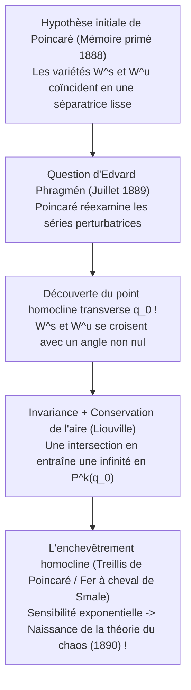

## 1. Introduction : La malédiction du troisième astre dans l'univers-horloge

En 1687, Isaac Newton publia ses monumentaux *Philosophiæ Naturalis Principia Mathematica*, bouleversant à jamais la compréhension humaine du cosmos. En démontrant que la chute d'une pomme et l'orbite de la Lune obéissent à la même loi universelle de la gravitation en carré inverse, Newton résolut intégralement le <strong>problème à deux corps (Two-Body Problem)</strong> : les trajectoires de deux masses ponctuelles s'attirant mutuellement sont pour l'éternité des <strong>sections coniques (ellipses, paraboles ou hyperboles)</strong> exprimables par des fonctions élémentaires, consacrant le déterminisme absolu du « démon de Laplace ».

Pourtant, dès que l'on ajoute un <strong>unique troisième astre</strong> — en passant de $N=2$ à $N=3$ avec le système Soleil-Terre-Lune, soit le <strong>problème à trois corps (Three-Body Problem)</strong> —, l'édifice analytique s'effondre. Pourquoi deux étoiles se résolvent-elles par le calcul intégral élémentaire, tandis que trois étoiles ont tenu en échec les plus grands mathématiciens pendant plus de trois siècles ?

Cet obstacle ne tient pas à la simple complexité des calculs, mais à un déficit structurel profond entre la <strong>dimension de l'espace des phases hamiltonien et le nombre d'intégrales premières (lois de conservation)</strong>, ainsi qu'à l'émergence de la <strong>non-intégrabilité et du chaos déterministe</strong>, découverts par Henri Poincaré à la fin du XIXe siècle.

---

## 2. Intégrabilité complète du problème à deux corps vs le mur dimensionnel à trois corps

### 2.1 Formulation hamiltonienne et théorème de Liouville-Arnold

Pour $N$ masses ponctuelles $m_i$ aux positions $\mathbf{r}_i \in \mathbb{R}^3$, les équations différentielles de Newton s'écrivent :

$$m_i \frac{d^2 \mathbf{r}_i}{dt^2} = \sum_{\substack{j=1 \\ j \ne i}}^{N} \frac{G m_i m_j (\mathbf{r}_j - \mathbf{r}_i)}{\|\mathbf{r}_j - \mathbf{r}_i\|^3} \qquad (i = 1, \dots, N)$$

Dans l'<strong>espace des phases à $6N$ dimensions</strong> muni des coordonnées canoniques $\mathbf{q} = (\mathbf{r}_1, \dots, \mathbf{r}_N)$ et des impulsions conjuguées $\mathbf{p} = (m_1\dot{\mathbf{r}}_1, \dots, m_N\dot{\mathbf{r}}_N)$, la dynamique est régie par le hamiltonien $H(\mathbf{q}, \mathbf{p})$ :

$$H(\mathbf{q}, \mathbf{p}) = \sum_{i=1}^{N} \frac{\|\mathbf{p}_i\|^2}{2m_i} - \sum_{1 \le i < j \le N} \frac{G m_i m_j}{\|\mathbf{r}_i - \mathbf{r}_j\|}$$

Selon le <strong>théorème de Liouville-Arnold (1855 / 1963)</strong>, un système hamiltonien autonome à $n$ degrés de liberté (espace des phases de dimension $2n$) est <strong>complètement intégrable par quadratures</strong> s'il possède $n$ intégrales premières fonctionnellement indépendantes $F_1 (=H), F_2, \dots, F_n$ <strong>en involution</strong> deux à deux (crochets de Poisson nuls $\{F_i, F_j\} = 0$). Le mouvement s'effectue alors de façon quasi-périodique sur des tores invariants $\mathbb{T}^n$.

En vertu du théorème de Noether appliqué au groupe de Galilée, tout système gravitationnel à $N$ corps possède exactement <strong>10 intégrales premières algébriques classiques</strong> :
1. <strong>Impulsion totale $\mathbf{P}$ (3) et mouvement rectiligne uniforme du barycentre $\mathbf{G}_{\text{CM}} = M\mathbf{R}_{\text{CM}} - \mathbf{P}t$ (3)</strong> : Réduit inconditionnellement l'espace des phases de <strong>6 dimensions</strong> ($6N \to 6N - 6$).
2. <strong>Moment cinétique total $\mathbf{L} = \sum \mathbf{r}_i \times \mathbf{p}_i$ (3)</strong> : Comme $\{L_x, L_y\} = L_z \ne 0$, on en extrait exactement <strong>2 intégrales en involution</strong> ($\|\mathbf{L}\|^2$ et $L_z$), permettant via l'*élimination des nœuds* de Jacobi (1842) d'abaisser la dimension de 4 unités.
3. <strong>Énergie mécanique totale $H = E$ (1)</strong>.

### 2.2 Comptage des degrés de liberté : Pourquoi $N=2$ réussit et $N=3$ échoue

```mermaid
flowchart TD
    subgraph TwoBody["Problème à deux corps (N = 2) : Espace des phases 12D (6 DDL)"]
        TB1["Espace des phases initial : 6 × 2 = 12 dimensions"] --> TB2["Réduction du barycentre (6 intégrales)<br/>12 - 6 = 6D espace relatif (n_rel = 3 DDL)"]
        TB2 --> TB3["3 intégrales en involution : H_rel, |L|^2, L_z<br/>Condition de Liouville-Arnold satisfaite (3 = 3) !"]
        TB3 --> TB4["Vecteur de Laplace-Runge-Lenz A -> Superintégrabilité<br/>Solution exacte : Sections coniques de Kepler"]
    end

    subgraph ThreeBody["Problème à trois corps (N = 3) : Espace des phases 18D (9 DDL)"]
        THB1["Espace des phases initial : 6 × 3 = 18 dimensions"] --> THB2["Coordonnées de Jacobi / Barycentre (6 intégrales)<br/>18 - 6 = 12D espace relatif (n_rel = 6 DDL)"]
        THB2 --> THB3["Pour n_rel = 6 DDL, seules 3 intégrales commutent :<br/>H_rel, |L|^2, L_z (Déficit de 3 intégrales !)"]
        THB3 --> THB4["Il subsiste 7D à 8D irréductibles !<br/>Théorèmes de Bruns (1887) & Poincaré (1889) : Non-intégrable"]
    end
```

* <strong>Pour $N=2$</strong> : Une fois le barycentre éliminé, le problème relatif ($\mathbf{r} = \mathbf{r}_1 - \mathbf{r}_2$, masse réduite $\mu_{\text{red}} = \frac{m_1 m_2}{m_1+m_2}$) possède <strong>$n_{\text{rel}} = 3$ degrés de liberté</strong> et exactement <strong>3 intégrales en involution</strong> ($H_{\text{rel}}, \|\mathbf{L}\|^2, L_z$). De plus, la symétrie cachée $SO(4)$ du potentiel en $1/r$ engendre la conservation du <strong>vecteur de Laplace-Runge-Lenz (LRL)</strong> :
  $$\mathbf{A} = \mathbf{p} \times \mathbf{L} - \mu_{\text{red}} G m_1 m_2 \frac{\mathbf{r}}{\|\mathbf{r}\|}$$
  rendant le système <strong>maximalement superintégrable</strong> avec des orbites elliptiques fermées $r(\theta) = \frac{p}{1 + e\cos(\theta - \varpi)}$.
* <strong>Pour $N=3$</strong> : L'espace des phases passe à <strong>$6 \times 3 = 18$ dimensions</strong>. Après élimination du barycentre, il reste 12 dimensions (<strong>$n_{\text{rel}} = 6$ degrés de liberté</strong>), mais seulement 3 intégrales en involution ! Même après réduction de Jacobi par le moment cinétique et fixation de l'énergie, <strong>8 dimensions symplectiques (ou une variété d'énergie de dimension 7)</strong> demeurent irréductibles.
  - <strong>Théorème de Bruns (1887)</strong> et <strong>Théorème de non-intégrabilité de Poincaré (1889)</strong> : Il n'existe aucune autre intégrale première algébrique ou analytique indépendante des 10 intégrales classiques.
  - <strong>Le piège de la série de Sundman (1912)</strong> : Bien que Karl Sundman ait construit en 1912 une série entière en $t^{1/3}$ convergente pour tout temps $t$ (pour $\mathbf{L} \ne \mathbf{0}$), David Beloriszky démontra en 1930 qu'il faut sommer au moins <strong>$10^{8\,000\,000}$ termes</strong> pour calculer une seule révolution planétaire — ce qui la rend physiquement inutilisable !

| Caractéristique | Problème à deux corps ($N=2$) | Problème général à trois corps ($N=3$) | Problème circulaire restreint plan (PCR3BP) |
| :--- | :--- | :--- | :--- |
| <strong>Dimension de l'espace des phases ($6N$)</strong> | $12\text{D}$ ($6$ DDL) | $18\text{D}$ ($9$ DDL) | $4\text{D}$ (particule-test, $2$ DDL) |
| <strong>Espace relatif (hors barycentre)</strong> | $6\text{D}$ ($n_{\text{rel}} = 3$ DDL) | $12\text{D}$ ($n_{\text{rel}} = 6$ DDL) | $4\text{D}$ ($n = 2$ DDL dans le repère synodique) |
| <strong>Intégrales en involution (Requises / Acquises)</strong> | $3$ / $3$ (+ vecteur LRL $\mathbf{A}$) | $6$ / $3$ (<strong>Déficit de $3$ !</strong>) | $2$ / $1$ (Constante de Jacobi $C_J$) |
| <strong>Régime dynamique</strong> | Superintégrable (Coniques) | <strong>Non-intégrable</strong> (Chaos homocline) | <strong>Non-intégrable</strong> (Tores KAM et chaos) |

---

## 3. Le problème circulaire restreint à trois corps (CR3BP) et les cinq points de Lagrange ($L_1$–$L_5$)

### 3.1 Équations dans le référentiel synodique tournant et intégrale de Jacobi

Dans le <strong>CR3BP</strong>, deux corps primaires $m_1 \ge m_2$ décrivent des orbites circulaires (distance $a=1$, vitesse angulaire $\omega=1$) autour de leur barycentre, tandis qu'une particule de masse négligeable ($m_3 \to 0$) évolue dans leur champ. Avec le paramètre de masse $\mu = \frac{m_2}{m_1 + m_2} \in (0, 1/2]$, les primaires sont fixes dans le <strong>repère tournant $(x,y,z)$</strong> en $(-\mu, 0, 0)$ et $(1-\mu, 0, 0)$. En définissant le <strong>potentiel effectif $\Omega(x, y, z)$</strong> :

$$\Omega(x, y, z) = \frac{1}{2}(x^2 + y^2) + \frac{1 - \mu}{r_1} + \frac{\mu}{r_2}, \qquad r_1 = \sqrt{(x+\mu)^2+y^2+z^2}, \quad r_2 = \sqrt{(x-1+\mu)^2+y^2+z^2}$$

les équations du mouvement incluant la force de Coriolis ($-2\boldsymbol{\omega}\times\mathbf{v}$) s'écrivent :

$$\ddot{x} - 2\dot{y} = \frac{\partial \Omega}{\partial x}, \qquad \ddot{y} + 2\dot{x} = \frac{\partial \Omega}{\partial y}, \qquad \ddot{z} = \frac{\partial \Omega}{\partial z}$$

En multipliant par $\dot{x}, \dot{y}, \dot{z}$ et en intégrant, le travail nul de la force de Coriolis donne l'unique invariant du système : la <strong>constante de Jacobi $C_J$</strong> :

$$C_J = 2\Omega(x, y, z) - (\dot{x}^2 + \dot{y}^2 + \dot{z}^2)$$

Comme $v_{\text{rot}}^2 = 2\Omega - C_J \ge 0$, le mouvement est confiné à la <strong>région de Hill $2\Omega(x,y,z) \ge C_J$</strong>, bordée par les <strong>surfaces de vitesse nulle (Zero-Velocity Surfaces)</strong> $2\Omega = C_J$.

### 3.2 Dérivation et stabilité des 5 points d'équilibre : JWST à $L_2$ et astéroïdes troyens à $L_4/L_5$

L'annulation du gradient $\nabla \Omega = \mathbf{0}$ dans le plan $z=0$ révèle cinq points d'équilibre :
1. <strong>Les trois points colinéaires d'Euler ($L_1, L_2, L_3$, 1767)</strong> : Situés sur l'axe $y=0$, racines de l'équation quintique $x - \frac{(1-\mu)(x+\mu)}{|x+\mu|^3} - \frac{\mu(x-1+\mu)}{|x-1+\mu|^3} = 0$. Pour $\mu \ll 1$, $L_1$ et $L_2$ se trouvent à la distance du <strong>rayon de Hill $r_{\text{Hill}} \approx a(\mu/3)^{1/3}$</strong> de $m_2$ (environ <strong>1,5 million de km</strong> de la Terre dans le système Soleil-Terre).
2. <strong>Les deux points équilatéraux de Lagrange ($L_4, L_5$, 1772)</strong> : En réécrivant $\Omega(r_1, r_2) = \frac{1-\mu}{2}(r_1^2 + \frac{2}{r_1}) + \frac{\mu}{2}(r_2^2 + \frac{2}{r_2}) - \frac{1}{2}\mu(1-\mu)$, la condition $\frac{\partial \Omega}{\partial r_1} = \frac{\partial \Omega}{\partial r_2} = 0$ donne immédiatement <strong>$r_1 = r_2 = 1$</strong> ! Les points $L_{4,5} = \left(\frac{1}{2}-\mu, \pm\frac{\sqrt{3}}{2}, 0\right)$ forment deux triangles équilatéraux parfaits avec les primaires.

L'équation caractéristique linéarisée $\lambda^4 + (4 - \Omega_{xx} - \Omega_{yy})\lambda^2 + (\Omega_{xx}\Omega_{yy} - \Omega_{xy}^2) = 0$ gouverne leur stabilité :
* <strong>Instabilité des points colinéaires ($L_1, L_2, L_3$) et orbites Halo du télescope James Webb (JWST)</strong> : Comme $\Omega_{xx}\Omega_{yy} < 0$, les valeurs propres sont $\pm\sigma, \pm i\omega_{xy}, \pm i\omega_z$ (point-selle $\text{Saddle} \times \text{Center} \times \text{Center}$), donc <strong>$L_1, L_2, L_3$ sont toujours instables</strong>. Toutefois, la variété centrale de dimension 4 abrite des <strong>orbites Halo</strong> périodiques tridimensionnelles. Le <strong>télescope spatial James Webb (JWST)</strong> décrit une orbite Halo autour de $L_2$ : il échappe en permanence à l'ombre de la Terre, garde le Soleil, la Terre et la Lune derrière son bouclier thermique unique (refroidissement passif à $<40\text{ K}$) et ne consomme que <strong>$\Delta v \approx 2\text{ à }4\text{ m/s}$ par an</strong> pour ses corrections de maintien à poste !
* <strong>Stabilisation gyroscopique par Coriolis de $L_4, L_5$ et critère de Routh</strong> : Bien que $L_4$ et $L_5$ soient des <strong>maxima locaux (sommets)</strong> du potentiel $\Omega$, la <strong>force de Coriolis ($-2\boldsymbol{\omega}\times\mathbf{v}$)</strong> dévie latéralement toute particule qui commence à glisser et l'enferme sur une orbite stable autour du sommet ! L'équation caractéristique
  $$\lambda^4 + \lambda^2 + \frac{27}{4}\mu(1 - \mu) = 0$$
  possède quatre racines purement imaginaires si et seulement si son discriminant est positif (<strong>Critère de Gascheau 1843 / Routh 1875</strong>) :
  $$1 - 27\mu(1 - \mu) > 0 \iff \mu < \mu_{\text{crit}} = \frac{1 - \sqrt{23/27}}{2} \approx 0.0385209 \quad \left(\frac{m_1}{m_2} > 24.96\right)$$
  Dans le système Soleil-Jupiter ($\mu \approx 0.000954 \ll 0.03852$), cette stabilité piège plus de 12 000 <strong>astéroïdes troyens</strong> aux points $L_4$ et $L_5$ !

---

## 4. Le concours du roi Oscar II et l'erreur féconde d'Henri Poincaré (1889)

En janvier 1889, <strong>Henri Poincaré</strong> remporta le grand prix international de mathématiques institué par le <strong>roi Oscar II de Suède et de Norvège</strong>. Mais en juillet 1889, lors de l'impression dans *Acta Mathematica*, le jeune secrétaire de rédaction <strong>Lars Edvard Phragmén</strong> signala un passage obscur. En vérifiant ses calculs, Poincaré découvrit avec stupeur que la <strong>variété stable $W^s(p_0)$</strong> et la <strong>variété instable $W^u(p_0)$</strong> d'une orbite périodique hyperbolique ne se raccordent pas lissement, mais <strong>se coupent transversalement (intersection homocline transverse)</strong> !

Par invariance sous l'application de premier retour de Poincaré $P$, une seule intersection transverse en $q_0$ implique une <strong>infinité d'intersections homoclines $P^k(q_0)$ ($k \in \mathbb{Z}$)</strong> ! La conservation symplectique de l'aire (théorème de Liouville) oblige alors les lobes compris entre $W^u$ et $W^s$ à s'étirer et se replier infiniment sur eux-mêmes, formant un treillis inextricable : <strong>l'enchevêtrement homocline (Homoclinic Tangle)</strong>, formalisé en 1967 par le <strong>fer à cheval de Smale</strong>. Poincaré paya de sa poche 3 581 couronnes (plus que les 2 500 couronnes du prix !) pour faire pilonner les exemplaires déjà imprimés et publia en 1890 son mémoire révisé de 270 pages, acte de naissance de la <strong>théorie du chaos</strong>.

---

## 5. Miracles modernes : La chorégraphie en huit et le théorème KAM dans le Système solaire

### 5.1 L'orbite en huit (Moore 1993 ; Chenciner & Montgomery 2000)

Après deux siècles sans nouvelle famille analytique pour trois masses égales ($m_1=m_2=m_3=1$), <strong>Cristopher Moore (1993)</strong> découvrit numériquement, et <strong>Alain Chenciner et Richard Montgomery (2000)</strong> démontrèrent rigoureusement dans les *Annals of Mathematics* par le <strong>calcul des variations (principe de moindre action)</strong>, l'existence de la célèbre <strong>chorégraphie en huit (Figure-Eight Orbit)</strong> où trois étoiles de moment cinétique nul ($\mathbf{L}=\mathbf{0}$) se poursuivent sur une même courbe en forme de huit à $T/3$ d'intervalle :

$$\mathbf{r}_2(t) = \mathbf{r}_1\left(t - \frac{T}{3}\right), \qquad \mathbf{r}_3(t) = \mathbf{r}_1\left(t - \frac{2T}{3}\right)$$

En minimisant la fonctionnelle d'action $\mathcal{A}[\mathbf{q}] = \int_0^T (T - V)\,dt$ sous symétrie $D_6$ sur la <strong>sphère des formes (Shape Sphere $S^2$)</strong>, ils prouvèrent que le minimum d'action est strictement inférieur à celui de toute trajectoire avec collision ($\mathcal{A}_{\text{huit}} < \mathcal{A}_{\text{coll}}$). Depuis, Šuvakov & Dmitrašinović (2013) puis Li & Liao (2017) ont découvert <strong>plus de 2 000 nouvelles familles d'orbites périodiques</strong>.

### 5.2 Le théorème KAM, la diffusion d'Arnold et l'horizon de Lyapunov de 5 millions d'années (Laskar)

Pourquoi le Système solaire survit-il depuis 4,5 milliards d'années malgré la non-intégrabilité ? Dans un système hamiltonien quasi-intégrable $H(\mathbf{I}, \boldsymbol{\theta}) = H_0(\mathbf{I}) + \epsilon H_1(\mathbf{I}, \boldsymbol{\theta})$, les séries perturbatrices se heurtent au <strong>problème des petits diviseurs</strong> $\mathbf{k}\cdot\boldsymbol{\omega}(\mathbf{I}) \approx 0$ aux résonances.

Le <strong>théorème de Kolmogorov-Arnold-Moser (KAM, 1954–1963)</strong> démontre que pour $\epsilon \ll 1$, la majorité des tores invariants survivent pourvu que leurs fréquences $\boldsymbol{\omega}$ vérifient la <strong>condition diophantienne</strong> :

$$|\mathbf{k} \cdot \boldsymbol{\omega}| \ge \frac{\gamma}{\|\mathbf{k}\|^\tau} \qquad \left(\forall \mathbf{k} \in \mathbb{Z}^n \setminus \{\mathbf{0}\}\right)$$

Seuls les tores résonnants sont détruits (<strong>théorème de Poincaré-Birkhoff</strong>, formant les lacunes de Kirkwood), tandis que pour $n \ge 3$ degrés de liberté, les couches chaotiques forment un réseau permettant la très lente <strong>diffusion d'Arnold</strong>.

Enfin, les intégrations numériques sur plusieurs milliards d'années de <strong>Jacques Laskar (Observatoire de Paris, 1989 / 2009)</strong> ont établi que le Système solaire interne est chaotique avec un <strong>temps de Lyapunov de seulement $\tau_{\text{L}} \approx 5\text{ millions d'années}$</strong> ! Une incertitude initiale de <strong>15 mètres</strong> sur la position de la Terre est multipliée par $e$ tous les 5 Ma et atteint <strong>$1\text{ UA}$ (la taille de l'orbite terrestre) en seulement 100 millions d'années</strong>, rendant toute prédiction de phase au-delà de 100 Ma physiquement impossible ; de plus, sur 5 milliards d'années, une résonance séculaire entre Mercure et Jupiter ($g_1 \approx g_5$) induit une <strong>probabilité d'environ $1\%$</strong> que l'excentricité de Mercure dépasse $0.6$, pouvant provoquer une collision entre Mercure, Vénus, Mars ou la Terre.
