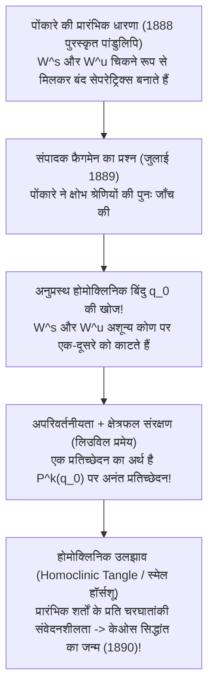

## 1. प्रस्तावना: घड़ी जैसी सटीक ब्रह्मांडीय व्यवस्था में 'तीसरे तारे' का अभिशाप

1687 में सर आइज़ैक न्यूटन (Isaac Newton) ने अपने अमर ग्रंथ *प्रिंसिपिया मैथेमैटिका* (*Principia*) का प्रकाशन कर ब्रह्मांड के प्रति मानवता की समझ को सदा के लिए बदल दिया। यह सिद्ध करके कि सेब को पृथ्वी पर गिराने वाला बल और चंद्रमा को उसकी कक्षा में बांधे रखने वाला बल एक ही सार्वत्रिक गुरुत्वाकर्षण नियम का पालन करते हैं, न्यूटन ने <strong>द्वि-पिंड समस्या (Two-Body Problem)</strong> को पूर्णतः हल कर दिया। पारस्परिक गुरुत्वाकर्षण के अधीन गति करते दो बिंदु-द्रव्यमानों के पथ अनंत काल तक बंद प्रारंभिक फलनों द्वारा व्यक्त <strong>शांकव परिच्छेद (Conic Sections: दीर्घवृत्त, परवलय या अतिपरवलय)</strong> होते हैं, जिसने लाप्लास के 'नियतिवादी ब्रह्मांड' (Laplace's Demon) की नींव रखी।

किंतु जैसे ही हम सूर्य और पृथ्वी की प्रणाली में चंद्रमा के रूप में <strong>केवल एक तीसरा खगोलीय पिंड</strong> जोड़ते हैं—अर्थात् $N=2$ से बढ़कर $N=3$ की <strong>त्रि-पिंड समस्या (Three-Body Problem)</strong> में प्रवेश करते हैं—विश्लेषणात्मक यांत्रिकी का यह जादू अचानक ढह जाता है। ऐसा क्यों है कि दो तारों की गति को प्रथम वर्ष केकलन (Calculus) से हल किया जा सकता है, जबकि तीन तारों ने तीन शताब्दियों से अधिक समय तक विश्व के महानतम गणितज्ञों को परास्त कर दिया?

यह बाधा केवल गणना की जटिलता नहीं है, बल्कि <strong>हैमिल्टनियन कला-समष्टि (Phase Space) की विमाओं और संरक्षित राशियों (प्रथम समाकलों) के बीच की संरचनात्मक कमी</strong>, तथा 19वीं सदी के अंत में हेनरी पोंकारे (Henri Poincaré) द्वारा खोजे गए <strong>असमाकलनीयता (Non-Integrability) और नियतिवादी अराजकता (Deterministic Chaos)</strong> के गहन ज्यामितीय ढांचे में निहित है।

---

## 2. द्वि-पिंड समस्या की पूर्ण समाकलनीयता बनाम त्रि-पिंड समस्या की विमीय दीवार

### 2.1 गुरुत्वीय $N$-पिंड समस्या का हैमिल्टनियन रूप और लिउविल-अर्नोल्ड प्रमेय

जड़त्वीय समष्टि $\mathbb{R}^3$ में स्थिति सदिश $\mathbf{r}_i$ पर स्थित $N$ बिंदु-द्रव्यमानों $m_i$ के लिए न्यूटन के गति के समीकरण हैं:

$$m_i \frac{d^2 \mathbf{r}_i}{dt^2} = \sum_{\substack{j=1 \\ j \ne i}}^{N} \frac{G m_i m_j (\mathbf{r}_j - \mathbf{r}_i)}{\|\mathbf{r}_j - \mathbf{r}_i\|^3} \qquad (i = 1, \dots, N)$$

विहित निर्देशांकों $\mathbf{q} = (\mathbf{r}_1, \dots, \mathbf{r}_N)$ और संयुग्मी संवेगों $\mathbf{p} = (m_1\dot{\mathbf{r}}_1, \dots, m_N\dot{\mathbf{r}}_N)$ से युक्त <strong>$6N$-विमीय कला-समष्टि (Phase Space)</strong> में निकाय का वर्णन हैमिल्टनियन फलन $H(\mathbf{q}, \mathbf{p})$ द्वारा होता है:

$$H(\mathbf{q}, \mathbf{p}) = \sum_{i=1}^{N} \frac{\|\mathbf{p}_i\|^2}{2m_i} - \sum_{1 \le i < j \le N} \frac{G m_i m_j}{\|\mathbf{r}_i - \mathbf{r}_j\|}$$

<strong>लिउविल-अर्नोल्ड समाकलनीयता प्रमेय (Liouville-Arnold Theorem, 1855 / 1963)</strong> के अनुसार, $n$ स्वतंत्रता की कोटियों ($2n$-विमीय कला-समष्टि) वाला एक स्वायत्त हैमिल्टनियन निकाय क्षेत्रकलन (Quadratures) द्वारा <strong>पूर्णतः समाकलनीय (Completely Integrable)</strong> तभी होता है जब उसमें $n$ फलनिक रूप से स्वतंत्र प्रथम समाकल $F_1 (=H), F_2, \dots, F_n$ परस्पर <strong>अंतर्वलन (In Involution: सभी युग्मों के पॉइसन कोष्ठक शून्य $\{F_i, F_j\} = 0$)</strong> में अस्तित्व रखते हों। तब गति $n$-विमीय अपरिवर्ती टोरस $\mathbb{T}^n$ पर अर्ध-आवधिक (Quasi-periodic) होती है।

नोएदर प्रमेय (Noether's Theorem) के अनुसार किसी भी $N$-पिंड गुरुत्वीय निकाय में गैलीलियन सममिति से ठीक <strong>10 चिरसम्मत बीजीय गति के समाकल (संरक्षित राशियाँ)</strong> प्राप्त होते हैं:
1. <strong>कुल रेखीय संवेग $\mathbf{P}$ (3) और द्रव्यमान-केंद्र की एकसमान गति $\mathbf{G}_{\text{CM}} = M\mathbf{R}_{\text{CM}} - \mathbf{P}t$ (3)</strong>: कला-समष्टि को बिना शर्त <strong>6 विमाओं</strong> से कम करता है ($6N \to 6N - 6$)।
2. <strong>कुल कोणीय संवेग $\mathbf{L} = \sum \mathbf{r}_i \times \mathbf{p}_i$ (3)</strong>: चूंकि $\{L_x, L_y\} = L_z \ne 0$, इनसे ठीक <strong>2 क्रमविनिमेय (Commuting) समाकल</strong> ($\|\mathbf{L}\|^2$ और $L_z$) मिलते हैं, और जैकोबी के *पात-विलोपन (Elimination of the Nodes, 1842)* द्वारा कला-समष्टि में 4 विमाओं की कमी होती है।
3. <strong>कुल यांत्रिक ऊर्जा $H = E$ (1)</strong>।

### 2.2 स्वतंत्रता की कोटियों का लेखा-जोखा: $N=2$ क्यों सफल है और $N=3$ क्यों विफल?

```mermaid
flowchart TD
    subgraph TwoBody["द्वि-पिंड समस्या (N = 2): 12D कला-समष्टि (6 स्वतंत्रता की कोटियाँ)"]
        TB1["प्रारंभिक कला-समष्टि: 6 × 2 = 12 विमाएँ"] --> TB2["द्रव्यमान-केंद्र का पृथक्करण (6 समाकल)<br/>12 - 6 = 6D सापेक्ष कला-समष्टि (n_rel = 3 DOF)"]
        TB2 --> TB3["3 क्रमविनिमेय समाकल उपलब्ध: H_rel, |L|^2, L_z<br/>लिउविल-अर्नोल्ड शर्त पूर्णतः संतुष्ट (3 = 3)!"]
        TB3 --> TB4["लाप्लास-रुंगे-लेंज़ सदिश A -> अति-समाकलनीयता<br/>सटीक हल: केप्लर के शांकव परिच्छेद"]
    end

    subgraph ThreeBody["त्रि-पिंड समस्या (N = 3): 18D कला-समष्टि (9 स्वतंत्रता की कोटियाँ)"]
        THB1["प्रारंभिक कला-समष्टि: 6 × 3 = 18 विमाएँ"] --> THB2["जैकोबी निर्देशांक / द्रव्यमान-केंद्र (6 समाकल)<br/>18 - 6 = 12D सापेक्ष कला-समष्टि (n_rel = 6 DOF)"]
        THB2 --> THB3["n_rel = 6 DOF के लिए केवल 3 क्रमविनिमेय समाकल हैं:<br/>H_rel, |L|^2, L_z (3 समाकलों की भारी कमी!)"]
        THB3 --> THB4["7D–8D अपरिवर्तनीय कला-समष्टि शेष रहती है!<br/>ब्रून्स (1887) व पोंकारे (1889) प्रमेय: असमाकलनीय और अराजक"]
    end
```

* <strong>$N=2$ के लिए</strong>: द्रव्यमान-केंद्र की 6 विमाएँ हटाने के बाद सापेक्ष गति ($\mathbf{r} = \mathbf{r}_1 - \mathbf{r}_2$, समानीत द्रव्यमान $\mu_{\text{red}} = \frac{m_1 m_2}{m_1+m_2}$) में <strong>$n_{\text{rel}} = 3$ स्वतंत्रता की कोटियाँ</strong> हैं और ठीक <strong>3 क्रमविनिमेय समाकल</strong> ($H_{\text{rel}}, \|\mathbf{L}\|^2, L_z$) मौजूद हैं। इसके अतिरिक्त, $1/r$ विभव की छिपी हुई $SO(4)$ सममिति से <strong>लाप्लास-रुंगे-लेंज़ (LRL) सदिश</strong> संरक्षित रहता है:
  $$\mathbf{A} = \mathbf{p} \times \mathbf{L} - \mu_{\text{red}} G m_1 m_2 \frac{\mathbf{r}}{\|\mathbf{r}\|}$$
  जो इस निकाय को बंद दीर्घवृत्तीय कक्षाओं $r(\theta) = \frac{p}{1 + e\cos(\theta - \varpi)}$ के साथ <strong>अधिकतम अति-समाकलनीय (Maximally Superintegrable)</strong> बनाता है।
* <strong>$N=3$ के लिए</strong>: कला-समष्टि बढ़कर <strong>$6 \times 3 = 18$ विमाओं</strong> की हो जाती है। द्रव्यमान-केंद्र हटाने पर 12 विमाएँ (<strong>$n_{\text{rel}} = 6$ स्वतंत्रता की कोटियाँ</strong>) बचती हैं, परंतु क्रमविनिमेय समाकल केवल 3 ही हैं! कोणीय संवेग और ऊर्जा के पूर्ण सममिति न्यूनीकरण के बाद भी <strong>8 सिम्प्लेक्टिक विमाएँ (या 7-विमीय ऊर्जा मैनिफोल्ड)</strong> अनसुलझी रह जाती हैं।
  - <strong>ब्रून्स प्रमेय (Bruns, 1887)</strong> और <strong>पोंकारे का असमाकलनीयता प्रमेय (Poincaré, 1889)</strong> ने सिद्ध किया कि 10 चिरसम्मत समाकलों के अतिरिक्त कोई अन्य स्वतंत्र बीजीय या विश्लेषणात्मक प्रथम समाकल अस्तित्व में नहीं है।
  - <strong>सुंडमैन श्रेणी का जाल (Sundman, 1912)</strong>: यद्यपि कार्ल सुंडमैन ने $\mathbf{L} \ne \mathbf{0}$ के लिए $t^{1/3}$ के पदों में सभी समय $t$ के लिए अभिसारी घात-श्रेणी (Power Series) प्राप्त की, तथापि डेविड बेलोरिज़्की (1930) ने दिखाया कि केवल एक कक्षीय आवर्तकाल की गणना करने के लिए कम से कम <strong>$10^{8,000,000}$ पदों</strong> को जोड़ना पड़ता है—जो भौतिक रूप से पूर्णतः अनुपयोगी है!

| विशेषता | द्वि-पिंड समस्या ($N=2$) | सामान्य त्रि-पिंड समस्या ($N=3$) | समतलीय वृत्तीय प्रतिबंधित त्रि-पिंड (PCR3BP) |
| :--- | :--- | :--- | :--- |
| <strong>कला-समष्टि की कुल विमा ($6N$)</strong> | $12\text{D}$ ($6$ DOF) | $18\text{D}$ ($9$ DOF) | $4\text{D}$ (परीक्षण कण, $2$ DOF) |
| <strong>सापेक्ष कला-समष्टि (CM रहित)</strong> | $6\text{D}$ ($n_{\text{rel}} = 3$ DOF) | $12\text{D}$ ($n_{\text{rel}} = 6$ DOF) | $4\text{D}$ ($n = 2$ DOF सह-घूर्णी तंत्र में) |
| <strong>क्रमविनिमेय समाकल (आवश्यक / उपलब्ध)</strong> | $3$ / $3$ (+ LRL सदिश $\mathbf{A}$) | $6$ / $3$ (<strong>$3$ की कमी!</strong>) | $2$ / $1$ (जैकोबी स्थिरांक $C_J$) |
| <strong>गतिकीय प्रकृति</strong> | अति-समाकलनीय (शांकव परिच्छेद) | <strong>असमाकलनीय</strong> (होमोक्लिनिक केओस) | <strong>असमाकलनीय</strong> (KAM टोरस व केओस) |

---

## 3. वृत्तीय प्रतिबंधित त्रि-पिंड समस्या (CR3BP) और पाँच लाग्रांज बिंदु ($L_1$–$L_5$)

### 3.1 सह-घूर्णी निर्देशांक तंत्र में समीकरण और जैकोबी समाकल

<strong>CR3BP</strong> में दो मुख्य पिंड $m_1 \ge m_2$ अपने द्रव्यमान-केंद्र के परितः वृत्तीय कक्षाओं ($a=1, \omega=1$) में घूमते हैं, जबकि नगण्य द्रव्यमान ($m_3 \to 0$) का तीसरा कण उनके गुरुत्वीय क्षेत्र में गति करता है। विमाहीन द्रव्यमान प्राचल $\mu = \frac{m_2}{m_1 + m_2} \in (0, 1/2]$ के साथ, दोनों मुख्य पिंड <strong>सह-घूर्णी तंत्र $(x,y,z)$</strong> में $(-\mu, 0, 0)$ और $(1-\mu, 0, 0)$ पर स्थिर रहते हैं। <strong>प्रभावी विभव (Effective Potential) $\Omega(x, y, z)$</strong> को परिभाषित करने पर:

$$\Omega(x, y, z) = \frac{1}{2}(x^2 + y^2) + \frac{1 - \mu}{r_1} + \frac{\mu}{r_2}, \qquad r_1 = \sqrt{(x+\mu)^2+y^2+z^2}, \quad r_2 = \sqrt{(x-1+\mu)^2+y^2+z^2}$$

कोरियोलिस बल ($-2\boldsymbol{\omega}\times\mathbf{v}$) सहित गति के समीकरण हैं:

$$\ddot{x} - 2\dot{y} = \frac{\partial \Omega}{\partial x}, \qquad \ddot{y} + 2\dot{x} = \frac{\partial \Omega}{\partial y}, \qquad \ddot{z} = \frac{\partial \Omega}{\partial z}$$

इन्हें क्रमशः $\dot{x}, \dot{y}, \dot{z}$ से गुणा कर समाकलित करने पर CR3BP की एकमात्र संरक्षित राशि—<strong>जैकोबी समाकल (Jacobi Constant $C_J$)</strong>—प्राप्त होती है:

$$C_J = 2\Omega(x, y, z) - (\dot{x}^2 + \dot{y}^2 + \dot{z}^2)$$

चूंकि $v_{\text{rot}}^2 = 2\Omega - C_J \ge 0$, कण की गति <strong>हिल क्षेत्र (Hill's Region) $2\Omega(x,y,z) \ge C_J$</strong> तक सीमित रहती है, जिसकी सीमा $2\Omega = C_J$ को <strong>शून्य-वेग वक्र (Zero-Velocity Curves)</strong> कहते हैं।

### 3.2 $L_1$–$L_5$ की व्युत्पत्ति और स्थायित्व: जेम्स वेब टेलीस्कोप और ट्रोजन क्षुद्रग्रह

समतल $z=0$ में संतुलन शर्त $\nabla \Omega = \mathbf{0}$ से पाँच संतुलन बिंदु मिलते हैं:
1. <strong>ऑयलर के तीन संरेख बिंदु ($L_1, L_2, L_3$, 1767)</strong>: रेखा $y=0$ पर पंचघात समीकरण $x - \frac{(1-\mu)(x+\mu)}{|x+\mu|^3} - \frac{\mu(x-1+\mu)}{|x-1+\mu|^3} = 0$ के मूल। जब $\mu \ll 1$, तब $L_1$ व $L_2$ की $m_2$ से दूरी लगभग <strong>हिल त्रिज्या $r_{\text{Hill}} \approx a(\mu/3)^{1/3}$</strong> होती है (सूर्य-पृथ्वी तंत्र में पृथ्वी से लगभग <strong>15 लाख किमी</strong>)।
2. <strong>लाग्रांज के दो समबाहु त्रिभुज बिंदु ($L_4, L_5$, 1772)</strong>: $\Omega(r_1, r_2) = \frac{1-\mu}{2}(r_1^2 + \frac{2}{r_1}) + \frac{\mu}{2}(r_2^2 + \frac{2}{r_2}) - \frac{1}{2}\mu(1-\mu)$ लिखने पर $\frac{\partial \Omega}{\partial r_1} = \frac{\partial \Omega}{\partial r_2} = 0$ से तुरंत <strong>$r_1 = r_2 = 1$</strong> प्राप्त होता है, जो $L_{4,5} = \left(\frac{1}{2}-\mu, \pm\frac{\sqrt{3}}{2}, 0\right)$ पर दो समबाहु त्रिभुज बनाते हैं।

रैखिक अभिलक्षणिक समीकरण $\lambda^4 + (4 - \Omega_{xx} - \Omega_{yy})\lambda^2 + (\Omega_{xx}\Omega_{yy} - \Omega_{xy}^2) = 0$ से स्पष्ट होता है:
* <strong>$L_1, L_2, L_3$ की काठी (Saddle) अस्थिरता और JWST की हेलो कक्षा</strong>: चूंकि $\Omega_{xx}\Omega_{yy} < 0$, आइगेनमान $\pm\sigma, \pm i\omega_{xy}, \pm i\omega_z$ ($\text{Saddle} \times \text{Center} \times \text{Center}$) होते हैं, अतः <strong>$L_1, L_2, L_3$ सदैव रैखिक रूप से अस्थिर हैं</strong>। फिर भी, इनके 4D केंद्रीय मैनिफोल्ड पर त्रिविमीय आवधिक <strong>हेलो कक्षाएँ (Halo Orbits)</strong> अस्तित्व रखती हैं। <strong>जेम्स वेब स्पेस टेलीस्कोप (JWST)</strong> सूर्य-पृथ्वी के $L_2$ बिंदु के चारों ओर हेलो कक्षा में परिक्रमा करता है: यह पृथ्वी की छाया से सदैव बचता है, अपनी 5-परत वाली सनशील्ड के पीछे सूर्य, पृथ्वी और चंद्रमा तीनों को एक साथ रखकर $<40\text{ K}$ तापमान बनाए रखता है, और कक्षा बनाए रखने हेतु प्रति वर्ष केवल <strong>$\Delta v \approx 2\text{–}4\text{ m/s}$</strong> ईंधन खर्च करता है!
* <strong>$L_4, L_5$ का कोरियोलिस स्थायीकरण और राउथ का क्रांतिक द्रव्यमान अनुपात</strong>: यद्यपि $L_4$ और $L_5$ प्रभावी विभव $\Omega$ के <strong>स्थानीय उच्चिष्ठ (शिखर)</strong> हैं, तथापि <strong>कोरियोलिस बल ($-2\boldsymbol{\omega}\times\mathbf{v}$)</strong> फिसलते हुए कण को मोड़कर शिखर के चारों ओर स्थिर कक्षा में बांध लेता है! अभिलक्षणिक समीकरण
  $$\lambda^4 + \lambda^2 + \frac{27}{4}\mu(1 - \mu) = 0$$
  के सभी मूल शुद्ध काल्पनिक (रैखिक स्थिर) तभी होते हैं जब विविक्तकर धनात्मक हो (<strong>राउथ की कसौटी, Routh 1875</strong>):
  $$1 - 27\mu(1 - \mu) > 0 \iff \mu < \mu_{\text{crit}} = \frac{1 - \sqrt{23/27}}{2} \approx 0.0385209 \quad \left(\frac{m_1}{m_2} > 24.96\right)$$
  सूर्य-बृहस्पति तंत्र ($\mu \approx 0.000954 \ll 0.03852$) में यह घूर्णी स्थिरता $L_4$ और $L_5$ पर 12,000 से अधिक <strong>ट्रोजन क्षुद्रग्रहों (Trojan Asteroids)</strong> को कैद रखती है!

---

## 4. राजा ऑस्कर द्वितीय का पुरस्कार और हेनरी पोंकारे की भूल (1889) जिसने केओस सिद्धांत को जन्म दिया

1889 में <strong>हेनरी पोंकारे</strong> ने <strong>स्वीडन और नॉर्वे के राजा ऑस्कर द्वितीय</strong> द्वारा आयोजित अंतरराष्ट्रीय गणित प्रतियोगिता जीती। किंतु जब उनका शोधपत्र *Acta Mathematica* में छप रहा था, युवा संपादक <strong>लार्स एडवर्ड फ्रैगमेन (Phragmén)</strong> ने प्रमाण में एक शंका उठाई। अपनी गणनाओं की पुनः जाँच करने पर पोंकारे ने स्तब्ध होकर पाया कि अतिपरवलयिक आवधिक कक्षा के <strong>स्थिर मैनिफोल्ड $W^s(p_0)$</strong> और <strong>अस्थिर मैनिफोल्ड $W^u(p_0)$</strong> चिकने रूप से संपाती नहीं होते, बल्कि <strong>अनुप्रस्थ रूप से प्रतिच्छेद (Transverse Homoclinic Intersection)</strong> करते हैं!

पोंकारे पुनरागमन प्रतिचित्रण $P$ के अंतर्गत अपरिवर्तनीयता के कारण, बिंदु $q_0$ पर एक बार प्रतिच्छेदन होने से सभी $P^k(q_0)$ ($k \in \mathbb{Z}$) पर <strong>अनंत बार प्रतिच्छेदन</strong> होना अनिवार्य है; और लिउविल के क्षेत्रफल संरक्षण के कारण मैनिफोल्ड के बीच के लूप अनंत रूप से खिंचते और मुड़ते हुए <strong>होमोक्लिनिक उलझाव (Homoclinic Tangle / स्मेल का नाल प्रतिचित्रण, 1967)</strong> बनाते हैं। पोंकारे ने अपनी जेब से 3,581 क्रोना (2,500 क्रोना की पुरस्कार राशि से भी अधिक!) खर्च करके छपी हुई प्रतियों को नष्ट करवाया और 1890 में संशोधित शोधपत्र प्रकाशित कर आधुनिक <strong>केओस सिद्धांत (Chaos Theory)</strong> की नींव रखी।

---

## 5. आधुनिक चमत्कार: '8-आकृति की आवधिक कक्षा' और सौर मंडल में KAM प्रमेय

### 5.1 8-आकृति का कोरियोग्राफी पथ (मूर 1993; शेनसिनर और मोंटगोमरी 2000)

ऑयलर और लाग्रांज के दो शताब्दियों बाद, <strong>क्रिस्टोफर मूर (1993)</strong> ने संख्यात्मक रूप से और <strong>अलेन शेनसिनर तथा रिचर्ड मोंटगोमरी (2000)</strong> ने *Annals of Mathematics* में <strong>न्यूनतम क्रिया के सिद्धांत (विचरण कलन)</strong> द्वारा तीन समान द्रव्यमानों ($m_1=m_2=m_3=1$) और शून्य कोणीय संवेग ($\mathbf{L}=\mathbf{0}$) के लिए <strong>8-आकृति की आवधिक कक्षा (Figure-Eight Orbit)</strong> के अस्तित्व को कठोरता से सिद्ध किया:

$$\mathbf{r}_2(t) = \mathbf{r}_1\left(t - \frac{T}{3}\right), \qquad \mathbf{r}_3(t) = \mathbf{r}_1\left(t - \frac{2T}{3}\right)$$

<strong>आकृति गोले (Shape Sphere $S^2$)</strong> पर $D_6$ सममिति के अंतर्गत क्रिया फलनक $\mathcal{A}[\mathbf{q}] = \int_0^T (T - V)\,dt$ को न्यूनतम करके उन्होंने सिद्ध किया कि इसकी न्यूनतम क्रिया किसी भी संघट्ट (Collision) पथ की क्रिया से सख्ती से कम है ($\mathcal{A}_{\text{eight}} < \mathcal{A}_{\text{coll}}$)। इसके बाद शुवाकोव और दिमित्राशिनोविच (2013) तथा ली और लियाओ (2017) ने <strong>2,000 से अधिक नई आवधिक कक्षाओं के परिवार</strong> खोजे।

### 5.2 KAM प्रमेय, अर्नोल्ड विसरण और सौर मंडल का 50 लाख वर्ष का ल्यापुनोव समय (लास्कर)

अर्ध-समाकलनीय हैमिल्टनियन प्रणाली $H(\mathbf{I}, \boldsymbol{\theta}) = H_0(\mathbf{I}) + \epsilon H_1(\mathbf{I}, \boldsymbol{\theta})$ में अनुनाद (Resonance) के कारण <strong>लघु भाजक समस्या (Small Divisors Problem)</strong> $\mathbf{k}\cdot\boldsymbol{\omega}(\mathbf{I}) \approx 0$ उत्पन्न होती है। <strong>कोल्मोगोरोव-अर्नोल्ड-मोज़र (KAM) प्रमेय (1954–1963)</strong> ने सिद्ध किया कि $\epsilon \ll 1$ के लिए अधिकांश अपरिवर्ती टोरस नष्ट नहीं होते यदि उनकी आवृत्तियाँ <strong>डायोफैंटाइन शर्त (Diophantine Condition)</strong> को संतुष्ट करती हैं:

$$|\mathbf{k} \cdot \boldsymbol{\omega}| \ge \frac{\gamma}{\|\mathbf{k}\|^\tau} \qquad \left(\forall \mathbf{k} \in \mathbb{Z}^n \setminus \{\mathbf{0}\}\right)$$

जबकि $n \ge 3$ स्वतंत्रता की कोटियों के लिए टूटे हुए अनुनाद जाल आपस में जुड़कर अत्यंत धीमे <strong>अर्नोल्ड विसरण (Arnold Diffusion)</strong> की अनुमति देते हैं।

अंततः, <strong>ज़ाक लास्कर (Jacques Laskar, 1989 / 2009)</strong> के अरबों वर्षों के संख्यात्मक समाकलनों ने सिद्ध किया कि आंतरिक सौर मंडल अराजक (Chaotic) है और इसका <strong>ल्यापुनोव समय केवल $\tau_{\text{L}} \approx 50\text{ लाख वर्ष (5 Million Years)}$</strong> है! आज पृथ्वी की स्थिति में मात्र <strong>15 मीटर</strong> की अनिश्चितता <strong>10 करोड़ वर्षों में बढ़कर $1\text{ AU}$ (पृथ्वी की पूरी कक्षा के बराबर)</strong> हो जाती है, जिससे 10 करोड़ वर्ष के बाद सटीक कक्षीय कला की भविष्यवाणी भौतिक रूप से असंभव हो जाती है; और अगले 5 अरब वर्षों में बुध व बृहस्पति के दीर्घकालिक अनुनाद ($g_1 \approx g_5$) के कारण <strong>$\sim 1\%$ संभावना</strong> है कि बुध की उत्केंद्रता $e > 0.6$ से अधिक हो जाए और आंतरिक ग्रहों के बीच भीषण टकराव हो।
