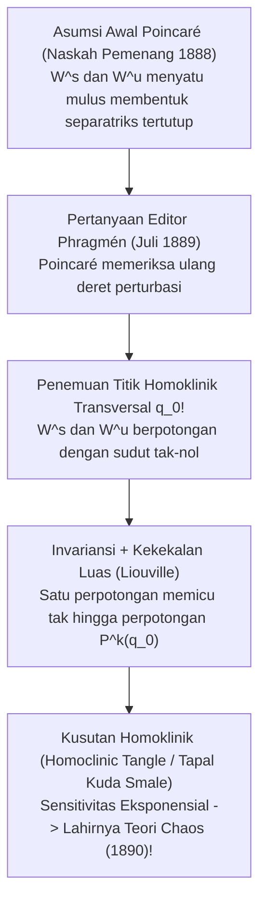

## 1. Pendahuluan: Kutukan Bintang Ketiga dalam Alam Semesta Jarum Jam

Pada tahun 1687, Sir Isaac Newton menerbitkan mahakaryanya *Philosophiæ Naturalis Principia Mathematica*, yang mengubah pemahaman manusia tentang kosmos selamanya. Dengan membuktikan bahwa gaya gravitasi yang menjatuhkan apel ke tanah dan gaya yang mengikat Bulan pada orbitnya mematuhi hukum gravitasi universal kuadrat-terbalik yang sama, Newton berhasil memecahkan <strong>Masalah Dua-Benda (Two-Body Problem)</strong> secara tuntas. Lintasan dua massa titik yang saling tarik-menarik secara gravitasi dapat dinyatakan secara eksak untuk selamanya sebagai <strong>irisan kerucut (elips, parabola, atau hiperbola)</strong> menggunakan fungsi elementer tertutup, yang melahirkan pandangan deterministik "Iblis Laplace".

Namun, begitu kita menambahkan <strong>satu saja benda langit ketiga</strong>—beralih dari $N=2$ menjadi $N=3$ seperti sistem Matahari-Bumi-Bulan, yaitu <strong>Masalah Tiga-Benda (Three-Body Problem)</strong>—keajaiban analitis tersebut runtuh seketika. Mengapa sistem dua bintang dapat diselesaikan dengan kalkulus dasar universitas, sedangkan tiga bintang membuat para matematikawan terhebat duniaพ่ายแพ้ selama lebih dari tiga abad?

Penghalang tersebut bukan sekadar kerumitan komputasi, melainkan defisit struktural antara <strong>dimensi ruang fase Hamiltonian dan jumlah integral pertama (kuantitas kekal)</strong>, serta geometri <strong>non-integrabilitas dan chaos deterministik</strong> yang ditemukan oleh Henri Poincaré pada akhir abad ke-19.

---

## 2. Integrabilitas Lengkap Masalah Dua-Benda vs. Tembok Dimensi Tiga-Benda

### 2.1 Formulasi Hamiltonian dan Teorema Liouville-Arnold

Untuk $N$ massa titik $m_i$ pada posisi $\mathbf{r}_i \in \mathbb{R}^3$, persamaan diferensial gerak Newton adalah:

$$m_i \frac{d^2 \mathbf{r}_i}{dt^2} = \sum_{\substack{j=1 \\ j \ne i}}^{N} \frac{G m_i m_j (\mathbf{r}_j - \mathbf{r}_i)}{\|\mathbf{r}_j - \mathbf{r}_i\|^3} \qquad (i = 1, \dots, N)$$

Dalam <strong>ruang fase berdimensi-$6N$</strong> dengan koordinat kanonik $\mathbf{q} = (\mathbf{r}_1, \dots, \mathbf{r}_N)$ dan momentum konjugat $\mathbf{p} = (m_1\dot{\mathbf{r}}_1, \dots, m_N\dot{\mathbf{r}}_N)$, dinamika sistem diatur oleh fungsi Hamiltonian $H(\mathbf{q}, \mathbf{p})$:

$$H(\mathbf{q}, \mathbf{p}) = \sum_{i=1}^{N} \frac{\|\mathbf{p}_i\|^2}{2m_i} - \sum_{1 \le i < j \le N} \frac{G m_i m_j}{\|\mathbf{r}_i - \mathbf{r}_j\|}$$

Menurut <strong>Teorema Liouville-Arnold (1855 / 1963)</strong>, suatu sistem Hamiltonian otonom dengan $n$ derajat kebebasan (ruang fase berdimensi $2n$) <strong>dapat diintegrasikan secara lengkap dengan kuadratur</strong> jika dan hanya jika terdapat $n$ integral pertama yang independen secara fungsional $F_1 (=H), F_2, \dots, F_n$ yang saling <strong>berinvolusi</strong> (kurung Poisson bernilai nol $\{F_i, F_j\} = 0$). Lintasan sistem kemudian bergerak secara kuasi-periodik pada torus invarian berdimensi-$n$ ($\mathbb{T}^n$).

Berdasarkan Teorema Noether pada grup Galilean, setiap sistem gravitasi $N$-benda memiliki tepat <strong>10 integral gerak aljabar klasik</strong>:
1. <strong>Momentum linier total $\mathbf{P}$ (3) dan gerak lurus beraturan pusat massa $\mathbf{G}_{\text{CM}} = M\mathbf{R}_{\text{CM}} - \mathbf{P}t$ (3)</strong>: Mereduksi ruang fase sebesar <strong>6 dimensi</strong> ($6N \to 6N - 6$).
2. <strong>Momentum sudut total $\mathbf{L} = \sum \mathbf{r}_i \times \mathbf{p}_i$ (3)</strong>: Karena $\{L_x, L_y\} = L_z \ne 0$, terdapat tepat <strong>2 integral yang saling komutatif</strong> ($\|\mathbf{L}\|^2$ dan $L_z$), yang bersama *eliminasi simpul Jacobi (1842)* mereduksi ruang fase sebesar 4 dimensi.
3. <strong>Energi mekanik total $H = E$ (1)</strong>.

### 2.2 Perhitungan Derajat Kebebasan: Mengapa $N=2$ Berhasil dan $N=3$ Gagal

```mermaid
flowchart TD
    subgraph TwoBody["Masalah Dua-Benda (N = 2): Ruang Fase 12D (6 DOF)"]
        TB1["Ruang Fase Awal: 6 × 2 = 12 Dimensi"] --> TB2["Reduksi Pusat Massa (6 Integral)<br/>12 - 6 = 6D Ruang Fase Relatif (n_rel = 3 DOF)"]
        TB2 --> TB3["Memiliki 3 Integral Komutatif: H_rel, |L|^2, L_z<br/>Syarat Liouville-Arnold Terpenuhi (3 = 3)!"]
        TB3 --> TB4["Vektor Laplace-Runge-Lenz A -> Superintegrabel<br/>Solusi Eksak: Irisan Kerucut Kepler"]
    end

    subgraph ThreeBody["Masalah Tiga-Benda (N = 3): Ruang Fase 18D (9 DOF)"]
        THB1["Ruang Fase Awal: 6 × 3 = 18 Dimensi"] --> THB2["Koordinat Jacobi / Pusat Massa (6 Integral)<br/>18 - 6 = 12D Ruang Fase Relatif (n_rel = 6 DOF)"]
        THB2 --> THB3["Untuk n_rel = 6 DOF, hanya ada 3 Integral Komutatif:<br/>H_rel, |L|^2, L_z (Defisit 3 Integral!)"]
        THB3 --> THB4["Tersisa 7D–8D Ruang Fase Tak Tereduksi!<br/>Teorema Bruns (1887) & Poincaré (1889): Non-Integrabel"]
    end
```

* <strong>Untuk $N=2$</strong>: Setelah memisahkan 6 dimensi pusat massa, gerak relatif ($\mathbf{r} = \mathbf{r}_1 - \mathbf{r}_2$, massa tereduksi $\mu_{\text{red}} = \frac{m_1 m_2}{m_1+m_2}$) memiliki <strong>$n_{\text{rel}} = 3$ derajat kebebasan</strong> dan tepat <strong>3 integral komutatif</strong> ($H_{\text{rel}}, \|\mathbf{L}\|^2, L_z$). Selain itu, simetri tersembunyi $SO(4)$ dari potensial $1/r$ melestarikan <strong>Vektor Laplace-Runge-Lenz (LRL)</strong>:
  $$\mathbf{A} = \mathbf{p} \times \mathbf{L} - \mu_{\text{red}} G m_1 m_2 \frac{\mathbf{r}}{\|\mathbf{r}\|}$$
  menjadikan sistem <strong>superintegrabel maksimal</strong> dengan orbit elips tertutup $r(\theta) = \frac{p}{1 + e\cos(\theta - \varpi)}$.
* <strong>Untuk $N=3$</strong>: Ruang fase melonjak menjadi <strong>$6 \times 3 = 18$ dimensi</strong>. Setelah mereduksi pusat massa, tersisa 12 dimensi (<strong>$n_{\text{rel}} = 6$ derajat kebebasan</strong>), namun hanya tersedia 3 integral komutatif! Bahkan setelah reduksi momentum sudut dan energi, <strong>tersisa 8 dimensi simplektik (atau manifol energi 7D)</strong> yang tak terpecahkan.
  - <strong>Teorema Bruns (1887)</strong> & <strong>Teorema Non-Integrabilitas Poincaré (1889)</strong>: Tidak ada integral pertama aljabar atau analitik independen lainnya selain 10 integral klasik.
  - <strong>Jebakan Deret Sundman (1912)</strong>: Meskipun Karl Sundman menemukan deret pangkat dalam $t^{1/3}$ yang konvergen untuk semua waktu $t$ (dengan $\mathbf{L} \ne \mathbf{0}$), David Beloriszky (1930) membuktikan bahwa menghitung satu periode orbit saja membutuhkan penjumlahan sedikitnya <strong>$10^{8.000.000}$ suku</strong>, sehingga sama sekali tidak berguna secara fisis!

| Karakteristik | Masalah Dua-Benda ($N=2$) | Masalah Tiga-Benda Umum ($N=3$) | Masalah Tiga-Benda Terbatas Sirkular Planar (PCR3BP) |
| :--- | :--- | :--- | :--- |
| <strong>Dimensi Ruang Fase ($6N$)</strong> | $12\text{D}$ ($6$ DOF) | $18\text{D}$ ($9$ DOF) | $4\text{D}$ (massa uji, $2$ DOF) |
| <strong>Ruang Relatif (Pasca-CM)</strong> | $6\text{D}$ ($n_{\text{rel}} = 3$ DOF) | $12\text{D}$ ($n_{\text{rel}} = 6$ DOF) | $4\text{D}$ ($n = 2$ DOF dalam kerangka sinodik) |
| <strong>Integral Komutatif (Butuh / Ada)</strong> | $3$ / $3$ (+ vektor LRL $\mathbf{A}$) | $6$ / $3$ (<strong>Kurang $3$!</strong>) | $2$ / $1$ (Konstanta Jacobi $C_J$) |
| <strong>Rezim Dinamis</strong> | Superintegrabel (Irisan Kerucut) | <strong>Non-Integrabel</strong> (Chaos Homoklinik) | <strong>Non-Integrabel</strong> (Torus KAM & Chaos) |

---

## 3. Masalah Tiga-Benda Terbatas Sirkular (CR3BP) dan Lima Titik Lagrange ($L_1$–$L_5$)

### 3.1 Persamaan Gerak Kerangka Sinodik dan Integral Jacobi

Dalam <strong>CR3BP</strong>, dua benda primer $m_1 \ge m_2$ mengorbit secara melingkar ($a=1, \omega=1$) mengelilingi barisenternya sementara partikel bermassa sangat kecil ($m_3 \to 0$) bergerak di medan gravitasinya. Dengan parameter massa tak berdimensi $\mu = \frac{m_2}{m_1 + m_2} \in (0, 1/2]$, kedua benda primer tetap diam dalam <strong>kerangka putar sinodik $(x,y,z)$</strong> di $(-\mu, 0, 0)$ dan $(1-\mu, 0, 0)$. Mendefinisikan <strong>potensial efektif $\Omega(x, y, z)$</strong>:

$$\Omega(x, y, z) = \frac{1}{2}(x^2 + y^2) + \frac{1 - \mu}{r_1} + \frac{\mu}{r_2}, \qquad r_1 = \sqrt{(x+\mu)^2+y^2+z^2}, \quad r_2 = \sqrt{(x-1+\mu)^2+y^2+z^2}$$

persamaan gerak yang mencakup gaya Coriolis ($-2\boldsymbol{\omega}\times\mathbf{v}$) adalah:

$$\ddot{x} - 2\dot{y} = \frac{\partial \Omega}{\partial x}, \qquad \ddot{y} + 2\dot{x} = \frac{\partial \Omega}{\partial y}, \qquad \ddot{z} = \frac{\partial \Omega}{\partial z}$$

Mengalikan dengan $\dot{x}, \dot{y}, \dot{z}$ dan mengintegrasikan menghasilkan satu-satunya kuantitas kekal CR3BP, yaitu <strong>Konstanta Jacobi $C_J$</strong>:

$$C_J = 2\Omega(x, y, z) - (\dot{x}^2 + \dot{y}^2 + \dot{z}^2)$$

Karena $v_{\text{rot}}^2 = 2\Omega - C_J \ge 0$, gerak partikel dibatasi pada <strong>Wilayah Hill $2\Omega(x,y,z) \ge C_J$</strong>, yang dibatasi oleh <strong>Kurva Kecepatan-Nol (Zero-Velocity Curves)</strong> $2\Omega = C_J$.

### 3.2 Penurunan dan Stabilitas $L_1$–$L_5$: Teleskop James Webb dan Asteroid Troya

Syarat ekuilibrium $\nabla \Omega = \mathbf{0}$ pada bidang $z=0$ menghasilkan lima titik stasioner:
1. <strong>Tiga Titik Kolinear Euler ($L_1, L_2, L_3$, 1767)</strong>: Terletak pada garis $y=0$, merupakan akar persamaan derajat lima $x - \frac{(1-\mu)(x+\mu)}{|x+\mu|^3} - \frac{\mu(x-1+\mu)}{|x-1+\mu|^3} = 0$. Untuk $\mu \ll 1$, jarak $L_1$ dan $L_2$ dari $m_2$ mendekati <strong>radius Hill $r_{\text{Hill}} \approx a(\mu/3)^{1/3}$</strong> (sekitar <strong>1,5 juta km</strong> dari Bumi pada sistem Matahari-Bumi).
2. <strong>Dua Titik Segitiga Sama Sisi Lagrange ($L_4, L_5$, 1772)</strong>: Menuliskan $\Omega(r_1, r_2) = \frac{1-\mu}{2}(r_1^2 + \frac{2}{r_1}) + \frac{\mu}{2}(r_2^2 + \frac{2}{r_2}) - \frac{1}{2}\mu(1-\mu)$, syarat $\frac{\partial \Omega}{\partial r_1} = \frac{\partial \Omega}{\partial r_2} = 0$ langsung memberikan <strong>$r_1 = r_2 = 1$</strong>, membentuk dua segitiga sama sisi sempurna di $L_{4,5} = \left(\frac{1}{2}-\mu, \pm\frac{\sqrt{3}}{2}, 0\right)$.

Polinom karakteristik linier $\lambda^4 + (4 - \Omega_{xx} - \Omega_{yy})\lambda^2 + (\Omega_{xx}\Omega_{yy} - \Omega_{xy}^2) = 0$ membuktikan:
* <strong>Ketidakstabilan Pelana $L_1, L_2, L_3$ dan Orbit Halo JWST</strong>: Karena $\Omega_{xx}\Omega_{yy} < 0$, nilai eigennya adalah $\pm\sigma, \pm i\omega_{xy}, \pm i\omega_z$ ($\text{Saddle} \times \text{Center} \times \text{Center}$), sehingga <strong>$L_1, L_2, L_3$ selalu tidak stabil secara linier</strong>. Namun, manifol pusatnya mendukung <strong>Orbit Halo</strong> periodik 3D. <strong>James Webb Space Telescope (JWST)</strong> mengorbit di sekitar $L_2$ dalam orbit Halo: selalu terhindar dari bayangan Bumi, menempatkan Matahari, Bumi, dan Bulan di balik satu perisai panas 5-lapis ($<40\text{ K}$), serta hanya membutuhkan bahan bakar station-keeping <strong>$\Delta v \approx 2\text{–}4\text{ m/s}$ per tahun</strong>!
* <strong>Stabilisasi Coriolis pada $L_4, L_5$ dan Kriteria Kritis Routh</strong>: Meskipun $L_4$ dan $L_5$ adalah <strong>puncak maksimum lokal</strong> dari $\Omega$, <strong>gaya Coriolis ($-2\boldsymbol{\omega}\times\mathbf{v}$)</strong> membelokkan partikel yang mulai tergelincir menjadi orbit tertutup yang stabil mengelilingi puncak! Persamaan karakteristiknya:
  $$\lambda^4 + \lambda^2 + \frac{27}{4}\mu(1 - \mu) = 0$$
  memiliki akar imajiner murni (stabil linier) jika dan hanya jika diskriminannya positif (<strong>Kriteria Routh, 1875</strong>):
  $$1 - 27\mu(1 - \mu) > 0 \iff \mu < \mu_{\text{crit}} = \frac{1 - \sqrt{23/27}}{2} \approx 0.0385209 \quad \left(\frac{m_1}{m_2} > 24.96\right)$$
  Dalam sistem Matahari-Jupiter ($\mu \approx 0.000954 \ll 0.03852$), stabilitas giroskopik ini memerangkap lebih dari 12.000 <strong>asteroid Troya</strong> di $L_4$ dan $L_5$!

---

## 4. Sayembara Raja Oscar II dan Kesalahan Henri Poincaré (1889) yang Melahirkan Teori Chaos

Pada tahun 1889, <strong>Henri Poincaré</strong> memenangkan kompetisi matematika internasional yang diadakan oleh <strong>Raja Oscar II dari Swedia dan Norwegia</strong>.Saat makalahnya sedang dicetak di *Acta Mathematica*, editor muda <strong>Lars Edvard Phragmén</strong> menemukan celah dalam pembuktian. Saat memeriksa ulang perhitungannya, Poincaré menyadari dengan ngeri bahwa <strong>manifol stabil $W^s(p_0)$</strong> dan <strong>manifol tak stabil $W^u(p_0)$</strong> dari orbit periodik hiperbolik tidak menyatu secara mulus, melainkan <strong>berpotongan secara transversal (Transverse Homoclinic Intersection)</strong>!

Karena invariansi terhadap peta kembali Poincaré $P$, satu perpotongan transversal di $q_0$ memaksa terjadinya <strong>tak terhingga banyaknya perpotongan homoklinik $P^k(q_0)$ ($k \in \mathbb{Z}$)</strong>; dan karena kekekalan luas Liouville, lobus di antara kedua manifol meregang dan melipat tak terhingga kali membentuk <strong>Kusutan Homoklinik (Homoclinic Tangle / Peta Tapal Kuda Smale, 1967)</strong>. Poincaré membayar dari kantongnya sendiri sebesar 3.581 krona (lebih besar dari hadiah 2.500 krona!) untuk menarik dan menghancurkan edisi yang telah dicetak, lalu menerbitkan versi revisi tahun 1890 yang melahirkan <strong>Teori Chaos</strong>.

---

## 5. Keajaiban Modern: Orbit Angka-Delapan dan Teorema KAM di Tata Surya

### 5.1 Koreografi Angka-Delapan (Moore 1993; Chenciner & Montgomery 2000)

Lebih dari dua abad setelah Euler dan Lagrange, <strong>Cristopher Moore (1993)</strong> menemukan secara numerik dan <strong>Alain Chenciner serta Richard Montgomery (2000)</strong> membuktikan secara ketat di *Annals of Mathematics* melalui <strong>prinsip aksi terkecil (kalkulus variasi)</strong> keberadaan <strong>orbit periodik angka-delapan (Figure-Eight Choreography)</strong> untuk tiga massa identik ($m_1=m_2=m_3=1$) dengan momentum sudut nol ($\mathbf{L}=\mathbf{0}$):

$$\mathbf{r}_2(t) = \mathbf{r}_1\left(t - \frac{T}{3}\right), \qquad \mathbf{r}_3(t) = \mathbf{r}_1\left(t - \frac{2T}{3}\right)$$

Dengan meminimalkan fungsional aksi $\mathcal{A}[\mathbf{q}] = \int_0^T (T - V)\,dt$ di bawah simetri $D_6$ pada <strong>bola bentuk (Shape Sphere $S^2$)</strong>, mereka membuktikan bahwa aksi minimumnya lebih kecil secara ketat daripada lintasan tumbukan mana pun ($\mathcal{A}_{\text{eight}} < \mathcal{A}_{\text{coll}}$). Selanjutnya, Šuvakov & Dmitrašinović (2013) serta Li & Liao (2017) menemukan <strong>lebih dari 2.000 keluarga orbit periodik baru</strong>.

### 5.2 Teorema KAM, Difusi Arnold, dan Horison Lyapunov 5 Juta Tahun (Laskar)

Dalam sistem Hamiltonian hampir-integrabel $H(\mathbf{I}, \boldsymbol{\theta}) = H_0(\mathbf{I}) + \epsilon H_1(\mathbf{I}, \boldsymbol{\theta})$, resonansi memicu <strong>masalah pembagi kecil (Small Divisors Problem)</strong> $\mathbf{k}\cdot\boldsymbol{\omega}(\mathbf{I}) \approx 0$. <strong>Teorema Kolmogorov-Arnold-Moser (KAM, 1954–1963)</strong> membuktikan bahwa untuk $\epsilon \ll 1$, sebagian besar torus invarian bertahan hidup asalkan frekuensinya memenuhi <strong>kondisi Diophantine</strong>:

$$|\mathbf{k} \cdot \boldsymbol{\omega}| \ge \frac{\gamma}{\|\mathbf{k}\|^\tau} \qquad \left(\forall \mathbf{k} \in \mathbb{Z}^n \setminus \{\mathbf{0}\}\right)$$

sedangkan untuk $n \ge 3$ derajat kebebasan, lapisan resonansi yang hancur saling terhubung memungkinkan <strong>Difusi Arnold</strong> yang sangat lambat.

Akhirnya, integrasi numerik <strong>Jacques Laskar (1989 / 2009)</strong> menunjukkan bahwa Tata Surya bagian dalam bersifat kacau (chaotic) dengan <strong>waktu Lyapunov hanya $\tau_{\text{L}} \approx 5\text{ juta tahun}$</strong>: ketidakpastian awal sebesar <strong>15 meter</strong> pada posisi Bumi tumbuh menjadi <strong>$1\text{ AU}$ dalam 100 juta tahun</strong>, membuat prediksi fase orbit di atas 100 juta tahun mustahil secara fisis, serta menyisakan <strong>$\sim 1\%$ probabilitas</strong> bahwa dalam 5 miliar tahun ke depan resonansi sekuler antara Merkurius dan Jupiter ($g_1 \approx g_5$) akan melontarkan eksentrisitas Merkurius ($e > 0.6$) dan memicu tabrakan antarplanet dalam.
