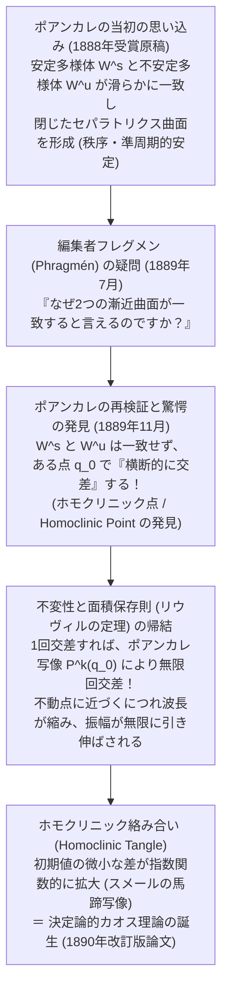

## 1. 序論：時計仕掛けの宇宙に潜む「第3の星」の呪い

1687年、アイザック・ニュートン（Isaac Newton）は不朽の名著『自然哲学の数学的諸原理（プリンキピア、*Philosophiæ Naturalis Principia Mathematica*）』を世に送り出し、人類の宇宙観を根底から書き換えた。リンゴを大地へと引き寄せる重力と、月を地球の周回軌道に繋ぎ止める力がまったく同一の「万有引力の法則」に従うことを突き止めたニュートンは、太陽と惑星という<strong>2つの天体</strong>が互いに引き合う運動——すなわち<strong>二体問題（Two-Body Problem）</strong>——を幾何学的・解析的に完全に解き明かしたのである。

そこから導かれた結論は、ヨハネス・ケプラー（Johannes Kepler）がティコ・ブラーエの膨大な観測データから経験的に見出していた3つの法則（楕円軌道の法則、面積速度一定の法則、調和の法則）の完璧な数学的証明であった。2つの星が織りなす軌道は、初期位置と初期速度さえ与えられれば、未来永劫にわたって「円錐曲線（楕円・放物線・双曲線）」という美しい閉じた数式（初等関数）によって寸分の狂いもなく記述できる。この驚異的な成功は、ピエール＝シモン・ラプラス（Pierre-Simon Laplace）をして「宇宙のすべての粒子の位置と運動量を知り得る知性（ラプラスの悪魔）が存在すれば、未来も過去もすべて単一の数式の中に凝縮される」と言わしめるほどの<strong>決定論的（Deterministic）な時計仕掛けの宇宙観</strong>を確立させた。

ところが、ニュートン自身が『プリンキピア』の執筆中から頭を抱え、「これほど私の頭を悩ませ、不眠に陥れた問題はない」と吐露した絶壁がすぐ目の前に聳え立っていた。太陽と地球の系に「月」という<strong>たった1つの第3の天体</strong>を加えた瞬間——すなわち天体の数が $N=2$ から $N=3$ へとわずか1つ増えただけの<strong>三体問題（Three-Body Problem）</strong>になった瞬間——、あれほど完璧に機能していた解析力学の魔法が突如として崩壊し、一般的な未来の軌道を初等関数や代数的な積分で書き下すことが<strong>原理的に不可能</strong>になるのである。

なぜ、星が2つなら高校生や大学初年次の微積分でも解けるのに、星が3つになった途端に人類最高の数学者たちが300年以上にわたって跳ね返され続けたのか？ そこには単なる「計算の複雑さ」ではなく、ハミルトン力学系における<strong>位相空間（Phase Space）の次元と保存量（運動の積分）の決定的な不足</strong>、そしてアンリ・ポアンカレ（Henri Poincaré）が19世紀末に扉を開いた<strong>非可積分性（Non-Integrability）とカオス（Chaos）</strong>という深遠な数学的構造が横たわっている。

本稿では、以下の5つの柱を通じて、三体問題と天体力学の深淵を数理的に徹底解剖していく。

1. <strong>二体問題の完全可積分性と三体問題の次元の壁</strong>：ハミルトン力学におけるリウヴィル＝アーノルド（Liouville-Arnold）の可積分性定理、10個の古典的保存量、ラプラス＝ルンゲ＝レンツ・ベクトルによる超可積分性、そしてブルンス（Bruns）とポアンカレの非可積分性定理（およびズンドマン級数の罠）。
2. <strong>円制限三体問題（CR3BP）とオイラー・ラグランジュの5つの平衡点（$L_1 \sim L_5$）</strong>：回転座標系における有効ポテンシャル、ヤコビ積分（ゼロ速度曲面）、直線解 $L_1, L_2, L_3$ の不安定性とジェイムズ・ウェッブ宇宙望遠鏡（JWST）のハロー軌道、正三角形解 $L_4, L_5$ を安定化させるコリオリ力の魔法とラウスの臨界質量比（トロヤ群小惑星）。
3. <strong>オスカル2世の懸賞問題とポアンカレの「歴史的誤り」</strong>：印刷済みの論文を自費で回収させたフレグメン（Phragmén）の指摘と、安定多様体・不安定多様体の横断的交差（ホモクリニック絡み合い）から生まれたカオス理論の産声。
4. <strong>変分法が切り拓いた現代の奇跡「8の字周期解」</strong>：ムーア（Moore）およびシェンシネ＝モンゴメリ（Chenciner & Montgomery）による等質量三体の舞踏（コレオグラフィ）と、数千に及ぶ新周期軌道族の発見。
5. <strong>KAM定理（コルモゴロフ・アーノルド・モーザー定理）と太陽系の運命</strong>：小分母問題（Small Divisors Problem）の克服、ディオファントス条件を満たす不変トーラスの生き残り、アーノルド拡散、そしてジャック・ラスカル（Jacques Laskar）の大規模数値積分が暴いた太陽系のリアプノフ時間（約500万年）と水星軌道崩壊のリスク。

---

## 2. 二体問題の完全可積分性と、三体問題が直面する「自由度の壁」

### 2.1 重力 $N$ 体問題の運動方程式とハミルトン形式

質量 $m_1, m_2, \dots, m_N$ を持つ $N$ 個の質点が、慣性系 $\mathbb{R}^3$ 内の位置ベクトル $\mathbf{r}_i = (x_i, y_i, z_i)^T \in \mathbb{R}^3$ （$i = 1, \dots, N$）にあり、万有引力定数 $G$ のもとで互いにニュートン重力のみを及ぼし合って運動する系を考えよう。ニュートンの運動の第2法則と万有引力の法則より、第 $i$ 天体の運動方程式は次の一見シンプルな連立2階常微分方程式系として書ける。

$$m_i \frac{d^2 \mathbf{r}_i}{dt^2} = \sum_{\substack{j=1 \\ j \ne i}}^{N} \frac{G m_i m_j (\mathbf{r}_j - \mathbf{r}_i)}{\|\mathbf{r}_j - \mathbf{r}_i\|^3} \qquad (i = 1, 2, \dots, N)$$

これを解析力学の最も強力な枠組みである<strong>ハミルトン形式（Hamiltonian Formalism）</strong>で書き直そう。一般化座標を $\mathbf{q} = (\mathbf{r}_1, \dots, \mathbf{r}_N) \in \mathbb{R}^{3N}$、それに共役な運動量を $\mathbf{p} = (\mathbf{p}_1, \dots, \mathbf{p}_N) \in \mathbb{R}^{3N}$（ただし $\mathbf{p}_i = m_i \dot{\mathbf{r}}_i$）と定義すると、系の全エネルギーを表すハミルトニアン $H(\mathbf{q}, \mathbf{p})$ は運動エネルギー $T(\mathbf{p})$ とポテンシャルエネルギー $V(\mathbf{q})$ の和となる。

$$H(\mathbf{q}, \mathbf{p}) = T(\mathbf{p}) + V(\mathbf{q}) = \sum_{i=1}^{N} \frac{\|\mathbf{p}_i\|^2}{2m_i} - \sum_{1 \le i < j \le N} \frac{G m_i m_j}{\|\mathbf{r}_i - \mathbf{r}_j\|}$$

このとき、2階の微分方程式 $3N$ 個は、座標と運動量を合わせた<strong>$6N$ 次元の位相空間（Phase Space）</strong> $M = T^*(\mathbb{R}^{3N} \setminus \Delta)$（ここで $\Delta$ は衝突特異点集合 $\mathbf{r}_i = \mathbf{r}_j$）上の1階連立常微分方程式 $6N$ 個（ハミルトンの正準方程式）へと変換される。

$$\frac{d\mathbf{r}_i}{dt} = \frac{\partial H}{\partial \mathbf{p}_i} = \frac{\mathbf{p}_i}{m_i}, \qquad \frac{d\mathbf{p}_i}{dt} = -\frac{\partial H}{\partial \mathbf{r}_i} = -\frac{\partial V}{\partial \mathbf{r}_i} \qquad (i = 1, \dots, N)$$

任意の滑らかな物理量 $F(\mathbf{q}, \mathbf{p}, t)$ の時間発展は、<strong>ポアソン括弧（Poisson Bracket）</strong>

$$\{F, G\} \equiv \sum_{i=1}^{N} \sum_{\alpha \in \{x,y,z\}} \left( \frac{\partial F}{\partial q_{i,\alpha}} \frac{\partial G}{\partial p_{i,\alpha}} - \frac{\partial F}{\partial p_{i,\alpha}} \frac{\partial G}{\partial q_{i,\alpha}} \right)$$

を用いて $\frac{dF}{dt} = \frac{\partial F}{\partial t} + \{F, H\}$ と表される。時間に陽に依存しない関数 $I(\mathbf{q}, \mathbf{p})$ が $\{I, H\} = 0$ を満たすとき、$I$ は軌道に沿って値が一切変化しない<strong>第一積分（First Integral / 運動の積分 / 保存量）</strong>と呼ばれる。

### 2.2 リウヴィル＝アーノルドの可積分性定理と10個の古典的保存量

では、微分方程式が「解析的に解ける（求積法で解ける / 可積分である）」とは数学的にどういうことか？

1階常微分方程式が1つ増えるごとに、初期条件に対応する積分定数が1つ必要になる。$6N$ 次元の位相空間を動く軌道を代数的な消去と1変数の積分（求積：Quadrature）だけで完全に決定するためには、原理的に $6N$ 個の独立な条件が必要である。しかしハミルトン系にはシンプレクティック構造（正準構造）という強力な幾何学的対称性が備わっているため、<strong>リウヴィル＝アーノルドの定理（Liouville-Arnold Theorem, 1855 / 1963）</strong>によって必要条件が劇的に半減する。

> <strong>定理（リウヴィル＝アーノルドの可積分性定理）</strong>：
> 自由度 $n$（すなわち位相空間の次元が $2n$）の自律ハミルトン系において、互いに機能的に独立であり、かつ互いに<strong>包合系（In Involution：すべてのペアでポアソン括弧がゼロ $\{F_i, F_j\} = 0$）</strong>をなす $n$ 個の第一積分 $F_1(=H), F_2, \dots, F_n$ が存在するならば、系は<strong>完全可積分（Completely Integrable）</strong>であり、正準変換によって作用・角変数 $(\mathbf{I}, \boldsymbol{\theta})$ に移ることで求積法により解くことができる。さらに、等位集合 $M_{\mathbf{f}} = \{(\mathbf{q}, \mathbf{p}) \mid F_i(\mathbf{q}, \mathbf{p}) = f_i\}$ が連結かつコンパクトであれば、それは $n$ 次元不変トーラス $\mathbb{T}^n$ に微分同相であり、その上の運動は一定角速度 $\dot{\boldsymbol{\theta}} = \boldsymbol{\omega}(\mathbf{I})$ の準周期運動となる。

ここで、空間の並進対称性・回転対称性・時間並進対称性（ネーターの定理：Noether's Theorem）から、天体数 $N$ がいくつであっても<strong>常に成り立つ10個の古典的代数積分（Classical Integrals of Motion）</strong>を数え上げてみよう。

1. <strong>全運動量の保存（3個）と重心の一様直線運動（3個）＝ 計6個</strong>：
   外力が働かないため、系全体の全運動量ベクトル $\mathbf{P} \in \mathbb{R}^3$ は保存される。
   $$\mathbf{P} = \sum_{i=1}^{N} \mathbf{p}_i = \text{const.} \quad (\text{成分 } P_x, P_y, P_z \text{ の3個})$$
   さらに全質量を $M = \sum_{i=1}^N m_i$、重心（バリセンター）を $\mathbf{R}_{\text{CM}} = \frac{1}{M}\sum_{i=1}^N m_i \mathbf{r}_i$ とすると、重心は等速直線運動を行うため、時刻 $t$ を含む次の3つの積分（重心積分）が得られる。
   $$\mathbf{G}_{\text{CM}} = M \mathbf{R}_{\text{CM}} - \mathbf{P} t = \text{const.} \quad (\text{成分 } G_x, G_y, G_z \text{ の3個})$$
   重心の位置と速度を原点に固定する座標系（重心静止系：$\mathbf{R}_{\text{CM}} = \mathbf{0}, \mathbf{P} = \mathbf{0}$）に移ることで、位相空間の次元 $6N$ から<strong>無条件に6次元を減らす（$6N \to 6N - 6$）</strong>ことができる。
2. <strong>全角運動量の保存（3個）</strong>：
   ポテンシャル $V$ が距離 $\|\mathbf{r}_i - \mathbf{r}_j\|$ のみに依存し回転不変であるため、全角運動量ベクトル $\mathbf{L} \in \mathbb{R}^3$ が保存される。
   $$\mathbf{L} = \sum_{i=1}^{N} \mathbf{r}_i \times \mathbf{p}_i = \text{const.} \quad (\text{成分 } L_x, L_y, L_z \text{ の3個})$$
   ただし注意点がある。角運動量の3成分は互いにポアソン括弧がゼロではない（$\{L_x, L_y\} = L_z \ne 0$ という $\mathfrak{so}(3)$ リー代数をなす）。互いに可換（$\{\cdot, \cdot\} = 0$）な独立成分として取り出せるのは、<strong>全角運動量の大きさの2乗 $\|\mathbf{L}\|^2 = L_x^2 + L_y^2 + L_z^2$</strong> と<strong>1つの軸成分 $L_z$</strong> の2個であり、さらにヤコビの「交点消去法（Elimination of the Nodes, 1842）」を用いることで、回転対称性全体から合計4次元分の位相空間縮約が可能となる。
3. <strong>全力学的エネルギーの保存（1個）</strong>：
   ハミルトニアン $H$ が時間 $t$ を陽に含まないため、エネルギー $E$ が保存される。
   $$H(\mathbf{q}, \mathbf{p}) = E = \text{const.} \quad (1\text{個})$$

以上を合計すると、空間の時空対称性から得られる普遍的な保存量は <strong>$6 + 3 + 1 = 10$ 個</strong>である。

### 2.3 なぜ $N=2$（二体問題）は完全に解け、$N=3$（三体問題）は破綻するのか？

この「10個の保存量」と「リウヴィル＝アーノルドの定理」を使って、$N=2$ と $N=3$ の決定的な違いを位相空間の次元計算（Degree-of-Freedom Accounting）で比較してみよう。

```mermaid
flowchart TD
    subgraph TwoBody["二体問題 (N = 2)：位相空間 12次元 (自由度 6)"]
        TB1["初期位相空間：6 × 2 = 12次元"] --> TB2["重心運動の分離 (6個の保存量)<br/>重心系へ移行：12 - 6 = 6次元 (相対自由度 3)"]
        TB2 --> TB3["相対ハミルトン系 (自由度 n = 3)<br/>可換な3個の保存量：H_rel, |L|^2, L_z"]
        TB3 --> TB4["リウヴィル＝アーノルド可積分条件 (3 = 3) 達成！<br/>さらにラプラス＝ルンゲ＝レンツ・ベクトル A により超可積分"]
        TB4 --> TB5["完全解析解：ケプラーの円錐曲線軌道<br/>(楕円・放物線・双曲線として永久に予測可能)"]
    end

    subgraph ThreeBody["三体問題 (N = 3)：位相空間 18次元 (自由度 9)"]
        THB1["初期位相空間：6 × 3 = 18次元"] --> THB2["ヤコビ座標による重心分離 (6個の保存量)<br/>18 - 6 = 12次元 (相対自由度 6)"]
        THB2 --> THB3["角運動量 L (3個) と交点消去法 + エネルギー E (1個)<br/>さらに時間変数消去を行っても 7〜8次元が残存"]
        THB3 --> THB4["相対自由度 n = 6 に対し、可換な第一積分は<br/>H, |L|^2, L_z の『3個』しか存在しない (3 < 6)！"]
        THB4 --> THB5["ブルンスの定理 (1887) ＆ ポアンカレの定理 (1889)<br/>一般三体問題は非可積分・カオスへ"]
    end
```

#### ① 二体問題（$N=2$）の完全可積分性とラプラス＝ルンゲ＝レンツ・ベクトル
$N=2$ のとき、位相空間の次元は $6 \times 2 = 12$ 次元（自由度 $n = 6$）である。
重心座標 $\mathbf{R}_{\text{CM}} = \frac{m_1 \mathbf{r}_1 + m_2 \mathbf{r}_2}{m_1 + m_2}$ と相対位置ベクトル $\mathbf{r} = \mathbf{r}_1 - \mathbf{r}_2$、そして<strong>換算質量（Reduced Mass）</strong> $\mu_{\text{red}} = \frac{m_1 m_2}{m_1 + m_2}$ を導入すると、6個の重心保存量によって重心運動は完全に分離され、残る相対運動の位相空間は<strong>6次元（自由度 $n_{\text{rel}} = 3$）</strong>となる。相対ハミルトニアンは次式で与えられる。

$$H_{\text{rel}}(\mathbf{r}, \mathbf{p}) = \frac{\|\mathbf{p}\|^2}{2\mu_{\text{red}}} - \frac{G m_1 m_2}{\|\mathbf{r}\|}$$

自由度が $n_{\text{rel}} = 3$ であるから、リウヴィル＝アーノルドの定理により、互いにポアソン括弧がゼロとなる独立な保存量が<strong>3個</strong>あれば完全に解ける。そして我々の手元には、まさに

$$F_1 = H_{\text{rel}}, \qquad F_2 = \|\mathbf{L}\|^2, \qquad F_3 = L_z \qquad (\{F_i, F_j\} = 0)$$

という<strong>3個の可換な第一積分</strong>が揃っている！ すなわち、必要な自由度3に対して保存量が3個ぴったり存在するため、運動は軌道平面（$\mathbf{r} \perp \mathbf{L}$）内の極座標 $(r, \theta)$ へと還元され、有効ポテンシャル $V_{\text{eff}}(r) = -\frac{G m_1 m_2}{r} + \frac{L^2}{2\mu_{\text{red}} r^2}$ を持つ<strong>実質1自由度の求積問題</strong>に帰着する。

それだけではない。ニュートンの逆2乗則重力（$V(r) \propto -1/r$）には、空間の回転対称性 $SO(3)$ を超えた隠れた高次元対称性（束縛状態では4次元回転群 $SO(4)$、散乱状態ではローレンツ群 $SO(3,1)$）が存在し、第4の独立な保存量として<strong>ラプラス＝ルンゲ＝レンツ・ベクトル（Laplace-Runge-Lenz Vector: LRLベクトル）</strong> $\mathbf{A}$ が保存される。

$$\mathbf{A} = \mathbf{p} \times \mathbf{L} - \mu_{\text{red}} G m_1 m_2 \frac{\mathbf{r}}{\|\mathbf{r}\|} = \text{const.}$$

このベクトル $\mathbf{A}$ は軌道平面内で常に近日点（近点：Periapsis）の方向を指し続け、その大きさは軌道の離心率 $e = \frac{\|\mathbf{A}\|}{\mu_{\text{red}} G m_1 m_2}$ に比例する。$\mathbf{r} \cdot \mathbf{A}$ の内積を計算するだけで、微分方程式を一切積分することなく、直ちにケプラーの円錐曲線の方程式が導出される。

$$r(\theta) = \frac{p}{1 + e \cos(\theta - \varpi)}, \qquad p = \frac{\|\mathbf{L}\|^2}{\mu_{\text{red}}^2 G(m_1 + m_2)}$$

自由度3に対して独立な保存量が5個（$\mathbf{L}, H_{\text{rel}}, \mathbf{A}$ の7成分中、直交関係 $\mathbf{L}\cdot\mathbf{A}=0$ と大きさの恒等式 $\mathbf{A}^2 = 2\mu_{\text{red}} H_{\text{rel}} \mathbf{L}^2 + (\mu_{\text{red}} G m_1 m_2)^2$ を除いた5個）も存在するこのような系を<strong>最大超可積分系（Maximally Superintegrable System）</strong>と呼ぶ。二体問題の楕円軌道が歳差運動もせずに永久に同じ閉曲線を回り続けるのは、この奇跡的な超可積分性のおかげなのである。

#### ② 三体問題（$N=3$）における次元の崩壊とブルンス・ポアンカレの定理
では、$N=3$ の三体問題では何が起きるのか？
3つの天体があるため、位相空間の次元は <strong>$6 \times 3 = 18$ 次元（自由度 $n = 9$）</strong>に跳ね上がる。
ここで<strong>ヤコビ座標（Jacobi Coordinates）</strong>を導入しよう。

$$\boldsymbol{\rho}_1 = \mathbf{r}_2 - \mathbf{r}_1, \qquad \boldsymbol{\rho}_2 = \mathbf{r}_3 - \frac{m_1 \mathbf{r}_1 + m_2 \mathbf{r}_2}{m_1 + m_2}, \qquad \mathbf{R}_{\text{CM}} = \frac{m_1 \mathbf{r}_1 + m_2 \mathbf{r}_2 + m_3 \mathbf{r}_3}{m_1 + m_2 + m_3}$$

重心 $\mathbf{R}_{\text{CM}}$ の6次元分を分離・消去すると、残る相対運動の位相空間は <strong>$18 - 6 = 12$ 次元（相対自由度 $n_{\text{rel}} = 6$）</strong>となる。
この自由度 $n_{\text{rel}} = 6$ のハミルトン系をリウヴィル＝アーノルドの意味で可積分にするには、互いにポアソン括弧がゼロとなる独立な保存量が<strong>6個</strong>必要である。ところが、普遍的な保存量として残っているのは $H_{\text{rel}}, \|\mathbf{L}\|^2, L_z$ の<strong>3個</strong>（ヤコビの交点消去法で回転対称性を最大限使い切っても4次元分の縮約）しかなく、エネルギー曲面 $H = E$ の固定と時間変数の消去を行っても、最終的に<strong>7次元（あるいは8次元の簡約位相空間）の未知の自由度</strong>がそのまま取り残されてしまう！

| 比較項目 | 二体問題 ($N=2$) | 一般三体問題 ($N=3$) | 平面円制限三体問題 (PCR3BP) |
| :--- | :--- | :--- | :--- |
| <strong>初期位相空間の次元 ($6N$)</strong> | $12$ 次元（自由度 $6$） | $18$ 次元（自由度 $9$） | $4$ 次元（第3天体のみ、自由度 $2$） |
| <strong>重心分離後の相対位相空間</strong> | $6$ 次元（相対自由度 $3$） | $12$ 次元（相対自由度 $6$） | $4$ 次元（回転座標系での自由度 $2$） |
| <strong>既知の古典的第一積分の総数</strong> | $10$ 個（＋LRLベクトル $\mathbf{A}$） | $10$ 個（重心 $6$ ＋角運動量 $3$ ＋エネルギー $1$） | $1$ 個（ヤコビ積分 $C_J$ のみ） |
| <strong>可積分に必要な可換積分の数</strong> | $3$ 個（所持数：$3$ 個 ＋ 超可積分） | $6$ 個（所持数：$3$ 個 $\rightarrow$ <strong>3個不足！</strong>） | $2$ 個（所持数：$1$ 個 $\rightarrow$ <strong>1個不足！</strong>） |
| <strong>対称性・エネルギー縮約後の残存次元</strong> | $0$ 次元（1変数の求積へ完全帰着） | $7 \sim 8$ 次元（消去不能な非線形連立系） | $3$ 次元エネルギー多様体（2次元ポアンカレ写像） |
| <strong>力学系の性質</strong> | 完全可積分・超可積分（周期・円錐曲線） | <strong>非可積分</strong>（カオス・ホモクリニック絡み合い） | <strong>非可積分</strong>（KAMトーラスとカオスの共存） |

18世紀から19世紀にかけて、オイラー、ラグランジュ、ラプラス、ヤコビ、ハミルトンらは「まだ人類が見つけていない第11、第12の隠れた保存量があるはずだ」と信じて探索を続けた。しかし、その希望は2つの非可積分性定理によって完全に打ち砕かれた。

* <strong>ブルンスの定理（Bruns's Theorem, 1887）</strong>：ドイツの天文学者ハインリヒ・ブルンスは、三体問題において座標 $\mathbf{q}$ と運動量 $\mathbf{p}$ の代数関数として書ける独立な第一積分は、<strong>古典的な10個の積分以外には一切存在しない</strong>ことを厳密に証明した。
* <strong>ポアンカレの非可積分性定理（Poincaré's Non-Integrability Theorem, 1889）</strong>：アンリ・ポアンカレはさらに踏み込み、摂動パラメータ $\mu$ を含む制限三体問題において、作用・角変数に関して一様解析的（Analytic）な新しい第一積分は<strong>ハミルトニアン（ヤコビ積分）以外に存在しない</strong>ことを証明した。

> [!NOTE]
> <strong>補足：ズンドマンの収束級数解（1912年）は「三体問題を解いた」と言えるのか？</strong>
> 1912年、フィンランドの数学者カール・ズンドマン（Karl Frithiof Sundman）は、全角運動量 $\mathbf{L} \ne \mathbf{0}$（三体同時衝突が起きない条件）のもとで、二体衝突の特異点を解消する非線形時間変換 $dt = r\,d\tau$（局所的に $t^{1/3}$ に比例するレヴィ＝チヴィタ正則化）と複素平面の帯状領域を単位円板へ写す等角写像を組み合わせることで、すべての時刻 $t$ で絶対収束する<strong>べき級数解</strong>を構成することに成功した（1991年には秋東（Qiu-Dong Wang）が $N$ 体問題へ一般化）。
> しかし、このズンドマン級数は<strong>「物理的・実用的な予測には全く役に立たない」</strong>ことで有名である。1930年にダヴィド・ベロリツキー（David Beloriszky）が検証したところ、惑星の軌道をわずか1周期分、天文観測の精度で計算するだけでも、ズンドマン級数の項を少なくとも <strong>$10^{8,000,000}$ 項（1の後ろに0が800万個並ぶ数）</strong>足し合わせなければならないことが判明した！ 観測可能な宇宙に存在する全原子の総数が約 $10^{80}$ 個であることを思えば、$10^{8,000,000}$ 項の和を計算することは宇宙の寿命が尽きても不可能である。これこそが「数学的な無限級数の存在」と「可積分性・未来予測可能性」が全く別物である理由なのだ。

---

## 3. 嵐の中の静寂：円制限三体問題（CR3BP）とオイラー・ラグランジュの5つの平衡点

一般三体問題が解析的に解けないという絶望の中で、18世紀の二大巨頭レオンハルト・オイラー（Leonhard Euler, 1767）とジョゼフ＝ルイ・ラグランジュ（Joseph-Louis Lagrange, 1772）は、特殊な幾何学的配置のもとで3つの天体が形を保ったまま回転する<strong>厳密な特殊解（平衡点）</strong>が存在することを発見した。

### 3.1 円制限三体問題（CR3BP）の運動方程式とヤコビ積分

太陽と地球に対する人工衛星や、太陽と木星に対する小惑星のように、2つの巨大な主天体 $m_1, m_2$ （$m_1 \ge m_2$）に比べて第3の天体 $m_3$ の質量が無視できるほど小さい（$m_3 \to 0$）近似を<strong>制限三体問題（Restricted Three-Body Problem）</strong>と呼ぶ。さらに、主天体 $m_1$ と $m_2$ が共通重心の周りを一定の距離 $a$、一定の角速度 $\omega = \sqrt{G(m_1 + m_2)/a^3}$ で<strong>円軌道</strong>を描いて公転している場合を<strong>円制限三体問題（Circular Restricted Three-Body Problem: CR3BP）</strong>という。

計算を最も美しく見通しよくするため、次の<strong>無次元化（Dimensionless Normalization）</strong>を導入しよう。
* 質量の単位：$m_1 + m_2 = 1$ とし、<strong>質量比パラメータ $\mu$</strong> を次のように定義する。
  $$\mu \equiv \frac{m_2}{m_1 + m_2} \in \left(0, \frac{1}{2}\right] \implies \text{主天体1の質量 } = 1 - \mu, \quad \text{主天体2の質量 } = \mu$$
* 長さの単位：主天体間の距離 $a = 1$ とする。
* 時間の単位：公転角速度 $\omega = 1$ となるように選ぶ（これにより $G(m_1 + m_2) = 1$ となり、1公転周期は $2\pi$ となる）。

ここで、2つの主天体と一緒に角速度 $\boldsymbol{\omega} = (0, 0, 1)^T$ で回転する<strong>共回転座標系（Synodic Frame） $(x, y, z)$</strong> に乗って運動を眺めよう。$x$ 軸を2つの主天体を結ぶ直線にとり、原点を共通重心に置くと、2つの主天体は回転座標系の中で<strong>永久に静止</strong>して見える。
* <strong>主天体1（質量 $1 - \mu$）の位置</strong>：$(-\mu, 0, 0)$
* <strong>主天体2（質量 $\mu$）の位置</strong>：$(1 - \mu, 0, 0)$

第3天体（位置 $(x, y, z)$）から各主天体までの距離 $r_1, r_2$ は次式となる。

$$r_1 = \sqrt{(x + \mu)^2 + y^2 + z^2}, \qquad r_2 = \sqrt{(x - 1 + \mu)^2 + y^2 + z^2}$$

回転座標系における加速度は、慣性系での加速度に<strong>コリオリの力（$-2\boldsymbol{\omega} \times \dot{\mathbf{r}}$）</strong>と<strong>遠心力（$-\boldsymbol{\omega} \times (\boldsymbol{\omega} \times \mathbf{r})$）</strong>が加わるため、運動方程式は次のようになる。

$$\ddot{x} - 2\dot{y} = x - \frac{(1 - \mu)(x + \mu)}{r_1^3} - \frac{\mu(x - 1 + \mu)}{r_2^3}$$

$$\ddot{y} + 2\dot{x} = y - \frac{(1 - \mu)y}{r_1^3} - \frac{\mu y}{r_2^3}$$

$$\ddot{z} = -\frac{(1 - \mu)z}{r_1^3} - \frac{\mu z}{r_2^3}$$

ここで、遠心力ポテンシャル $\frac{1}{2}(x^2 + y^2)$ と万有引力ポテンシャルを 합体させた<strong>有効ポテンシャル（Effective Potential / 擬ポテンシャル） $\Omega(x, y, z)$</strong> を定義しよう（天体力学の慣習に従い、力の向きが $+\nabla \Omega$ となる符号をとる）。

$$\Omega(x, y, z) \equiv \frac{1}{2}(x^2 + y^2) + \frac{1 - \mu}{r_1} + \frac{\mu}{r_2}$$

すると、CR3BPの運動方程式は驚くほど簡潔な形で書き下せる。

$$\ddot{x} - 2\dot{y} = \frac{\partial \Omega}{\partial x}, \qquad \ddot{y} + 2\dot{x} = \frac{\partial \Omega}{\partial y}, \qquad \ddot{z} = \frac{\partial \Omega}{\partial z}$$

この3式の両辺にそれぞれ $\dot{x}, \dot{y}, \dot{z}$ を掛けて足し合わせると、左辺のコリオリ力の項 $-2\dot{x}\dot{y} + 2\dot{y}\dot{x} = 0$ が恒等的にキャンセル（コリオリ力は常に速度と直交するため仕事をしない！）し、時間について積分することでCR3BPにおける<strong>唯一の厳密な保存量であるヤコビ積分（Jacobi Integral / ヤコビ定数 $C_J$）</strong>が得られる。

$$C_J \equiv 2\Omega(x, y, z) - (\dot{x}^2 + \dot{y}^2 + \dot{z}^2) = x^2 + y^2 + \frac{2(1 - \mu)}{r_1} + \frac{2\mu}{r_2} - v_{\text{rot}}^2 = \text{const.}$$

回転座標系における速さの2乗 $v_{\text{rot}}^2 = \dot{x}^2 + \dot{y}^2 + \dot{z}^2 = 2\Omega(x, y, z) - C_J$ は必ず非負（$v_{\text{rot}}^2 \ge 0$）でなければならない。したがって、与えられたヤコビ定数 $C_J$ を持つ天体は、

$$2\Omega(x, y, z) \ge C_J$$

を満たす空間領域（<strong>ヒル領域：Hill's Region</strong>）の外側へは物理的に絶対に出ることができない。その境界曲面 $2\Omega(x, y, z) = C_J$（$v_{\text{rot}} = 0$）を<strong>ゼロ速度曲面（Zero-Velocity Surface / 平面内ではゼロ速度曲線 ZVC）</strong>と呼ぶ。$C_J$ の値を大きく（エネルギーを低く）していくと、ゼロ速度曲面が閉じて天体は主天体の周りから脱出できなくなり、逆に $C_J$ を下げていくと、まずある特別な「峠（鞍点）」から順番にゲートが開いていく。その峠と山頂こそが、次に導出する<strong>ラグランジュ点（$L_1 \sim L_5$）</strong>なのである。

### 3.2 オイラーの3つの直線平衡点（$L_1, L_2, L_3$）の導出

回転座標系の中で速度も加速度もゼロ（$\dot{x} = \dot{y} = \dot{z} = 0$ かつ $\ddot{x} = \ddot{y} = \ddot{z} = 0$）となり、2つの主天体との相対位置を保ったまま永遠に静止し続けられる平衡点を探そう。平衡条件は有効ポテンシャル $\Omega$ の勾配がゼロとなることである。

$$\nabla \Omega(x, y, z) = \mathbf{0} \iff \frac{\partial \Omega}{\partial x} = 0, \quad \frac{\partial \Omega}{\partial y} = 0, \quad \frac{\partial \Omega}{\partial z} = 0$$

第3式 $\frac{\partial \Omega}{\partial z} = -z\left(\frac{1-\mu}{r_1^3} + \frac{\mu}{r_2^3}\right) = 0$ より、すべての平衡点は必ず公転平面内（<strong>$z = 0$</strong>）に存在することが直ちにわかる。

まず、1767年にオイラーが発見した<strong>直線解（Collinear Points：$y = 0, z = 0$）</strong>を求めよう。$y = 0$ を代入すると $\frac{\partial \Omega}{\partial y} = 0$ は自動的に満たされ、$x$ 軸上の力の釣り合い $\frac{\partial \Omega}{\partial x} = 0$ は次の<strong>5次代数方程式</strong>を与える。

$$f(x) = x - \frac{(1 - \mu)(x + \mu)}{|x + \mu|^3} - \frac{\mu(x - 1 + \mu)}{|x - 1 + \mu|^3} = 0$$

主天体1の位置 $x = -\mu$ と主天体2の位置 $x = 1 - \mu$ を境目として、実軸は3つの開区間 $(-\infty, -\mu)$、$(-\mu, 1-\mu)$、$(1-\mu, +\infty)$ に分割される。どの区間でも導関数は

$$f'(x) = 1 + \frac{2(1 - \mu)}{|x + \mu|^3} + \frac{2\mu}{|x - 1 + \mu|^3} > 0$$

と厳密に正（単調増加）であり、かつ各区間の両端で $f(x)$ は $-\infty$ から $+\infty$ へと変化するため、中間値の定理より<strong>各区間に必ずただ1つずつ、合計3つの実数解 $L_1, L_2, L_3$ が存在する</strong>。

1. <strong>$L_1$ 点（主天体1と主天体2の間：$-\mu < x < 1 - \mu$）</strong>：
   主天体2からの距離を $\xi = (1 - \mu) - x > 0$ と置き、惑星が恒星に比べて十分軽い場合（$\mu \ll 1$）に展開すると、$3\xi^3 \approx \mu$ となり、よく知られた<strong>ヒル球半径（Hill Radius）</strong>の近似式が得られる。
   $$r_{2}(L_1) \approx a \left(\frac{\mu}{3}\right)^{1/3} \left[1 - \frac{1}{3}\left(\frac{\mu}{3}\right)^{1/3} - \mathcal{O}(\mu^{2/3})\right]$$
   太陽・地球系（$\mu \approx 3.003 \times 10^{-6}, a \approx 1.496 \times 10^8\text{ km}$）では、地球から太陽側へ約 <strong>150万 km（$0.01\text{ AU}$）</strong>の地点が $L_1$ となる。太陽の引力を地球の逆向き引力がわずかに相殺することで、公転周期が地球とぴったり同じ1年になる絶妙なバランス点である。
2. <strong>$L_2$ 点（主天体2の外側：$x > 1 - \mu$）</strong>：
   同様に主天体2からの距離を $\xi = x - (1 - \mu) > 0$ と置くと、やはり主項はヒル球半径で与えられ、
   $$r_{2}(L_2) \approx a \left(\frac{\mu}{3}\right)^{1/3} \left[1 + \frac{1}{3}\left(\frac{\mu}{3}\right)^{1/3} - \mathcal{O}(\mu^{2/3})\right]$$
   太陽・地球系では、地球から太陽と反対側（外側）へ約 <strong>150万 km</strong> の地点が $L_2$ となる。通常なら太陽から遠ざかるほどケプラーの法則で公転周期は長くなるはずだが、太陽と地球の2つの引力が合算して求心力を強めるため、地球と同じ1年周期で公転できる。
3. <strong>$L_3$ 点（主天体1の反対側：$x < -\mu$）</strong>：
   太陽を挟んで地球のちょうど裏側にある平衡点であり、$\mu \ll 1$ で展開すると主天体1からの距離は
   $$x(L_3) \approx -1 - \frac{5}{12}\mu + \mathcal{O}(\mu^2)$$
   となり、地球の公転軌道よりごくわずかに外側に位置する。

### 3.3 ラグランジュの2つの正三角形平衡点（$L_4, L_5$）のエレガントな導出

次に、1772年にラグランジュが発見した平面内の非直線解（$y \ne 0, z = 0$）を導出しよう。直交座標 $(x, y)$ のまま偏微分を計算してもよいが、$r_1^2 = (x+\mu)^2 + y^2$ と $r_2^2 = (x-1+\mu)^2 + y^2$ を用いて $(1-\mu)r_1^2 + \mu r_2^2 = x^2 + y^2 + \mu(1-\mu)$ という恒等式に注目すると、有効ポテンシャル $\Omega$ は距離 $r_1, r_2$ だけの関数として極めて対称的な形に書き換えられる！

$$\Omega(r_1, r_2) = \frac{1 - \mu}{2}\left(r_1^2 + \frac{2}{r_1}\right) + \frac{\mu}{2}\left(r_2^2 + \frac{2}{r_2}\right) - \frac{1}{2}\mu(1 - \mu)$$

$y \ne 0$ のとき $(x, y) \mapsto (r_1, r_2)$ は局所的に正則な座標変換であるため、$\nabla_{x,y} \Omega = \mathbf{0}$ は $\frac{\partial \Omega}{\partial r_1} = 0$ かつ $\frac{\partial \Omega}{\partial r_2} = 0$ と完全に同値である。微分すると、

$$\frac{\partial \Omega}{\partial r_1} = (1 - \mu)\left(r_1 - \frac{1}{r_1^2}\right) = 0, \qquad \frac{\partial \Omega}{\partial r_2} = \mu\left(r_2 - \frac{1}{r_2^2}\right) = 0$$

なんと質量比 $\mu$ の値に一切依存せず、直ちに次の解が得られる！

$$r_1 = 1, \qquad r_2 = 1$$

主天体1と主天体2の距離も $1$ であったから、$r_1 = r_2 = 1$ とはすなわち、<strong>3つの天体が1辺の長さ $1$ の「正三角形（Equilateral Triangle）」の頂点をなす位置</strong>に他ならない！ 座標で表せば、主天体2の公転方向の前方 $60^\circ$ にある <strong>$L_4$ 点</strong>と、後方 $60^\circ$ にある <strong>$L_5$ 点</strong>である。

$$L_4 = \left(\frac{1}{2} - \mu, \; +\frac{\sqrt{3}}{2}, \; 0\right), \qquad L_5 = \left(\frac{1}{2} - \mu, \; -\frac{\sqrt{3}}{2}, \; 0\right)$$

### 3.4 線形安定性解析：コリオリ力の魔法、ラウスの臨界質量比、そして宇宙望遠鏡の軌道力学

5つの平衡点 $L_1 \sim L_5$ は見つけた。しかし物理学・工学において最も重要な問いは<strong>「そこに置いた天体は、わずかな摂動（太陽風や他惑星の引力）を受けてもそこにとどまり続けるか（安定か）、それとも指数関数的に逃げ出してしまうか（不安定か）？」</strong>である。

平衡点 $(x_0, y_0, 0)$ の周りの微小変位を $(\xi, \eta, \zeta) = (x - x_0, y - y_0, z - 0)$ とすると、$z$ 方向の運動は平面内運動と分離して単振動 $\ddot{\zeta} = -\left(\frac{1-\mu}{r_{10}^3} + \frac{\mu}{r_{20}^3}\right)\zeta = -\omega_z^2 \zeta$ となるため、常に垂直方向には中立安定（周期振動）である。一方、公転平面内の線形化方程式は次のようになる（$\Omega_{xx} \equiv \left.\frac{\partial^2 \Omega}{\partial x^2}\right|_0$ などと略記する）。

$$\begin{cases}
\ddot{\xi} - 2\dot{\eta} = \Omega_{xx} \xi + \Omega_{xy} \eta \\
\ddot{\eta} + 2\dot{\xi} = \Omega_{xy} \xi + \Omega_{yy} \eta
\end{cases}$$

固有モード $\begin{pmatrix} \xi \\ \eta \end{pmatrix} = \begin{pmatrix} \xi_0 \\ \eta_0 \end{pmatrix} e^{\lambda t}$ を代入すると、固有値 $\lambda$ に関する<strong>4次の特性方程式（双2次方程式）</strong>が得られる。

$$\det \begin{pmatrix} \lambda^2 - \Omega_{xx} & -2\lambda - \Omega_{xy} \\ 2\lambda - \Omega_{xy} & \lambda^2 - \Omega_{yy} \end{pmatrix} = \lambda^4 + (4 - \Omega_{xx} - \Omega_{yy})\lambda^2 + (\Omega_{xx}\Omega_{yy} - \Omega_{xy}^2) = 0$$

系が線形安定であるための必要十分条件は、4つの固有値 $\lambda_1, \lambda_2, \lambda_3, \lambda_4$ がすべて<strong>純虚数 $\lambda = \pm i\omega$</strong>（すなわち $\Lambda \equiv \lambda^2$ がすべて実数かつ負：$\Lambda < 0$）となることである。

#### ① 直線点 $L_1, L_2, L_3$ の鞍点不安定性と「ハロー軌道・JWST」の秘密
直線点 $L_1, L_2, L_3$ 上では $y_0 = 0$ より $\Omega_{xy} = 0$ であり、有効ポテンシャルの2階微分を計算すると、パラメータ $A \equiv \frac{1-\mu}{r_{10}^3} + \frac{\mu}{r_{20}^3} > 1$ を用いて

$$\Omega_{xx} = 1 + 2A > 3 > 0, \qquad \Omega_{yy} = 1 - A < 0$$

となる。すると特性方程式の定数項（ヘッセ行列式）は

$$\Lambda_1 \Lambda_2 = \Omega_{xx} \Omega_{yy} = (1 + 2A)(1 - A) < 0$$

となり、2つの根 $\Lambda_1, \Lambda_2$ は必ず異符号（$\Lambda_1 > 0, \Lambda_2 < 0$）となる！
* $\Lambda_1 > 0 \implies \lambda_{1,2} = \pm \sigma$（実数解：一方は指数関数的に発散する不安定多様体 $e^{+\sigma t}$、もう一方は収束する安定多様体 $e^{-\sigma t}$）
* $\Lambda_2 < 0 \implies \lambda_{3,4} = \pm i\omega_{xy}$（純虚数解：平面内の周期振動モード）

つまり、<strong>オイラーの直線点 $L_1, L_2, L_3$ は質量比 $\mu$ がどんな値であっても常に不安定な「鞍点（Saddle $\times$ Center $\times$ Center）」</strong>なのである。

ここで読者は疑問に思うだろう。<strong>「もし $L_1$ や $L_2$ が不安定な鞍点なら、なぜ太陽観測衛星 SOHO や DSCOVR は $L_1$ に、そしてジェイムズ・ウェッブ宇宙望遠鏡（JWST）やガイア（Gaia）、プランク（Planck）は $L_2$ に配置されているのか？」</strong>

その答えこそが、この「鞍点 $\times$ 中心（$\pm \sigma, \pm i\omega_{xy}, \pm i\omega_z$）」という固有値構造そのものにある！
1. <strong>リサジュー軌道（Lissajous Orbit）とハロー軌道（Halo Orbit）</strong>：
   4次元の中立安定部分空間（中心多様体：$\pm i\omega_{xy}$ と $\pm i\omega_z$）が存在するため、発散モード $\pm \sigma$ をゼロに抑え込むような初期条件を選べば、何もない空間点である $L_1$ や $L_2$ の周りをぐるぐると周回する準周期的な<strong>リサジュー軌道</strong>、さらに非線形効果によって面内振動周期と面外振動周期が一致した3次元周期軌道である<strong>ハロー軌道（Halo Orbit）</strong>が存在する。
2. <strong>JWSTにとっての $L_2$ ハロー軌道の圧倒的メリット</strong>：
   JWSTは $L_2$ 点そのものに静止しているのではない。$L_2$ 点の周りを半径数十万 km（月軌道よりも大きい！）のハロー軌道を描いて約6ヶ月周期で周回している。これにより、①地球の影（本影・半影）に一度も入らないため太陽電池パネルで常時発電でき、かつ極端な熱変化を避けられる、②太陽・地球・月の3つの巨大な熱源がすべて常に同じ方向（望遠鏡の背後）にあるため、テニスコート大の5層サンシールド1枚でそれらすべての赤外線ノイズを同時に遮断し、鏡を約 $40\text{ K}$（$-233^\circ\text{C}$）の極低温に保てるのだ。
3. <strong>微小な軌道維持（Station-Keeping）と惑星間スーパーハイウェイ（IPS）</strong>：
   もちろん不安定固有値 $\sigma$ が存在するため、放置すれば誤差が時定数 $\tau = 1/\sigma \approx 23\text{ 日}$ で $e$ 倍に増幅して軌道から外れていく。しかし、不安定多様体と安定多様体の分水嶺（セパラトリクス）のすぐ近くに乗り続けるよう、約3週間に1回ごくわずかなスラスタ噴射を行うだけで、<strong>年間わずか $\Delta v \approx 2 \sim 4\text{ m/s}$（歩く速さ程度！）の超低燃費</strong>でハロー軌道を何十年も維持できるのである。さらに、$L_1, L_2$ のハロー軌道から伸びる安定多様体・不安定多様体のチューブ（コンジット）を繋ぎ合わせることで、燃料をほとんど使わずに太陽系内を移動する<strong>惑星間スーパーハイウェイ（Interplanetary Superhighway: IPS）</strong>が設計されている。

#### ② 正三角形点 $L_4, L_5$ のコリオリ安定化と「ラウスの臨界質量比」
では、正三角形点 $L_4, L_5$ はどうだろうか？
驚くべき事実がある。有効ポテンシャル $\Omega(x, y)$ の地形図を描いてみると、<strong>$L_4$ と $L_5$ はポテンシャルの「谷底（極小点）」ではなく、実は「山頂（極大点）」</strong>なのだ！
通常の静力学であれば、山頂に置いたボールは少しでもつついた瞬間に転がり落ちて絶対に安定しない。ところが回転座標系では、山頂から転がり落ちようとして速度 $(\dot{\xi}, \dot{\eta})$ を持った瞬間に、速度に直交する<strong>コリオリの力（$-2\boldsymbol{\omega} \times \mathbf{v}$）</strong>が働き、天体の軌道を横に曲げて山頂の周りを周回する閉軌道へと閉じ込めてしまう（ちょうど磁場中の荷電粒子や回転する鞍型ポテンシャルによるポール・トラップ／ペニング・トラップと同じジャイロスコープ安定化機構）！

実際に $L_4, L_5$ の座標 $\left(\frac{1}{2}-\mu, \pm\frac{\sqrt{3}}{2}\right)$ における2階偏微分を計算すると、

$$\Omega_{xx} = \frac{3}{4}, \qquad \Omega_{yy} = \frac{9}{4}, \qquad \Omega_{xy} = \pm \frac{3\sqrt{3}}{4}(1 - 2\mu)$$

となる。これを特性方程式に代入すると、$4 - \Omega_{xx} - \Omega_{yy} = 4 - \left(\frac{3}{4} + \frac{9}{4}\right) = 1$、また $\Omega_{xx}\Omega_{yy} - \Omega_{xy}^2 = \frac{27}{16} - \frac{27}{16}(1 - 2\mu)^2 = \frac{27}{4}\mu(1 - \mu)$ となるため、特性方程式は驚くほど美しい形に整理される。

$$\lambda^4 + \lambda^2 + \frac{27}{4}\mu(1 - \mu) = 0$$

$\Lambda = \lambda^2$ と置いた2次方程式 $\Lambda^2 + \Lambda + \frac{27}{4}\mu(1 - \mu) = 0$ の2つの解 $\Lambda_1, \Lambda_2$ がともに負の実数（$\lambda$ が純虚数で線形安定）となるための必要十分条件は、判別式 $D > 0$ である（$\mu \in (0, 1/2]$ より2根の和 $-1 < 0$、積 $\frac{27}{4}\mu(1-\mu) > 0$ は常に満たされているため）。

$$D = 1 - 27\mu(1 - \mu) > 0 \iff \mu(1 - \mu) < \frac{1}{27}$$

この2次不等式を解くことで、1843年にガショー（Gascheau）、1875年にエドワード・ジョン・ラウス（Edward John Routh）が導いた天体力学の金字塔、<strong>ラウスの安定条件（Routh's Stability Criterion）</strong>が得られる。

$$\mu < \mu_{\text{crit}} = \frac{1 - \sqrt{1 - 4/27}}{2} = \frac{1 - \sqrt{23/27}}{2} \approx 0.0385208965\dots$$

主天体1と主天体2の質量比 $\frac{m_1}{m_2} = \frac{1 - \mu}{\mu}$ に換算すると、

$$\frac{m_1}{m_2} > \frac{1 + \sqrt{23/27}}{1 - \sqrt{23/27}} = \frac{25 + 3\sqrt{69}}{2} \approx 24.9599358\dots$$

すなわち、<strong>「重い方の天体が軽い方の天体よりも約24.96倍以上重ければ、山頂である $L_4, L_5$ はコリオリの力によって線形安定な捕獲領域になる」</strong>のである！（なお、厳密な非線形KAM安定性解析では、長周期モード $\omega_1$ と短周期モード $\omega_2$ が $1:2$ 共鳴や $1:3$ 共鳴を起こす特定の孤立した質量比 $\mu_{1:2} \approx 0.02429$ と $\mu_{1:3} \approx 0.01352$ を除き、すべての $\mu < \mu_{\text{crit}}$ で非線形にも安定であることがデプリ（Deprit）とマルケーエフ（Markeev）によって証明されている。）

| 天体系（主天体1 − 主天体2） | 質量パラメータ $\mu = \frac{m_2}{m_1+m_2}$ | ラウス臨界値 $\mu_{\text{crit}} \approx 0.03852$ との比較 | $L_4, L_5$ の安定性と実際の天体・探査機（$L_1, L_2$ 含む） |
| :--- | :--- | :--- | :--- |
| <strong>太陽 − 木星系</strong> | $\approx 9.537 \times 10^{-4}$ | $\mu \ll \mu_{\text{crit}}$ （<strong>安定</strong>） | $L_4$（ギリシア群）・$L_5$（トロヤ群）に<strong>1万個以上のトロヤ群小惑星</strong>が捕獲（ルーシー探査機が探査中） |
| <strong>太陽 − 地球系</strong> | $\approx 3.003 \times 10^{-6}$ | $\mu \ll \mu_{\text{crit}}$ （<strong>安定</strong>） | $L_1$ に SOHO/DSCOVR、$L_2$ に <strong>JWST</strong>/Gaia、$L_4$ に地球トロヤ群小惑星（2010 TK7, 2020 XL5） |
| <strong>地球 − 月系</strong> | $\approx 1.215 \times 10^{-2}$ | $\mu < \mu_{\text{crit}}$ （<strong>安定</strong>） | 質量比 $m_1/m_2 \approx 81.3 > 24.96$ で安定！ $L_4, L_5$ にコーディレフスキー雲、$L_2$ に月裏側通信中継衛星「鵲橋」 |
| <strong>冥王星 − カロン系</strong> | $\approx 1.085 \times 10^{-1}$ | $\mu > \mu_{\text{crit}}$ （<strong>不安定！</strong>） | 質量比 $m_1/m_2 \approx 8.2 < 24.96$ のため、コリオリ力が山腹の勾配を支えきれず $L_4, L_5$ はスパイラル不安定 |

---

## 4. オスカル2世の懸賞問題と、カオス理論を生んだポアンカレの「歴史的誤り」

### 4.1 1889年の国際数学コンペティション

オイラーとラグランジュの特殊解が発見されてから100年以上が経過した19世紀末、三体問題の一般解はいまだ霧の中にあった。1885年、スウェーデンの数学者ヨスタ・ミッタク＝レフラー（Gösta Mittag-Leffler）は、数学のパトロンとして知られたスウェーデン＝ノルウェー国王<strong>オスカル2世（King Oscar II）</strong>の60歳の誕生日（1889年1月21日）を祝うため、国際的な数学懸賞問題を開催した。審査員はカール・ワイエルシュトラス（Karl Weierstrass）、シャルル・エルミート（Charles Hermite）、そしてミッタク＝レフラーという当時の数学界の最高権威3名であった。

提示された4つの懸賞問題のうち、第1問こそが天体力学の究極の難問であった。

> <strong>第1問（ワイエルシュトラスによる出題）</strong>：
> 「ニュートンの万有引力の法則に従って互いに引き合う任意の個数の質点系について、いかなる2点も衝突しないという仮定のもとで、各質点の座標を時間の既知関数の無限級数として表し、その級数がすべての実数時間に対して一様に収束するものを求めよ。」

この問題に挑んだのが、当時34歳のフランスの若き天才数学者<strong>アンリ・ポアンカレ（Henri Poincaré, 1854–1912）</strong>であった。ポアンカレは一般の $N$ 体問題を直接級数展開する代わりに、本質的な困難がすべて凝縮されている平面円制限三体問題（PCR3BP）に焦点を絞り、今日「力学系理論（Dynamical Systems Theory）」の基礎となっている革新的な手法を次々と発明した。

* <strong>ポアンカレ断面とポアンカレ写像（Poincaré Surface of Section & First Return Map）</strong>：連続的な微分方程式の軌道（フロー）を直接追う代わりに、位相空間を横切る断面 $\Sigma$ を設定し、軌道が $\Sigma$ を通過する点列 $x_{n+1} = P(x_n)$ という離散写像へと次元を落として幾何学的に解析する手法。
* <strong>積分不変量（Integral Invariants）とポアンカレの再帰定理（Poincaré Recurrence Theorem, 1890）</strong>：ハミルトン流が位相空間の体積（リウヴィル測度）を保存することから、有界な位相空間内のほとんどすべての軌道は、初期状態のいくらでも近くに無限回戻ってくることを証明した定理。
* <strong>特性指数（Characteristic Exponents）と漸近曲面（Asymptotic Surfaces）</strong>：不安定周期軌道 $\gamma$ に時間を $t \to +\infty$ としたときに漸近していく軌道の集合（現在の<strong>安定多様体：Stable Manifold $W^s(\gamma)$</strong>）と、$t \to -\infty$ で漸近する軌道の集合（<strong>不安定多様体：Unstable Manifold $W^u(\gamma)$</strong>）の構成。

### 4.2 印刷直前の悪夢：フレグメンの質問と「ホモクリニック絡み合い」の発見

1888年に提出されたポアンカレの約160ページに及ぶ論文は、審査員のワイエルシュトラスらから「天体力学に新しい時代を切り拓く歴史的業績」と絶賛され、1889年1月21日に見事オスカル2世賞（賞金2,500クローナと金メダル）を受賞した。論文はミッタク＝レフラーが主宰する最高峰の数学誌 *Acta Mathematica* 第13巻に掲載されるため、印刷が開始された。

ところが1889年7月、印刷の校正作業を担当していた26歳の若きスウェーデン人編集助手<strong>ラーシュ・エドヴァルド・フレグメン（Lars Edvard Phragmén）</strong>が、ポアンカレの論文のある箇所に疑問を抱き、丁寧な手紙を送った。「先生、この漸近級数が収束し、安定漸近曲面 $W^s$ と不安定漸近曲面 $W^u$ が滑らかに繋がって1つの閉じた不変曲面を作るという証明の行間がどうしても埋められないのですが、ご説明いただけますでしょうか？」

フレグメンの質問を受け取って自分の証明を再点検したポアンカレは、背筋が凍りついた。
ポアンカレは当初、直感的に「不安定な周期点 $p_0$ から伸びていく不安定多様体 $W^u(p_0)$ と、そこへ吸い込まれていく安定多様体 $W^s(p_0)$ は、摂動を加えても滑らかに一致して閉じた曲線（可積分系のセパラトリクスと同じ形）を作り、その内側に軌道を安定に閉じ込める」と思い込んでいたのである。

しかし、摂動展開の高次項と解析接続を厳密に調べ直した結果、ポアンカレはとんでもない事実に気づいた。<strong>$W^u(p_0)$ と $W^s(p_0)$ は滑らかに一致するのではなく、ある角度をもって「横断的に交差（Transverse Intersection）」していたのである！</strong>

なぜ「たった1点で横断的に交差する」だけで、宇宙の秩序が崩壊するのか？ ポアンカレの論理を辿ってみよう。

1. ポアンカレ断面上の双曲型不動点（サドル点）を $p_0$ とし、その安定多様体 $W^s(p_0)$ と不安定多様体 $W^u(p_0)$ が、$p_0$ 以外の点 $q_0$ で角度をもって交わったとする。この点 $q_0 \in W^s(p_0) \cap W^u(p_0) \setminus \{p_0\}$ を、ポアンカレは<strong>二重漸近解（後に「ホモクリニック点：Homoclinic Point」と命名）</strong>と呼んだ。
2. 点 $q_0$ は $W^s(p_0)$ と $W^u(p_0)$ の<strong>両方</strong>に属している。そして安定多様体も不安定多様体もポアンカレ写像 $P$ に対して不変集合（$P(W^s) = W^s, P(W^u) = W^u$）であるから、$q_0$ を写像 $P$ で1回進めた点 $q_1 = P(q_0)$ も、2回進めた $q_2 = P^2(q_0)$ も、逆向きに戻した $q_{-1} = P^{-1}(q_0)$ も、<strong>すべての $q_k = P^k(q_0)$ （$k \in \mathbb{Z}$）が必ず $W^s(p_0)$ と $W^u(p_0)$ の交点にならなければならない！</strong>
3. すなわち、<strong>1回でも横断的に交われば、自動的に無限個のホモクリニック交点が存在する</strong>。
4. さらに、$k \to +\infty$ とすると点列 $q_k$ は不動点 $p_0$ へとどんどん近づき、交点と交点の間隔は指数関数的に狭まっていく。ところが、ハミルトン系のポアンカレ写像は<strong>面積（シンプレクティック形式）を厳密に保存する</strong>！ $W^u$ と $W^s$ の間のループ（ローブ：Lobe）が囲む面積は、何回写像しても絶対に変わらない。
5. 横幅（交点間の距離）がゼロに向かって指数関数的に潰れていくのに、囲む面積が一定に保たれるためには何が起きるか？ ループの縦の長さ（ヒダ）が<strong>無限に細長く引き伸ばされ、激しく折れ曲がりながら自分自身の隙間に折り重なっていく</strong>しかない！

これが<strong>ホモクリニック絡み合い（Homoclinic Tangle / ポアンカレの絡み合い）</strong>である。
パニックに陥ったポアンカレは直ちにミッタク＝レフラーに電報と手紙を送り、すでに印刷されて一部の数学者に発送され始めていた *Acta Mathematica* 第13巻をすべて回収・廃棄するよう懇願した。ミッタク＝レフラーは機転を利かせてすべての印刷物を回収し、ポアンカレはその再印刷費用として<strong>3,581クローナ75オーレ（受賞した賞金2,500クローナを1,000クローナ以上も上回る巨額！）を自腹で支払った</strong>。

そして数ヶ月の猛烈な書き直しを経て1890年に出版された270ページの改訂版論文『三体問題と力学の方程式について（*Sur le problème des trois corps et les équations de la dynamique*）』、および後の名著『天体力学の新しい方法（*Les Méthodes Nouvelles de la Mécanique Céleste*, 1899）』第3巻の中で、ポアンカレは歴史に残る次の言葉を記した。

> 「この図形（ホモクリニック格子）を描こうと試みれば、そのあまりの複雑さに愕然とし、私は描くことすら躊躇してしまう。これら2つの曲線（$W^s$ と $W^u$）が作り出す網の目（レティクル）は、無限に密な格子を形成する。どちらの曲線も決して自分自身とは交わらないにもかかわらず、無限に複雑なやり方で自分自身の上に折り畳まれ、網の目のすべての交点を無限回横切らなければならないのである。……ここには、三体問題がいかに複雑であり、いかに超越的な手法をもってしても解くことができないかを示す最も鮮やかな証拠がある。」

1960年代に入ってスティーヴン・スメール（Stephen Smale）がこのホモクリニック絡み合いの幾何学を<strong>スメールの馬蹄写像（Smale Horseshoe Map, 1967）</strong>として定式化し、そこにあらゆるコイン投げの無限列（ベルヌーイ・シフト）と同型な完全なランダム性（位相的カオス）が埋め込まれていることを証明するまで、人類の数学がポアンカレのこの洞察に追いつくには実に70年以上の歳月を要したのである。

初期条件の微小なズレ $\delta \mathbf{x}(0)$ が時間とともに指数関数的に増幅する度合いを表す<strong>最大リアプノフ指数（Maximum Lyapunov Exponent） $\lambda_{\text{L}}$</strong>

$$\|\delta \mathbf{x}(t)\| \sim \|\delta \mathbf{x}(0)\| e^{\lambda_{\text{L}} t} \qquad (\lambda_{\text{L}} > 0)$$

において、その逆数 $\tau_{\text{L}} = 1/\lambda_{\text{L}}$（<strong>リアプノフ時間：Lyapunov Time</strong>）を超えると予測誤差が軌道スケール全体に飽和する——この「初期値鋭敏性（バタフライ効果）」の数学的起源こそ、1889年のポアンカレの誤りとその修正だったのだ。

---

## 5. 変分法が切り拓いた現代の奇跡：「8の字周期解」と新周期軌道の爆発的発見

### 5.1 200年間の空白を破った「8の字軌道（Figure-Eight Orbit）」

一般三体問題がカオス的であり一般解を持たないとしても、「特別な初期条件を選べば、3つの星が同じ軌道を周期的に回り続ける周期解（Periodic Orbits）」は存在する。ポアンカレ自身、「周期解こそが、近寄りがたい難공不落の領域（非可積分系）に開かれた唯一の突破口である」と述べていた。

しかし、すべての質量が等しい一般三体問題（$m_1 = m_2 = m_3 = 1$）において、オイラーの直線解族（1767年）とラグランジュの正三角形解族（1772年）以外に、本質的に新しい解析的な周期軌道族を見つけることは200年以上にわたって誰にもできなかった。

その2世紀の沈黙を破ったのが、1993年にサンタフェ研究所の物理学者<strong>クリストファー・ムーア（Cristopher Moore）</strong>が数値計算とトポロジー（組み紐群：Braid Group）を用いて発見し、2000年に数学者<strong>アラン・シェンシネ（Alain Chenciner）とリチャード・モンゴメリ（Richard Montgomery）</strong>が『*Annals of Mathematics*』誌上で厳密に存在を証明した驚異の軌道——<strong>「8の字周期解（Figure-Eight Orbit）」</strong>である！

この軌道は、質量がすべて等しい3つの星（$m_1 = m_2 = m_3 = 1$）が、全角運動量がゼロ（$\mathbf{L} = \mathbf{0}$）の平面内で、<strong>たった1本の「8の字（レムニスケート）」の形をした閉曲線の上を、互いに $T/3$ 周期ずつ遅れながら追いかけっこ（コレオグラフィ：Choreography）して回り続ける</strong>という信じがたいほど美しい解である。

$$\mathbf{r}_2(t) = \mathbf{r}_1\left(t - \frac{T}{3}\right), \qquad \mathbf{r}_3(t) = \mathbf{r}_1\left(t - \frac{2T}{3}\right)$$

### 5.2 シェンシネ＝モンゴメリの変分法による証明の仕組み

なぜ微分方程式が解けないのに、この8の字軌道の厳密な存在を証明できたのか？
シェンシネとモンゴメリが使ったのは、ニュートンの運動方程式を直接解く方法ではなく、解析力学のもう一つの柱である<strong>最小作用の原理（変分法：Variational Calculus）</strong>であった。

ラグランジアン $L(\mathbf{q}, \dot{\mathbf{q}}) = T(\dot{\mathbf{q}}) - V(\mathbf{q})$ を1周期 $T$ にわたって積分した<strong>作用汎関数（Action Functional） $\mathcal{A}[\mathbf{q}]$</strong> を考える。

$$\mathcal{A}[\mathbf{q}] = \int_0^T \left( \sum_{i=1}^{3} \frac{1}{2} m_i \|\dot{\mathbf{r}}_i(t)\|^2 + \sum_{1 \le i < j \le 3} \frac{G m_i m_j}{\|\mathbf{r}_i(t) - \mathbf{r}_j(t)\|} \right) dt$$

オイラー＝ラグランジュ方程式により、この作用汎関数 $\mathcal{A}[\mathbf{q}]$ を最小化（あるいは停留化）する閉曲線 $\mathbf{q}(t)$ は、自動的にニュートンの重力三体問題の周期解となる！
ただし、ニュートン重力ポテンシャル $1/r_{ij}$ には大きな罠がある。2つの星が衝突（$r_{ij} \to 0$）しても、距離の逆数の積分 $\int t^{-2/3} dt$ は有限値に収束してしまうため、単純に作用 $\mathcal{A}$ の最小値を探すと、3つの星が衝突してしまう「特異軌道（Collision Path）」に落ちてしまう可能性があったのだ。

シェンシネとモンゴメリは、3つの天体の形を表す<strong>形状球面（Shape Sphere：慣性モーメントで正規化した配置空間 $\mathbb{C}\mathbb{P}^1 \cong S^2$）</strong>の上に12個の離散対称群（クラインの4元群と巡回置換群の積 $D_6$）の拘束条件を課し、以下のエレガントな2段階評価を行った。
1. 対称性を満たす閉ループの中で、いかなる二体衝突（あるいは三体衝突）を含む軌道の作用 $\mathcal{A}_{\text{collision}}$ の下限値を厳密に見積もる。
2. 一方、衝突を含まない滑らかな8の字型のテスト軌道の作用 $\mathcal{A}_{\text{test}}$ を計算し、<strong>$\mathcal{A}_{\text{test}} < \mathcal{A}_{\text{collision}}$（8の字の作用の方が衝突軌道の作用よりも厳密に小さい！）</strong>ことを不等式で証明した。

これにより、作用汎関数 $\mathcal{A}$ の大域的最小解は絶対に衝突を起こさず、滑らかな<strong>真の周期解（8の字軌道）として実在する</strong>ことが100%の数学的厳密さで証明されたのである！ さらにカルレス・シモ（Carles Simó）の数値解析により、この8の字軌道は質量や初期値をわずかにずらしても崩壊しない<strong>KAM安定（線形・非線形安定）</strong>な領域を持つことまで判明し、天体物理学界に衝撃を与えた。

### 5.3 モンゴメリの形状球面と数千の新周期軌道族の発見

このブレークスルーを契機に、21世紀の三体問題研究は黄金時代を迎えた。
* <strong>シュヴァコフとドミトラシノヴィッチの13の新族（Šuvakov & Dmitrašinović, 2013）</strong>：セルビアの物理学者ミロヴァン・シュヴァコフとヴェリコ・ドミトラシノヴィッチは、3つの衝突特異点（穴）が空いた形状球面 $S^2 \setminus \{3\text{ points}\}$ 上の自由ホモトピー類（基本群 $\pi_1$ の共役類＝2文字の語 $a, b, A, B$）によって周期軌道をトポロジー分類し、「毛糸玉（Yarn）」「蝶（Butterfly）」「トンボ（Dragonfly）」「ゴーグル（Goggles）」などと呼ばれる13種類の新しい周期軌道族を一挙に発見した。
* <strong>李暁明（Xiaoming Li）と廖世俊（Shijun Liao）による数千の周期解（2017–2018）</strong>：上海交通大学の廖世俊らは、丸め誤差と打ち切り誤差を任意精度（数百桁の多倍長演算）で制御する「クリーン数値シミュレーション（Clean Numerical Simulation: CNS）」を開発し、従来の倍精度浮動小数点演算ではカオス的発散に埋もれて見つけられなかった<strong>695個（等質量）、さらには不等質量も含めて2,000個以上の新しい三体周期軌道族</strong>を発見した。

---

## 6. KAM定理（コルモゴロフ・アーノルド・モーザー定理）と太陽系の運命

### 6.1 「小分母問題（Small Divisors Problem）」という200年の呪い

最後に、最も身近で最も深遠な問いに立ち返ろう。
<strong>「もし三体問題（そして9つの惑星が引き合う太陽系の $N$ 体問題）が非可積分であり、ホモクリニック絡み合いによるカオスを内包しているのなら、なぜ地球は誕生から46億年もの間、太陽に墜落したり宇宙空間へ放り出されたりせずに安定して公転し続けているのか？」</strong>

太陽系では、太陽の質量が全惑星質量の約 $99.86\%$ を占めている（木星ですら太陽の約 $1/1000$、地球は約 $1/330,000$）。したがって、太陽系のハミルトニアン $H$ は、太陽と各惑星の独立な二体問題（完全可積分なケプラー運動）$H_0$ に、惑星同士の微小な重力相互作用 $\epsilon H_1$（$\epsilon \sim 10^{-3} \ll 1$）が加わった<strong>近可積分ハミルトン系（Nearly Integrable Hamiltonian System）</strong>として書ける。

$$H(\mathbf{I}, \boldsymbol{\theta}) = H_0(\mathbf{I}) + \epsilon H_1(\mathbf{I}, \boldsymbol{\theta}) \qquad (\epsilon \ll 1)$$

ここで $\mathbf{I} = (I_1, \dots, I_n)$ は軌道の長半径や離心率・傾斜角に対応する<strong>作用変数（Action Variables）</strong>、$\boldsymbol{\theta} = (\theta_1, \dots, \theta_n) \in \mathbb{T}^n$ は軌道上の位相を表す<strong>角変数（Angle Variables）</strong>である。摂動がないとき（$\epsilon = 0$）、作用 $\mathbf{I}$ は完全に一定であり、角変数は固有振動数ベクトル $\boldsymbol{\omega}(\mathbf{I}) = \frac{\partial H_0}{\partial \mathbf{I}}$ で $n$ 次元トーラス $\mathbb{T}^n$ の上を一定のペースで回り続ける。

18世紀のラプラスとラグランジュから19世紀のルヴェリエ、ドローネー、リンドstedtに至る天体力学の大家たちは、微小な摂動 $\epsilon H_1(\mathbf{I}, \boldsymbol{\theta})$ をフーリエ級数 $\sum_{\mathbf{k} \in \mathbb{Z}^n} h_{\mathbf{k}}(\mathbf{I}) e^{i \mathbf{k} \cdot \boldsymbol{\theta}}$ に展開し、正準変換の母関数 $S(\mathbf{J}, \boldsymbol{\theta}) = \mathbf{J}\cdot\boldsymbol{\theta} + \epsilon S_1(\mathbf{J}, \boldsymbol{\theta}) + \dots$ によって角度依存性を消去しようとした。すると $S_1$ のフーリエ係数は必ず次の形になる。

$$S_{1,\mathbf{k}}(\mathbf{J}) = \frac{i \, h_{\mathbf{k}}(\mathbf{J})}{\mathbf{k} \cdot \boldsymbol{\omega}(\mathbf{J})} \qquad (\mathbf{k} = (k_1, k_2, \dots, k_n) \in \mathbb{Z}^n \setminus \{\mathbf{0}\})$$

ここに現れる分母 <strong>$\mathbf{k} \cdot \boldsymbol{\omega}(\mathbf{J}) = k_1 \omega_1 + k_2 \omega_2 + \dots + k_n \omega_n$</strong> こそが、天体力学を200年間苦しめた悪名高き<strong>「小分母問題（Small Divisors Problem / 小除数問題）」</strong>である！

たとえば2つの惑星の公転周期が整数比に近い<strong>平均運動共鳴（Mean-Motion Resonance）</strong>——たとえば木星と土星の $5:2$ 近共鳴（大不等：Great Inequality）や、小惑星帯のカークウッドの空隙（木星との $3:1, 5:2, 2:1$ 共鳴）——にあるとき、ある整数ベクトル $\mathbf{k}$ に対して $\mathbf{k} \cdot \boldsymbol{\omega} = 0$（あるいは極めて $0$ に近い値）となり、分母がゼロに近づいて摂動級数が発散してしまう！
それどころか、有理数（共鳴条件 $\mathbf{k}\cdot\boldsymbol{\omega}=0$ を満たす点）は実数空間の中に<strong>稠密（Dense：どんなに小さな区間にも無限個存在する）</strong>に分布している。そのため、ポアンカレやエルゴード理論の創始者たちは一時、「摂動 $\epsilon > 0$ が加わった瞬間、すべての不変トーラスが小分母の共鳴によって破壊され、系はカオス的（エルゴード的）になるのではないか」とさえ考えたのである。

### 6.2 KAM定理の革命：ディオファントス条件とカントール集合上のトーラス

この200年来のパラドックスを鮮やかに解決したのが、1954年にソ連の数学者<strong>アンドレイ・コルモゴロフ（Andrey Kolmogorov）</strong>が国際数学者会議で提唱し、1962年に<strong>ユルゲン・モーザー（Jürgen Moser）</strong>（滑らかな写像の場合）、1963年に<strong>ウラジーミル・アーノルド（Vladimir Arnold）</strong>（解析的ハミルトン系の場合）が完全な証明を与えた20世紀数学の最高峰、<strong>KAM定理（Kolmogorov-Arnold-Moser Theorem）</strong>である。

コルモゴロフの天才的な着眼点は、<strong>「有理数は稠密であるが、ルベーグ測度（体積）はゼロである。一方、『有理数で近似しにくい無理数（強い無理数）』の集合は、隙間だらけのカントール集合でありながら、位相空間のほとんどの体積（正の測度）を占める！」</strong>という数論的・測度論的事実を、ニュートン法型の超収束反復法（二次収束スキーム）と結びつけたことにあった。

> <strong>定理（KAM定理の数学的骨子）</strong>：
> 非摂動ハミルトニアン $H_0(\mathbf{I})$ が非退化条件（ヘッセ行列式 $\det \left(\frac{\partial^2 H_0}{\partial \mathbf{I}^2}\right) \ne 0$、またはアーノルドの等エネルギー非退化条件）を満たすとする。このとき、摂動パラメータ $\epsilon$ が十分に小さければ、非摂動系の不変トーラスのうち、その固有振動数ベクトル $\boldsymbol{\omega} = (\omega_1, \dots, \omega_n)$ が次の<strong>ディオファントス条件（Diophantine Condition：強無理数条件）</strong>
> $$|\mathbf{k} \cdot \boldsymbol{\omega}| \ge \frac{\gamma}{\|\mathbf{k}\|^\tau} \qquad \left(\forall \mathbf{k} \in \mathbb{Z}^n \setminus \{\mathbf{0}\}, \quad \|\mathbf{k}\| = \sum_{j=1}^n |k_j|\right)$$
> （ここで $\gamma > 0, \tau > n - 1$ は定数）を満たす<strong>ほとんどの不変トーラス（KAMトーラス）は破壊されずに生き残り</strong>、わずかに変形しただけで準周期運動を永遠に続ける。破壊されるトーラスの集合の体積（ルベーグ測度）は、$\epsilon \to 0$ とともに $O(\sqrt{\epsilon})$ でゼロに収束する。

ディオファントス条件において、分母の減衰 $\|\mathbf{k}\|^{-\tau}$ は多項式的であるのに対し、解析関数のフーリエ係数 $h_{\mathbf{k}}$ は $\|\mathbf{k}\|$ に関して指数関数的に減衰（$|h_{\mathbf{k}}| \le C e^{-\rho \|\mathbf{k}\|}$）する。さらに各ステップで誤差が $\epsilon \to \epsilon^2 \to \epsilon^4 \to \epsilon^{2^m}$ と超指数関数的に縮小するニュートン法（KAM反復）を用いることで、小分母による増大を完全に抑え込んで級数を絶対収束させることができるのだ！（ちなみに2自由度系で最もディオファントス条件を満たしやすい「最も無理数らしい無理数」は、連分数展開がすべて1になる<strong>黄金比 $\phi = \frac{1 + \sqrt{5}}{2}$</strong> であり、黄金比の振動数比を持つ「黄金トーラス（Golden Torus）」が最後まで破壊されずに生き残る。）

### 6.3 ポアンカレ＝バーコフの定理、アーノルド拡散、そして太陽系のリアプノフ時間（500万年）

では、ディオファントス条件を満たさない「共鳴トーラス（$\mathbf{k} \cdot \boldsymbol{\omega} = 0$）」の周りでは何が起きているのか？

1. <strong>ポアンカレ＝バーコフの定理（Poincaré-Birkhoff Theorem）とフラクタル階層構造</strong>：
   有理数比の共鳴トーラスは摂動によって粉々に崩壊し、代わりに偶数個の周期軌道——安定な<strong>楕円型周期点（Elliptic Points：その周りを小さなKAMトーラスの島が取り囲む）</strong>と、不安定な<strong>双曲型周期点（Hyperbolic Points：そこからホモクリニック絡み合いのカオスの海が広がる）</strong>——が交互に並んだ「真珠の首飾り（共鳴島チェーン）」へと分裂する。そしてその楕円点の周りの小さな島を拡大すると、さらに小さなKAMトーラスと共鳴島とカオス層が無限に入れ子になった自己相似なフラクタル構造が広がっている。
2. <strong>自由度 $n=2$ と $n \ge 3$ の決定的な違い：アーノルド拡散（Arnold Diffusion, 1964）</strong>：
   * <strong>自由度 $n = 2$（例：平面円制限三体問題）の場合</strong>：エネルギー曲面は $2n - 1 = 3$ 次元であり、生き残ったKAMトーラスは $n = 2$ 次元の閉曲面である。3次元空間の中に置かれた2次元トーラスは空間を「内側」と「外側」に完全に分断するため、2つのKAMトーラスに挟まれたカオス軌道は<strong>トーラスの壁を永遠に突き破ることができず、作用変数 $\mathbf{I}$（軌道長半径や離心率）の変動は永久に有界に閉じ込められる</strong>！
   * <strong>自由度 $n \ge 3$（例：空間三体問題や実際の太陽系）の場合</strong>：エネルギー曲面は $2n - 1 \ge 5$ 次元であるのに対し、KAMトーラスは $n$ 次元（$n < 2n-2$）しかない。ちょうど3次元空間の中で1次元の「曲線（輪っか）」が空間を内と外に分断できないのと同じように、高次元位相空間ではKAMトーラスが壁の役割を果たせず、破壊された共鳴領域（<strong>アーノルドの網：Arnold Web</strong>）が位相空間全体にクモの巣のように連結してしまう！ その結果、軌道はこの細いカオスの網の目を伝って、ネホロシェフの定理（Nekhoroshev's Theorem, 1977）が示す指数関数的に長い時間スケール $T \sim \exp\left((1/\epsilon)^a\right)$ をかけてゆっくりと漂流していく。これを<strong>アーノルド拡散（Arnold Diffusion）</strong>と呼ぶ。

そして1989年から2009年にかけて、パリ天文台の<strong>ジャック・ラスカル（Jacques Laskar）</strong>は、太陽系8惑星（＋冥王星・月・一般相対論効果）の永年摂動方程式および直接数値積分をスーパーコンピュータで数十億年にわたって実行し、世界に衝撃を与える結論を導き出した。

* <strong>太陽系のリアプノフ時間は約500万年（$\tau_{\text{L}} \approx 5\text{ Myr}$）である</strong>：
  地球・金星・火星・水星からなる内太陽系は<strong>明確にカオス的</strong>であり、リアプノフ時間はわずか約500万年であることが判明した。これはどういう意味か？ 仮に今日、地球の位置を<strong>わずか $15\text{ m}$（建物の大きさ程度）</strong>の誤差で測定したとすると、その誤差は500万年ごとに $e \approx 2.718$ 倍ずつ指数関数的に膨れ上がり、1,000万年後には約 $110\text{ m}$、1億年後には $15\text{ m} \times e^{20} \approx 7.3 \times 10^9\text{ m}$、そして<strong>約1億年を超えると誤差が $1\text{ AU}$（地球の公転軌道半径そのもの！）に達する</strong>。つまり、1億年後の夏に地球が太陽の右側（冬至側）にいるか左側（夏至側）にいるかを予測することは、物理的に<strong>絶対に不可能</strong>なのである！
* <strong>数十億年スケールでの水星軌道のカオス的暴走（確率約1%）</strong>：
  太陽系はKAMトーラスに近い準周期領域にいるため、1億年後に地球の「軌道上の位相（角度 $\boldsymbol{\theta}$）」は予測不能になっても、軌道の形（長半径や離心率 $\mathbf{I}$）はしばらくの間はほぼ一定に保たれる。しかし、太陽が赤色巨星になるまでの残り約50億年の間に、水星の近日点歳差振動数 $g_1$ と木星の近日点歳差振動数 $g_5$ が永年共鳴（$g_1 \approx g_5$）を起こすことで角運動量が激しく輸送され、<strong>約 $1\%$ の確率で水星の離心率が $e > 0.6$ を超えて暴走し、金星や太陽に衝突する、あるいは火星が太陽系外へ放り出されたり、内惑星同士（地球と金星・火星）が巨大衝突を起こしたりする</strong>ことが2,501通りのアンサンブル数値積分によって示された。

---

## 7. 結論：解けないからこそ、宇宙はこれほどまでに豊かである

ニュートンが二体問題を解いたとき、人類は宇宙を「単純な数式に支配された退屈な時計仕掛け」だと考えた。もし三体問題も二体問題と同じように初等関数で完全に解けてしまっていたならば、すべての天体は決まりきった楕円やトーラスの上をただ単調に回り続けるだけの世界になっていたはずである。

しかし、第3の星が加わった瞬間に現れる「位相空間の18次元と保存量10個のギャップ」は、天体力学に思いもよらない豊かな構造をもたらした。

1. <strong>不安定性が生む自在な航行</strong>：オイラーの直線点 $L_1, L_2$ が不安定な鞍点であり、ホモクリニック・ヘテロクリニック多様体の網の目を持っているからこそ、人類はジェイムズ・ウェッブ宇宙望遠鏡を $L_2$ ハロー軌道に極めて少ない燃料で留め置き、惑星間スーパーハイウェイを使って太陽系を旅することができる。
2. <strong>コリオリ力が生む動的安定性</strong>：ラグランジュの正三角形点 $L_4, L_5$ が有効ポテンシャルの山頂でありながら、コリオリ力とラウスの条件（$\mu < 0.03852$）によって安定化されているからこそ、木星のトロヤ群小惑星は46億年前の太陽系形成期の記憶をそのままタイムカプセルのように閉じ込めている。
3. <strong>カオスとKAMトーラスの絶妙な共存</strong>：ポアンカレが自費で論文を回収してまで描き出したホモクリニック絡み合い（カオス）と、コルモゴロフ・アーノルド・モーザーが証明したディオファントス不変トーラス（秩序）がフラクタルに織り交ざっているからこそ、小惑星帯のカークウッドの空隙から地球へ隕石（そして生命の材料や恐竜絶滅の契機）が届けられる一方で、地球自身の軌道は46億年にわたって生命を育むのに十分な準周期的安定性を保つことができたのである。

「星が3つになると未来の軌道が解けなくなる」という事実は、決して人間の理性の敗北ではない。その「解けなさ」の正体を突き詰めようとした300年の格闘の中から、位相幾何学（トポロジー）、シンプレクティック幾何学、変分法、KAM理論、そして現代のすべての複雑系科学の基礎であるカオス理論が誕生したのだ。夜空に輝く星々の静かな運行の背後には、いまこの瞬間も、18次元の位相空間で無限に折り畳まれ続ける多様体の壮麗なタペストリーが息づいているのである。

---

## 参考文献・原典論文

1. Newton, I. (1687). *Philosophiæ Naturalis Principia Mathematica*. Londini: Jussu Societatis Regiæ ac Typis Josephi Streater.
2. Euler, L. (1767). "De motu rectilineo trium corporum se mutuo. attrahentium." *Novi Commentarii Academiae Scientiarum Petropolitanae*, 11, 144–151.
3. Lagrange, J.-L. (1772). "Essai sur le problème des trois corps." *Œuvres de Lagrange*, Vol. 6, 229–331.
4. Bruns, H. (1887). "Über die Integrale des Vielkörper-Problems." *Acta Mathematica*, 11(1–4), 25–96.
5. Poincaré, H. (1890). "Sur le problème des trois corps et les équations de la dynamique." *Acta Mathematica*, 13, 1–270.
6. Poincaré, H. (1892–1899). *Les Méthodes Nouvelles de la Mécanique Céleste* (Vols. 1–3). Paris: Gauthier-Villars.
7. Sundman, K. F. (1912). "Mémoire sur le problème des trois corps." *Acta Mathematica*, 36(1), 105–179.
8. Kolmogorov, A. N. (1954). "On conservation of conditionally periodic motions for a small change in Hamilton's function." *Doklady Akademii Nauk SSSR*, 98, 527–530.
9. Arnold, V. I. (1963). "Proof of a theorem of A. N. Kolmogorov on the preservation of conditionally periodic motions under a small perturbation of the Hamiltonian." *Russian Mathematical Surveys*, 18(5), 9–36.
10. Moser, J. (1962). "On invariant curves of area-preserving mappings of an annulus." *Nachrichten der Akademie der Wissenschaften in Göttingen, Mathematisch-Physikalische Klasse*, 1962, 1–20.
11. Moore, C. (1993). "Braids in classical dynamics." *Physical Review Letters*, 70(24), 3675–3679.
12. Chenciner, A., & Montgomery, R. (2000). "A remarkable periodic solution of the three-body problem in the case of equal masses." *Annals of Mathematics*, 152(3), 881–901.
13. Laskar, J., & Gastineau, M. (2009). "Existence of collisional trajectories of Mercury, Mars and Venus with the Earth." *Nature*, 459(7248), 817–819.
14. Šuvakov, M., & Dmitrašinović, V. (2013). "Three classes of Newtonian three-body planar periodic orbits." *Physical Review Letters*, 110(11), 114301.
