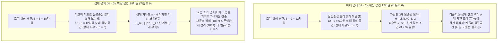
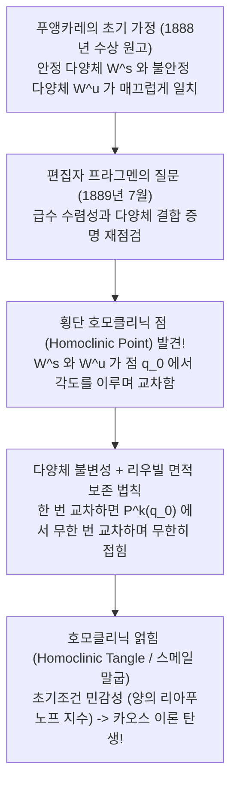

## 1. 서론: 시계태엽 우주에 드리운 ‘세 번째 별’의 저주

1687년 아이작 뉴턴(Isaac Newton)은 불멸의 명저 『자연철학의 수학적 원리(프린키피아, *Principia*)』를 출간하며 인류의 우주관을 뿌리째 뒤바꾸었다. 사과를 땅으로 떨어뜨리는 중력과 달을 지구 궤도에 묶어두는 힘이 완전히 동일한 ‘만유인력의 법칙’을 따른다는 사실을 밝혀낸 뉴턴은, 두 개의 천체가 서로 중력으로 끌어당기며 운동하는 <strong>이체 문제(Two-Body Problem)</strong>를 기하학적·해석적으로 완벽하게 풀어냈다.

그 결과 케플러의 행성운동 법칙 3가지가 엄밀하게 증명되었으며, 두 천체의 초기 위치와 초기 속도만 주어지면 미래의 모든 궤도는 영원토록 <strong>원뿔곡선(타원·포물선·쌍곡선)</strong>이라는 닫힌 초등함수 수식으로 한 치의 오차도 없이 예측할 수 있게 되었다. 이는 라플라스(Pierre-Simon Laplace)가 말한 ‘라플라스의 악마’—결정론적 시계태엽 우주관—의 수학적 토대가 되었다.

그러나 뉴턴조차 『프린키피아』를 집필하며 “달의 운동 이론만큼 내 머리를 지끈거리게 만든 문제는 없었다”고 고백한 절벽이 바로 눈앞에 서 있었다. 태양과 지구의 계에 ‘달’이라는 <strong>단 하나의 세 번째 천체</strong>를 추가한 순간—즉 $N=2$에서 $N=3$인 <strong>삼체 문제(Three-Body Problem)</strong>로 넘어간 순간—해석역학의 마법은 산산조각이 나고, 일반적인 미래 궤도를 초등함수나 대수적 구적법(Quadrature)으로 기술하는 것이 <strong>원리적으로 불가능</strong>해진다.

왜 별이 2개일 때는 대학 1학년 미적분학으로도 풀리는데, 별이 3개가 되는 순간 인류 최고의 수학자들이 300년 넘게 좌절했을까? 그 원인은 단순한 계산의 복잡성이 아니라, 해밀턴 역학계에서 <strong>위상 공간(Phase Space)의 차원과 보존량(운동의 제1적분) 사이의 구조적 불균형</strong>, 그리고 19세기 말 앙리 푸앵카레(Henri Poincaré)가 발견한 <strong>비적분가능성(Non-Integrability)과 결정론적 카오스(Chaos)</strong>에 있다.

---

## 2. 이체 문제의 완전 적분가능성과 삼체 문제의 위상 공간 차원 장벽

### 2.1 중력 $N$체 문제의 해밀턴 정식화와 리우빌-아놀드 정리

질량 $m_1, \dots, m_N$을 가진 $N$개의 질점이 관성계 $\mathbb{R}^3$의 위치 $\mathbf{r}_i$에서 만유인력 상수 $G$로 상호작용할 때, 운동방정식은 다음과 같다.

$$m_i \frac{d^2 \mathbf{r}_i}{dt^2} = \sum_{\substack{j=1 \\ j \ne i}}^{N} \frac{G m_i m_j (\mathbf{r}_j - \mathbf{r}_i)}{\|\mathbf{r}_j - \mathbf{r}_i\|^3} \qquad (i = 1, \dots, N)$$

일반화 좌표 $\mathbf{q} = (\mathbf{r}_1, \dots, \mathbf{r}_N)$와 공액 운동량 $\mathbf{p} = (m_1\dot{\mathbf{r}}_1, \dots, m_N\dot{\mathbf{r}}_N)$을 도입하면, 이 계는 <strong>$6N$차원 위상 공간</strong> 상의 해밀토니안 $H(\mathbf{q}, \mathbf{p})$로 기술된다.

$$H(\mathbf{q}, \mathbf{p}) = \sum_{i=1}^{N} \frac{\|\mathbf{p}_i\|^2}{2m_i} - \sum_{1 \le i < j \le N} \frac{G m_i m_j}{\|\mathbf{r}_i - \mathbf{r}_j\|}$$

<strong>리우빌-아놀드 적분가능성 정리(Liouville-Arnold Theorem)</strong>에 따르면, 자유도가 $n$(위상 공간 차원 $2n$)인 자율 해밀턴 계가 구적법으로 완전 적분가능하려면, 서로 함수적으로 독립이고 <strong>가환(In Involution: 모든 쌍의 푸아송 괄호가 $\{F_i, F_j\} = 0$)</strong>인 <strong>$n$개의 제1적분(보존량)</strong>이 존재해야 한다.

뇌터 정리(Noether's Theorem)에 의해 시공간의 갈릴레이 대칭성으로부터 임의의 $N$체 계에서 항상 성립하는 <strong>고전적 대수 보존량은 정확히 10개</strong>이다:
1. <strong>총 선운동량 보존(3개) 및 질량중심의 등속 직선 운동(3개) = 총 6개</strong>: $\mathbf{P} = \sum \mathbf{p}_i$와 $\mathbf{G}_{\text{CM}} = M\mathbf{R}_{\text{CM}} - \mathbf{P}t$. 질량중심 정지계($\mathbf{R}_{\text{CM}}=\mathbf{0}, \mathbf{P}=\mathbf{0}$)로 옮기면 위상 공간 차원이 무조건 6차원 줄어든다($6N \to 6N - 6$).
2. <strong>총 각운동량 보존(3개)</strong>: $\mathbf{L} = \sum \mathbf{r}_i \times \mathbf{p}_i$. 단, $\{L_x, L_y\} = L_z \ne 0$이므로 서로 가환인 독립 적분은 $\|\mathbf{L}\|^2$과 $L_z$의 <strong>2개</strong>뿐이며, 야코비의 ‘교점 소거법(Elimination of the Nodes, 1842)’을 통해 회전 대칭성 전체로 위상 공간을 4차원 축소할 수 있다.
3. <strong>총 역학적 에너지 보존(1개)</strong>: $H(\mathbf{q}, \mathbf{p}) = E$.

### 2.2 자유도 계산 비교: 왜 $N=2$는 풀리고 $N=3$은 무너지는가?

* <strong>$N=2$(이체 문제)의 경우</strong>: $12 - 6 = 6$차원 상대 위상 공간(상대 자유도 $n_{\text{rel}} = 3$, 환산질량 $\mu_{\text{red}} = \frac{m_1 m_2}{m_1+m_2}$)에 대해 가환인 제1적분 $H_{\text{rel}}, \|\mathbf{L}\|^2, L_z$가 정확히 <strong>3개</strong> 존재하므로 리우빌-아놀드 정리에 의해 완전히 풀린다! 나아가 $1/r$ 퍼텐셜의 숨겨진 $SO(4)$ 대칭성에서 유래하는 <strong>라플라스-룽게-렌츠(LRL) 벡터</strong>
  $$\mathbf{A} = \mathbf{p} \times \mathbf{L} - \mu_{\text{red}} G m_1 m_2 \frac{\mathbf{r}}{\|\mathbf{r}\|}$$
  까지 보존되어, 궤도가 세차운동 없이 완벽히 닫힌 원뿔곡선 $r(\theta) = \frac{p}{1 + e\cos(\theta - \varpi)}$를 그리는 <strong>최대 초적분가능계(Maximally Superintegrable System)</strong>가 된다.
* <strong>$N=3$(삼체 문제)의 경우</strong>: 초기 위상 공간은 <strong>$6 \times 3 = 18$차원</strong>이다. 질량중심 6차원을 빼면 12차원 상대 위상 공간(<strong>상대 자유도 $n_{\text{rel}} = 6$</strong>)이 남지만, 가환인 제1적분은 여전히 3개뿐이다! 회전 대칭성(4차원)과 에너지 곡면·시간 변수 소거를 모두 동원해도 <strong>7~8차원의 미지 자유도</strong>가 남는다.
  - <strong>브룬스 정리(Bruns, 1887)</strong>와 <strong>푸앵카레 비적분가능성 정리(Poincaré, 1889)</strong>는 고전적인 10개 적분 외에 새로운 대수적·해석적 제1적분이 존재하지 않음을 증명했다.
  - 한편 1912년 핀란드 수학자 <strong>카를 순드만(Karl Sundman)</strong>이 $dt = r\,d\tau$($t^{1/3}$ 정칙화) 변환을 통해 모든 시간에서 수렴하는 급수해를 구성했으나, Beloriszky(1930)의 계산에 따르면 단 한 주기의 궤도를 천문학적 정밀도로 계산하는 데만 최소 <strong>$10^{8,000,000}$개(1 뒤에 0이 800만 개)의 항</strong>을 더해야 하므로 물리적 예측에는 전혀 쓸 수 없다.

| 비교 항목 | 이체 문제 ($N=2$) | 일반 삼체 문제 ($N=3$) | 평면 원형 제한 삼체 문제 (PCR3BP) |
| :--- | :--- | :--- | :--- |
| <strong>초기 위상 공간 차원 ($6N$)</strong> | $12$차원 (자유도 $6$) | $18$차원 (자유도 $9$) | $4$차원 (제3천체만, 자유도 $2$) |
| <strong>질량중심 분리 후 상대 자유도</strong> | 자유도 $3$ ($6$차원) | 자유도 $6$ ($12$차원) | 자유도 $2$ (회전좌표계 $4$차원) |
| <strong>필요 가환 적분 수 vs 보유 수</strong> | 필요 $3$ / 보유 $3$ (+LRL 벡터) | 필요 $6$ / 보유 $3$ (<strong>3개 부족!</strong>) | 필요 $2$ / 보유 $1$ (야코비 적분 $C_J$) |
| <strong>대칭성·에너지 축소 후 잔존 차원</strong> | $0$차원 (1차원 구적법으로 완결) | $7 \sim 8$차원 비선형 연립계 | $3$차원 에너지 다양체 ($2$차원 푸앵카레 사상) |
| <strong>역학계의 성질</strong> | 완전·초적분가능 (원뿔곡선) | <strong>비적분가능</strong> (호모클리닉 카오스) | <strong>비적분가능</strong> (KAM 토러스와 카오스 공존) |

---

## 3. 원형 제한 삼체 문제(CR3BP)와 오일러-라그랑주 평형점($L_1 \sim L_5$)

### 3.1 회전좌표계 운동방정식, 유효 퍼텐셜 및 야코비 적분

두 주천체 $m_1 \ge m_2$가 원궤도를 돌고 제3천체의 질량이 무시할 만큼 작을 때($m_3 \to 0$)를 <strong>원형 제한 삼체 문제(CR3BP)</strong>라 한다. 무차원 질량비 $\mu = \frac{m_2}{m_1 + m_2} \in (0, 1/2]$를 도입하고 두 주천체와 함께 회전하는 <strong>공회전 좌표계(Synodic Frame) $(x, y, z)$</strong>를 잡으면, 주천체들은 $(-\mu, 0, 0)$과 $(1-\mu, 0, 0)$에 고정된다. 원심력과 만유인력을 합친 <strong>유효 퍼텐셜(Effective Potential) $\Omega(x, y, z)$</strong>를 정의하자:

$$\Omega(x, y, z) = \frac{1}{2}(x^2 + y^2) + \frac{1 - \mu}{r_1} + \frac{\mu}{r_2}, \qquad r_1 = \sqrt{(x+\mu)^2+y^2+z^2}, \quad r_2 = \sqrt{(x-1+\mu)^2+y^2+z^2}$$

코리올리 힘($-2\boldsymbol{\omega}\times\mathbf{v}$)을 포함한 운동방정식은 다음과 같다:

$$\ddot{x} - 2\dot{y} = \frac{\partial \Omega}{\partial x}, \qquad \ddot{y} + 2\dot{x} = \frac{\partial \Omega}{\partial y}, \qquad \ddot{z} = \frac{\partial \Omega}{\partial z}$$

세 식에 각각 $\dot{x}, \dot{y}, \dot{z}$를 곱해 더하여 적분하면 코리올리 항이 소거되면서 유일한 보존량인 <strong>야코비 적분(Jacobi Constant $C_J$)</strong>이 도출된다:

$$C_J = 2\Omega(x, y, z) - (\dot{x}^2 + \dot{y}^2 + \dot{z}^2)$$

회전계 속력의 제곱 $v_{\text{rot}}^2 = 2\Omega - C_J \ge 0$이므로 입자는 <strong>힐 영역(Hill's Region) $2\Omega \ge C_J$</strong> 밖으로 나갈 수 없으며, 경계면 $2\Omega = C_J$를 <strong>영속도 곡면(Zero-Velocity Surface)</strong>이라 부른다.

### 3.2 5개 라그랑주 점의 유도와 안정성: 제임스 웹 우주망원경과 트로이 소행성군

평형 조건 $\nabla \Omega = \mathbf{0}$을 풀면 공전 평면($z=0$) 상에 5개의 해가 나타난다:
1. <strong>오일러의 3개 일직선 해($L_1, L_2, L_3$, 1767년)</strong>: $y = 0$ 직선 위에서 5차 방정식 $x - \frac{(1-\mu)(x+\mu)}{|x+\mu|^3} - \frac{\mu(x-1+\mu)}{|x-1+\mu|^3} = 0$의 해로 주어지며, $\mu \ll 1$일 때 $L_1, L_2$는 제2천체로부터 <strong>힐 반경 $r_{\text{Hill}} \approx a(\mu/3)^{1/3}$</strong>(태양-지구 계에서 지구로부터 약 <strong>150만 km</strong>) 거리에 위치한다.
2. <strong>라그랑주의 2개 정삼각형 해($L_4, L_5$, 1772년)</strong>: $\Omega$를 $r_1, r_2$로 표현하여 미분하면 $\frac{\partial \Omega}{\partial r_1} = (1-\mu)(r_1 - r_1^{-2}) = 0$, $\frac{\partial \Omega}{\partial r_2} = \mu(r_2 - r_2^{-2}) = 0$으로부터 질량비 $\mu$에 무관하게 즉시 <strong>$r_1 = r_2 = 1$</strong>이 도출된다! 즉 두 주천체와 정삼각형을 이루는 앞뒤 $60^\circ$ 지점 $L_{4,5} = \left(\frac{1}{2}-\mu, \pm\frac{\sqrt{3}}{2}, 0\right)$이다.

평형점 근방의 선형 특성방정식 $\lambda^4 + (4 - \Omega_{xx} - \Omega_{yy})\lambda^2 + (\Omega_{xx}\Omega_{yy} - \Omega_{xy}^2) = 0$을 분석하면 놀라운 물리적 대비가 드러난다:
* <strong>$L_1, L_2, L_3$의 안장점 불안정성과 제임스 웹 우주망원경(JWST)의 헤일로 궤도</strong>: 일직선 점에서는 $\Omega_{xx}\Omega_{yy} < 0$이므로 고유값이 실수 쌍 $\pm\sigma$와 순허수 쌍 $\pm i\omega_{xy}, \pm i\omega_z$를 갖는 <strong>안장점($\text{Saddle} \times \text{Center} \times \text{Center}$)</strong>이 되어 항상 불안정하다! 그러나 중심 다양체(Center Manifold) 위에는 3차원 주기 궤도인 <strong>헤일로 궤도(Halo Orbit)</strong>와 리사주 궤도가 존재한다. <strong>제임스 웹 우주망원경(JWST)</strong>은 태양-지구 $L_2$ 점 주위의 거대한 헤일로 궤도를 돌면서 지구 그림자를 영구히 피해 태양광 발전을 유지하고, 태양·지구·달을 항상 방열판 뒤쪽 한 방향에 두어 $40\text{ K}$의 극저온을 유지하며, 연간 불과 <strong>$\Delta v \approx 2\sim 4\text{ m/s}$</strong>의 미세한 궤도 유지 분사만으로 불안정 다양체로의 이탈을 제어한다!
* <strong>$L_4, L_5$의 코리올리 안정화와 라우스의 임계 질량비</strong>: $L_4, L_5$는 유효 퍼텐셜 $\Omega$의 <strong>산꼭대기(극대점)</strong>이지만, 굴러떨어지려는 순간 속도에 수직으로 작용하는 <strong>코리올리 힘($-2\boldsymbol{\omega}\times\mathbf{v}$)</strong>이 궤도를 휘어잡아 가두어 버린다! 특성방정식은 다음과 같이 정리된다:
  $$\lambda^4 + \lambda^2 + \frac{27}{4}\mu(1 - \mu) = 0$$
  모든 고유값 $\lambda$가 순허수가 되어 선형 안정해지려면 판별식 조건이 성립해야 한다(<strong>라우스 안정성 조건, Routh 1875</strong>):
  $$1 - 27\mu(1 - \mu) > 0 \iff \mu < \mu_{\text{crit}} = \frac{1 - \sqrt{23/27}}{2} \approx 0.0385209 \quad \left(\text{질량비 } \frac{m_1}{m_2} > 24.96\right)$$
  태양-목성 계($\mu \approx 0.000954 \ll 0.03852$)와 지구-달 계($\mu \approx 0.01215 < 0.03852$)는 이 조건을 만족하며, 덕분에 목성의 $L_4, L_5$에는 1만 개가 넘는 <strong>트로이 소행성군(Trojan Asteroids)</strong>이 46억 년째 포획되어 있다.

---

## 4. 오스카르 2세 현상 논문과 카오스 이론을 낳은 푸앵카레의 ‘역사적 오류’

1889년 스웨덴-노르웨이 국왕 <strong>오스카르 2세(King Oscar II)</strong>의 60세 생일을 기념한 국제 수학 콩쿠르에서 <strong>앙리 푸앵카레(Henri Poincaré)</strong>는 제한 삼체 문제 연구로 우승을 차지했다. 그러나 학술지 *Acta Mathematica* 인쇄 도중 젊은 편집자 <strong>프라그멘(Lars Edvard Phragmén)</strong>이 제기한 질문에 답하던 푸앵카레는 치명적인 오류를 발견했다.

푸앵카레는 당초 불안정 주기 궤도의 <strong>안정 다양체 $W^s$</strong>와 <strong>불안정 다양체 $W^u$</strong>가 매끄럽게 일치하여 닫힌 경계면(Separatrix)을 형성한다고 가정했으나, 실제로는 두 다양체가 <strong>0이 아닌 각도로 ‘횡단 교차(Transverse Intersection)’</strong>하고 있었던 것이다!

한 점 $q_0$에서 횡단 교차하면 불변성에 의해 모든 반복 사상점 $P^k(q_0)$($k \in \mathbb{Z}$)에서 <strong>무한히 교차</strong>해야 하며, 위상 공간 면적 보존(리우빌 정리) 때문에 두 다양체 사이의 영역(Lobe)이 무한히 가늘고 길게 늘어나며 접히는 <strong>호모클리닉 얽힘(Homoclinic Tangle, 훗날 스메일의 말굽 사상)</strong>이 형성된다. 푸앵카레는 상금(2,500크로나)보다 많은 3,581크로나를 사비로 지불해 이미 인쇄된 학술지를 전량 회수·폐기하고 1890년 개정판 논문을 출간함으로써 현대 <strong>카오스 이론</strong>의 문을 열었다.

---

## 5. 현대의 기적: ‘8자형 주기해’와 태양계의 KAM 정리

### 5.1 변분법이 증명한 등질량 삼체 ‘8자형 안무 궤도(Figure-Eight Orbit)’

오일러와 라그랑주 이후 200년 넘게 멈춰 있던 등질량($m_1=m_2=m_3=1$) 삼체 주기해 연구는, 1993년 물리학자 <strong>크리스토퍼 무어(Cristopher Moore)</strong>의 수치적 발견과 2000년 수학자 <strong>알랭 셴시네(Alain Chenciner)와 리처드 몽고메리(Richard Montgomery)</strong>의 엄밀한 <strong>최소작용의 원리(변분법)</strong> 증명으로 기적을 맞이했다. 세 개의 같은 질량을 가진 별이 총 각운동량 $\mathbf{L}=\mathbf{0}$ 상태에서 하나의 <strong>8자 모양 곡선</strong>을 따라 $T/3$ 시간차로 서로를 쫓아 도는 해이다:

$$\mathbf{r}_2(t) = \mathbf{r}_1\left(t - \frac{T}{3}\right), \qquad \mathbf{r}_3(t) = \mathbf{r}_1\left(t - \frac{2T}{3}\right)$$

셴시네와 몽고메리는 <strong>형상 구면(Shape Sphere $S^2$)</strong> 위에서 $D_6$ 대칭성을 부여한 작용 범함수 $\mathcal{A} = \int_0^T (T - V)\,dt$의 최솟값이 충돌 궤도의 작용 하한보다 엄밀히 작음($\mathcal{A}_{\text{eight}} < \mathcal{A}_{\text{coll}}$)을 증명하여 충돌 특이점을 배제했다. 이후 Šuvakov & Dmitrašinović(2013)의 13개 신궤도족과 Li & Liao(2017)의 <strong>2,000개 이상의 새로운 주기 궤도족</strong> 발견이 이어졌다.

### 5.2 KAM 정리, 아놀드 확산, 그리고 태양계의 리아푸노프 시간(500만 년)

근적분가능 해밀토니안 $H(\mathbf{I}, \boldsymbol{\theta}) = H_0(\mathbf{I}) + \epsilon H_1(\mathbf{I}, \boldsymbol{\theta})$에서 섭동 급수의 분모 $\mathbf{k}\cdot\boldsymbol{\omega}(\mathbf{I}) \approx 0$이 발산하는 <strong>작은 분모 문제(Small Divisors Problem)</strong>를 해결한 것이 <strong>콜모고로프-아놀드-모저 정리(KAM Theorem, 1954–1963)</strong>이다. 진동수 벡터 $\boldsymbol{\omega}$가 강한 무리수 조건인 <strong>디오판토스 조건(Diophantine Condition)</strong>

$$|\mathbf{k} \cdot \boldsymbol{\omega}| \ge \frac{\gamma}{\|\mathbf{k}\|^\tau} \qquad \left(\forall \mathbf{k} \in \mathbb{Z}^n \setminus \{\mathbf{0}\}\right)$$

을 만족하는 <strong>대부분의 불변 토러스(KAM 토러스)는 작은 섭동 하에서도 파괴되지 않고 살아남아</strong> 준주기 운동을 유지한다! 다만 자유도 $n \ge 3$에서는 공명 층들이 연결된 ‘아놀드 그물(Arnold Web)’을 따라 느린 <strong>아놀드 확산(Arnold Diffusion)</strong>이 일어난다.

프랑스 천문학자 <strong>자크 라스카르(Jacques Laskar, 1989 / 2009)</strong>의 수십억 년 수치적분에 따르면, 내태양계는 카오스적이며 <strong>리아푸노프 시간은 약 500만 년($\tau_{\text{L}} \approx 5\text{ Myr}$)</strong>에 불과하다! 오늘 지구 위치의 <strong>15미터</strong> 오차는 1억 년 뒤 <strong>지구 공전 궤도 전체($1\text{ AU}$)</strong> 크기로 증폭되어 1억 년 이후의 정확한 궤도 위상 예측은 물리적으로 불가능하며, 향후 50억 년 내에 수성과 목성의 영년 공명($g_1 \approx g_5$)으로 인해 <strong>약 $1\%$의 확률로 수성 궤도 이심률이 폭주하여 내행성 간 대충돌</strong>이 일어날 수 있다. 삼체 문제의 불완전성이야말로 우주의 질서와 카오스를 동시에 빚어내는 원동력인 것이다.
