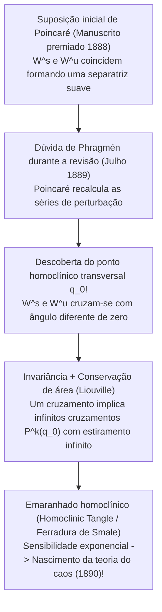

## 1. Introdução: A maldição da terceira estrela no universo-relógio

Em 1687, Isaac Newton publicou seus monumentais *Philosophiæ Naturalis Principia Mathematica*, transformando para sempre nossa compreensão do cosmos. Ao demonstrar que a queda de uma maçã e a órbita da Lua obedecem exatamente à mesma lei da gravitação universal, Newton resolveu por completo o <strong>Problema dos Dois Corpos (Two-Body Problem)</strong>: as trajetórias de duas massas pontuais que se atraem gravitacionalmente são por toda a eternidade <strong>seções cônicas (elipses, parábolas ou hipérboles)</strong> expressas por funções elementares fechadas, consolidando o determinismo do «demônio de Laplace».

Contudo, assim que adicionamos um <strong>único terceiro corpo celeste</strong> — passando de $N=2$ para $N=3$ no sistema Sol-Terra-Lua, o <strong>Problema dos Três Corpos (Three-Body Problem)</strong> —, a magia analítica desmorona. Por que duas estrelas são resolvidas com cálculo universitário básico, enquanto três estrelas desafiaram os maiores matemáticos por mais de três séculos?

A barreira não reside na mera dificuldade algébrica, mas num déficit estrutural entre a <strong>dimensão do espaço de fases hamiltoniano e o número de integrais primeiras (quantidades conservadas)</strong>, bem como na geometria da <strong>não-integrabilidade e do caos determinístico</strong> descoberta por Henri Poincaré no final do século XIX.

---

## 2. Integrabilidade completa do Problema de Dois Corpos vs. o muro dimensional de Três Corpos

### 2.1 Formulação hamiltoniana e o Teorema de Liouville-Arnold

Para $N$ massas pontuais $m_i$ nas posições $\mathbf{r}_i \in \mathbb{R}^3$, as equações diferenciais de Newton são:

$$m_i \frac{d^2 \mathbf{r}_i}{dt^2} = \sum_{\substack{j=1 \\ j \ne i}}^{N} \frac{G m_i m_j (\mathbf{r}_j - \mathbf{r}_i)}{\|\mathbf{r}_j - \mathbf{r}_i\|^3} \qquad (i = 1, \dots, N)$$

No <strong>espaço de fases de $6N$ dimensões</strong> com coordenadas canônicas $\mathbf{q} = (\mathbf{r}_1, \dots, \mathbf{r}_N)$ e momentos conjugados $\mathbf{p} = (m_1\dot{\mathbf{r}}_1, \dots, m_N\dot{\mathbf{r}}_N)$, a dinâmica é governada pelo hamiltoniano $H(\mathbf{q}, \mathbf{p})$:

$$H(\mathbf{q}, \mathbf{p}) = \sum_{i=1}^{N} \frac{\|\mathbf{p}_i\|^2}{2m_i} - \sum_{1 \le i < j \le N} \frac{G m_i m_j}{\|\mathbf{r}_i - \mathbf{r}_j\|}$$

Pelo <strong>Teorema de Liouville-Arnold (1855 / 1963)</strong>, um sistema hamiltoniano autônomo com $n$ graus de liberdade (espaço de fases de dimensão $2n$) é <strong>completamente integrável por quadraturas</strong> se e somente se existirem $n$ integrais primeiras funcionalmente independentes $F_1 (=H), F_2, \dots, F_n$ mutuamente <strong>em involução</strong> (colchetes de Poisson nulos $\{F_i, F_j\} = 0$). Nesse caso, as trajetórias enrolam-se quase-periodicamente sobre toros invariantes $n$-dimensionais $\mathbb{T}^n$.

Pelo teorema de Noether, as simetrias de Galileu garantem para qualquer sistema de $N$ corpos exatamente <strong>10 integrais algébricas clássicas de movimento</strong>:
1. <strong>Momento linear total $\mathbf{P}$ (3) e movimento uniforme do centro de massa $\mathbf{G}_{\text{CM}} = M\mathbf{R}_{\text{CM}} - \mathbf{P}t$ (3)</strong>: Reduz incondicionalmente o espaço de fases em <strong>6 dimensões</strong> ($6N \to 6N - 6$).
2. <strong>Momento angular total $\mathbf{L} = \sum \mathbf{r}_i \times \mathbf{p}_i$ (3)</strong>: Como $\{L_x, L_y\} = L_z \ne 0$, fornece exatamente <strong>2 integrais em involução</strong> ($\|\mathbf{L}\|^2$ e $L_z$) e, via a *eliminação dos nós* de Jacobi (1842), reduz o espaço de fases em 4 dimensões.
3. <strong>Energia mecânica total $H = E$ (1)</strong>.

### 2.2 Contagem de graus de liberdade: Por que $N=2$ é integrável e $N=3$ falha

```mermaid
flowchart TD
    subgraph TwoBody["Problema de Dois Corpos (N = 2): Espaço de fases 12D (6 GDL)"]
        TB1["Espaço de fases inicial: 6 × 2 = 12 dimensões"] --> TB2["Redução do centro de massa (6 integrais)<br/>12 - 6 = 6D espaço relativo (n_rel = 3 GDL)"]
        TB2 --> TB3["Possui 3 integrais em involução: H_rel, |L|^2, L_z<br/>Condição de Liouville-Arnold satisfeita (3 = 3)!"]
        TB3 --> TB4["Vetor de Laplace-Runge-Lenz A -> Superintegrabilidade<br/>Solução exata: Seções cônicas de Kepler"]
    end

    subgraph ThreeBody["Problema de Três Corpos (N = 3): Espaço de fases 18D (9 GDL)"]
        THB1["Espaço de fases inicial: 6 × 3 = 18 dimensões"] --> THB2["Coordenadas de Jacobi / Centro de massa (6 integrais)<br/>18 - 6 = 12D espaço relativo (n_rel = 6 GDL)"]
        THB2 --> THB3["Para n_rel = 6 GDL, só existem 3 integrais em involução:<br/>H_rel, |L|^2, L_z (Déficit de 3 integrais!)"]
        THB3 --> THB4["Restam 7D–8D irredutíveis!<br/>Teoremas de Bruns (1887) e Poincaré (1889): Não-integrável"]
    end
```

* <strong>Para $N=2$</strong>: Descontadas as 6 dimensões do centro de massa, o movimento relativo ($\mathbf{r} = \mathbf{r}_1 - \mathbf{r}_2$, massa reduzida $\mu_{\text{red}} = \frac{m_1 m_2}{m_1+m_2}$) tem <strong>$n_{\text{rel}} = 3$ graus de liberdade</strong> e exatamente <strong>3 integrais em involução</strong> ($H_{\text{rel}}, \|\mathbf{L}\|^2, L_z$). Além disso, a simetria oculta $SO(4)$ do potencial $1/r$ conserva o <strong>vetor de Laplace-Runge-Lenz (LRL)</strong>:
  $$\mathbf{A} = \mathbf{p} \times \mathbf{L} - \mu_{\text{red}} G m_1 m_2 \frac{\mathbf{r}}{\|\mathbf{r}\|}$$
  tornando o sistema <strong>maximalmente superintegrável</strong> com órbitas cônicas fechadas $r(\theta) = \frac{p}{1 + e\cos(\theta - \varpi)}$.
* <strong>Para $N=3$</strong>: O espaço de fases salta para <strong>$6 \times 3 = 18$ dimensões</strong>. Após separar o centro de massa restam 12 dimensões (<strong>$n_{\text{rel}} = 6$ graus de liberdade</strong>), mas apenas as mesmas 3 integrais em involução. Mesmo após reduzir o momento angular e fixar a energia, <strong>restam 8 dimensões simpléticas (ou uma variedade de energia de 7 dimensões)</strong> sem solução.
  - <strong>Teorema de Bruns (1887)</strong> e <strong>Teorema da Não-Integrabilidade de Poincaré (1889)</strong>: Não existem outras integrais primeiras algébricas ou analíticas independentes das 10 clássicas.
  - <strong>A armadilha da série de Sundman (1912)</strong>: Embora Karl Sundman tenha construído uma série convergente em potências de $t^{1/3}$ para todo $t$ (com $\mathbf{L} \ne \mathbf{0}$), David Beloriszky (1930) provou que calcular uma única época orbital requer somar pelo menos <strong>$10^{8\,000\,000}$ termos</strong>, tornando-a fisicamente inútil.

| Característica | Problema de Dois Corpos ($N=2$) | Problema Geral de Três Corpos ($N=3$) | Problema Circular Restrito Plano (PCR3BP) |
| :--- | :--- | :--- | :--- |
| <strong>Dimensão do espaço de fases ($6N$)</strong> | $12\text{D}$ ($6$ GDL) | $18\text{D}$ ($9$ GDL) | $4\text{D}$ (massa de teste, $2$ GDL) |
| <strong>Espaço relativo (sem CM)</strong> | $6\text{D}$ ($n_{\text{rel}} = 3$ GDL) | $12\text{D}$ ($n_{\text{rel}} = 6$ GDL) | $4\text{D}$ ($n = 2$ GDL no referencial sinódico) |
| <strong>Integrais em involução (Req. / Disp.)</strong> | $3$ / $3$ (+ vetor LRL $\mathbf{A}$) | $6$ / $3$ (<strong>Faltam $3$!</strong>) | $2$ / $1$ (Constante de Jacobi $C_J$) |
| <strong>Regime dinâmico</strong> | Superintegrável (Cônicas) | <strong>Não-integrável</strong> (Caos homoclínico) | <strong>Não-integrável</strong> (Toros KAM e caos) |

---

## 3. O Problema Circular Restrito de Três Corpos (CR3BP) e os cinco pontos de Lagrange ($L_1$–$L_5$)

### 3.1 Equações no referencial sinódico corrotante e a Constante de Jacobi

No <strong>CR3BP</strong>, dois corpos primários $m_1 \ge m_2$ giram em órbitas circulares ($a=1, \omega=1$) em torno do seu baricentro enquanto uma partícula de massa infinitesimal ($m_3 \to 0$) se move no seu campo. Com o parâmetro de massa $\mu = \frac{m_2}{m_1 + m_2} \in (0, 1/2]$, as massas primárias estão fixas no <strong>referencial rotativo $(x,y,z)$</strong> em $(-\mu, 0, 0)$ e $(1-\mu, 0, 0)$. Definindo o <strong>potencial efetivo $\Omega(x, y, z)$</strong>:

$$\Omega(x, y, z) = \frac{1}{2}(x^2 + y^2) + \frac{1 - \mu}{r_1} + \frac{\mu}{r_2}, \qquad r_1 = \sqrt{(x+\mu)^2+y^2+z^2}, \quad r_2 = \sqrt{(x-1+\mu)^2+y^2+z^2}$$

as equações de movimento incluindo a força de Coriolis ($-2\boldsymbol{\omega}\times\mathbf{v}$) são:

$$\ddot{x} - 2\dot{y} = \frac{\partial \Omega}{\partial x}, \qquad \ddot{y} + 2\dot{x} = \frac{\partial \Omega}{\partial y}, \qquad \ddot{z} = \frac{\partial \Omega}{\partial z}$$

Multiplicando por $\dot{x}, \dot{y}, \dot{z}$ e integrando obtém-se a única quantidade conservada do CR3BP, a <strong>Constante de Jacobi $C_J$</strong>:

$$C_J = 2\Omega(x, y, z) - (\dot{x}^2 + \dot{y}^2 + \dot{z}^2)$$

Como $v_{\text{rot}}^2 = 2\Omega - C_J \ge 0$, o movimento fica confinado à <strong>região de Hill $2\Omega(x,y,z) \ge C_J$</strong>, delimitada pelas <strong>curvas de velocidade zero (Zero-Velocity Curves)</strong> $2\Omega = C_J$.

### 3.2 Derivação e estabilidade de $L_1$–$L_5$: O Telescópio James Webb e os asteroides troianos

A condição de equilíbrio $\nabla \Omega = \mathbf{0}$ no plano $z=0$ produz cinco pontos estacionários:
1. <strong>Os três pontos colineares de Euler ($L_1, L_2, L_3$, 1767)</strong>: Sobre o eixo $y=0$, raízes da equação de quinto grau $x - \frac{(1-\mu)(x+\mu)}{|x+\mu|^3} - \frac{\mu(x-1+\mu)}{|x-1+\mu|^3} = 0$. Para $\mu \ll 1$, $L_1$ e $L_2$ distam de $m_2$ aproximadamente o <strong>raio de Hill $r_{\text{Hill}} \approx a(\mu/3)^{1/3}$</strong> (cerca de <strong>1,5 milhão de km</strong> da Terra no sistema Sol-Terra).
2. <strong>Os dois pontos equiláteros de Lagrange ($L_4, L_5$, 1772)</strong>: Expressando $\Omega(r_1, r_2) = \frac{1-\mu}{2}(r_1^2 + \frac{2}{r_1}) + \frac{\mu}{2}(r_2^2 + \frac{2}{r_2}) - \frac{1}{2}\mu(1-\mu)$, a condição $\frac{\partial \Omega}{\partial r_1} = \frac{\partial \Omega}{\partial r_2} = 0$ fornece imediatamente <strong>$r_1 = r_2 = 1$</strong>, formando dois triângulos equiláteros exatos em $L_{4,5} = \left(\frac{1}{2}-\mu, \pm\frac{\sqrt{3}}{2}, 0\right)$.

O polinômio característico linearizado $\lambda^4 + (4 - \Omega_{xx} - \Omega_{yy})\lambda^2 + (\Omega_{xx}\Omega_{yy} - \Omega_{xy}^2) = 0$ demonstra:
* <strong>Instabilidade de sela de $L_1, L_2, L_3$ e as órbitas Halo do JWST</strong>: Como $\Omega_{xx}\Omega_{yy} < 0$, os autovalores são $\pm\sigma, \pm i\omega_{xy}, \pm i\omega_z$ ($\text{Saddle} \times \text{Center} \times \text{Center}$), pelo que <strong>$L_1, L_2, L_3$ são sempre linearmente instáveis</strong>. Contudo, sua variedade central abriga <strong>órbitas Halo</strong> periódicas tridimensionais. O <strong>Telescópio Espacial James Webb (JWST)</strong> orbita em torno de $L_2$ numa órbita Halo: evita permanentemente a sombra da Terra, mantém o Sol, a Terra e a Lua atrás do seu escudo térmico de 5 camadas ($<40\text{ K}$) e requer apenas <strong>$\Delta v \approx 2\text{–}4\text{ m/s}$ por ano</strong> para manutenção orbital.
* <strong>Estabilização por Coriolis de $L_4, L_5$ e critério crítico de Routh</strong>: Embora $L_4$ e $L_5$ sejam <strong>máximos locais (topos)</strong> de $\Omega$, a <strong>força de Coriolis ($-2\boldsymbol{\omega}\times\mathbf{v}$)</strong> desvia lateralmente qualquer partícula e a aprisiona em torno do topo. A equação característica
  $$\lambda^4 + \lambda^2 + \frac{27}{4}\mu(1 - \mu) = 0$$
  tem raízes puramente imaginárias (estabilidade linear) se e somente se o seu discriminante for positivo (<strong>Critério de Routh, 1875</strong>):
  $$1 - 27\mu(1 - \mu) > 0 \iff \mu < \mu_{\text{crit}} = \frac{1 - \sqrt{23/27}}{2} \approx 0.0385209 \quad \left(\frac{m_1}{m_2} > 24.96\right)$$
  No sistema Sol-Júpiter ($\mu \approx 0.000954 \ll 0.03852$), esta estabilidade giroscópica aprisiona mais de 12.000 <strong>asteroides troianos</strong> em $L_4$ e $L_5$.

---

## 4. O prêmio do Rei Oscar II e o erro de Henri Poincaré (1889) que gerou a teoria do caos

Em 1889, <strong>Henri Poincaré</strong> venceu o concurso internacional patrocinado pelo <strong>Rei Oscar II da Suécia e Noruega</strong>. Enquanto a memória era impressa na *Acta Mathematica*, o jovem editor <strong>Lars Edvard Phragmén</strong> detectou uma lacuna na demonstração. Ao rever seus cálculos, Poincaré descobriu horrorizado que a <strong>variedade estável $W^s(p_0)$</strong> e a <strong>variedade instável $W^u(p_0)$</strong> de uma órbita periódica hiperbólica não coincidem suavemente, mas <strong>se cruzam transversalmente (interseção homoclínica transversal)</strong>.

Por invariância sob o mapa de retorno de Poincaré $P$, um único cruzamento transversal em $q_0$ obriga a que se cruzem em <strong>infinitos pontos homoclínicos $P^k(q_0)$ ($k \in \mathbb{Z}$)</strong>; e pela conservação de área de Liouville, os lóbulos estiram-se e dobram-se infinitas vezes formando o <strong>emaranhado homoclínico (Homoclinic Tangle / Ferradura de Smale, 1967)</strong>. Poincaré pagou do próprio bolso 3.581 coroas (mais do que as 2.500 coroas do prêmio!) para destruir a edição impressa e publicar em 1890 a versão corrigida que fundou a <strong>teoria do caos</strong>.

---

## 5. Milagres modernos: A órbita em forma de oito e o teorema KAM no Sistema Solar

### 5.1 A coreografia em oito (Moore 1993; Chenciner e Montgomery 2000)

Mais de dois séculos após Euler e Lagrange, <strong>Cristopher Moore (1993)</strong> descobriu numericamente e <strong>Alain Chenciner e Richard Montgomery (2000)</strong> demonstraram rigorosamente nos *Annals of Mathematics* através do <strong>princípio da mínima ação (cálculo de variações)</strong> a existência da <strong>órbita periódica em forma de oito (Figure-Eight Choreography)</strong> para três massas iguais ($m_1=m_2=m_3=1$) com momento angular nulo ($\mathbf{L}=\mathbf{0}$):

$$\mathbf{r}_2(t) = \mathbf{r}_1\left(t - \frac{T}{3}\right), \qquad \mathbf{r}_3(t) = \mathbf{r}_1\left(t - \frac{2T}{3}\right)$$

Minimizando o funcional de ação $\mathcal{A}[\mathbf{q}] = \int_0^T (T - V)\,dt$ com simetria $D_6$ sobre a <strong>esfera de formas (Shape Sphere $S^2$)</strong>, provaram que o mínimo de ação é estritamente menor do que o de qualquer trajetória com colisão ($\mathcal{A}_{\text{oito}} < \mathcal{A}_{\text{coll}}$). Posteriormente, Šuvakov e Dmitrašinović (2013) e Li e Liao (2017) descobriram <strong>mais de 2.000 novas famílias de órbitas periódicas</strong>.

### 5.2 O teorema KAM, a difusão de Arnold e o horizonte de Lyapunov de 5 milhões de anos (Laskar)

Num sistema hamiltoniano quase-integrável $H(\mathbf{I}, \boldsymbol{\theta}) = H_0(\mathbf{I}) + \epsilon H_1(\mathbf{I}, \boldsymbol{\theta})$, as ressonâncias geram o <strong>problema dos pequenos divisores</strong> $\mathbf{k}\cdot\boldsymbol{\omega}(\mathbf{I}) \approx 0$. O <strong>teorema de Kolmogorov-Arnold-Moser (KAM, 1954–1963)</strong> provou que para $\epsilon \ll 1$, a maioria dos toros invariantes sobrevive se as suas frequências satisfizerem a <strong>condição diofantina</strong>:

$$|\mathbf{k} \cdot \boldsymbol{\omega}| \ge \frac{\gamma}{\|\mathbf{k}\|^\tau} \qquad \left(\forall \mathbf{k} \in \mathbb{Z}^n \setminus \{\mathbf{0}\}\right)$$

enquanto para $n \ge 3$ graus de liberdade as ressonâncias destruídas se conectam permitindo a lenta <strong>difusão de Arnold</strong>.

Finalmente, as integrações numéricas de <strong>Jacques Laskar (1989 / 2009)</strong> demonstraram que o Sistema Solar interno é caótico com um <strong>tempo de Lyapunov de apenas $\tau_{\text{L}} \approx 5\text{ milhões de anos}$</strong>: um erro inicial de <strong>15 metros</strong> na posição da Terra cresce até <strong>$1\text{ UA}$ em 100 milhões de anos</strong>, impossibilitando prever a fase orbital além desse horizonte, e deixando <strong>$\sim 1\%$ de probabilidade</strong> de que nos próximos 5 bilhões de anos uma ressonância secular entre Mercúrio e Júpiter ($g_1 \approx g_5$) dispare a excentricidade de Mercúrio ($e > 0.6$) e desencadeie colisões entre os planetas internos.
