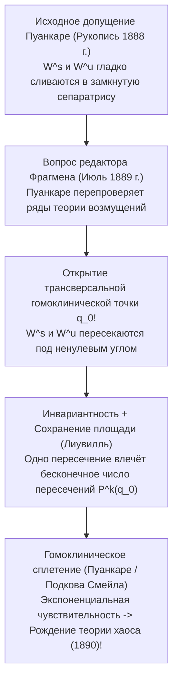

## 1. Введение: Проклятие третьей звезды в часовом механизме Вселенной

В 1687 году Исаак Ньютон опубликовал свои монументальные «Математические начала натуральной философии» (*Principia*), навсегда изменив представление человечества о космосе. Доказав, что падение яблока и движение Луны подчиняются одному и тому же закону всемирного тяготения, Ньютон полностью и точно решил <strong>задачу двух тел (Two-Body Problem)</strong>: траектории двух материальных точек, притягивающихся по закону обратных квадратов, вечно остаются <strong>коническими сечениями (эллипсами, параболами или гиперболами)</strong>, выражаемыми через элементарные функции, что стало фундаментом детерминизма «демона Лапласа».

Однако стоит добавить в систему Солнце–Земля всего <strong>одно третье небесное тело</strong> — Луну, перейдя от $N=2$ к $N=3$, то есть к <strong>задаче трёх тел (Three-Body Problem)</strong>, — как аналитическая магия рушится. Почему система из двух звёзд решается методами первокурсника, а три звезды ставили в тупик величайших математиков более трёх столетий?

Преграда кроется не в громоздкости вычислений, а в фундаментальном дефиците между <strong>размерностью гамильтонова фазового пространства и числом первых интегралов (законов сохранения)</strong>, а также в геометрии <strong>неинтегрируемости и детерминированного хаоса</strong>, открытой Анри Пуанкаре в конце XIX века.

---

## 2. Полная интегрируемость задачи двух тел и размерностная стена задачи трёх тел

### 2.1 Гамильтонова формулировка и теорема Лиувилля — Арнольда

Для $N$ точечных масс $m_i$ с радиус-векторами $\mathbf{r}_i \in \mathbb{R}^3$ уравнения движения Ньютона имеют вид:

$$m_i \frac{d^2 \mathbf{r}_i}{dt^2} = \sum_{\substack{j=1 \\ j \ne i}}^{N} \frac{G m_i m_j (\mathbf{r}_j - \mathbf{r}_i)}{\|\mathbf{r}_j - \mathbf{r}_i\|^3} \qquad (i = 1, \dots, N)$$

В <strong>$6N$-мерном фазовом пространстве</strong> с каноническими координатами $\mathbf{q} = (\mathbf{r}_1, \dots, \mathbf{r}_N)$ и импульсами $\mathbf{p} = (m_1\dot{\mathbf{r}}_1, \dots, m_N\dot{\mathbf{r}}_N)$ система задаётся функцией Гамильтона $H(\mathbf{q}, \mathbf{p})$:

$$H(\mathbf{q}, \mathbf{p}) = \sum_{i=1}^{N} \frac{\|\mathbf{p}_i\|^2}{2m_i} - \sum_{1 \le i < j \le N} \frac{G m_i m_j}{\|\mathbf{r}_i - \mathbf{r}_j\|}$$

Согласно <strong>теореме Лиувилля — Арнольда (1855 / 1963)</strong>, автономная гамильтонова система с $n$ степенями свободы ($2n$-мерное фазовое пространство) <strong>вполне интегрируема в квадратурах</strong> тогда и только тогда, когда существуют $n$ функционально независимых первых интегралов $F_1 (=H), F_2, \dots, F_n$, находящихся <strong>в инволюции</strong> (скобки Пуассона попарно равны нулю: $\{F_i, F_j\} = 0$). Тогда компактные поверхности уровня диффеоморфны $n$-мерным инвариантным торам $\mathbb{T}^n$, а движение по ним условно-периодично.

По теореме Нётер из симметрий группы Галилея для любой системы $N$ тел следуют ровно <strong>10 классических алгебраических интегралов движения</strong>:
1. <strong>Полный импульс $\mathbf{P}$ (3) и равномерное движение центра масс $\mathbf{G}_{\text{CM}} = M\mathbf{R}_{\text{CM}} - \mathbf{P}t$ (3)</strong>: Безусловно понижают размерность фазового пространства на <strong>6 единиц</strong> ($6N \to 6N - 6$).
2. <strong>Полный момент импульса $\mathbf{L} = \sum \mathbf{r}_i \times \mathbf{p}_i$ (3)</strong>: В силу коммутационных соотношений $\{L_x, L_y\} = L_z \ne 0$ из них можно выделить ровно <strong>2 интеграла в инволюции</strong> ($\|\mathbf{L}\|^2$ и $L_z$), что с помощью *исключения узлов Якоби (1842)* понижает размерность фазового пространства на 4.
3. <strong>Полная механическая энергия $H = E$ (1)</strong>.

### 2.2 Баланс степеней свободы: почему $N=2$ интегрируется, а $N=3$ — нет

```mermaid
flowchart TD
    subgraph TwoBody["Задача двух тел (N = 2): 12D фазовое пространство (6 степеней свободы)"]
        TB1["Исходное фазовое пространство: 6 × 2 = 12 измерений"] --> TB2["Отделение центра масс (6 интегралов)<br/>12 - 6 = 6D относительное пространство (n_rel = 3)"]
        TB2 --> TB3["Есть 3 коммутирующих интеграла: H_rel, |L|^2, L_z<br/>Условие Лиувилля — Арнольда выполнено (3 = 3)!"]
        TB3 --> TB4["Вектор Лапласа — Рунге — Ленца A -> Суперинтегрируемость<br/>Точное решение: конические сечения Кеплера"]
    end

    subgraph ThreeBody["Задача трёх тел (N = 3): 18D фазовое пространство (9 степеней свободы)"]
        THB1["Исходное фазовое пространство: 6 × 3 = 18 измерений"] --> THB2["Координаты Якоби / Центр масс (6 интегралов)<br/>18 - 6 = 12D относительное пространство (n_rel = 6)"]
        THB2 --> THB3["Для n_rel = 6 степеней свободы есть лишь 3 интеграла в инволюции:<br/>H_rel, |L|^2, L_z (Дефицит 3 интегралов!)"]
        THB3 --> THB4["Остаётся неприводимое 7D–8D пространство!<br/>Теоремы Брунса (1887) и Пуанкаре (1889): Неинтегрируемость"]
    end
```

* <strong>При $N=2$</strong>: После отделения центра масс относительное движение ($\mathbf{r} = \mathbf{r}_1 - \mathbf{r}_2$, приведённая масса $\mu_{\text{red}} = \frac{m_1 m_2}{m_1+m_2}$) имеет <strong>$n_{\text{rel}} = 3$ степени свободы</strong> и ровно <strong>3 коммутирующих интеграла</strong> ($H_{\text{rel}}, \|\mathbf{L}\|^2, L_z$). Более того, скрытая симметрия $SO(4)$ потенциала $1/r$ сохраняет <strong>вектор Лапласа — Рунге — Ленца (LRL)</strong>:
  $$\mathbf{A} = \mathbf{p} \times \mathbf{L} - \mu_{\text{red}} G m_1 m_2 \frac{\mathbf{r}}{\|\mathbf{r}\|}$$
  делая систему <strong>максимально суперинтегрируемой</strong> с замкнутыми эллиптическими орбитами $r(\theta) = \frac{p}{1 + e\cos(\theta - \varpi)}$.
* <strong>При $N=3$</strong>: Размерность фазового пространства возрастает до <strong>$6 \times 3 = 18$</strong>. После исключения центра масс остаётся 12 измерений (<strong>$n_{\text{rel}} = 6$ степеней свободы</strong>), но по-прежнему лишь 3 интеграла в инволюции! Даже после исключения узлов Якоби и фиксации уровня энергии остаются <strong>8 симплектических измерений (или 7-мерное многообразие энергии)</strong>.
  - <strong>Теорема Брунса (1887)</strong> и <strong>Теорема Пуанкаре о неинтегрируемости (1889)</strong> доказали отсутствие любых других независимых алгебраических или аналитических первых интегралов.
  - <strong>Ловушка ряда Зундмана (1912)</strong>: Хотя финский математик Карл Зундман построил сходящийся при всех $t$ степенной ряд по $t^{1/3}$ (при $\mathbf{L} \ne \mathbf{0}$), Давид Белорицкий (1930) показал, что для вычисления всего одного оборота требуется просуммировать не менее <strong>$10^{8\,000\,000}$ членов ряда</strong>, что делает его физически бесполезным!

| Характеристика | Задача двух тел ($N=2$) | Общая задача трёх тел ($N=3$) | Плоская круговая ограниченная (PCR3BP) |
| :--- | :--- | :--- | :--- |
| <strong>Размерность фазового пространства ($6N$)</strong> | $12\text{D}$ ($6$ степ. своб.) | $18\text{D}$ ($9$ степ. своб.) | $4\text{D}$ (пробное тело, $2$ степ. своб.) |
| <strong>Относительное пространство (без ЦМ)</strong> | $6\text{D}$ ($n_{\text{rel}} = 3$) | $12\text{D}$ ($n_{\text{rel}} = 6$) | $4\text{D}$ ($n = 2$ во вращающейся системе) |
| <strong>Интегралы в инволюции (Нужно / Есть)</strong> | $3$ / $3$ (+ вектор LRL $\mathbf{A}$) | $6$ / $3$ (<strong>Не хватает $3$!</strong>) | $2$ / $1$ (Интеграл Якоби $C_J$) |
| <strong>Динамический режим</strong> | Суперинтегрируема (Коники) | <strong>Неинтегрируема</strong> (Гомоклинический хаос) | <strong>Неинтегрируема</strong> (КАМ-торы и хаос) |

---

## 3. Круговая ограниченная задача трёх тел (CR3BP) и пять точек Лагранжа ($L_1$–$L_5$)

### 3.1 Уравнения во вращающейся синодической системе и интеграл Якоби

В <strong>CR3BP</strong> два массивных тела $m_1 \ge m_2$ обращаются по круговым орбитам ($a=1, \omega=1$) вокруг общего барицентра, а третье тело пренебрежимо малой массы ($m_3 \to 0$) движется в их поле. С безразмерным параметром масс $\mu = \frac{m_2}{m_1 + m_2} \in (0, 1/2]$ основные тела неподвижны во <strong>вращающейся системе координат $(x,y,z)$</strong> в точках $(-\mu, 0, 0)$ и $(1-\mu, 0, 0)$. Вводя <strong>эффективный потенциал $\Omega(x, y, z)$</strong>:

$$\Omega(x, y, z) = \frac{1}{2}(x^2 + y^2) + \frac{1 - \mu}{r_1} + \frac{\mu}{r_2}, \qquad r_1 = \sqrt{(x+\mu)^2+y^2+z^2}, \quad r_2 = \sqrt{(x-1+\mu)^2+y^2+z^2}$$

получаем уравнения движения с учётом силы Кориолиса ($-2\boldsymbol{\omega}\times\mathbf{v}$):

$$\ddot{x} - 2\dot{y} = \frac{\partial \Omega}{\partial x}, \qquad \ddot{y} + 2\dot{x} = \frac{\partial \Omega}{\partial y}, \qquad \ddot{z} = \frac{\partial \Omega}{\partial z}$$

Умножая на $\dot{x}, \dot{y}, \dot{z}$ и интегрируя, находим единственный закон сохранения CR3BP — <strong>интеграл Якоби (постоянную Якоби $C_J$)</strong>:

$$C_J = 2\Omega(x, y, z) - (\dot{x}^2 + \dot{y}^2 + \dot{z}^2)$$

Так как $v_{\text{rot}}^2 = 2\Omega - C_J \ge 0$, движение ограничено <strong>областью Хилла $2\Omega(x,y,z) \ge C_J$</strong>, ограниченной <strong>поверхностями нулевой скорости (Zero-Velocity Surfaces)</strong> $2\Omega = C_J$.

### 3.2 Точки равновесия $L_1$–$L_5$: Телескоп «Джеймс Уэбб» и критерий Рауса

Условие $\nabla \Omega = \mathbf{0}$ в плоскости $z=0$ даёт пять точек либрации:
1. <strong>Три коллинеарные точки Эйлера ($L_1, L_2, L_3$, 1767)</strong>: Лежат на прямой $y=0$ и определяются уравнением пятой степени $x - \frac{(1-\mu)(x+\mu)}{|x+\mu|^3} - \frac{\mu(x-1+\mu)}{|x-1+\mu|^3} = 0$. При $\mu \ll 1$ точки $L_1$ и $L_2$ отстоят от $m_2$ на <strong>радиус сферы Хилла $r_{\text{Hill}} \approx a(\mu/3)^{1/3}$</strong> (около <strong>1,5 млн км</strong> от Земли в системе Солнце–Земля).
2. <strong>Две треугольные точки Лагранжа ($L_4, L_5$, 1772)</strong>: Записывая $\Omega(r_1, r_2) = \frac{1-\mu}{2}(r_1^2 + \frac{2}{r_1}) + \frac{\mu}{2}(r_2^2 + \frac{2}{r_2}) - \frac{1}{2}\mu(1-\mu)$, из $\frac{\partial \Omega}{\partial r_1} = \frac{\partial \Omega}{\partial r_2} = 0$ мгновенно получаем <strong>$r_1 = r_2 = 1$</strong> — вершины двух равносторонних треугольников $L_{4,5} = \left(\frac{1}{2}-\mu, \pm\frac{\sqrt{3}}{2}, 0\right)$.

Линейный анализ устойчивости ($\lambda^4 + (4 - \Omega_{xx} - \Omega_{yy})\lambda^2 + (\Omega_{xx}\Omega_{yy} - \Omega_{xy}^2) = 0$) показывает:
* <strong>Седловая неустойчивость $L_1, L_2, L_3$ и гало-орбита телескопа «Джеймс Уэбб» (JWST)</strong>: Так как $\Omega_{xx}\Omega_{yy} < 0$, корни имеют вид $\pm\sigma, \pm i\omega_{xy}, \pm i\omega_z$ ($\text{Saddle} \times \text{Center} \times \text{Center}$), поэтому <strong>$L_1, L_2, L_3$ всегда неустойчивы</strong>. Однако на 4-мерном центральном многообразии существуют трёхмерные периодические <strong>гало-орбиты (Halo Orbits)</strong>. Космический телескоп <strong>«Джеймс Уэбб» (JWST)</strong> обращается вокруг точки $L_2$ по гало-орбите: он никогда не заходит в тень Земли, закрывается единым пятислойным тепловым экраном сразу от Солнца, Земли и Луны (охлаждаясь до $<40\text{ K}$) и тратит на удержание орбиты всего <strong>$\Delta v \approx 2\text{–}4\text{ м/с}$ в год</strong>!
* <strong>Гироскопическая стабилизация $L_4, L_5$ силой Кориолиса и критическое отношение масс Рауса</strong>: Хотя $L_4$ и $L_5$ являются <strong>максимумами (вершинами)</strong> потенциала $\Omega$, <strong>сила Кориолиса ($-2\boldsymbol{\omega}\times\mathbf{v}$)</strong> заворачивает скатывающуюся частицу в замкнутую орбиту вокруг вершины! Характеристическое уравнение
  $$\lambda^4 + \lambda^2 + \frac{27}{4}\mu(1 - \mu) = 0$$
  даёт чисто мнимые корни (линейную устойчивость) тогда и только тогда, когда дискриминант положителен (<strong>критерий Рауса, 1875</strong>):
  $$1 - 27\mu(1 - \mu) > 0 \iff \mu < \mu_{\text{crit}} = \frac{1 - \sqrt{23/27}}{2} \approx 0.0385209 \quad \left(\frac{m_1}{m_2} > 24.96\right)$$
  В системе Солнце–Юпитер ($\mu \approx 0.000954 \ll 0.03852$) эта устойчивость удерживает более 12 000 <strong>троянских астероидов</strong> в окрестностях $L_4$ и $L_5$!

---

## 4. Премия короля Оскара II и ошибка Анри Пуанкаре (1889), породившая теорию хаоса

В 1889 году <strong>Анри Пуанкаре</strong> выиграл международный конкурс, учреждённый <strong>королём Швеции и Норвегии Оскаром II</strong>. Во время печати мемуара в *Acta Mathematica* молодой редактор <strong>Ларс Эдвард Фрагмен</strong> заметил пробел в доказательстве. Перепроверив выкладки, Пуанкаре с ужасом обнаружил, что <strong>устойчивое многообразие $W^s(p_0)$</strong> и <strong>неустойчивое многообразие $W^u(p_0)$</strong> гиперболической периодической орбиты не сливаются гладко, а <strong>пересекаются трансверсально (под ненулевым углом)</strong>!

В силу инвариантности относительно отображения Пуанкаре $P$ одно трансверсальное пересечение в точке $q_0$ порождает <strong>бесконечное множество гомоклинических точек $P^k(q_0)$ ($k \in \mathbb{Z}$)</strong>, а сохранение фазовой площади вынуждает петли многообразий бесконечно растягиваться и складываться, образуя <strong>гомоклиническое сплетение (Homoclinic Tangle / подкова Смейла, 1967)</strong>. Пуанкаре за свой счёт заплатил 3 581 крону (больше самой премии в 2 500 крон!), чтобы изъять и уничтожить отпечатанный тираж, и в 1890 году опубликовал исправленный труд, положивший начало <strong>теории динамического хаоса</strong>.

---

## 5. Современные чудеса: Орбита-восьмёрка и КАМ-теория в Солнечной системе

### 5.1 Хореография «восьмёрки» (Мур 1993; Шенсине и Монтгомери 2000)

Спустя более двух веков после Эйлера и Лагранжа <strong>Кристофер Мур (1993)</strong> численно открыл, а <strong>Ален Шенсине и Ричард Монтгомери (2000)</strong> строго доказали в *Annals of Mathematics* с помощью <strong>принципа наименьшего действия (вариационного исчисления)</strong> существование <strong>периодической орбиты в форме восьмёрки (Figure-Eight Orbit)</strong> для трёх равных масс ($m_1=m_2=m_3=1$) с нулевым моментом импульса ($\mathbf{L}=\mathbf{0}$):

$$\mathbf{r}_2(t) = \mathbf{r}_1\left(t - \frac{T}{3}\right), \qquad \mathbf{r}_3(t) = \mathbf{r}_1\left(t - \frac{2T}{3}\right)$$

Минимизируя функционал действия $\mathcal{A}[\mathbf{q}] = \int_0^T (T - V)\,dt$ с $D_6$-симметрией на <strong>сфере форм (Shape Sphere $S^2$)</strong>, они доказали, что минимум действия строго меньше действия любой траектории со столкновением ($\mathcal{A}_{\text{eight}} < \mathcal{A}_{\text{coll}}$). Впоследствии Шуваков и Дмитрашинович (2013) и Ли и Ляо (2017) открыли <strong>более 2 000 новых семейств периодических орбит</strong>.

### 5.2 Теорема КАМ, диффузия Арнольда и 5-миллионолетний горизонт Ляпунова (Ласкар)

В близкой к интегрируемой гамильтоновой системе $H(\mathbf{I}, \boldsymbol{\theta}) = H_0(\mathbf{I}) + \epsilon H_1(\mathbf{I}, \boldsymbol{\theta})$ резонансы порождают <strong>проблему малых знаменателей</strong> $\mathbf{k}\cdot\boldsymbol{\omega}(\mathbf{I}) \approx 0$. <strong>Теорема Колмогорова — Арнольда — Мозера (КАМ, 1954–1963)</strong> доказала, что при $\epsilon \ll 1$ большинство инвариантных торов сохраняется, если их частоты удовлетворяют <strong>диофантову условию</strong>:

$$|\mathbf{k} \cdot \boldsymbol{\omega}| \ge \frac{\gamma}{\|\mathbf{k}\|^\tau} \qquad \left(\forall \mathbf{k} \in \mathbb{Z}^n \setminus \{\mathbf{0}\}\right)$$

тогда как при $n \ge 3$ степенях свободы разрушенные резонансы сливаются в единую сеть, допускающую медленную <strong>диффузию Арнольда</strong>.

Наконец, многомиллиарднолетние численные интегрирования <strong>Жака Ласкара (1989 / 2009)</strong> показали, что внутренняя Солнечная система хаотична с <strong>временем Ляпунова всего $\tau_{\text{L}} \approx 5\text{ миллионов лет}$</strong>: начальная погрешность положения Земли в <strong>15 метров</strong> вырастает до <strong>$1\text{ а.е.}$ за 100 миллионов лет</strong>, делая невозможным точный прогноз орбитальной фазы за этим пределом, а вековой резонанс между Меркурием и Юпитером ($g_1 \approx g_5$) создаёт <strong>$\sim 1\%$-ную вероятность</strong> катастрофического роста эксцентриситета Меркурия ($e > 0.6$) и столкновения внутренних планет в ближайшие 5 миллиардов лет.
