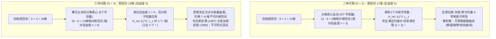
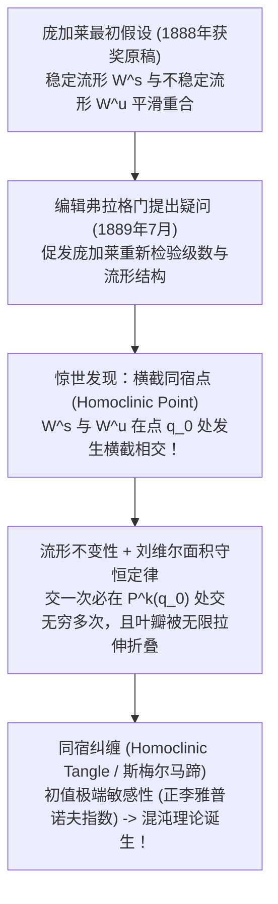

## 1. 引言：发条宇宙中“第三颗星”的诅咒

1687年，艾萨克·牛顿（Isaac Newton）发表了不朽巨著《自然哲学的数学原理》（*Principia*），彻底改写了人类的宇宙观。牛顿证明了使苹果落地的重力与维系月球轨道的引力遵循完全相同的万有引力定律，并精确求解了两个天体在相互引力作用下的运动——即<strong>二体问题（Two-Body Problem）</strong>。根据牛顿的解析解，只要给定初始位置与初始速度，两个天体的轨道就永远是可以用初等函数精确表达的<strong>圆锥曲线（椭圆、抛物线或双曲线）</strong>，从而严格证明了开普勒三大定律，并奠定了拉普拉斯“决定论发条宇宙”的基石。

然而，当牛顿试图将地球、月球与太阳同时纳入计算——即从 $N=2$ 增加到仅仅 $N=3$ 的<strong>三体问题（Three-Body Problem）</strong>时，解析力学的魔法突然失效了。牛顿曾感叹：“没有任何问题像月球运动理论那样令我头痛欲裂。”为什么两个星体可以用微积分完全求解，而仅仅增加第三颗星，就让人类最顶尖的数学家们困惑了三百多年？

这一壁垒并非源于计算繁琐，而是源于哈密顿力学中<strong>相空间（Phase Space）维度与守恒量（运动积分）之间的结构性赤字</strong>，以及亨利·庞加莱（Henri Poincaré）在19世纪末揭示的<strong>不可积性（Non-Integrability）与决定论混沌（Chaos）</strong>。本文将从五个核心维度全面剖析三体问题与天体力学的深渊。

---

## 2. 二体问题的完全可积性与三体问题的相空间自由度壁垒

### 2.1 引力 $N$ 体问题的哈密顿形式与刘维尔-阿诺德定理

设 $N$ 个质点质量为 $m_i$，在惯性系 $\mathbb{R}^3$ 中的位置矢量为 $\mathbf{r}_i$（$i=1,\dots,N$）。牛顿万有引力运动方程为：

$$m_i \frac{d^2 \mathbf{r}_i}{dt^2} = \sum_{\substack{j=1 \\ j \ne i}}^{N} \frac{G m_i m_j (\mathbf{r}_j - \mathbf{r}_i)}{\|\mathbf{r}_j - \mathbf{r}_i\|^3}$$

引入广义坐标 $\mathbf{q} = (\mathbf{r}_1, \dots, \mathbf{r}_N)$ 与共轭动量 $\mathbf{p} = (m_1\dot{\mathbf{r}}_1, \dots, m_N\dot{\mathbf{r}}_N)$，系统由 <strong>$6N$ 维相空间</strong>上的哈密顿量 $H(\mathbf{q}, \mathbf{p})$ 描述：

$$H(\mathbf{q}, \mathbf{p}) = \sum_{i=1}^{N} \frac{\|\mathbf{p}_i\|^2}{2m_i} - \sum_{1 \le i < j \le N} \frac{G m_i m_j}{\|\mathbf{r}_i - \mathbf{r}_j\|}$$

根据<strong>刘维尔-阿诺德可积性定理（Liouville-Arnold Theorem）</strong>，一个具有 $n$ 个自由度（相空间维度为 $2n$）的哈密顿系统若要通过求积法（Quadratures）完全可积，必须存在 <strong>$n$ 个函数独立且两两对合（泊松括号为零 $\{F_i, F_j\} = 0$）的第一积分</strong>。此时相空间被 $n$ 维不变环面 $\mathbb{T}^n$ 叶状剖分，运动表现为规则的准周期运动。

根据诺特定理（Noether's Theorem），三维欧氏空间的伽利略对称性为任意 $N$ 体系统提供了不多不少恰好 <strong>10个经典代数守恒量</strong>：
1. <strong>总动量守恒与质心匀速运动（6个积分）</strong>：总动量 $\mathbf{P} = \sum \mathbf{p}_i$（3个）与质心积分 $\mathbf{G}_{\text{CM}} = M\mathbf{R}_{\text{CM}} - \mathbf{P}t$（3个），将相空间维度无条件缩减6维（$6N \to 6N - 6$）。
2. <strong>总角动量守恒（3个积分）</strong>：$\mathbf{L} = \sum \mathbf{r}_i \times \mathbf{p}_i$。由于角动量分量满足李代数 $\{L_x, L_y\} = L_z \ne 0$，其中对合（对易）的独立守恒量有2个（$\|\mathbf{L}\|^2$ 与 $L_z$），结合雅可比“交点消去法（Elimination of the Nodes）”共可缩减4维相空间。
3. <strong>总机械能守恒（1个积分）</strong>：$H(\mathbf{q}, \mathbf{p}) = E$。

### 2.2 自由度计数对比：为何 $N=2$ 可解而 $N=3$ 不可积？

* <strong>当 $N=2$ 时</strong>：相空间为 $6 \times 2 = 12$ 维。扣除质心6维后，相对运动 $\mathbf{r} = \mathbf{r}_1 - \mathbf{r}_2$（折合质量 $\mu_{\text{red}} = \frac{m_1 m_2}{m_1+m_2}$）仅有 <strong>$n_{\text{rel}} = 3$ 个自由度</strong>，而系统恰好拥有 $H_{\text{rel}}, \|\mathbf{L}\|^2, L_z$ 这 <strong>3个对合积分</strong>！此外，$1/r$ 引力势还具有隐藏的 $SO(4)$ 动态对称性，对应守恒的<strong>拉普拉斯-龙格-楞次矢量（LRL矢量）</strong>：
  $$\mathbf{A} = \mathbf{p} \times \mathbf{L} - \mu_{\text{red}} G m_1 m_2 \frac{\mathbf{r}}{\|\mathbf{r}\|}$$
  这使二体问题成为<strong>最大超可积系统</strong>，轨道严格闭合为不进动的椭圆 $r(\theta) = \frac{p}{1 + e\cos(\theta - \varpi)}$。
* <strong>当 $N=3$ 时</strong>：相空间跃升至 <strong>$6 \times 3 = 18$ 维</strong>。扣除6个质心积分后，剩余12维相对相空间（<strong>$n_{\text{rel}} = 6$ 个自由度</strong>），但对合守恒量依然只有3个！即便利用角动量和能量进行最大程度的对称性约化，仍剩下 <strong>8维辛相空间（或7维能量流形）</strong>无法消去。
  - <strong>布伦斯定理（Bruns's Theorem, 1887）</strong>证明：除10个经典积分外，三体问题不存在任何其他关于坐标和动量的独立代数第一积分。
  - <strong>庞加莱不可积定理（Poincaré, 1889）</strong>证明：即便在限制性三体问题中，也不存在关于作用量-角变量和摄动参数 $\mu$ 解析的新第一积分。
  - <strong>顺德曼级数的陷阱（Sundman, 1912）</strong>：芬兰数学家卡尔·顺德曼虽然在 $\mathbf{L} \ne \mathbf{0}$ 条件下利用局部时间变换 $dt = r\,d\tau$（含 $t^{1/3}$ 项）消去二体碰撞奇点，构造了对所有时间收敛的幂级数解；但法国天文学家 Beloriszky（1930）证明，用该级数计算哪怕一个轨道周期的精确位置，也需要累加至少 <strong>$10^{8,000,000}$ 项</strong>（远超可观测宇宙原子总数 $10^{80}$），因此在物理预测上毫无实用价值。

| 比较维度 | 二体问题 ($N=2$) | 一般三体问题 ($N=3$) | 平面圆型限制性三体问题 (PCR3BP) |
| :--- | :--- | :--- | :--- |
| <strong>相空间总维度 ($6N$)</strong> | $12$ 维（$6$ 自由度） | $18$ 维（$9$ 自由度） | $4$ 维（第三天体，$2$ 自由度） |
| <strong>质心约化后相对自由度</strong> | $3$ 自由度（$6$ 维） | $6$ 自由度（$12$ 维） | $2$ 自由度（共转系 $4$ 维） |
| <strong>所需对合积分 vs 实际拥有</strong> | 需 $3$ 个 / 有 $3$ 个（外加LRL矢量） | 需 $6$ 个 / 仅有 $3$ 个（<strong>缺3个！</strong>） | 需 $2$ 个 / 仅有 $1$ 个雅可比积分 |
| <strong>对称性与能量约化后剩余维度</strong> | $0$（退化为一维求积） | $7 \sim 8$ 维不可约流形 | $3$ 维能量流形（$2$ 维庞加莱映射） |
| <strong>动力学性质</strong> | 完全超可积（闭合圆锥曲线） | <strong>不可积</strong>（同宿纠缠与全局混沌） | <strong>不可积</strong>（KAM环面与混沌海共存） |

---

## 3. 圆型限制性三体问题（CR3BP）与欧拉-拉格朗日五个平衡点（$L_1 \sim L_5$）

### 3.1 共转系运动方程、有效势与雅可比积分

当第三天体质量极小（$m_3 \to 0$，如航天器或小行星），且两个主天体 $m_1 \ge m_2$ 绕公共质心做角速度 $\omega = 1$、距离 $a = 1$ 的圆周运动时，称为<strong>圆型限制性三体问题（CR3BP）</strong>。定义无量纲质量参数：

$$\mu = \frac{m_2}{m_1 + m_2} \in \left(0, \frac{1}{2}\right]$$

在随主天体一同旋转的<strong>会合坐标系（Synodic Frame） $(x, y, z)$</strong> 中，主天体 $1-\mu$ 固定于 $(-\mu, 0, 0)$，主天体 $\mu$ 固定于 $(1-\mu, 0, 0)$。引入包含引力势与离心势的<strong>有效势（Effective Potential） $\Omega(x, y, z)$</strong>：

$$\Omega(x, y, z) = \frac{1}{2}(x^2 + y^2) + \frac{1 - \mu}{r_1} + \frac{\mu}{r_2}, \qquad r_1 = \sqrt{(x+\mu)^2+y^2+z^2}, \quad r_2 = \sqrt{(x-1+\mu)^2+y^2+z^2}$$

包含科里奥利力（$-2\boldsymbol{\omega}\times\mathbf{v}$）的运动方程为：

$$\ddot{x} - 2\dot{y} = \frac{\partial \Omega}{\partial x}, \qquad \ddot{y} + 2\dot{x} = \frac{\partial \Omega}{\partial y}, \qquad \ddot{z} = \frac{\partial \Omega}{\partial z}$$

将三式分别乘以 $\dot{x}, \dot{y}, \dot{z}$ 相加并积分，科里奥利力不做功而相互抵消，得到CR3BP唯一的守恒量——<strong>雅可比积分（Jacobi Constant $C_J$）</strong>：

$$C_J = 2\Omega(x, y, z) - (\dot{x}^2 + \dot{y}^2 + \dot{z}^2)$$

由于速度平方 $v_{\text{rot}}^2 = 2\Omega - C_J \ge 0$，天体被严格限制在<strong>希尔区域（Hill's Region） $2\Omega(x,y,z) \ge C_J$</strong> 内，其边界 $2\Omega = C_J$ 即为<strong>零速度曲面（Zero-Velocity Surfaces）</strong>。

### 3.2 五个拉格朗日点的推导与线性稳定性：JWST 与木星特洛伊小行星

令 $\nabla \Omega = \mathbf{0}$，可解出轨道平面 $z=0$ 上的5个平衡点：
1. <strong>欧拉共线点（$L_1, L_2, L_3$，1767年）</strong>：位于连线 $y = 0$ 上，满足五次代数方程 $x - \frac{(1-\mu)(x+\mu)}{|x+\mu|^3} - \frac{\mu(x-1+\mu)}{|x-1+\mu|^3} = 0$。当 $\mu \ll 1$ 时，$L_1$（两星之间）和 $L_2$（次星外侧）距离次星约为<strong>希尔半径 $r_{\text{Hill}} \approx a(\mu/3)^{1/3}$</strong>（日地系统中距地球约 <strong>150万公里</strong>）。
2. <strong>拉格朗日等边三角形点（$L_4, L_5$，1772年）</strong>：将有效势改写为 $\Omega(r_1, r_2) = \frac{1-\mu}{2}(r_1^2 + \frac{2}{r_1}) + \frac{\mu}{2}(r_2^2 + \frac{2}{r_2}) - \frac{1}{2}\mu(1-\mu)$，对 $r_1, r_2$ 求偏导立得 <strong>$r_1 = r_2 = 1$</strong>！即与两主天体构成正三角形的顶点 $L_{4,5} = \left(\frac{1}{2}-\mu, \pm\frac{\sqrt{3}}{2}, 0\right)$。

对平衡点做微扰线性化 $(\delta x, \delta y) \propto e^{\lambda t}$，平面特征方程为 $\lambda^4 + (4 - \Omega_{xx} - \Omega_{yy})\lambda^2 + (\Omega_{xx}\Omega_{yy} - \Omega_{xy}^2) = 0$：
* <strong>共线点 $L_1, L_2, L_3$ 的鞍点不稳定性与晕轨道（Halo Orbits）</strong>：由于 $\Omega_{xx}\Omega_{yy} - \Omega_{xy}^2 < 0$，特征值包含一对实根 $\pm\sigma$ 和两对纯虚根 $\pm i\omega_{xy}, \pm i\omega_z$（拓扑类型为 $\text{Saddle} \times \text{Center} \times \text{Center}$），故 <strong>$L_1, L_2, L_3$ 永远线性不稳定</strong>。然而，中心流形上存在着三维周期性的<strong>晕轨道（Halo Orbits）</strong>和利萨如轨道！<strong>詹姆斯·韦伯太空望远镜（JWST）</strong>正是运行在日地 $L_2$ 点的巨大晕轨道上——既能永远避开地球和月球的阴影以保证太阳能供电，又能用单侧五层遮阳罩同时挡住太阳、地球和月球的热辐射，且每年仅需消耗 <strong>$\Delta v \approx 2\sim 4\text{ m/s}$</strong> 的极微量推进剂即可维持轨道！日地 $L_1$ 点则部署着 <strong>SOHO</strong> 和 <strong>DSCOVR</strong> 太阳监测卫星。
* <strong>三角点 $L_4, L_5$ 的科里奥利力稳定化与劳斯判据（Routh's Criterion）</strong>：尽管 $L_4, L_5$ 是有效势 $\Omega$ 的<strong>局部极大值点（山峰）</strong>，但旋转系中的<strong>科里奥利力（$-2\boldsymbol{\omega}\times\mathbf{v}$）</strong>像磁场洛伦兹力一样将滑落的质点偏转为围绕山峰的闭合轨道！代入二阶导数可得特征方程：
  $$\lambda^4 + \lambda^2 + \frac{27}{4}\mu(1 - \mu) = 0$$
  要使四个特征值全为纯虚数（线性稳定），关于 $\lambda^2$ 的二次方程判别式必须大于零：
  $$1 - 27\mu(1 - \mu) > 0 \iff \mu < \mu_{\text{crit}} = \frac{1 - \sqrt{23/27}}{2} \approx 0.0385209 \quad \left(\text{即质量比 } \frac{m_1}{m_2} > 24.96\right)$$
  这就是著名的<strong>劳斯临界质量比（Routh, 1875）</strong>。太阳-木星系统的 $\mu \approx 0.000954 \ll 0.03852$，因此其 $L_4$（希腊营）和 $L_5$（特洛伊营）极其稳定，捕获了超过一万颗<strong>木星特洛伊小行星</strong>！

---

## 4. 奥斯卡二世悬赏竞赛与庞加莱催生混沌理论的“历史性错误”

1885年，瑞典国王<strong>奥斯卡二世（King Oscar II）</strong>为庆祝60岁寿辰设立了国际数学大奖，由魏尔斯特拉斯、埃尔米特和米塔-列夫勒担任评委，第一题正是求解 $N$ 体问题的全局收敛级数。法国数学家<strong>亨利·庞加莱（Henri Poincaré）</strong>为此创立了庞加莱截面（返回映射 $P$）、特征指数、积分不变量（庞加莱回归定理）以及双曲周期轨道的<strong>稳定流形 $W^s(\gamma)$ 与不稳定流形 $W^u(\gamma)$</strong>，并于1889年1月荣膺大奖。

然而在1889年7月论文付印于《*Acta Mathematica*》之际，年轻的编辑助手<strong>弗拉格门（Lars Edvard Phragmén）</strong>来信指出了证明中的一处疑点。庞加莱复查后惊出一身冷汗：他原本默认稳定流形 $W^s$ 与不稳定流形 $W^u$ 会平滑重合为一条封闭的分界线（Separatrix）；但严格计算表明，在摄动下 <strong>$W^s$ 与 $W^u$ 会以非零角度发生“横截相交（Transverse Intersection）”！</strong>

由于 $W^s$ 与 $W^u$ 都是庞加莱映射 $P$ 的不变集，只要它们在同宿点 $q_0$ 横截相交一次，就必须在所有迭代点 $P^k(q_0)$（$k \in \mathbb{Z}$）处<strong>相交无穷多次</strong>！同时，由于哈密顿流保持相空间面积守恒，随着交点间距趋于零，两流形围成的叶瓣（Lobe）被迫无限拉长并反复折叠，形成无穷复杂的网格——<strong>同宿纠缠（Homoclinic Tangle，1967年被斯梅尔抽象为“斯梅尔马蹄映射”）</strong>。庞加莱立即自掏腰包花费3,581克朗（超过2,500克朗奖金！）召回并销毁了已印好的期刊，于1890年发表了重写后的270页巨著，宣告了现代<strong>混沌理论（Chaos Theory）</strong>的诞生。

---

## 5. 现代奇迹：“8字形周期解”与太阳系的 KAM 定理

### 5.1 变分法与等质量三体“8字形编舞轨道”

在欧拉（1767）与拉格朗日（1772）之后的两百多年间，等质量三体问题从未发现新的显式周期轨道族。直到1993年，物理学家 <strong>Cristopher Moore</strong> 利用拓扑辫群数值发现了零角动量（$\mathbf{L}=\mathbf{0}$）的<strong>8字形周期轨道（Figure-Eight Orbit）</strong>；2000年，数学家 <strong>Alain Chenciner 与 Richard Montgomery</strong> 在《数学年刊》（*Annals of Mathematics*）上利用<strong>最小作用量原理（变分法）</strong>严格证明了其存在性！

三颗质量相等的恒星沿着同一条8字形曲线彼此相差 $T/3$ 周期追逐旋转：

$$\mathbf{r}_2(t) = \mathbf{r}_1\left(t - \frac{T}{3}\right), \qquad \mathbf{r}_3(t) = \mathbf{r}_1\left(t - \frac{2T}{3}\right)$$

通过在<strong>形状球面（Shape Sphere $S^2$，含3个二体碰撞奇点）</strong>上施加 $D_6$ 对称群约束，Chenciner 和 Montgomery 证明了光滑8字形测试轨道的作用量积分 $\mathcal{A} = \int_0^T (T - V)\,dt$ 严格小于任何包含碰撞奇点的轨道作用量（$\mathcal{A}_{\text{eight}} < \mathcal{A}_{\text{coll}}$），从而排除了碰撞陷阱！此后，Šuvakov 与 Dmitrašinović（2013）发现了13个新拓扑族，中国学者<strong>李晓明与廖世俊（2017–2018）</strong>更利用高精度“洁净数值模拟（CNS）”发现了<strong>超过2,000个新三体周期轨道族</strong>。

### 5.2 KAM 定理、阿诺德扩散与太阳系的 500 万年李雅普诺夫时间

既然三体问题充满混沌，为什么地球能稳定公转46亿年？在太阳系近可积哈密顿量 $H(\mathbf{I}, \boldsymbol{\theta}) = H_0(\mathbf{I}) + \epsilon H_1(\mathbf{I}, \boldsymbol{\theta})$ 中，经典微扰论会遇到分母 $\mathbf{k}\cdot\boldsymbol{\omega}(\mathbf{I}) \approx 0$ 发散的<strong>小分母问题（Small Divisors Problem）</strong>。

1954年至1963年建立的<strong>柯尔莫哥洛夫-阿诺德-莫泽定理（KAM Theorem）</strong>证明：当 $\epsilon \ll 1$ 且 $H_0$ 非退化时，只要未摄动环面的频率向量 $\boldsymbol{\omega}$ 满足强无理性的<strong>丢番图条件（Diophantine Condition）</strong>：

$$|\mathbf{k} \cdot \boldsymbol{\omega}| \ge \frac{\gamma}{\|\mathbf{k}\|^\tau} \qquad \left(\forall \mathbf{k} \in \mathbb{Z}^n \setminus \{\mathbf{0}\}\right)$$

对应的<strong>绝大多数不变环面（KAM环面）就不会被破坏</strong>，而是微变形后继续保持准周期运动！唯有共振环面会按<strong>庞加莱-伯克霍夫定理</strong>破裂为椭圆岛链与混沌层（如小行星带的柯克伍德空隙）。在自由度 $n \ge 3$ 的系统中，共振网络相互连通形成“阿诺德网”，产生极其缓慢的<strong>阿诺德扩散（Arnold Diffusion）</strong>。

法国天文学家<strong>雅克·拉斯卡尔（Jacques Laskar, 1989 / 2009）</strong>通过长达数十亿年的数值积分证实：内太阳系本质上是混沌的，其<strong>李雅普诺夫时间仅为 $\tau_{\text{L}} \approx 500\text{ 万年}$</strong>！地球初始位置哪怕有 <strong>15米</strong> 的测量误差，每500万年就会放大 $e$ 倍，在 <strong>1亿年后误差将扩大到整个地球公转轨道（$1\text{ AU}$）</strong>，从而使超过1亿年的精确轨道相位预测在物理上彻底不可能；而在未来50亿年内，水星与木星的近日点进动共振（$g_1 \approx g_5$）更有约 <strong>$1\%$ 的概率</strong>导致水星偏心率暴增至 $e > 0.6$，引发内太阳系行星相撞或逃逸。正是KAM环面的秩序与庞加莱同宿混沌的精妙交织，塑造了我们既稳定又生机勃勃的宇宙。
