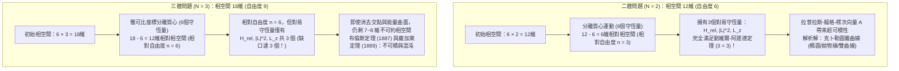
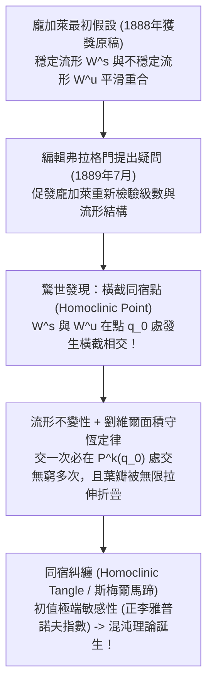

## 1. 引言：發條宇宙中「第三顆星」的詛咒

1687年，艾薩克·牛頓（Isaac Newton）發表了不朽巨著《自然哲學的數學原理》（*Principia*），徹底改寫了人類的宇宙觀。牛頓證明了使蘋果落地的重力與維繫月球軌道的引力遵循完全相同的萬有引力定律，並精確求解了兩個天體在相互引力作用下的運動——即<strong>二體問題（Two-Body Problem）</strong>。根據牛頓的解析解，只要給定初始位置與初始速度，兩個天體的軌道就永遠是可以用初等函數精確表達的<strong>圓錐曲線（橢圓、拋物線或雙曲線）</strong>，從而嚴格證明了克卜勒三大定律，並奠定了拉普拉斯「決定論發條宇宙」的基石。

然而，當牛頓試圖將地球、月球與太陽同時納入計算——即從 $N=2$ 增加到僅僅 $N=3$ 的<strong>三體問題（Three-Body Problem）</strong>時，解析力學的魔法突然失效了。牛頓曾感嘆：「沒有任何問題像月球運動理論那樣令我頭痛欲裂。」為什麼兩個星體可以用微積分完全求解，而僅僅增加第三顆星，就讓人類最頂尖的數學家們困惑了三百多年？

這一壁壘並非源於計算繁瑣，而是源於哈密頓力學中<strong>相空間（Phase Space）維度與守恆量（運動積分）之間的結構性赤字</strong>，以及亨利·龐加萊（Henri Poincaré）在19世紀末揭示的<strong>不可積性（Non-Integrability）與決定論混沌（Chaos）</strong>。本文將從五個核心維度全面剖析三體問題與天體力學的深淵。

---

## 2. 二體問題的完全可積性與三體問題的相空間自由度壁壘

### 2.1 引力 $N$ 體問題的哈密頓形式與劉維爾-阿諾德定理

設 $N$ 個質點質量為 $m_i$，在慣性系 $\mathbb{R}^3$ 中的位置向量為 $\mathbf{r}_i$（$i=1,\dots,N$）。牛頓萬有引力運動方程為：

$$m_i \frac{d^2 \mathbf{r}_i}{dt^2} = \sum_{\substack{j=1 \\ j \ne i}}^{N} \frac{G m_i m_j (\mathbf{r}_j - \mathbf{r}_i)}{\|\mathbf{r}_j - \mathbf{r}_i\|^3}$$

引入廣義座標 $\mathbf{q} = (\mathbf{r}_1, \dots, \mathbf{r}_N)$ 與共軛動量 $\mathbf{p} = (m_1\dot{\mathbf{r}}_1, \dots, m_N\dot{\mathbf{r}}_N)$，系統由 <strong>$6N$ 維相空間</strong>上的哈密頓量 $H(\mathbf{q}, \mathbf{p})$ 描述：

$$H(\mathbf{q}, \mathbf{p}) = \sum_{i=1}^{N} \frac{\|\mathbf{p}_i\|^2}{2m_i} - \sum_{1 \le i < j \le N} \frac{G m_i m_j}{\|\mathbf{r}_i - \mathbf{r}_j\|}$$

根據<strong>劉維爾-阿諾德可積性定理（Liouville-Arnold Theorem）</strong>，一個具有 $n$ 個自由度（相空間維度為 $2n$）的哈密頓系統若要透過求積法（Quadratures）完全可積，必須存在 <strong>$n$ 個函數獨立且兩兩對合（泊松括號為零 $\{F_i, F_j\} = 0$）的第一積分</strong>。此時相空間被 $n$ 維不變環面 $\mathbb{T}^n$ 葉狀剖分，運動表現為規則的準週期運動。

根據諾特定理（Noether's Theorem），三維歐氏空間的伽利略對稱性為任意 $N$ 體系統提供了不多不少恰好 <strong>10個經典代數守恆量</strong>：
1. <strong>總動量守恆與質心等速運動（6個積分）</strong>：總動量 $\mathbf{P} = \sum \mathbf{p}_i$（3個）與質心積分 $\mathbf{G}_{\text{CM}} = M\mathbf{R}_{\text{CM}} - \mathbf{P}t$（3個），將相空間維度無條件縮減6維（$6N \to 6N - 6$）。
2. <strong>總角動量守恆（3個積分）</strong>：$\mathbf{L} = \sum \mathbf{r}_i \times \mathbf{p}_i$。由於角動量分量滿足李代數 $\{L_x, L_y\} = L_z \ne 0$，其中對合（對易）的獨立守恆量有2個（$\|\mathbf{L}\|^2$ 與 $L_z$），結合雅可比「交點消去法（Elimination of the Nodes）」共可縮減4維相空間。
3. <strong>總機械能守恆（1個積分）</strong>：$H(\mathbf{q}, \mathbf{p}) = E$。

### 2.2 自由度計數對比：為何 $N=2$ 可解而 $N=3$ 不可積？

* <strong>當 $N=2$ 時</strong>：相空間為 $6 \times 2 = 12$ 維。扣除質心6維後，相對運動 $\mathbf{r} = \mathbf{r}_1 - \mathbf{r}_2$（約化質量 $\mu_{\text{red}} = \frac{m_1 m_2}{m_1+m_2}$）僅有 <strong>$n_{\text{rel}} = 3$ 個自由度</strong>，而系統恰好擁有 $H_{\text{rel}}, \|\mathbf{L}\|^2, L_z$ 這 <strong>3個對合積分</strong>！此外，$1/r$ 引力勢還具有隱藏的 $SO(4)$ 動態對稱性，對應守恆的<strong>拉普拉斯-龍格-楞次向量（LRL向量）</strong>：
  $$\mathbf{A} = \mathbf{p} \times \mathbf{L} - \mu_{\text{red}} G m_1 m_2 \frac{\mathbf{r}}{\|\mathbf{r}\|}$$
  這使二體問題成為<strong>最大超可積系統</strong>，軌道嚴格閉合為不進動的橢圓 $r(\theta) = \frac{p}{1 + e\cos(\theta - \varpi)}$。
* <strong>當 $N=3$ 時</strong>：相空間躍升至 <strong>$6 \times 3 = 18$ 維</strong>。扣除6個質心積分後，剩餘12維相對相空間（<strong>$n_{\text{rel}} = 6$ 個自由度</strong>），但對合守恆量依然只有3個！即便利用角動量和能量進行最大程度的對稱性約化，仍剩下 <strong>8維辛相空間（或7維能量流形）</strong>無法消去。
  - <strong>布倫斯定理（Bruns's Theorem, 1887）</strong>證明：除10個經典積分外，三體問題不存在任何其他關於座標和動量的獨立代數第一積分。
  - <strong>龐加萊不可積定理（Poincaré, 1889）</strong>證明：即便在限制性三體問題中，也不存在關於作用量-角變數和攝動參數 $\mu$ 解析的新第一積分。
  - <strong>順德曼級數的陷阱（Sundman, 1912）</strong>：芬蘭數學家卡爾·順德曼雖然在 $\mathbf{L} \ne \mathbf{0}$ 條件下利用局部時間變換 $dt = r\,d\tau$（含 $t^{1/3}$ 項）消去二體碰撞奇異點，構造了對所有時間收斂的冪級數解；但法國天文學家 Beloriszky（1930）證明，用該級數計算哪怕一個軌道週期的精確位置，也需要累加至少 <strong>$10^{8,000,000}$ 項</strong>（遠超可觀測宇宙原子總數 $10^{80}$），因此在物理預測上毫無實用價值。

| 比較維度 | 二體問題 ($N=2$) | 一般三體問題 ($N=3$) | 平面圓型限制性三體問題 (PCR3BP) |
| :--- | :--- | :--- | :--- |
| <strong>相空間總維度 ($6N$)</strong> | $12$ 維（$6$ 自由度） | $18$ 維（$9$ 自由度） | $4$ 維（第三天體，$2$ 自由度） |
| <strong>質心約化後相對自由度</strong> | $3$ 自由度（$6$ 維） | $6$ 自由度（$12$ 維） | $2$ 自由度（共轉系 $4$ 維） |
| <strong>所需對合積分 vs 實際擁有</strong> | 需 $3$ 個 / 有 $3$ 個（外加LRL向量） | 需 $6$ 個 / 僅有 $3$ 個（<strong>缺3個！</strong>） | 需 $2$ 個 / 僅有 $1$ 個雅可比積分 |
| <strong>對稱性與能量約化後剩餘維度</strong> | $0$（退化為一維求積） | $7 \sim 8$ 維不可約流形 | $3$ 維能量流形（$2$ 維龐加萊映射） |
| <strong>動力學性質</strong> | 完全超可積（閉合圓錐曲線） | <strong>不可積</strong>（同宿糾纏與全局混沌） | <strong>不可積</strong>（KAM環面與混沌海共存） |

---

## 3. 圓型限制性三體問題（CR3BP）與歐拉-拉格朗日五個平衡點（$L_1 \sim L_5$）

### 3.1 共轉系運動方程、有效勢與雅可比積分

當第三天體質量極小（$m_3 \to 0$，如太空船或小行星），且兩個主天體 $m_1 \ge m_2$ 繞公共質心做角速度 $\omega = 1$、距離 $a = 1$ 的圓周運動時，稱為<strong>圓型限制性三體問題（CR3BP）</strong>。定義無因次質量參數：

$$\mu = \frac{m_2}{m_1 + m_2} \in \left(0, \frac{1}{2}\right]$$

在隨主天體一同旋轉的<strong>會合座標系（Synodic Frame） $(x, y, z)$</strong> 中，主天體 $1-\mu$ 固定於 $(-\mu, 0, 0)$，主天體 $\mu$ 固定於 $(1-\mu, 0, 0)$。引入包含引力勢與離心勢的<strong>有效勢（Effective Potential） $\Omega(x, y, z)$</strong>：

$$\Omega(x, y, z) = \frac{1}{2}(x^2 + y^2) + \frac{1 - \mu}{r_1} + \frac{\mu}{r_2}, \qquad r_1 = \sqrt{(x+\mu)^2+y^2+z^2}, \quad r_2 = \sqrt{(x-1+\mu)^2+y^2+z^2}$$

包含科氏力（$-2\boldsymbol{\omega}\times\mathbf{v}$）的運動方程為：

$$\ddot{x} - 2\dot{y} = \frac{\partial \Omega}{\partial x}, \qquad \ddot{y} + 2\dot{x} = \frac{\partial \Omega}{\partial y}, \qquad \ddot{z} = \frac{\partial \Omega}{\partial z}$$

將三式分別乘以 $\dot{x}, \dot{y}, \dot{z}$ 相加並積分，科氏力不做功而相互抵消，得到CR3BP唯一的守恆量——<strong>雅可比積分（Jacobi Constant $C_J$）</strong>：

$$C_J = 2\Omega(x, y, z) - (\dot{x}^2 + \dot{y}^2 + \dot{z}^2)$$

由於速度平方 $v_{\text{rot}}^2 = 2\Omega - C_J \ge 0$，天體被嚴格限制在<strong>希爾區域（Hill's Region） $2\Omega(x,y,z) \ge C_J$</strong> 內，其邊界 $2\Omega = C_J$ 即為<strong>零速度曲面（Zero-Velocity Surfaces）</strong>。

### 3.2 五個拉格朗日點的推導與線性穩定性：JWST 與木星特洛伊小行星

令 $\nabla \Omega = \mathbf{0}$，可解出軌道平面 $z=0$ 上的5個平衡點：
1. <strong>歐拉共線點（$L_1, L_2, L_3$，1767年）</strong>：位於連線 $y = 0$ 上，滿足五次代數方程 $x - \frac{(1-\mu)(x+\mu)}{|x+\mu|^3} - \frac{\mu(x-1+\mu)}{|x-1+\mu|^3} = 0$。當 $\mu \ll 1$ 時，$L_1$（兩星之間）和 $L_2$（次星外側）距離次星約為<strong>希爾半徑 $r_{\text{Hill}} \approx a(\mu/3)^{1/3}$</strong>（日地系統中距地球約 <strong>150萬公里</strong>）。
2. <strong>拉格朗日等邊三角形點（$L_4, L_5$，1772年）</strong>：將有效勢改寫為 $\Omega(r_1, r_2) = \frac{1-\mu}{2}(r_1^2 + \frac{2}{r_1}) + \frac{\mu}{2}(r_2^2 + \frac{2}{r_2}) - \frac{1}{2}\mu(1-\mu)$，對 $r_1, r_2$ 求偏導立得 <strong>$r_1 = r_2 = 1$</strong>！即與兩主天體構成正三角形的頂點 $L_{4,5} = \left(\frac{1}{2}-\mu, \pm\frac{\sqrt{3}}{2}, 0\right)$。

對平衡點做微擾線性化 $(\delta x, \delta y) \propto e^{\lambda t}$，平面特徵方程為 $\lambda^4 + (4 - \Omega_{xx} - \Omega_{yy})\lambda^2 + (\Omega_{xx}\Omega_{yy} - \Omega_{xy}^2) = 0$：
* <strong>共線點 $L_1, L_2, L_3$ 的鞍點不穩定性與暈軌道（Halo Orbits）</strong>：由於 $\Omega_{xx}\Omega_{yy} - \Omega_{xy}^2 < 0$，特徵值包含一對實根 $\pm\sigma$ 和兩對純虛根 $\pm i\omega_{xy}, \pm i\omega_z$（拓撲類型為 $\text{Saddle} \times \text{Center} \times \text{Center}$），故 <strong>$L_1, L_2, L_3$ 永遠線性不穩定</strong>。然而，中心流形上存在著三維週期性的<strong>暈軌道（Halo Orbits）</strong>和利薩如軌道！<strong>詹姆斯·韋伯太空望遠鏡（JWST）</strong>正是運行在日地 $L_2$ 點的巨大暈軌道上——既能永遠避開地球和月球的陰影以保證太陽能供電，又能用單側五層遮陽罩同時擋住太陽、地球和月球的熱輻射，且每年僅需消耗 <strong>$\Delta v \approx 2\sim 4\text{ m/s}$</strong> 的極微量推進劑即可維持軌道！日地 $L_1$ 點則部署著 <strong>SOHO</strong> 和 <strong>DSCOVR</strong> 太陽監測衛星。
* <strong>三角點 $L_4, L_5$ 的科氏力穩定化與勞斯判據（Routh's Criterion）</strong>：儘管 $L_4, L_5$ 是有效勢 $\Omega$ 的<strong>局部極大值點（山峰）</strong>，但旋轉系中的<strong>科氏力（$-2\boldsymbol{\omega}\times\mathbf{v}$）</strong>像磁場勞侖茲力一樣將滑落的質點偏轉為圍繞山峰的閉合軌道！代入二階導數可得特徵方程：
  $$\lambda^4 + \lambda^2 + \frac{27}{4}\mu(1 - \mu) = 0$$
  要使四個特徵值全為純虛數（線性穩定），關於 $\lambda^2$ 的二次方程判別式必須大於零：
  $$1 - 27\mu(1 - \mu) > 0 \iff \mu < \mu_{\text{crit}} = \frac{1 - \sqrt{23/27}}{2} \approx 0.0385209 \quad \left(\text{即質量比 } \frac{m_1}{m_2} > 24.96\right)$$
  這就是著名的<strong>勞斯臨界質量比（Routh, 1875）</strong>。太陽-木星系統的 $\mu \approx 0.000954 \ll 0.03852$，因此其 $L_4$（希臘營）和 $L_5$（特洛伊營）極其穩定，捕獲了超過一萬顆<strong>木星特洛伊小行星</strong>！

---

## 4. 奧斯卡二世懸賞競賽與龐加萊催生混沌理論的「歷史性錯誤」

1885年，瑞典國王<strong>奧斯卡二世（King Oscar II）</strong>為慶祝60歲壽辰設立了國際數學大獎，由魏爾斯特拉斯、埃爾米特和米塔-列夫勒擔任評審，第一題正是求解 $N$ 體問題的全局收斂級數。法國數學家<strong>亨利·龐加萊（Henri Poincaré）</strong>為此創立了龐加萊截面（返回映射 $P$）、特徵指數、積分不變量（龐加萊回歸定理）以及雙曲週期軌道的<strong>穩定流形 $W^s(\gamma)$ 與不穩定流形 $W^u(\gamma)$</strong>，並於1889年1月榮膺大獎。

然而在1889年7月論文付印於《*Acta Mathematica*》之際，年輕的編輯助手<strong>弗拉格門（Lars Edvard Phragmén）</strong>來信指出了證明中的一處疑點。龐加萊複查後驚出一身冷汗：他原本預設穩定流形 $W^s$ 與不穩定流形 $W^u$ 會平滑重合為一條封閉的分界線（Separatrix）；但嚴格計算表明，在攝動下 <strong>$W^s$ 與 $W^u$ 會以非零角度發生「橫截相交（Transverse Intersection）」！</strong>

由於 $W^s$ 與 $W^u$ 都是龐加萊映射 $P$ 的不變集，只要它們在同宿點 $q_0$ 橫截相交一次，就必須在所有迭代點 $P^k(q_0)$（$k \in \mathbb{Z}$）處<strong>相交無窮多次</strong>！同時，由於哈密頓流保持相空間面積守恆，隨著交點間距趨於零，兩流形圍成的葉瓣（Lobe）被迫無限拉長並反覆折疊，形成無窮複雜的網格——<strong>同宿糾纏（Homoclinic Tangle，1967年被斯梅爾抽象為「斯梅爾馬蹄映射」）</strong>。龐加萊立即自掏腰包花費3,581克朗（超過2,500克朗獎金！）召回並銷毀了已印好的期刊，於1890年發表了重寫後的270頁巨著，宣告了現代<strong>混沌理論（Chaos Theory）</strong>的誕生。

---

## 5. 現代奇蹟：「8字形週期解」與太陽系的 KAM 定理

### 5.1 變分法與等質量三體「8字形編舞軌道」

在歐拉（1767）與拉格朗日（1772）之後的兩百多年間，等質量三體問題從未發現新的顯式週期軌道族。直到1993年，物理學家 <strong>Cristopher Moore</strong> 利用拓撲辮群數值發現了零角動量（$\mathbf{L}=\mathbf{0}$）的<strong>8字形週期軌道（Figure-Eight Orbit）</strong>；2000年，數學家 <strong>Alain Chenciner 與 Richard Montgomery</strong> 在《數學年刊》（*Annals of Mathematics*）上利用<strong>最小作用量原理（變分法）</strong>嚴格證明了其存在性！

三顆質量相等的恆星沿著同一條8字形曲線彼此相差 $T/3$ 週期追逐旋轉：

$$\mathbf{r}_2(t) = \mathbf{r}_1\left(t - \frac{T}{3}\right), \qquad \mathbf{r}_3(t) = \mathbf{r}_1\left(t - \frac{2T}{3}\right)$$

透過在<strong>形狀球面（Shape Sphere $S^2$，含3個二體碰撞奇異點）</strong>上施加 $D_6$ 對稱群約束，Chenciner 和 Montgomery 證明了光滑8字形測試軌道的作用量積分 $\mathcal{A} = \int_0^T (T - V)\,dt$ 嚴格小於任何包含碰撞奇異點的軌道作用量（$\mathcal{A}_{\text{eight}} < \mathcal{A}_{\text{coll}}$），從而排除了碰撞陷阱！此後，Šuvakov 與 Dmitrašinović（2013）發現了13個新拓撲族，中國學者<strong>李曉明與廖世俊（2017–2018）</strong>更利用高精度「潔淨數值模擬（CNS）」發現了<strong>超過2,000個新三體週期軌道族</strong>。

### 5.2 KAM 定理、阿諾德擴散與太陽系的 500 萬年李雅普諾夫時間

既然三體問題充滿混沌，為什麼地球能穩定公轉46億年？在太陽系近可積哈密頓量 $H(\mathbf{I}, \boldsymbol{\theta}) = H_0(\mathbf{I}) + \epsilon H_1(\mathbf{I}, \boldsymbol{\theta})$ 中，經典微擾論會遇到分母 $\mathbf{k}\cdot\boldsymbol{\omega}(\mathbf{I}) \approx 0$ 發散的<strong>小分母問題（Small Divisors Problem）</strong>。

1954年至1963年建立的<strong>柯爾莫哥洛夫-阿諾德-莫澤定理（KAM Theorem）</strong>證明：當 $\epsilon \ll 1$ 且 $H_0$ 非退化時，只要未攝動環面的頻率向量 $\boldsymbol{\omega}$ 滿足強無理性的<strong>丟番圖條件（Diophantine Condition）</strong>：

$$|\mathbf{k} \cdot \boldsymbol{\omega}| \ge \frac{\gamma}{\|\mathbf{k}\|^\tau} \qquad \left(\forall \mathbf{k} \in \mathbb{Z}^n \setminus \{\mathbf{0}\}\right)$$

對應的<strong>絕大多數不變環面（KAM環面）就不會被破壞</strong>，而是微變形後繼續保持準週期運動！唯有共振環面會按<strong>龐加萊-伯克霍夫定理</strong>破裂為橢圓島鏈與混沌層（如小行星帶的柯克伍德空隙）。在自由度 $n \ge 3$ 的系統中，共振網絡相互連通形成「阿諾德網」，產生極其緩慢的<strong>阿諾德擴散（Arnold Diffusion）</strong>。

法國天文學家<strong>雅克·拉斯卡爾（Jacques Laskar, 1989 / 2009）</strong>透過長達數十億年的數值積分證實：內太陽系本質上是混沌的，其<strong>李雅普諾夫時間僅為 $\tau_{\text{L}} \approx 500\text{ 萬年}$</strong>！地球初始位置哪怕有 <strong>15公尺</strong> 的測量誤差，每500萬年就會放大 $e$ 倍，在 <strong>1億年後誤差將擴大到整個地球公轉軌道（$1\text{ AU}$）</strong>，從而使超過1億年的精確軌道相位預測在物理上徹底不可能；而在未來50億年內，水星與木星的近日點進動共振（$g_1 \approx g_5$）更有約 <strong>$1\%$ 的機率</strong>導致水星偏心率暴增至 $e > 0.6$，引發內太陽系行星相撞或逃逸。正是KAM環面的秩序與龐加萊同宿混沌的精妙交織，塑造了我們既穩定又生機勃勃的宇宙。
