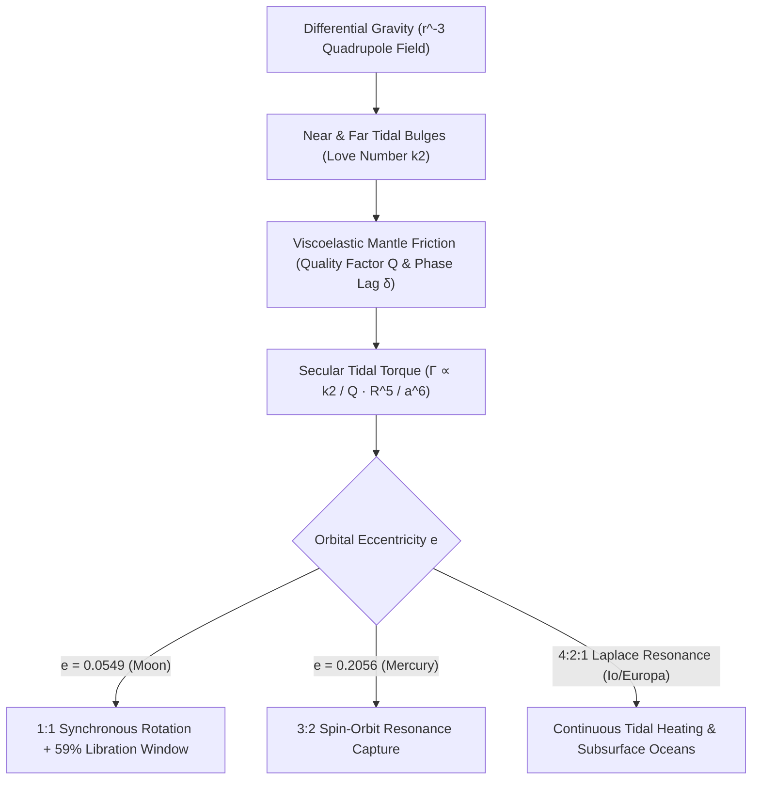

## 1. حقل المد رباعي الأقطاب: لماذا تتناسب قوة المد عكسياً مع مكعب المسافة $r^{-3}$؟

عندما ننظر إلى السماء ليلاً من أي مكان على سطح الأرض، نرى دائماً نفس السهول البازلتية الداكنة (*البحار القمرية*) على الوجه القريب للقمر؛ ولم يكتشف البشر الوجه البعيد للقمر المليء بالفوهات إلا في أكتوبر 1959 عندما التقط المسبار السوفيتي *لونا 3* أولى الصور له. إن التطابق المذهل بين فترة دوران القمر حول محوره ($P_{\text{rot}} = 27.321661\,\text{يوماً}$) وفترة دورانه النجمي حول الأرض ($P_{\text{orb}} = 27.321661\,\text{يوماً}$) ليس مصادفة كونية، بل هو النتيجة الحتمية لقوانين الجاذبية، والتشوه اللزج المرن، وتبدد الطاقة الحرارية عبر ملايين السنين، وهو ما يُعرف باسم <strong>التقييد المدّي أو الدوران المتزامن (Tidal Locking / Synchronous Rotation)</strong>.

وفقاً لقانون الجذب العام لنيوتن، يؤثر جرم مركزي كتلته $M$ على مركز كتلة تابع (كتلته $m$ ونصف قطره $R$) يقع على مسافة $r$ بتسارع جاذبي $g_0 = GM/r^2$ يحافظ على مداره. غير أن القمر ليس جسماً نقطياً، بل كرة ممتدة قطرها $2R \approx 3,474\,\text{كم}$. لذلك تتعرض النقطة الأقرب للأرض ($r-R$) لقوة جذب أقوى من مركز الكتلة، بينما تتعرض النقطة المقابلة في الوجه البعيد ($r+R$) لقوة جذب أضعف. وبنشر المتسلسلة ذات الحدين $(1 \mp R/r)^{-2} \approx 1 \pm 2(R/r)$ وطرح تسارع مركز الكتلة $g_0$، نحصل على <strong>تسارع المد التفاضلي</strong> وقدره $+2GMR/r^3$ (باتجاه الأرض) على الوجه القريب و$-2GMR/r^3$ (بعيداً عن الأرض!) على الوجه البعيد. وعند نشر الجهد الجاذبي $\Phi(R,\theta) = -GM/s$ بدلالة كثيرات حدود ليجاندر $P_\ell(\cos\theta)$ وحذف الحدين $\ell=0$ و$\ell=1$، نحصل على <strong>جهد المد رباعي الأقطاب (Quadrupole Tidal Potential, $\ell=2$)</strong>:

$$
\mathbf{a}_{\text{tidal}}(R, \theta) = -\nabla V_{\text{tidal}} = -\nabla \left[ -\frac{G M R^2}{2 r^3} (3\cos^2\theta - 1) \right] = \frac{G M R}{r^3} \left[ (3\cos^2\theta - 1)\hat{\mathbf{e}}_R - 3\sin\theta\cos\theta\,\hat{\mathbf{e}}_\theta \right]
$$

---

## 2. التشوه اللزج المرن، أعداد لاف $k_2$، زاوية التأخر الطوري $\delta$ وعزم المد $\propto a^{-6}$

يعمل هذا الجهد رباعي الأقطاب على مطّ الجرم السماوي على طول محور خط المركزين ($	heta = 0, \pi$) وضغطه على طول الحلقة الاستوائية المتعامدة ($\theta = \pi/2$)، مما يولّد <strong>انتفاخين مدّيين متماثلين (Tidal Bulges)</strong> على الوجهين القريب والبعيد. وفي عام 1909، قدّم عالم الرياضيات البريطاني أوغسطس إدوارد هاف لاف معاملات لا بُعدية تُعرف باسم <strong>أعداد لاف (Love Numbers) $k_2$</strong> لقياس الجهد الجاذبي الإضافي الناتج عن إعادة توزيع كتلة الانتفاخ المدّي: $k_2 = \frac{3/2}{1 + 19\mu_{\text{shear}}/(2\rho g R)}$ حيث $\mu_{\text{shear}}$ هو معامل القص ($k_2 \approx 0.0241$ للقمر الصخري الحالي و$k_2 \approx 0.299$ للأرض).

لو كان القمر جسماً مرناً مثالياً عديم الاحتكاك، لاستجاب الانتفاخان لحظياً لجاذبية الأرض ولاصطفّا تماماً على خط الأرض–القمر ($\delta = 0$)، مما يجعل عزم الدوران الصافي صفراً ($\Gamma = 0$). لكن صخور الوشاح الحقيقية ذات طبيعة <strong>لزجة مرنة (Viscoelastic)</strong>: إذ يؤدي الاحتكاك الداخلي (المقاس بمعامل الجودة $Q$، حيث نسبة الطاقة المتبددة في كل دورة هي $Q^{-1} \approx \sin 2\delta$) إلى تأخر زمني $\Delta t$ بين ذروة إجهاد المد وذروة التشوه. عندما كان القمر الفتيّ يدور حول محوره أسرع من دورانه المداري ($\omega_{\text{rot}} > n$)، سحب دورانه الانتفاخين المدّيين <strong>إلى الأمام من خط الأرض–القمر بزاوية تأخر طوري $\delta$</strong>. ولأن الأرض تجذب الانتفاخ القريب بقوة أكبر من جذبها للانتفاخ البعيد، ينشأ <strong>عزم كبح مدّي علمي (Secular Tidal Torque)</strong> يتناسب عكسياً مع <strong>القوة السادسة لنصف المحور الأكبر للمدار ($a^{-6}$)</strong>:

$$
\Gamma = -\frac{3}{2} \frac{G M^2 R^5}{a^6} k_2 \sin(2\delta) \approx -\frac{3}{2} \frac{G M^2 R^5}{a^6} \left(\frac{k_2}{Q}\right) \operatorname{sgn}(\omega_{\text{rot}} - n), \qquad \tau_{\text{lock}} \approx \frac{2 \alpha \, \omega_0 \, m \, a^6 \, Q}{3 G M^2 k_2 R^3}
$$

---

## 3. حفظ الزخم الزاوي، ابتعاد القمر، وظاهرة الميسان (لماذا نرى 59% من سطح القمر؟)

بسبب الاعتماد الهائل على $a^{-6}$، فإن القمر الفتيّ الذي تشكّل قبل $4.5\,\text{مليار سنة}$ على مسافة قريبة من الأرض ($a_0 \approx 4\text{–}10\,R_\oplus$) تباطأ دورانه ليصل إلى حالة التزامن $1:1$ ($\omega_{\text{rot}} = n$) خلال $10^2\text{–}10^5$ سنوات فقط. واليوم، رغم أن دوران القمر مقفل، فإن دوران الأرض السريع حول محورها ($24\,\text{ساعة}$) يسحب انتفاخات المحيطات والوشاح الأرضي بزاوية $\delta_\oplus \approx 2.9^\circ$ أمام خط الأرض–القمر. يؤدي هذا الانتفاخ المتقدم إلى إبطاء دوران الأرض (مما يزيد طول اليوم الأرضي بمقدار $+1.7\text{–}2.3\,\text{مللي ثانية}$ لكل قرن)، وفي الوقت نفسه يدفع القمر للأمام في مداره وفق القانون الثالث لنيوتن، ناقلاً الزخم الزاوي الدوراني للأرض $I_\oplus\Omega_\oplus$ إلى الزخم الزاوي المداري للقمر $m\sqrt{GM_\oplus a}$. وتؤكد قياسات <strong>المدى الليزري القمري (LLR)</strong> عبر عاكسات أبولو أن القمر يبتعد عن الأرض بمعدل $+3.82 \pm 0.07\,\text{سم/سنة}$!

ولكن إذا كان القمر مقفلاً بنسبة $1:1$، فلماذا نستطيع رصد <strong>$59\%$ من مساحة سطح القمر</strong> من الأرض بدلاً من $50\%$ فقط؟ يكمن الجواب في <strong>الميسان القمري (Lunar Libration)</strong>: فبينما يدور القمر حول محوره بسرعة زاوية ثابتة $\omega_{\text{rot}} = n$، تتغير سرعته الزاوية المدارية $\dot{f}(t)$ على طول مداره الإهليلجي ($e = 0.0549$) وفق القانون الثاني لكبلر. يولّد هذا الفرق <strong>ميساناً طولياً</strong> يصل إلى $\pm 7^\circ 54'$، وبالاجتماع مع <strong>الميسان العرضي</strong> ($\pm 6^\circ 41'$ بسبب ميل المحور والمدار) و<strong>الميسان اليومي باختلاف المنظر</strong> ($\pm 1^\circ$)، ينكشف للراصد الأرضي $59.0\%$ من الكرة القمرية:

$$
\Delta \phi_{\text{long}}(t) = f(t) - M(t) = 2 e \sin(n t) + \frac{5}{4} e^2 \sin(2 n t) + \mathcal{O}(e^3), \qquad \frac{\dot{f}_{\text{peri}}}{n} = \frac{\sqrt{1 - e^2}}{(1 - e)^2} \approx 1.5506 \approx \frac{3}{2}
$$

---

## 4. رنين الدوران-المدار 3:2 لكوكب عطارد والتسخين المدّي لأقمار المشتري

لا تنتهي جميع الأجرام الخاضعة لقوى المد في حالة التزامن $1:1$. ففي عام 1965، كشفت أرصاد رادار دوبلر في مرصد أريسيبو أن كوكب عطارد يدور حول محوره كل $P_{\text{rot}} = 58.646\,\text{يوماً}$، أي ثلثي دورته المدارية البالغة $87.969\,\text{يوماً}$ بالضبط (<strong>رنين دوران-مدار $3:2$</strong>)! وأثبت غولدرايخ وبيل (Goldreich & Peale, 1966) أن ذلك يعود إلى الشذوذ المداري الكبير لعطارد ($e = 0.2056$): فبما أن عزم المد يتناسب مع $r^{-6}$، تكون قوة المد الشمسية عند الحضيض أقوى بـ $12.2$ مرة منها عند الأوج، وتبلغ السرعة الزاوية المدارية اللحظية عند الحضيض $\dot{f}_{\text{peri}}/n = (1-e^2)^{1/2}/(1-e)^2 \approx 1.5506 \approx 3/2$. وبالتآزر مع عزم الاستعادة ثلاثي المحاور $(B-A)/C$، وقع عطارد في بئر الرنين $3:2$ بشكل دائم.

وفي نظام المشتري، يحافظ <strong>رنين لابلاس المداري $4:2:1$</strong> بين آيو وأوروبا وغانيميد على شذوذ مداري قسري ($e_{\text{Io}} = 0.0041$) يمنع استدارة المدارات ويولّد طاقة هائلة قدرها $10^{14}\,\text{واط}$ من <strong>التسخين المدّي (Tidal Heating)</strong>، مما يغذي البراكين النشطة على آيو ويحافظ على المحيطات المائية السائلة تحت القشرة الجليدية في أوروبا وإنسيلادوس.

| النظام / الجرم | الجرم المركزي | نسبة رنين الدوران:المدار | الشذوذ المداري $e$ | النتيجة الديناميكية والجيوفيزيائية الرئيسية |
| :--- | :--- | :--- | :--- | :--- |
| <strong>القمر (Moon)</strong> | الأرض | $1:1$ دوران متزامن | $0.0549$ | نفس الوجه للأرض؛ الميسان يكشف $59\%$؛ ابتعاد بمعدل $+3.82\,\text{سم/سنة}$ |
| <strong>عطارد (Mercury)</strong> | الشمس | $3:2$ رنين دوران-مدار | $0.2056$ | $P_{\text{rot}}=58.65\,\text{d}$؛ اليوم الشمسي على عطارد يعادل سنتين عطارديتين ($176\,\text{d}$) |
| <strong>بلوتو وشارون</strong> | متبادل | $1:1$ إقفال مزدوج كامل | $<0.0002$ | توازن مدّي متبادل كامل لكلا الجرمين ($P_{\text{rot}}=P_{\text{orb}}=6.387\,\text{d}$) |
| <strong>آيو / أوروبا</strong> | المشتري | $1:1$ دوران + $4:2:1$ لابلاس | $0.0041$ | الشذوذ القسري يغذي براكين آيو والمحيط السائل تحت جليد أوروبا |

$$
\dot{E}_{\text{ecc}} = \frac{21}{2} \frac{k_2}{Q} \frac{G M_J^2 R^5 n \, e^2}{a^6}, \qquad \frac{d}{dt}\left(I_\oplus \Omega_\oplus + m \sqrt{G M_\oplus a}\right) = 0
$$

