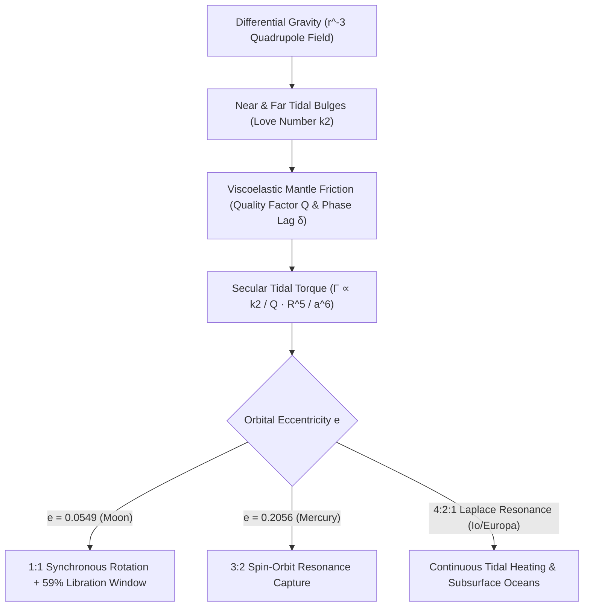

## 1. Das Quadrupol-Gezeitenfeld: Warum skaliert die Gezeitenkraft mit $r^{-3}$ statt $r^{-2}$?

Blickt man von einem beliebigen Ort der Erde zum Nachthimmel, sieht man stets dieselben dunklen Basaltebenen (*Maria*) der Mondvorderseite; erst im Oktober 1959 übermittelte die sowjetische Raumsonde *Luna 3* die ersten Aufnahmen der kraterübersäten Rückseite des Mondes. Dass die Rotationsperiode des Mondes um seine eigene Achse ($P_{\text{rot}} = 27{,}321661\,\text{Tage}$) exakt mit seiner siderischen Umlaufperiode um die Erde ($P_{\text{orb}} = 27{,}321661\,\text{Tage}$) übereinstimmt, ist kein kosmischer Zufall, sondern das zwingende Resultat von Gravitation, viskoelastischer Verformung und thermodynamischer Energiedissipation: die <strong>gebundene Rotation (Tidal Locking / Synchronous Rotation)</strong>.

Nach dem Newtonschen Gravitationsgesetz erfährt der Schwerpunkt eines Satelliten (Masse $m$, Radius $R$) im Abstand $r$ vom Zentralkörper (Masse $M$) die Schwerebeschleunigung $g_0 = GM/r^2$, welche exakt die Kreisbahnbewegung aufrechterhält. Da der Mond jedoch ein ausgedehnter Körper mit Durchmesser $2R \approx 3.474\,\text{km}$ ist, wirkt auf den erdnächsten Punkt ($r-R$) eine stärkere Gravitationskraft als auf den Schwerpunkt, während auf den erdfernsten Punkt ($r+R$) eine schwächere Kraft wirkt. Eine Taylor-Entwicklung $(1 \mp R/r)^{-2} \approx 1 \pm 2(R/r)$ liefert nach Abzug der Schwerpunktsbeschleunigung die <strong>Gezeitenbeschleunigung</strong> $+2GMR/r^3$ (zur Erde gerichtet) auf der Vorderseite und $-2GMR/r^3$ (von der Erde weggerichtet!) auf der Rückseite. Entwickelt man das Gravitationspotential $\Phi(R,\theta) = -GM/s$ nach Legendre-Polynomen $P_\ell(\cos\theta)$ und subtrahiert den konstanten Monopolterm ($\ell=0$) sowie den bahnkrümmenden Dipolterm ($\ell=1$), so erhält man das führende <strong>Quadrupol-Gezeitenpotential ($\ell=2$)</strong>:

$$
\mathbf{a}_{\text{tidal}}(R, \theta) = -\nabla V_{\text{tidal}} = -\nabla \left[ -\frac{G M R^2}{2 r^3} (3\cos^2\theta - 1) \right] = \frac{G M R}{r^3} \left[ (3\cos^2\theta - 1)\hat{\mathbf{e}}_R - 3\sin\theta\cos\theta\,\hat{\mathbf{e}}_\theta \right]
$$

---

## 2. Viskoelastische Verformung, Love-Zahlen $k_2$, Phasenverzögerung $\delta$ und das $a^{-6}$-Drehmoment

Dieses Quadrupolfeld dehnt den Himmelskörper entlang der Verbindungslinie ($	heta = 0, \pi$) und staucht ihn entlang des senkrechten Äquatorialrings ($\theta = \pi/2$), sodass <strong>zwei symmetrische Gezeitenberge (Tidal Bulges)</strong> auf Vorder- und Rückseite entstehen. Der britische Mathematiker Augustus Edward Hough Love führte 1909 die dimensionslose <strong>Love-Zahl $k_2$</strong> ein, um das zusätzliche Gravitationspotential der verformten Massenverteilung zu quantifizieren: $k_2 = \frac{3/2}{1 + 19\mu_{\text{shear}}/(2\rho g R)}$, wobei $\mu_{\text{shear}}$ der Schermodul ist (für den heutigen Gesteinsmond gilt $k_2 \approx 0{,}0241$, für die Erde $k_2 \approx 0{,}299$).

Wäre der Mond perfekt elastisch und reibungsfrei, würden die Gezeitenberge verzögerungsfrei auf die Erdanziehung reagieren und exakt auf der Verbindungslinie Erde–Mond liegen ($\delta = 0$), sodass aus Symmetriegründen kein Drehmoment entstünde ($\Gamma = 0$). Reales Mantelgestein verhält sich jedoch <strong>viskoelastisch</strong>: Innere Reibung (charakterisiert durch den inversen Qualitätsfaktor $Q^{-1} \approx \sin 2\delta$) bewirkt eine Zeitverzögerung $\Delta t$ zwischen maximaler Gezeitenspannung und maximaler Verformung. Rotierte der junge Mond schneller als sein Bahnumlauf ($\omega_{\text{rot}} > n$), schleppte seine Rotation die Gezeitenberge um den <strong>Phasenwinkel $\delta$ vor die Verbindungslinie Erde–Mond</strong>. Da die Erde am näheren vorderen Gezeitenberg stärker zieht als am ferneren hinteren Berg, entsteht ein bremsendes <strong>säkulares Gezeitendrehmoment</strong>, das invers mit der <strong>sechsten Potenz der großen Halbachse ($a^{-6}$)</strong> skaliert:

$$
\Gamma = -\frac{3}{2} \frac{G M^2 R^5}{a^6} k_2 \sin(2\delta) \approx -\frac{3}{2} \frac{G M^2 R^5}{a^6} \left(\frac{k_2}{Q}\right) \operatorname{sgn}(\omega_{\text{rot}} - n), \qquad \tau_{\text{lock}} \approx \frac{2 \alpha \, \omega_0 \, m \, a^6 \, Q}{3 G M^2 k_2 R^3}
$$

---

## 3. Drehimpulserhaltung, Mondflucht und Libration (Warum wir 59 % des Mondes sehen)

Wegen der extremen $a^{-6}$-Abhängigkeit wurde der junge Mond kurz nach seiner Entstehung in einer erdnahen Bahn ($a_0 \approx 4\text{–}10\,R_\oplus$) innerhalb von nur $10^2\text{–}10^5$ Jahren in die $1:1$-Synchronrotation ($\omega_{\text{rot}} = n$) abgebremst. Heute ist die Mondrotation gebunden, doch die schnelle Erdrotation ($24\,\text{h}$) schleppt die irdischen Ozean- und Mantelgezeitenberge um $\delta_\oplus \approx 2{,}9^\circ$ vor die Erde-Mond-Linie. Dieses voreilende Schwerefeld bremst einerseits die Erdrotation (die Tageslänge wächst um $+1{,}7\text{–}2{,}3\,\text{ms}$ pro Jahrhundert) und beschleunigt andererseits den Mond auf seiner Bahn, wodurch Drehimpuls von der Erdrotation $I_\oplus\Omega_\oplus$ in den Bahndrehimpuls des Mondes $m\sqrt{GM_\oplus a}$ übertragen wird. <strong>Lunar Laser Ranging (LLR)</strong> an den Apollo-Retroreflektoren bestätigt millimetergenau, dass sich der Mond mit $+3{,}82 \pm 0{,}07\,\text{cm/Jahr}$ von der Erde entfernt!

Warum aber können wir trotz exakter $1:1$-Synchronisation von der Erde aus im Laufe der Zeit <strong>$59\%$ der Mondoberfläche</strong> beobachten statt nur $50\%$? Der Grund ist die <strong>Libration des Mondes</strong>: Während die Eigenrotation des Mondes mit konstanter Winkelgeschwindigkeit $\omega_{\text{rot}} = n$ erfolgt, bewegt sich der Mond auf einer elliptischen Bahn ($e = 0{,}0549$) nach dem zweiten Keplerschen Gesetz nahe dem Perigäum schneller und nahe dem Apogäum langsamer als $n$. Diese Differenz erzeugt die <strong>Libration in Länge</strong> von bis zu $\pm 7^\circ 54'$; zusammen mit der <strong>Libration in Breite</strong> ($\pm 6^\circ 41'$ durch Achsneigung und Bahninklination) sowie der <strong>täglichen Parallaxen-Libration</strong> ($\pm 1^\circ$) öffnet sich ein Sichtfenster auf $59{,}0\%$ der gesamten Mondkugel:

$$
\Delta \phi_{\text{long}}(t) = f(t) - M(t) = 2 e \sin(n t) + \frac{5}{4} e^2 \sin(2 n t) + \mathcal{O}(e^3), \qquad \frac{\dot{f}_{\text{peri}}}{n} = \frac{\sqrt{1 - e^2}}{(1 - e)^2} \approx 1.5506 \approx \frac{3}{2}
$$

---

## 4. Merkurs 3:2-Spin-Bahn-Resonanz und Gezeitenheizung der Galileischen Monde

Nicht jeder gezeitengebundene Körper endet im $1:1$-Zustand. Radarmessungen am Arecibo-Observatorium im Jahr 1965 zeigten überraschend, dass der Planet Merkur in $P_{\text{rot}} = 58{,}646\,\text{Tagen}$ rotiert – exakt zwei Drittel seiner Umlaufzeit von $87{,}969\,\text{Tagen}$ (eine <strong>$3:2$-Spin-Bahn-Resonanz</strong>)! Goldreich und Peale (1966) erklärten dies durch Merkurs hohe Bahnexzentrizität ($e = 0{,}2056$): Da das Gezeitendrehmoment mit $r^{-6}$ skaliert, ist die Gezeitenwirkung im Perihel $12{,}2$-mal stärker als im Aphel; im Perihel beträgt die momentane Bahnwinkelgeschwindigkeit $\dot{f}_{\text{peri}}/n = (1-e^2)^{1/2}/(1-e)^2 \approx 1{,}5506 \approx 3/2$. Zusammen mit dem rückstellenden Gravitationsdrehmoment seiner dreiachsigen Massenverteilung $(B-A)/C$ wurde Merkur dauerhaft im $3:2$-Resonanzzustand eingefangen.

Im Jupitersystem wiederum erzwingt die <strong>Laplace-4:2:1-Bahnresonanz</strong> zwischen Io, Europa und Ganymed eine dauerhafte Bahnexzentrizität ($e_{\text{Io}} = 0{,}0041$). Das resultierende periodische Durchkneten des Mondinneren erzeugt eine gewaltige <strong>Gezeitenheizung (Tidal Heating)</strong> von $10^{14}\,\text{W}$ auf Io (dem vulkanisch aktivsten Körper des Sonnensystems) und erhält die unterirdischen flüssigen Ozeane unter den Eiskrusten von Europa und Enceladus.

| System / Himmelskörper | Zentralkörper | Spin:Bahn-Resonanz | Exzentrizität $e$ | Zentrale himmelsmechanische & geophysikalische Folge |
| :--- | :--- | :--- | :--- | :--- |
| <strong>Mond (Moon)</strong> | Erde | $1:1$ Synchronrotation | $0{,}0549$ | Stets gleiche Vorderseite; Libration zeigt $59\%$ Fläche; $+3{,}82\,\text{cm/Jahr}$ Mondflucht |
| <strong>Merkur (Mercury)</strong> | Sonne | $3:2$ Spin-Bahn-Resonanz | $0{,}2056$ | $P_{\text{rot}}=58{,}65\,\text{d}$; ein Sonnentag auf Merkur dauert exakt $2$ Merkurjahre ($176\,\text{d}$) |
| <strong>Pluto & Charon</strong> | Gegenseitig | $1:1$ Doppelbindung | $<0{,}0002$ | Vollständiges Gezeitengleichgewicht beider Körper ($P_{\text{rot}}=P_{\text{orb}}=6{,}387\,\text{d}$) |
| <strong>Io / Europa</strong> | Jupiter | $1:1$ Spin + $4:2:1$ Laplace | $0{,}0041$ | Erzwungene Exzentrizität treibt extremen Io-Vulkanismus und Europas Ozean an |

$$
\dot{E}_{\text{ecc}} = \frac{21}{2} \frac{k_2}{Q} \frac{G M_J^2 R^5 n \, e^2}{a^6}, \qquad \frac{d}{dt}\left(I_\oplus \Omega_\oplus + m \sqrt{G M_\oplus a}\right) = 0
$$

