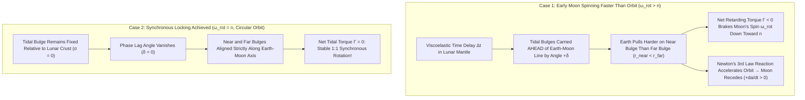
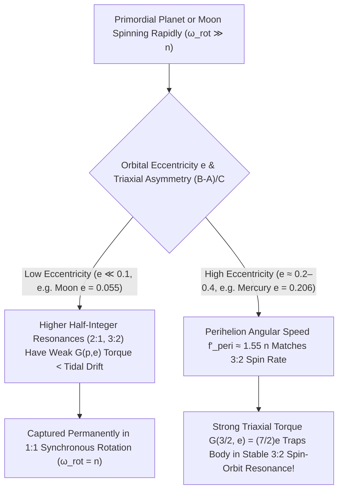

Look up at the night sky from anywhere on Earth—whether from Tokyo, London, Cairo, or Buenos Aires—and you will always see the exact same dark basaltic plains (*maria*): the Sea of Tranquility, the Ocean of Storms, and the bright rayed crater Tycho. Humanity never saw the rugged, densely cratered <strong>far side of the Moon</strong> until October 1959, when the Soviet spacecraft <em>Luna 3</em> swung behind the lunar limb and transmitted the first grainy photographs back to Earth.

At first glance, it feels almost like a cosmic conspiracy: for the Moon to keep the exact same hemisphere pointed toward Earth at every moment, its rotational period around its own spin axis ($P_{\text{rot}} = 27.321661\,\text{days}$) must match its sidereal orbital period around the Earth ($P_{\text{orb}} = 27.321661\,\text{days}$) to an accuracy of better than one part in ten million. If those two periods differed by even $0.01\%$, the Moon would slowly turn in the sky, exposing its far side over the course of a few centuries.

Why do these two seemingly independent motions—how fast a rock spins on its axis and how long it takes to orbit a planet $384,400\,\text{km}$ away—match with mathematical perfection? Even more intriguingly:
1. Why can terrestrial observers actually photograph <strong>$59\%$ of the lunar surface</strong> rather than strictly $50\%$?
2. Why did astronomers believe for nearly a century that the planet <strong>Mercury</strong> was similarly locked in a $1:1$ synchronous state with the Sun, only for 1965 Arecibo radar pulses to reveal that Mercury rotates <strong>exactly three times for every two orbits ($3:2$ spin-orbit resonance)</strong>?
3. How is the exact same tidal physics currently <strong>lengthening Earth's day by $1.7\text{–}2.3\,\text{milliseconds}$ per century</strong> while pushing the Moon away from Earth at $3.82\,\text{centimeters per year}$—and simultaneously melting the interior of Jupiter's moon Io into the most volcanically active world in the Solar System?

In this article, we derive the complete physics of <strong>Tidal Locking (Synchronous Rotation)</strong>, <strong>Viscoelastic Energy Dissipation</strong>, <strong>Lunar Libration</strong>, and <strong>Spin-Orbit Resonances</strong> from the first principles of Newtonian continuum mechanics and celestial dynamics.

---

## 1. The Quadrupole Physics of Tidal Force: Why $r^{-3}$ Instead of $r^{-2}$?

### 1.1 Differential Gravity Across an Extended Body

In introductory physics, we often treat planets and moons as idealized point masses. Under Newton's Law of Universal Gravitation, a primary body (say, Earth, mass $M$) exerts a gravitational acceleration on a satellite (say, the Moon, mass $m$ and mean radius $R$) located at center-to-center distance $r$:

$$
\mathbf{g}_0 = -\frac{G M}{r^2} \hat{\mathbf{r}}
$$

where $\hat{\mathbf{r}}$ is the unit vector pointing from the center of the primary $M$ to the center of the satellite $m$. This center-of-mass acceleration $\mathbf{g}_0$ is precisely what curves the Moon's trajectory into its orbit around the Earth; in the freely falling reference frame of the Moon's center of mass, $\mathbf{g}_0$ is exactly balanced by the orbital centrifugal acceleration.

However, the Moon is <strong>not a point mass</strong>—it is an extended sphere of rock with diameter $2R \approx 3,474\,\text{km}$. Because gravity weakens with distance, the point on the Moon's surface closest to Earth (the <strong>sub-Earth point</strong>, at distance $r - R$) experiences a slightly <em>stronger</em> gravitational pull than the Moon's center, whereas the point on the far side (the <strong>antipodal point</strong>, at distance $r + R$) experiences a slightly <em>weaker</em> pull than the center.

Let us compute the residual acceleration—the <strong>tidal acceleration</strong> $\mathbf{a}_{\text{tidal}}$—along the Earth-Moon axis by subtracting the center-of-mass acceleration $g_0 = -GM/r^2$. At the near side ($x = -R$ relative to the Moon's center, distance $r - R$ from Earth), the net inward pull toward Earth minus the center's acceleration is:

$$
a_{\text{near}} = \frac{G M}{(r - R)^2} - \frac{G M}{r^2} = \frac{G M}{r^2} \left[ \left(1 - \frac{R}{r}\right)^{-2} - 1 \right]
$$

Since the Moon's radius is much smaller than its orbital distance ($R / r \approx 1,737 / 384,400 \approx 4.52 \times 10^{-3} \ll 1$), we can expand $(1 - R/r)^{-2}$ in a binomial Taylor series:

$$
\left(1 - \frac{R}{r}\right)^{-2} = 1 + 2\left(\frac{R}{r}\right) + 3\left(\frac{R}{r}\right)^2 + \mathcal{O}\!\left(\frac{R^3}{r^3}\right)
$$

Substituting the leading linear term yields the tidal acceleration at the near side:

$$
a_{\text{near}} \approx +\frac{2 G M R}{r^3} \quad (\text{directed toward Earth})
$$

Now perform the exact same expansion at the far side ($x = +R$, distance $r + R$ from Earth):

$$
a_{\text{far}} = \frac{G M}{(r + R)^2} - \frac{G M}{r^2} = \frac{G M}{r^2} \left[ \left(1 + \frac{R}{r}\right)^{-2} - 1 \right] \approx -\frac{2 G M R}{r^3} \quad (\text{directed away from Earth!})
$$

Look closely at the signs of $a_{\text{near}}$ and $a_{\text{far}}$:
- The near side is pulled <strong>toward Earth</strong> relative to the Moon's center with acceleration $+2GMR/r^3$.
- The far side is "left behind" by the stronger pull on the Moon's center, experiencing an outward acceleration $-2GMR/r^3$ <strong>directly away from Earth</strong>!

This is the fundamental reason why <strong>tidal bulges always form symmetrically on BOTH the near side and the far side</strong> (creating two high tides per day in Earth's oceans and stretching a spherical moon into a prolate lemon-like ellipsoid).

### 1.2 The Legendre Polynomial Expansion and the Quadrupole Tidal Potential

To analyze the 3D deformation of an entire celestial body, let us derive the scalar gravitational potential $\Phi(\mathbf{R})$ at an arbitrary point $\mathbf{R}$ inside the satellite at angle $\theta$ from the line connecting the centers of $M$ and $m$. By the Law of Cosines, the distance $s$ from the primary $M$ to the internal point $(R, \theta)$ is:

$$
s = \sqrt{r^2 - 2 r R \cos\theta + R^2} = r \sqrt{1 - 2\left(\frac{R}{r}\right)\cos\theta + \left(\frac{R}{r}\right)^2}
$$

Using the generating function of the <strong>Legendre polynomials</strong> $P_\ell(\cos\theta)$:

$$
\frac{1}{\sqrt{1 - 2 u \cos\theta + u^2}} = \sum_{\ell=0}^{\infty} u^\ell P_\ell(\cos\theta), \qquad u = \frac{R}{r} < 1
$$

the gravitational potential $\Phi(R, \theta) = -GM/s$ splits cleanly into multipole orders:

$$
\Phi(R, \theta) = -\frac{G M}{r} \left[ \underbrace{P_0(\cos\theta)}_{\ell=0:\text{ constant}} + \underbrace{\left(\frac{R}{r}\right) P_1(\cos\theta)}_{\ell=1:\text{ orbital acceleration}} + \underbrace{\left(\frac{R}{r}\right)^2 P_2(\cos\theta)}_{\ell=2:\text{ quadrupole tidal potential}} + \sum_{\ell=3}^{\infty} \left(\frac{R}{r}\right)^\ell P_\ell(\cos\theta) \right]
$$

Let us examine the first three terms:
1. <strong>Monopole ($\ell = 0$, $P_0(\cos\theta) = 1$)</strong>: $\Phi_0 = -GM/r$ is spatially constant across the satellite and produces zero force ($-\nabla \Phi_0 = \mathbf{0}$).
2. <strong>Dipole ($\ell = 1$, $P_1(\cos\theta) = \cos\theta$)</strong>: $\Phi_1 = -\frac{GM}{r^2} R \cos\theta = -\frac{GM}{r^2} x$. Its negative gradient $-\nabla \Phi_1 = \frac{GM}{r^2}\hat{\mathbf{x}}$ is a uniform acceleration field across the entire body—precisely the center-of-mass orbital acceleration $\mathbf{g}_0$!
3. <strong>Quadrupole ($\ell = 2$, $P_2(\cos\theta) = \frac{1}{2}(3\cos^2\theta - 1)$)</strong>: Subtracting $\Phi_0$ and $\Phi_1$ leaves the dominant <strong>Quadrupole Tidal Potential</strong> $V_{\text{tidal}}(R, \theta)$:

$$
V_{\text{tidal}}(R, \theta) = -\frac{G M R^2}{2 r^3} \left(3\cos^2\theta - 1\right)
$$

Taking the negative gradient $-\nabla V_{\text{tidal}}$ in spherical coordinates $(R, \theta)$ gives the full 3D tidal acceleration vector field:

$$
\mathbf{a}_{\text{tidal}}(R, \theta) = -\frac{\partial V_{\text{tidal}}}{\partial R}\hat{\mathbf{e}}_R - \frac{1}{R}\frac{\partial V_{\text{tidal}}}{\partial \theta}\hat{\mathbf{e}}_\theta = \frac{G M R}{r^3} \left[ (3\cos^2\theta - 1)\hat{\mathbf{e}}_R - 3\sin\theta\cos\theta\,\hat{\mathbf{e}}_\theta \right]
$$

At the sub-Earth and antipodal poles ($\theta = 0$ and $\theta = \pi$, where $\cos^2\theta = 1$), the radial component is $+2GMR/r^3$ (stretching outward). Along the equatorial ring perpendicular to the Earth-Moon line ($\theta = \pi/2$, where $\cos\theta = 0$), the radial component is $-GMR/r^3$ (compressing inward!). Notice that the divergence of the tidal field vanishes in interior space ($\nabla^2 V_{\text{tidal}} = 0$): the quadrupole field is a <strong>pure shear/deviatoric stress tensor</strong> that stretches the body along the primary axis by $2$ units while squeezing the two perpendicular axes by $1$ unit each, preserving total volume to first order.

---

## 2. Viscoelastic Deformation, Phase Lag, and the Tidal Torque Mechanism

### 2.1 Love Numbers ($k_2, h_2$) and Internal Rigidity

If a satellite were a weightless fluid droplet, its surface would deform until its self-gravitational potential plus $V_{\text{tidal}}$ became an equipotential surface, yielding a hydrostatic bulge height $H_{\text{fluid}} = \frac{3}{2}\frac{M}{m}\left(\frac{R}{r}\right)^3 R$. However, real moons and planets possess internal elastic rigidity $\mu_{\text{shear}}$ (shear modulus) as well as self-gravity. In 1909, the British mathematician <strong>Augustus Edward Hough Love</strong> introduced dimensionless parameters—now universally called <strong>Love numbers</strong>—to quantify how a non-rigid planetary body responds to a tidal potential:

- <strong>The Displacement Love Number $h_2$</strong> measures the ratio of the actual radial surface uplift $\xi_R(\theta)$ to the equilibrium fluid tide height.
- <strong>The Gravitational Potential Love Number $k_2$</strong> measures the additional secondary gravitational potential $\Phi_{\text{bulge}}$ generated by the redistributed mass of the tidal bulge itself at the body's surface ($r_{\text{surf}} = R$):

$$
\Phi_{\text{bulge}}(R, \theta) = k_2 \, V_{\text{tidal}}(R, \theta) \left(\frac{R}{r_{\text{ext}}}\right)^3
$$

For a homogeneous incompressible elastic sphere of density $\rho$, surface gravity $g = Gm/R^2$, and shear modulus $\mu_{\text{shear}}$, Kelvin's formula gives:

$$
k_2 = \frac{3/2}{1 + \tilde{\mu}}, \qquad \text{where } \tilde{\mu} = \frac{19 \, \mu_{\text{shear}}}{2 \rho g R}
$$

- For an infinitely rigid rock ($\mu_{\text{shear}} \to \infty$), $k_2 = 0$ (no bulge forms).
- For a homogeneous fluid sphere ($\mu_{\text{shear}} = 0$), $k_2 = 1.5$ (and for centrally condensed stars/giant planets, $k_2 \in [0.01, 0.6]$).
- For the present-day solid Moon, spacecraft selenodesy (GRAIL mission) measures $k_2 \approx 0.0241$, whereas for the Earth (including oceans and mantle), $k_2 \approx 0.299$.

### 2.2 Why Ideal Elastic Bulges Produce Zero Torque: The Necessity of Dissipation ($Q$)

Suppose the young Moon is spinning much faster than its orbital motion ($\omega_{\text{rot}} > n$, where $n = 2\pi / P_{\text{orb}}$ is the mean orbital angular velocity). If the Moon were <strong>perfectly elastic and frictionless</strong>, its tidal bulges would respond instantaneously to Earth's gravity, remaining aligned at $\theta = 0$ directly along the line connecting the centers of Earth and Moon. By symmetry, the gravitational pull of Earth on the near bulge and the far bulge would point strictly along the radial line $\hat{\mathbf{r}}$, producing <strong>zero net torque ($\mathbf{\Gamma} = \mathbf{r} \times \mathbf{F} = \mathbf{0}$)</strong>!

Real rock and magma, however, are <strong>viscoelastic</strong>: when subjected to periodic flexing at tidal frequency $\sigma = 2|\omega_{\text{rot}} - n|$, internal grain-boundary friction, mantle anelasticity, and magma viscosity cause a <strong>time delay $\Delta t$</strong> between peak tidal stress and peak strain. Because the Moon is rotating at rate $\omega_{\text{rot}}$ relative to the orbit $n$, this time delay carries the tidal bulge forward (if $\omega_{\text{rot}} > n$) or backward (if $\omega_{\text{rot}} < n$) by a small geometric <strong>phase lag angle $\delta$</strong>:

$$
\delta = (\omega_{\text{rot}} - n)\Delta t \approx \frac{1}{2 Q} \operatorname{sgn}(\omega_{\text{rot}} - n)
$$

where $Q$ is the dimensionless <strong>Tidal Quality Factor</strong> (defined via the fraction of peak stored elastic energy $\Delta E$ dissipated as frictional heat per cycle: $Q^{-1} = \frac{1}{2\pi E_0}\oint dE \approx \sin(2\delta) \approx 2\delta$).

### 2.3 Exact Derivation of the Secular Tidal Torque ($a^{-6}$) and Locking Timescale

When the satellite's tidal bulge is offset by angle $\delta$ from the center-to-center line, the primary mass $M$ at distance $a$ pulls on the asymmetric quadrupole mass distribution. Evaluating $-\frac{\partial}{\partial \theta} \Phi_{\text{bulge}}(a, \delta)$ at the primary's position yields the classic <strong>MacDonald-Goldreich-Soter Secular Tidal Torque</strong>:

$$
\Gamma = -\frac{3}{2} \frac{G M^2 R^5}{a^6} k_2 \sin(2\delta) \approx -\frac{3}{2} \frac{G M^2 R^5}{a^6} \left(\frac{k_2}{Q}\right) \operatorname{sgn}(\omega_{\text{rot}} - n)
$$

Look at the extraordinary sensitivity of this equation to orbital semi-major axis $a$:
- Tidal force scales as $a^{-3}$.
- The amplitude of the induced tidal bulge *also* scales as $a^{-3}$, and its quadrupole potential falls off by another $a^{-3}$.
- Consequently, the <strong>tidal torque $\Gamma$ scales inversely with the SIXTH POWER of distance ($a^{-6}$)</strong>! Halving the orbital distance increases the tidal braking torque by a factor of $2^6 = 64$; reducing the distance by a factor of $10$ increases the torque by a factor of $1,000,000$.

Approximating the satellite's moment of inertia as $I = \alpha m R^2$ (with $\alpha \approx 0.4$ for a uniform sphere; $\alpha_{\text{Moon}} = 0.393$), the equation of rotational deceleration $I \frac{d\omega_{\text{rot}}}{dt} = \Gamma$ gives the characteristic <strong>Tidal Locking Timescale $\tau_{\text{lock}}$</strong> required to brake an initial spin rate $\omega_0$ down to synchronous rotation:

$$
\tau_{\text{lock}} \approx \frac{I \, \omega_0}{|\Gamma|} = \frac{2 \alpha \, \omega_0 \, m \, a^6 \, Q}{3 G M^2 k_2 R^3} = \frac{8 \pi \, \alpha \, \omega_0 \, \rho \, a^6 \, Q}{9 G M^2 k_2}
$$

When the Moon formed roughly $4.5\,\text{billion years ago}$ from the giant impact debris disk at an initial distance of only $a_0 \approx 4\text{–}10\,R_\oplus$ ($\sim 25,000\text{–}60,000\,\text{km}$) with an initial spin period of $\sim 5\text{–}10\,\text{hours}$, plugging in lunar parameters ($\rho = 3,344\,\text{kg/m}^3$, $k_2/Q \sim 10^{-3}$) yields a locking time of <strong>only $\tau_{\text{lock}} \sim 10^2 \text{ to } 10^5\,\text{years}$</strong>—an eyeblink in geological history! Within less than a hundred thousand years of its birth, the Moon was already locked into $1:1$ synchronous rotation.

---

## 3. Angular Momentum Transfer: Why the Moon Is Escaping and Earth's Day Is Lengthening

### 3.1 Conservation of Total Angular Momentum in the Earth-Moon System

The Moon has already completed its spin lock ($\omega_{\text{Moon}} = n$), so lunar spin torque is near zero. However, the <strong>Earth itself</strong> is rotating much faster ($\Omega_\oplus = 2\pi / 24\,\text{hr}$) than the Moon orbits ($\Omega_\oplus \gg n$). Therefore, the Moon raises tidal bulges in Earth's oceans and solid mantle, and Earth's rapid rotation drags those ocean-mantle bulges <strong>ahead of the Earth-Moon line by an angle $\delta_\oplus \approx 2.9^\circ$</strong>!

By Newton's Third Law, this forward-shifted terrestrial bulge exerts two simultaneous effects:
1. The Moon pulls backward on Earth's forward bulge, applying a braking torque $\Gamma_\oplus < 0$ that slows down Earth's rotation rate $\Omega_\oplus$ (dissipating roughly $3.7\,\text{Terawatts}$ of rotational kinetic energy as ocean/mantle heat).
2. Earth's forward bulge pulls the Moon <strong>forward along its orbital velocity vector</strong>, injecting positive torque $+\Gamma_\oplus$ into the Moon's orbital angular momentum $L_{\text{orb}}$!

Since the Earth-Moon system is nearly isolated, the sum of Earth's spin angular momentum $J_\oplus = I_\oplus \Omega_\oplus$ and the Moon's orbital angular momentum $L_{\text{orb}} = m \sqrt{G(M_\oplus + m)a(1-e^2)} \approx m \sqrt{G M_\oplus a}$ must remain constant:

$$
\frac{d}{dt}\left(I_\oplus \Omega_\oplus + m \sqrt{G M_\oplus a}\right) = 0 \implies I_\oplus \frac{d\Omega_\oplus}{dt} = -\Gamma_\oplus = -\frac{1}{2} m \sqrt{\frac{G M_\oplus}{a}} \frac{da}{dt}
$$

Look at the counterintuitive consequence of Kepler's Third Law ($v_{\text{orb}} = \sqrt{GM_\oplus/a}$): when Earth's bulge pulls the Moon forward and adds mechanical energy to its orbit, the Moon moves to a <strong>higher orbit ($da/dt > 0$)</strong> where its linear orbital speed $v_{\text{orb}}$ and angular velocity $n = \sqrt{GM_\oplus/a^3}$ actually <em>decrease</em>!

### 3.2 Lunar Laser Ranging (LLR) and Coral Fossil Verification

Since 1969, astronomers have bounced picosecond laser pulses off the corner-cube retroreflector arrays placed on the Moon by Apollo 11, 14, and 15 and the Soviet Lunokhod rovers. <strong>Lunar Laser Ranging (LLR)</strong> measures the Earth-Moon distance with millimeter precision, confirming that:
- The Moon is receding from Earth at <strong>$\frac{da}{dt} = +3.82 \pm 0.07\,\text{cm/year}$</strong>.
- Earth's solar day is lengthening at <strong>$+2.3\,\text{ms/century}$</strong> from tidal braking (partially offset by $-0.6\,\text{ms/century}$ from post-glacial isostatic rebound shrinking Earth's polar flattening, leaving a net observed $+1.7\,\text{ms/century}$).
- Geological growth rings (tidal rhythmites and Devonian rugose corals from $400\,\text{million years ago}$) independently confirm that a Devonian year contained $\approx 400\text{–}410\,\text{solar days}$, meaning Earth's day was only $\approx 21.8\,\text{hours}$ long!

---

## 4. Lunar Libration: Why We Can See 59% of a Synchronous Moon

If the Moon's rotation period equals its orbital period ($1:1$), why don't we see strictly $50.0\%$ of its surface? Because <strong>Keplerian elliptical motion is variable in speed, whereas rigid-body axial rotation is uniform in speed</strong>! This geometric mismatch produces three distinct oscillating "wobbles" known as <strong>Lunar Libration</strong> (from Latin *librare*, "to balance on a scale"):

| Libration Mode | Physical Origin | Maximum Angular Amplitude | Surface Area Gained |
| :--- | :--- | :--- | :--- |
| <strong>1. Libration in Longitude</strong> | Orbital eccentricity ($e = 0.0549$): orbital angular speed $\dot{f}(t)$ varies by Kepler's 2nd Law while axial spin $\omega_{\text{rot}}$ is constant | $\pm 7^\circ 54'$ (East–West) | Reveals $\sim 8^\circ$ past eastern and western limbs alternately |
| <strong>2. Libration in Latitude</strong> | Axial obliquity ($6^\circ 41'$): Moon's spin axis is tilted $1.54^\circ$ to ecliptic + $5.14^\circ$ orbital inclination ($5.14^\circ + 1.54^\circ = 6.68^\circ$) | $\pm 6^\circ 41'$ (North–South) | Reveals beyond north pole and south pole alternately every month |
| <strong>3. Diurnal (Parallax) Libration</strong> | Observer on Earth's surface is carried by Earth's radius $R_\oplus = 6,378\,\text{km}$ between moonrise and moonset | $\pm 0^\circ 57'$ ($\approx 1^\circ$) | Topocentric parallax shift across $12,756\,\text{km}$ baseline |
| <strong>4. Physical Libration</strong> | Actual dynamical oscillation of the Moon's triaxial ellipsoid $(C - B)/A$ under Earth's torque | $\pm 0^\circ 02'$ ($\sim 100''$) | Tiny but reveals core-mantle boundary fluid state via LLR |

Let us derive the dominant <strong>Libration in Longitude</strong> analytically. By the <strong>Equation of the Center</strong> for a Keplerian ellipse of eccentricity $e \ll 1$, the true anomaly $f(t)$ (actual angular position in orbit) oscillates ahead of and behind the mean anomaly $M(t) = n t$ (uniform rotational angle):

$$
\Delta \phi_{\text{long}}(t) = f(t) - M(t) = 2 e \sin(n t) + \frac{5}{4} e^2 \sin(2 n t) + \mathcal{O}(e^3)
$$

Between perigee ($M = 0$) and apogee ($M = \pi$), the Moon's orbital speed after perigee exceeds its average spin rate, so at $n t \approx \pi/2$ the orbital angle pulls ahead of the rotation angle by:

$$
\Delta \phi_{\max} \approx 2 e = 2 \times 0.05490\,\text{rad} = 0.1098\,\text{rad} \approx 6.29^\circ
$$

(and up to $\pm 7.9^\circ$ when solar perturbations called the *evection* align with the apsidal line). Combining the spherical cap area integrated over the $\pm 7.9^\circ$ longitudinal envelope and $\pm 6.68^\circ$ latitudinal envelope expands the visible fraction of the lunar sphere from $\frac{1}{2} = 50\%$ to:

$$
f_{\text{visible}} = \frac{1}{4\pi} \iint_{\text{envelope}} d\Omega \approx 0.590 \quad (\mathbf{59.0\% \text{ of the Lunar Surface!}})
$$

---

## 5. Mercury's 3:2 Spin-Orbit Resonance: Why Eccentricity Defeats 1:1 Locking

### 5.1 The 1965 Radar Shock and Goldreich-Peale Resonance Theory

From Giovanni Schiaparelli's visual observations in the 1880s until 1965, every astronomy textbook stated that Mercury was tidally locked in a $1:1$ synchronous state with the Sun ($P_{\text{rot}} = P_{\text{orb}} = 87.969\,\text{days}$). In 1965, Gordon Pettengill and Rolf Dyce used the giant $305\,\text{m}$ Arecibo radio telescope to bounce Doppler radar pulses off Mercury's limbs—and discovered that Mercury's rotation period is actually <strong>$P_{\text{rot}} = 58.6462\,\text{days}$</strong>, which is <strong>exactly $\frac{2}{3}$ of its orbital period</strong> ($\frac{87.9693}{58.6462} = 1.50000$, or $\omega_{\text{rot}} / n = 3/2$)!

Why did Mercury lock into a $3:2$ resonance instead of $1:1$? The answer, explained by Giuseppe Colombo (1965) and Peter Goldreich & Stanton Peale (1966), lies in Mercury's <strong>exceptionally large orbital eccentricity ($e = 0.2056$)</strong> combined with a permanent triaxial mass asymmetry ($B - A > 0$).

Recall that the secular tidal torque $\Gamma_{\text{tidal}} \propto r^{-6} (\omega_{\text{rot}} - \dot{f})$ is overwhelmingly concentrated right around <strong>perihelion</strong> ($r_{\min} = a(1 - e) = 0.3075\,\text{AU}$ vs. $r_{\max} = a(1 + e) = 0.4667\,\text{AU}$): because $(r_{\max}/r_{\min})^6 = \left(\frac{1 + 0.2056}{1 - 0.2056}\right)^6 = (1.5176)^6 \approx \mathbf{12.2}$, the Sun's tidal grip at perihelion is <strong>more than twelve times stronger</strong> than at aphelion!

Now compute the instantaneous orbital angular velocity $\dot{f}_{\text{peri}}$ right at perihelion using conservation of angular momentum $r^2 \dot{f} = n a^2 \sqrt{1 - e^2}$:

$$
\frac{\dot{f}_{\text{peri}}}{n} = \frac{\sqrt{1 - e^2}}{(1 - e)^2} = \sqrt{\frac{1 + e}{1 - e}} \frac{1}{1 - e}
$$

Plugging in Mercury's eccentricity $e = 0.2056$:

$$
\frac{\dot{f}_{\text{peri}}}{n} = \frac{\sqrt{1 - (0.2056)^2}}{(1 - 0.2056)^2} = \frac{0.9786}{0.6311} \approx \mathbf{1.5506 \approx \frac{3}{2}}
$$

At perihelion—where tidal forces dominate—Mercury's instantaneous orbital angular speed is <strong>$1.55\,n$, right next to $1.50\,n$!</strong> When Mercury spins at $\omega_{\text{rot}} = 1.5\,n$, it is nearly stationary relative to the Sun during the crucial days around perihelion (in fact, for an observer standing on Mercury at perihelion, $\dot{f}_{\text{peri}} = 1.55n > \omega_{\text{rot}} = 1.50n$, so the Sun briefly stops in the Mercurian sky, reverses direction backward for several Earth days, stops again, and resumes moving westward!).

More rigorously, a slightly triaxial planet with principal moments of inertia $A < B < C$ experiences a conservative gravitational restoring torque averaged over a $p : 1$ spin-orbit resonance ($p = 1, \frac{3}{2}, 2, \frac{5}{2}, \dots$, where the planet's long axis aligns with the Sun at every perihelion):

$$
\ddot{\gamma} + \frac{3}{2} n^2 \left(\frac{B - A}{C}\right) G(p, e) \sin(2\gamma) = \frac{\langle \Gamma_{\text{tidal}} \rangle}{C}
$$

where $\gamma = \theta_{\text{rot}} - p M$ is the resonance libration angle and $G(p, e)$ is the <strong>Kaula-Cayley eccentricity function</strong>:
- For $p = 1:1$ synchronous resonance: $G(1, e) = 1 - \frac{5}{2}e^2 + \frac{13}{16}e^4 \approx 0.898$.
- For $p = 3:2$ spin-orbit resonance: $G(3/2, e) = \frac{7}{2}e - \frac{123}{16}e^3 \approx \mathbf{0.719 \times e} \approx 0.141$ (for $e=0.2056$, whereas for the Moon's low $e=0.0549$, $G(3/2, e)$ is four times weaker and boosted to much higher values earlier in Mercury's chaotic eccentricity history up to $e \sim 0.35$).

Because Mercury's core-mantle boundary decouples and enhances capture probability while $(B-A)/C \approx 8 \times 10^{-5}$ creates a deep potential well at $p = 3/2$, Mercury was permanently captured into the $3:2$ state as it spun down from an initially rapid rotation—and it could never escape down to $1:1$!

---

## 6. Comparative Taxonomy of Tidal States Across the Solar System and Exoplanets

Tidal mechanics governs not only the Moon and Mercury, but virtually every close-in satellite and exoplanet in the universe:

| System / Body | Primary Body | Resonance Ratio ($\omega_{\text{rot}} : n$) | Orbital Period ($P_{\text{orb}}$) | Eccentricity ($e$) | Key Dynamical & Geophysical Consequence |
| :--- | :--- | :--- | :--- | :--- | :--- |
| <strong>Moon</strong> | Earth | $1:1$ Synchronous | $27.322\,\text{d}$ | $0.0549$ | Same near side faces Earth; $\pm 7.9^\circ$ libration reveals $59\%$ of surface; receding at $+3.82\,\text{cm/yr}$ |
| <strong>Mercury</strong> | Sun | $3:2$ Spin-Orbit | $87.969\,\text{d}$ | $0.2056$ | $P_{\text{rot}} = 58.646\,\text{d}$; one solar day on Mercury lasts exactly $2$ Mercurian years ($175.94\,\text{d}$)! |
| <strong>Pluto & Charon</strong> | Mutual | $1:1$ Double Lock | $6.387\,\text{d}$ | $< 0.0002$ | Mass ratio $q \approx 0.122$; <strong>both</strong> bodies have reached full tidal equilibrium ($\Omega_{\text{Pluto}} = \Omega_{\text{Charon}} = n$) |
| <strong>Io, Europa, Ganymede</strong> | Jupiter | $1:1$ Spin + $4:2:1$ Laplace | $1.77 / 3.55 / 7.15\,\text{d}$ | $0.0041$ (forced) | Laplace $4:2:1$ orbital resonance pumps forced eccentricity $e$, generating $10^{14}\,\text{W}$ tidal heating (Io volcanism, Europa ocean) |
| <strong>Hyperion</strong> | Saturn | Chaotic Tumbling | $21.277\,\text{d}$ | $0.1230$ | Strongly aspherical potato shape ($(B-A)/C \approx 0.26$) + 4:3 Titan resonance drives positive Lyapunov exponent chaotic rotation |
| <strong>TRAPPIST-1 b–h</strong> | M-Dwarf Star | $1:1$ / Resonant Chain | $1.51\text{–}18.77\,\text{d}$ | $< 0.01$ | Permanent day/night hemispheres ("Eyeball Earths") with sub-stellar ocean and night-side ice cap |

### 6.1 Tidal Heating in the Galilean Laplace Resonance ($4:2:1$)

Normally, once a moon achieves $1:1$ synchronous rotation ($P_{\text{rot}} = P_{\text{orb}}$), radial and librational tides quickly damp its orbital eccentricity $e \to 0$, shutting off all tidal flexing. Why, then, does Jupiter's innermost large moon <strong>Io</strong> erupt with hundreds of active silicate lava fountains and dissipate $\dot{E}_{\text{tidal}} \approx 10^{14}\,\text{Watts}$ ($40\times$ Earth's average heat flux)?

Because Io, Europa, and Ganymede are locked in Pierre-Simon Laplace's famous <strong>$4:2:1$ Mean-Motion Orbital Resonance</strong> ($n_{\text{Io}} - 3 n_{\text{Europa}} + 2 n_{\text{Ganymede}} = 0$)! Every time Io completes two orbits and Europa completes one, their gravitational conjunctions occur at the exact same longitude, continuously pumping a <strong>forced orbital eccentricity $e_{\text{Io}} = 0.0041$</strong>. Even though Io's average spin is $1:1$ synchronous, its forced eccentricity causes its distance from Jupiter to oscillate by $\pm 1,700\,\text{km}$ and its libration angle to rock back and forth every $42.5\,\text{hours}$, flexing Io's mantle vertically by <strong>$100\,\text{meters}$ every single orbit</strong>! The resulting viscoelastic dissipation rate (Peale, Cassen & Reynolds, 1979):

$$
\dot{E}_{\text{ecc}} = \frac{21}{2} \frac{k_2}{Q} \frac{G M_J^2 R^5 n \, e^2}{a^6}
$$

melts Io's interior and maintains the liquid water subsurface oceans of <strong>Europa</strong> and Saturn's <strong>Enceladus</strong>—making tidal dissipation one of the most important energy sources for extraterrestrial habitability in the cosmos.

---

## 7. Summary: The Cosmic Clockwork of Gravity and Friction

Why does the Moon always show us the same face? Let us synthesize the complete chain of physical causation:

1. <strong>The Quadrupole Differential Field ($r^{-3}$)</strong>: Gravity across an extended body of radius $R$ creates a quadrupole tidal potential $V_{\text{tidal}} \propto -GMR^2/r^3 P_2(\cos\theta)$ that stretches both the near and far sides into a symmetric pair of tidal bulges.
2. <strong>Viscoelastic Phase Lag and $a^{-6}$ Torque</strong>: Internal friction ($Q^{-1}$) inside the deforming mantle delays the tidal bulge by phase angle $\delta$, generating a secular braking torque $\Gamma \propto k_2 Q^{-1} R^5 / a^6$ that locked the young Moon's spin into $1:1$ synchrony within less than $10^5\,\text{years}$.
3. <strong>Libration and the $59\%$ Window</strong>: Because elliptical orbital speed varies while axial rotation is constant ($\Delta\phi \approx 2e\sin(nt)$), combined with axial tilt and diurnal parallax, earthly observers peek around the lunar limb to view $59\%$ of the Moon's surface.
4. <strong>Spin-Orbit Resonances and Planetary Habitability</strong>: When orbital eccentricity is large ($e = 0.2056$ on Mercury) or pumped by multi-body resonances ($4:2:1$ on Io and Europa), tidal physics traps planets in higher half-integer resonances ($3:2$) or powers subsurface oceans across the outer Solar System.

The serene, unchanging face of the Moon in our night sky is not a static coincidence—it is the frozen fossil of an ancient dynamical struggle between gravity, elasticity, and thermodynamic dissipation, still quietly reshaping the length of every human day.
