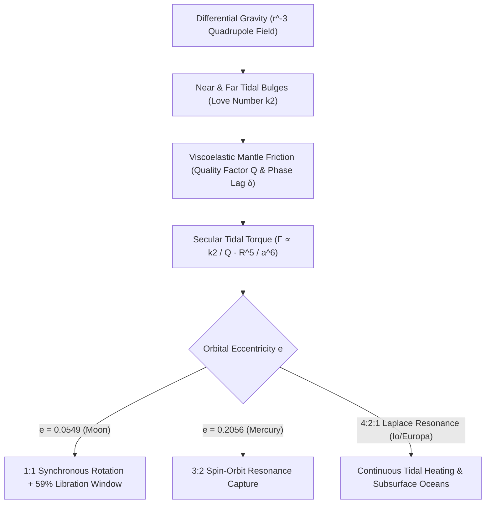

## 1. El campo de marea cuadrupolar: ¿por qué la fuerza de marea decrece como $r^{-3}$?

Desde cualquier rincón de la Tierra, al contemplar la Luna en el cielo nocturno vemos siempre las mismas llanuras basálticas oscuras (*maria*) de su cara visible; la humanidad no contempló la cara oculta, intensamente craterizada, hasta octubre de 1959 gracias a las fotografías transmitidas por la sonda soviética *Luna 3*. Que el período de rotación de la Luna sobre su eje ($P_{\text{rot}} = 27.321661\,\text{días}$) coincida exactamente con su período orbital sideral alrededor de la Tierra ($P_{\text{orb}} = 27.321661\,\text{días}$) no es una casualidad cósmica, sino el resultado físico inevitable de la gravitación, la deformación viscoelástica y la disipación termodinámica: el <strong>acoplamiento de marea o rotación síncrona (Tidal Locking)</strong>.

Según la ley de gravitación universal de Newton, un cuerpo primario de masa $M$ ejerce sobre el centro de masas de un satélite (masa $m$, radio $R$) situado a distancia $r$ una aceleración $g_0 = GM/r^2$ que curva su órbita. Sin embargo, al ser la Luna un cuerpo extenso de diámetro $2R \approx 3,474\,\text{km}$, el punto más cercano a la Tierra ($r-R$) experimenta una atracción mayor que el centro, mientras que el punto antípoda ($r+R$) sufre una atracción menor. Desarrollando en serie binomial $(1 \mp R/r)^{-2} \approx 1 \pm 2(R/r)$ y restando $g_0$, obtenemos una <strong>aceleración de marea diferencial</strong> de $+2GMR/r^3$ (hacia la Tierra) en la cara cercana y $-2GMR/r^3$ (¡alejándose de la Tierra!) en la cara lejana. Expandiendo el potencial gravitatorio $\Phi(R,\theta) = -GM/s$ mediante polinomios de Legendre $P_\ell(\cos\theta)$ y eliminando los términos $\ell=0$ y $\ell=1$, emerge el <strong>potencial de marea cuadrupolar ($\ell=2$)</strong>:

$$
\mathbf{a}_{\text{tidal}}(R, \theta) = -\nabla V_{\text{tidal}} = -\nabla \left[ -\frac{G M R^2}{2 r^3} (3\cos^2\theta - 1) \right] = \frac{G M R}{r^3} \left[ (3\cos^2\theta - 1)\hat{\mathbf{e}}_R - 3\sin\theta\cos\theta\,\hat{\mathbf{e}}_\theta \right]
$$

---

## 2. Deformación viscoelástica, números de Love $k_2$, desfase $\delta$ y el torque en $a^{-6}$

Este potencial cuadrupolar estira el astro a lo largo del eje que une ambos centros ($	heta = 0, \pi$) y lo comprime en el anillo ecuatorial perpendicular ($\theta = \pi/2$), formando <strong>dos abultamientos de marea simétricos (Tidal Bulges)</strong> en las caras cercana y opuesta. En 1909, el matemático británico Augustus Edward Hough Love introdujo el <strong>número de Love adimensional $k_2$</strong> para cuantificar el potencial gravitatorio adicional generado por la masa redistribuida del abultamiento: $k_2 = \frac{3/2}{1 + 19\mu_{\text{shear}}/(2\rho g R)}$, donde $\mu_{\text{shear}}$ es el módulo de cizalladura ($k_2 \approx 0.0241$ para la Luna sólida actual y $k_2 \approx 0.299$ para la Tierra).

Si la Luna fuera un cuerpo perfectamente elástico y sin fricción, sus abultamientos responderían instantáneamente a la gravedad terrestre alineándose sobre el eje Tierra–Luna ($\delta = 0$), produciendo un torque neto nulo ($\Gamma = 0$). Pero el manto rocoso real es <strong>viscoelástico</strong>: la fricción interna (medida por el factor de calidad $Q$, con disipación por ciclo $Q^{-1} \approx \sin 2\delta$) introduce un retardo temporal $\Delta t$ entre la tensión de marea y la deformación. Cuando la joven Luna giraba más rápido que su órbita ($\omega_{\text{rot}} > n$), su rotación arrastraba los abultamientos <strong>un ángulo de desfase $\delta$ por delante del eje Tierra–Luna</strong>. Como la Tierra atrae con más fuerza el abultamiento cercano que el lejano, surge un <strong>torque de frenado secular</strong> inversamente proporcional a la <strong>sexta potencia del semieje mayor ($a^{-6}$)</strong>:

$$
\Gamma = -\frac{3}{2} \frac{G M^2 R^5}{a^6} k_2 \sin(2\delta) \approx -\frac{3}{2} \frac{G M^2 R^5}{a^6} \left(\frac{k_2}{Q}\right) \operatorname{sgn}(\omega_{\text{rot}} - n), \qquad \tau_{\text{lock}} \approx \frac{2 \alpha \, \omega_0 \, m \, a^6 \, Q}{3 G M^2 k_2 R^3}
$$

---

## 3. Conservación del momento angular, recesión lunar y libración (el 59 % visible)

Debido a la extrema dependencia en $a^{-6}$, la Luna primitiva, formada hace $4,500\,\text{millones de años}$ a corta distancia ($a_0 \approx 4\text{–}10\,R_\oplus$), frenó su rotación hasta el estado síncrono $1:1$ ($\omega_{\text{rot}} = n$) en apenas $10^2\text{–}10^5$ años. Hoy en día, la rápida rotación de la Tierra ($24\,\text{h}$) arrastra los abultamientos oceánicos y mantélicos terrestres unos $\delta_\oplus \approx 2.9^\circ$ por delante de la línea Tierra–Luna. Este abultamiento adelantado frena la rotación terrestre (alargando el día terrestre en $+1.7\text{–}2.3\,\text{ms}$ por siglo) y, por la tercera ley de Newton, impulsa a la Luna hacia adelante en su órbita, transfiriendo momento angular de rotación terrestre $I_\oplus\Omega_\oplus$ al momento angular orbital lunar $m\sqrt{GM_\oplus a}$. Las mediciones de <strong>telemetría láser lunar (LLR)</strong> sobre los retrorreflectores del programa Apolo confirman con precisión milimétrica que la Luna se aleja de la Tierra a razón de $+3.82 \pm 0.07\,\text{cm/año}$.

¿Por qué, pese a la sincronización $1:1$, podemos observar desde la Tierra el <strong>$59\%$ de la superficie lunar</strong> en lugar del $50\%$? La causa es la <strong>libración lunar</strong>: mientras la rotación axial de la Luna ocurre a velocidad angular constante $\omega_{\text{rot}} = n$, su velocidad angular orbital $\dot{f}(t)$ a lo largo de su órbita elíptica ($e = 0.0549$) varía según la segunda ley de Kepler. Esta diferencia produce una <strong>libración en longitud</strong> de hasta $\pm 7^\circ 54'$, que sumada a la <strong>libración en latitud</strong> ($\pm 6^\circ 41'$ por la inclinación axial y orbital) y a la <strong>libración diurna paraláctica</strong> ($\pm 1^\circ$), descubre el $59.0\%$ de la esfera lunar:

$$
\Delta \phi_{\text{long}}(t) = f(t) - M(t) = 2 e \sin(n t) + \frac{5}{4} e^2 \sin(2 n t) + \mathcal{O}(e^3), \qquad \frac{\dot{f}_{\text{peri}}}{n} = \frac{\sqrt{1 - e^2}}{(1 - e)^2} \approx 1.5506 \approx \frac{3}{2}
$$

---

## 4. La resonancia espín-órbita 3:2 de Mercurio y el calentamiento de marea en Júpiter

No todo cuerpo sometido a fuerzas de marea termina en rotación $1:1$. En 1965, las observaciones por radar Doppler desde el radiotelescopio de Arecibo revelaron que Mercurio rota en $P_{\text{rot}} = 58.646\,\text{días}$, exactamente dos tercios de su período orbital de $87.969\,\text{días}$ (una <strong>resonancia espín-órbita $3:2$</strong>). Goldreich y Peale (1966) demostraron que esto se debe a su elevada excentricidad orbital ($e = 0.2056$): como el torque de marea escala con $r^{-6}$, la acción solar en el perihelio es $12.2$ veces más intensa que en el afelio, y la velocidad angular orbital instantánea en el perihelio es $\dot{f}_{\text{peri}}/n = (1-e^2)^{1/2}/(1-e)^2 \approx 1.5506 \approx 3/2$. Junto con el torque restaurador triaxial $(B-A)/C$, Mercurio quedó atrapado permanentemente en el pozo de resonancia $3:2$.

Asimismo, en el sistema de Júpiter, la <strong>resonancia orbital de Laplace $4:2:1$</strong> entre Ío, Europa y Ganimedes mantiene una excentricidad forzada ($e_{\text{Io}} = 0.0041$) que impide la circularización orbital y genera $10^{14}\,\text{W}$ de <strong>calentamiento de marea (Tidal Heating)</strong>, alimentando el vulcanismo extremo de Ío y los océanos líquidos subterráneos bajo el hielo de Europa y Encélado.

| Sistema / Astro | Cuerpo primario | Resonancia espín:órbita | Excentricidad $e$ | Consecuencia dinámica y geofísica clave |
| :--- | :--- | :--- | :--- | :--- |
| <strong>Luna (Moon)</strong> | Tierra | $1:1$ Síncrona | $0.0549$ | Misma cara visible; libración revela el $59\%$; recesión de $+3.82\,\text{cm/año}$ |
| <strong>Mercurio (Mercury)</strong> | Sol | $3:2$ Espín-Órbita | $0.2056$ | $P_{\text{rot}}=58.65\,\text{d}$; un día solar en Mercurio dura $2$ años mercurianos ($176\,\text{d}$) |
| <strong>Plutón y Caronte</strong> | Mutuo | $1:1$ Doble bloqueo | $<0.0002$ | Equilibrio de marea mutuo completo ($P_{\text{rot}}=P_{\text{orb}}=6.387\,\text{d}$) |
| <strong>Ío / Europa</strong> | Júpiter | $1:1$ Espín + $4:2:1$ Laplace | $0.0041$ | Excentricidad forzada impulsa el vulcanismo de Ío y el océano líquido de Europa |

$$
\dot{E}_{\text{ecc}} = \frac{21}{2} \frac{k_2}{Q} \frac{G M_J^2 R^5 n \, e^2}{a^6}, \qquad \frac{d}{dt}\left(I_\oplus \Omega_\oplus + m \sqrt{G M_\oplus a}\right) = 0
$$

