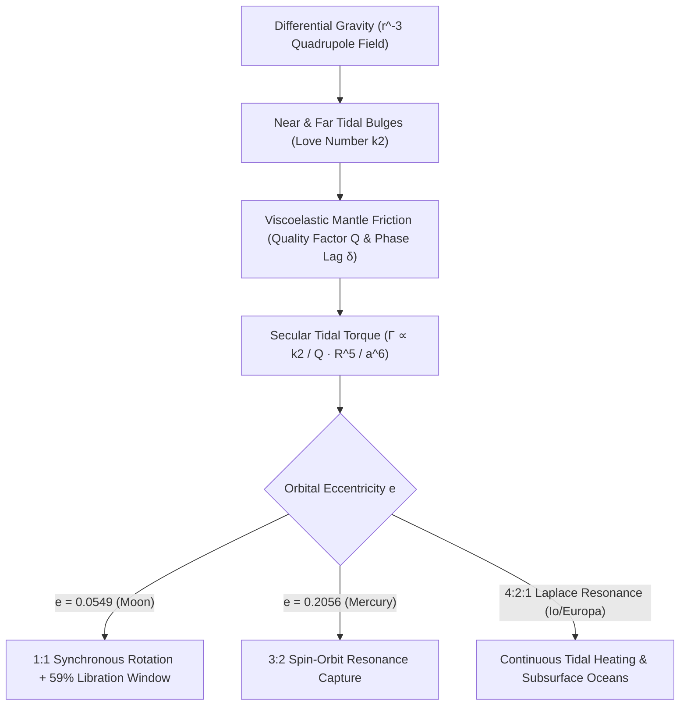

## 1. Le champ de marée quadrupolaire : pourquoi la force de marée décroît-elle en $r^{-3}$ ?

Depuis n'importe quel point du globe terrestre, l'observateur qui contemple la Lune voit invariablement les mêmes plaines basaltiques sombres (*maria*) de la face visible ; l'humanité n'a découvert la face cachée, criblée de cratères, qu'en octobre 1959 grâce aux clichés transmis par la sonde soviétique *Luna 3*. L'égalité parfaite entre la période de rotation propre de la Lune ($P_{\text{rot}} = 27{,}321661\,\text{jours}$) et sa période de révolution sidérale autour de la Terre ($P_{\text{orb}} = 27{,}321661\,\text{jours}$) n'est nullement une coïncidence cosmique : c'est l'aboutissement mécanique inéluctable de la gravitation, de la déformation viscoélastique et de la dissipation thermique, connu sous le nom de <strong>verrouillage gravitationnel par effet de marée (rotation synchrone)</strong>.

En mécanique newtonienne, un corps primaire de masse $M$ exerce sur le centre de masse d'un satellite (masse $m$, rayon $R$) situé à la distance $r$ une accélération gravitationnelle $g_0 = GM/r^2$ qui maintient sa trajectoire orbitale. Mais la Lune étant un corps étendu de diamètre $2R \approx 3\,474\,\text{km}$, son point sub-terrestre ($r-R$) subit une attraction plus forte que son centre, tandis que son point antipodal ($r+R$) subit une attraction plus faible. Le développement binomial $(1 \mp R/r)^{-2} \approx 1 \pm 2(R/r)$ donne, après soustraction de $g_0$, une <strong>accélération de marée</strong> différentielle $+2GMR/r^3$ (vers la Terre) sur la face proche et $-2GMR/r^3$ (à l'opposé de la Terre !) sur la face éloignée. En développant le potentiel gravitationnel $\Phi(R,\theta) = -GM/s$ en polynômes de Legendre $P_\ell(\cos\theta)$ et en retranchant les termes $\ell=0$ et $\ell=1$, on obtient le <strong>potentiel de marée quadrupolaire ($\ell=2$)</strong> :

$$
\mathbf{a}_{\text{tidal}}(R, \theta) = -\nabla V_{\text{tidal}} = -\nabla \left[ -\frac{G M R^2}{2 r^3} (3\cos^2\theta - 1) \right] = \frac{G M R}{r^3} \left[ (3\cos^2\theta - 1)\hat{\mathbf{e}}_R - 3\sin\theta\cos\theta\,\hat{\mathbf{e}}_\theta \right]
$$

---

## 2. Déformation viscoélastique, nombres de Love $k_2$, déphasage $\delta$ et couple en $a^{-6}$

Ce potentiel quadrupolaire étire l'astre le long de l'axe des centres ($	heta = 0, \pi$) et le comprime le long de l'anneau équatorial perpendiculaire ($\theta = \pi/2$), engendrant <strong>deux bourrelets de marée symétriques</strong> sur les faces proche et opposée. En 1909, le mathématicien britannique Augustus Edward Hough Love introduisit le <strong>nombre de Love $k_2$</strong> sans dimension pour quantifier le potentiel gravitationnel additionnel induit par la redistribution de masse du bourrelet : $k_2 = \frac{3/2}{1 + 19\mu_{\text{shear}}/(2\rho g R)}$, où $\mu_{\text{shear}}$ désigne le module de cisaillement ($k_2 \approx 0{,}0241$ pour la Lune actuelle et $k_2 \approx 0{,}299$ pour la Terre).

Si la Lune était parfaitement élastique et sans friction interne, ses bourrelets s'aligneraient instantanément sur l'axe Terre–Lune ($\delta = 0$) et le couple gravitationnel net serait identiquement nul ($\Gamma = 0$). Or la roche mantellique réelle est <strong>viscoélastique</strong> : la friction interne (caractérisée par le facteur de qualité $Q$, avec $Q^{-1} \approx \sin 2\delta$) introduit un retard temporel $\Delta t$ entre la contrainte de marée et la déformation. Lorsque la Lune primitive tournait plus vite que son mouvement orbital ($\omega_{\text{rot}} > n$), sa rotation entraînait les bourrelets <strong>en avant de l'axe Terre–Lune d'un angle de déphasage $\delta$</strong>. La Terre tirant plus fortement sur le bourrelet proche que sur le bourrelet éloigné, il en résulte un <strong>couple de freinage séculaire</strong> inversement proportionnel à la <strong>sixième puissance du demi-grand axe ($a^{-6}$)</strong> :

$$
\Gamma = -\frac{3}{2} \frac{G M^2 R^5}{a^6} k_2 \sin(2\delta) \approx -\frac{3}{2} \frac{G M^2 R^5}{a^6} \left(\frac{k_2}{Q}\right) \operatorname{sgn}(\omega_{\text{rot}} - n), \qquad \tau_{\text{lock}} \approx \frac{2 \alpha \, \omega_0 \, m \, a^6 \, Q}{3 G M^2 k_2 R^3}
$$

---

## 3. Transfert de moment cinétique, éloignement lunaire et libration (59 % de surface visible)

En raison de cette dépendance extrême en $a^{-6}$, la jeune Lune, formée il y a $4{,}5\,\text{milliards d'années}$ à faible distance ($a_0 \approx 4\text{–}10\,R_\oplus$), fut freinée jusqu'à la synchronisation $1:1$ ($\omega_{\text{rot}} = n$) en seulement $10^2\text{–}10^5$ ans. Aujourd'hui, la rotation rapide de la Terre ($24\,\text{h}$) entraîne les bourrelets océaniques et mantelliques terrestres d'environ $\delta_\oplus \approx 2{,}9^\circ$ en avant de l'axe Terre–Lune. Ce bourrelet avancé ralentit la rotation terrestre (allongeant le jour terrestre de $+1{,}7\text{–}2{,}3\,\text{ms}$ par siècle) et, par réaction (troisième loi de Newton), accélère la Lune sur son orbite, transférant le moment cinétique de rotation terrestre $I_\oplus\Omega_\oplus$ vers le moment cinétique orbital lunaire $m\sqrt{GM_\oplus a}$. La télémétrie laser Terre–Lune (<strong>Lunar Laser Ranging</strong>) sur les rétroréflecteurs Apollo confirme que la Lune s'éloigne de la Terre à raison de $+3{,}82 \pm 0{,}07\,\text{cm/an}$ !

Pourquoi pouvons-nous néanmoins observer <strong>$59\%$ de la surface lunaire</strong> depuis la Terre au lieu de $50\%$ ? Grâce à la <strong>libration lunaire</strong> : tandis que la rotation axiale de la Lune s'effectue à vitesse angulaire constante $\omega_{\text{rot}} = n$, sa vitesse angulaire orbitale $\dot{f}(t)$ le long de son orbite elliptique ($e = 0{,}0549$) varie selon la deuxième loi de Kepler. Ce décalage engendre une <strong>libration en longitude</strong> atteignant $\pm 7^\circ 54'$, qui, combinée à la <strong>libration en latitude</strong> ($\pm 6^\circ 41'$ due à l'inclinaison axiale et orbitale) et à la <strong>libration diurne parallactique</strong> ($\pm 1^\circ$), dévoile progressivement $59{,}0\%$ du globe lunaire :

$$
\Delta \phi_{\text{long}}(t) = f(t) - M(t) = 2 e \sin(n t) + \frac{5}{4} e^2 \sin(2 n t) + \mathcal{O}(e^3), \qquad \frac{\dot{f}_{\text{peri}}}{n} = \frac{\sqrt{1 - e^2}}{(1 - e)^2} \approx 1.5506 \approx \frac{3}{2}
$$

---

## 4. La résonance spin-orbite 3:2 de Mercure et le chauffage de marée des lunes galiléennes

Tous les astres soumis aux marées ne terminent pas en rotation $1:1$. En 1965, les observations radar Doppler du radiotélescope d'Arecibo révélèrent que Mercure tourne sur elle-même en $P_{\text{rot}} = 58{,}646\,\text{jours}$, soit exactement les deux tiers de sa période orbitale de $87{,}969\,\text{jours}$ (une <strong>résonance spin-orbite $3:2$</strong>) ! Goldreich et Peale (1966) démontrèrent que cette capture résulte de la forte excentricité orbitale de Mercure ($e = 0{,}2056$) : le couple de marée en $r^{-6}$ est $12{,}2$ fois plus intense au périhélie qu'à l'aphélie, et la vitesse angulaire orbitale instantanée au périhélie vaut précisément $\dot{f}_{\text{peri}}/n = (1-e^2)^{1/2}/(1-e)^2 \approx 1{,}5506 \approx 3/2$. Associée à l'asymétrie triaxiale permanente $(B-A)/C$ de Mercure, cette géométrie a piégé la planète dans le puits de potentiel résonant $3:2$.

Dans le système jovien, la <strong>résonance orbitale de Laplace $4:2:1$</strong> entre Io, Europe et Ganymède maintient une excentricité forcée ($e_{\text{Io}} = 0{,}0041$) qui empêche la circularisation des orbites et dissipe $10^{14}\,\text{W}$ par <strong>chauffage de marée (Tidal Heating)</strong> dans le manteau d'Io, alimentant son volcanisme extrême ainsi que les océans liquides souterrains d'Europe et d'Encelade.

| Système / Astre | Corps primaire | Résonance spin:orbite | Excentricité $e$ | Conséquence dynamique et géophysique majeure |
| :--- | :--- | :--- | :--- | :--- |
| <strong>Lune (Moon)</strong> | Terre | $1:1$ Synchrone | $0{,}0549$ | Même face visible ; libration dévoilant $59\%$ ; récession à $+3{,}82\,\text{cm/an}$ |
| <strong>Mercure (Mercury)</strong> | Soleil | $3:2$ Spin-Orbite | $0{,}2056$ | $P_{\text{rot}}=58{,}65\,\text{j}$ ; un jour solaire sur Mercure dure $2$ années mercuriennes ($176\,\text{j}$) |
| <strong>Pluton & Charon</strong> | Mutuel | $1:1$ Double verrouillage | $<0{,}0002$ | Équilibre de marée mutuel complet ($P_{\text{rot}}=P_{\text{orb}}=6{,}387\,\text{j}$) |
| <strong>Io / Europe</strong> | Jupiter | $1:1$ Spin + $4:2:1$ Laplace | $0{,}0041$ | Excentricité forcée alimentant le volcanisme d'Io et l'océan liquide d'Europe |

$$
\dot{E}_{\text{ecc}} = \frac{21}{2} \frac{k_2}{Q} \frac{G M_J^2 R^5 n \, e^2}{a^6}, \qquad \frac{d}{dt}\left(I_\oplus \Omega_\oplus + m \sqrt{G M_\oplus a}\right) = 0
$$

