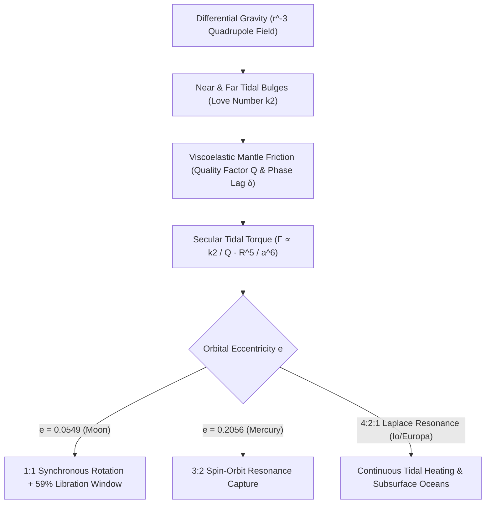

## 1. चतुर्ध्रुवी ज्वारीय क्षेत्र (Quadrupole Tidal Field): ज्वारीय बल $r^{-3}$ के व्युत्क्रमानुपाती क्यों होता है?

पृथ्वी के किसी भी कोने से रात के आकाश में देखने पर हमें हमेशा चंद्रमा के निकटवर्ती भाग के वही गहरे बेसाल्टिक मैदान (*मारिया*) दिखाई देते हैं; मानव जाति ने अक्टूबर 1959 में सोवियत अंतरिक्ष यान *लूना 3 (Luna 3)* द्वारा भेजी गई तस्वीरों से पहले कभी चंद्रमा के क्रेटर-युक्त पिछले हिस्से को नहीं देखा था। चंद्रमा का अपनी धुरी पर घूर्णन काल ($P_{\text{rot}} = 27.321661\,\text{दिन}$) और पृथ्वी के चारों ओर उसका नाक्षत्र परिक्रमण काल ($P_{\text{orb}} = 27.321661\,\text{दिन}$) का सटीक $1:1$ अनुपात में होना कोई खगोलीय संयोग नहीं है, बल्कि गुरुत्वाकर्षण, विस्कोइलास्टिक विरूपण (viscoelastic deformation) और ऊष्मागतिक ऊर्जा क्षय का अनिवार्य परिणाम है जिसे <strong>ज्वारीय लॉकिंग या तुल्यकालिक घूर्णन (Tidal Locking / Synchronous Rotation)</strong> कहा जाता है।

न्यूटन के सार्वत्रिक गुरुत्वाकर्षण नियम के अनुसार, $M$ द्रव्यमान का प्राथमिक पिंड $r$ दूरी पर स्थित उपग्रह (द्रव्यमान $m$, त्रिज्या $R$) के द्रव्यमान केंद्र पर $g_0 = GM/r^2$ का गुरुत्वीय त्वरण लगाता है जो उसकी कक्षा को बनाए रखता है। किंतु चंद्रमा कोई बिंदु द्रव्यमान नहीं है, बल्कि $2R \approx 3,474\,\text{किमी}$ व्यास का एक विस्तृत गोला है। पृथ्वी के सबसे निकट स्थित चंद्र बिंदु ($r-R$) पर द्रव्यमान केंद्र की तुलना में अधिक गुरुत्वाकर्षण बल लगता है, जबकि विपरीत छोर ($r+R$) पर कम बल लगता है। द्विपद श्रेणी $(1 \mp R/r)^{-2} \approx 1 \pm 2(R/r)$ का विस्तार करने और $g_0$ घटाने पर निकट और दूर के छोरों पर क्रमशः $+2GMR/r^3$ (पृथ्वी की ओर) और $-2GMR/r^3$ (पृथ्वी से दूर!) का <strong>अवकल ज्वारीय त्वरण (Differential Tidal Acceleration)</strong> प्राप्त होता है। लेजेंड्रे बहुपद $P_\ell(\cos\theta)$ द्वारा गुरुत्वीय विभव $\Phi(R,\theta) = -GM/s$ का विस्तार करने और $\ell=0, 1$ पदों को हटाने पर प्रमुख <strong>चतुर्ध्रुवी ज्वारीय विभव ($\ell=2$)</strong> प्राप्त होता है:

$$
\mathbf{a}_{\text{tidal}}(R, \theta) = -\nabla V_{\text{tidal}} = -\nabla \left[ -\frac{G M R^2}{2 r^3} (3\cos^2\theta - 1) \right] = \frac{G M R}{r^3} \left[ (3\cos^2\theta - 1)\hat{\mathbf{e}}_R - 3\sin\theta\cos\theta\,\hat{\mathbf{e}}_\theta \right]
$$

---

## 2. विस्कोइलास्टिक विरूपण, लव संख्या $k_2$, कला पश्चता कोण $\delta$ और $a^{-6}$ ज्वारीय बल-आघूर्ण

यह चतुर्ध्रुवी विभव खगोलीय पिंड को केंद्रों को मिलाने वाली रेखा ($	heta = 0, \pi$) के अनुदिश खींचता है और लंबवत विषुवतीय वलय ($\theta = \pi/2$) के अनुदिश संपीड़ित करता है, जिससे निकट और दूर दोनों ओर <strong>दो सममित ज्वारीय उभार (Tidal Bulges)</strong> बनते हैं। 1909 में ब्रिटिश गणितज्ञ ऑगस्टस एडवर्ड हफ लव ने उभार के पुनर्वितरित द्रव्यमान द्वारा उत्पन्न अतिरिक्त गुरुत्वीय विभव को मापने के लिए विमाहीन <strong>लव संख्या (Love Number) $k_2$</strong> प्रस्तुत की: $k_2 = \frac{3/2}{1 + 19\mu_{\text{shear}}/(2\rho g R)}$, जहाँ $\mu_{\text{shear}}$ अपरूपण मापांक (shear modulus) है (वर्तमान ठोस चंद्रमा के लिए $k_2 \approx 0.0241$ और पृथ्वी के लिए $k_2 \approx 0.299$)।

यदि चंद्रमा पूर्णतः प्रत्यास्थ और घर्षण-रहित होता, तो उसके ज्वारीय उभार तुरंत पृथ्वी–चंद्रमा रेखा ($\delta = 0$) पर संरेखित हो जाते और कुल बल-आघूर्ण शून्य ($\Gamma = 0$) होता। परंतु वास्तविक मेंटल चट्टानें <strong>विस्कोइलास्टिक (Viscoelastic)</strong> होती हैं: आंतरिक घर्षण (गुणवत्ता कारक $Q$ द्वारा परिभाषित, जहाँ प्रति चक्र ऊर्जा क्षय $Q^{-1} \approx \sin 2\delta$ है) ज्वारीय प्रतिबल और विकृति के बीच $\Delta t$ का समय विलंब उत्पन्न करता है। जब प्रारंभिक चंद्रमा अपनी कक्षीय गति से तेज़ घूम रहा था ($\omega_{\text{rot}} > n$), तो उसका घूर्णन ज्वारीय उभारों को पृथ्वी–चंद्रमा रेखा से <strong>कला कोण $\delta$ आगे खींच लेता था</strong>। चूँकि पृथ्वी दूर वाले उभार की तुलना में निकट वाले उभार को अधिक बल से पीछे खींचती है, इसलिए अर्ध-दीर्घ अक्ष की <strong>छठी घात के व्युत्क्रमानुपाती ($a^{-6}$)</strong> एक शक्तिशाली <strong>दीर्घकालिक ज्वारीय मंदन बल-आघूर्ण (Secular Tidal Torque)</strong> उत्पन्न होता है:

$$
\Gamma = -\frac{3}{2} \frac{G M^2 R^5}{a^6} k_2 \sin(2\delta) \approx -\frac{3}{2} \frac{G M^2 R^5}{a^6} \left(\frac{k_2}{Q}\right) \operatorname{sgn}(\omega_{\text{rot}} - n), \qquad \tau_{\text{lock}} \approx \frac{2 \alpha \, \omega_0 \, m \, a^6 \, Q}{3 G M^2 k_2 R^3}
$$

---

## 3. कोणीय संवेग संरक्षण, चंद्रमा का अपगमन और लibration (59% दृश्य सतह का रहस्य)

$a^{-6}$ की तीव्र निर्भरता के कारण, $4.5\,\text{अरब वर्ष पूर्व}$ पृथ्वी के निकट ($a_0 \approx 4\text{–}10\,R_\oplus$) निर्मित युवा चंद्रमा मात्र $10^2\text{–}10^5$ वर्षों में ही रुककर $1:1$ तुल्यकालिक घूर्णन ($\omega_{\text{rot}} = n$) में लॉक हो गया। आज चंद्रमा का घूर्णन लॉक हो चुका है, लेकिन पृथ्वी का तीव्र घूर्णन ($24\,\text{घंटे}$) पृथ्वी के महासागरीय और मेंटल उभारों को पृथ्वी–चंद्रमा रेखा से $\delta_\oplus \approx 2.9^\circ$ आगे खींचता है। यह अग्रगामी उभार पृथ्वी के घूर्णन को धीमा करता है (जिससे पृथ्वी का दिन प्रति शताब्दी $+1.7\text{–}2.3\,\text{मिलीसेकंड}$ बढ़ रहा है) और न्यूटन के तीसरे नियम के अनुसार चंद्रमा को उसकी कक्षा में आगे की ओर त्वरित करता है, जिससे पृथ्वी का घूर्णी कोणीय संवेग $I_\oplus\Omega_\oplus$ चंद्रमा के कक्षीय कोणीय संवेग $m\sqrt{GM_\oplus a}$ में स्थानांतरित होता है। अपोलो मिशन के रेट्रो-रिफ्लेक्टरों से किए गए <strong>लूनर लेज़र रेंजिंग (LLR)</strong> मापन पुष्टि करते हैं कि चंद्रमा प्रतिवर्ष $+3.82 \pm 0.07\,\text{सेमी/वर्ष}$ की दर से पृथ्वी से दूर जा रहा है!

फिर $1:1$ तुल्यकालिक घूर्णन के बावजूद हम पृथ्वी से चंद्रमा की $50\%$ सतह के बजाय <strong>$59\%$ सतह कैसे देख पाते हैं</strong>? इसका कारण <strong>चंद्र लibration (Lunar Libration / डोलन)</strong> है: चंद्रमा का अक्षीय घूर्णन स्थिर कोणीय वेग $\omega_{\text{rot}} = n$ से होता है, जबकि दीर्घवृत्तीय कक्षा ($e = 0.0549$) में उसका कक्षीय कोणीय वेग $\dot{f}(t)$ केप्लर के दूसरे नियम के अनुसार बदलता रहता है। इससे $\pm 7^\circ 54'$ का <strong>देशांतरीय लibration</strong> उत्पन्न होता है, जो <strong>अक्षांशीय लibration</strong> ($\pm 6^\circ 41'$) और <strong>दैनिक लंबन लibration</strong> ($\pm 1^\circ$) के साथ मिलकर चंद्रमा की कुल $59.0\%$ सतह को दृश्यमान बनाता है:

$$
\Delta \phi_{\text{long}}(t) = f(t) - M(t) = 2 e \sin(n t) + \frac{5}{4} e^2 \sin(2 n t) + \mathcal{O}(e^3), \qquad \frac{\dot{f}_{\text{peri}}}{n} = \frac{\sqrt{1 - e^2}}{(1 - e)^2} \approx 1.5506 \approx \frac{3}{2}
$$

---

## 4. बुध का 3:2 स्पिन-ऑर्बिट अनुनाद और बृहस्पति के उपग्रहों का ज्वारीय तापन

ज्वारीय बल के अधीन प्रत्येक पिंड $1:1$ अवस्था में ही नहीं रुकता। 1965 में अरेसीबो रेडियो टेलीस्कोप के डॉपलर रडार प्रेक्षणों ने दिखाया कि बुध ग्रह का घूर्णन काल $P_{\text{rot}} = 58.646\,\text{दिन}$ है, जो उसके कक्षीय काल $87.969\,\text{दिन}$ का ठीक दो-तिहाई है (<strong>$3:2$ स्पिन-ऑर्बिट अनुनाद</strong>)! गोल्डराइख और पील (Goldreich & Peale, 1966) ने सिद्ध किया कि यह बुध की उच्च कक्षीय उत्केंद्रता ($e = 0.2056$) के कारण है: चूँकि ज्वारीय आघूर्ण $r^{-6}$ के समानुपाती है, सूर्य के निकटतम बिंदु (perihelion) पर ज्वारीय प्रभाव अधिकतम दूरी (aphelion) की तुलना में $12.2$ गुना अधिक शक्तिशाली होता है, और वहाँ तात्कालिक कक्षीय कोणीय वेग $\dot{f}_{\text{peri}}/n = (1-e^2)^{1/2}/(1-e)^2 \approx 1.5506 \approx 3/2$ होता है। अपने त्रि-अक्षीय द्रव्यमान असममिति $(B-A)/C$ के कारण बुध स्थायी रूप से $3:2$ अनुनाद विभव कूप में फँस गया।

इसी प्रकार बृहस्पति तंत्र में आयो (Io), यूरोपा (Europa) और गेनीमेड (Ganymede) के बीच <strong>लाप्लास का $4:2:1$ कक्षीय अनुनाद</strong> प्रणोदित उत्केंद्रता ($e_{\text{Io}} = 0.0041$) को बनाए रखता है, जिससे $10^{14}\,\text{W}$ का प्रचंड <strong>ज्वारीय तापन (Tidal Heating)</strong> उत्पन्न होता है जो आयो के सक्रिय ज्वालामुखियों और यूरोपा व एन्सेलाडस के बर्फीले आवरण के नीचे द्रव महासागरों को ऊर्जा प्रदान करता है।

| तंत्र / खगोलीय पिंड | प्राथमिक पिंड | स्पिन:कक्षा अनुनाद | उत्केंद्रता $e$ | प्रमुख गतिकीय एवं भूभौतिकीय परिणाम |
| :--- | :--- | :--- | :--- | :--- |
| <strong>चंद्रमा (Moon)</strong> | पृथ्वी | $1:1$ तुल्यकालिक | $0.0549$ | सदैव एक ही भाग दृश्य; लibration से $59\%$ दर्शन; $+3.82\,\text{सेमी/वर्ष}$ अपगमन |
| <strong>बुध (Mercury)</strong> | सूर्य | $3:2$ स्पिन-कक्षा | $0.2056$ | $P_{\text{rot}}=58.65\,\text{d}$; बुध पर एक सौर दिन $2$ बुध वर्षों ($176\,\text{d}$) के बराबर |
| <strong>प्लूटो और चारोन</strong> | पारस्परिक | $1:1$ दोहरा लॉक | $<0.0002$ | दोनों पिंडों का पूर्ण ज्वारीय संतुलन ($P_{\text{rot}}=P_{\text{orb}}=6.387\,\text{d}$) |
| <strong>आयो / यूरोपा</strong> | बृहस्पति | $1:1$ स्पिन + $4:2:1$ लाप्लास | $0.0041$ | प्रणोदित उत्केंद्रता द्वारा आयो का ज्वालामुखी और यूरोपा का भूमिगत महासागर संचालित |

$$
\dot{E}_{\text{ecc}} = \frac{21}{2} \frac{k_2}{Q} \frac{G M_J^2 R^5 n \, e^2}{a^6}, \qquad \frac{d}{dt}\left(I_\oplus \Omega_\oplus + m \sqrt{G M_\oplus a}\right) = 0
$$

