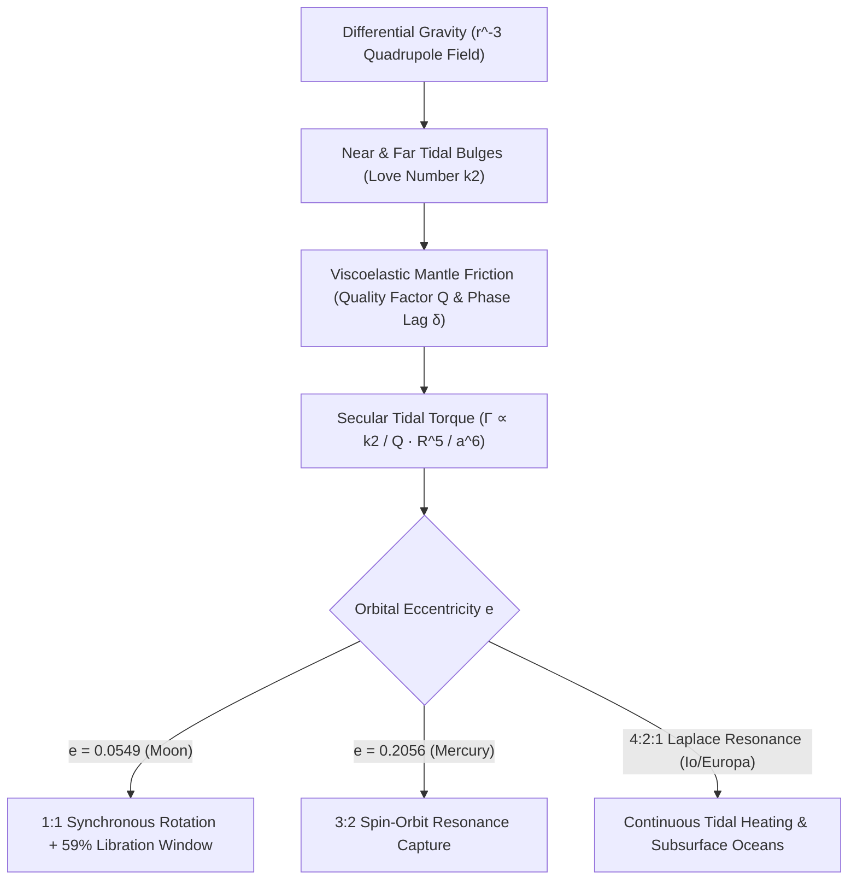

## 1. Medan Pasang Surut Kuadrupol: Mengapa Gaya Pasang Surut Sebanding dengan $r^{-3}$?

Dari belahan Bumi mana pun kita menatap langit malam, kita selalu melihat dataran basal gelap (*maria*) yang sama di sisi dekat Bulan; umat manusia baru melihat sisi jauh Bulan yang penuh kawah pada Oktober 1959 ketika wahana antariksa Uni Soviet *Luna 3* mengirimkan foto-foto pertamanya. Kesamaan presisi antara periode rotasi Bulan pada porosnya ($P_{\text{rot}} = 27,321661\,\text{hari}$) dan periode орbit siderisnya mengelilingi Bumi ($P_{\text{orb}} = 27,321661\,\text{hari}$) bukanlah kebetulan kosmik, melainkan konsekuensi mekanis tak terelakkan dari gravitasi, deformasi viskoelastis, dan disipasi energi termodinamika yang disebut <strong>penguncian pasang surut atau rotasi sinkron (Tidal Locking)</strong>.

Menurut hukum gravitasi universal Newton, benda primer bermassa $M$ memberikan percepatan gravitasi $g_0 = GM/r^2$ pada pusat massa satelit (massa $m$, jari-jari $R$) pada jarak $r$. Namun Bulan bukanlah titik massa, melainkan bola berdimensi dengan diameter $2R \approx 3.474\,\text{km}$. Titik permukaan Bulan yang paling dekat dengan Bumi ($r-R$) mengalami tarikan gravitasi lebih kuat daripada pusat massanya, sedangkan titik antipodal di sisi jauh ($r+R$) mengalami tarikan lebih lemah. Ekspansi deret binomial $(1 \mp R/r)^{-2} \approx 1 \pm 2(R/r)$ setelah dikurangi percepatan pusat massa $g_0$ menghasilkan <strong>percepatan pasang surut diferensial</strong> sebesar $+2GMR/r^3$ (menuju Bumi) di sisi dekat dan $-2GMR/r^3$ (menjauhi Bumi!) di sisi jauh. Dengan menguraikan potensial gravitasi $\Phi(R,\theta) = -GM/s$ menggunakan polinomial Legendre $P_\ell(\cos\theta)$ dan mengeliminasi suku $\ell=0$ serta $\ell=1$, diperoleh <strong>potensial pasang surut kuadrupol ($\ell=2$)</strong>:

$$
\mathbf{a}_{\text{tidal}}(R, \theta) = -\nabla V_{\text{tidal}} = -\nabla \left[ -\frac{G M R^2}{2 r^3} (3\cos^2\theta - 1) \right] = \frac{G M R}{r^3} \left[ (3\cos^2\theta - 1)\hat{\mathbf{e}}_R - 3\sin\theta\cos\theta\,\hat{\mathbf{e}}_\theta \right]
$$

---

## 2. Deformasi Viskoelastis, Bilangan Love $k_2$, Sudut Fase $\delta$, dan Torsi $a^{-6}$

Potensial kuadrupol ini meregangkan benda langit sepanjang sumbu penghubung pusat ($	heta = 0, \pi$) dan menekannya sepanjang cincin ekuator tegak lurus ($\theta = \pi/2$), membentuk <strong>dua tonjolan pasang surut simetris (Tidal Bulges)</strong> di sisi dekat dan sisi jauh. Pada tahun 1909, matematikawan Inggris Augustus Edward Hough Love memperkenalkan <strong>bilangan Love tak berdimensi $k_2$</strong> untuk mengukur rasio potensial gravitasi tambahan akibat redistribusi massa tonjolan: $k_2 = \frac{3/2}{1 + 19\mu_{\text{shear}}/(2\rho g R)}$, di mana $\mu_{\text{shear}}$ adalah modulus geser ($k_2 \approx 0,0241$ untuk Bulan padat saat ini dan $k_2 \approx 0,299$ untuk Bumi).

Jika Bulan adalah benda elastis sempurna tanpa gesekan internal, tonjolan pasang surutnya akan langsung sejajar dengan garis Bumi–Bulan ($\delta = 0$) sehingga torsi bersihnya nol ($\Gamma = 0$). Akan tetapi, batuan mantel nyata bersifat <strong>viskoelastis</strong>: gesekan internal (dikarakterisasi oleh faktor kualitas $Q$, dengan fraksi disipasi energi per siklus $Q^{-1} \approx \sin 2\delta$) menyebabkan jeda waktu $\Delta t$ antara tegangan pasang surut puncak dan regangan puncak. Ketika Bulan purba berotasi lebih cepat daripada gerak orbitnya ($\omega_{\text{rot}} > n$), rotasinya menyeret tonjolan pasang surut <strong>mendahului garis Bumi–Bulan sebesar sudut fase $\delta$</strong>. Karena Bumi menarik tonjolan dekat lebih kuat daripada tonjolan jauh, timbul <strong>torsi pengereman pasang surut sekuler</strong> yang berbanding terbalik dengan <strong>pangkat enam sumbu semi-mayor ($a^{-6}$)</strong>:

$$
\Gamma = -\frac{3}{2} \frac{G M^2 R^5}{a^6} k_2 \sin(2\delta) \approx -\frac{3}{2} \frac{G M^2 R^5}{a^6} \left(\frac{k_2}{Q}\right) \operatorname{sgn}(\omega_{\text{rot}} - n), \qquad \tau_{\text{lock}} \approx \frac{2 \alpha \, \omega_0 \, m \, a^6 \, Q}{3 G M^2 k_2 R^3}
$$

---

## 3. Kekekalan Momentum Sudut, Resesi Bulan, dan Librasi (59% Permukaan Terlihat)

Karena ketergantungan ekstrem pada $a^{-6}$, Bulan muda yang terbentuk $4,5\,\text{miliar tahun lalu}$ pada jarak dekat ($a_0 \approx 4\text{–}10\,R_\oplus$) mengalami pengereman rotasi hingga mencapai kondisi sinkron $1:1$ ($\omega_{\text{rot}} = n$) hanya dalam $10^2\text{–}10^5$ tahun. Saat ini, rotasi cepat Bumi ($24\,\text{jam}$) menyeret tonjolan pasang surut samudra dan mantel Bumi sekitar $\delta_\oplus \approx 2,9^\circ$ di depan garis Bumi–Bulan. Tonjolan yang mendahului ini memperlambat rotasi Bumi (memperpanjang hari Bumi sebesar $+1,7\text{–}2,3\,\text{ms}$ per abad) sekaligus mempercepat Bulan pada orbitnya melalui hukum ketiga Newton, mentransfer momentum sudut rotasi Bumi $I_\oplus\Omega_\oplus$ menjadi momentum sudut orbit Bulan $m\sqrt{GM_\oplus a}$. Pengukuran <strong>Lunar Laser Ranging (LLR)</strong> menggunakan retroreflektor misi Apollo membuktikan secara presisi bahwa Bulan menjauhi Bumi dengan laju $+3,82 \pm 0,07\,\text{cm/tahun}$!

Mengapa meskipun terkunci $1:1$, pengamat di Bumi dapat melihat <strong>$59\%$ permukaan Bulan</strong> alih-alih tepat $50\%$? Jawabannya adalah <strong>librasi Bulan (Lunar Libration)</strong>: sementara rotasi aksial Bulan berlangsung dengan kecepatan sudut konstan $\omega_{\text{rot}} = n$, kecepatan sudut orbitnya $\dot{f}(t)$ sepanjang orbit elips ($e = 0,0549$) berubah-ubah mengikuti hukum kedua Kepler. Perbedaan ini menghasilkan <strong>librasi bujur</strong> hingga $\pm 7^\circ 54'$, yang bila digabungkan dengan <strong>librasi lintang</strong> ($\pm 6^\circ 41'$ akibat kemiringan sumbu dan orbit) serta <strong>librasi diurnal paralaks</strong> ($\pm 1^\circ$), menyingkapkan $59,0\%$ bola Bulan:

$$
\Delta \phi_{\text{long}}(t) = f(t) - M(t) = 2 e \sin(n t) + \frac{5}{4} e^2 \sin(2 n t) + \mathcal{O}(e^3), \qquad \frac{\dot{f}_{\text{peri}}}{n} = \frac{\sqrt{1 - e^2}}{(1 - e)^2} \approx 1.5506 \approx \frac{3}{2}
$$

---

## 4. Resonansi Spin-Orbit 3:2 Merkurius dan Pemanasan Pasang Surut Satelit Jupiter

Tidak semua benda langit yang mengalami gaya pasang surut berakhir pada penguncian $1:1$. Pada tahun 1965, pengamatan radar Doppler di Observatorium Arecibo mengungkap bahwa Merkurius berotasi dalam $P_{\text{rot}} = 58,646\,\text{hari}$, tepat dua pertiga dari periode orbitnya $87,969\,\text{hari}$ (<strong>resonansi spin-orbit $3:2$</strong>)! Goldreich dan Peale (1966) membuktikan bahwa hal ini disebabkan oleh eksentrisitas orbit Merkurius yang tinggi ($e = 0,2056$): karena torsi pasang surut sebanding dengan $r^{-6}$, efek pasang surut Matahari di perihelion $12,2$ kali lebih kuat daripada di aphelion, dan kecepatan sudut orbit sesaat di perihelion adalah $\dot{f}_{\text{peri}}/n = (1-e^2)^{1/2}/(1-e)^2 \approx 1,5506 \approx 3/2$. Bersama torsi pemulih triaksial $(B-A)/C$, Merkurius terperangkap secara permanen dalam sumur potensial resonansi $3:2$.

Di sistem Jupiter, <strong>resonansi orbit Laplace $4:2:1$</strong> antara Io, Europa, dan Ganymede mempertahankan eksentrisitas paksa ($e_{\text{Io}} = 0,0041$) yang mencegah sirkularisasi orbit dan menghasilkan $10^{14}\,\text{W}$ <strong>pemanasan pasang surut (Tidal Heating)</strong>, menggerakkan vulkanisme ekstrem di Io serta menjaga samudra cair bawah permukaan di Europa dan Enceladus.

| Sistem / Benda Langit | Benda Primer | Resonansi Spin:Orbit | Eksentrisitas $e$ | Konsekuensi Dinamika & Geofisika Utama |
| :--- | :--- | :--- | :--- | :--- |
| <strong>Bulan (Moon)</strong> | Bumi | $1:1$ Sinkron | $0,0549$ | Sisi dekat selalu menghadap Bumi; librasi membuka $59\%$; resesi $+3,82\,\text{cm/thn}$ |
| <strong>Merkurius (Mercury)</strong> | Matahari | $3:2$ Spin-Orbit | $0,2056$ | $P_{\text{rot}}=58,65\,\text{h}$; satu hari surya di Merkurius setara $2$ tahun Merkurius ($176\,\text{h}$) |
| <strong>Pluto & Charon</strong> | Timbal Balik | $1:1$ Kunci Ganda | $<0,0002$ | Keseimbangan pasang surut penuh kedua benda ($P_{\text{rot}}=P_{\text{orb}}=6,387\,\text{h}$) |
| <strong>Io / Europa</strong> | Jupiter | $1:1$ Spin + $4:2:1$ Laplace | $0,0041$ | Eksentrisitas paksa memicu vulkanisme Io dan samudra cair bawah es Europa |

$$
\dot{E}_{\text{ecc}} = \frac{21}{2} \frac{k_2}{Q} \frac{G M_J^2 R^5 n \, e^2}{a^6}, \qquad \frac{d}{dt}\left(I_\oplus \Omega_\oplus + m \sqrt{G M_\oplus a}\right) = 0
$$

