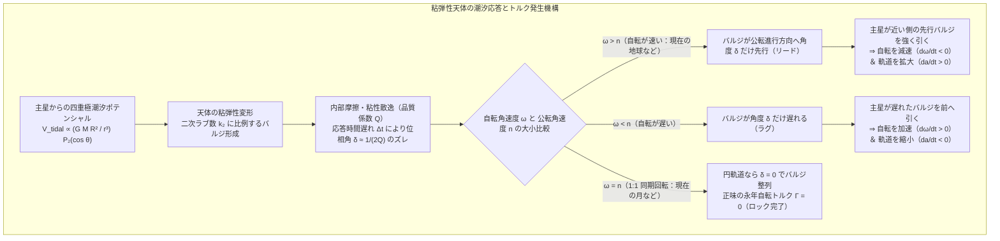
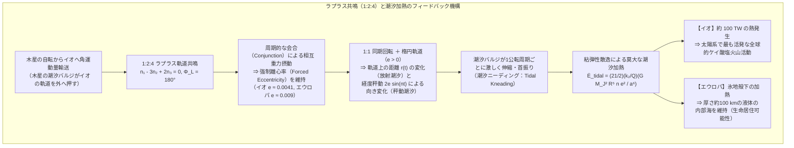

## はじめに：夜空の「ウサギ」が決して後ろ姿を見せない理由

夜空を見上げるとき、私たちは常に月の同じ模様——日本では「餅をつくウサギ」、西洋では「月の顔（Man in the Moon）」に例えられる暗い玄武岩質の平原（月の海：Maria）——を目にする。有史以来、どの文明の天文学者も、地上からは月の裏側（ファーサイド：Far side）を一度たりとも直接見ることはできなかった。1959年10月、ソビエト連邦の無人探査機ルナ3号（Luna 3）が月の裏側に回り込み、初めてその姿を撮影したとき、世界中の惑星科学者は衝撃を受けた。そこには表側のような広大な「海」がほとんど存在せず、無数のクレーターが重なり合う分厚い斜長岩質の高地が広がっていたのである。

なぜ月は地球に対して、いつも寸分の狂いもなく同じ面（ニアサイド：Near side）を向け続けているのだろうか？「月は自転していないからだ」と誤解されることが少なくないが、もし月が慣性空間に対して全く自転していなければ、地球の周りを1公転する間に地球上の観測者からは月の全面（$360^\circ$ すべて）が順番に見えるはずである。実際には、月は自らの自転軸の周りで確実に回転している。ただ、その<strong>自転周期（恒星自転周期 $P_{\text{rot}} = 27.321661\text{ 日}$）</strong>と、地球の周りを回る<strong>公転周期（恒星月 $P_{\text{orb}} = 27.321661\text{ 日}$）</strong>が、有効数字何桁もの精度で完全に $1:1$ に一致しているのである。

天体力学（Celestial Mechanics）において、この現象は<strong>同期回転（Synchronous Rotation）</strong>、あるいはより広い物理過程を含めて<strong>潮汐ロック（Tidal Locking / 潮汐固定）</strong>と呼ばれる。月の自転周期と公転周期の完全な一致は、宇宙の気まぐれな偶然などでは断じてない。それは、重力場の空間的な勾配が生み出す<strong>潮汐力（Tidal Force）</strong>と、岩石や氷・流体からなる天体内部の<strong>粘弾性変形（Viscoelastic Deformation）</strong>および<strong>摩擦散逸（Tidal Dissipation）</strong>が、数十億年という地質学的・天文学的タイムスケールにわたって自転角運動量と軌道角運動量を交換し続けた必然の力学的帰結である。

さらに視야を太陽系全体や系外惑星系へと広げると、潮汐が織りなすドラマは単なる $1:1$ の同期回転にとどまらない。実は月の表面も、楕円軌道や自転軸の傾きに起因する<strong>秤動（Libration）</strong>という絶妙な首振り運動によって、地球から<strong>全表面の約 $59\%$</strong> を覗き見ることができる。また、太陽に最も近い惑星である水星は、長年信じられていた $1:1$ ロックではなく、2公転する間にちょうど3回自転する<strong>$3:2$ スピン・軌道共鳴（Spin-Orbit Resonance）</strong>という高次の安定状態に捕獲されている。そして木星のガリレオ衛星（イオ・エウロパ・ガニメデ）が刻む<strong>$1:2:4$ ラプラス共鳴（Laplace Resonance）</strong>は、潮汐変形による内部摩擦熱（潮汐加熱）を永続的に駆動し、イオに太陽系最強の火山活動をもたらし、エウロパの氷地殻の下に生命を育みうる広大な液体の海を維持している。

本稿では、四重極潮汐ポテンシャルの厳密な数学的導出から出発し、ラブ数 $k_2$ と散逸品質係数 $Q$ を用いた永年潮汐トルクの定式化、地球―月系の角運動量輸送と月レーザー測距（LLR）の観測事実、秤動の3次元幾何学、水星の $3:2$ 共鳴の捕獲確率論、そしてラプラス共鳴による潮汐加熱までを体系的に解き明かす。

---

## 第1章：潮汐力の物理学的導出——なぜ重力の「差」は距離の3乗に反比例し、両側に膨らみを作るのか

### 1.1 四重極潮汐ポテンシャルのルジャンドル展開

まず、「潮汐力とは何か」をニュートンの万有引力の法則とポテンシャル理論から厳密に導出しよう。質量 $M$ を持つ主星（摂動天体、たとえば地球）と、その周囲を距離 $r$ で公転する質量 $m$、平均半径 $R$ の衛星（被摂動天体、たとえば月）を考える。ここで衛星のサイズはその軌道距離に比べて十分に小さい（$\epsilon \equiv R/r \ll 1$）ものとする。

衛星の中心 $O$ から見た主星の位置ベクトルを $\mathbf{r}$（大きさ $r = |\mathbf{r}|$）とし、衛星内部または表面の任意の点 $P$ の中心 $O$ からの位置ベクトルを $\mathbf{R}$（大きさ $R = |\mathbf{R}|$）とする。また、ベクトル $\mathbf{r}$ と $\mathbf{R}$ がなす角度（天頂角：主星直下点からの角距離）を $\theta$ と定義する。このとき、点 $P$ から主星までの距離 $s = |\mathbf{r} - \mathbf{R}|$ は、余弦定理によって次のように書ける。

$$s = \sqrt{r^2 - 2rR\cos\theta + R^2} = r \left[ 1 - 2\left(\frac{R}{r}\right)\cos\theta + \left(\frac{R}{r}\right)^2 \right]^{1/2}$$

主星が点 $P$ に作る単位質量あたりの重力ポテンシャル $V(\mathbf{R})$ は $V(\mathbf{R}) = -\frac{GM}{s}$ である。ここで無次元微小パラメータ $\frac{R}{r} \ll 1$ について、ルジャンドル多項式（Legendre polynomials）$P_n(\cos\theta)$ の母関数展開公式：

$$\frac{1}{\sqrt{1 - 2x\cos\theta + x^2}} = \sum_{n=0}^{\infty} x^n P_n(\cos\theta) \qquad (|x| < 1)$$

を適用すると、重力ポテンシャル $V(\mathbf{R})$ は次のような多重極展開（Multipole Expansion）として正確に表現される。

$$V(\mathbf{R}) = -\frac{GM}{r} \sum_{n=0}^{\infty} \left(\frac{R}{r}\right)^n P_n(\cos\theta)$$

最初の数項（$n = 0, 1, 2, 3$）を具体的に書き下してみよう。ここで $P_0(\cos\theta) = 1$、$P_1(\cos\theta) = \cos\theta$、$P_2(\cos\theta) = \frac{1}{2}(3\cos^2\theta - 1)$、$P_3(\cos\theta) = \frac{1}{2}(5\cos^3\theta - 3\cos\theta)$ である。

$$V(\mathbf{R}) = \underbrace{-\frac{GM}{r}}_{n=0\text{（定数項）}} \underbrace{- \frac{GMR\cos\theta}{r^2}}_{n=1\text{（軌道運動項）}} \underbrace{- \frac{GMR^2}{2r^3}(3\cos^2\theta - 1)}_{n=2\text{（四重極潮汐項）}} - \mathcal{O}\left(\frac{GMR^3}{r^4}\right)$$

この展開式の各項が持つ物理的意味を吟味することが、潮汐現象を理解する最大の鍵である。

1. <strong>第0項（$n=0$：$V_0 = -\frac{GM}{r}$）</strong>：衛星内の座標 $(R, \theta)$ に一切依存しない空間的一様な定数ポテンシャルである。力はポテンシャルの空間勾配 $\mathbf{f} = -\nabla V$ で与えられるため、この項からはいかなる力も生じない（$-\nabla V_0 = \mathbf{0}$）。
2. <strong>第1項（$n=1$：$V_1 = -\frac{GMR\cos\theta}{r^2}$）</strong>：主星方向の直交座標を $x = R\cos\theta$ と置けば、$V_1 = -\frac{GM}{r^2}x$ となる。その勾配 $-\nabla V_1 = +\frac{GM}{r^2}\hat{\mathbf{x}}$ は、衛星内のすべての構成粒子に対して主星方向に大きさ $\frac{GM}{r^2}$ の<strong>一様な加速度</strong>を与える。これはまさに衛星全体の質量中心 $O$ に公転軌道運動を行わせる重力加速度 $\mathbf{a}_0$ そのものである。衛星とともに自由落下（公転）する非慣性座標系（衛星中心静止系）に乗ると、この第1項による引力は座標系の並進加速度に伴う慣性力（円軌道でいえば遠心力）と<strong>完全に相殺される</strong>。
3. <strong>第2項（$n=2$：$V_2 \equiv V_{\text{tidal}}$）</strong>：第1項までが相殺された結果、衛星自体を基準座標系から見て変形させる実質的な最低次のポテンシャルがこの $n=2$ の項である。これを<strong>四重極潮汐ポテンシャル（Quadrupole Tidal Potential）</strong>と呼ぶ。

$$V_{\text{tidal}}(R, \theta) = -\frac{G M R^2}{r^3} P_2(\cos\theta) = -\frac{G M R^2}{2 r^3} (3\cos^2\theta - 1)$$

### 1.2 距離の逆3乗則（$r^{-3}$）と両側バルジの形成メカニズム

四重極潮汐ポテンシャル $V_{\text{tidal}}$ の空間勾配 $-\nabla V_{\text{tidal}}$ を球面座標系 $(R, \theta)$ で計算すると、衛星表面の各点に働く単位質量あたりの<strong>潮汐加速度（Tidal Acceleration）</strong> $\mathbf{a}_{\text{tidal}} = (a_R, a_\theta)$ が得られる。

$$a_R = -\frac{\partial V_{\text{tidal}}}{\partial R} = \frac{G M R}{r^3}(3\cos^2\theta - 1)$$

$$a_\theta = -\frac{1}{R}\frac{\partial V_{\text{tidal}}}{\partial \theta} = -\frac{3 G M R}{r^3}\sin\theta\cos\theta = -\frac{3 G M R}{2 r^3}\sin(2\theta)$$

この式から、天体力学における2つの極めて重要な結論が直ちに導かれる。

第一に、<strong>潮汐力は距離の2乗ではなく「距離の3乗（$r^{-3}$）」に反比例する</strong>。主星直下点（Sub-primary point：$\theta = 0$）および反主星点（Anti-primary point：$\theta = \pi$）では $\cos^2\theta = 1$ となるため、半径方向外向きに働く最大の潮汐加速度および質量 $m$ の天体全体に働く特徴的な潮汐力 $F_{\text{tidal}}$ は次のようになる。

$$a_R(\theta = 0, \pi) = +\frac{2 G M R}{r^3} > 0 \quad \text{（外向きへの引き伸ばし）}$$

$$F_{\text{tidal}} \approx \frac{2 G M m R}{r^3}$$

一方、主星方向と直交するリング状の領域（$\theta = \pi/2, 3\pi/2$）では $\cos\theta = 0$ となるため、半径方向内向き（中心へ向けて押し潰す向き）の圧縮加速度が働く。

$$a_R\left(\theta = \frac{\pi}{2}, \frac{3\pi}{2}\right) = -\frac{G M R}{r^3} < 0 \quad \text{（内向きへの圧縮）}$$

なぜ重力が $r^{-2}$ に比例するのに、潮汐力は $r^{-3}$ に比例するのか？それは潮汐力が重力そのものではなく、天体の直径 $2R$ にわたる<strong>「重力の空間微分（差分：Differential Gravity）」</strong>だからである。微積分学の基本どおり、$\frac{d}{dr}\left(-\frac{GM}{r^2}\right) = \frac{2GM}{r^3}$ となるため、距離が半分になると重力は4倍にしかならないが、潮汐力は<strong>8倍（$2^3 = 8$）</strong>に跳ね上がる。地球の海洋潮汐において、太陽の重力そのものは月の重力の約179倍も強いにもかかわらず、月が及ぼす潮汐力が太陽の潮汐力の約 $2.18$ 倍も支配的である理由は、この $r^{-3}$ 依存性によって太陽の巨大質量が距離の遠さ（月の約389倍）で大きく減殺されるためである。

第二に、<strong>潮汐バルジ（膨らみ）は主星に面した表側（$\theta=0$）だけでなく、真反対の裏側（$\theta=\pi$）にも全く同じ大きさで形成される</strong>。数式上は $\cos^2\theta$ が $\theta = 0$ でも $\theta = \pi$ でも $+1$ になる（第2ルジャンドル多項式 $P_2(\cos\theta)$ が空間反転に対して偶関数である）ことから明らかだが、物理的・直感的には次のように理解できる。

- <strong>表側（$\theta = 0$）</strong>：衛星の中心 $O$ よりも主星に距離 $R$ だけ近いため、主星から受ける引力が中心 $O$ に働く平均引力（＝公転軌道を維持する向心力）よりも強い。そのため、表側の物質は衛星本体から主星へ向かって引き剥がされるように隆起する。
- <strong>裏側（$\theta = \pi$）</strong>：衛星の中心 $O$ よりも主星から距離 $R$ だけ遠いため、主星から受ける引力が中心 $O$ に働く平均引力よりも弱い。衛星全体が中心 $O$ の加速度で主星へ向かって落下（公転）している中で、裏側の物質だけは引き寄せる力が不足するため、公転に伴う慣性（遠心力）によって外側へ取り残されるように隆起する。

この結果、球形だった天体は、主星と衛星を結ぶ直線（$\theta = 0$ と $\theta = \pi$ を結ぶ軸）を長軸とし、それに直交する赤道・極方向を短軸とする<strong>回転長楕円体（Prolate Spheroid：ラグビーボール型）</strong>へと変形する。この両側の隆起こそが<strong>潮汐バルジ（Tidal Bulge）</strong>である。

---

## 第2章：粘弾性変形・ラブ数 $k_2$・散逸品質係数 $Q$ と永年潮汐トルク

### 2.1 二次ラブ数 $k_2$（Love Number）と天体の剛性

外部から四重極潮汐ポテンシャル $V_{\text{tidal}}$ が印加されたとき、天体がどれだけ実際に変形し、その変形した質量分布がどれだけ付加的な重力ポテンシャル $V_{\text{def}}$ を生み出すかは、天体内部の密度分布と物質の硬さ（剛性率 $\mu$）に依存する。

1909年、イギリスの数学者オーガスタス・エドワード・ホフ・ラブ（A. E. H. Love）は、天体表面における変形起因の付加重力ポテンシャル $V_{\text{def}}(R, \theta)$ と、外部から印加された潮汐ポテンシャル $V_{\text{tidal}}(R, \theta)$ の比を表す無次元応答係数を導入した。これが<strong>二次ラブ数（Second-order Potential Love Number）$k_2$</strong> である。

$$V_{\text{def}}(R, \theta) = k_2 V_{\text{tidal}}(R, \theta)$$

また、天体表面の外側（$r' > R$）における変形ポテンシャルは、四重極場の減衰則 $(R/r')^3$ に従って次のように空間へ広がる。

$$V_{\text{def}}(r', \theta) = k_2 \left(\frac{R}{r'}\right)^3 V_{\text{tidal}}(R, \theta) = -k_2 \frac{G M R^5}{r^3 r'^3} P_2(\cos\theta)$$

均質で非圧縮性の弾性球（密度 $\rho$、剛性率 $\mu$、表面重力加速度 $g = \frac{G m}{R^2}$）を仮定した場合、ケルヴィン卿（Lord Kelvin）が導出した古典的公式により、ラブ数 $k_2$ は無次元実効剛性パラメータ $\tilde{\mu} \equiv \frac{19\mu}{2\rho g R}$ を用いて次のように表される。

$$k_2 = \frac{3/2}{1 + \tilde{\mu}} = \frac{3/2}{1 + \frac{19\mu}{2\rho g R}}$$

この式は天体のサイズと物性の競合を見事に表現している。
- <strong>自己重力が支配的な巨大流体天体（$\mu \to 0$）</strong>：剛性率 $\mu = 0$ の均質理想流体では $\tilde{\mu} = 0$ となり、理論上限値である $k_2 = 1.5$（$= 3/2$）をとる（実際の木星や恒星では中心に向かって密度が強く集中しているため、質量が中心に集まるほど変形しにくくなり、木星で $k_2 \approx 0.59$、土星で $k_2 \approx 0.39$ となる。なお質点モデルでは $k_2 = 0$ である）。
- <strong>岩石剛性が支配的な小型固体天体（$\tilde{\mu} \gg 1$）</strong>：岩石の剛性率 $\mu \sim 3\times 10^{10}\text{ Pa}$ に対して天体半径 $R$ が小さい場合、分母の第2項が卓越して $k_2$ は非常に小さくなる。たとえば海洋と軟らかいアセノスフェアを持つ<strong>地球全体では $k_2 \approx 0.299$</strong> であるのに対し、冷えて厚いリソスフェアを持つ<strong>現在の月では $k_2 \approx 0.0242$</strong> と1桁以上小さい（ただし月が形成直後のマグマオーシャン状態にあった太古には $k_2 \sim 0.3\text{–}0.5$ と非常に大きかった）。

### 2.2 内部摩擦・散逸品質係数 $Q$ と位相遅れ角 $\delta$

もし天体がエネルギー散逸を全く伴わない<strong>完全弾性体（Perfectly Elastic Body）</strong>あるいは<strong>無粘性理想流体（Inviscid Fluid）</strong>であれば、潮汐バルジは常に主星と衛星を結ぶ直線（$\theta = 0, \pi$）の上に瞬時に、かつ完全に対称な形で整列する。この場合、主星が表側のバルジを引く力と裏側のバルジを引く力はすべて主星―衛星を結ぶ直線上に乗るため、重心周りの力のモーメント（重力トルク）は<strong>厳密にゼロ（$\Gamma = 0$）</strong>となり、自転速度も軌道も一切変化しない。

しかし、現実の惑星や衛星は完全弾性体ではなく、<strong>粘弾性体（Viscoelastic Body）</strong>である。天体の自転角速度 $\omega$ が公転の平均角速度（平均運動）$n = \sqrt{G(M+m)/a^3}$ と異なるとき（$\omega \neq n$）、天体自身の座標系から見れば潮汐バルジは角振動数 $\sigma = 2|\omega - n|$ で天体内部を駆け巡る進行波となる（バルジが表と裏の2箇所にあるため、1自転あたり2周期の変形を受けることから係数 $2$ がつく）。

岩石マントルの結晶粒界すべりや転位クリープ、部分溶融層の粘性流動、あるいは浅い海底における海流の乱流摩擦によって、変形には必ず<strong>応答の時間遅れ $\Delta t$</strong> と熱エネルギーへの散逸が伴う。この時間遅れ $\Delta t$ の間に天体は角度 $\delta = |\omega - n|\Delta t$ だけ余分に回転してしまうため、潮汐バルジの頂点は主星―衛星を結ぶ直線から幾何学的な<strong>位相遅れ角（Phase Lag Angle）$\delta$</strong>（半日周潮汐波の位相角としては $\epsilon_2 = 2\delta$）だけズレた位置に形成されるのである。

振動工学や地震学と同様に、天体内部の摩擦散逸の強さは<strong>潮汐散逸品質係数（Tidal Quality Factor）$Q$</strong> によって定量化される。1サイクルの間に蓄えられる最大弾性ひずみエネルギーを $E_0$、1サイクルの間に内部摩擦によって熱として失われる散逸エネルギーを $\Delta E = \oint \tau d\varepsilon$ と定義すると、品質係数 $Q$ と位相遅れ角 $\delta$ の間には次の関係が成り立つ。

$$\frac{1}{Q} \equiv \frac{\Delta E}{2\pi E_0} = \tan(2\delta) \approx \sin(2\delta) \approx 2\delta \qquad (\delta \ll 1)$$

$Q$ が小さいほど散逸が激しく（位相遅れ $\delta$ が大きく）、$Q$ が大きいほど理想弾性体に近くなり散逸が少ない。
- <strong>現在の地球</strong>：浅海（ベーリング海やパタゴニア棚など）での海洋潮汐摩擦が極めて強く働くため、地球全体の実効的な品質係数は <strong>$Q_{\oplus} \approx 12$</strong>（位相遅れ角 $\delta \approx 2.4^\circ\text{–}2.9^\circ$）という異常に小さな値（極めて強い散逸）を持つ。固体地球（マントル）単体では $Q \approx 280$ 程度である。
- <strong>現在の月・地球型岩石惑星</strong>：液体の海を持たない固体岩石天体では $Q \sim 30\text{–}200$ 程度（現在の月は周波数依存性を含めて $Q_{\text{Moon}} \approx 38$、火星は $Q \approx 80\text{–}100$）。
- <strong>木星・土星などの巨大ガス惑星</strong>：厚い流体層を持ち散逸が小さいため、$Q \sim 10^4\text{–}10^5$ と非常に大きな値をとる。

### 2.3 永年潮汐トルク $\Gamma$（$a^{-6}$ 則）とロック時間スケール $\tau_{\text{lock}}$

潮汐バルジが主星―衛星を結ぶ直線から角度 $\delta$ だけズレると、直ちに非対称な重力トルクが発生する。
表側のバルジ（主星に近い側）と裏側のバルジ（主星から遠い側）はどちらも主星から引力を受けるが、重力は距離に依存するため、<strong>主星により近い表側のバルジに働く引力の方が、裏側のバルジに働く引力よりも強い</strong>。

したがって、$\omega > n$（自転が公転より速い場合）には、自転によって前方へ持ち去られた表側バルジを主星が後ろへ引き戻すため、天体の自転を減速させる向きの<strong>永年潮汐トルク（Secular Tidal Torque）$\Gamma$</strong> が作用する。軌道長半径 $a$ の円軌道において、変形ポテンシャル $V_{\text{def}}$（角度 $\delta$ だけ回転した座標系での評価）が質量 $M$ の主星に及ぼす接線方向の力 $F_\theta = -\frac{M}{a}\left.\frac{\partial V_{\text{def}}}{\partial \theta}\right|_{r'=a, \theta=\delta}$ に腕の長さ $a$ を掛けることで、トルク $\Gamma$ が厳密に導出される（MacDonald 1964; Goldreich & Soter 1966）。

$$\Gamma = -M \left.\frac{\partial V_{\text{def}}(a, \theta)}{\partial \theta}\right|_{\theta=\delta} = -\frac{3}{2} \frac{G M^2 R^5}{a^6} k_2 \sin(2\delta) \operatorname{sgn}(\omega - n)$$

$\sin(2\delta) \approx \frac{1}{Q}$ を代入すると、天体力学で最も基本的かつ重要な<strong>潮汐トルクの公式</strong>が得られる。

$$|\Gamma| \approx \frac{3}{2} \frac{G M^2 R^5}{a^6} \frac{k_2}{Q}$$

ここで特に注目すべきは、潮汐トルク $\Gamma$ が軌道長半径 $a$ の<strong>6乗に反比例（$\Gamma \propto a^{-6}$）</strong>し、天体半径 $R$ の<strong>5乗に比例（$\Gamma \propto R^5$）</strong>するという極端なスケーリング則である。なぜ $a^{-6}$ なのか？その物理的理由は明確である。
1. 主星が衛星に作る潮汐変形（誘起される四重極モーメントの大きさ）自体が、潮汐力に比例するため <strong>$a^{-3}$</strong> に比例する。
2. その誘起された四重極モーメントに対して、距離 $a$ にある主星の重力場が及ぼすトルクもまた重力場の勾配（潮汐場）に比例するため、さらに <strong>$a^{-3}$</strong> が掛かる。
3. 両者の積として $a^{-3} \times a^{-3} = a^{-6}$ となる。つまり軌道距離が2倍になると、潮汐トルクは実に <strong>$1/64$（$2^{-6}$）</strong> にまで急減するのである！

このトルク $\Gamma$ によって、初期自転角速度 $\omega_0$ を持っていた天体（主慣性モーメント $I = \alpha m R^2$、無次元慣性モーメント係数 $\alpha \approx 0.4$）が同期回転（$\omega = n$）に至るまでの<strong>潮汐ロック時間スケール（Tidal Locking Timescale）$\tau_{\text{lock}}$</strong> は、回転の運動方程式 $I \left|\frac{d\omega}{dt}\right| = |\Gamma|$ を積分することで直ちに求まる。

$$\tau_{\text{lock}} \approx \frac{\omega_0 I}{|\Gamma|} = \frac{2}{3} \frac{\omega_0 a^6 I Q}{G M^2 k_2 R^5} = \frac{2\alpha}{3} \frac{\omega_0 a^6 m Q}{G M^2 k_2 R^3}$$

この式に地球―月系のパラメータを当てはめてみよう。現在の軌道距離（$a \approx 384,400\text{ km}$）で計算しても $\tau_{\text{lock}}$ は数千万年〜数億年と太陽系年齢（45.6億年）より圧倒的に短い。まして約45億年前のジャイアント・インパクト（Giant Impact）直後、月が地球からわずか $a \approx 3\text{–}5 R_{\oplus}$（約2万〜3万km、現在の約 $1/15$）の距離で集積した時代には、$a^6$ が現在の $15^{-6} \approx 10^{-7}$ 倍、かつマグマオーシャン状態で $k_2/Q$ も現在より数桁大きかったため、月は誕生からわずか<strong>数百年〜数万年という天文学的な一瞬</strong>のうちに地球に対して $1:1$ の同期回転へとロックされたのである。これは木星や土星の主要衛星（イオ、エウロパ、ガニメデ、カリスト、タイタン、エンケラドゥスなど）がすべて主星に対して $1:1$ 潮汐ロックされている理由でもある。

---

## 第3章：地球―月系の角運動量保存と軌道進化——月レーザー測距（LLR）が明かす未来

### 3.1 地球の潮汐バルジが月を加速させるメカニズム

月はすでに地球に対して $1:1$ の同期回転にロックされており、円軌道近似のもとでは月自身の潮汐変形による自転減速は完了している。しかし、<strong>地球―月系の潮汐進化は現在も全く終わっていない</strong>。なぜなら、主星である地球の自転周期（恒星日 $P_{\oplus} = 23\text{時間}56\text{分}4.1\text{秒}$、角速度 $\omega_{\oplus} = 7.2921 \times 10^{-5}\text{ rad/s}$）が、月の公転周期（$27.32\text{ 日}$、角速度 $n_{\text{Moon}} = 2.6617 \times 10^{-6}\text{ rad/s}$）よりも約27倍も速い（$\omega_{\oplus} \gg n_{\text{Moon}}$）からである。

今度は立場を逆転させ、「月が摂動天体として地球に潮汐バルジを作り、地球の高速な自転がそのバルジを引きずる」という過程を考えよう。
月の重力によって地球の海洋および固体マントルに形成された潮汐バルジは、海底摩擦や大陸棚での散逸（$Q_{\oplus} \approx 12$）によって、地球―月を結ぶ直線から地球の自転方向（東向き）へ位相遅れ角 $\delta_{\oplus} \approx 2.9^\circ$ だけ常に先行して持ち運ばれている。

この「月よりも先回りした地球の潮汐バルジ」と月の間の重力相互作用を考えると、驚くべき二面性が浮かび上がる。
1. <strong>地球への作用（自転のブレーキ）</strong>：月は地球の先行する表側バルジを後ろ（西向き）へ引っ張るため、地球には自転を減速させる負の潮汐トルク $-\Gamma_{\oplus}$ が働く。これにより地球の自転速度 $\omega_{\oplus}$ は徐々に遅くなり、1日の長さ（Length of Day: LOD）は少しずつ長くなっていく。
2. <strong>月への反作用（公転軌道へのスリングショット加速）</strong>：作用・反作用の法則により、地球の先行するバルジは月を公転進行方向（前方）へと引っ張り上げる正の軌道トルク $+\Gamma_{\oplus}$ を及ぼす！軌道運動している天体が進行方向に力を受けると、軌道エネルギー $E_{\text{orb}} = -\frac{G M_{\oplus} m_{\text{Moon}}}{2a}$ と軌道角運動量が増加し、月は<strong>より高い軌道（より大きな軌道長半径 $a$）へと螺旋状に遠ざかっていく</strong>のである。

### 3.2 角運動量保存則と月レーザー測距（LLR）による精密実証

孤立系としての地球―月系の全角運動量 $L_{\text{total}}$ は、地球の自転角運動量 $L_{\oplus} = I_{\oplus}\omega_{\oplus}$、月の自転角運動量 $L_{\text{Moon}} = I_{\text{Moon}}n_{\text{Moon}}$（全体の $10^{-5}$ 以下で無視できる）、および地球―月系の公転軌道角運動量 $L_{\text{orb}}$ の和として厳密に保存される（太陽潮汐によるわずかな寄与を除く）。

$$L_{\text{total}} = I_{\oplus}\omega_{\oplus} + \mu_{\text{red}}\sqrt{G(M_{\oplus} + m_{\text{Moon}})a(1-e^2)} = \text{const.}$$

ここで $\mu_{\text{red}} = \frac{M_{\oplus} m_{\text{Moon}}}{M_{\oplus} + m_{\text{Moon}}}$ は換算質量である（現在、地球―月系の全角運動量のうち約 $82.9\%$ はすでに月の公転軌道角運動量 $L_{\text{orb}}$ が占めており、地球の自転角運動量 $L_{\oplus}$ は約 $17.1\%$ である）。離心率 $e \ll 1$ として時間微分 $\frac{dL_{\text{total}}}{dt} = 0$ をとると、地球の自転減速率 $\frac{d\omega_{\oplus}}{dt}$ と月の軌道拡大率（後退速度）$\frac{da}{dt}$ を結ぶ直結式が得られる。

$$I_{\oplus}\frac{d\omega_{\oplus}}{dt} = -\Gamma_{\oplus} = -\frac{1}{2}\mu_{\text{red}}\sqrt{\frac{G(M_{\oplus}+m_{\text{Moon}})}{a}}\frac{da}{dt} = -\frac{1}{2}\mu_{\text{red}} n_{\text{Moon}} a \frac{da}{dt}$$

$$\frac{da}{dt} = \frac{2\Gamma_{\oplus}}{\mu_{\text{red}} n_{\text{Moon}} a} \approx 3 \frac{k_{2,\oplus}}{Q_{\oplus}} \frac{m_{\text{Moon}}}{M_{\oplus}} \left(\frac{R_{\oplus}}{a}\right)^5 n_{\text{Moon}} a$$

この理論予測は、現代の宇宙測地学によってミリメートル単位の驚異的な精度で直接測定されている。1969年のアポロ11号・14号・15号、およびソ連のルノホート1号・2号が月面に設置したコーナーキューブ・レトロリフレクター（再帰性反射鏡）に向けて地球上の天文台からレーザーパルスを発射し、その往復時間をピコ秒精度で計測する<strong>月レーザー測距（Lunar Laser Ranging: LLR）</strong>である。50年以上にわたるLLR観測の結果、次の数値が確定している（Williams & Boggs 2016）。

- <strong>月の後退速度（軌道長半径の増加率）</strong>：
  $$\frac{da}{dt} = +3.82 \pm 0.07\text{ cm/yr}$$
- <strong>月の平均運動の永年減速率（軌道周期の長期化）</strong>：
  $$\frac{dn_{\text{Moon}}}{dt} = -\frac{3}{2}\frac{n_{\text{Moon}}}{a}\frac{da}{dt} = -25.85 \pm 0.03\text{ arcsec/century}^2$$
- <strong>地球の1日の長さ（LOD）の増加率</strong>：
  潮汐摩擦単独では100年あたり約 $+2.3\text{ ms/century}$ の減速が生じる（現在は最終氷期終了後のスカンジナビアやカナダの氷床融解に伴う<strong>氷河性アイソスタシー調整：GIA</strong>によって地球の極慣性モーメント $I_{\oplus}$ がわずかに減少し自転を速める効果が約 $-0.6\text{ ms/century}$ 働いているため、過去2700年間の日食記録から得られる正味のLOD増加率は <strong>$+1.7\text{〜}1.8\text{ ms/century}$</strong> となっている）。

この事実は古生物学の地質記録（古潮汐学：Paleotidology）とも見事に整合する。古生代デボン紀中期（約3億9000万年前）のサンゴ化石（*Heliophyllum* など）や二枚貝、さらに先カンブリア時代の潮汐堆積物（Tidal rhythmites）の成長縞を解析すると、約4億年前の地球は<strong>1日が約21.9時間、1年が約400日</strong>であり、約6億2000万年前のエディアカラ紀には<strong>1日が約21.9時間未満、月までの距離も現在より約 $4\%$ 近かった</strong>ことが実証されている。

### 3.3 二重同期回転（Double Synchronous Locking）と冥王星―カロン系

このまま地球が自転角運動量を月の軌道へと渡し続けると、最終的にどうなるのだろうか？
全角運動量保存則とケプラーの第三法則 $n = \sqrt{G(M_{\oplus}+m_{\text{Moon}})/a^3}$ を連立させると、やがて地球の自転角速度 $\omega_{\oplus}$ が月の公転角速度 $n_{\text{Moon}}$ にまで落ち込み、$\omega_{\oplus} = \omega_{\text{Moon}} = n_{\text{Moon}}$ となる究極の熱力学的平衡状態——<strong>二重同期回転（Double Synchronous Rotation / 相互潮汐ロック：Mutual Tidal Locking）</strong>——に到達することがわかる。

計算上、この状態は今から約500億年後、軌道長半径が現在の約 $1.45$ 倍（$a_{\text{final}} \approx 55\text{万 km}$）まで拡大し、<strong>地球の1日の長さと月の1公転周期がともに現在の約47日（約1,130時間）で一致した時点</strong>で訪れる（現実には約50億年後に太陽が赤色巨星へと進化して膨張するため、500億年を待たずに地球―月系は太陽外層大気の抵抗を受けることになるが、力学的な終着点は明確である）。もし二重同期状態になれば、地球の片半球（月が見える側の半球）の空には、月が永遠に同じ高度・同じ方位角にピタリと静止して浮かび続け、反対側の半球からは未来永劫、月を見ることはできなくなる。また地球の海洋から月による満ち引き（太陰潮）は消滅し、わずかな太陽潮だけが残る。

実は太陽系には、すでにこの二重同期回転を完全に達成した天体ペアが存在する。準惑星<strong>冥王星（Pluto）と最大の衛星カロン（Charon）</strong>である。カロンの質量は冥王星の約 $12.2\%$（質量比約 $8:1$、地球に対する月の質量比 $1.23\%$ の約10倍）と極めて大きく、両者の距離も $a = 19,591\text{ km}$ と非常に近いため、早期に相互の潮汐ロックが完了した。現在、冥王星の自転周期、カロンの自転周期、そして両者が共通重心（冥王星の表面外側の宇宙空間にある！）の周りを回る公転周期は、すべて <strong>$6.387230\text{ 日}$</strong> で完全に一致している。冥王星のカロン側半球に立つ観測者からは、巨大なカロンが空の同じ一点に永遠に釘付けになって見えているのである。

---

## 第4章：秤動（Libration）の幾何学と力学——なぜ私たちは月の表面の「59%」を見ることができるのか

### 4.1 「同じ面を向ける」のに 50% ではなく 59% が見える理由

月が $1:1$ の同期回転にロックされているなら、地球から見える月面の割合はきっちり半分（$50\%$）であり、残り半分（$50\%$）は永遠に見えないはずだと思われるかもしれない。ある一瞬（スナップショット）において地球から見える月面が $50\%$ であることは間違いない。しかし、1か月（1恒星月・1近点月）あるいは数年にわたって月を継続的に観測・撮影して重ね合わせると、私たちは月面の北極・南極の奥や、東端・西端の縁の向こう側まで覗き込むことができ、合計で<strong>月面全体の約 $59\%$（正確には約 $58.7\%$）</strong>を地上から直接観測することができる！

この、月が地球に対して上下左右および回転方向にわずかに首を振るように揺れ動く現象を<strong>秤動（ひょうどう / Lunar Libration）</strong>と呼ぶ。語源はラテン語の *librare*（「天秤（libra）が釣り合いをとって揺れる」の意）であり、ガリレオ・ガリレイが1632年の『天文対話』や晩年の観測で発見し、その後アイザック・ニュートンやジョヴァンニ・ドメニコ・カッシーニ、ジョゼフ＝ルイ・ラグランジュらによって力学的に体系化された。

月の秤動は、月自身の実際の回転速度が変動して生じる<strong>物理秤動（Physical Libration：振幅は最大でも約 $2'$（分角）以下と極めて微小）</strong>と、月の軌道運動と自転の幾何学的関係から見かけ上生じる<strong>光学的秤動（Optical Libration：振幅が数度〜約8度と大きく、$59\%$ 可視化の主因）</strong>の2つに大別される。光学的秤動は以下の3つの独立したメカニズムから成り立っている。

### 4.2 経度秤動（Libration in Longitude：最大 $\pm 7^\circ 54'$）——楕円軌道とケプラーの第二法則

最も振幅が大きいのが、月が東西方向（黄経・月面経度方向）に首を振る<strong>経度秤動</strong>である。その原因は、<strong>「月の自転角速度 $\omega$ はほぼ完全に一定（等速回転）であるのに対し、月の公転軌道は真円ではなく離心率 $e = 0.0549$ の楕円軌道であるため、公転角速度 $\dot{f}$ が周期的に変動する」</strong>という不一致にある。

慣性モーメントが巨大な固体球である月は、1か月の間に自転速度を急激に変えることができず、一定の角速度 $\omega = n = \frac{2\pi}{P_{\text{orb}}}$ で淡々と回り続ける（時刻 $t$ における自転角は平均近点角 $M = n(t - t_0)$ に等しい）。
一方、楕円軌道上の公転運動は<strong>ケプラーの第二法則（面積速度一定の法則：$r^2 \dot{f} = n a^2 \sqrt{1-e^2} = \text{const.}$）</strong>に従う。
1. <strong>近地点（Perigee）から遠地点（Apogee）へ向かう前半周期</strong>：近地点付近では地球との距離 $r = a(1-e)$ が最も近いため、公転角速度 $\dot{f}$ が平均角速度 $n$（＝自転角速度 $\omega$）よりも速くなる。すると、月の自転が公転の回り込みに追いつかず遅れるため、地球からは月の<strong>西側の縁（月面座標系での西、地球の空では右側）の奥</strong>が余分に回り込んで見える。
2. <strong>遠地点（Apogee）から近地点（Perigee）へ向かう後半周期</strong>：遠地点付近では距離 $r = a(1+e)$ が遠いため、公転角速度 $\dot{f}$ が自転角速度 $\omega$ よりも遅くなる。今度は月の自転が公転を追い越してしまうため、地球からは月の<strong>東側の縁の奥</strong>が余分に見える。

真近点角 $f$ と平均近点角 $M = nt$ の差は、天体力学において<strong>中心差（Equation of the Center）</strong>と呼ばれ、離心率 $e$ のべき級数として次のように展開される。

$$\Delta \lambda_{\text{lon}} = f - M = \left(2e - \frac{1}{4}e^3\right)\sin M + \frac{5}{4}e^2\sin(2M) + \frac{13}{12}e^3\sin(3M) + \mathcal{O}(e^4)$$

ここに月の平均軌道離心率 $e = 0.0549$ を代入すると、第一項だけでも $2e \approx 0.1098\text{ rad} \approx \pm 6.29^\circ$（$6^\circ 17'$）に達する。さらに太陽からの重力摂動による軌道離心率の周期変動（出差：Evection、最大約 $1.27^\circ$）や二均差（Variation）が重なるタイミングでは、経度秤動の振幅は最大で <strong>$\pm 7^\circ 54'$（約 $\pm 7.9^\circ$）</strong>にまで達するのである。

### 4.3 緯度秤動（Libration in Latitude：最大 $\pm 6^\circ 41'$）——カッシーニの法則と自転軸の傾き

2つ目は、月が南北方向（月面緯度方向）にうなずくように揺れる<strong>緯度秤動</strong>である。これは地球の自転軸が公転面（黄道面）に対して $23.4^\circ$ 傾いているために季節が生じるのと全く同じ幾何学的原理による。

月の自転軸・公転軌道面（白道面）・黄道面の3つの幾何学的関係は、1693年にジョヴァンニ・ドメニコ・カッシーニが発見した<strong>カッシーニの3法則（Cassini's Laws）</strong>という美しい力学状態（カッシーニ状態：Cassini State）に支配されている。
- <strong>カッシーニの第1法則</strong>：月の自転周期と公転周期は $1:1$ で同期している。
- <strong>カッシーニの第2法則</strong>：月の自転軸（赤道面の法線）と黄道面の法線（黄道極）は常に一定の角度 <strong>$I_{\text{eq}} = 1^\circ 32'（1.54^\circ）$</strong> を保つ。
- <strong>カッシーニの第3法則</strong>：月の自転軸の法線、黄道面の法線、および月の公転軌道面（白道面）の法線の3本のベクトルは、常に同一平面上（コプラナー）にあり、黄道面の法線を挟んで月の軌道面法線（傾き <strong>$i_{\text{orb}} = 5^\circ 09'（5.14^\circ）$</strong>）と月の自転軸法線（傾き $1.54^\circ$）は<strong>常に正反対の向き</strong>を向いて18.6年周期で歳差運動している。

このカッシーニの第3法則により、月の公転軌道面（白道面）に対する月の自転軸の傾き（赤道傾斜角）$\beta_{\text{lat}}$ は、2つの角度の差ではなく<strong>和</strong>となる！

$$\beta_{\text{lat}} = i_{\text{orb}} + I_{\text{eq}} = 5^\circ 09' + 1^\circ 32' = 6^\circ 41' \approx 6.68^\circ$$

この約 $6.68^\circ$（最大時 $6^\circ 50'$）の傾きがあるため、月が公転軌道を半周するごとに、ある時期には月の北極が地球側へ $6.68^\circ$ お辞儀をして北極周辺のクレーター群を晒し、約2週間後には南極が地球側へ $6.68^\circ$ 傾いて南極エイトケン盆地（South Pole–Aitken basin）の縁を見せてくれるのである。

### 4.4 日周秤動（Diurnal / Parallactic Libration：最大約 $\pm 0^\circ 57'$）——地球自転による視差

3つ目は、月ではなく<strong>地球上の観測者自身の位置が地球の自転によって移動すること</strong>で生じる<strong>日周秤動（視差秤動）</strong>である。
赤道付近にいる観測者が、東の地平線から昇ってきたばかりの月（月の出）を見るときと、12時間後に地球の自転によって地球の直径 $2R_{\oplus} \approx 12,756\text{ km}$ だけ運ばれて西の地平線に沈む月（月の入り）を見るときとでは、月を見上げる視線の角度が地球半径分の三角視差（地平視差）だけ変化する。

$$\Delta \psi_{\text{diurnal}} = \arcsin\left(\frac{R_{\oplus}}{r}\right) \approx \frac{6,378\text{ km}}{384,400\text{ km}}\text{ rad} \approx 0.0166\text{ rad} \approx 0^\circ 57' \quad (\text{約 } \pm 1^\circ)$$

月の出のときには月の上側（西端）を約 $1^\circ$ 斜め上から覗き込み、月の入りのときには逆側（東端）を約 $1^\circ$ 斜めから覗き込むことになる。
これら<strong>経度秤動（$\pm 7.9^\circ$）</strong>、<strong>緯度秤動（$\pm 6.7^\circ$）</strong>、<strong>日周秤動（$\pm 1.0^\circ$）</strong>の3つが複合的に組み合わさった球面幾何学積分の結果として、地球上から見える月面の総面積はちょうど $50\%$ ではなく <strong>約 $59\%$</strong> へと拡大するのである。

---

## 第5章：水星の3:2スピン・軌道共鳴——1965年のレーダー観測が覆した「1:1ロック」の定説

### 5.1 80年間信じられた「1:1 同期回転」神話とその崩壊

太陽系の第1惑星である水星（Mercury：平均軌道長半径 $a = 0.3871\text{ AU}$、公転周期 $P_{\text{orb}} = 87.969\text{ 日}$）は、太陽に最も近いため太陽から強烈な潮汐力を受ける。1880年代、イタリアの天文学者ジョヴァンニ・スキアパレッリ（Giovanni Schiaparelli）や後にパーシヴァル・ローウェル、ウジェーヌ・アントニアディらは、望遠鏡による水星表面の淡い模様の眼視観測から「水星は月が地球に対するのと同じく、太陽に対して $1:1$ の同期回転（$P_{\text{rot}} = P_{\text{orb}} \approx 88\text{ 日}$）に潮汐ロックされている」と結論づけた。

以来80年近くの間、すべての天文学の教科書やSF小説には「水星の片面は永遠に太陽に炙られ続ける灼熱の地獄であり、反対側の面は太陽光が一度も届かない絶対零度近い極寒の闇である」と書かれ続けていた。しかし1960年代に入ると、電波望遠鏡によるマイクロ波観測で水星の夜側（暗い面）の熱放射温度が測定され、もし永遠の夜であれば絶対温度 $30\text{ K}$ 以下になるはずが、実際には $100\text{ K}$ 以上もあるという謎が浮上した。

決定的なパラダイムシフトは1965年春に起きた。コーネル大学のゴードン・ペッテンギル（Gordon H. Pettengill）とロルフ・ダイス（Rolf B. Dyce）が、プエルトリコに完成したばかりの世界最大の口径 $305\text{ m}$ アレシボ電波望遠鏡（Arecibo Observatory）を用い、周波数 $430\text{ MHz}$ のレーダーパルスを水星に照射して反射波のドップラー広がり（自転によって近づく縁と遠ざかる縁の周波数シフト）を精密に測定したのである。彼らが導き出した水星の自転周期は、88日ではなく <strong>$59 \pm 3\text{ 日}$</strong>（現代の精密値は <strong>$P_{\text{rot}} = 58.6462\text{ 日}$</strong>）であった！

この報に接したイタリアの応用数学者・天体力学者ジュゼッペ・コロンボ（Giuseppe "Bepi" Colombo：後の日欧共同水星探査計画「ベピ・コロンボ」の名前の由来となった人物）は直ちに閃いた。

$$\frac{P_{\text{orb}}}{P_{\text{rot}}} = \frac{87.9693\text{ d}}{58.6462\text{ d}} = 1.50000 = \frac{3}{2} \quad \Longleftrightarrow \quad \frac{\omega}{n} = \frac{3}{2}$$

水星の自転周期 $58.646\text{ 日}$ は、公転周期 $87.969\text{ 日}$ の<strong>きっちり $2/3$ 倍</strong>だったのである！すなわち水星は、太陽の周りを<strong>2公転（約176日）する間に、慣性空間に対してちょうど3回自転する「$3:2$ スピン・軌道共鳴（3:2 Spin-Orbit Resonance）」</strong>という高次の共鳴状態にロックされていたのだ。
（ちなみに、なぜスキアパレッリら眼視観測者が88日周期だと誤認したのかもこれで説明がつく。水星が地球から観測しやすい位置に来る会合周期（約116日）の3倍である約348日は、水星の公転周期88日の約4倍であると同時に、3:2共鳴下での太陽日176日のちょうど2倍に一致するため、好条件の観測タイミングごとに常に水星の同じ面が見えていたのである！）

### 5.2 なぜ水星は 1:1 ではなく 3:2 を選んだのか？——高離心率軌道（$e=0.2056$）と近日点での準同期

なぜ水星は月のように $1:1$ まで減速せず、$3:2$（$\omega = 1.5 n$）でピタリと止まり、そこで安定化したのだろうか？コロンボ（1965）およびピーター・ゴールドライクとスタントン・ピール（Goldreich & Peale 1966）が解明したその物理的理由は、水星が太陽系の全惑星の中で最も大きな<strong>軌道離心率 $e = 0.2056$</strong> を持つ激しい楕円軌道を回っていることにある。

第2章で導いたように、潮汐トルクは距離の6乗に反比例する（$\Gamma \propto r^{-6}$）。水星の近日点距離 $r_{\min} = a(1-e) = 0.3075\text{ AU}$ と遠日点距離 $r_{\max} = a(1+e) = 0.4667\text{ AU}$ を比較すると、近日点と遠日点での潮汐トルクの強さの比は驚くべき値になる。

$$\frac{\Gamma_{\text{peri}}}{\Gamma_{\text{apo}}} = \left(\frac{r_{\max}}{r_{\min}}\right)^6 = \left(\frac{1 + 0.2056}{1 - 0.2056}\right)^6 = (1.5177)^6 \approx 12.2\text{ 倍}$$

つまり、水星が太陽から受ける潮汐作用のほとんどすべては、<strong>近日点（Perihelion）を通過するごく短い期間に集中的に作用している</strong>のである。
では、その決定的な「近日点通過の瞬間」において、水星の公転角速度 $\dot{f}_{\text{peri}}$ は平均角速度 $n$ の何倍になっているだろうか？ケプラーの面積速度一定の法則 $r^2 \dot{f} = n a^2 \sqrt{1-e^2}$ に $r = r_{\min} = a(1-e)$ を代入してみよう。

$$\frac{\dot{f}_{\text{peri}}}{n} = \frac{\sqrt{1-e^2}}{(1-e)^2} = \sqrt{\frac{1+e}{(1-e)^3}}$$

ここに水星の離心率 $e = 0.2056$ を代入すると：

$$\frac{\dot{f}_{\text{peri}}}{n} = \frac{\sqrt{1 - (0.2056)^2}}{(1 - 0.2056)^2} = \frac{0.9786}{0.6311} \approx 1.551 \approx 1.5$$

驚くべきことに、<strong>近日点における水星の瞬間公転角速度 $\dot{f}_{\text{peri}} \approx 1.55 n$ は、$3:2$ 共鳴の自転角速度 $\omega = 1.5 n$ とほぼ完全に一致している！</strong>
もし水星が仮に $1:1$（$\omega = n$）で自転していたとすると、潮汐力が12倍も強い近日点通過時に公転角速度（$1.55 n$）の方が自転角速度（$1.0 n$）よりも圧倒的に速いため、太陽は水星の自転を<strong>加速させる向き（$\omega$ を $1.5 n$ へ引き上げる向き）</strong>に強烈な潮汐トルクを浴びせてしまうのである！

### 5.3 三軸不等性とケイリー展開係数 $H(p, e)$ による共鳴捕獲

さらに、この $3:2$ 共鳴を永続的にロックしている決定打が、水星の固体形状が持つ<strong>永久四重極モーメント（三軸不等性：Triaxiality）</strong>である。水星の赤道面内の2つの主慣性モーメントを $A < B$、極慣性モーメントを $C$（水星では $\frac{B-A}{C} \approx 8.1 \times 10^{-5}$）とし、慣性空間に対する水星の長軸（最小慣性モーメント $A$ の軸）の回転角を $\theta$（$\dot{\theta} = \omega$）、近日点からの真近点角を $f$ とすると、太陽が水星の永久非球形形状に及ぼす重力トルク $\Gamma_{\text{tri}}$ は次のようになる。

$$\Gamma_{\text{tri}} = -\frac{3}{2} \frac{G M_{\odot}}{r^3} (B - A) \sin 2(\theta - f)$$

楕円軌道上の距離 $r(t)$ と真近点角 $f(t)$ は平均近点角 $M = nt$ の周期関数であるため、このトルクをスピン・軌道比 $p = \frac{\omega}{n} = \frac{k}{2}$（$k$ は整数：$p = 1, 3/2, 2, 5/2, \dots$）の周りで軌道周期にわたってフーリエ級数展開（時間平均）すると、共鳴角 $\gamma \equiv \theta - p M$ に関する振り子型の運動方程式が得られる（Goldreich & Peale 1966）。

$$C \ddot{\gamma} + \frac{3}{2} n^2 (B - A) H(p, e) \sin(2\gamma) = \langle \Gamma_{\text{tidal}} \rangle$$

ここで無次元係数 $H(p, e)$ は<strong>ケイリー係数（Cayley Coefficients / ハンセン係数 $X_{2p}^{-3, 2}(e)$）</strong>と呼ばれ、各共鳴 $p$ のポテンシャルの井戸の深さ（ロックする強さ）を離心率 $e$ のべき乗で表す。主な共鳴モードにおける $H(p, e)$ の展開式は次の通りである。

- <strong>$1:1$ 共鳴（$p = 1$）</strong>：
  $$H(1, e) = 1 - \frac{5}{2}e^2 + \frac{13}{16}e^4 \approx 0.896 \quad (e=0.2056)$$
- <strong>$3:2$ 共鳴（$p = 3/2$）</strong>：
  $$H\left(\frac{3}{2}, e\right) = \frac{7}{2}e - \frac{123}{16}e^3 + \dots \approx 0.655 \quad (e=0.2056)$$
- <strong>$2:1$ 共鳴（$p = 2$）</strong>：
  $$H(2, e) = \frac{17}{2}e^2 - \frac{115}{6}e^4 + \dots \approx 0.325 \quad (e=0.2056)$$

円軌道（$e = 0$）では $p \neq 1$ のすべての高次共鳴で $H(p, 0) = 0$ となるため、$1:1$ 同期回転しか安定に存在し得ない。しかし水星のように離心率 $e = 0.2056$ が大きい場合、$p = 3/2$ の項が $e$ の1次に比例して $H(3/2, e) \approx 0.655$ という巨大な振幅を持つため、初期の高速自転から潮汐減速してきた水星は $1:1$ に落ちる手前の <strong>$3:2$ 共鳴のポテンシャル井戸に高い確率で捕獲（Capture into Resonance）され、そのままロックされた</strong>のである（さらにマントルと液体コアの境界摩擦 Core-Mantle Friction を考慮すると、$3:2$ への捕獲確率はほぼ $100\%$ に達することが Peale & Boss 1977 および Correia & Laskar 2004 によって示されている）。

この $3:2$ 共鳴の結果、水星の表面に立つ観測者が見る「太陽の1日（太陽日 $P_{\text{solar}}$）」は、公転周期のちょうど2倍である <strong>$175.94\text{ 地球日}$（水星の2年＝水星の1日！）</strong>となる。さらに近日点通過の前後約8日間だけは、軌道角速度 $\dot{f}$ が自転角速度 $\omega$ を上回るため、水星の空では<strong>太陽が一時的に西から東へと逆行（Retrograde motion of the Sun）し、場所によっては一度沈んだ太陽が再び西の地平線から昇ってまた沈む（二重の日の出・日の入り）</strong>という驚異的な光景が繰り広げられる。

---

## 第6章：ラプラス共鳴（1:2:4）と潮汐加熱——イオの火山とエウロパの内部海を沸かす熱機関

### 6.1 イオ・エウロパ・ガニメデの 1:2:4 平均運動共鳴

潮汐ロックと軌道共鳴が結びついたとき、天体力学は天体内部の地質学そのものを書き換える熱機関へと変貌する。その最も劇的な実例が、木星の4大ガリレオ衛星のうち内側の3つ——<strong>イオ（Io）</strong>、<strong>エウロパ（Europa）</strong>、<strong>ガニメデ（Ganymede）</strong>——が形成する<strong>ラプラス共鳴（Laplace Orbital Resonance）</strong>である。

これら3衛星はすべて木星に対して $1:1$ の同期回転に潮汐ロックされているが、それだけでなく、互いの<strong>公転周期（軌道周期）が極めて精密な $1:2:4$ の整数比</strong>になっている。
- <strong>イオ（Io）</strong>：$P_1 = 1.769138\text{ 日}$（軌道長半径 $a_1 = 421,700\text{ km} \approx 5.9 R_{\text{Jup}}$）
- <strong>エウロパ（Europa）</strong>：$P_2 = 3.551181\text{ 日}$（$P_2 / P_1 = 2.0073$、$a_2 = 671,034\text{ km} \approx 9.4 R_{\text{Jup}}$）
- <strong>ガニメデ（Ganymede）</strong>：$P_3 = 7.154553\text{ 日}$（$P_3 / P_2 = 2.0147$、$a_3 = 1,070,412\text{ km} \approx 15.0 R_{\text{Jup}}$）

18世紀末にピエール＝シモン・ラプラス（Pierre-Simon Laplace）が発見したように、3衛星の平均運動 $n_i = 2\pi / P_i$ と平均黄経 $\lambda_i$ の間には、次の厳密な共鳴関係式（ラプラス関係式）が成り立っている。

$$n_1 - 2n_2 = n_2 - 2n_3 \approx 0.7395^\circ/\text{day} \quad \Longrightarrow \quad n_1 - 3n_2 + 2n_3 = 0$$

$$\Phi_L \equiv \lambda_1 - 3\lambda_2 + 2\lambda_3 = 180^\circ \quad (\pi\text{ rad})$$

ラプラス角 $\Phi_L$ が常に $180^\circ$ の周りで微小振動（秤動）しているということは、<strong>「イオ、エウロパ、ガニメデの3つの衛星が木星の片側に一直線に並ぶ（三重会合：Triple Conjunction）ことは幾何学的に絶対に起こらない」</strong>ことを意味する。イオがエウロパを追い抜く（内合）瞬間、ガニメデは必ずそこから $90^\circ$ または $180^\circ$ 離れた位置に配置される。

### 6.2 なぜ離心率 $e$ がゼロに減衰しないのか？——潮汐ニーディングと潮汐加熱率 $\dot{E}_{\text{tidal}}$

ここにとてつもないパラドックスと、それを解決する劇的な物理がある。
イオは月と同程度のサイズ（半径 $R_{\text{Io}} = 1,821.6\text{ km}$）で、月よりもはるかに冷たい外太陽系（約 $5.2\text{ AU}$）にある。放射性同位体の崩壊熱だけでは、イオは数十億年前に冷え切って死んだ天体になっているはずだった。
ところが1979年3月、ボイジャー1号（Voyager 1）がイオに接近する直前、スタントン・ピール、パトリック・カッセン、レイ・レイノルズ（Peale, Cassen & Reynolds 1979）は『Science』誌に歴史的論文を発表し、「ラプラス共鳴による潮汐加熱のため、イオは激しい溶融状態にあり活火山が噴火しているはずだ」と予言した。そのわずか数日後、ボイジャー1号のナビゲーションエンジニアであるリンダ・モラビト（Linda Morabito）がイオの縁から高さ $300\text{ km}$ に噴き上がる巨大な火山噴煙（ペレ火山）を発見し、理論天体力学の勝利が劇的に証明されたのである！

なぜ $1:1$ に潮汐ロックされているはずのイオが加熱され続けるのか？
もしイオの軌道が<strong>完全な真円（$e = 0$）</strong>であれば、$1:1$ 同期回転するイオの潮汐バルジは常に一定の高さ・一定の向きで固定され、時間変化しないため摩擦熱は一切発生しない（$\dot{E}_{\text{tidal}} = 0$）。また、もしイオが単独の衛星であれば、わずかな軌道離心率があっても潮汐散逸によってわずか数百万年以内に軌道は真円（$e \to 0$）へと減衰してしまう。

しかし、外側を回るエウロパとガニメデとの <strong>$1:2:4$ ラプラス共鳴</strong>がそれを許さない。イオは2公転するごとに毎回必ず軌道の同じ経度でエウロパと最接近（会合）し、周期的な重力キックを受け続ける。この共鳴摂動によって、イオには <strong>$e_1 = 0.0041$</strong>、エウロパには <strong>$e_2 = 0.0094$</strong> という決して消えない<strong>強制離心率（Forced Eccentricity）</strong>が半永久的に維持されるのである。

軌道離心率 $e > 0$ を持ったまま $1:1$ 同期回転すると、1公転（イオならわずか42.5時間！）の間に次の2つの動的潮汐変形（<strong>潮汐ニーディング：Tidal Kneading</strong>、粘土を絶えず手で捏ね回すような変形）が同時に発生する。
1. <strong>動径潮汐（Radial Tides）</strong>：近木点（Perijove）と遠木点（Apojove）の間で木星からの距離 $r$ が $a(1 \pm e)$ と変化するため、潮汐バルジの高さ（$\propto r^{-3}$）が1公転ごとに約 $\pm 3e$ の割合で上下に脈動（ポンプ運動）する。
2. <strong>秤動潮汐（Librational Tides）</strong>：第4章で解説した経度秤動と全く同じ原理により、木星を見る方向が最大 $\pm 2e\text{ rad}$ だけ東西に首を振るため、潮汐バルジの頂点の位置自体がイオの地表を左右に往復移動する。

この2つの効果（動径方向からの寄与と秤動方向からの寄与の和）を粘弾性体全体にわたって積分すると、天体内部で単位時間あたりに発生する<strong>潮汐加熱率（Tidal Heating Rate / Tidal Dissipation Power）$\dot{E}_{\text{tidal}}$</strong> の基本公式（Peale, Cassen & Reynolds 1979; Segatz et al. 1988）が導かれる。

$$\dot{E}_{\text{tidal}} = -\frac{dE_{\text{orb}}}{dt} = \frac{21}{2} \frac{k_2}{Q} \frac{G M_{\text{primary}}^2 R^5 n e^2}{a^6}$$

（ここで係数 $\frac{21}{2}$ は、動径方向の伸縮による寄与 $\frac{9}{2}$ と、経度秤動による向きの振動の寄与 $\frac{12}{2} = 6$ の和 $\frac{9+12}{2} = \frac{21}{2}$ から生じる！）

イオの軌道長半径 $a_1$ は月とほぼ同じ（約42万km）だが、主星である木星の質量 $M_{\text{Jup}}$ は地球の約 $317.8$ 倍であるため、式中の $M_{\text{primary}}^2$ は地球―月系の約 <strong>$10^5$（10万）倍</strong>に達する。その結果、わずか $e = 0.0041$ という小さな離心率であっても、イオの潮汐加熱率は実に <strong>$\dot{E}_{\text{tidal}} \approx 1.0 \times 10^{14}\text{ W}$（約100テラワット）</strong>に上る。これは地球全体の内部熱流量（約 $4.7 \times 10^{13}\text{ W}$）の2倍以上であり、単位面積あたりの熱流量（$\approx 2.5\text{ W/m}^2$）としては地球平均（$\approx 0.09\text{ W/m}^2$）の約30倍近くに達する。これによりイオのマントルは広範囲にわたって融解し、400以上の活火山が絶えず溶岩と二酸化硫黄を噴き上げている。

さらにそのすぐ外側を回る<strong>エウロパ（Europa）</strong>（および土星系でディオネと $1:2$ 共鳴にある<strong>エンケラドゥス：Enceladus</strong>）では、この潮汐加熱が厚さ数km〜数十kmの氷地殻の下で氷を融かし、深さ約 $100\text{ km}$（地球の全海洋の約2倍の水量！）におよぶ<strong>液体の内部海（Subsurface Ocean）</strong>と海底の熱水噴出孔を維持している。従来、生命居住可能領域（ハビタブルゾーン）は「恒星からの放射エネルギーで表面に液体の水が存在できる範囲」と定義されてきたが、軌道共鳴と潮汐散逸が生み出す潮汐加熱は、太陽光がほとんど届かない極寒の外太陽系にも豊かなハビタブル環境を創出できることを証明したのである。

---

## 第7章：主要な潮汐ロック・スピン軌道共鳴天体の比較と系外惑星への展開

ここまでの議論を整理するため、太陽系および系外惑星系における代表的な潮汐ロック・共鳴天体の物理パラメータと力学的特徴を比較表にまとめよう。

| 天体系（主星 ― 衛星/惑星） | 共鳴比（自転 : 公転） | 公転周期 $P_{\text{orb}}$ | 自転周期 $P_{\text{rot}}$ | 軌道離心率 $e$ | 主要な潮汐・力学的現象と特徴 |
| :--- | :---: | :---: | :---: | :---: | :--- |
| <strong>地球 ― 月（Moon）</strong> | <strong>$1 : 1$</strong>（月のみ同期） | $27.3217\text{ d}$ | $27.3217\text{ d}$ | $0.0549$ | 地球から月へ角運動量輸送中（$+3.82\text{ cm/yr}$ で後退）。秤動により月面の <strong>$59\%$</strong> が可視。 |
| <strong>冥王星 ― カロン（Charon）</strong> | <strong>$1 : 1$（二重同期）</strong> | $6.3872\text{ d}$ | $6.3872\text{ d}$（両方） | $< 0.0002$ | 太陽系代表の<strong>相互潮汐ロック</strong>完了系。互いの空の同じ位置に相手が静止し続ける。 |
| <strong>太陽 ― 水星（Mercury）</strong> | <strong>$3 : 2$</strong> | $87.9693\text{ d}$ | $58.6462\text{ d}$ | $0.2056$ | 1965年レーダー観測で発見。高離心率により近日点角速度 $\dot{f}_{\text{peri}} \approx 1.55 n$ に準同期し捕獲。 |
| <strong>木星 ― イオ・エウロパ・ガニメデ</strong> | <strong>$1 : 1$</strong>（自転） <strong>$1 : 2 : 4$</strong>（軌道） | $1.77\text{ d}$ / $3.55\text{ d}$ / $7.15\text{ d}$ | 各公転周期と一致 | $0.0041$（Io） $0.0094$（Eu） | <strong>ラプラス共鳴</strong>が強制離心率を維持。潮汐加熱（Ioで約 $100\text{ TW}$）が火山と内部海を駆動。 |
| <strong>土星 ― エンケラドゥス</strong> | <strong>$1 : 1$</strong>（自転） <strong>$1 : 2$</strong>（対ディオネ） | $1.3702\text{ d}$ | $1.3702\text{ d}$ | $0.0047$ | ディオネとの平均運動共鳴による潮汐加熱が南極の氷間欠泉（プルーム）と地下海を維持。 |
| <strong>土星 ― ヒペリオン（Hyperion）</strong> | <strong>カオス自転</strong>（非周期） | $21.276\text{ d}$ | カオス的変動（$\sim 5\text{ d}$） | $0.1230$ | 強い不規則形状と高離心率、タイタンとの $4:3$ 軌道共鳴により自転軸と周期がカオス的に変動。 |
| <strong>太陽 ― 金星（Venus）</strong> | 非同期（逆行自転） | $224.701\text{ d}$ | $-243.023\text{ d}$ | $0.0068$ | 固体潮汐トルク（減速）と濃厚大気の<strong>熱潮汐トルク（加速）</strong>が拮抗し逆行非同期を維持。 |
| <strong>赤色矮星 ― 系外惑星（TRAPPIST-1等）</strong> | <strong>$1 : 1$</strong> または <strong>$3 : 2$</strong> | $\sim 1.5\text{–}19\text{ d}$ | 同期または共鳴 | $\sim 0.001\text{–}0.01$ | 主星に極めて近いため数百万年で潮汐ロック。「アイボール・アース」気候と共鳴鎖の潮汐加熱。 |

### 7.1 金星の「熱潮汐（Thermal Tides）」と土星衛星ヒペリオンの「カオス自転」

上の表には、重力潮汐の多様性を示す2つの非常に興味深い例外が含まれている。
1つ目は<strong>金星（Venus）</strong>である。金星は太陽から $0.723\text{ AU}$ の距離にあり、重力による固体潮汐トルクだけを考えればすでに $1:1$ の同期回転にロックされているはずである。しかし実際の金星は、公転とは逆向き（Retrograde）に $243.02\text{ 日}$ の周期でゆっくり自転している。なぜ $1:1$ にロックされないのか？その理由は金星の $92\text{ 気圧}$ におよぶ濃厚な二酸化炭素大気にある。太陽光による昼側の加熱が作る<strong>大気の熱潮汐バルジ（Atmospheric Thermal Bulge）</strong>は、重力潮汐バルジとは逆に「熱慣性によって昼の正午よりも午後側へ遅れる（結果として高密度の冷たい大気バルジが午前側へ先行する）」という性質を持つ。このため、<strong>固体潮汐が自転を減速させるトルクと、大気の熱潮汐が自転を加速させるトルクがちょうど釣り合う平衡点</strong>で金星の自転が安定化しているのである（Gold & Soter 1969; Correia & Laskar 2001）。

2つ目は土星の衛星<strong>ヒペリオン（Hyperion）</strong>である。ヒペリオンはジャガイモのような極端な三軸不等形状（約 $360 \times 266 \times 205\text{ km}$）を持ち、かつ軌道離心率が $e = 0.123$（巨大衛星タイタンとの $4:3$ 軌道共鳴によって強制維持されている）と大きい。この結果、ヒペリオンの位相空間では $1:1$ 共鳴や $3:2$ 共鳴のポテンシャル領域が重なり合い（チリコフの共鳴重なり条件：Chirikov Resonance Overlap Criterion）、自転角速度も自転軸の向きも数日ごとに予測不能な形でひっくり返る<strong>カオス的タンブリング（Chaotic Tumbling）</strong>状態にある（Wisdom, Peale & Mignard 1984）。

### 7.2 系外惑星における潮汐ロックと「アイボール・アース（眼球地球）」のハビタビリティ

現代の天文学において、潮汐ロックの物理学が最も熱い注目を集めているフロンティアが<strong>太陽系外惑星（Exoplanets）</strong>である。宇宙に存在する恒星の約 $75\%$ は、太陽よりも質量が小さく暗い<strong>M型赤色矮星（M-dwarfs）</strong>である。赤色矮星は光度が太陽の $10^{-4}\text{〜}10^{-2}$ 倍と低いため、表面に液体の水が存在できるハビタブルゾーン（Habitable Zone）は恒星からわずか $a \approx 0.01\text{〜}0.1\text{ AU}$（公転周期数日〜十数日）という極めて近い距離に位置する。

第2章で導いた潮汐ロック時間スケール $\tau_{\text{lock}} \propto a^6 / M_*^2$ にこの距離 $a \sim 0.03\text{ AU}$ を代入すると、赤色矮星のハビタブルゾーンにある地球型惑星（たとえばプロキシマ・ケンタウリbや、7つの地球サイズ惑星が連なる <strong>TRAPPIST-1 系</strong>）は、誕生からわずか<strong>数万年〜数百万年以内に恒星に対して $1:1$ の同期回転に潮汐ロックされる</strong>ことがわかる。

もし惑星が恒星に対して $1:1$ ロックされると、片方の半球は永遠の昼（Permanent Dayside）、反対側の半球は永遠の夜（Permanent Nightside）となる。大気が希薄であれば、夜側で冷やされた大気成分（水蒸気や二酸化炭素）がすべて夜側の氷床として凍結・凝結してしまう「大気崩壊（Atmospheric Collapse）」のリスクがある。しかし、一定以上の気圧を持つ大気や海洋が存在すれば、昼夜の激しい温度差が駆動する全球規模のスーパーローテーション風や海洋深層循環によって昼側から夜側へ効率的に熱が輸送され、恒星直下点（Substellar point）の周囲に丸い液体の海が開け、その周囲を氷が取り囲む<strong>「アイボール・アース（Eyeball Earth：眼球地球）」</strong>あるいは境界領域（ターミネーター・ゾーン）において安定な生命居住可能環境が維持されうることが、3次元全球気候モデル（GCM）によって示されている。また、金星のように大気熱潮汐が働く場合や、TRAPPIST-1系のような共鳴鎖（Resonant Chain）の中で離心率が励起されている場合には、水星のような $3:2$ スピン・軌道共鳴によって全球に昼夜サイクルがもたらされる可能性も精力的に研究されている。

---

## おわりに：重力と散逸が刻む宇宙の時計

私たちが毎晩見上げる月がいつも同じ「ウサギ」の面を向けていること。その一見すると静的で当たり前に見える風景の背後には、万有引力の空間勾配が距離の3乗に反比例して天体を両側へと引き伸ばす<strong>四重極潮汐力</strong>と、天体内部の粘弾性散逸が距離の6乗に反比例して自転にブレーキをかけ続ける<strong>永年潮汐トルク</strong>という、壮大な天体力学の法則が脈打っている。

月はかつて地球のすぐ近くで猛スピードで自転していたが、地球が作る潮汐によって $1:1$ の同期回転へとロックされた。そして今もなお、地球の高速な自転が作る潮汐バルジから角運動量を受け取り、月レーザー測距（LLR）が示すとおり毎年 $3.82\text{ cm}$ ずつ地球から遠ざかりながら、地球の1日を少しずつ引き延ばし続けている。さらに月の軌道がわずかに楕円であり自転軸が傾いているおかげで、月は「秤動」という優雅な首振り運動を見せ、私たちに全表面の $59\%$ を披露してくれる。

同じ潮汐の物理は、水星を $3:2$ のスピン・軌道共鳴へと導いて水星の空に太陽の逆行現象を描き出し、木星の衛星イオとエウロパを $1:2:4$ のラプラス共鳴に閉じ込めて灼熱の火山と生命を宿しうる内部海を創り出した。重力という保存力と、内部摩擦という非保存的な散逸力——この2つがタッグを組んだとき、宇宙の天体は単なる時計仕掛けの振り子を超え、自らの回転と軌道、そして内部の熱的進化までもダイナミックに作り変えていくのである。

---

## 参考文献・主要論文

1. Darwin, G. H. (1879). "On the bodily tides of viscous and semi-elastic spheroids, and on the ocean tides upon a yielding nucleus." *Philosophical Transactions of the Royal Society of London*, 170, 1–35.
2. Love, A. E. H. (1911). *Some Problems of Geodynamics*. Cambridge University Press.
3. MacDonald, G. J. F. (1964). "Tidal Friction." *Reviews of Geophysics*, 2(3), 467–541.
4. Pettengill, G. H., & Dyce, R. B. (1965). "A Radar Determination of the Rotation of the Planet Mercury." *Nature*, 206(4990), 1240.
5. Colombo, G. (1965). "Rotational Period of the Planet Mercury." *Nature*, 208(5010), 575.
6. Goldreich, P., & Peale, S. (1966). "Spin-orbit coupling in the solar system." *The Astronomical Journal*, 71, 425–438.
7. Goldreich, P., & Soter, S. (1966). "Q in the Solar System." *Icarus*, 5(1–6), 375–389.
8. Peale, S. J., Cassen, P., & Reynolds, R. T. (1979). "Melting of Io by Tidal Dissipation." *Science*, 203(4383), 892–894.
9. Murray, C. D., & Dermott, S. F. (1999). *Solar System Dynamics*. Cambridge University Press.
10. Williams, J. G., & Boggs, D. H. (2016). "Secular tidal changes in lunar orbit and Earth rotation." *Celestial Mechanics and Dynamical Astronomy*, 126(1–3), 89–129.
