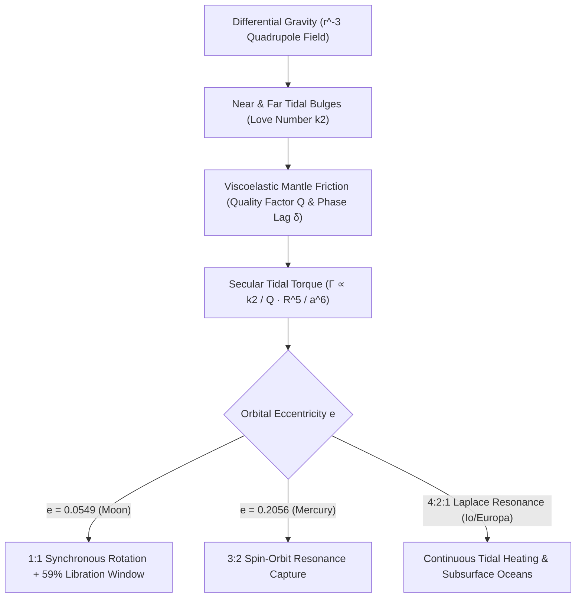

## 1. 서론 및 사중극자 조석장: 왜 조석력은 거리 세제곱($r^{-3}$)에 반비례하는가?

지구 어디에서 밤하늘을 올려다보더라도 우리는 항상 고요의 바다, 폭풍의 대양, 티코 크레이터가 있는 달의 앞면만을 보게 됩니다. 인류가 충돌구로 가득한 달의 뒷면을 처음 목격한 것은 1959년 소련의 루나 3호(Luna 3) 탐사선이 달 뒤편을 촬영해 전송했을 때였습니다. 달의 자전 주기($P_{\text{rot}} = 27.321661\,\text{일}$)와 지구 공전 항성월 주기($P_{\text{orb}} = 27.321661\,\text{일}$)가 백만분의 일 오차도 없이 정확히 $1:1$로 일치하는 현상은 우연이 아니라, 중력과 점탄성 변형, 열역학적 에너지 소산이 수억 년에 걸쳐 빚어낸 <strong>조석 고정(Tidal Locking / Synchronous Rotation)</strong>의 필연적 결과입니다.

뉴턴의 만유인력 법칙에 따르면 질량 $M$인 중심 천체가 거리 $r$에 위치한 위성(질량 $m$, 반지름 $R$)의 질량중심에 가하는 중력 가속도는 $g_0 = GM/r^2$입니다. 그러나 위성은 점질량이 아니라 직경 $2R$을 가진 확장된 구체입니다. 지구에 가장 가까운 달의 표면($r-R$)은 질량중심보다 더 강한 중력을 받고, 반대쪽 뒷면 표면($r+R$)은 더 약한 중력을 받습니다. 이항 급수 $(1 \mp R/r)^{-2} \approx 1 \pm 2(R/r)$를 전개하여 질량중심 가속도를 빼면, 앞면과 뒷면에서 나타나는 <strong>조석 가속도(Tidal Acceleration)</strong>는 각각 $+2GMR/r^3$(지구 방향)과 $-2GMR/r^3$(지구 반대 방향)이 됩니다. 르장드르 다항식 $P_\ell(\cos\theta)$을 이용해 중력 퍼텐셜 $\Phi(R,\theta) = -GM/s$를 다중극 전개하고 상수항($\ell=0$)과 궤도 가속도항($\ell=1$)을 소거하면, 천체의 타원체 변형을 지배하는 <strong>사중극자 조석 퍼텐셜(Quadrupole Tidal Potential, $\ell=2$)</strong>을 얻습니다:

$$
\mathbf{a}_{\text{tidal}}(R, \theta) = -\nabla V_{\text{tidal}} = -\nabla \left[ -\frac{G M R^2}{2 r^3} (3\cos^2\theta - 1) \right] = \frac{G M R}{r^3} \left[ (3\cos^2\theta - 1)\hat{\mathbf{e}}_R - 3\sin\theta\cos\theta\,\hat{\mathbf{e}}_\theta \right]
$$

---

## 2. 점탄성 변형, 러브 수 $k_2$, 위상 지연각 $\delta$ 및 $a^{-6}$ 조석 토크

사중극자 조석 퍼텐셜은 천체를 중심 연결선 축($\theta = 0, \pi$)을 따라 양쪽으로 늘리고 수직 적도면($\theta = \pi/2$)을 따라 압축하여, 앞면과 뒷면 양쪽에 대칭적인 <strong>이중 조석 팽대부(Tidal Bulges)</strong>를 형성합니다. 1909년 영국의 수학자 러브(A. E. H. Love)는 천체의 강성률 $\mu_{\text{shear}}$와 자체 중력에 의해 결정되는 무차원 응답 계수인 <strong>러브 수(Love Number) $k_2$</strong>를 도입했습니다($k_2 = \frac{3/2}{1 + 19\mu_{\text{shear}}/(2\rho g R)}$). 완전 강체는 $k_2 = 0$, 균질 유체구는 $k_2 = 1.5$이며, 현재 암석 달은 $k_2 \approx 0.0241$, 지구는 $k_2 \approx 0.299$입니다.

만약 달이 마찰 없는 이상적인 완전 탄성체라면, 조석 팽대부는 지구의 중력에 즉각 반응하여 지구-달 연결선 위에 정확히 정렬($\delta = 0$)되므로 대칭성에 의해 알짜 토크가 0($\Gamma = 0$)이 됩니다. 그러나 실제 암석 맨틀과 마그마는 <strong>점탄성(Viscoelasticity)</strong>과 내부 마찰(품질 인자 $Q$로 정의되며 주기당 소산 에너지 비율은 $Q^{-1} \approx \sin 2\delta$)을 갖습니다. 초기 달의 자전 각속도가 공전 각속도보다 빠를 때($\omega_{\text{rot}} > n$), 변형 응답의 시간 지연 $\Delta t$ 때문에 조석 팽대부는 지구-달 연결선보다 <strong>위상 지연각 $\delta$만큼 앞쪽으로 끌려가게 됩니다</strong>. 지구는 멀리 있는 뒷면 팽대부보다 가까운 앞면 팽대부를 더 강하게 뒤로 잡아당기므로, 궤도 긴반지름의 6제곱에 반비례($a^{-6}$)하는 강력한 <strong>영년 조석 감속 토크(Secular Tidal Torque)</strong>가 발생합니다:

$$
\Gamma = -\frac{3}{2} \frac{G M^2 R^5}{a^6} k_2 \sin(2\delta) \approx -\frac{3}{2} \frac{G M^2 R^5}{a^6} \left(\frac{k_2}{Q}\right) \operatorname{sgn}(\omega_{\text{rot}} - n), \qquad \tau_{\text{lock}} \approx \frac{2 \alpha \, \omega_0 \, m \, a^6 \, Q}{3 G M^2 k_2 R^3}
$$

---

## 3. 지구-달 각운동량 보존, 달의 후퇴, 그리고 칭동(59% 가시 면적의 비밀)

조석 토크가 $a^{-6}$에 비례하기 때문에, 약 45억 년 전 거대 충돌 파편 원반($a_0 \approx 4\text{–}10\,R_\oplus$)에서 탄생한 초기 달은 불과 $10^2\text{–}10^5$ 년 만에 $\omega_{\text{rot}} = n$인 $1:1$ 동기자전 상태로 고정되었습니다. 오늘날 달의 자전은 이미 잠겼지만, 지구의 빠른 자전($24$시간 주기)이 지구 해양과 맨틀의 조석 팽대부를 지구-달 연결선보다 약 $2.9^\circ$ 앞쪽으로 끌고 갑니다. 이 앞선 팽대부는 지구의 자전을 감속시켜 지구의 하루를 100년당 약 $+1.7\text{–}2.3\,\text{밀리초}$씩 길어지게 하는 동시에, 뉴턴의 제3법칙 반작용으로 달을 공전 진행 방향으로 가속시켜 지구의 자전 각운동량 $I_\oplus\Omega_\oplus$을 달의 궤도 각운동량 $m\sqrt{GM_\oplus a}$으로 이전시킵니다. 아폴로 임무가 달 표면에 설치한 반사경 배열을 이용한 <strong>달 레이저 거리 측정(LLR)</strong>은 달이 매년 $+3.82 \pm 0.07\,\text{cm}$씩 지구로부터 멀어지고 있음을 밀리미터 정밀도로 입증했습니다!

그렇다면 달이 $1:1$ 동기자전을 하는데도 왜 우리는 지구에서 달 표면의 $50\%$가 아닌 <strong>$59\%$를 볼 수 있을까요</strong>? 그 해답은 <strong>달의 칭동(Lunar Libration)</strong>에 있습니다. 달의 공전 궤도는 이심률 $e = 0.0549$인 타원이므로 케플러 제2법칙에 따라 근지점 부근에서는 공전 각속도 $\dot{f}(t)$가 평균 각속도 $n$보다 빠르고 원지점에서는 느린 반면, 달의 축 자전 속도 $\omega_{\text{rot}} = n$은 일정합니다. 이 속도 차이로 인해 동서 방향으로 최대 $\pm 7^\circ 54'$의 <strong>경도 칭동</strong>이 발생하며, 여기에 자전축과 궤도면 법선 사이의 $6^\circ 41'$ 기울기에 의한 <strong>위도 칭동</strong>과 지구 반지름 시차에 의한 $\pm 1^\circ$ <strong>일주 칭동</strong>이 더해져 달 전체 표면의 $59.0\%$가 지구 관측자에게 드러납니다:

$$
\Delta \phi_{\text{long}}(t) = f(t) - M(t) = 2 e \sin(n t) + \frac{5}{4} e^2 \sin(2 n t) + \mathcal{O}(e^3), \qquad \frac{\dot{f}_{\text{peri}}}{n} = \frac{\sqrt{1 - e^2}}{(1 - e)^2} \approx 1.5506 \approx \frac{3}{2}
$$

---

## 4. 수성의 3:2 자전-궤도 공명과 목성 갈릴레이 위성의 조석 가열

조석력을 받는 모든 천체가 $1:1$ 동기자전에 도달하는 것은 아닙니다. 1965년 아레시보 전파망원경의 도플러 레이더 관측은 수성의 자전 주기가 공전 주기($87.97$일)와 같은 것이 아니라 정확히 그 $\frac{2}{3}$인 <strong>$58.646$일($3:2$ 자전-궤도 공명)</strong>임을 밝혀내어 천문학계를 놀라게 했습니다! 골드라이히와 필(Goldreich & Peale, 1966)이 증명했듯, 이는 수성의 큰 궤도 이심률($e = 0.2056$) 때문입니다. 조석 토크는 $r^{-6}$에 비례하므로 근일점에서의 조석 작용은 원일점보다 $12.2$배나 강하며, 근일점에서의 순간 공전 각속도는 $\dot{f}_{\text{peri}}/n = (1-e^2)^{1/2}/(1-e)^2 \approx 1.5506 \approx 3/2$입니다. 따라서 수성이 $\omega_{\text{rot}} = 1.5n$으로 회전할 때 근일점 부근에서 태양에 대해 거의 정지 상태가 되며, 삼축 타원체 질량 비대칭성 $(B-A)/C$에 의한 복원 토크 $G(3/2, e) \approx \frac{7}{2}e$가 수성을 $3:2$ 공명 퍼텐셜 우물에 영구히 포획한 것입니다.

나아가 목성계의 이오(Io), 유로파(Europa), 가니메데(Ganymede)는 라플라스 <strong>$4:2:1$ 평균 운동 궤도 공명</strong>에 묶여 있습니다. 이웃 위성들의 주기적인 중력 섭동이 강제 이심률($e_{\text{Io}} = 0.0041$)을 지속적으로 유지시켜 궤도 원형화를 막고, 그 결과 $10^{14}\,\text{W}$에 달하는 막대한 <strong>조석 가열(Tidal Heating)</strong>을 발생시켜 이오의 격렬한 활화산 분출과 유로파·엔셀라두스의 얼음 지각 아래 액체 바다를 유지하는 핵심 에너지원이 됩니다.

| 천체 시스템 | 중심 천체 | 자전:궤도 공명비 | 궤도 이심률 $e$ | 핵심 천체역학 및 지구물리학적 결과 |
| :--- | :--- | :--- | :--- | :--- |
| <strong>달 (Moon)</strong> | 지구 | $1:1$ 동기자전 | $0.0549$ | 항상 같은 앞면 지향; 칭동으로 $59\%$ 표면 관측; 매년 $+3.82\,\text{cm}$ 후퇴 |
| <strong>수성 (Mercury)</strong> | 태양 | $3:2$ 자전-궤도 공명 | $0.2056$ | $P_{\text{rot}}=58.65\,\text{d}$; 수성의 태양일 하루는 수성년 2년($176$지구일)과 동일 |
| <strong>명왕성-카론</strong> | 상호 고정 | $1:1$ 이중 완전 고정 | $<0.0002$ | 모행성과 위성 모두 자전 주기가 공전 주기($6.387\,\text{d}$)와 일치하는 최종 평형 |
| <strong>이오 / 유로파</strong> | 목성 | $1:1$ 자전 + $4:2:1$ 궤도 | $0.0041$ | 라플라스 공명이 강제 이심률을 유지하여 이오의 화산과 유로파의 지하 바다 구동 |

$$
\dot{E}_{\text{ecc}} = \frac{21}{2} \frac{k_2}{Q} \frac{G M_J^2 R^5 n \, e^2}{a^6}, \qquad \frac{d}{dt}\left(I_\oplus \Omega_\oplus + m \sqrt{G M_\oplus a}\right) = 0
$$

