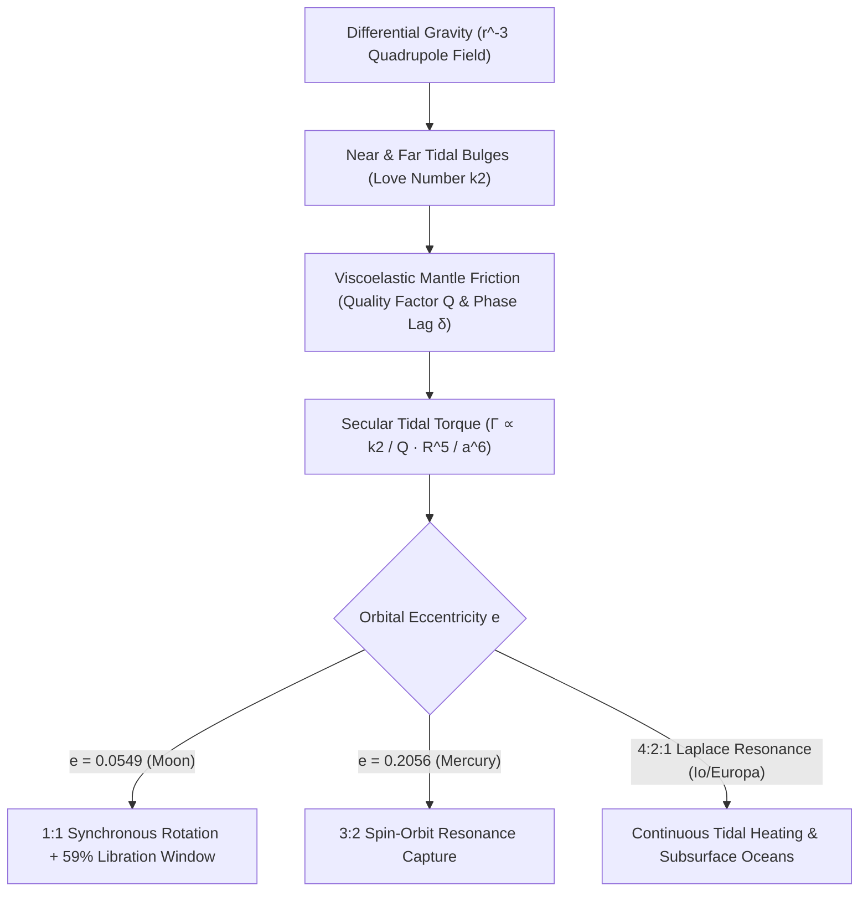

## 1. O campo de maré quadrupolar: por que a força de maré cai com $r^{-3}$?

De qualquer ponto da Terra, ao olharmos para a Lua no céu noturno, vemos sempre as mesmas planícies basálticas escuras (*maria*) de sua face visível; a humanidade só conheceu o lado oculto da Lua, repleto de crateras, em outubro de 1959, quando a sonda soviética *Luna 3* transmitiu as primeiras fotografias. O fato de o período de rotação da Lua em torno de seu eixo ($P_{\text{rot}} = 27,321661\,\text{dias}$) coincidir exatamente com seu período orbital sideral ao redor da Terra ($P_{\text{orb}} = 27,321661\,\text{dias}$) não é uma coincidência cósmica, mas o resultado físico inevitável da gravitação, da deformação viscoelástica e da dissipação termodinâmica: o <strong>acoplamento de maré ou rotação síncrona (Tidal Locking)</strong>.

Pela lei da gravitação universal de Newton, um corpo primário de massa $M$ exerce sobre o centro de massa de um satélite (massa $m$, raio $R$) à distância $r$ uma aceleração $g_0 = GM/r^2$ que mantém sua órbita. Contudo, como a Lua é um corpo extenso de diâmetro $2R \approx 3.474\,\text{km}$, o ponto mais próximo da Terra ($r-R$) sofre uma atração gravitacional maior que o centro, enquanto o ponto antípoda ($r+R$) sofre uma atração menor. Expandindo em série binomial $(1 \mp R/r)^{-2} \approx 1 \pm 2(R/r)$ e subtraindo $g_0$, obtemos uma <strong>aceleração de maré diferencial</strong> de $+2GMR/r^3$ (em direção à Terra) na face próxima e $-2GMR/r^3$ (afastando-se da Terra!) na face oculta. Expandindo o potencial gravitacional $\Phi(R,\theta) = -GM/s$ em polinômios de Legendre $P_\ell(\cos\theta)$ e subtraindo os termos $\ell=0$ e $\ell=1$, obtemos o <strong>potencial de maré quadrupolar ($\ell=2$)</strong>:

$$
\mathbf{a}_{\text{tidal}}(R, \theta) = -\nabla V_{\text{tidal}} = -\nabla \left[ -\frac{G M R^2}{2 r^3} (3\cos^2\theta - 1) \right] = \frac{G M R}{r^3} \left[ (3\cos^2\theta - 1)\hat{\mathbf{e}}_R - 3\sin\theta\cos\theta\,\hat{\mathbf{e}}_\theta \right]
$$

---

## 2. Deformação viscoelástica, números de Love $k_2$, defasagem $\delta$ e o torque em $a^{-6}$

Esse potencial quadrupolar estica o astro ao longo do eixo que une os centros ($	heta = 0, \pi$) e o comprime ao longo do anel equatorial perpendicular ($\theta = \pi/2$), gerando <strong>dois bojos de maré simétricos (Tidal Bulges)</strong> nas faces próxima e oposta. Em 1909, o matemático britânico Augustus Edward Hough Love introduziu o <strong>número de Love adimensional $k_2$</strong> para quantificar o potencial gravitacional adicional produzido pela massa redistribuída do bojo: $k_2 = \frac{3/2}{1 + 19\mu_{\text{shear}}/(2\rho g R)}$, onde $\mu_{\text{shear}}$ é o módulo de cisalhamento ($k_2 \approx 0,0241$ para a Lua sólida atual e $k_2 \approx 0,299$ para a Terra).

Se a Lua fosse perfeitamente elástica e sem atrito interno, seus bojos responderiam instantaneamente à gravidade terrestre alinhando-se sobre o eixo Terra–Lua ($\delta = 0$), resultando em torque líquido nulo ($\Gamma = 0$). Porém, o manto rochoso real é <strong>viscoelástico</strong>: o atrito interno (caracterizado pelo fator de qualidade $Q$, com dissipação por ciclo $Q^{-1} \approx \sin 2\delta$) introduz um atraso temporal $\Delta t$ entre a tensão de maré e a deformação. Quando a jovem Lua girava mais rápido que sua órbita ($\omega_{\text{rot}} > n$), sua rotação arrastava os bojos por <strong>um ângulo de defasagem $\delta$ à frente do eixo Terra–Lua</strong>. Como a Terra puxa com mais força o bojo próximo do que o distante, surge um <strong>torque de frenagem secular</strong> inversamente proporcional à <strong>sexta potência do semieixo maior ($a^{-6}$)</strong>:

$$
\Gamma = -\frac{3}{2} \frac{G M^2 R^5}{a^6} k_2 \sin(2\delta) \approx -\frac{3}{2} \frac{G M^2 R^5}{a^6} \left(\frac{k_2}{Q}\right) \operatorname{sgn}(\omega_{\text{rot}} - n), \qquad \tau_{\text{lock}} \approx \frac{2 \alpha \, \omega_0 \, m \, a^6 \, Q}{3 G M^2 k_2 R^3}
$$

---

## 3. Conservação do momento angular, recessão lunar e libração (59% de área visível)

Devido à extrema dependência em $a^{-6}$, a Lua primitiva, formada há $4,5\,\text{bilhões de anos}$ a pequena distância ($a_0 \approx 4\text{–}10\,R_\oplus$), teve sua rotação freada até o estado síncrono $1:1$ ($\omega_{\text{rot}} = n$) em apenas $10^2\text{–}10^5$ anos. Hoje, a rápida rotação da Terra ($24\,\text{h}$) arrasta os bojos oceânicos e mantélicos terrestres cerca de $\delta_\oplus \approx 2,9^\circ$ à frente da linha Terra–Lua. Esse bojo adiantado freia a rotação terrestre (aumentando a duração do dia em $+1,7\text{–}2,3\,\text{ms}$ por século) e, pela terceira lei de Newton, acelera a Lua em sua órbita, transferindo momento angular de rotação da Terra $I_\oplus\Omega_\oplus$ para o momento angular orbital da Lua $m\sqrt{GM_\oplus a}$. As medições de <strong>telemetria laser lunar (LLR)</strong> nos retrorrefletores das missões Apollo confirmam que a Lua se afasta da Terra a $+3,82 \pm 0,07\,\text{cm/ano}$!

Por que, apesar da sincronização $1:1$, conseguimos observar da Terra <strong>$59\%$ da superfície lunar</strong> em vez de $50\%$? Graças à <strong>libração lunar</strong>: enquanto a rotação axial da Lua ocorre com velocidade angular constante $\omega_{\text{rot}} = n$, sua velocidade angular orbital $\dot{f}(t)$ ao longo de sua órbita elíptica ($e = 0,0549$) varia segundo a segunda lei de Kepler. Essa diferença gera uma <strong>libração em longitude</strong> de até $\pm 7^\circ 54'$, que somada à <strong>libração em latitude</strong> ($\pm 6^\circ 41'$ pela inclinação axial e orbital) e à <strong>libração diurna paralática</strong> ($\pm 1^\circ$), revela $59,0\%$ do globo lunar:

$$
\Delta \phi_{\text{long}}(t) = f(t) - M(t) = 2 e \sin(n t) + \frac{5}{4} e^2 \sin(2 n t) + \mathcal{O}(e^3), \qquad \frac{\dot{f}_{\text{peri}}}{n} = \frac{\sqrt{1 - e^2}}{(1 - e)^2} \approx 1.5506 \approx \frac{3}{2}
$$

---

## 4. A ressonância spin-órbita 3:2 de Mercúrio e o aquecimento de maré em Júpiter

Nem todo corpo sujeito a marés termina em rotação $1:1$. Em 1965, observações de radar Doppler no radiotelescópio de Arecibo revelaram que Mercúrio gira em $P_{\text{rot}} = 58,646\,\text{dias}$, exatamente dois terços de seu período orbital de $87,969\,\text{dias}$ (uma <strong>ressonância spin-órbita $3:2$</strong>)! Goldreich e Peale (1966) demonstraram que isso decorre da alta excentricidade orbital de Mercúrio ($e = 0,2056$): como o torque de maré escala com $r^{-6}$, a ação solar no periélio é $12,2$ vezes mais intensa que no afélio, e a velocidade angular orbital instantânea no periélio é $\dot{f}_{\text{peri}}/n = (1-e^2)^{1/2}/(1-e)^2 \approx 1,5506 \approx 3/2$. Combinado ao torque restaurador triaxial $(B-A)/C$, Mercúrio foi permanentemente capturado no poço de ressonância $3:2$.

No sistema de Júpiter, a <strong>ressonância orbital de Laplace $4:2:1$</strong> entre Io, Europa e Ganimedes mantém uma excentricidade forçada ($e_{\text{Io}} = 0,0041$) que impede a circularização orbital e gera $10^{14}\,\text{W}$ de <strong>aquecimento de maré (Tidal Heating)</strong>, alimentando o vulcanismo extremo de Io e os oceanos líquidos subterrâneos sob a crosta de gelo de Europa e Encélado.

| Sistema / Astro | Corpo primário | Ressonância spin:órbita | Excentricidade $e$ | Consequência dinâmica e geofísica principal |
| :--- | :--- | :--- | :--- | :--- |
| <strong>Lua (Moon)</strong> | Terra | $1:1$ Síncrona | $0,0549$ | Mesma face visível; libração revela $59\%$; recessão de $+3,82\,\text{cm/ano}$ |
| <strong>Mercúrio (Mercury)</strong> | Sol | $3:2$ Spin-Órbita | $0,2056$ | $P_{\text{rot}}=58,65\,\text{d}$; um dia solar em Mercúrio dura $2$ anos mercurianos ($176\,\text{d}$) |
| <strong>Plutão e Caronte</strong> | Mútuo | $1:1$ Duplo bloqueio | $<0,0002$ | Equilíbrio de maré mútuo completo ($P_{\text{rot}}=P_{\text{orb}}=6,387\,\text{d}$) |
| <strong>Io / Europa</strong> | Júpiter | $1:1$ Spin + $4:2:1$ Laplace | $0,0041$ | Excentricidade forçada mantém vulcanismo de Io e oceano líquido de Europa |

$$
\dot{E}_{\text{ecc}} = \frac{21}{2} \frac{k_2}{Q} \frac{G M_J^2 R^5 n \, e^2}{a^6}, \qquad \frac{d}{dt}\left(I_\oplus \Omega_\oplus + m \sqrt{G M_\oplus a}\right) = 0
$$

