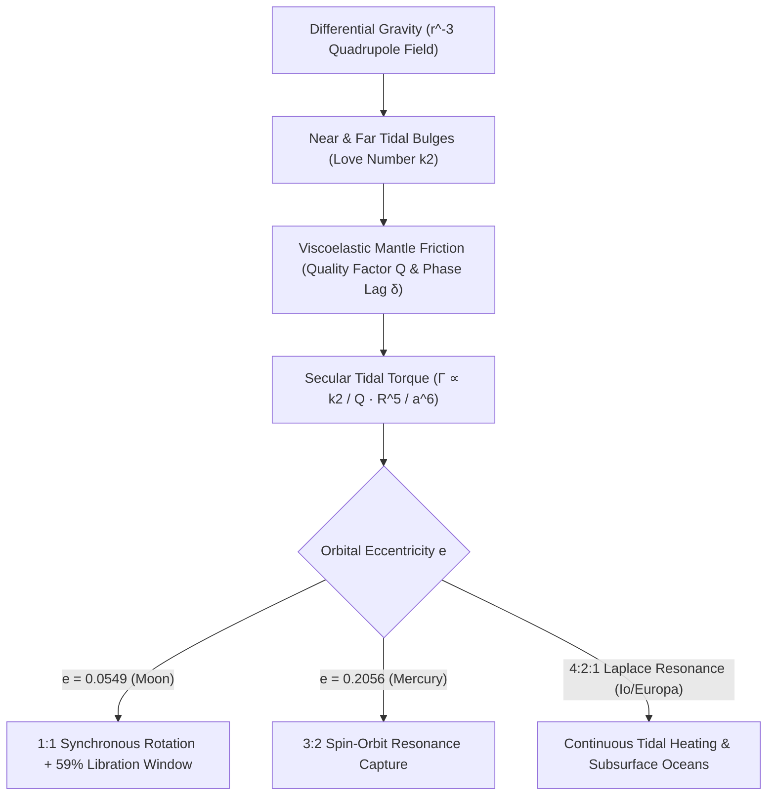

## 1. Квадрупольное приливное поле: почему приливная сила убывает как $r^{-3}$?

Из любой точки Земли, глядя на ночное небо, мы всегда видим одни и те же темные базальтовые равнины (*моря*) видимого полушария Луны; человечество впервые увидело покрытую кратерами обратную сторону Луны лишь в октябре 1959 года благодаря снимкам советской автоматической станции *«Луна-3»*. Тот факт, что период осевого вращения Луны ($P_{\text{rot}} = 27{,}321661\,\text{сут}$) с высочайшей точностью совпадает с сидерическим периодом ее обращения вокруг Земли ($P_{\text{orb}} = 27{,}321661\,\text{сут}$), — не космическая случайность, а неизбежный результат гравитации, вязкоупругой деформации и термодинамической диссипации энергии, называемый <strong>приливным захватом или синхронным вращением (Tidal Locking)</strong>.

Согласно закону всемирного тяготения Ньютона, центральное тело массы $M$ сообщает центру масс спутника (масса $m$, радиус $R$) на расстоянии $r$ ускорение $g_0 = GM/r^2$, удерживающее спутник на орбите. Однако Луна — протяженное тело диаметром $2R \approx 3474\,\text{км}$: ближайшая к Земле точка поверхности ($r-R$) притягивается сильнее центра масс, а противоположная точка ($r+R$) — слабее. Биномиальное разложение $(1 \mp R/r)^{-2} \approx 1 \pm 2(R/r)$ после вычитания $g_0$ дает дифференциальное <strong>приливное ускорение</strong> $+2GMR/r^3$ (к Земле) на ближней стороне и $-2GMR/r^3$ (от Земли!) на обратной стороне. Разлагая гравитационный потенциал $\Phi(R,\theta) = -GM/s$ по полиномам Лежандра $P_\ell(\cos\theta)$ и отбрасывая члены $\ell=0$ и $\ell=1$, получаем главный <strong>квадрупольный приливной потенциал ($\ell=2$)</strong>:

$$
\mathbf{a}_{\text{tidal}}(R, \theta) = -\nabla V_{\text{tidal}} = -\nabla \left[ -\frac{G M R^2}{2 r^3} (3\cos^2\theta - 1) \right] = \frac{G M R}{r^3} \left[ (3\cos^2\theta - 1)\hat{\mathbf{e}}_R - 3\sin\theta\cos\theta\,\hat{\mathbf{e}}_\theta \right]
$$

---

## 2. Вязкоупругая деформация, числа Лява $k_2$, фазовый сдвиг $\delta$ и момент сил $\propto a^{-6}$

Квадрупольный потенциал растягивает спутник вдоль линии центров ($	heta = 0, \pi$) и сжимает вдоль перпендикулярного экваториального кольца ($\theta = \pi/2$), формируя <strong>два симметричных приливных горба (Tidal Bulges)</strong> на ближней и дальней сторонах. В 1909 году британский математик Огастес Эдвард Хаф Ляв ввел безразмерное <strong>число Лява $k_2$</strong> для описания дополнительного гравитационного потенциала, создаваемого перераспределенной массой горба: $k_2 = \frac{3/2}{1 + 19\mu_{\text{shear}}/(2\rho g R)}$, где $\mu_{\text{shear}}$ — модуль сдвига ($k_2 \approx 0{,}0241$ для современной твердой Луны и $k_2 \approx 0{,}299$ для Земли).

Если бы Луна была идеально упругой и лишенной внутреннего трения, приливные горбы мгновенно выстраивались бы строго вдоль линии Земля–Луна ($\delta = 0$), и суммарный момент сил равнялся бы нулю ($\Gamma = 0$). Однако реальные породы мантии обладают <strong>вязкоупругостью</strong>: внутреннее трение (описываемое добротностью $Q$, где доля диссипируемой за цикл энергии равна $Q^{-1} \approx \sin 2\delta$) вызывает временное запаздывание деформации $\Delta t$. Когда молодая Луна вращалась быстрее своего орбитального движения ($\omega_{\text{rot}} > n$), ее вращение увлекало приливные горбы <strong>вперед относительно линии Земля–Луна на фазовый угол $\delta$</strong>. Поскольку Земля сильнее притягивает ближний горб, чем дальний, возникает тормозящий <strong>вековой приливной момент сил</strong>, обратно пропорциональный <strong>шестой степени большой полуоси ($a^{-6}$)</strong>:

$$
\Gamma = -\frac{3}{2} \frac{G M^2 R^5}{a^6} k_2 \sin(2\delta) \approx -\frac{3}{2} \frac{G M^2 R^5}{a^6} \left(\frac{k_2}{Q}\right) \operatorname{sgn}(\omega_{\text{rot}} - n), \qquad \tau_{\text{lock}} \approx \frac{2 \alpha \, \omega_0 \, m \, a^6 \, Q}{3 G M^2 k_2 R^3}
$$

---

## 3. Сохранение момента импульса, удаление Луны и либрация (почему мы видим 59% Луны)

Из-за колоссальной зависимости от расстояния $a^{-6}$ молодая Луна, сформировавшаяся $4{,}5\,\text{млрд лет назад}$ на близкой орбите ($a_0 \approx 4\text{–}10\,R_\oplus$), была заторможена до синхронного вращения $1:1$ ($\omega_{\text{rot}} = n$) всего за $10^2\text{–}10^5$ лет. Сегодня осевое вращение Луны синхронизировано, но быстрое суточное вращение Земли ($24\,\text{ч}$) увлекает океанические и мантийные приливные горбы самой Земли на угол $\delta_\oplus \approx 2{,}9^\circ$ вперед относительно линии Земля–Луна. Этот опережающий горб тормозит вращение Земли (удлиняя земные сутки на $+1{,}7\text{–}2{,}3\,\text{мс}$ за столетие) и по третьему закону Ньютона разгоняет Луну вдоль орбиты, передавая вращательный момент импульса Земли $I_\oplus\Omega_\oplus$ в орбитальный момент импульса Луны $m\sqrt{GM_\oplus a}$. <strong>Лазерная локация Луны (LLR)</strong> с помощью уголковых отражателей миссий «Аполлон» и «Луноход» с миллиметровой точностью подтверждает, что Луна удаляется от Земли со скоростью $+3{,}82 \pm 0{,}07\,\text{см/год}$!

Почему же, несмотря на синхронное вращение $1:1$, с Земли можно увидеть <strong>$59\%$ лунной поверхности</strong> вместо $50\%$? Причина кроется в <strong>либрации Луны</strong>: осевое вращение Луны происходит с постоянной угловой скоростью $\omega_{\text{rot}} = n$, тогда как орбитальная угловая скорость $\dot{f}(t)$ вдоль эллиптической орбиты ($e = 0{,}0549$) периодически меняется по второму закону Кеплера. Это порождает <strong>либрацию по долготе</strong> с амплитудой до $\pm 7^\circ 54'$, которая вместе с <strong>либрацией по широте</strong> ($\pm 6^\circ 41'$ из-за наклона оси и орбиты) и <strong>суточной параллактической либрацией</strong> ($\pm 1^\circ$) открывает земному наблюдателю $59{,}0\%$ поверхности Луны:

$$
\Delta \phi_{\text{long}}(t) = f(t) - M(t) = 2 e \sin(n t) + \frac{5}{4} e^2 \sin(2 n t) + \mathcal{O}(e^3), \qquad \frac{\dot{f}_{\text{peri}}}{n} = \frac{\sqrt{1 - e^2}}{(1 - e)^2} \approx 1.5506 \approx \frac{3}{2}
$$

---

## 4. Спин-орбитальный резонанс 3:2 Меркурия и приливной разогрев спутников Юпитера

Не каждое небесное тело под действием приливов переходит в состояние $1:1$. В 1965 году радиолокационные доплеровские измерения в обсерватории Аресибо показали, что период вращения Меркурия составляет $P_{\text{rot}} = 58{,}646\,\text{сут}$ — ровно две трети его орбитального периода $87{,}969\,\text{сут}$ (<strong>спин-орбитальный резонанс $3:2$</strong>)! Голдрайх и Пил (Goldreich & Peale, 1966) доказали, что это обусловлено высоким эксцентриситетом орбиты Меркурия ($e = 0{,}2056$): поскольку приливной момент зависит от расстояния как $r^{-6}$, в перигелии приливное воздействие Солнца в $12{,}2$ раза сильнее, чем в афелии, а мгновенная орбитальная угловая скорость в перигелии равна $\dot{f}_{\text{peri}}/n = (1-e^2)^{1/2}/(1-e)^2 \approx 1{,}5506 \approx 3/2$. В сочетании с трехосной асимметрией формы $(B-A)/C$ это навсегда захватило Меркурий в резонансную потенциальную яму $3:2$.

В системе Юпитера <strong>орбитальный резонанс Лапласа $4:2:1$</strong> между Ио, Европой и Ганимедом поддерживает вынужденный эксцентриситет ($e_{\text{Io}} = 0{,}0041$), препятствуя скруглению орбит и выделяя $10^{14}\,\text{Вт}$ тепловой мощности за счет <strong>приливного разогрева (Tidal Heating)</strong>, что питает мощнейший вулканизм Ио и поддерживает подледные жидкие океаны Европы и Энцелада.

| Система / Тело | Центральное тело | Спин:орбитальный резонанс | Эксцентриситет $e$ | Ключевое динамическое и геофизическое следствие |
| :--- | :--- | :--- | :--- | :--- |
| <strong>Луна (Moon)</strong> | Земля | $1:1$ Синхронное вращение | $0{,}0549$ | Видна одна сторона; либрация открывает $59\%$; удаление $+3{,}82\,\text{см/год}$ |
| <strong>Меркурий (Mercury)</strong> | Солнце | $3:2$ Спин-орбитальный | $0{,}2056$ | $P_{\text{rot}}=58{,}65\,\text{сут}$; солнечные сутки на Меркурии длятся $2$ меркурианских года ($176\,\text{сут}$) |
| <strong>Плутон и Харон</strong> | Взаимный захват | $1:1$ Двойная синхронизация | $<0{,}0002$ | Полное взаимное приливное равновесие обоих тел ($P_{\text{rot}}=P_{\text{orb}}=6{,}387\,\text{сут}$) |
| <strong>Ио / Европа</strong> | Юпитер | $1:1$ Спин + $4:2:1$ Лаплас | $0{,}0041$ | Вынужденный эксцентриситет питает вулканизм Ио и подледный океан Европы |

$$
\dot{E}_{\text{ecc}} = \frac{21}{2} \frac{k_2}{Q} \frac{G M_J^2 R^5 n \, e^2}{a^6}, \qquad \frac{d}{dt}\left(I_\oplus \Omega_\oplus + m \sqrt{G M_\oplus a}\right) = 0
$$

